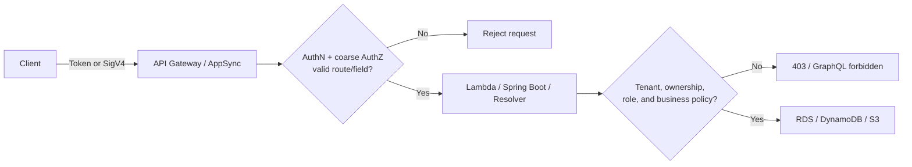
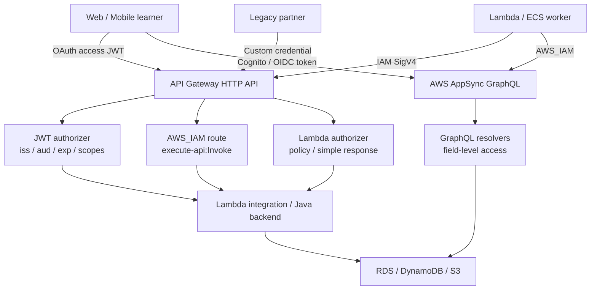
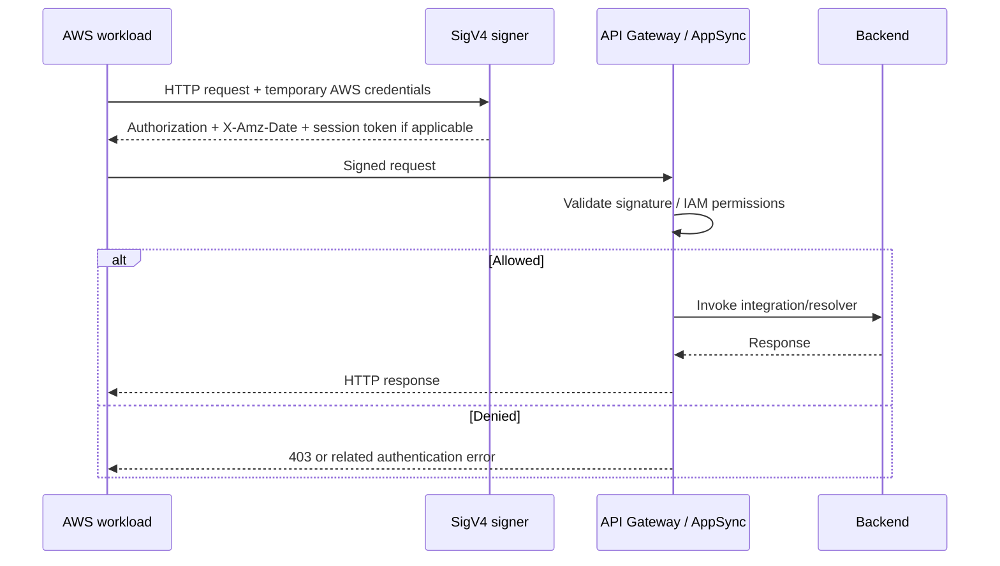
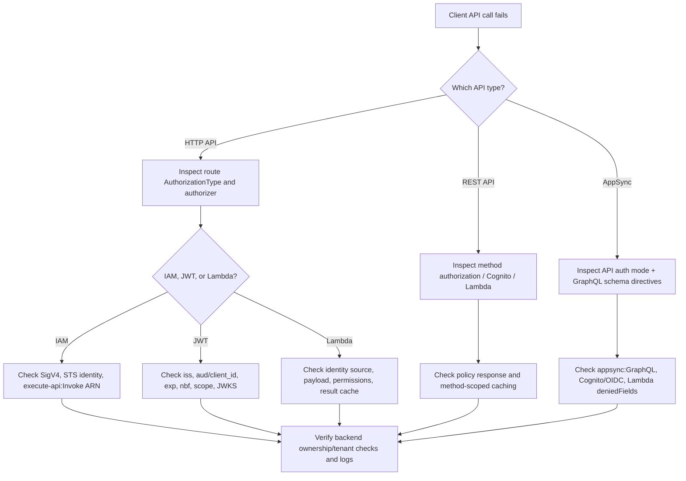

# IAM Authorization, JWT Authorizers, and Lambda Authorizers

> **Module:** CLOUD_PROVIDERS_AWS  
> **Chapter:** API Gateway and AppSync  
> **Lesson:** IAM Authorization, JWT Authorizers, and Lambda Authorizers  
> **Context:** Building secure APIs on AWS using IAM, Amazon Cognito, OAuth 2.0/OpenID Connect (OIDC), AWS Lambda, and Amazon API Gateway or AWS AppSync.

## 1. Why Does an API Need Multiple Authorization Mechanisms?

A Java/Spring Boot learning platform on AWS exposes several APIs:

- **Student** web/mobile apps call `GET /courses` and `POST /enrollments`.
- A backend **reporting Lambda** calls `POST /internal/reports`.
- Administrators use an internal app to access reports containing sensitive data.
- A GraphQL frontend reads the course catalog and updates student profiles via **AWS AppSync**.
- Partners integrate with a custom entitlement system that does not use AWS IAM or a standard JWT provider.

All five cases require **identity verification** and **deciding whether an action is allowed**, yet they do not necessarily use the same mechanism.

Typical options:

1. **IAM authorization:** Callers use an IAM identity and sign requests with **AWS Signature Version 4 (SigV4)**; ideal for service-to-service communication and AWS workloads.
2. **JWT authorizer:** API Gateway **HTTP API** validates JWTs issued by an identity provider based on signature and claims such as issuer, audience, expiration, and scopes.
3. **Lambda authorizer:** A Lambda function executes custom authorization logic, such as evaluating partner entitlements, tenant mappings, or internal rules.
4. **AppSync GraphQL:** Uses its own **authorization modes**—`AWS_IAM`, `AMAZON_COGNITO_USER_POOLS`, `OPENID_CONNECT`, and `AWS_LAMBDA`—which can be combined to restrict access per schema field.

### After This Lesson, You Will Be Able To

- Distinguish **authentication** from **authorization**, as well as identity, role, claim, scope, and policy.
- Choose the right authorizer when deploying **API Gateway HTTP API**, **REST API**, or **AppSync GraphQL**.
- Write least-privilege IAM policies for `execute-api:Invoke` and `appsync:GraphQL`.
- Configure a JWT authorizer with `issuer`, `audience`, and `authorizationScopes`.
- Build a Lambda authorizer, understanding v1.0/v2.0 payloads, simple responses, policy responses, and cache keys.
- Understand AppSync field-level authorization, multi-auth directives, and Lambda `deniedFields`.
- Structure Java/Spring Boot backends to enforce **object- and tenant-level** access control instead of blindly trusting that a request passed the gateway.
- Test 401/403 responses, latency, logging, costs, and how to fix misconfigured security settings.

## 2. Two Layers of Security: Authentication and Authorization

**Authentication (AuthN)** answers: *Who is the caller, or what identity do they hold?*

**Authorization (AuthZ)** answers: *Is this authenticated identity allowed to perform this action on this resource?*

Example:

```text
Student A is logged in -> authentication succeeds (AuthN).
Student A requests Student B's grades ->
  must be denied if unauthorized (AuthZ),
  even though A's access token is valid and unexpired.
```

A gateway authorizer can enforce **route-level access**, but a business API still needs **object-level authorization**:



If you only verify that a token is valid without checking which tenant owns `reportId`, the API is vulnerable to **Broken Object Level Authorization (BOLA/IDOR)**.

### 2.1. Essential Terminology

| Term | Meaning | Example |
|---|---|---|
| Principal | Entity calling an API or evaluated by AWS permissions. | IAM role, user, assumed-role session |
| Credential | Data proving identity. | Temporary AWS credentials, JWT |
| Claim | Key-value attribute inside a JWT. | `iss`, `aud`, `sub`, `exp` |
| Scope | OAuth permission, typically at the API operation level. | `courses:read`, `enrollments:write` |
| IAM policy | Set of Allow/Deny statements specifying actions and resources. | `execute-api:Invoke` on a specific route |
| Authorizer | Component evaluating a request before the integration/resolver runs. | JWT or Lambda authorizer |
| Integration | Backend behind API Gateway. | Lambda, HTTP service, ALB/VPC Link |
| Resolver | Logic executing a field in AppSync GraphQL. | DynamoDB query, Lambda |

**An API key is not user authentication.** API Gateway REST usage plans/API keys are meant for client identification and usage/throttling governance, not full authentication/authorization. AppSync `API_KEY` is a basic authorization mode that does not prove user identity like OIDC or IAM.

## 3. Before Configuring: HTTP API vs. REST API vs. AppSync

Their names look similar, yet **they do not share the same authorizer types**.

| Platform | Mechanisms covered in this lesson | Key point to remember |
|---|---|---|
| **API Gateway HTTP API (v2)** | `NONE`, `AWS_IAM`, `JWT`, `CUSTOM` (Lambda) | Includes a **native JWT authorizer** configured with issuer/audience/scopes. |
| **API Gateway REST API (v1)** | `NONE`, `AWS_IAM`, `COGNITO_USER_POOLS`, `CUSTOM` (Lambda) | Does not have a native `JWT` authorizer type like HTTP API; uses Cognito User Pools or Lambda authorizers as appropriate. |
| **AWS AppSync GraphQL API** | `AWS_IAM`, `AMAZON_COGNITO_USER_POOLS`, `OPENID_CONNECT`, `AWS_LAMBDA`, `API_KEY` | Evaluates **GraphQL schema fields/types** using authorization modes and directives; does not use API Gateway route JWT configurations. |

A CloudFormation snippet `AWS::ApiGatewayV2::Authorizer` with `AuthorizerType: JWT` **belongs exclusively to HTTP API**; never copy it into REST API `AWS::ApiGateway::Authorizer` or AWS AppSync.

### 3.1. What Granularity Does Each Platform Enforce?

- **HTTP API:** Authorization attaches to a **route**, such as `GET /courses` or `POST /enrollments`.
- **REST API:** Authorization attaches to a **method** under a resource, such as `GET` on `/courses/{id}`.
- **AppSync GraphQL:** Authorization attaches to the **API authorization mode**, **schema types/fields**, and resolver logic.

In GraphQL, a single HTTP request to `/graphql` can query multiple fields; inspecting only the HTTP route without **schema field permissions** is insufficient.

## 4. Reference Architecture for the Online Learning Platform



This is a **conceptual diagram**: each HTTP API route uses the authorization type appropriate for it; a single request is not sequentially checked by all three authorizers on the same route. Internal systems must define which **client types** and **credential types** are permitted on each route.

Sample convention:

| API operation | Caller | Recommended authorization |
|---|---|---|
| `GET /courses` | Logged-in student | HTTP API JWT + scope `courses:read` |
| `POST /enrollments` | Logged-in student | HTTP API JWT + scope `enrollments:write`; backend verifies user/tenant |
| `POST /internal/reports` | Lambda, ECS task role | HTTP API `AWS_IAM` + scoped `execute-api:Invoke` |
| `POST /partners/import` | Partner system with custom entitlements | Lambda authorizer + backend ownership check |
| `Query.myCourses` | GraphQL student | AppSync `AMAZON_COGNITO_USER_POOLS` or `OPENID_CONNECT` |
| `Query.internalMetrics` | AWS system | AppSync `AWS_IAM` |

## 5. IAM Authorization: How SigV4 Works

With **IAM authorization**, the caller uses an authorized **IAM identity/role session** and signs the HTTP request using **AWS Signature Version 4**.

Basic flow:

1. A backend Lambda/EC2/ECS task or client holds temporary AWS credentials for a role.
2. The AWS SDK or signer computes a signature over the HTTP request using those credentials.
3. API Gateway or AppSync verifies the signature and identifies the principal.
4. AWS evaluates IAM permissions and applicable policies; the request runs only if permitted.
5. The backend/resolver **still** performs business authorization when resources belong to specific users or tenants.



**Do not confuse SigV4 with JWT:** A SigV4 `Authorization` header carries AWS signature parameters, not `Bearer eyJ...`. A JWT/OIDC authorizer will not treat an AWS signature as an access token.

### 5.1. IAM Policy for API Gateway

For API Gateway, the IAM action used to invoke an API method or route is:

```text
execute-api:Invoke
```

**Least-privilege** example: allow an IAM role to call only `POST /internal/reports` on API `abc123def4`, stage `prod`, in `ap-southeast-1`:

```json
{
  "Version": "2012-10-17",
  "Statement": [
    {
      "Sid": "InvokeInternalReportsOnly",
      "Effect": "Allow",
      "Action": "execute-api:Invoke",
      "Resource": "arn:aws:execute-api:ap-southeast-1:123456789012:abc123def4/prod/POST/internal/reports"
    }
  ]
}
```

ARN structure:

```text
arn:aws:execute-api:{region}:{account}:{api-id}/{stage}/{method}/{resource-path}
```

If the stage is `$default`, the stage segment in the ARN must literally be `$default`—do not substitute `prod` out of habit. Likewise, never grant `Resource: "*"` when only one route is needed.

**Note:** REST API supports **resource policies**, IAM, VPC endpoint policies, and related conditions when configured. **HTTP API does not currently support API Gateway resource policies** per AWS documentation; do not instruct teams to attach a REST resource policy to an HTTP API to block IPs.

### 5.2. Enabling IAM on an HTTP API Route

In the API Gateway Console:

1. Select your **HTTP API**.
2. Open **Routes** and select `POST /internal/reports`.
3. Open **Authorization**.
4. Choose **`AWS_IAM`**.
5. Save and verify the route shows the expected authorization; verify deployment/stage configuration per your API setup.

AWS CLI:

```bash
aws apigatewayv2 update-route \
  --api-id abc123def4 \
  --route-id route-id-from-console-or-list-routes \
  --authorization-type AWS_IAM \
  --region ap-southeast-1
```

This is a **permission-changing operation** that can break existing clients. Never enable IAM on a Production route before confirming callers have SigV4 signing and the required IAM policies in place.

### 5.3. IAM Policy for AppSync GraphQL

AppSync GraphQL offers the `AWS_IAM` authorization mode. Callers sign requests to the GraphQL endpoint with SigV4 and require the action:

```text
appsync:GraphQL
```

Example policy allowing queries only on the `getCourse` field of type `Query`:

```json
{
  "Version": "2012-10-17",
  "Statement": [
    {
      "Sid": "ReadGetCourseField",
      "Effect": "Allow",
      "Action": "appsync:GraphQL",
      "Resource": "arn:aws:appsync:ap-southeast-1:123456789012:apis/graphqlexample123/types/Query/fields/getCourse"
    }
  ]
}
```

AppSync uses field-level ARNs structured as `apis/{api-id}/types/{type}/fields/{field}`. To allow multiple operations, list each field explicitly or use carefully scoped wildcards.

**Key difference:** The IAM action `appsync:GraphQL` is **not** `execute-api:Invoke`. Never copy an API Gateway IAM policy to AppSync and expect it to grant access.

### 5.4. Temporary Credentials and IAM Roles

Prefer IAM roles over long-lived IAM user access keys:

| Workload | How credentials are obtained |
|---|---|
| AWS Lambda | Function **execution role** |
| ECS/Fargate | ECS **task role** |
| Amazon EC2 | **Instance profile role** |
| Local developer | IAM Identity Center or assumed role via CLI profile |
| Browser/mobile needing IAM | Amazon Cognito Identity Pools / appropriate federation; **never embed long-lived IAM access keys** |

If clients do not hold IAM identities but have OAuth/OIDC access tokens, a **JWT authorizer** is usually much more natural. Never exchange a web user token for a long-lived access key stored directly in the browser.

## 6. JWT Authorizers: Native to API Gateway HTTP API

A **JWT** (*JSON Web Token*) consists of three Base64URL-encoded segments:

```text
base64url(header).base64url(payload).base64url(signature)
```

Token contents can be read after decoding; **JWTs are signed by default, not encrypted for confidentiality**. Never put passwords, API keys, or sensitive data into JWT claims merely because the token is signed.

### 6.1. Important Claims

Abbreviated **illustrative payload** (not a valid usable token):

```json
{
  "iss": "https://id.example.com/tenant-a",
  "sub": "user-17",
  "aud": "course-api",
  "exp": 1795000000,
  "nbf": 1794900000,
  "iat": 1794900000,
  "scope": "courses:read enrollments:write",
  "tenant_id": "school-01"
}
```

| Claim | Meaning | Check |
|---|---|---|
| `iss` | Issuer that minted the JWT | Must match configured issuer |
| `aud` | Intended audience for the token | Must match one of the authorizer's audiences |
| `client_id` | OAuth client identifier | Checked against audience by API Gateway **only when `aud` is absent** |
| `exp` | Expiration time (Unix epoch seconds) | Token must not be expired |
| `nbf` | Not-before timestamp | Current time must be past this boundary |
| `iat` | Issued-at timestamp | Evaluated per JWT authorizer rules |
| `sub` | Subject of the token | Identifies the user; not a permissions list |
| `scope` or `scp` | Granted scopes | Used for route-level authorization |
| `kid` (header) | Signing key ID | Must match a key in the JWKS |

**A JWT authorizer must verify the signature**, not just decode the payload. An attacker can forge a token with `"scope": "admin"`, and an invalid signature must be rejected.

### 6.2. Native Verification Flow in HTTP API

Per AWS documentation, the API Gateway HTTP API JWT authorizer:

1. Reads the token from `identitySource`, typically `$request.header.Authorization`.
2. Accepts either the raw token value or a value prefixed with `Bearer`.
3. Fetches public keys from the issuer's JWKS endpoint and verifies the signature; as documented, HTTP API JWT authorizers support **RSA-based signing algorithms**.
4. Validates `kid`, `iss`, `aud` (or `client_id` when `aud` is absent), `exp`, `nbf`, and `iat`.
5. If the route configures `authorizationScopes`, requires the token to include **at least one** matching scope.
6. Forwards the request to the integration only when all checks pass.

API Gateway caches public keys for **up to roughly two hours on a best-effort basis**. When rotating signing keys on an identity provider, keep an overlap window between old and new keys so valid tokens in flight do not break.

### 6.3. Access Token or ID Token?

An **access token** is normally issued for an API/resource server and carries scopes.

An **ID token** proves to the client app that the user authenticated and is **not generally intended for calling APIs**. Because there is no single universal standard separating all JWT access and ID tokens, AWS recommends configuring **route scopes** when using HTTP API JWT authorizers unless your use case genuinely requires an ID token.

Example:

```text
GET /courses            requires courses:read
POST /enrollments        requires enrollments:write
DELETE /admin/course/42  requires courses:admin
```

If a route specifies multiple scopes, API Gateway only requires **at least one matching scope**; if you need two conditions simultaneously (e.g., both `tenant:school-01` and `courses:admin`), do not assume listing multiple scopes creates an `AND` rule. Enforce extra conditions in the backend, define a dedicated combined scope, or use a Lambda authorizer when needed.

### 6.4. A JWT Does Not Prove Resource Ownership

A valid token carrying `courses:read` does not prove a student can read **every private course** or another tenant's report.

Example request:

```text
GET /students/user-999/grades
Authorization: Bearer <valid access token for user-17>
```

The JWT authorizer may allow the route because the token is valid and holds the required scope, yet the backend must verify:

- Who is `sub=user-17`?
- Is `user-17` permitted to read `user-999`'s grades?
- Does the grade's tenant match the caller's tenant?
- Does the caller have an instructor or admin role where required?

**Reject unauthorized ownership in the backend** even after the JWT passes the gateway.

## 7. Configuring a JWT Authorizer on HTTP API

### 7.1. Setting Up the Identity Provider / Identifying the Issuer

A JWT authorizer requires:

- The **Issuer URL** of a trusted token issuer.
- An **Audience list** identifying allowed APIs or clients.
- A **JWKS** endpoint exposing public keys for signature validation.
- A flow that issues **access tokens** to clients.
- Scopes defined in the authorization server and granted properly in tokens.

For an Amazon Cognito User Pool, the issuer typically looks like:

```text
https://cognito-idp.ap-southeast-1.amazonaws.com/ap-southeast-1_EXAMPLE
```

This URL is an example; replace it with your real User Pool and inspect actual tokens for `iss` and `client_id`/`aud`. Cognito access tokens commonly use `client_id`, whereas ID tokens commonly use `aud`. Your configured audience must match the token type you intend to accept.

### 7.2. Console

1. Open **API Gateway → select your HTTP API → Authorization**.
2. Under **Manage authorizers**, create a **JWT authorizer**.
3. Set **Identity source** = `$request.header.Authorization`.
4. Enter the **Issuer** and approved **Audiences**.
5. Attach the JWT authorizer to `GET /courses`.
6. Add authorization scope `courses:read` on the route.
7. Save and confirm the active deployment/stage reflects the change.
8. Test with a valid token, a token missing the scope, a wrong-audience token, and an expired token.

### 7.3. AWS CLI with JSON Input

Create `jwt-authorizer.json` on your deployment machine:

```json
{
  "ApiId": "abc123def4",
  "Name": "course-jwt",
  "AuthorizerType": "JWT",
  "IdentitySource": [
    "$request.header.Authorization"
  ],
  "JwtConfiguration": {
    "Audience": [
      "course-api"
    ],
    "Issuer": "https://id.example.com/tenant-a"
  }
}
```

Then run:

```bash
aws apigatewayv2 create-authorizer \
  --cli-input-json file://jwt-authorizer.json \
  --region ap-southeast-1
```

Record the real `AuthorizerId` from the output, then attach the authorizer to the target route:

```bash
aws apigatewayv2 update-route \
  --api-id abc123def4 \
  --route-id route-id-from-list-routes \
  --authorization-type JWT \
  --authorizer-id authorizer-id-from-create \
  --authorization-scopes courses:read \
  --region ap-southeast-1
```

**Do not assume** `course-api` or the sample issuer URL are valid in your account; they must match your real identity provider.

Inspect the configuration:

```bash
aws apigatewayv2 get-authorizers \
  --api-id abc123def4 \
  --region ap-southeast-1

aws apigatewayv2 get-routes \
  --api-id abc123def4 \
  --region ap-southeast-1
```

**Caution:** Changing an authorizer on a live route can immediately break all clients lacking matching tokens or claims. Use a staging environment and prepare a rollback plan.

## 8. Lambda Authorizers: Custom Logic on API Gateway

A **Lambda authorizer** lets API Gateway invoke a Lambda function before calling the backend integration. Lambda can validate **opaque tokens**, check entitlements in a custom store, resolve tenant mappings, or enforce policies unsupported by native JWT authorizers.

### 8.1. When Do You Need a Lambda Authorizer?

Examples:

- Partners send opaque tokens that must be looked up in an internal IAM/entitlement service.
- Routes require combining multiple business conditions.
- You need allowlist/denylist or account-status checks from a custom system.
- Authorization depends on multiple identity sources, such as an `Authorization` header plus another verified request attribute.

**Do not use a Lambda authorizer merely to reimplement RS256/JWKS validation** if HTTP API's native JWT authorizer already meets your needs. Rolling your own token validator increases security risk, latency, and cost unnecessarily.

### 8.2. HTTP API Payloads v1.0 and v2.0

HTTP API Lambda authorizers support:

| Payload version | Key input fields | Expected output |
|---|---|---|
| `1.0` | Includes `methodArn`; structure compatible with REST REQUEST format | **IAM policy response** containing `principalId` and `policyDocument` |
| `2.0` | Includes `routeArn`, `routeKey`, headers, `requestContext` | **Simple response** `isAuthorized` when simple responses are enabled; or IAM policy response |

**Do not confuse** a Lambda authorizer with a Lambda **proxy integration**. An authorizer returns an *access decision*; an integration executes business logic and returns `statusCode`/`body`.

Abbreviated HTTP API v2.0 authorizer request example:

```json
{
  "version": "2.0",
  "type": "REQUEST",
  "routeArn": "arn:aws:execute-api:ap-southeast-1:123456789012:abc123def4/prod/POST/partners/import",
  "routeKey": "POST /partners/import",
  "identitySource": [
    "Bearer sample-token"
  ],
  "headers": {
    "authorization": "Bearer sample-token"
  },
  "requestContext": {
    "apiId": "abc123def4",
    "stage": "prod"
  }
}
```

### 8.3. Simple Response: Allow/Deny

When an authorizer is created with `AuthorizerPayloadFormatVersion=2.0` and `EnableSimpleResponses=true`, Lambda can return:

```json
{
  "isAuthorized": true,
  "context": {
    "partnerId": "partner-17",
    "plan": "standard"
  }
}
```

To deny:

```json
{
  "isAuthorized": false,
  "context": {
    "reason": "not_entitled"
  }
}
```

**Never put secrets or raw tokens into `context`.** Context values can be forwarded to integrations or access logs and are subject to format and size limits. In v2.0, AWS supports context types per current documentation; keep context minimal, such as a non-sensitive `partnerId`.

### 8.4. IAM Policy Response

For logic requiring **route/method-level restrictions**, you can configure the authorizer to return an IAM policy instead of a simple boolean:

```json
{
  "principalId": "partner-17",
  "policyDocument": {
    "Version": "2012-10-17",
    "Statement": [
      {
        "Action": "execute-api:Invoke",
        "Effect": "Allow",
        "Resource": "arn:aws:execute-api:ap-southeast-1:123456789012:abc123def4/prod/POST/partners/import"
      }
    ]
  },
  "context": {
    "partnerId": "partner-17"
  }
}
```

When `AuthorizerPayloadFormatVersion=1.0`, you must return a policy with `principalId`. HTTP API 2.0 can also return an IAM policy when simple responses are disabled. For **REST API Lambda authorizers**, responses are IAM-policy-based, not the HTTP API 2.0 `isAuthorized` boolean.

### 8.5. Identity Sources and `401` Before Lambda

An HTTP API Lambda authorizer can configure identity sources:

```text
$request.header.Authorization
$request.querystring.tenant
$context.routeKey
```

When the authorizer requires identity sources and a request is missing any of them, API Gateway can reject the request with **`401`** before invoking Lambda. This saves Lambda invocations, though you must verify header names, casing, and how clients send tokens.

**Never trust a `tenant` query parameter as proof of identity.** Even if `tenant` is part of the cache key or input, the authorizer must verify that the caller **is actually authorized for that tenant**. Clients can freely change `tenant=school-02` unless checked.

## 9. Lambda Authorizer Caching Risks and Mitigations

**Caching** reduces Lambda invocation latency and cost, but it is a frequent source of authorization bugs.

### 9.1. HTTP API Cache Keys Rely on Identity Sources

For HTTP API Lambda authorizers:

- `AuthorizerResultTtlInSeconds` controls caching; `0` disables caching.
- Identity sources form the **cache key**.
- When **simple responses** are enabled, a cached `isAuthorized: true` result applies to **every route matching the same cache key** protected by that authorizer.
- If the same token calls route A and route B while the cache key contains only the token, an Allow decision from A can be reused for B without re-running route-specific logic.

**Example vulnerability:**

```text
Token T is allowed on:
  GET /courses

Token T is NOT allowed on:
  DELETE /courses/42

Authorizer returns isAuthorized=true on GET.
Cache key = Authorization header only.

DELETE /courses/42 uses the same authorizer and same token.
=> Risk of reusing the GET allow decision for DELETE.
```

**How to fix it:**

1. If decisions vary by route, include **`$context.routeKey`** in the identity sources used as the cache key.
2. Or **disable simple responses** and return an IAM policy whose `Resource` ARN scopes strictly to the allowed route/method.
3. Or set `AuthorizerResultTtlInSeconds=0` to disable caching when required.
4. Keep backend object-level permission checks independent of gateway caching.

Better identity sources example:

```json
{
  "IdentitySource": [
    "$request.header.Authorization",
    "$context.routeKey"
  ],
  "AuthorizerResultTtlInSeconds": 60
}
```

With `$context.routeKey` in the cache key, a decision for `GET /courses` will not apply to `DELETE /courses/{id}`. However, it still **does not distinguish individual object IDs** inside a parameterized route. When permissions vary by ID or tenant, use policy responses, disable caching, or enforce checks in the backend.

### 9.2. TTL Creates Delayed Revocation Risk

When a partner is suspended, a cached Allow result can remain valid until the TTL expires. Long TTLs suit stable permissions but fail **immediate revocation** requirements.

- Choose TTLs based on **permission volatility and risk tolerance**.
- Compare token expiration against cache TTL.
- Plan explicit revocation strategies (shorter TTLs or disabled caching).
- Never assume updating a database permission immediately invalidates all gateway caches.

For **REST API REQUEST authorizers**, caching also keys on identity sources; if a policy returned for one method only Allows that specific method ARN, subsequent calls to another method using the same cached entry can be unexpectedly denied. Design policy `Resource` ARNs and caching strategies carefully together.

## 10. Deploying an HTTP API Lambda Authorizer with CLI and Java

### 10.1. Authorizer Configuration

Prepare a deployed AWS Lambda function `course-partner-authorizer` with an execution role.

Illustrative `lambda-authorizer.json`:

```json
{
  "ApiId": "abc123def4",
  "Name": "course-partner-auth",
  "AuthorizerType": "REQUEST",
  "IdentitySource": [
    "$request.header.Authorization",
    "$context.routeKey"
  ],
  "AuthorizerUri": "arn:aws:apigateway:ap-southeast-1:lambda:path/2015-03-31/functions/arn:aws:lambda:ap-southeast-1:123456789012:function:course-partner-authorizer/invocations",
  "AuthorizerPayloadFormatVersion": "2.0",
  "EnableSimpleResponses": true,
  "AuthorizerResultTtlInSeconds": 60
}
```

Create it:

```bash
aws apigatewayv2 create-authorizer \
  --cli-input-json file://lambda-authorizer.json \
  --region ap-southeast-1
```

**You must grant API Gateway permission to invoke the Lambda authorizer** via a Lambda resource-based policy or an appropriate IAM authorizer role. Example:

```bash
aws lambda add-permission \
  --function-name course-partner-authorizer \
  --statement-id allow-apigateway-authorizer \
  --action lambda:InvokeFunction \
  --principal apigateway.amazonaws.com \
  --source-arn 'arn:aws:execute-api:ap-southeast-1:123456789012:abc123def4/authorizers/*' \
  --region ap-southeast-1
```

The ARN above is a sample; verify the exact source ARN for your authorizer. Attach the authorizer to an existing route:

```bash
aws apigatewayv2 update-route \
  --api-id abc123def4 \
  --route-id route-id-for-partners-import \
  --authorization-type CUSTOM \
  --authorizer-id authorizer-id-from-create \
  --region ap-southeast-1
```

If using API Gateway REST API, create a **REST Lambda authorizer** via `aws apigateway create-authorizer`, not `apigatewayv2`.

### 10.2. Sandbox Java Lambda Authorizer

The following Java 17 example demonstrates the **exact request/response contract** of an HTTP API v2.0 authorizer. For easy lab testing, it compares a **lab-only opaque token** against a test environment variable using constant-time byte comparison. **This is not a production authentication mechanism**; real applications must validate tokens against a trusted identity provider or secure token/entitlement service, checking expiration, issuer, tenant, permissions, and audit trails.

```java
package com.example.authorizer;

import com.amazonaws.services.lambda.runtime.Context;
import com.amazonaws.services.lambda.runtime.RequestHandler;

import java.nio.charset.StandardCharsets;
import java.security.MessageDigest;
import java.util.Map;

public final class LabPartnerAuthorizer
        implements RequestHandler<Map<String, Object>, Map<String, Object>> {

    @Override
    public Map<String, Object> handleRequest(
            Map<String, Object> event, Context context) {

        String expected = System.getenv("LAB_ONLY_SHARED_TOKEN");
        String authorization = readAuthorization(event);

        String supplied = authorization.startsWith("Bearer ")
                ? authorization.substring("Bearer ".length()) : "";

        boolean allowed = expected != null
                && !expected.isBlank()
                && MessageDigest.isEqual(
                    expected.getBytes(StandardCharsets.UTF_8),
                    supplied.getBytes(StandardCharsets.UTF_8));

        // Do not log tokens or the Authorization header contents.
        return Map.of(
            "isAuthorized", allowed,
            "context", Map.of("sandboxOnly", true));
    }

    @SuppressWarnings("unchecked")
    private static String readAuthorization(Map<String, Object> event) {
        Object rawHeaders = event.get("headers");
        if (!(rawHeaders instanceof Map<?, ?> headers)) {
            return "";
        }

        for (Map.Entry<?, ?> entry : headers.entrySet()) {
            if ("authorization".equalsIgnoreCase(
                    String.valueOf(entry.getKey()))) {
                return String.valueOf(entry.getValue());
            }
        }

        return "";
    }
}
```

This code uses the `com.amazonaws:aws-lambda-java-core` dependency and is **for sandbox accounts only**. To experiment with caching behavior, you can replace the token check with controlled route/tenant test permissions, ensuring you track **whether the cache key includes the route**.

**Production checklist:** Never store shared secrets in code, avoid static non-expiring tokens, prefer native JWT when feasible, verify token source/expiration/entitlements, apply least privilege, sanitize logs, and enforce per-tenant/per-object authorization.

### 10.3. Critical Detail for API Gateway v2 Events

The code above handles an **authorizer event** containing headers and returns:

```json
{
  "isAuthorized": true,
  "context": {
    "sandboxOnly": true
  }
}
```

**Do not** return `{"statusCode":200,"body":"ok"}` from an authorizer expecting it to work; that schema belongs to a **Lambda proxy integration**, not an authorizer.

## 11. API Gateway REST API Lambda Authorizers: TOKEN and REQUEST

REST API supports **Lambda TOKEN authorizers** and **Lambda REQUEST authorizers**.

### 11.1. TOKEN Authorizer

- Reads a token from a single configured header.
- Can validate token syntax with a regex before invoking Lambda.
- Uses an IAM policy response.
- Caches by the source token/header if enabled.

**Abbreviated** event example:

```json
{
  "type": "TOKEN",
  "authorizationToken": "Bearer example-token",
  "methodArn": "arn:aws:execute-api:ap-southeast-1:123456789012:abc123def4/prod/GET/courses"
}
```

### 11.2. REQUEST Authorizer

- Receives multiple parts of the request: headers, query strings, context, stage variables.
- Suits decisions relying on several combined inputs.
- When caching is enabled, all configured identity sources must be present; missing required values can return `401` before Lambda is invoked.
- Requires careful IAM policy `Resource` and method-level caching design.

REST API policy response example:

```json
{
  "principalId": "user-17",
  "policyDocument": {
    "Version": "2012-10-17",
    "Statement": [
      {
        "Action": "execute-api:Invoke",
        "Effect": "Allow",
        "Resource": "arn:aws:execute-api:ap-southeast-1:123456789012:abc123def4/prod/GET/courses"
      }
    ]
  },
  "context": {
    "userId": "user-17"
  }
}
```

**Difference from HTTP API:** REST API also provides a dedicated **Cognito User Pools authorizer** for Cognito tokens. If an API is a REST API, do not document "enable authorizer type `JWT`" as if it were HTTP API; use supported REST mechanisms or evaluate migrating to HTTP API if features and costs align.

## 12. AWS AppSync: IAM, Cognito, OIDC, and Lambda

AWS AppSync GraphQL APIs support the following authorization modes:

| Mode | Mechanism | Example caller |
|---|---|---|
| `AWS_IAM` | SigV4 + IAM policies (`appsync:GraphQL`) | Lambda/ECS backend |
| `AMAZON_COGNITO_USER_POOLS` | JWT from a Cognito User Pool | Students on web/mobile |
| `OPENID_CONNECT` | Token from an OIDC-compliant identity provider | Enterprise SSO |
| `AWS_LAMBDA` | Lambda returns allow/deny and optional resolver context | Custom entitlements |
| `API_KEY` | API key issued by AppSync | Public/dev APIs not requiring user identity |

**AppSync does not have an HTTP API-style `JWT` authorizer.** AppSync uses **Cognito User Pools** or **`OPENID_CONNECT`** for those tokens. You cannot drop an `AWS::ApiGatewayV2::Authorizer` into a GraphQL API.

### 12.1. AppSync Authentication Modes

A GraphQL API defines a **default authorization mode** and optional **additional authorization modes**.

Example:

- Default: `AMAZON_COGNITO_USER_POOLS` for students.
- Additional: `AWS_IAM` for internal workers.
- Additional: `AWS_LAMBDA` for partners using custom auth.

Schema directives on **types/fields** control which mode may access them. AWS enforces constraints on repeating modes (for example, you cannot add duplicate `AWS_IAM` or `AWS_LAMBDA` modes as additional auth). Never assume you can attach unlimited Lambda authorizers to one AppSync API: **an AppSync GraphQL API supports at most one Lambda authorization function**.

### 12.2. Field-Level Directives

Illustrative GraphQL schema once the required modes are enabled:

```graphql
type Course {
  id: ID!
  title: String!
}

type Query {
  # Students signed in via Cognito
  myCourses: [Course!]! @aws_cognito_user_pools

  # Internal service signed with SigV4
  internalReportStatus(id: ID!): String @aws_iam

  # Partner using custom Lambda authorization
  partnerCatalog: [Course!]! @aws_lambda
}

type Mutation {
  createCourse(title: String!): Course @aws_iam
}
```

**Important:** Directives specify **which authorization mode** can invoke a field; they **do not automatically check** whether `user-17` owns `course-42`. Resolvers and data access layers must enforce fine-grained authorization.

When **additional authorization modes** are enabled, AppSync supports `@aws_iam`, `@aws_cognito_user_pools`, `@aws_oidc`, `@aws_lambda`, and `@aws_api_key` accordingly. **Do not combine `@aws_auth` with additional authorization modes**; `@aws_auth` is reserved for Cognito-only authorization configurations.

### 12.3. Cognito Groups Do Not Replace Ownership

A user in the `Instructors` group may be permitted to call the `createCourse` mutation, yet when editing an existing course the backend must still verify:

- Does the instructor belong to the organization that owns the course?
- Is the course locked in a published or archived state?
- Was the user's permission revoked in that specific tenant?
- Is an audit trail or approval required?

Cognito groups, JWT claims, schema directives, and resolver authorization complement one another rather than replacing each other.

## 13. AWS AppSync Lambda Authorizer

AppSync has its own Lambda authorization mechanism whose request/response contract **differs from API Gateway Lambda authorizers**.

### 13.1. Request Event Example

AppSync sends Lambda an event containing `authorizationToken` and `requestContext`. Abbreviated example:

```json
{
  "authorizationToken": "partner-token-placeholder",
  "requestContext": {
    "apiId": "graphqlexample123",
    "accountId": "123456789012",
    "requestId": "example-request-id",
    "queryString": "query MyPartnerCatalog { partnerCatalog { id title } }",
    "operationName": "MyPartnerCatalog",
    "variables": {}
  }
}
```

The authorizer must validate the token securely and avoid logging tokens or raw GraphQL variables containing sensitive data.

### 13.2. AppSync Response Format

Example:

```json
{
  "isAuthorized": true,
  "resolverContext": {
    "partnerId": "partner-17",
    "tenantId": "school-01"
  },
  "deniedFields": [
    "Mutation.deleteCourse"
  ],
  "ttlOverride": 0
}
```

| Field | Purpose |
|---|---|
| `isAuthorized` | Overall allow/deny decision for the GraphQL request under Lambda auth |
| `resolverContext` | Minimal verified context passed to resolvers (e.g., verified `tenantId`) |
| `deniedFields` | Specific GraphQL fields to deny even when the request overall is authorized |
| `ttlOverride` | Overrides authorizer response cache TTL for this request |

**Do not confuse these:** API Gateway Lambda authorizer 2.0 simple responses use `context`, whereas AppSync Lambda authorizers use **`resolverContext`**. Copying `context` verbatim to AppSync will not behave equivalently.

AppSync caches Lambda authorizer responses **by API ID and authorization token**. Tokens whose permissions change with business state require a short TTL or `ttlOverride=0` where appropriate. AppSync enforces size limits on cached responses and resolver context bytes; consult current AWS quotas before placing large metadata in `resolverContext`.

### 13.3. Constraints When Enabling Multi-Auth

When a GraphQL API enables both `AWS_LAMBDA` and `AWS_IAM`, AWS documentation warns **not to pass a SigV4 signature directly as a Lambda authorization token**. Similarly, when combining `AWS_LAMBDA` with `OPENID_CONNECT` or `AMAZON_COGNITO_USER_POOLS`, avoid reusing raw OIDC tokens directly as Lambda authorization tokens under the documented multi-auth constraints.

In practice, **design distinct tokens and header flows per authorization mode** rather than overloading one header to act simultaneously as SigV4, an OAuth JWT, and a Lambda opaque token.

### 13.4. Allowing AppSync to Invoke the Authorizer Lambda

Grant a scoped resource-based permission for the specific AppSync GraphQL API:

```bash
aws lambda add-permission \
  --function-name course-graphql-authorizer \
  --statement-id allow-appsync-graphql \
  --principal appsync.amazonaws.com \
  --action lambda:InvokeFunction \
  --source-arn arn:aws:appsync:ap-southeast-1:123456789012:apis/graphqlexample123 \
  --region ap-southeast-1
```

**Never grant broad `lambda:InvokeFunction` to any principal** when only one AppSync API needs access. Avoid duplicate statement IDs across repeated deployments by using IaC or checking existing policies first.

### 13.5. Data Source Roles Are a Separate Permission Layer

When AppSync resolvers query DynamoDB, Lambda, or S3 through data sources, AppSync assumes a **data source service role** with appropriate AWS permissions.

**Separate the three layers:**

1. **Caller → AppSync authorization:** JWT/IAM/Lambda decides which GraphQL fields the caller can invoke.
2. **AppSync → data source permission:** Service role or resource policy lets AppSync access DynamoDB/Lambda.
3. **Data source / resolver business logic:** Enforces tenant, ownership, and object-specific conditions.

Being authorized to call `getCourse(id)` **does not mean** the resolver should query records across all tenants without a tenant filter.

## 14. Java/Spring Boot Backends: Consuming Gateway-Verified Identity

### 14.1. Claims Delivered to an HTTP API Lambda Integration

With an **HTTP API Lambda proxy integration (payload format 2.0)**, API Gateway populates JWT authorizer claims at:

```text
requestContext.authorizer.jwt.claims
requestContext.authorizer.jwt.scopes
```

**Abbreviated** event example:

```json
{
  "requestContext": {
    "authorizer": {
      "jwt": {
        "claims": {
          "sub": "user-17",
          "tenant_id": "school-01"
        },
        "scopes": [
          "courses:read"
        ]
      }
    }
  },
  "pathParameters": {
    "id": "course-42"
  }
}
```

**Never read a self-asserted client header like `X-User-Id` and treat it as verified identity.** Only trust identity passed through the integration context from a trusted authorizer, and ensure no network path lets callers bypass the gateway directly to the backend.

### 14.2. Java Lambda Proxy Integration Enforcing Object-Level Access

Java 17 example for a **backend Lambda integration** (not an authorizer):

```java
package com.example.course;

import com.amazonaws.services.lambda.runtime.Context;
import com.amazonaws.services.lambda.runtime.RequestHandler;

import java.util.Map;

public final class CourseHandler
        implements RequestHandler<Map<String, Object>, Map<String, Object>> {

    @Override
    public Map<String, Object> handleRequest(
            Map<String, Object> event, Context context) {

        Map<?, ?> requestContext = child(event, "requestContext");
        Map<?, ?> authorizer = child(requestContext, "authorizer");
        Map<?, ?> jwt = child(authorizer, "jwt");
        Map<?, ?> claims = child(jwt, "claims");
        Map<?, ?> path = child(event, "pathParameters");

        String subject = value(claims, "sub");
        String tenant = value(claims, "tenant_id");
        String courseId = value(path, "id");

        if (subject.isBlank() || tenant.isBlank() || courseId.isBlank()) {
            return response(403, "{\"error\":\"Forbidden\"}");
        }

        // Illustrative placeholder for business authorization:
        // CourseRepository fetches the course from the database by courseId.
        // Return it only if course.tenantId == tenant and the user has permission.
        // Never skip this check just because the gateway validated the JWT.

        return response(200, "{\"message\":\"Identity received; check ownership in repository\"}");
    }

    private static Map<?, ?> child(Map<?, ?> map, String key) {
        Object result = map.get(key);
        return result instanceof Map<?, ?> m ? m : Map.of();
    }

    private static String value(Map<?, ?> map, String key) {
        Object value = map.get(key);
        return value == null ? "" : value.toString();
    }

    private static Map<String, Object> response(int code, String body) {
        return Map.of(
            "statusCode", code,
            "headers", Map.of("content-type", "application/json"),
            "body", body);
    }
}
```

**Very important:** This handler **does not yet perform the business database lookup**; the `200` response is only a test message and exposes no course data. **Never deploy this placeholder directly as a production API returning real data** without implementing `CourseRepository` and ownership checks.

For Spring Boot running on ECS/EC2 behind an API Gateway HTTP integration, establish a clear trust boundary: API Gateway/VPC Link, security groups/private routing, verified request context or backend token validation; never blindly trust identity headers that an Internet client could forge.

### 14.3. Tenant Isolation Principle

A multi-tenant API must bind permissions to both the **request** and the **data query**:

```text
Principal: user-17
Verified tenant: school-01
Requested object: course-42
Database row: course-42 belongs to school-02
Result: 403 / do not disclose data
```

Example backend policy:

```text
ALLOW if:
  token verified by trusted authorizer
  AND user active
  AND user has course:read in verified tenant
  AND course.tenantId == verified tenant
else DENY
```

Avoid SQL queries lacking a tenant predicate in multi-organization databases. Never accept a self-declared `tenantId` query parameter as authorization.

## 15. CloudFormation/IaC: Declaring Authorization Explicitly

Example **CloudFormation fragment** for an HTTP API JWT authorizer:

```yaml
Resources:
  CourseJwtAuthorizer:
    Type: AWS::ApiGatewayV2::Authorizer
    Properties:
      ApiId: !Ref CourseHttpApi
      AuthorizerType: JWT
      Name: course-jwt
      IdentitySource:
        - '$request.header.Authorization'
      JwtConfiguration:
        Audience:
          - course-api
        Issuer: https://id.example.com/tenant-a

  CourseGetRoute:
    Type: AWS::ApiGatewayV2::Route
    Properties:
      ApiId: !Ref CourseHttpApi
      RouteKey: 'GET /courses'
      AuthorizationType: JWT
      AuthorizerId: !Ref CourseJwtAuthorizer
      AuthorizationScopes:
        - courses:read
      Target: !Join
        - ''
        - - 'integrations/'
          - !Ref CourseCoursesIntegration
```

This is a **fragment**, omitting `CourseHttpApi`, `CourseCoursesIntegration`, Lambda permissions, stages, deployments, logging, and IAM roles. Use it only alongside the full referenced resources. Avoid editing routes manually in the Console outside IaC, as the next deployment will overwrite them.

### 15.1. Default-Deny Policy Design

In security design:

1. Never leave protected routes with `AuthorizationType=NONE`.
2. Open public routes only intentionally, and review the list regularly.
3. Scope scopes, ARNs, and field directives to least privilege.
4. In custom authorizers, **fail closed** if tokens are missing, signatures fail, the entitlement service errors, or tenant resolution fails.
5. Avoid `*` wildcards across all methods, tenants, or GraphQL fields unless truly justified.
6. Block direct network paths to backends that bypass API Gateway or the ALB.

**Note:** CORS controls how browsers may read cross-origin responses; **it is not an authentication or authorization mechanism**. Never enable `Access-Control-Allow-Origin: *` and assume the API is protected.

## 16. Testing All Three Models

### 16.1. JWT Authorizer Test Matrix

| Scenario | Expected result | Reason |
|---|---|---|
| Missing `Authorization` | Rejected | Missing identity |
| Valid JWT, matching issuer/audience and scope | Passes gateway | JWT validation succeeds |
| Expired JWT | Rejected | Invalid `exp` |
| Valid signature, wrong issuer | Rejected | `iss` mismatch |
| Valid issuer, wrong audience | Rejected | `aud`/`client_id` mismatch |
| Valid JWT missing `courses:read` | Rejected | Missing route scope |
| Tampered payload with original signature | Rejected | Invalid signature |
| Valid JWT for user A requesting user B's object | Rejected by backend | Object-level AuthZ |

You do not need to hand-craft fake signed JWTs in labs; use a sandbox identity provider and controlled test token tools. Never paste real access tokens into terminal history, screenshots, or tickets.

### 16.2. IAM Test Matrix

| Scenario | Expected result |
|---|---|
| Role has `execute-api:Invoke` on exact route, valid SigV4 | Passes gateway |
| Role calls another unauthorized route | Rejected |
| Wrong Region/service in SigV4 or expired credentials | Rejected |
| Calling AppSync with `execute-api:Invoke` but missing `appsync:GraphQL` | Rejected |
| Valid IAM role, but backend policy forbids reading another tenant's record | Rejected by backend |
| Sending a JWT Bearer token to an `AWS_IAM` route | Fails without SigV4 signing |

### 16.3. Lambda Authorizer Test Matrix

1. Missing identity source → rejected before Lambda runs (when required by configuration).
2. Valid custom token → authorizer returns Allow.
3. Expired, revoked, or invalid token → Deny, without logging secrets.
4. Same token calling two routes with different permissions → **no cross-route privilege leak from cache**.
5. Permission revoked while Allow is still cached → verify acceptable revocation lag and TTL policy.
6. Authorizer timeout or unhandled exception → fails closed per gateway behavior; metrics/alarms trigger.
7. Route missing custom auth due to misconfiguration → caught by pre-production tests.
8. Partner system rotates tokens or issuers → tested rotation and compatibility process in place.

### 16.4. Testing with `curl` in a Sandbox

For an API Gateway HTTP API with a JWT authorizer, securely obtain an access token **from your sandbox IdP**. Syntax example:

```bash
# Illustrative only: set ACCESS_TOKEN through a secure mechanism.
# Never hardcode real tokens into committed commands or shared logs.
curl -sS -i \
  -H "Authorization: Bearer $ACCESS_TOKEN" \
  https://abc123def4.execute-api.ap-southeast-1.amazonaws.com/prod/courses
```

For IAM-protected API Gateway routes, clients must **sign requests with SigV4** via an AWS SDK or HTTP signer. Plain `curl` does not sign IAM requests automatically just because AWS CLI is installed. Use an AWS SDK or SigV4-capable tool with temporary credentials without **printing secret keys**.

For AppSync:

```bash
# With Cognito/OIDC:
curl -sS \
  -H "Content-Type: application/json" \
  -H "Authorization: $ACCESS_TOKEN" \
  --data '{"query":"query { myCourses { id title } }"}' \
  https://example.appsync-api.ap-southeast-1.amazonaws.com/graphql
```

This is an example; domain, AppSync API ID, and token must be real. `AWS_IAM` requires SigV4 signing, while `AWS_LAMBDA` requires the token expected by your AppSync configuration. Never reuse the same signature/token format across every mode.

## 17. Observability, Auditing, and Troubleshooting

### 17.1. What Should You Log and Monitor?

- **API Gateway access logs**: method/route, status, request ID, latency, integration status, non-sensitive authorizer metadata.
- **Lambda authorizer logs**: Allow/Deny counts, latency, categorized error codes/reasons; never log raw `Authorization` headers.
- **CloudWatch metrics**: request count, `4XXError`, `5XXError`, latency, authorizer Lambda invocations/errors/throttles.
- **AppSync metrics/logs/X-Ray** as configured: request/error/latency, resolver failures, unauthorized fields.
- **CloudTrail management events**: who modified API routes, authorizer configs, Lambda resource policies, IAM roles, and AppSync auth modes.
- **Identity provider logs**: token issuance, client credentials, groups/roles, and key rotations.
- **Backend audit logs**: verified user/tenant, requested object, business-level Allow/Deny decisions without raw tokens.

Propagate correlation IDs linking gateway requests to Lambda integrations and Java backends. Logging policies must prevent unfiltered names, emails, or tokens from entering CloudWatch; enforce log retention and IAM read permissions.

### 17.2. Classifying 401, 403, and 5xx Errors

| Symptom | Suspect | What to inspect |
|---|---|---|
| `401 Unauthorized` | Missing `Authorization`, wrong identity source, invalid/expired token | Header, issuer, audience, `exp`, token format |
| `403 Forbidden` | Valid principal lacking scope/IAM permission, Lambda Deny, or backend rejection | Scopes, action/resource ARN, policy, object ownership |
| `500/502` from authorizer/integration | Authorizer exception/timeout, bad response schema, missing invoke permission | CloudWatch logs, `add-permission`, payload version, response contract |
| Valid JWT still gets `401/403` | Wrong authorizer attached, wrong stage, `aud` taking precedence over `client_id` | `get-routes`/`get-authorizers`, token claims |
| Lambda authorizer rarely invoked despite heavy traffic | Caching is active | TTL, identity sources, cache key |
| User gains unexpected route access | Token-only simple response cache, wildcard policy, or missing backend AuthZ | `$context.routeKey`, policy ARNs, backend tests |
| Single AppSync field returns Forbidden | Schema directive/mode, group policy, `deniedFields`, or resolver | AppSync schema, auth modes, Lambda response, field logs |
| AppSync IAM caller rejected | Missing `appsync:GraphQL`, wrong field ARN, bad signer | STS identity, policy, field ARN, SigV4 |
| Unable to configure HTTP API resource policy | HTTP API does not support resource policies | Use IAM/JWT/Lambda and proper networking |
| Intermittent failures during JWT key rotation | JWKS cache and insufficient overlap | IdP key rotation schedule, `kid`, AWS key caching |
| AppSync Lambda token collides with OIDC/SigV4 | AppSync multi-auth token constraints | Separate token flows per mode |

Actual status codes can vary by authorization path, policy, and integration. Do not write tests assuming "`401` is always unauthenticated and `403` is always scope failure"—check the request ID and logs to pinpoint the rejecting layer.

### 17.3. Layered Debugging Workflow



**Once you isolate the failing layer**, fix only the corresponding permission or rule. Never broaden IAM to `*:*` to "fix" an expired JWT, and never set route authorization to `NONE` to debug a backend connection timeout.

## 18. Cost, Latency, and Architecture

### 18.1. Overhead Comparison

| Mechanism | Cost/latency factors | Trade-offs |
|---|---|---|
| IAM SigV4 | Client-side request signing, AWS-side IAM evaluation | Ideal for AWS workloads; non-AWS clients must manage signing/temporary credentials |
| HTTP API native JWT | API Gateway validates JWT/JWKS with no custom Lambda | Simple, zero authorizer Lambda cost, though claim/scope logic is constrained |
| Lambda authorizer | Lambda invocations/duration, cold starts, logs, entitlement store calls, cache | Highly flexible, but adds cost, latency, and cache/logic risk |
| AppSync IAM/OIDC/Cognito | AppSync operation charges, IdP, and resolver/data-source costs | Native GraphQL field-level rules; requires careful schema design |
| AppSync Lambda | Lambda invocations, caching, resolver context, and logging | Custom permissions with higher operational responsibility |

**API Gateway, AppSync, Lambda, Cognito, CloudWatch, DynamoDB/Secrets Manager**, and data transfer each carry separate pricing. Never assume a Lambda authorizer is free when caching is enabled; TTLs do not eliminate cache misses, and downstream stores still incur charges.

### 18.2. Illustrative Cost Model

Suppose an HTTP API handles **1,000,000 requests/month** using an uncached Lambda authorizer:

```text
Approximate authorizer Lambda invocations
= 1,000,000 calls/month (assuming all requests reach the authorizer)

Lambda compute duration
= invocations × billed duration × configured memory
```

Enabling caching **can reduce** authorizer invocations depending on token reuse and the cache key, at the expense of keeping cached decisions active until TTL expiry. Do not rely on guessed cache-hit ratios for budgeting—measure real metrics.

With native IAM or native JWT, there are **no separate Lambda authorizer invocations**; you still pay API Gateway request fees and any backend Lambda invocations.

### 18.3. When to Choose Which Solution?

1. **AWS service-to-service calls with IAM roles:** Prefer `AWS_IAM` when callers can sign with SigV4.
2. **Browsers/mobile apps with OAuth/OIDC access tokens on HTTP API:** Use the **native JWT authorizer** when issuer/audience/scope checks suffice.
3. **Partners with opaque tokens or custom entitlements:** Use a **Lambda authorizer** with careful cache scoping and fail-closed logic.
4. **GraphQL serving diverse client types:** Use **AppSync multi-auth**, schema directives, and resolver-level authorization.
5. **Strict Object-Level Authorization requirements:** Enforce business checks in the backend regardless of the gateway authorizer.
6. **REST APIs needing REST-specific features (usage plans, resource policies, etc.):** Use authorizers supported by REST API rather than copying HTTP API configurations.

## 19. Capstone Lab: Course Platform API

**Scenario:** A team is building a course management platform with:

- An HTTP API exposing `GET /courses`, `POST /enrollments`, `POST /internal/reports`, and `POST /partners/import`.
- An AppSync GraphQL API exposing `myCourses`, `internalReportStatus`, and `partnerCatalog`.
- End users authenticating with Cognito/OIDC, internal Lambdas using IAM roles, and partners using opaque tokens.
- A Java/Spring Boot or Lambda backend backed by RDS/DynamoDB.

### 19.1. Tasks

1. Diagram the flow: callers → API Gateway/AppSync → authorizers → backends/data sources.
2. Build a table showing **which auth mode each route and GraphQL field uses**, with justification.
3. Write an IAM policy allowing internal workers to invoke only `POST /internal/reports`, without exposing the entire API.
4. Write an `appsync:GraphQL` IAM policy allowing only `Query.internalReportStatus`.
5. Create an HTTP API JWT authorizer with `issuer`, `audience`, and scope `courses:read`; verify that JWTs with wrong issuer/audience/expiry/scope are rejected.
6. Create a v2.0 Lambda authorizer for `POST /partners/import` in a sandbox using test tokens only, configured to fail closed.
7. Configure caching with `$context.routeKey` (or disable caching), and explain the risk of token-only caching.
8. Compare REST API `TOKEN`/`REQUEST` authorizers against HTTP API simple responses, highlighting output schema differences.
9. Configure AppSync GraphQL with Cognito as default plus additional IAM and Lambda modes, adding appropriate field directives.
10. Explain API Gateway's `context` versus AppSync's `resolverContext` and `deniedFields`.
11. Design business authorization ensuring a user in tenant A cannot read courses or grades belonging to tenant B.
12. Collect CloudWatch metrics, log request IDs, audit config changes, and test 401/403/5xx behavior during deployment.
13. Compare IAM, native JWT, and Lambda authorizers across latency, cost, revocation agility, and security.
14. Write a rollback checklist for changing authorizer types, stages, or GraphQL auth modes.

### 19.2. Evaluation Criteria

The lab is complete when:

- `execute-api:Invoke` is never confused with `appsync:GraphQL`.
- HTTP API's `JWT` authorizer type is never applied to REST API or AppSync.
- Token verification validates **signature/issuer/audience/expiration**, not just Base64 decoding.
- Scope-level checks and object-level authorization are cleanly separated.
- IAM SigV4 is treated as request signing, not a Bearer JWT.
- Simple-response caching cannot inadvertently escalate privileges across routes.
- You recognize that one AppSync API supports at most one Lambda authorization function and enforces multi-auth constraints.
- Negative tests, least-privilege IAM, observability, and cost estimates are included.

### 19.3. Self-Check Questions

**1. Does a JWT access token with a valid signature automatically allow reading any record in the database?**  
No. You still need scope/role checks and object-/tenant-level authorization.

**2. Which IAM action does an HTTP API IAM authorizer require for callers?**  
`execute-api:Invoke` on the ARN of the permitted route/method.

**3. Which action does AppSync IAM authorization use?**  
`appsync:GraphQL`, which can be scoped down to a specific root field ARN.

**4. API Gateway HTTP API has a native JWT authorizer; does REST API have the exact same `JWT` authorizer type?**  
No. REST API uses `COGNITO_USER_POOLS` or Lambda authorizers and other REST-supported mechanisms.

**5. If a token contains both `aud` and `client_id`, which claim does the API Gateway JWT authorizer check first?**  
`aud`. It falls back to `client_id` only when `aud` is absent.

**6. If a route configures two scopes, `courses:read` and `courses:admin`, must a token contain both?**  
No. An HTTP API JWT route only requires at least one configured scope to match.

**7. Do Lambda authorizer v2.0 simple responses and AppSync Lambda authorizers both use `context` identically?**  
No. AppSync uses `resolverContext`; HTTP API uses `context`.

**8. What problem can occur when caching an IAM policy Lambda authorizer using only the token?**  
A cached decision/policy can be reused for requests targeting different routes or resources; design cache keys and policy `Resource` ARNs carefully.

**9. Does AppSync GraphQL only need the caller's IAM role to access DynamoDB?**  
No. You need the AppSync → data source permission layer plus resolver business authorization.

**10. Why is an API key not a complete user authentication solution?**  
API keys generally identify an application/client for usage metering, without proving individual user identity or object-level permissions.

**11. Does CORS replace an authorizer?**  
No. CORS is browser-enforced and does not stop `curl` or server-side clients from calling an endpoint.

**12. Should you implement JWT verification by Base64-decoding the payload and trusting `scope`?**  
No. You must verify the signature/JWKS, issuer, audience, `exp`, and related constraints.

## 20. Summary and Official Reference Documentation

The three authorization approaches serve complementary roles:

- **IAM/SigV4** fits callers holding **AWS IAM roles/temporary credentials**, especially service-to-service workloads.
- **API Gateway HTTP API JWT authorizers** fit **OIDC/OAuth access tokens** with issuer, audience, and scope validation without writing custom token-checking Lambdas.
- **Lambda authorizers** fit **custom authorization logic**, provided you carefully control cache keys, TTLs, Lambda invoke permissions, and fail-closed behavior.
- **AWS AppSync GraphQL** provides dedicated **authorization modes** and schema directives for field-level control, still requiring resolver-level authorization and proper data-source IAM roles.

Secure architecture does not stop once a request passes an authorizer. Every system needs least privilege, user/tenant ownership enforcement, HTTPS, secret-free logging, negative testing, and cost/latency monitoring.

### AWS Documentation

- [API Gateway — IAM authorization for HTTP APIs](https://docs.aws.amazon.com/apigateway/latest/developerguide/http-api-access-control-iam.html)
- [API Gateway — IAM policies for invoking APIs](https://docs.aws.amazon.com/apigateway/latest/developerguide/api-gateway-control-access-using-iam-policies-to-invoke-api.html)
- [API Gateway — JWT authorizers for HTTP APIs](https://docs.aws.amazon.com/apigateway/latest/developerguide/http-api-jwt-authorizer.html)
- [API Gateway — Lambda authorizers for HTTP APIs](https://docs.aws.amazon.com/apigateway/latest/developerguide/http-api-lambda-authorizer.html)
- [API Gateway — Lambda TOKEN/REQUEST authorizers for REST APIs](https://docs.aws.amazon.com/apigateway/latest/developerguide/apigateway-use-lambda-authorizer.html)
- [API Gateway — Configure a Lambda authorizer](https://docs.aws.amazon.com/apigateway/latest/developerguide/configure-api-gateway-lambda-authorization.html)
- [API Gateway — Control access to REST APIs using Cognito User Pools](https://docs.aws.amazon.com/apigateway/latest/developerguide/apigateway-integrate-with-cognito.html)
- [API Gateway — HTTP API Lambda proxy payload format](https://docs.aws.amazon.com/apigateway/latest/developerguide/http-api-develop-integrations-lambda.html)
- [API Gateway — AWS::ApiGatewayV2::Authorizer (CloudFormation)](https://docs.aws.amazon.com/AWSCloudFormation/latest/TemplateReference/aws-resource-apigatewayv2-authorizer.html)
- [AWS AppSync — Configuring GraphQL authorization and multi-auth](https://docs.aws.amazon.com/appsync/latest/devguide/security-authz.html)
- [AWS AppSync — Fine-grained authorization using IAM](https://docs.aws.amazon.com/appsync/latest/devguide/security-authorization-use-cases.html)
- [AWS Lambda — Using resource-based policies to invoke functions](https://docs.aws.amazon.com/lambda/latest/dg/access-control-resource-based.html)
- [Amazon Cognito — Understanding user pool JWTs](https://docs.aws.amazon.com/cognito/latest/developerguide/amazon-cognito-user-pools-using-the-access-token.html)
- [AWS IAM — AWS Signature Version 4](https://docs.aws.amazon.com/IAM/latest/UserGuide/reference_sigv.html)
- [Amazon API Gateway — Monitoring APIs with CloudWatch](https://docs.aws.amazon.com/apigateway/latest/developerguide/monitoring-cloudwatch.html)
- [AWS AppSync — Monitoring](https://docs.aws.amazon.com/appsync/latest/devguide/monitoring.html)
- [AWS API Gateway Pricing](https://aws.amazon.com/api-gateway/pricing/)
- [AWS AppSync Pricing](https://aws.amazon.com/appsync/pricing/)

> **Lab safety note:** Account IDs, ARNs, API IDs, issuer URLs, token payloads, IAM policies, and routes in this lesson are examples only. Never paste real JWTs or secrets into chat, logs, or source code. Only create or modify authorizers in an authorized sandbox account, with a rollback plan and verified negative tests before applying to Production.
