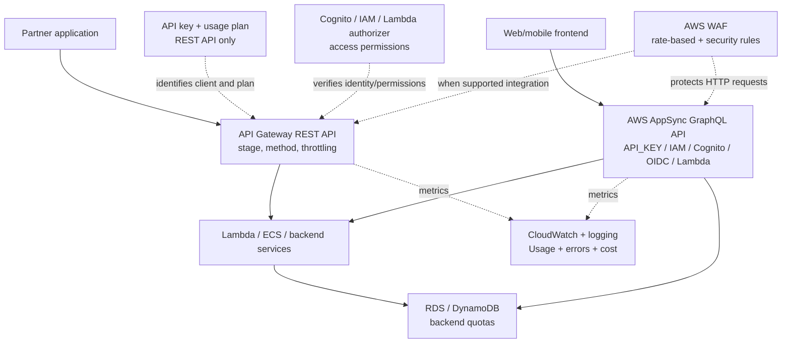
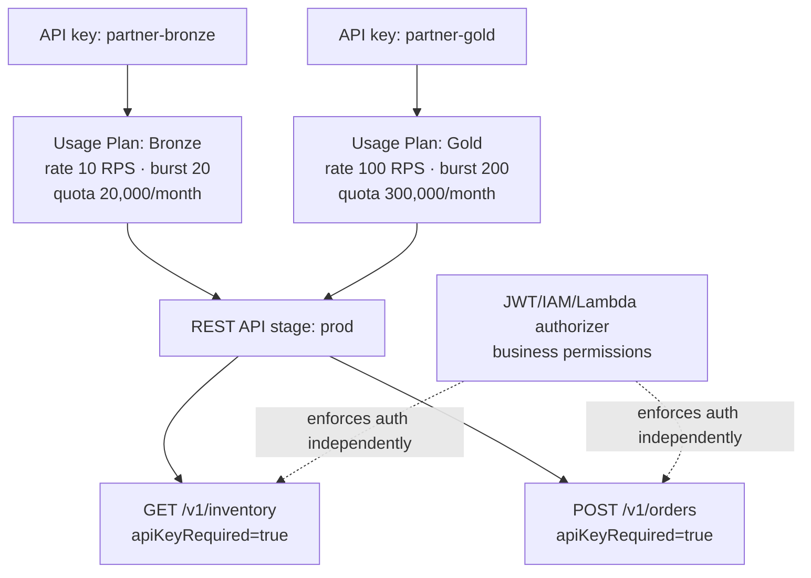
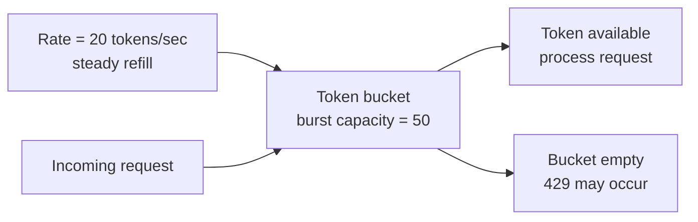
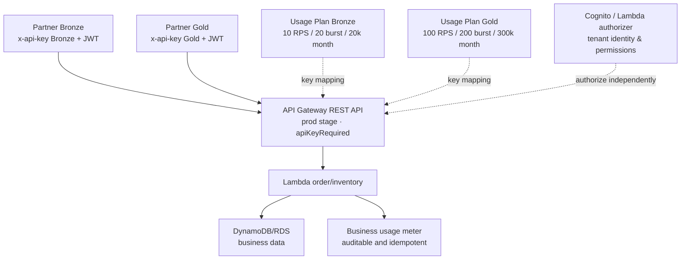

# API Keys, Usage Plans, Throttling, and Quotas in API Gateway and AppSync

> **Chapter:** API Gateway and AppSync  
> **Module:** CLOUD_PROVIDERS_AWS  
> **Objective:** Distinguish API keys, identification/authentication mechanisms, usage plans, throttling, and quotas; configure API protection per client and at system scale; understand per-service limits, monitoring, error handling, and cost estimation.
>
> **Scope:** Amazon API Gateway **REST API**, compared with **HTTP API/WebSocket API**, and **AWS AppSync GraphQL API**. Sample IDs, domains, accounts, keys, and customer limits are illustrative for learning and are not deployable production values.

## 1. Scenario: Two APIs, Three Clients, and One Database

A company exposes an inventory lookup service to partners:

- **REST API:** `GET /v1/inventory` and `POST /v1/orders`, routed through Amazon API Gateway to AWS Lambda.
- **GraphQL API:** An internal frontend uses AWS AppSync to read multiple inventory-related fields from DynamoDB or Lambda resolvers.
- **Bronze Partner:** Allowed roughly up to 10 requests/second during normal hours.
- **Gold Partner:** Needs around 100 requests/second with a monthly usage allowance.
- **Anonymous Visitors:** Read public data only; cannot place orders or read other customers' data.
- **Backend:** Lambda/RDS/DynamoDB have concurrency, connection, and capacity limits; traffic spikes can overload systems or inflate bills.

The engineering team wants to solve four requirements:

1. Identify **which client** is consuming the API and separate service tiers.
2. Ensure users only access **data they are authorized to see**.
3. Control request rates over seconds and total requests over a month.
4. Prevent a sudden traffic spike from crashing the backend or causing runaway costs.

These functions are **not the same thing**:

| Need | Typical mechanism | Question it answers |
|---|---|---|
| Identify client application for usage tracking | API Gateway REST **API key** + usage plan | Which plan does a client presenting a valid key belong to? |
| Verify user identity and access permissions | **IAM, Cognito, JWT/OIDC, Lambda authorizer, application logic** | Who is allowed to read/modify which data? |
| Smooth out request bursts/peaks | **Throttling** and defensive layers | When do we begin rate-limiting requests? |
| Period usage allowance | **Usage plan quota** or custom business metering | How many requests has a customer sent this period? |
| Protect GraphQL from expensive queries | **AppSync service quotas, auth, AWS WAF, schema/resolver design** | How many resources does a GraphQL query consume? |

**Core mindset:** An API key does not replace access permissions; a rate limit is not a quota; a monthly quota is not an exact billing contract; and **API Gateway REST** limits do not automatically apply to **AppSync GraphQL**.

## 2. Overview Diagram: What Do API Gateway and AppSync Protect?



In both flows, distinguish the **control plane** (admin IAM permissions to create APIs, keys, and plans) from the **data plane** (client requests invoking the API). Granting `apigateway:GET` or `appsync:ListApiKeys` to an administrator does not grant end users access to business endpoints.

## 3. Three Core Concepts: API Keys, Throttling, and Quotas

### 3.1. What Is an API Key?

An **API key** is typically a string value sent by a client in the `x-api-key` HTTP header. Its meaning **depends on the AWS service**:

- In **API Gateway REST API**, an API key is a **client identifier** used alongside a **usage plan** to track and apply throttling/quotas per client. **AWS recommends not using it in place of authentication or authorization.**
- In **AWS AppSync GraphQL API**, `API_KEY` is an **authorization mode** supported by AppSync for key-based access; suitable for dev/test or public data, but it **does not represent a strongly authenticated user** and has no API Gateway-style usage plan.

Do not assume that because both use the `x-api-key` header, they share **the same plan and limit management model**.

### 3.2. What Is Throttling?

**Throttling** is the system rejecting or delaying excess traffic when request rates exceed target thresholds. In API Gateway, this uses a **token bucket** model:

- `rate`: steady token refill rate, usually measured in **requests per second (RPS)**.
- `burst`: maximum bucket capacity, allowing short bursts above the steady-state rate.
- When tokens run out, clients may receive **HTTP 429 Too Many Requests**.

**Rate is not concurrent request count**, and **burst is not a daily quota**.

### 3.3. What Is a Quota?

In an **API Gateway REST usage plan**, a quota is the target number of requests allowed for **an API key** over a **DAY, WEEK, or MONTH** period. Quotas differ from throttling:

| Property | Throttling | Quota |
|---|---|---|
| Primary unit | Requests/second and burst tokens | Total requests per day/week/month |
| Goal | Protect against peaks/surges | Allocate usage over a billing/time period |
| Example | 20 RPS, burst 50 | 100,000 requests/month |
| When exceeded | May return `429` | May return `429` when quota is enforced |
| Strictly exact? | **No** — best effort | **No** — best effort |
| Replaces access control? | No | No |

**A usage plan quota is not a hard financial cap.** AWS explicitly states that usage plan throttling and quotas are **best effort**; actual traffic can slightly exceed configured values. For strict contractual rules such as "stop billing after exactly the 100,000th request," implement **application-level metering/entitlement** with independent reconciliation.

## 4. How Do REST API, HTTP API, WebSocket API, and AppSync Differ?

Before writing a single line of configuration, pick the right API type.

| Capability | **API Gateway REST API** | **API Gateway HTTP API** | **API Gateway WebSocket API** | **AppSync GraphQL API** |
|---|---|---|---|---|
| API key + REST-style **usage plan** | **Yes** | **No** | Does not use REST usage plans | **No** |
| API key sent via `x-api-key` | **Yes**, when method requires it | No REST API key/usage plan feature | Not via REST usage plan mechanism | **Yes**, when `API_KEY` auth is enabled |
| Request throttling | Account, stage/method, usage plan | Account + stage/route | Connection/message quotas, stage/route as supported | Service quotas + WAF/query design |
| Per-client DAY/WEEK/MONTH quota | **Usage plan**, best effort | No equivalent plan feature | No equivalent plan feature | No API Gateway usage plan |
| Identity/auth | IAM, Cognito, Lambda authorizer, resource policy | JWT/IAM/Lambda authorizer | IAM/Lambda authorizer and integration | `API_KEY`, IAM, Cognito, OIDC, Lambda |
| Workload type | REST APIs needing client/plan management | Simple HTTP endpoints optimizing overhead/cost | Long-lived bidirectional connections | GraphQL queries, mutations, subscriptions |

**Note:** API Gateway **HTTP API** still provides **stage/route throttling** and account-level throttling. Saying HTTP API "has no API keys" **does not mean it has no rate limiting**; it simply lacks REST API's **per-client usage plan/API key feature**.

**AppSync scope:** This chapter focuses on **GraphQL APIs**. AWS AppSync also offers **Event APIs** with distinct quotas and features; do not apply GraphQL API numbers indiscriminately to Event APIs.

## 5. API Keys in API Gateway REST API

### 5.1. How a Key Participates in Request Handling

An API key has:

- **Name**: administrative label identifying the customer/application; not the secret transmitted over the network.
- **Value**: the actual key string sent in `x-api-key`.
- **Enabled/disabled** status and related metadata.
- Association with one or more **usage plans**.

API Gateway REST lets you auto-generate or import keys, typically **20–128 characters** long; key values must be **unique** per service rules. Letting API Gateway generate keys is usually simpler and safer than inventing guessable strings.

**Never print real keys in docs, logs, repositories, tickets, or screenshots.** Even though AWS advises against using keys as identity secrets, anyone who steals a key can still **consume the customer's quota** and invoke methods that only require an API key.

### 5.2. API Key Source: `HEADER` or `AUTHORIZER`

REST API Gateway supports **two API key sources**:

| `apiKeySource` | How it works | When to use |
|---|---|---|
| **HEADER** | API Gateway reads the `X-API-Key` header from the request | Partners pass the key directly |
| **AUTHORIZER** | A Lambda authorizer returns `usageIdentifierKey` so API Gateway identifies which key applies | You want to derive the key from verified identity instead of having clients pass a raw key |

With `AUTHORIZER`, configure a compatible REST API authorizer that returns a valid key value bound to a usage plan. It **does not** automatically turn `Authorization: Bearer ...` into a usage plan; the authorizer must perform the mapping explicitly.

**Separation of duties:** A Lambda authorizer can verify user permissions while returning `usageIdentifierKey` to select the customer's quota. **A usage plan only meters and throttles per client**—it does not replace authorization logic inside the authorizer.

### 5.3. Methods Must Enable API Key Required

Creating an API key and usage plan is **not enough** for a method to enforce the key. In the **REST API method request**, you must enable:

```text
API Key Required = true
```

Example:

| Method | API Key Required | Authorization |
|---|---|---|
| `GET /v1/catalog` | `true` | Cognito/IAM/Lambda authorizer as needed |
| `GET /v1/status` | `false` | Can be public or authenticated by design |
| `POST /v1/orders` | `true` | Business authorization mandatory |

After modifying method settings, **deploy/redeploy the REST API stage** if required for changes to take effect on that stage.

If `apiKeyRequired=false`, the method **ignores API keys and usage plans** even when the stage is attached to a usage plan. This is a common reason why a plan appears to "have no effect."

### 5.4. Why API Keys Should Not Be Used for Authorization

A single key is usually shared across a **client application**, not individual users. If a team shares **one key across an entire partner company**, every user holding that key can invoke key-gated methods on that stage.

If a usage plan spans multiple API stages, keys in that plan are accepted across all linked APIs/stages. AWS recommends **not using API keys to control read/write permissions on data**.

Appropriate alternatives:

- **Amazon Cognito User Pools/JWT/OIDC** to identify end users.
- **AWS IAM** and SigV4 for AWS workload-to-workload communication.
- **Lambda authorizers** for custom authentication/authorization rules.
- **Backend authorization** to verify access per order, tenant, user, and resource.

**A valid request often requires both:** JWT/IAM verifies permissions **and** the API key applies usage-plan governance—they are complementary, not interchangeable.

## 6. Usage Plans: Connecting Client Keys, API Stages, and Methods

### 6.1. What Does a Usage Plan Contain?

An API Gateway REST API **usage plan** combines:

1. **API stages:** one or more `REST API ID + stage name` pairs.
2. **API keys:** one or more keys linked to the plan.
3. **Throttle settings:** default rate and burst limits, plus optional method-level overrides.
4. **Quota:** target request count per `DAY`/`WEEK`/`MONTH`.



Values in the diagram merely **illustrate business tiers**, not AWS defaults.

### 6.2. Rules for Associating Keys with Plans

AWS rules state:

- **One key can be associated with multiple usage plans**, across different stages.
- **One plan can contain multiple API stages**.
- However, **one API key can be associated with at most one usage plan per specific API stage**.

This prevents a single key on the same stage from facing two conflicting plans simultaneously. If you want Bronze and Gold tiers on the same `prod` stage, issue **two distinct keys** or structure your stage/key mapping accordingly.

### 6.3. Scope of Usage Aggregation

**Usage plan throttling and quotas apply per API key and aggregate across all API stages in the same plan.**

Suppose a Bronze key has a 20,000 requests/month quota in a plan covering:

- `inventory-api/prod`.
- `orders-api/prod`.

If the client sends 12,000 inventory requests and 8,000 order requests, total usage is roughly **20,000** against the plan. Do not assume each stage gets an independent 20,000 quota when sharing the same key and plan.

**Method-level throttling overrides** inside a plan can vary by API/stage/method, whereas the plan's **period quota** remains a key/plan-wide allowance rather than a separate monthly quota per HTTP method.

### 6.4. Two-Tier Example Table

| Property | Bronze | Gold |
|---|---:|---:|
| Rate target | 10 RPS | 100 RPS |
| Burst target | 20 | 200 |
| Monthly quota target | 20,000 requests | 300,000 requests |
| REST stages | `inventory-api/prod`, `orders-api/prod` | Same stages |
| Business auth | JWT/IAM/authorizer | JWT/IAM/authorizer |
| Audience | Low-traffic partners | High-volume partners |

**Reminder:** Gold's 300,000 quota **does not guarantee request 300,001 is blocked with pinpoint precision**. It is a best-effort target. For customer billing, use **independent, auditable usage metering and reconciliation**.

## 7. Token Bucket: Understanding Rate and Burst Correctly

### 7.1. Visualizing the Token Bucket

API Gateway uses a **token bucket** mechanism to regulate requests:



Suppose **rate=20 RPS** and **burst=50**:

- During idle periods, the bucket accumulates up to roughly 50 tokens.
- If 30 requests arrive simultaneously after the bucket fills, the model can admit them even though the instantaneous rate exceeds 20 RPS.
- If the client sustains 100 RPS for several seconds, the bucket drains quickly and API Gateway begins throttling.

**Do not equate "burst 50" with 50 concurrent connections.** Concurrency depends on backend processing duration and in-flight requests; the token bucket regulates **request arrival rate**, and will not automatically close database connections when too many requests are active.

### 7.2. Quantitative Example

Starting with 50 tokens, refilling at 20 tokens/second, while a client sends a steady 100 requests/second:

\[
\text{Net drain rate} \approx 100-20=80\ \text{tokens/second}
\]

Idealized time to exhaust the initial 50 tokens:

\[
t \approx \frac{50}{80}=0.625\ \text{seconds}
\]

After that, roughly 20 RPS are admitted in steady state, and excess requests may receive `429`.

**This is purely an idealized model.** API Gateway throttling is **best effort**, and distributed enforcement and accounting differ in practice; never treat 0.625 seconds as an SLA or billing guarantee.

### 7.3. RPS Is Not Concurrent Invocations

If an API receives 20 RPS and Lambda averages 0.4 seconds per request:

\[
C \approx \text{RPS}\times\text{Duration}
=20\times 0.4=8
\]

The backend needs about **8 concurrent invocations** at steady load. However, if request duration rises to 2 seconds because RDS slows down:

\[
C \approx 20\times 2=40
\]

**Setting API Gateway rate=20 RPS does not guarantee Lambda concurrency stays ≤ 8.** To cap concurrent executions, configure **Lambda reserved concurrency**, RDS Proxy, ECS scaling, or appropriate backend ceilings.

## 8. Precedence of Throttling Layers in API Gateway

### 8.1. API Gateway REST API

Per AWS documentation, throttling targets are evaluated in order:

1. **Per-client/per-method throttling in a usage plan** for an API stage.
2. **Per-method throttling** configured on the API stage.
3. **Account-level throttling** per AWS account and Region.
4. **AWS Regional throttling** at the service level.

Lower-level settings cannot exceed higher-level AWS ceilings. Thus, a Gold plan with rate=200 RPS **does not guarantee 200 RPS** if other APIs in the account are consuming the account-level quota.

### 8.2. Default Account-Level Quotas

Per the current AWS General Reference, default API Gateway account-level throttling in many Regions is:

- **Steady-state rate:** roughly **10,000 requests/second**.
- **Burst bucket:** up to roughly **5,000 requests** per service mechanics.

This quota covers **combined REST, HTTP, WebSocket, and callback requests** within the account/Region per AWS rules. **Some Regions or accounts have lower defaults**, and AWS scales burst capacity alongside the account-level rate quota; always inspect **Service Quotas / actual account limits** instead of hardcoding 10,000/5,000 into designs.

**Common misconception:** This is an **account/Region quota**, not "every REST API gets its own isolated 10,000 RPS."

### 8.3. API Gateway HTTP API

HTTP API has no REST usage plans, but offers:

- Account-level throttling.
- **Stage-level default route settings**.
- **Route-level throttling** via `ThrottlingRateLimit` and `ThrottlingBurstLimit` where supported.

If an HTTP API needs **per-user or per-tenant billing**, build custom client tracking (e.g., Cognito/JWT authorizer + application/DynamoDB metering) or choose REST API if native usage plans are a core requirement. There is no switch to copy REST usage plans onto HTTP API unchanged.

### 8.4. WebSocket API

WebSocket APIs have separate quotas for **new connections/second, connection duration, message rates/payload sizes, and route throttling** in their documentation. Long-lived WebSocket connections have different semantics from synchronous HTTP requests. Never assume "100 RPS" translates into 100 concurrent WebSocket connections.

## 9. Period Quotas: Guiding Usage, Not a Hard Budget

### 9.1. Quota Periods

REST usage plans support these quota periods:

| `period` | Interpretation |
|---|---|
| `DAY` | Daily request target |
| `WEEK` | Weekly request target |
| `MONTH` | Monthly request target |

API Gateway resets usage on the service-managed period schedule. When exposing quotas to global customers, clearly specify **timezones and reset boundaries in contracts** rather than assuming "midnight in Vietnam" matches AWS's internal usage window.

### 9.2. Monthly Plan Example

A Gold customer has:

- Quota target: **300,000 requests/month**.
- Rate target: **100 RPS**, burst target **200**.

At observation time, the plan reports:

```text
GET /v1/inventory: 180,000 requests
POST /v1/orders: 110,000 requests
Total for key in usage plan: 290,000 requests
Remaining approx: 10,000 requests
```

The `10,000` figure is a **usage plan estimate**, not an ironclad guarantee that the backend will reject request 10,001. Because distributed counting has propagation lag, clients may slightly exceed the target.

### 9.3. Usage Plan Quotas Do Not Replace Billing Systems

If a company sells paid API tiers by request volume:

1. Use API Gateway usage plans for **coarse traffic shaping** and tier enforcement.
2. Record per-client/tenant usage in an **authoritative data store**.
3. Support **deduplication/idempotency** so client retries are not double-counted when business rules prohibit it.
4. Define clear rules for failed requests, timeouts, cache hits, and throttled responses.
5. Use consistent counters/transactions matching contractual accuracy requirements.
6. Reconcile usage logs, backend metrics, and the billing system.
7. Enable **AWS Budgets, Cost Anomaly Detection**, and early alerts.

AWS recommends not treating usage plan quotas or throttling as a **hard maximum cost cap** or a security access control.

## 10. How to Set Up a REST API Usage Plan Properly

Assume a REST API with ID `a1b2c3d4e`, stage `prod`, and method `GET /v1/inventory` backed by Lambda.

### 10.1. Design Before Configuring

Determine:

- Which customers need separate plans (e.g., Bronze vs. Gold)?
- Which **REST API stages** belong to each plan?
- Which methods require `apiKeyRequired=true`?
- Which method authorization applies: IAM, Cognito, or Lambda authorizer?
- Are RPS/burst and quota values safe for Lambda and RDS capacity?
- Do individual methods need separate throttle overrides?
- When customers hit quota, should clients back off/retry or prompt for a plan upgrade?
- Do you have procedures for issuing, rotating, revoking compromised keys, and monitoring usage?

### 10.2. Steps in the AWS Console

1. **Create and deploy the REST API** with stage `prod`.
2. On metered methods, enable **API Key Required** under **Method request**, configure proper authorization, and redeploy the stage.
3. Create an **API key** for the customer; prefer AWS-generated key values.
4. Go to **Usage plans → Create usage plan** and enter rate, burst, and quota targets.
5. Add **API stage** `a1b2c3d4e/prod` to the plan.
6. Associate the **API key** with the plan.
7. Test HTTP calls with a valid key, a missing key, and a disabled key.
8. Monitor `Count`, `4XX`/`429`, per-key usage, and downstream latency.
9. Document key rotation/revocation and budget alerts in your runbook.

**Important:** Associating a key with a usage plan **can take a few minutes to propagate**. Do not immediately assume your setup is broken if the very first request right after linking a key returns `403`.

### 10.3. Illustrative Configuration

This is a **conceptual JSON model**, not a single payload sent directly to one AWS API call:

```json
{
  "restApiStage": "a1b2c3d4e/prod",
  "method": {
    "httpMethod": "GET",
    "resourcePath": "/v1/inventory",
    "apiKeyRequired": true,
    "authorization": "COGNITO_USER_POOLS"
  },
  "usagePlanBronze": {
    "name": "partner-bronze",
    "throttle": {
      "rateLimit": 10,
      "burstLimit": 20
    },
    "quota": {
      "limit": 20000,
      "period": "MONTH"
    }
  }
}
```

The model highlights parameters configured across **distinct resources**: REST method, stage, usage plan, and API key. Execution happens via Console, CloudFormation, CDK, Terraform, or the respective APIs.

### 10.4. Calling the REST API Example

```bash
# Partners must pass the API key, plus a JWT if the method uses an authorizer.
# API_KEY and ACCESS_TOKEN are environment variables provided by the test environment.
curl --request GET \
  --url "https://a1b2c3d4e.execute-api.ap-southeast-1.amazonaws.com/prod/v1/inventory" \
  --header "x-api-key: $API_KEY" \
  --header "Authorization: Bearer $ACCESS_TOKEN"
```

**Note:** Placeholder IDs are not real endpoints. Never type real API keys into shared terminal shell history; load credentials from a managed secret source with restricted access.

If a valid key is provided without a valid JWT, the method will still reject the request—**that is the intended behavior** when authorization is configured independently.

## 11. AppSync `API_KEY`: Same Header, Different Meaning

### 11.1. `API_KEY` Is a GraphQL Authorization Mode

AWS AppSync GraphQL APIs support authorization modes including:

- **`API_KEY`**.
- **`AWS_IAM`** with SigV4.
- **`AMAZON_COGNITO_USER_POOLS`**.
- **`OPENID_CONNECT`**.
- **`AWS_LAMBDA`**.

A GraphQL API configures a **default authorization mode** and optional **additional authorization modes** where supported. Schema directives specify which mode can access each type or field.

Example:

```graphql
type Product @aws_api_key {
  id: ID!
  name: String!
  price: Float
}

type Order @aws_cognito_user_pools {
  id: ID!
  customerId: ID!
  total: Float!
}

type Query {
  products: [Product!]! @aws_api_key
  myOrders: [Order!]! @aws_cognito_user_pools
}

schema {
  query: Query
}
```

**This is only an illustrative schema sketch.** In production, configure default/additional auth modes consistently across the full schema, resolver logic, and authorized data. Never assume every field or type is protected just because you added a directive to another field.

### 11.2. AppSync API Keys Expire

For GraphQL `API_KEY`, AppSync:

- Lets you create and rotate API keys.
- Supports key lifetimes of **up to 365 days** per update per current documentation.
- Allows extending expiration within service limits.
- Defaults to roughly **7 days** in some APIs/CLI calls if expiration is omitted.
- Expects clients to pass the key in the `x-api-key` header.

**AWS recommends `API_KEY` for development or intentionally public APIs.** Never rely on a public key embedded in JavaScript or a mobile app to prove a user is allowed to read private orders.

### 11.3. AppSync Does Not Use API Gateway REST Usage Plans

AWS AppSync **has no Bronze/Gold API-key usage plan model** like API Gateway REST. If you need:

- Per-user or per-tenant limits.
- A 10,000 queries/month tier per customer.
- Accurate invoicing policies.
- Differentiated permissions on sensitive GraphQL fields.

then combine **identity auth** (Cognito/OIDC/IAM/Lambda), **business metering** in resolvers/data sources or a dedicated service, and WAF/quota layers. Do not design an AppSync GraphQL API expecting `aws apigateway create-usage-plan` to attach to it.

### 11.4. Calling an AppSync GraphQL API Example

```bash
# APPSYNC_KEY and endpoint are supplied via protected environment variables.
curl --request POST \
  --url "https://EXAMPLE.appsync-api.ap-southeast-1.amazonaws.com/graphql" \
  --header "Content-Type: application/json" \
  --header "x-api-key: $APPSYNC_KEY" \
  --data '{"query":"query { products { id name price } }"}'
```

**Do not judge GraphQL success by HTTP `200` alone.** A GraphQL response can return HTTP `200` **with an `errors` array** due to resolver, authorization, or partial-result failures. Inspect HTTP status, GraphQL `errors`, latency, and request token usage together.

## 12. Throttling and Quotas in AppSync GraphQL

### 12.1. Request Tokens Differ from Requests per Second

AWS AppSync GraphQL enforces **request tokens/second** as an account/Region resource quota rather than treating every GraphQL query as having identical execution cost.

Per current AWS documentation:

- A request consuming up to **1,500 KB-seconds** of processing resources is charged **1 request token**.
- Requests consuming more consume **multiple tokens**, rounded up per the resource formula.
- For example, AWS documents that a request consuming **3,350 KB-seconds** counts as **3 tokens**.
- The default account/Region quota for GraphQL request tokens is **10,000 tokens/second** in many Regions including `ap-southeast-1`, and **5,000 tokens/second** in some other Regions.

**This is not a guaranteed flat limit of 10,000 GraphQL requests/second.** If each request averages 2 tokens, a 10,000 tokens/second quota yields roughly 5,000 requests/second on average.

### 12.2. AppSync Capacity Estimation Example

| Workload | Tokens / request | 10,000 tokens/s quota allows approx. |
|---|---:|---:|
| Simple query | 1 | 10,000 req/s |
| Moderately complex query | 2 | 5,000 req/s |
| Heavy query | 5 | 2,000 req/s |
| Very heavy query | 10 | 1,000 req/s |

These numbers merely illustrate **token budgeting**; real throughput is also bounded by other quotas, downstream latency, concurrent connections, resolver capacity, and network limits.

**Not all GraphQL requests cost the same.** A 10-field query with proper caching/batching can be far lighter than a deeply nested query firing sequential resolvers or returning massive payloads.

### 12.3. How to See Which Requests Consume Many Tokens

AppSync provides:

- The CloudWatch **`TokensConsumed`** metric.
- The **`x-amzn-appsync-TokensConsumed`** response header showing token consumption per request when provided.
- `Requests`, `4XXError`, `5XXError`, and `Latency` metrics.
- Enhanced metrics per resolver, data source, and operation when enabled (with associated charges).

Example response header:

```text
x-amzn-appsync-TokensConsumed: 3
```

This shows the request consumed three AppSync quota tokens—**it does not automatically mean the customer is billed for three requests** under every pricing dimension. Read **quota tokens** and **billing units** separately in AWS pricing documentation.

### 12.4. Preventing Overly Expensive GraphQL Queries

Helpful practices:

1. Design schemas with **pagination**; avoid unbounded lists.
2. Prevent **N+1** resolver fan-outs by using **batching** where supported by data sources and resolvers.
3. Consider **caching** for public or read-heavy fields where consistency allows.
4. Enforce **query depth / resolver count limits** where supported by your API features and model.
5. Apply field-level auth so public keys cannot invoke sensitive mutations.
6. Set appropriate DynamoDB/Lambda/RDS capacities and monitor downstream throttles.
7. Attach **AWS WAF** for web ACL rules, abuse patterns, and rate-based controls.

**Raising the AppSync request-token quota will not fix an inefficient GraphQL query.** Optimize schemas and resolvers first before requesting a quota increase.

## 13. AWS WAF: Controlling Traffic by IP and Request Patterns

### 13.1. What Does AWS WAF Address?

AWS WAF can be attached to supported API resources—including **API Gateway REST API** (Regional scopes) and **AppSync GraphQL API**—to:

- Block bots, malicious request patterns, and SQLi/XSS attempts.
- Allow or block traffic by geography, IP, headers, or custom conditions.
- Enforce **rate-based rules** to mitigate clients exceeding request thresholds within an evaluation window.
- Monitor sampled requests and CloudWatch metrics.

**AWS WAF does not replace per-key usage plans.** Rate-based rules typically aggregate by **client IP** or supported aggregation keys. A single NAT IP can hide thousands of legitimate users, while one user may roam across IPs—so IP-based rate limiting requires evaluating false positives and fairness.

### 13.2. WAF with AppSync

Per AWS, on WAF-integrated GraphQL APIs, **WAF rules are evaluated before** AppSync authorization checks such as API key, IAM, Cognito, or OIDC.

For example:

- WAF blocks requests from an IP generating abusive traffic.
- Remaining requests proceed to AppSync for `API_KEY` or JWT/IAM validation.
- Resolvers run queries and call DynamoDB/Lambda under the configured service role.

**Note:** WAF inspects HTTP requests, not the full semantic permissions of a GraphQL schema to decide which records a user owns. Enforce authorization in your schema, resolvers, and business logic.

### 13.3. WAF Is Not a Guaranteed Cost Ceiling

Rate-based rules have **evaluation windows and propagation delays** and should not be treated as exact per-request metering for paid contracts. WAF is an abuse-mitigation layer that complements—rather than replaces—:

- Identity authentication.
- AppSync/API Gateway service throttling.
- Downstream quotas.
- AWS Budgets and anomaly alerts.
- Tenant-aware usage accounting.

## 14. Secure Design for Three Customer Groups

### 14.1. Paid Partner REST API



This architecture separates concerns:

- **API key:** identifies the partner tier for throttling and quota management.
- **JWT/IAM:** authenticates users/workloads and verifies permissions.
- **Lambda:** enforces tenant IDs, resource ownership, and business rules.
- **Usage meter:** records reconcilable usage for billing.
- **CloudWatch/WAF:** monitors abuse and service health.

Never share a single key across unrelated customers, because **quotas and audit trails become mixed**.

### 14.2. GraphQL Public Catalog

An application uses AppSync for a **public product catalog**, while orders remain private data:

- Public product queries can use `API_KEY` after assessing public-access risks.
- `myOrders` and `updateOrder` require Cognito, IAM, or an appropriate authorizer.
- WAF defends against abuse traffic; field-level auth prevents leaking private fields.
- AppSync `TokensConsumed` is monitored to catch expensive queries.
- Resolvers and data sources handle pagination, batching, and tenant authorization.
- If exact Gold/Bronze tiers are required, build custom metering/entitlements—**never try to attach a REST usage plan to AppSync**.

### 14.3. Avoid Relying Solely on Frontend-Embedded Keys

A SPA, web app, or mobile client can be inspected to extract embedded API keys. If such a key allows mutations that modify customer data:

- Attackers can replay the key directly.
- You cannot tell which user invoked the mutation.
- You have no per-user permission isolation.
- A leaked key lets attackers quickly exhaust your usage quota.

Use **Cognito/JWT/OIDC/IAM/Lambda authorizers** for sensitive data and actions. API keys belong with intentionally public APIs or per-client usage tiers, never as personal identity tokens.

## 15. Error Responses: 403, 429, and GraphQL Errors

### 15.1. API Gateway REST API

| Symptom | Possible causes | Diagnostic steps |
|---|---|---|
| **`403 Forbidden`** when `x-api-key` is missing | Method has `apiKeyRequired=true` without a valid key | Check header, key enabled state, plan/stage association |
| **`403 Forbidden`** even though key looks right | Key disabled/wrong value, key not attached to plan, propagation lag, or another authorizer failed | Check method, usage plan, key ID, and authorizer |
| **`401 Unauthorized`** | Missing or invalid token per auth mechanism | Check JWT/IAM/Lambda authorizer and token expiry |
| **`429 Too Many Requests`** | Usage plan rate/burst/quota, or stage/account/Regional throttle | Compare traffic, usage, and CloudWatch metrics |
| **`500/502/504`** | Backend/integration failure or timeout | Inspect Lambda logs, integration latency, and gateway responses |
| **No `429` despite setting a quota** | Method does not require key, traffic hits another stage, or best-effort lag | Verify method/stage/key/usage mapping |
| **`429` even with monthly quota remaining** | Rate, burst, or account limit exhausted before monthly quota | Check throttling layers and traffic spikes |

**There is no rule saying "every `403` means a bad API key."** A `403` can come from a resource policy, IAM authorizer, WAF, custom gateway response, or other checks. Inspect the response type, access logs, and CloudTrail/configuration context.

### 15.2. AppSync GraphQL

An AppSync API can reject requests due to:

- Expired/invalid API key or wrong auth mode.
- Invalid JWT or IAM signature.
- Field/object denied by auth directives.
- Exceeding AppSync request-token quota or other quotas.
- Invalid GraphQL syntax/schema or malformed request body.
- Throttled or failing resolvers/data sources.

**An HTTP `200` GraphQL response can still carry an `errors` array**; request-level errors may return HTTP `4xx`/`5xx`. Do not lump all GraphQL failures together as "AppSync `429` throttle"—inspect **HTTP status, response body, CloudWatch `4XX`/`5XX`, `TokensConsumed`, and resolver logs**.

### 15.3. Proper Client Retries on `429`

Clients should:

1. Distinguish `429` from `401`/`403`—**never retry indefinitely** on bad credentials.
2. Respect `Retry-After` **when present in the response**.
3. Use **exponential backoff with jitter**, bounded by max attempts or a time budget.
4. Avoid synchronized retry storms where all clients retry at the exact same instant.
5. Supply idempotency keys for state-changing mutations and order/payment `POST`s.
6. For deferrable workloads, consider SQS or queues to buffer traffic spikes away from backends.
7. Log request/correlation IDs for troubleshooting without logging real API keys or tokens.

```text
retryDelay = min(maxDelay, baseDelay * 2^attempt)
actualDelay = random(0, retryDelay)  # full jitter
```

This is pseudocode; AWS SDKs include built-in retry policies for many scenarios. Retries must always be **bounded**, especially when upstream API Gateway is shielding an overloaded downstream service.

## 16. CloudWatch, Access Logs, and Auditing

### 16.1. API Gateway Metrics

The **`AWS/ApiGateway`** namespace includes metrics such as:

| Metric | How to interpret | Purpose |
|---|---|---|
| **`Count`** | Total requests | Track traffic volume |
| **`4XXError`** | Total client/gateway errors | Detect spikes in `403`/`429` |
| **`5XXError`** | Server/integration errors | Detect backend failures |
| **`Latency`** | Time from request receipt to response | End-to-end API latency inside Gateway |
| **`IntegrationLatency`** | Time API Gateway waits on backend | Separate slow backends from Gateway overhead |
| **`CacheHitCount / CacheMissCount`** | When API caching is enabled where supported | Optimize cache hit ratio and backend cost |

**Watch out:** `4XXError` aggregates many client errors and is not a pure "throttled request count" metric. To isolate `429`s, combine metrics with **access logs** recording `status`, gateway response type, and API key ID per your log format.

Detailed per-method CloudWatch metrics **incur additional costs**; enable detailed metrics selectively where needed.

### 16.2. Never Log Key Values

For REST API access logs, consider fields such as:

```text
requestId
requestTime
httpMethod
resourcePath
status
responseLatency
integrationLatency
apiKeyId  # ID, not the raw key value
```

**Never log raw `x-api-key` values**, `Authorization` headers, or query strings containing secrets. If you need per-customer reporting, map **`key ID → tenant`** in a secure system and restrict log read permissions via least privilege.

### 16.3. AppSync Metrics

The **`AWS/AppSync`** namespace typically includes:

| Metric | Purpose |
|---|---|
| **`Requests`** | Number of GraphQL query/mutation requests |
| **`TokensConsumed`** | Resource quota tokens consumed |
| **`4XXError`** | Client errors, throttling, invalid auth, etc. |
| **`5XXError`** | Service or processing errors |
| **`Latency`** | API processing latency inside AppSync |
| **Enhanced metrics** | Per-operation, data-source, and resolver breakdown when enabled |

Per AWS documentation, AppSync can return `x-amzn-appsync-TokensConsumed` in responses to diagnose individual queries. Overly verbose field-level logging can capture sensitive data and increase log volume/cost; choose logging levels carefully.

### 16.4. CloudTrail and Key Governance

**CloudTrail** records control-plane actions such as creating, updating, or deleting API keys, usage plans, APIs/stages, and policies depending on event configuration. It **does not replace per-request access logs**.

Alert on anomalous administrative changes:

- Creating new keys outside approved workflows.
- Disabling `apiKeyRequired`.
- Removing a stage from a usage plan.
- Raising rate/burst/quota settings inappropriately.
- Disabling WAF/authorizers or altering AppSync auth modes.
- Modifying IAM permissions/roles affecting backends.

Apply least-privilege IAM and change approvals/alerts on management APIs that affect security, cost, or reliability.

## 17. AWS CLI: Inspecting API Gateway REST Usage Plans (Read-Only)

These examples are read-only queries and **do not create, modify, or expose raw API key values**. You need AWS CLI v2 and read-only permissions in the target service/Region. Replace illustrative IDs with real ones; never query production customer metadata without authorization.

### 17.1. List REST APIs

```bash
aws apigateway get-rest-apis \
  --region ap-southeast-1 \
  --query 'items[].[id,name,apiKeySource]' \
  --output table
```

`apiKeySource` is either `HEADER` or `AUTHORIZER`. For other API types, use the `apigatewayv2` namespace—**do not conclude from the REST API list** that no HTTP APIs or AppSync APIs exist.

### 17.2. List Usage Plans

```bash
aws apigateway get-usage-plans \
  --region ap-southeast-1 \
  --query 'items[].[id,name,throttle.rateLimit,throttle.burstLimit,quota.limit,quota.period]' \
  --output table
```

This shows plans, rate/burst limits, and quota periods; some fields may be empty if unconfigured.

### 17.3. Inspect Stage Associations and Method Overrides

```bash
aws apigateway get-usage-plan \
  --region ap-southeast-1 \
  --usage-plan-id PLAN_ID \
  --output json
```

Inspect `apiStages[]`, `throttle`, and `quota`; `apiStages[].throttle` may contain method-level overrides. Do not interpret the default `rateLimit` as "every method gets that rate independently."

### 17.4. List Keys Attached to a Plan Without Exposing Values

```bash
aws apigateway get-usage-plan-keys \
  --region ap-southeast-1 \
  --usage-plan-id PLAN_ID \
  --query 'items[].[id,name,type]' \
  --output table
```

**Avoid `--include-values` or querying the `value` field** in shared reports or terminals. The key ID suffices to correlate logs and usage without leaking raw keys.

### 17.5. Check Whether a Method Requires a Key

```bash
aws apigateway get-method \
  --region ap-southeast-1 \
  --rest-api-id REST_API_ID \
  --resource-id RESOURCE_ID \
  --http-method GET \
  --query '{ApiKeyRequired:apiKeyRequired,Authorization:authorizationType}' \
  --output json
```

To locate the resource ID:

```bash
aws apigateway get-resources \
  --region ap-southeast-1 \
  --rest-api-id REST_API_ID \
  --query 'items[].[id,path]' \
  --output table
```

After editing a method, confirm **a new deployment revision was published to the right stage**; undeployed resource changes are not active for callers.

### 17.6. View Recorded Usage for a Period

```bash
aws apigateway get-usage \
  --region ap-southeast-1 \
  --usage-plan-id PLAN_ID \
  --start-date 2026-11-01 \
  --end-date 2026-11-20 \
  --output json
```

Data from `get-usage` is meant for operations and rough reconciliation, not a strict billing ledger. With many customers, filter by the specific **key ID** and date range to avoid pulling unnecessary data. Quotas are best effort and have reporting lag.

### 17.7. Inspect API Gateway HTTP API Throttling

```bash
aws apigatewayv2 get-stages \
  --region ap-southeast-1 \
  --api-id HTTP_API_ID \
  --query 'Items[].[StageName,DefaultRouteSettings,RouteSettings]' \
  --output json
```

Check `ThrottlingRateLimit` and `ThrottlingBurstLimit` in default and route settings. This is how **HTTP API** throttles traffic, rather than REST per-customer usage plans.

## 18. AWS CLI: Inspecting AppSync GraphQL and Quotas (Read-Only)

### 18.1. List GraphQL APIs

```bash
aws appsync list-graphql-apis \
  --region ap-southeast-1 \
  --query 'graphqlApis[].[name,apiId,authenticationType]' \
  --output table
```

### 18.2. Inspect Auth Modes and API Configuration

```bash
aws appsync get-graphql-api \
  --region ap-southeast-1 \
  --api-id GRAPHQL_API_ID \
  --query 'graphqlApi.{Name:name,ApiId:apiId,DefaultAuth:authenticationType,AdditionalAuth:additionalAuthenticationProviders}' \
  --output json
```

Having `API_KEY` as default or additional auth does not guarantee private data is exposed or protected—inspect schema directives, resolver authorization, and data-source permissions as well.

### 18.3. Check AppSync Key Expiration Without Printing Raw Keys

```bash
aws appsync list-api-keys \
  --region ap-southeast-1 \
  --api-id GRAPHQL_API_ID \
  --query 'apiKeys[].[description,expires,deletes]' \
  --output table
```

**Warning:** In AppSync's API response, the API key `id` field is the actual secret key value used to invoke the API. This example intentionally **omits `id`**. `expires` and `deletes` are Unix epoch seconds; convert them to human-readable timestamps before scheduling renewal.

If the API does not use `API_KEY` mode, the command returns no keys or an empty list; that is normal, not an error.

### 18.4. Inspect Request-Token Quotas

```bash
aws service-quotas list-service-quotas \
  --region ap-southeast-1 \
  --service-code appsync \
  --query 'Quotas[].[QuotaName,Value,Adjustable]' \
  --output table
```

Filter specifically for **GraphQL APIs – Rate of request tokens**. Quotas vary by Region and approved limit increases; never rely solely on static numbers from study tables.

### 18.5. Check CloudWatch Metrics

In CloudWatch, monitor:

- `AWS/AppSync`: `Requests`, `TokensConsumed`, `4XXError`, `5XXError`, `Latency`.
- `AWS/ApiGateway`: `Count`, `4XXError`, `5XXError`, `Latency`, `IntegrationLatency`.
- `AWS/Lambda`: `Invocations`, `Errors`, `Throttles`, `ConcurrentExecutions`.
- `AWS/DynamoDB`: read/write throttling and consumed capacity per table.
- **AWS WAF:** allowed/blocked/count metrics per Web ACL and rule.

**Cross-layer failures often surface together.** A spike in GraphQL `5XXError` alongside Lambda `Throttles` likely points to downstream Lambda concurrency exhaustion rather than the AppSync request-token quota.

## 19. IaC Workflow Example and Configuration Changes

> **This section describes mutating changes.** Creating keys/plans, enforcing API keys, or changing auth/quotas can cause `403`/`429` errors, partner disruptions, or charges. Deploy only in an approved lab environment or through change review.

### 19.1. Configuring REST Resources via IaC

Common CloudFormation resources involved:

| Resource | Purpose |
|---|---|
| `AWS::ApiGateway::RestApi` | REST API |
| `AWS::ApiGateway::Resource` | Resource path |
| `AWS::ApiGateway::Method` | HTTP method, `ApiKeyRequired`, `AuthorizationType` |
| `AWS::ApiGateway::Deployment` | Freezes deployment configuration |
| `AWS::ApiGateway::Stage` | Traffic-serving stage |
| `AWS::ApiGateway::ApiKey` | Named key/mode, optionally AWS-generated value |
| `AWS::ApiGateway::UsagePlan` | API stages, throttle, quota |
| `AWS::ApiGateway::UsagePlanKey` | Associates an API key with a usage plan |

Partial illustrative properties (**not a complete deployable template**):

```yaml
# Reference snippet for a REST API with existing Deployment and Stage.
# Logical IDs UsagePlan, ApiKey, RestApiStage are illustrative.
UsagePlan:
  Type: AWS::ApiGateway::UsagePlan
  Properties:
    UsagePlanName: bronze
    ApiStages:
      - ApiId: !Ref RestApi
        Stage: prod
    Throttle:
      RateLimit: 10
      BurstLimit: 20
    Quota:
      Limit: 20000
      Period: MONTH

ApiKey:
  Type: AWS::ApiGateway::ApiKey
  Properties:
    Name: partner-bronze
    Enabled: true
    GenerateDistinctId: true

UsagePlanKey:
  Type: AWS::ApiGateway::UsagePlanKey
  Properties:
    KeyId: !Ref ApiKey
    KeyType: API_KEY
    UsagePlanId: !Ref UsagePlan
```

**Note:** Beyond this snippet, the method must set `ApiKeyRequired: true` and an appropriate `AuthorizationType`, `RestApi`/`Deployment`/`Stage` must exist with proper dependencies, and the template must obey CloudFormation ordering without deprecated properties. Verify current support for `GenerateDistinctId` before deploying; **do not run this snippet verbatim**.

### 19.2. Configuration Versioning and Key Rotation

A key rotation workflow should include:

1. Identify which customers use the old key and set a cutover deadline.
2. Create the new key, attach it to the right usage plan, and allow time for propagation.
3. Deliver the new key via a secure channel, maintaining a defined **overlap** window.
4. Monitor usage on both old and new key IDs and verify method authorization keeps working.
5. Disable the old key once customers have migrated and the rollback window closes.
6. Revoke compromised keys immediately; audit access logs, costs, and data access.
7. For AppSync, rotate/renew keys ahead of expiration and avoid overly permissive public keys in clients.

**Do not treat API key rotation like JWT signing key rotation:** API keys are not user-authentication claims tokens; manage identity and token verification separately.

## 20. Cost and Financial Risk Control

### 20.1. Cost Drivers to Include

| Layer | Cost examples |
|---|---|
| **API Gateway REST/HTTP** | Request volume under respective pricing tiers, data transfer, REST stage cache if enabled |
| **API Gateway WebSocket** | Messages and connection minutes per pricing table |
| **AWS AppSync GraphQL** | Query/mutation operations, real-time updates/connection minutes, and optional features |
| **AWS WAF** | Web ACLs, rule groups, evaluated requests, optional advanced features |
| **Lambda** | Requests, execution duration, memory, provisioned concurrency if used |
| **DynamoDB/RDS** | Storage, reads/writes/capacity, or database instance resources |
| **CloudWatch** | Log ingestion/retention, detailed metrics, alarms |
| **VPC/networking** | NAT Gateways, VPC endpoints, cross-AZ data transfer depending on architecture |

**Never assume AppSync request-token quotas are identical to AppSync billing units.** Quota tokens measure resource consumption, whereas AppSync billing is defined per operation/feature in AWS pricing tables.

### 20.2. Why a 100,000/Month Quota Does Not Cap Your Bill

- Usage plans are best effort; traffic can overshoot targets.
- Methods without `apiKeyRequired` or other APIs still accept traffic.
- AWS bills also include other APIs, Lambda, RDS, WAF, and CloudWatch Logs.
- A single heavy GraphQL query can trigger numerous resolver executions while counting as one query operation.
- Retry storms, cache misses, error responses, and integration costs can climb even when nominal request counts stay within expectations.

To manage financial risk:

1. Configure appropriate API Gateway usage plans and stage throttles.
2. Place AWS WAF in front to block abusive traffic early.
3. Set Lambda reserved concurrency and database capacity ceilings.
4. Enable **AWS Budgets** and **Cost Anomaly Detection**.
5. Add application-level hard quotas and billing logic when contracts demand strict limits.
6. Monitor `4xx`/`5xx` spikes, queue backlogs, and RDS metrics.
7. Review **Cost Explorer / CUR** by Region, usage type, and tags.

## 21. Practice Scenarios with Answers

### Scenario 1 — Choosing the API Type

A company must issue **separate API keys per partner** with monthly quotas using native API Gateway features. Should they choose REST API or HTTP API?

**Answer:** **REST API**, because it natively supports API keys + usage plans. HTTP API has no per-client usage plan; choosing HTTP API would require building custom metering and rate control.

### Scenario 2 — Key Created, Yet Unenforced

A team created an API key and Bronze usage plan attached to stage `prod`, yet clients without a key can still call `GET /v1/items`.

**Answer:** Check `apiKeyRequired=true` on the **method**, then deploy/redeploy the REST API stage. Creating a plan alone does not force methods to require a key.

### Scenario 3 — Is an API Key Equal to User Permissions?

A customer holds a Bronze key, and a developer lets the caller query any user's data because "the key is valid."

**Answer:** Unsafe. An API key only identifies a client for a usage plan; you must use Cognito/JWT/IAM/Lambda authorizers and enforce tenant/resource ownership in the backend.

### Scenario 4 — Rate and Burst

A plan sets `rate=20 RPS` and `burst=50`. After an idle period, a client sends a rapid burst of 35 requests.

**Answer:** Under the token bucket model, accumulated tokens can serve short bursts above 20 RPS; 20 RPS is the steady-state refill rate. Never mistake `50` for 50 requests/month.

### Scenario 5 — Plan Quota Across Two Stages

A key has a 20,000/month quota in a plan containing both Inventory and Orders stages. The client sends 12,000 Inventory requests and 8,000 Orders requests.

**Answer:** Total usage is roughly **20,000** against the key/plan—not 20,000 independently per API stage.

### Scenario 6 — Quota Overshoot

A plan sets 100,000/month, yet logs record 100,020 requests before throttling kicks in.

**Answer:** Expected behavior because usage plan quotas are **best effort**, not hard caps. Strict contractual cutoffs require dedicated application-level metering.

### Scenario 7 — `429` Before Monthly Quota Runs Out

A client sends 200 RPS against a plan with `rate=20 RPS` while monthly quota is only 5% used.

**Answer:** Throttled by **rate/burst** limits even though period quota remains. Inspect request rate, burst spikes, and client retries.

### Scenario 8 — `403` on a Newly Linked Key

A brand-new API key is attached to a plan, and clients immediately receive `403` for a couple of minutes.

**Answer:** Verify key value, enabled flag, stage association, method settings, and **propagation delay**. Also rule out other authorizers rather than assuming every `403` is a key issue.

### Scenario 9 — Shared Account Quota

Three REST APIs in the same account/Region each send 5,000 RPS; each usage plan allows 6,000 RPS. Is 15,000 RPS total guaranteed without throttling?

**Answer:** No. **Account-level throttling** applies across the account/Region; lower-level settings cannot exceed higher-level ceilings. Check actual Service Quotas.

### Scenario 10 — Does HTTP API Still Throttle?

A team picks HTTP API for simplicity and claims HTTP API cannot throttle requests.

**Answer:** False. HTTP API supports account-level and stage/route throttling, even though it lacks REST API's per-client API key usage plans.

### Scenario 11 — AppSync `API_KEY` vs. API Gateway Key

A frontend calls an AppSync GraphQL API with `x-api-key` and wants a 10,000 queries/month tier per tenant. Can you attach `AWS::ApiGateway::UsagePlan` to AppSync?

**Answer:** No. AppSync `API_KEY` is a distinct auth mode and does not use REST usage plans. Implement user/tenant auth, custom usage metering, and WAF/service quotas.

### Scenario 12 — Leaked AppSync Key

AppSync embeds an API key in a JavaScript client that permits `mutation deleteOrder`, and the key is copied.

**Answer:** Frontend-embedded keys do not prove user identity. Sensitive mutations must require Cognito/IAM/OIDC/Lambda authorizers and per-record/tenant authorization checks. Rotate the key and audit logs.

### Scenario 13 — AppSync Token Math

A GraphQL API has a quota of 10,000 tokens/second, and each request averages 5 tokens. What is the approximate throughput from the token budget?

**Answer:** \(10,000 / 5 \approx 2,000\) requests/second, further bounded by downstream capacity, connections, and other quotas.

### Scenario 14 — Heavy GraphQL Query

A query returns huge lists, triggers numerous resolvers, and spikes `TokensConsumed`. Should the team simply request a higher token quota?

**Answer:** Not alone. Implement pagination, batching, caching, query complexity/depth limits, and resolver/data-source optimization first before asking for a quota increase.

### Scenario 15 — AWS WAF IP Rate Limiting

An enterprise puts 500 employees behind one corporate NAT IP, and a WAF rate-based rule blocks by client IP. Many employees get blocked despite normal usage.

**Answer:** One IP does not equal one user. Tune aggregation keys/rate thresholds, allowlist appropriately, apply auth/tenant-aware controls, and evaluate false positives.

### Scenario 16 — Retrying `429`

A client receives HTTP `429` and immediately retries 100 times/second, making the outage worse.

**Answer:** Implement **exponential backoff + jitter**, honor `Retry-After` if present, cap retry attempts/time budgets, and use idempotency keys on writes.

### Scenario 17 — Do Rate Limits Cap DB Connections?

API Gateway limits traffic to 50 RPS, but Lambda takes 4 seconds per call when RDS slows down. What is the estimated concurrency?

**Answer:** \(50 \times 4 = 200\) concurrent invocations at steady state. Rate limits do not cap DB connections at 50; use Lambda reserved concurrency, RDS Proxy, connection pooling, and capacity planning.

### Scenario 18 — Rising `4XXError`

CloudWatch `4XXError` rises on API Gateway. Can you assume all of them are usage-plan throttles?

**Answer:** No. `4XX` spans `401`, `403`, `429`, validation failures, and more. Inspect access logs for status codes, response types, and auth/key metadata **without exposing raw keys**.

### Scenario 19 — Did AppSync Succeed?

AppSync returns HTTP `200` with body `{"data":{"products":null},"errors":[...]}`. Should this be treated as fully successful?

**Answer:** No. GraphQL often returns HTTP `200` alongside an `errors` array; inspect response bodies, field errors, and resolver logs, not just HTTP status codes.

### Scenario 20 — Usage Plans as Billing Source of Truth?

A team wants to use API Gateway `get-usage` as the sole billing source of truth for B2B contracts.

**Answer:** Not recommended, because usage plans are best effort and have reporting lag. Build an auditable, reconcilable usage metering system with explicit billable-request and idempotency rules.

### Scenario 21 — Regional AppSync Request-Token Quotas

An app in `ap-southeast-1` already received an approved request-token quota increase, yet a team cites the documented default of 10,000 tokens/s to claim it cannot scale higher.

**Answer:** Always check the **actual Service Quotas / limits for the specific account and Region**. Documented defaults are not immutable ceilings for every account.

### Scenario 22 — Confusing Control-Plane IAM

A developer has IAM permission to create usage plans and API keys and assumes end users therefore automatically have permission to read all orders.

**Answer:** Wrong. **Control-plane IAM** does not replace **data-plane auth/authorization**. End users need identity tokens, authorizers, and backend per-user/per-tenant permission checks.

## 22. Production Design Checklist

1. **API type:** REST API offers usage plans; HTTP API has no REST per-client plans; AppSync GraphQL uses its own auth and quotas.
2. **Identification:** Decide whether keys govern partner/app tiers vs. user identities; never treat raw keys as personal authorization.
3. **REST methods:** Enable `apiKeyRequired` on the exact resources/methods and deploy to the right stage.
4. **Usage plans:** Attach API stages, keys, and rate/burst/quota settings; remember usage aggregates per key across stages in a plan.
5. **Authorization:** Enforce IAM, Cognito/JWT/OIDC, Lambda authorizers, and tenant-level checks.
6. **Throttling:** Pick rate/burst limits grounded in load measurements; understand token buckets and account/Regional quota precedence.
7. **Quotas:** Document `DAY`/`WEEK`/`MONTH` periods, best-effort behavior, and user-facing policies.
8. **GraphQL:** Manage `API_KEY` expirations, additional auth modes, field-level auth, and query complexity.
9. **AppSync tokens:** Check per-account/Region request-token quotas, `TokensConsumed` metrics, and downstream capacity.
10. **Traffic defense:** Configure WAF rate-based/managed rules while guarding against false positives behind shared NAT IPs.
11. **Backend:** Right-size Lambda concurrency, RDS/DynamoDB capacity, queues, and execution durations.
12. **Error handling:** Distinguish `401`/`403`/`429` and GraphQL errors; enforce client backoff + jitter and idempotency.
13. **Observability:** Monitor API Gateway `Count`/`4XX`/`5XX`/`Latency`, AppSync `Requests`/`TokensConsumed`/`Errors`, and key-safe access logs.
14. **Security:** Rotate/revoke keys, restrict IAM management APIs, protect token storage, and audit with CloudTrail.
15. **Billing:** Maintain an independent auditable ledger/metering system when exact cutoffs or billing are required.
16. **Costs:** Account for API request pricing, WAF, Lambda, AppSync, RDS, CloudWatch, and VPC networking; enable AWS Budgets and anomaly alerts.
17. **Testing:** Simulate bursts, missing/invalid keys, expired JWTs, quota exhaustion, slow resolvers, and client retries.
18. **Operations:** Track actual Service Quotas, configuration history, and AWS documentation updates per Region and feature.

**Final takeaway:** An **API Gateway REST API key** identifies a client for a **usage plan** rather than proving access rights; **throttling** shapes short-term rate and burst, while **quotas** govern period usage—and both are **best effort**. **AppSync `API_KEY`** is a separate GraphQL authorization mode, and AppSync capacity is governed by **request-token quotas** and downstream limits. Secure systems combine **authentication/authorization, rate protection, per-tenant accounting, observability, and cost controls** instead of relying on an API key alone.

## AWS Reference Documentation

- [Usage plans and API keys for REST APIs in API Gateway](https://docs.aws.amazon.com/apigateway/latest/developerguide/api-gateway-api-usage-plans.html)
- [Set up API keys for REST APIs](https://docs.aws.amazon.com/apigateway/latest/developerguide/api-gateway-setup-api-keys.html)
- [Choose an API key source](https://docs.aws.amazon.com/apigateway/latest/developerguide/api-gateway-api-key-source.html)
- [Create usage plans for REST APIs](https://docs.aws.amazon.com/apigateway/latest/developerguide/api-gateway-create-usage-plans.html)
- [Maintain and monitor a usage plan](https://docs.aws.amazon.com/apigateway/latest/developerguide/api-gateway-usage-plan-manage-usage.html)
- [Throttle requests to REST APIs](https://docs.aws.amazon.com/apigateway/latest/developerguide/api-gateway-request-throttling.html)
- [Throttle requests to HTTP APIs](https://docs.aws.amazon.com/apigateway/latest/developerguide/http-api-throttling.html)
- [Choose between REST APIs and HTTP APIs](https://docs.aws.amazon.com/apigateway/latest/developerguide/http-api-vs-rest.html)
- [Amazon API Gateway quotas](https://docs.aws.amazon.com/apigateway/latest/developerguide/limits.html)
- [API Gateway metrics and dimensions](https://docs.aws.amazon.com/apigateway/latest/developerguide/api-gateway-metrics-and-dimensions.html)
- [AppSync GraphQL authorization types](https://docs.aws.amazon.com/appsync/latest/devguide/security-authz.html)
- [AWS AppSync API key API reference](https://docs.aws.amazon.com/appsync/latest/APIReference/API_ApiKey.html)
- [AWS AppSync endpoints and quotas](https://docs.aws.amazon.com/general/latest/gr/appsync.html)
- [Using CloudWatch to monitor AWS AppSync](https://docs.aws.amazon.com/appsync/latest/devguide/monitoring.html)
- [AWS WAF integration with AppSync](https://docs.aws.amazon.com/appsync/latest/devguide/WAF-Integration.html)
- [Security best practices for AWS AppSync](https://docs.aws.amazon.com/appsync/latest/devguide/best-practices.html)
- [Amazon API Gateway pricing](https://aws.amazon.com/api-gateway/pricing/)
- [AWS AppSync pricing](https://aws.amazon.com/appsync/pricing/)
