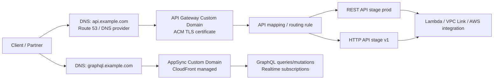
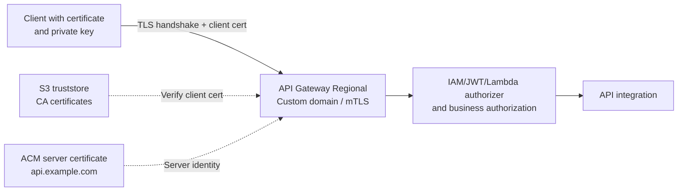
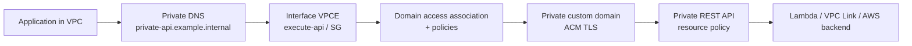
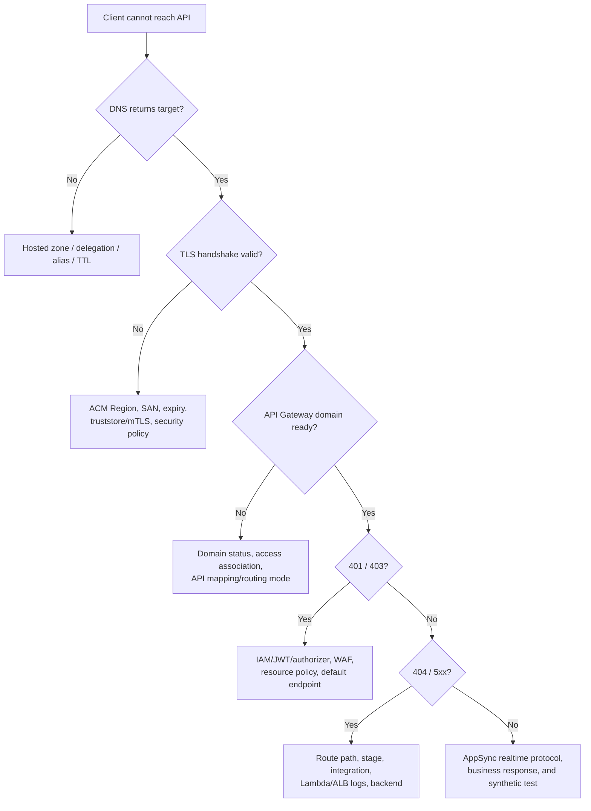

# Custom Domains, Certificates, and API Endpoints

## Learning Objectives

After this lesson, you will be able to:

1. Distinguish between the default `execute-api` URL, **custom domains**, **API mappings**, **routing rules**, and **DNS records** when publishing APIs on Amazon API Gateway.
2. Choose the right **Regional**, **edge-optimized**, or **private endpoint** by API type, understanding why REST, HTTP, WebSocket, and AWS AppSync have different support.
3. Provision an **AWS Certificate Manager (ACM) certificate** for the right domain names and Region, complete DNS validation, configure HTTPS/TLS, and plan certificate renewal/rotation.
4. Configure **Route 53 A/AAAA aliases** or DNS at external providers, understanding the difference between **your own hosted zone** and the **AWS-owned hosted zone ID for the API endpoint**.
5. Use **API mappings / base path mappings** for versions, stages, or multiple APIs under one domain, and distinguish them from newer API Gateway routing rules.
6. Set up a **custom domain for AppSync** sharing one hostname for GraphQL HTTPS and real-time WebSockets, knowing the **`us-east-1` ACM certificate** requirement.
7. Understand **mTLS**, **private custom domains**, disabling the default `execute-api` endpoint, IAM/JWT/Lambda authorizers, API resource policies, WAF, and the security boundaries of DNS/TLS.
8. Practice via the AWS CLI, verify with `curl`/DNS tools, troubleshoot 403/404/502/TLS errors, and evaluate monitoring, availability, and costs.

## 1. The Problem: API URLs Must Be Memorable, Secure, and Decoupled from Backends

Suppose an online store deploys a Java API using **API Gateway → Lambda** alongside a real-time GraphQL API using **AWS AppSync**. During testing, API Gateway provides a URL like:

```text
https://a1b2c3d4e5.execute-api.ap-southeast-1.amazonaws.com/prod/orders
```

AppSync exposes separate endpoints for GraphQL and subscriptions:

```text
https://a1b2c3d4e5.appsync-api.ap-southeast-1.amazonaws.com/graphql
wss://a1b2c3d4e5.appsync-realtime-api.ap-southeast-1.amazonaws.com/graphql
```

Default URLs work, but they are hard to remember, expose internal service stage/ID structure, and are poorly suited to long-term API contracts. The organization wants:

- Clients to call REST/HTTP APIs at `https://api.example.com/v1/orders`.
- GraphQL apps to call `https://graphql.example.com/graphql` and `wss://graphql.example.com/graphql/realtime`.
- Managed HTTPS certificates with automated renewal and monitoring.
- The ability to swap stages or backends without forcing partners to change hostnames.
- Blocking unintended entry points, enforcing authentication/authorization, and separating public APIs from private APIs.

A **custom domain** provides a hostname you control; a **certificate** proves domain identity and secures TLS; **DNS** routes clients to the AWS-provisioned target; and an **API mapping or routing rule** forwards requests from that domain to the target API/stage.

> **Early takeaway:** DNS and certificates do not grant application-level access control. An API with valid HTTPS can still expose data if routes lack authorizers, IAM/resource policies, or proper backend authorization.

### Traffic Flow Diagram



This diagram shows two **distinct AWS services**—AppSync is not a stage inside API Gateway. An API Gateway custom domain **does not automatically map** to AppSync.

## 2. Default API Endpoints vs. Custom Domains

| Concept | Example | Who manages it? |
| --- | --- | --- |
| **Default invoke URL** | `https://a1b2c3d4e5.execute-api.ap-southeast-1.amazonaws.com/prod/orders` | API Gateway assigns the hostname and API ID; stage/path behavior varies by API type. |
| **Custom domain hostname** | `api.example.com` | You own the domain name and create the custom domain configuration. |
| **Custom domain target** | `d-abc123.execute-api.ap-southeast-1.amazonaws.com` | API Gateway generates this target hostname for DNS configuration. |
| **ACM certificate** | Certificate with SAN `api.example.com` | You request/import, validate ownership, and attach to the custom domain. |
| **API mapping** | `v1` → HTTP API `abc123`, stage `prod` | API Gateway routes URL prefixes to an API and stage. |
| **DNS alias** | `api.example.com` → API Gateway Regional target | Route 53 or your DNS provider resolves the domain. |
| **API integration** | Route `GET /orders` → Lambda/ALB | API Gateway forwards requests to the backend. |

Once configured:

```text
Client calls: https://api.example.com/v1/orders/42
DNS: api.example.com → Regional API Gateway target
TLS: API Gateway presents valid certificate for api.example.com
Mapping: /v1 → API abc123, stage prod
Route in API: GET /orders/{id}
Backend: Lambda orders-handler → data
```

**The `/v1` segment on a custom domain is a mapping key**, not necessarily the internal stage name. Stripping the mapping prefix can cause the backend to receive a different path than when calling the default `execute-api` URL directly.

### REST, HTTP, and WebSocket APIs: They Do Not Share Identical Rules

| API type | Default endpoint | Custom domain | Notes |
| --- | --- | --- | --- |
| **REST API** (API Gateway v1) | `https://{api-id}.execute-api.{region}.amazonaws.com/{stage}/...` | **Regional**, **edge-optimized**, or **private custom domain** for private REST APIs. | Has stage deployments, usage plans/API keys, REST features; edge-optimized uses an API Gateway-managed CloudFront distribution. |
| **HTTP API** (API Gateway v2) | `https://{api-id}.execute-api.{region}.amazonaws.com/{stage}/...`; `$default` stage can be omitted from the URL. | **Regional custom domain**. | Differs in cost/features from REST; uses `apigatewayv2` CLI and API mappings. |
| **WebSocket API** (API Gateway v2) | `wss://{api-id}.execute-api.{region}.amazonaws.com/{stage}` | **Regional custom domain**. | Long-lived connections, route selection, and callback URLs; not identical to HTTP API. |
| **AWS AppSync GraphQL** | `https://...appsync-api.../graphql` and `wss://...appsync-realtime-api.../graphql` | AppSync-managed custom domain for GraphQL and real-time. | Requires an ACM certificate in `us-east-1`; uses AppSync domain associations, not API Gateway API mappings. |

URL examples use curly braces for placeholders; real API IDs and Regions come from your account. **API endpoint type** (`REGIONAL`/`EDGE`/`PRIVATE`) is an infrastructure deployment choice, whereas **REST/HTTP/WebSocket/GraphQL** is the API interface/protocol type. The two dimensions are independent.

## 3. Endpoint Types: Regional, Edge-Optimized, and Private

### 3.1. Regional Endpoints

A Regional custom domain is usually the best choice when:

- Clients mainly call the API from the same Region, or you **place your own CloudFront distribution** in front for custom caching, WAF, TLS, and multi-Region routing.
- You are using **HTTP API** or WebSocket API.
- You require **mTLS** on a public REST/HTTP API where supported.
- You prefer managing both the API Gateway endpoint and ACM certificate in the same Region.

For example, `api.example.com` for an HTTP API in Singapore needs an **ACM certificate in `ap-southeast-1`**, not an ARN from Tokyo or N. Virginia.

### 3.2. Edge-Optimized Endpoints for REST APIs

A REST API **edge-optimized custom domain** uses an **Amazon CloudFront distribution managed by API Gateway**. It requires an **ACM certificate in `us-east-1`** (N. Virginia), even if the REST API lives in another Region.

| Aspect | REST Regional | REST Edge-optimized |
| --- | --- | --- |
| Client hop to API | Regional API Gateway endpoint. | API Gateway-managed CloudFront edge forwarding to the API Region. |
| ACM certificate | **Same Region** as the Regional custom domain/API. | **`us-east-1`**. |
| DNS alias target | `RegionalDomainName` + `RegionalHostedZoneId`. | `DistributionDomainName` + `DistributionHostedZoneId`. |
| Operations/updates | Managed directly at the Regional endpoint. | Account for CloudFront propagation time on configuration changes. |
| Supported API types | REST/HTTP; WebSocket under Regional support. | **REST API** only—not HTTP or WebSocket APIs. |

Do not confuse an edge-optimized custom domain with **creating your own CloudFront distribution** in front of a Regional API; the two models differ in cache/certificate/DNS ownership and cost.

### 3.3. Private Custom Domains for Private REST APIs

A **Private REST API** is accessed through an **interface VPC endpoint** for `execute-api`. AWS supports **private custom domains** for REST APIs with specific requirements:

- Create a custom domain with endpoint type **`PRIVATE`**, plus a certificate and resource policy.
- Grant a **domain name access association** for each VPC endpoint allowed to use the domain.
- Design both the **private domain resource policy** and **private API resource policy** to govern allowed principals and VPC endpoints.
- Configure private DNS / Route 53 Private Hosted Zones and network reachability inside the VPC or connected networks; clients cannot reach it merely because the domain has a certificate.

Private custom domains take time to provision and associate. While the same private custom domain name can exist in multiple accounts under scoping rules, **do not assume namespace/policy mechanics match public domains**.

**Important limitation:** API Gateway mTLS **is not supported for private APIs** per REST/HTTP mTLS documentation. A private custom domain does not turn an HTTP API into a private REST API.

## 4. ACM Certificates: Right Names, Region, and Trust Chain

**AWS Certificate Manager (ACM)** issues public certificates once you prove domain ownership. Certificates attached to API Gateway or AppSync must cover the **exact hostname clients connect to**, in the Common Name/SAN per TLS verification rules.

Examples:

| Client URL | Matching certificate | Insufficient |
| --- | --- | --- |
| `https://api.example.com` | SAN `api.example.com` or `*.example.com`. | Cert covering only `www.example.com`. |
| `https://payments.api.example.com` | SAN `payments.api.example.com` or `*.api.example.com`. | `*.example.com` **does not** cover multiple subdomain levels. |
| `https://example.com` | SAN `example.com`. | `*.example.com` does not cover the zone apex. |
| `https://graphql.example.com` (AppSync) | ACM certificate in `us-east-1` covering `graphql.example.com`. | Same-named certificate located only in `ap-southeast-1`. |

### 4.1. Certificate Region Rules by Service

| Endpoint | Required ACM Region | Notes |
| --- | --- | --- |
| API Gateway **REST Regional** | **Region of the API/custom domain**, e.g., `ap-southeast-1`. | Regional endpoint binds a certificate in that Region. |
| API Gateway **HTTP/WebSocket Regional** | **Region of the API**, e.g., `ap-southeast-1`. | Domain created via `apigatewayv2`. |
| API Gateway **REST edge-optimized** | **`us-east-1`**. | Served via API Gateway-managed CloudFront. |
| API Gateway **private REST custom domain** | **Region of the private API/domain**, per private domain docs. | Also requires resource policy and access association. |
| **AppSync custom domain** | **`us-east-1`**. | AppSync provisions a CloudFront distribution using a N. Virginia certificate. |

### 4.2. Issuing a Certificate with DNS Validation

Run in the **target Region**—for example, for a Regional API Gateway in Singapore:

```bash
aws sts get-caller-identity

aws acm request-certificate \
  --domain-name api.example.com \
  --validation-method DNS \
  --region ap-southeast-1
```

AWS returns a `CertificateArn`. Use that ARN to inspect `DomainValidationOptions`:

```bash
aws acm describe-certificate \
  --certificate-arn "arn:aws:acm:ap-southeast-1:111122223333:certificate/<real-cert-id>" \
  --region ap-southeast-1 \
  --query 'Certificate.{Status:Status,Names:SubjectAlternativeNames,Validation:DomainValidationOptions}'
```

ACM provides a **CNAME record** to prove domain ownership. Create that exact record in your **public DNS zone** (or authoritative DNS provider), then wait until status reaches `ISSUED` before attaching it to an endpoint.

**The DNS validation CNAME only proves ownership; it is not the API endpoint record.** These two records serve **two separate purposes**: certificate verification and routing client traffic to your API.

For eligible AWS-issued public certificates, ACM can auto-renew as long as the DNS validation record stays intact and usage conditions are met. For **imported certificates** or private certificates, maintain a dedicated renewal and rotation plan.

### 4.3. Common Certificate Pitfalls

- Requesting the right domain name in the **wrong Region** → API Gateway/AppSync cannot select that ARN.
- Deleting the DNS validation CNAME after `ISSUED` → risks breaking **automated renewal**.
- Using wildcard `*.example.com` for `a.b.example.com` → TLS hostname mismatch.
- Attaching an expired imported cert or missing intermediate chain → client TLS failure.
- Using a private CA certificate on a public API whose clients do not trust the CA → TLS handshake/validation failure.
- Confusing a **client mTLS** certificate with the **server TLS** certificate API Gateway presents to clients.

### 4.4. TLS Security Policies

API Gateway lets you choose a **minimum TLS version and cipher/security policy** depending on custom domain type. `TLS_1_2` is widely used, and newer documentation also offers **TLS 1.3 security policies** for certain REST custom domains. Do not assume "API Gateway only ever supports TLS 1.2," and do not blindly pick a policy unsupported by your API/endpoint type.

For instance, HTTP API custom domains typically support `TLS_1_2` as the minimum policy in the standard configuration. For REST endpoints, consult the security policy table, cipher suites, endpoint type, and mTLS requirements before modifying settings.

## 5. API Mappings: One Hostname, Multiple APIs or Stages

An **API mapping** binds a custom domain path prefix to an API and stage. For example:

```text
https://api.example.com/           → HTTP API "homepage", stage $default
https://api.example.com/v1/        → REST API "orders-v1", stage prod
https://api.example.com/v2/        → HTTP API "orders-v2", stage prod
```

A Regional domain can map **both REST APIs and HTTP APIs** where supported by API Gateway; this does not mean you can mix WebSocket or AppSync into the same mapping table.

### 5.1. An API Mapping Key Is Not a Stage Path

| URL seen by caller | Mapping key | API/stage | Path delivered to API route |
| --- | --- | --- | --- |
| `/v1/orders/42` | `v1` | orders REST, stage `prod` | `/orders/42` |
| `/v2/orders/42` | `v2` | orders HTTP, stage `prod` | `/orders/42` |
| `/health` | empty/root mapping | health API, stage `$default` | `/health` |

Custom domain routing **strips the mapping key** before passing the request to the mapped API. Each stage retains its own deployment, integration, and authorizer. Creating an API mapping does not automatically block callers from invoking the default `execute-api` endpoint.

### 5.2. Longest Matching Prefix

With multi-level API mappings on Regional domains and compatible security policies, API Gateway selects the **longest matching prefix**. For example:

```text
Mapping A: /orders       → API A
Mapping B: /orders/v2    → API B

GET /orders/v2/items → API B; route receives /items
GET /orders/list     → API A; route receives /list
```

Do not treat this as a general-purpose wildcard reverse proxy: mappings have character/prefix rules and count limits, so test overlapping paths, `Host` headers, and how backends see paths.

### 5.3. New Routing Rules and Routing Modes

API Gateway now offers **routing rules** for certain custom domains alongside **API mappings / base path mappings**. Available routing modes:

| Routing mode | Meaning |
| --- | --- |
| `API_MAPPING_ONLY` | Uses API mappings only; the familiar pattern for HTTP/REST. |
| `ROUTING_RULE_ONLY` | Uses routing rules only, ignoring API mappings. |
| `ROUTING_RULE_THEN_API_MAPPING` | Evaluates routing rules first, falling back to API mappings. |

In the **AWS CLI `apigateway` (REST/v1)**, the equivalent enum values are `BASE_PATH_MAPPING_ONLY`, `ROUTING_RULE_ONLY`, and `ROUTING_RULE_THEN_BASE_PATH_MAPPING`. Do not copy `apigatewayv2` enum names into `apigateway`.

**This lab uses `API_MAPPING_ONLY`** for a clean, easy-to-verify CLI flow. Routing rules are useful for advanced conditions, provided you review precedence behavior and limits for your domain/API type.

## 6. Route 53 and DNS: Which Record Points Where?

Creating a custom domain and certificate only prepares the **TLS endpoint**. You must also publish the hostname in DNS.

### 6.1. Regional API Gateway Domain

API Gateway returns attributes such as:

```text
RegionalDomainName = d-abc123.execute-api.ap-southeast-1.amazonaws.com
RegionalHostedZoneId = <AWS-owned-hosted-zone-id>
```

Inside your **public hosted zone `example.com`**, create:

```text
Name: api.example.com
Type: A
Alias: YES
Alias DNSName: d-abc123.execute-api.ap-southeast-1.amazonaws.com
Alias HostedZoneId: RegionalHostedZoneId returned by API Gateway
```

Depending on IPv6 support, you can add a matching **AAAA alias** record. With third-party DNS providers lacking alias support, a **subdomain** like `api.example.com` can use a **CNAME** pointing to the AWS-provided target hostname; standard DNS prohibits CNAMEs at the **zone apex**.

**Never confuse the two hosted zone IDs:** the record is created inside **your domain's hosted zone**, while `AliasTarget.HostedZoneId` must be **API Gateway's target hosted zone ID**, not your `example.com` hosted zone ID.

### 6.2. Edge-Optimized REST Domain

API Gateway returns:

```text
DistributionDomainName  = <generated-distribution>.cloudfront.net
DistributionHostedZoneId = <AWS-CloudFront-hosted-zone-id>
```

Create a Route 53 alias pointing to that distribution domain name. Do not point DNS at a Regional API ID target when you created an **edge-optimized custom domain**, because TLS and mappings are hosted at the API Gateway-managed CloudFront endpoint.

### 6.3. Private Custom Domain

A private custom domain requires DNS **inside a VPC / private hosted zone** resolving to an authorized **interface VPC endpoint**. Design domain access associations, endpoint policies, and private API/domain resource policies together. Never expect a public `A` record to make a `PRIVATE` endpoint callable from the Internet.

### 6.4. DNS Propagation and TTLs

Client DNS resolvers cache records until TTL expiry. When swapping endpoints or certificates:

1. Prepare and test the new API, stage, and certificate.
2. Lower the DNS TTL ahead of the cutover if your DNS workflow allows.
3. Update the alias/CNAME record according to plan.
4. Monitor errors and latency across both old and new targets throughout the TTL window.
5. Delete old mappings or endpoints only after traffic has stabilized.

**DNS does not verify whether your API returns healthy business responses.** Route 53 alias failover also depends on configured health checks/failover policies; active-active multi-Region requires dedicated Route 53 / Global Accelerator / CloudFront design plus data replication.

## 7. AppSync Custom Domains: Sharing a Hostname for GraphQL and Real-Time

AWS AppSync provisions two default endpoint URLs:

```text
HTTPS GraphQL:
https://<api-id>.appsync-api.ap-southeast-1.amazonaws.com/graphql

Realtime WebSocket:
wss://<api-id>.appsync-realtime-api.ap-southeast-1.amazonaws.com/graphql
```

When creating an **AppSync custom domain** like `graphql.example.com`, clients use:

```text
GraphQL HTTPS:
https://graphql.example.com/graphql

Realtime WebSocket:
wss://graphql.example.com/graphql/realtime
```

**Crucial difference:** AppSync creates a **service-managed CloudFront distribution** for custom domains, so the **ACM certificate must be in `us-east-1`**—even when the GraphQL API and its data sources reside in `ap-southeast-1`.

### 7.1. Deploying AppSync Custom Domains via CLI

Assuming DNS ownership is verified and a `us-east-1` certificate is `ISSUED`:

```bash
# Domain and certificate ARN are illustrative values
aws appsync create-domain-name \
  --domain-name graphql.example.com \
  --certificate-arn arn:aws:acm:us-east-1:111122223333:certificate/<appsync-cert-id> \
  --description "GraphQL and realtime API endpoint" \
  --region ap-southeast-1
```

Next, associate the **GraphQL API ID**:

```bash
aws appsync associate-api \
  --domain-name graphql.example.com \
  --api-id "<real-appsync-api-id>" \
  --region ap-southeast-1
```

Inspect the status:

```bash
aws appsync get-domain-name \
  --domain-name graphql.example.com \
  --region ap-southeast-1 \
  --query 'domainNameConfig.{Domain:domainName,Target:appsyncDomainName,TargetZoneId:hostedZoneId,Certificate:certificateArn}'

aws appsync get-api-association \
  --domain-name graphql.example.com \
  --region ap-southeast-1
```

Create a Route 53 alias for `graphql.example.com` targeting the **`appsyncDomainName` and `hostedZoneId` returned by AppSync**, and wait for association status `SUCCESS` and DNS propagation. Always point to the **target returned by AppSync** rather than pointing `graphql.example.com` directly at either default endpoint.

### 7.2. Custom Domains Do Not Change AppSync Authentication

Creating a custom domain **does not turn `AWS_IAM` into `API_KEY`**, remove Cognito/OIDC/Lambda authorization, or grant new data-source permissions. **Authorization modes** remain configured on the GraphQL API.

Applications using subscriptions must:

- Connect to the WebSocket URL ending in `/graphql/realtime`.
- Supply headers, tokens, `SigV4` signatures, or auth parameters matching the AppSync real-time protocol and configured auth mode.
- Handle reconnects/retries, token expiration, connection lifecycles, and quotas.

A `200` response on an HTTPS GraphQL query **does not prove WebSocket subscriptions work**. Test real-time handshakes and event delivery separately.

### 7.3. Important Limitations

- AppSync custom domains **do not have API Gateway API mappings** for multiple REST/HTTP stages; AppSync uses **API associations**.
- Private AppSync APIs **cannot use custom domains** under current AppSync API association constraints.
- AppSync custom domains enforce TLS **1.2 or 1.3** per service documentation; do not blindly apply API Gateway HTTP API TLS policies to AppSync.
- Wildcard hostnames are supported with matching certificates, subject to domain conflicts and account scope.

## 8. Defense in Depth on Custom Domains

A custom domain solves **hostname and TLS**, not **who is allowed to invoke the API**. Design security layers by API type:

| Layer | API Gateway | AppSync |
| --- | --- | --- |
| **Transport/TLS** | ACM certificate, TLS policy, mTLS where supported. | ACM certificate in `us-east-1`, AppSync-managed endpoint. |
| **Authentication** | `AWS_IAM`, JWT authorizer (HTTP), Lambda authorizer, Cognito authorizer (REST) per API type. | `AWS_IAM`, Cognito, OIDC, Lambda auth, API key per configuration. |
| **Authorization** | Route/method policies, authorizer context, backend checks. | GraphQL schema directives, field/data-source resolvers, backend auth. |
| **Resource policy** | REST API resource policies, private domain policies/VPCE associations where supported. | IAM permissions, GraphQL auth modes, data-source policies. |
| **Abuse protection** | Throttling, quotas where supported, AWS WAF on REST stage or CloudFront. | AWS WAF AppSync association where applicable, request limits. |
| **Observability** | Access logs, execution logs, CloudWatch metrics, traces. | CloudWatch logs, metrics, X-Ray per configuration. |

### 8.1. When to Disable the Default `execute-api` Endpoint

Once your custom domain is verified, you can **disable the default `execute-api` endpoint** so callers cannot easily bypass your intended entry point:

- REST API: set `DisableExecuteApiEndpoint=true`, then **redeploy or update the stage** for it to take effect.
- HTTP API: set `DisableExecuteApiEndpoint=true`; requires a deployment unless the stage has **auto-deploy** enabled.

Clients can still connect to the `execute-api` hostname, but receive `403 Forbidden` once disabled. This is a **domain guardrail**, not a replacement for JWT/IAM authentication, resource policies, or network boundaries.

### 8.2. When to Use mTLS

**Mutual TLS (mTLS)** requires the **client to present a certificate** signed by a CA trusted in the server's truststore, in addition to the server certificate API Gateway presents to the client. It is commonly used for B2B integrations, internal services with PKI, or machine-to-machine partners.

- API Gateway supports mTLS on **Regional public REST/HTTP custom domains** with a compatible security policy (`TLS_1_2` is common).
- The truststore is a bundle of CA certificates stored in **S3**, referenced via `TruststoreUri`; manage CA versioning and rotation carefully.
- If using an imported or private-CA ACM certificate as the **server certificate** with mTLS, an ACM-issued **ownership verification certificate** may be required.
- **mTLS is not supported for private APIs**, and mTLS authenticates clients at the TLS layer—it never replaces endpoint/tenant authorization.

**Never upload customer or partner private keys into the S3 truststore.** The truststore holds CA/public certificates used to verify clients; client private keys must stay securely on the client side.

## 9. AWS CLI Lab: HTTP API Regional Custom Domain

This lab demonstrates publishing an **existing HTTP API** at `https://api.example.com/v1/orders`. It **does not create new Lambdas or routes**, keeping focus on the custom domain, certificate, mapping, and DNS.

### 9.1. Prerequisites

```text
Account (example):     111122223333
Region:                ap-southeast-1
HTTP API ID (example): a1b2c3d4
Deployed stage:        prod
Owned domain:          api.example.com
ACM certificate:       ISSUED in ap-southeast-1
Route 53 hosted zone:  example.com (public)
```

**IDs and ARNs in this guide are placeholders.** Run resource-creating/modifying commands only in your authorized lab account and hosted zone. API Gateway requests, Route 53 hosted zones/queries, certificates, and backends can incur charges.

### 9.2. Verify Account, API, Stage, and Certificate

```bash
aws sts get-caller-identity

aws apigatewayv2 get-api \
  --api-id a1b2c3d4 \
  --region ap-southeast-1 \
  --query '{Name:Name,Id:ApiId,Protocol:ProtocolType,DefaultDisabled:DisableExecuteApiEndpoint,Endpoint:ApiEndpoint}'

aws apigatewayv2 get-stages \
  --api-id a1b2c3d4 \
  --region ap-southeast-1 \
  --query 'Items[].{Stage:StageName,AutoDeploy:AutoDeploy,Deployment:DeploymentId}'

aws acm describe-certificate \
  --certificate-arn "arn:aws:acm:ap-southeast-1:111122223333:certificate/<real-cert-id>" \
  --region ap-southeast-1 \
  --query 'Certificate.{Status:Status,Domains:SubjectAlternativeNames,NotAfter:NotAfter}'
```

Proceed only when `ProtocolType=HTTP`, the target stage exists, the certificate status is `ISSUED`, and its SAN covers `api.example.com`.

### 9.3. Create the Regional Custom Domain

```bash
aws apigatewayv2 create-domain-name \
  --domain-name api.example.com \
  --domain-name-configurations \
    CertificateArn=arn:aws:acm:ap-southeast-1:111122223333:certificate/<real-cert-id>,EndpointType=REGIONAL,SecurityPolicy=TLS_1_2 \
  --routing-mode API_MAPPING_ONLY \
  --region ap-southeast-1
```

`--routing-mode API_MAPPING_ONLY` ensures the lab uses API mappings rather than routing rules. Wait for domain provisioning to complete; clients cannot call the domain until both the mapping and DNS record exist.

Inspect the AWS-assigned domain target:

```bash
aws apigatewayv2 get-domain-name \
  --domain-name api.example.com \
  --region ap-southeast-1 \
  --query 'DomainNameConfigurations[].{Target:ApiGatewayDomainName,TargetHostedZoneId:HostedZoneId,Status:DomainNameStatus,Cert:CertificateArn}'
```

**Illustrative** output:

```json
[
  {
    "Target": "d-abc123.execute-api.ap-southeast-1.amazonaws.com",
    "TargetHostedZoneId": "ZEXAMPLEAWSTARGETID",
    "Status": "AVAILABLE",
    "Cert": "arn:aws:acm:ap-southeast-1:111122223333:certificate/EXAMPLE"
  }
]
```

**Never copy `ZEXAMPLEAWSTARGETID` into a real configuration.** Hosted zone IDs vary by target and Region and must come from the actual command output.

### 9.4. Map Prefix `v1` to the API and Stage

```bash
aws apigatewayv2 create-api-mapping \
  --domain-name api.example.com \
  --api-mapping-key v1 \
  --api-id a1b2c3d4 \
  --stage prod \
  --region ap-southeast-1
```

Verify:

```bash
aws apigatewayv2 get-api-mappings \
  --domain-name api.example.com \
  --region ap-southeast-1
```

If the API defines route `GET /orders`, the custom domain URL is `https://api.example.com/v1/orders`. The `v1` prefix is consumed by the mapping and is not passed into the route path.

To map the **root**, omit `--api-mapping-key` in `create-api-mapping`, ensuring no two root mappings collide on the same domain.

### 9.5. Create the Route 53 Alias `A` Record

From `get-domain-name`, capture:

```text
Target: d-abc123.execute-api.ap-southeast-1.amazonaws.com
TargetHostedZoneId: ZEXAMPLEAWSTARGETID
```

Save `route53-api-alias.json` on your lab machine:

```json
{
  "Comment": "Map api.example.com to API Gateway Regional custom domain",
  "Changes": [
    {
      "Action": "UPSERT",
      "ResourceRecordSet": {
        "Name": "api.example.com.",
        "Type": "A",
        "AliasTarget": {
          "HostedZoneId": "ZEXAMPLEAWSTARGETID",
          "DNSName": "d-abc123.execute-api.ap-southeast-1.amazonaws.com.",
          "EvaluateTargetHealth": false
        }
      }
    }
  ]
}
```

Replace **both** target fields with real output values. `EvaluateTargetHealth=false` applies to a single API Gateway target; multi-Region architectures require a dedicated DNS failover and health-check strategy.

Find **your own domain's hosted zone** for `example.com` (not `TargetHostedZoneId`):

```bash
aws route53 list-hosted-zones-by-name \
  --dns-name example.com \
  --query 'HostedZones[].{Id:Id,Name:Name,Private:Config.PrivateZone}'
```

Confirm the hosted zone belongs to the right account and is **public**. Then run:

```bash
aws route53 change-resource-record-sets \
  --hosted-zone-id ZEXAMPLEYOURPUBLICZONE \
  --change-batch file://route53-api-alias.json
```

Record `ChangeInfo.Id` and wait for `INSYNC` if needed. You can add an `AAAA` alias if your endpoint IP address type and IPv6 architecture support it; never create `AAAA` records without verifying IPv6 support.

### 9.6. Verify DNS, TLS, and the Live API

```bash
# Query DNS; on Windows you can use nslookup instead of dig
dig api.example.com

# Inspect HTTP response headers, TLS, and timing
curl --verbose "https://api.example.com/v1/orders"

# Test the default invoke URL for comparison if not yet disabled
curl --verbose "https://a1b2c3d4.execute-api.ap-southeast-1.amazonaws.com/prod/orders"
```

**The result does not have to be HTTP `200`.** APIs with JWT/IAM authorizers, missing routes, or uninitialized backends can return `401`/`403`/`404`/`5xx`. The goal of the lab is to prove **the hostname/certificate, DNS, API mapping, and routing path** work while verifying caller authorization as designed.

To inspect TLS directly with OpenSSL:

```bash
openssl s_client -connect api.example.com:443 \
  -servername api.example.com \
  -showcerts
```

Note that `openssl s_client` does not evaluate business responses; inspect the certificate SANs, chain, TLS version, and any certificate validation errors.

### 9.7. Scoped Cleanup

If the domain was created solely for the lab with no active clients:

1. Delete the lab mapping using `delete-api-mapping` with the ID from `get-api-mappings`.
2. Delete **only** the `api.example.com` Route 53 record created for the lab, using `DELETE` with the exact existing record payload.
3. Delete the custom domain via `apigatewayv2 delete-domain-name` once no mappings remain.
4. Delete the certificate only if **no other service uses it** and doing so does not affect other renewals/validations.

**Never delete pre-existing HTTP APIs, Lambdas, or hosted zones** just because the lab finished—those resources were not created by these steps.

## 10. REST API Custom Domains: CLI v1 and Differences

For a **REST API**, the AWS CLI namespace is `aws apigateway`, not `apigatewayv2`. Example creating a **Regional** custom domain:

```bash
aws apigateway create-domain-name \
  --domain-name rest.example.com \
  --regional-certificate-arn "arn:aws:acm:ap-southeast-1:111122223333:certificate/<real-cert-id>" \
  --endpoint-configuration types=REGIONAL \
  --security-policy TLS_1_2 \
  --routing-mode BASE_PATH_MAPPING_ONLY \
  --region ap-southeast-1
```

Map the REST API/stage:

```bash
aws apigateway create-base-path-mapping \
  --domain-name rest.example.com \
  --base-path v1 \
  --rest-api-id "<real-rest-api-id>" \
  --stage prod \
  --region ap-southeast-1
```

Inspect the configuration:

```bash
aws apigateway get-domain-name \
  --domain-name rest.example.com \
  --region ap-southeast-1 \
  --query '{Target:regionalDomainName,TargetHostedZoneId:regionalHostedZoneId,EndpointType:endpointConfiguration.types,RoutingMode:routingMode}'

aws apigateway get-base-path-mappings \
  --domain-name rest.example.com \
  --region ap-southeast-1
```

If choosing **edge-optimized**, pass `--certificate-arn` in **`us-east-1`** and `--endpoint-configuration types=EDGE`, then use `distributionDomainName`/`distributionHostedZoneId` as the DNS target. That path differs from `regionalDomainName` and typically takes longer to provision.

### REST APIs Can Disable the Default Invoke URL

Once the custom domain is active and verified:

```bash
aws apigateway update-rest-api \
  --rest-api-id "<real-rest-api-id>" \
  --patch-operations op=replace,path=/disableExecuteApiEndpoint,value='True' \
  --region ap-southeast-1
```

**You must redeploy or update the REST stage** for the setting to take effect:

```bash
aws apigateway create-deployment \
  --rest-api-id "<real-rest-api-id>" \
  --stage-name prod \
  --region ap-southeast-1
```

Running `create-deployment` updates the live stage deployment; do so only after reviewing API configuration, stage variables, and release procedures. Disabling the default endpoint affects **all stages** of that REST API, not just one stage.

For HTTP API:

```bash
aws apigatewayv2 update-api \
  --api-id a1b2c3d4 \
  --disable-execute-api-endpoint \
  --region ap-southeast-1
```

If the HTTP stage has `AutoDeploy=true`, the change rolls out automatically; otherwise, create a deployment manually. **Never disable the default endpoint before confirming the custom domain is serving traffic**, or existing clients will lose connectivity.

## 11. mTLS: Verifying Client Certificates on Custom Domains

For certain B2B integrations, JWTs or API keys may be insufficient if policy mandates **mutual TLS** at connection establishment. API Gateway supports mTLS on compatible **Regional public REST/HTTP custom domains**.

### 11.1. Both Sides of mTLS



- The **ACM server certificate** proves the hostname the client is calling.
- The **client certificate** proves the caller's machine/service identity against a CA chain trusted by the truststore.
- The **S3 truststore** stores CA certificates used by API Gateway to verify clients.
- **API authorization** must still decide which client can invoke **which route, tenant, or resource**. Holding a valid client certificate does not automatically grant `DELETE /customers`.

### 11.2. Preparing the Truststore and Domain Configuration

Suppose you upload `truststore.pem` containing the **public CA certificate chain** to a private S3 bucket managed by the security team:

```text
s3://company-api-mtls-truststore/certs/truststore.pem
```

Enable bucket versioning, restrict write access to the truststore, and plan CA lifecycle/rotation. Never upload client private keys into the truststore.

Example configuring an **HTTP API custom domain** with mTLS:

```bash
aws apigatewayv2 create-domain-name \
  --domain-name partner-api.example.com \
  --domain-name-configurations \
    CertificateArn=arn:aws:acm:ap-southeast-1:111122223333:certificate/<real-cert-id>,EndpointType=REGIONAL,SecurityPolicy=TLS_1_2 \
  --mutual-tls-authentication \
    TruststoreUri=s3://company-api-mtls-truststore/certs/truststore.pem \
  --routing-mode API_MAPPING_ONLY \
  --region ap-southeast-1
```

This only succeeds when the bucket, truststore, and certificate are properly prepared, API Gateway can read the truststore, and IAM permissions allow domain creation.

When using an **imported or private-CA server certificate**, you may need `OwnershipVerificationCertificateArn` to prove hostname control. Inspect `TruststoreWarnings` and domain status in the response to catch invalid or pending certificates.

### 11.3. Testing an mTLS Client

```bash
# Run only on a test machine holding an AUTHORIZED client certificate and private key
curl --verbose \
  --cert client.crt \
  --key client.key \
  "https://partner-api.example.com/v1/status"
```

Test all cases:

- Client **with no certificate** → TLS handshake must be rejected per mTLS policy.
- Client with an **expired or untrusted CA certificate** → must not reach the route.
- Client with a valid certificate but **no API permission** → should receive `401`/`403` from the authorizer.
- Client with valid certificate and permissions → request reaches backend; verify business response.

Never commit `client.key` to repositories or send it over email/tickets; use a vault/HSM and secure certificate distribution.

## 12. Private Custom Domains: Access Paths and Multi-Layer Protection

A **private REST API** inside a VPC is invoked through an interface **`execute-api` VPC endpoint**. Adding a private custom domain requires configuring **multiple independent resources**:

| Component | Role |
| --- | --- |
| Private REST API | Exposes routes/methods and backend integrations. |
| Private custom domain | Domain name and ACM certificate for private clients. |
| Domain resource policy | Governs which principals/sources may access the domain. |
| Domain management policy | Governs which accounts/partners may create a **domain name access association** when needed. |
| Domain name access association | Binds the domain to an authorized VPC endpoint. |
| REST API resource policy | Controls which callers/VPC endpoints can invoke the private API. |
| Interface VPC endpoint policy | Filters `execute-api` requests at the endpoint. |
| Private DNS / Route 53 PHZ | Resolves the hostname to the VPC endpoint inside the VPC. |
| Security Group / NACL / routes | Permits clients to establish TLS to the interface endpoint. |

### 12.1. How Does a Private API Request Flow?



**A valid policy alone is not enough** if clients cannot resolve private DNS or the VPCE Security Group blocks port 443. Conversely, resolving to a valid private IP does not mean domain and API policies permit the request.

### 12.2. Do Not Equate Private Domains with Public Endpoints

- Never use a public API Gateway Regional alias record in place of a VPC endpoint association.
- Never omit domain or API resource policies just because the endpoint sits inside a VPC.
- Never publish a private DNS name in a public zone expecting Internet users to reach it.
- Never try to apply public Regional REST/HTTP mTLS settings onto a private API.

Private custom domains use dedicated APIs for domain name access associations, resource policies, and ARNs; in CloudFormation or Terraform, select the matching private-domain resources rather than copying public `apigatewayv2 create-domain-name` templates.

## 13. Rotating Certificates, Changing Domains, or Switching API Stages Safely

Production systems regularly need to **rotate certificates**, swap backends, or shift `/v1` to `/v2` without disrupting clients.

### 13.1. Certificate Rotation

1. **Inventory:** Record hostname, SANs, certificate ARN/Region, expiration date, API type, and endpoint type.
2. **Prepare:** Issue or import the new certificate in the **exact Region required by the endpoint**, complete DNS validation, and confirm `ISSUED` and full chain.
3. **Test:** Validate certificate and TLS policy on a staging domain or test hostname.
4. **Update:** Swap the certificate ARN on the API Gateway/AppSync domain via API/Console and monitor domain status (`UPDATING` → `AVAILABLE`).
5. **Observe:** Check TLS handshakes, HTTP responses, latency, and any clients using certificate pinning.
6. **Retire the old certificate** only once no service references it; preserve any DNS validation records needed for active certificates.

For **edge-optimized REST APIs** and **AppSync custom domains**, certificates reside in `us-east-1` because CloudFront serves them. For **Regional API Gateway**, certificates reside in the API's Region. **Updating a certificate ARN is not the same as updating a DNS A/CNAME record**: TLS is configured on the target endpoint, while DNS merely points to that endpoint.

### 13.2. Switching API Stages via Mapping

Current setup:

```text
api.example.com/v1 → HTTP API abc123, stage prod
```

To migrate to a new API:

1. Provision and test the new API/stage via a staging domain or invoke endpoint.
2. Configure authorizers, scopes, rate limits, and integrations on the new API to match security requirements.
3. Update the API mapping from the old API to the new API using `update-api-mapping`, verifying route and path compatibility.
4. Monitor API Gateway access logs, error rates, backend traces, and per-mapping request counts.
5. Keep the old version ready for rollback during the agreed change window.

If you only change the **API mapping** while keeping the same custom domain target, **no DNS change is required**. That is why decoupling a stable hostname from underlying API IDs and stages is so valuable.

### 13.3. Multi-Region and Disaster Recovery

A Regional API Gateway custom domain points to a specific Regional endpoint. If a service must survive full-Region failure, also design:

- **Parallel API deployments** in two Regions with matching routing and auth configurations.
- **ACM certificates in each Region** for Regional custom domains (the same hostname may need a certificate in every Region).
- **DNS failover / latency routing** via Route 53 or a global edge layer, tuning TTLs and health checks.
- **Data replication / failover** for RDS, DynamoDB, S3, Secrets Manager, and KMS keys matching RPO/RTO targets.
- **Idempotency**, login/token portability, connection draining, and client reconnect logic.

**DNS failover does not replicate databases or keep stateful WebSocket connections alive across Regions.** Real-time clients must reconnect, resubscribe, and resync state after a Regional failover.

### 13.4. Infrastructure as Code and Drift

For organizations running multiple environments, manage with IaC:

- Certificate issuance/validation, ARN Regions, and lifecycle via Terraform/CloudFormation/CDK/SAM per policy.
- API domain resources, API mappings/routing rules, routing modes, DNS aliases, and private VPCE associations.
- Auth/JWT audiences, WAF associations, CloudWatch logs, stage deployments, and tagging.
- Parameterize per-account inputs like domain names, hosted zone IDs, Regions, stages, and API IDs rather than hardcoding them.

Note: support for domain and private-association resources varies across REST, HTTP, WebSocket, AppSync, and IaC providers. Check current provider and service documentation before upgrading infrastructure.

## 14. Monitoring, Security, and Costs

### 14.1. Metrics and Logs to Watch

| Source | Signal | Meaning |
| --- | --- | --- |
| **API Gateway CloudWatch** | `Count`, `4XXError`, `5XXError`, `Latency`, `IntegrationLatency` where supported by API type. | Detects request errors, API latency, or backend slowdowns. |
| **Access logs** | Request ID, route, stage, status, source IP, non-sensitive authorizer context. | Identifies caller, path, and backend during incidents. |
| **Execution logs** (REST when enabled) | Integration/authorizer diagnostics. | Helpful for `403`/`502`, though avoid logging sensitive payloads. |
| **AWS AppSync** | GraphQL requests, latency, error metrics, resolver logs, subscription connections/messages as supported. | Separates resolver errors from subscription or auth errors. |
| **AWS Certificate Manager** | Certificate `ISSUED`, expiration date, renewal status. | Alerts on TLS expiration and invalidation risks. |
| **Route 53 / CloudWatch Synthetics** | DNS resolution, HTTP probes, TLS handshakes, endpoint failover. | End-to-end testing from the client's perspective. |
| **CloudTrail** | Creating/updating domains, mappings, certificates, API associations. | Audits out-of-band configuration changes. |
| **AWS WAF / authorizer logs** | Blocked requests, authentication/authorization failures. | Separates policy blocks from backend failures. |

CloudWatch API Gateway metrics may require enabling **detailed metrics** on a stage or specific configuration depending on REST vs. HTTP API. Never assume "no datapoints means no errors"; verify metric settings and logging permissions.

### 14.2. Deployment Security Practices

1. Enforce HTTPS and choose TLS security policies balancing client compatibility and security; avoid unnecessary plain HTTP.
2. Scope IAM permissions strictly for `apigateway:*DomainName`, `apigatewayv2:*DomainName`, AppSync domain operations, Route 53, and ACM; separate deployment roles from runtime/backend roles.
3. Protect **DNS hosted zones** and **ACM certificate management** with least-privilege IAM, MFA, change reviews, and CloudTrail.
4. Keep API keys, tokens, and personal data out of URL paths/query strings whenever possible, as URLs appear in logs.
5. Never rely on a REST **API key** as strong authentication for sensitive data; keys govern usage plans/quotas and do not replace IAM/JWT.
6. Enforce authorizers, scopes, RBAC, and backend business authorization; do not assume domain-level auth protects every route automatically.
7. For private REST APIs, audit **VPCE policy, domain policy, API resource policy, SGs/NACLs, and DNS** as a unified system.
8. With mTLS, manage client certificate expiration/revocation and truststore updates; a TLS-valid certificate does not confer business roles on its own.

### 14.3. Costs

| Component | Potential cost drivers |
| --- | --- |
| **API Gateway REST API** | API requests, data transfer, caching/features per API type and pricing. |
| **API Gateway HTTP API** | HTTP API requests, data transfer, enabled features. |
| **API Gateway WebSocket API** | Messages and connection minutes per pricing model. |
| **AppSync** | GraphQL queries/mutations, real-time connections/messages, caching, add-ons. |
| **ACM certificates** | Public ACM certificates follow AWS pricing policies; imported/private CA certificates and advanced features carry separate fees. |
| **Route 53** | Hosted zones, DNS queries, health checks, domain registration. |
| **CloudFront / WAF** | Edge-optimized or custom CDN/WAF usage and rules. |
| **CloudWatch / CloudTrail** | Logs, detailed metrics, alarms, management/data events. |
| **Backends** | Lambda duration/requests, VPC Link/ALB/NLB, RDS, DynamoDB, data transfer. |

Never quote one fixed USD rate across all Regions because **pricing varies by service, Region, volume, and time**. Use the AWS Pricing Calculator, Cost Explorer, Budgets, and logs to estimate your actual workload.

**Optimize in the right place:** API Gateway HTTP API is often cheaper per request than REST API, but lacks REST's full suite of usage plans, API keys, API caching, and private APIs. Pick the API type based on **required features**, not solely a per-request price line.

## 15. Troubleshooting: Separating DNS, TLS, Routing, and Authorization Errors

| Symptom | Likely cause | Priority checks |
| --- | --- | --- |
| `NXDOMAIN` calling `api.example.com` | Missing record in the right DNS zone, or wrong authoritative nameservers. | `dig`/`nslookup`, Route 53 record, NS delegation. |
| DNS resolves to an old endpoint | TTL caching, un-updated alias, or record created in a non-authoritative zone. | DNS chain, `change-resource-record-sets` status, TTL, resolver cache. |
| TLS hostname mismatch | Cert lacks matching SAN; wildcard covers only one subdomain level. | ACM SANs, custom domain certificate ARN, SNI. |
| Certificate missing in API Gateway console | ACM cert is in the **wrong Region** or not `ISSUED`. | REST edge/AppSync: `us-east-1`; Regional: matching Region. |
| Domain created, yet not serving | Domain is `UPDATING`/`PENDING...`; provisioning/propagation incomplete. | `get-domain-name`, status, certificate, association, DNS. |
| HTTP `403` from default `execute-api` | Default endpoint disabled or missing auth/resource permissions. | `DisableExecuteApiEndpoint` and stage deployment, IAM/JWT/authorizer. |
| Custom domain `403` while default endpoint `200` | API mapping/routing rule, domain policy, or host-based auth mismatch. | `RoutingMode`, mapping, REST resource policy, authorizer, WAF. |
| HTTP `404` / `Missing Authentication Token` from REST API | Wrong path/stage/mapping, undeployed route/method, or unexpected prefix stripping. | Mapping key, stage, resource/method, deployment, access logs. |
| HTTP `502`/`504` from API Gateway | Lambda/backend error, bad integration response, timeout, or unhealthy VPC Link/ALB target. | `IntegrationLatency`, logs, Lambda/ALB/networking. |
| HTTP API works on invoke URL, fails on domain | Missing API mapping or domain set to `ROUTING_RULE_ONLY`. | `get-api-mappings` and `get-domain-name.RoutingMode`. |
| REST base path mapping fails to create | Used `apigatewayv2` ID/CLI or wrong routing mode, or duplicate path. | `create-base-path-mapping` with REST API ID and `BASE_PATH_MAPPING_ONLY`. |
| Private API unreachable | Bad private DNS, missing domain access association, VPCE SG/resource policy block. | Endpoint ENI/SG, domain/API policies, hosted zone, source VPC. |
| mTLS handshake fails | Missing/expired client cert, untrusted CA, invalid truststore. | Client cert chain, S3 truststore, truststore warnings, TLS policy. |
| AppSync GraphQL HTTP works, subscription fails | Realtime uses `/graphql/realtime`, or auth handshake/token/protocol mismatch. | WebSocket URL, connection init, AppSync auth, logs. |
| AppSync custom domain cert fails to attach | Certificate not in `us-east-1`, validation pending, or CloudFront permission issue. | ACM ARN/Region/`ISSUED`, AppSync domain association status. |
| TLS errors after certificate rotation | Client pinning, incomplete cert chain, or domain still `UPDATING`. | TLS probes from multiple networks, ACM status, propagation. |

### Investigation Flowchart



### Verification Routine to Avoid Misdiagnosis

**Is DNS right?** Run `dig api.example.com` and verify the authoritative record. **Is TLS right?** Run `curl -v` or `openssl s_client` with SNI and check the chain. **Is the mapping right?** Run `get-api-mappings` or `get-base-path-mappings`. **Is auth passing?** Test with valid tokens/credentials and inspect access logs. **Is the backend healthy?** Compare the invoke URL against the mapped domain and check integration logs.

Never fix a `403` by **disabling authorizers**, opening wildcard resource policies, or turning off mTLS in production—doing so turns a configuration issue into a security incident.

## 16. Design Case Study

**Scenario:** An enterprise builds an ordering platform with three APIs:

- **REST API v1**: partner integration with usage plans, deployed in `ap-southeast-1`.
- **HTTP API v2**: invokes Java Lambda with JWT auth, deployed in Singapore.
- **AppSync GraphQL API**: provides real-time order status subscriptions.

The company domain `example.com` is hosted in Route 53. Partners want `https://api.example.com/v1`, mobile apps want `https://api.example.com/v2`, and the GraphQL UI uses `graphql.example.com`. Some partners also require client certificates.

### Requirements

1. Choose the **custom domain endpoint** type for REST v1 and HTTP v2 so they share `api.example.com`.
2. List the **ACM certificates and Regions** needed for `api.example.com` and `graphql.example.com`.
3. Propose two **API mapping keys** and explain what path reaches the backend.
4. Specify the Route 53 alias records, distinguishing your hosted zone from the target `HostedZoneId`.
5. Propose mTLS for partners without blocking mobile users who lack client certificates.
6. Disable the default `execute-api` endpoints for public APIs after domain cutover, noting any required redeploy steps.
7. Design the AppSync custom domain for both queries/mutations and subscriptions, testing HTTPS and WSS.
8. Write a `403`/`404`/TLS troubleshooting checklist and a certificate renewal/migration plan.
9. Outline monitoring for error rates, latency, certificate expiration, and cost.

### One Solution Approach

**Architecture:** Use a **Regional API Gateway custom domain** `api.example.com` in `ap-southeast-1`, allowing both the REST API and HTTP API to share it via `v1` and `v2` mappings. Provision an **ACM certificate in Singapore** covering `api.example.com`. Maintain separate stages and authorizers on the REST Regional API and HTTP API.

**Routing:** `/v1/orders` → REST `prod` stage route `/orders`; `/v2/orders` → HTTP `prod` stage route `/orders`. Use `API_MAPPING_ONLY` / `BASE_PATH_MAPPING_ONLY` with the matching CLI and verify longest-prefix behavior if adding subpaths.

**DNS:** Point a Route 53 alias `api.example.com` to API Gateway's **`RegionalDomainName` + `RegionalHostedZoneId`**. For AppSync, issue a **`us-east-1` ACM certificate** for `graphql.example.com`, create the AppSync domain and association, and alias DNS to **`appsyncDomainName` + `hostedZoneId`** returned by AppSync.

**mTLS:** Because only certain partners use client certificates while mobile apps rely on JWTs, use a **separate domain** such as `partner-api.example.com` (Regional mTLS) alongside `api.example.com` for public apps; enabling mTLS on the shared hostname would lock out mobile clients without certificates. Backends still authenticate and authorize partners.

**Security:** Enforce JWT/IAM/Lambda authorizers on routes, REST API resource policies where needed, and WAF/rate controls; disable default `execute-api` endpoints after verifying the custom domain and notifying clients. AppSync continues using its configured auth modes and field permissions.

**Operations:** Test TLS/HTTP/WSS from real clients, monitor CloudWatch, API access logs, and AppSync logs, and track ACM certificates, DNS TTLs/caches, and per-service costs.

## 17. Common Pitfalls

**Pitfall 1: "Adding a DNS CNAME automatically gives my API secure HTTPS."** No. The endpoint needs an ACM certificate matching the hostname and Region, and the app still needs authentication and authorization.

**Pitfall 2: "Every certificate for API Gateway must live in `us-east-1`."** No. **REST edge-optimized** uses `us-east-1`; **Regional** uses the API's own Region.

**Pitfall 3: "Placing the AppSync certificate in the same Region as the GraphQL API is enough."** No. AppSync custom domains use managed CloudFront distributions and require certificates in **`us-east-1`**.

**Pitfall 4: "HTTP API supports edge-optimized custom domains just like REST."** No. HTTP API uses **Regional custom domains**.

**Pitfall 5: "The API mapping key is literally the stage name."** No. `v1` can map to stage `prod`, with the prefix stripped by API Gateway.

**Pitfall 6: "The new routing rules always run alongside API mappings."** No. Evaluation depends on **`RoutingMode`** and precedence rules.

**Pitfall 7: "`BASE_PATH_MAPPING_ONLY` is the right flag for `apigatewayv2`."** No. API Gateway v2 uses `API_MAPPING_ONLY`; v1 uses `BASE_PATH_MAPPING_ONLY`.

**Pitfall 8: "Route 53 `AliasTarget.HostedZoneId` should be `example.com`'s hosted zone ID."** No. It must be the **AWS target endpoint's hosted zone ID**; the record itself is created inside `example.com`'s hosted zone.

**Pitfall 9: "Disabling the default `execute-api` endpoint replaces JWT/IAM auth."** No. It only closes the default invoke URL; routes and backends still need proper security.

**Pitfall 10: "A private custom domain is just a public API with a private DNS record."** No. It requires a **`PRIVATE` REST API**, an interface VPCE, domain access associations, and policies.

**Pitfall 11: "mTLS means the client is authorized for every operation."** No. mTLS only authenticates the client certificate at TLS; business authorization is still required.

**Pitfall 12: "AppSync GraphQL and real-time subscriptions share the exact same URL path."** Not quite. Custom domains typically expose `/graphql` for HTTPS and `/graphql/realtime` for WSS.

**Pitfall 13: "Rotating a certificate does not require checking DNS validation or certificate chains."** No. ACM status, SANs, CA trust, renewal records, and endpoint configurations must all stay consistent.

**Pitfall 14: "DNS failover automatically migrates live data and open WebSocket connections."** No. Applications must handle reconnects, resubscribes, retries, and data replication.

## 18. Self-Check Questions

**Question 1.** Which Region holds the ACM certificate for a Regional HTTP API in Singapore?

**Answer:** `ap-southeast-1`, the same Region as the API and custom domain.

**Question 2.** Where must the ACM certificate live for a Singapore REST API using an edge-optimized custom domain?

**Answer:** `us-east-1`, because API Gateway creates a CloudFront distribution for edge-optimized domains.

**Question 3.** Where must the ACM certificate live for a Singapore AppSync GraphQL API with a custom domain, and what is the WSS path?

**Answer:** Certificate in `us-east-1`; real-time WebSockets connect to `wss://graphql.example.com/graphql/realtime`.

**Question 4.** Can REST v1 and HTTP v2 share the same hostname `api.example.com`?

**Answer:** Yes, with a **Regional custom domain** in the same Region and supported API mappings, e.g., `v1` → REST `prod` stage and `v2` → HTTP `prod` stage.

**Question 5.** If API mapping `v1` targets stage `prod` and receives `/v1/orders`, what path does the API route typically see?

**Answer:** `/orders`, after API Gateway strips the `v1` prefix.

**Question 6.** Why does a Route 53 alias need API Gateway's target hosted zone ID?

**Answer:** Because `AliasTarget.HostedZoneId` identifies the **target AWS service's hosted zone**; the record lives in your own hosted zone, so you do not put your own zone ID in `AliasTarget`.

**Question 7.** After disabling `execute-api`, what do clients receive when calling the default invoke URL?

**Answer:** Typically `403 Forbidden` once the setting takes effect and the stage is deployed per the API type.

**Question 8.** Can you enable mTLS on a private API?

**Answer:** No, under current API Gateway REST/HTTP mTLS support; mTLS applies to compatible **Regional public custom domains**.

**Question 9.** Is a certificate for `*.example.com` valid for `payments.api.example.com`?

**Answer:** No. A single-level wildcard `*.example.com` does not cover two-level subdomains like `payments.api.example.com`.

**Question 10.** AppSync GraphQL queries work over a custom domain, yet subscriptions fail to connect. What should you inspect?

**Answer:** The WSS endpoint `/graphql/realtime`, protocol/auth handshake, token expiration, DNS/CloudFront association, and AppSync logs.

## Official AWS Documentation

- [API Gateway — Custom domain names for public REST APIs](https://docs.aws.amazon.com/apigateway/latest/developerguide/how-to-custom-domains.html)
- [API Gateway — Regional custom domain names](https://docs.aws.amazon.com/apigateway/latest/developerguide/apigateway-regional-api-custom-domain-create.html)
- [API Gateway — Edge-optimized custom domain names](https://docs.aws.amazon.com/apigateway/latest/developerguide/how-to-edge-optimized-custom-domain-name.html)
- [API Gateway — HTTP API custom domain names](https://docs.aws.amazon.com/apigateway/latest/developerguide/http-api-custom-domain-names.html)
- [API Gateway — Set the routing mode](https://docs.aws.amazon.com/apigateway/latest/developerguide/set-routing-mode.html)
- [API Gateway — API mappings for custom domain](https://docs.aws.amazon.com/apigateway/latest/developerguide/http-api-mappings.html)
- [API Gateway — Private custom domain names](https://docs.aws.amazon.com/apigateway/latest/developerguide/apigateway-private-custom-domains.html)
- [API Gateway — REST mutual TLS](https://docs.aws.amazon.com/apigateway/latest/developerguide/rest-api-mutual-tls.html)
- [API Gateway — HTTP mutual TLS](https://docs.aws.amazon.com/apigateway/latest/developerguide/http-api-mutual-tls.html)
- [API Gateway — Disable default endpoint for REST APIs](https://docs.aws.amazon.com/apigateway/latest/developerguide/rest-api-disable-default-endpoint.html)
- [API Gateway — Disable default endpoint for HTTP APIs](https://docs.aws.amazon.com/apigateway/latest/developerguide/http-api-disable-default-endpoint.html)
- [AWS AppSync — Configuring custom domain names for GraphQL and real-time APIs](https://docs.aws.amazon.com/appsync/latest/devguide/custom-domain-name.html)
- [AWS AppSync CLI — create-domain-name](https://docs.aws.amazon.com/cli/latest/reference/appsync/create-domain-name.html)
- [AWS AppSync CLI — associate-api](https://docs.aws.amazon.com/cli/latest/reference/appsync/associate-api.html)
- [AWS CLI — API Gateway v2 create-domain-name](https://docs.aws.amazon.com/cli/latest/reference/apigatewayv2/create-domain-name.html)
- [AWS CLI — API Gateway v2 create-api-mapping](https://docs.aws.amazon.com/cli/latest/reference/apigatewayv2/create-api-mapping.html)
- [AWS CLI — REST create-base-path-mapping](https://docs.aws.amazon.com/cli/latest/reference/apigateway/create-base-path-mapping.html)
- [AWS Certificate Manager — DNS validation](https://docs.aws.amazon.com/acm/latest/userguide/dns-validation.html)
- [Amazon Route 53 — Routing traffic to API Gateway](https://docs.aws.amazon.com/Route53/latest/DeveloperGuide/routing-to-api-gateway.html)
- [Amazon API Gateway pricing](https://aws.amazon.com/api-gateway/pricing/)
- [AWS AppSync pricing](https://aws.amazon.com/appsync/pricing/)

**Key takeaway:** A production-ready API endpoint combines **DNS → properly named/Region-matched TLS certificate → custom domain → mapping/routing → API stage/GraphQL API → authorizer → backend**. For **Regional API Gateway**, ACM certificates live in the API's Region; for **REST edge-optimized** and **AppSync custom domains**, certificates live in **`us-east-1`**. Always verify both the default endpoint and custom domain, protect private APIs with VPCEs and layered policies, test both HTTPS and WSS, monitor certificates, latency, and errors, and plan cutovers and rollbacks before going live.
