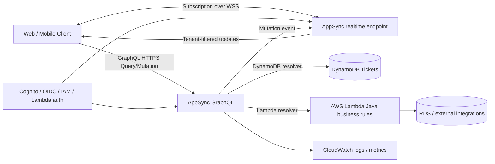
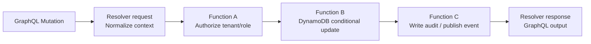
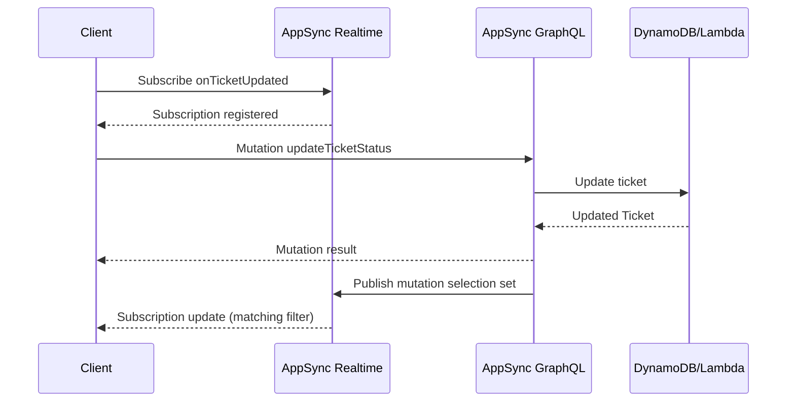

# AppSync GraphQL, Resolvers, and Subscriptions

An enterprise is building an order-tracking system. The web app needs to read the latest status, update records, and **receive immediate notifications whenever status changes** without continuously polling a REST API. Data lives in **Amazon DynamoDB**, several business rules run in **Java AWS Lambda**, and users authenticate via **Amazon Cognito**.

With **AWS AppSync GraphQL**, you can expose one unified schema for **Queries**, **Mutations**, and **Subscriptions**:

- **Query:** reads data, e.g., `getTicket(id: ...)`.
- **Mutation:** modifies data, e.g., `updateTicketStatus(...)`.
- **Subscription:** holds a WebSocket connection open to receive updates triggered by designated schema mutations.

However, defining a GraphQL schema alone is not enough for an application to work properly: each field needs an appropriate **resolver**, **data sources** need IAM permissions, subscriptions must enforce **tenant boundaries**, and updating DynamoDB directly outside a mutation does not automatically trigger GraphQL notifications.

This lesson belongs to the **API Gateway and AppSync** chapter of the **CLOUD_PROVIDERS_AWS** module, connecting Regions/AZs, IAM, VPCs, Lambda, DynamoDB, API design, monitoring, resilience, and cost control. The focus is **AppSync GraphQL, resolvers, and subscriptions**, while clarifying when to choose API Gateway or AppSync Events instead.

## 1. Learning Objectives

After this lesson, you will be able to:

1. Distinguish **GraphQL schemas**, **Queries**, **Mutations**, **Subscriptions**, **resolvers**, and **data sources**.
2. Explain AWS AppSync GraphQL architecture, its HTTP and WebSocket paths, and its boundaries versus API Gateway and AppSync Events.
3. Author a GraphQL schema with types, inputs, enums, non-null constraints, matching resolvers, and subscription triggers via `@aws_subscribe`.
4. Write **`APPSYNC_JS` unit resolvers** to read/write DynamoDB and invoke Java Lambdas.
5. Describe **pipeline resolvers**, `ctx.args`, `ctx.identity`, `ctx.stash`, `ctx.prev.result`, and error handling.
6. Distinguish **basic subscription filtering** from **enhanced filtering**, implementing server-side filtering grounded in verified identity.
7. Design multi-tenant security using Cognito, IAM, OIDC, or Lambda authorizers, least privilege, and field-level controls.
8. Diagnose GraphQL errors, `403`/`401` failures, unexpected `null` data, WebSocket reconnects, missing subscription updates, and N+1 resolver calls.
9. Monitor CloudWatch, logs, query/real-time costs, and run end-to-end tests in CI/CD pipelines.

## 2. What Is AWS AppSync GraphQL?

**AWS AppSync** is a managed **GraphQL** API service connecting multiple data sources and supporting real-time updates. Instead of building multiple REST endpoints that clients must stitch together, applications request **only the exact fields** they need from a single GraphQL endpoint.

For example, when displaying a ticket:

```graphql
query GetTicket($id: ID!) {
  getTicket(id: $id) {
    id
    title
    status
    updatedAt
  }
}
```

The client specifies the **selection set** `id/title/status/updatedAt`; resolvers and data sources fetch the data, and AppSync shapes the response to match the schema.

### 2.1. Core Components

| Component | Role | Example |
|---|---|---|
| **GraphQL API** | Endpoint plus security, schema, and resolver configuration | `https://<api-id>.appsync-api.<region>.amazonaws.com/graphql` |
| **Schema** | Contract of types and operations | `type Query`, `type Mutation`, `type Subscription` |
| **Resolver** | Evaluates a field's request/response against a data source | `Query.getTicket` |
| **Data source** | Backend invoked by AppSync | DynamoDB, Lambda, HTTP, RDS, OpenSearch, `NONE`, EventBridge, etc. |
| **Unit resolver** | Single resolver interacting with one data source | `GetItem` from DynamoDB |
| **Pipeline resolver** | Runs an ordered sequence of AppSync functions | Authorize → Load → Transform |
| **`APPSYNC_JS`** | Restricted AWS-managed JavaScript runtime | `request(ctx)` / `response(ctx)` |
| **VTL** | Legacy mapping template language still supported | `$ctx.args.id` in VTL |
| **Realtime endpoint** | WebSocket connection for GraphQL subscriptions | Clients subscribe and receive updates |
| **Authorization mode** | How requests are authenticated/authorized | Cognito User Pools, IAM, OIDC, API key, Lambda |

**`APPSYNC_JS` is not full Node.js.** Resolvers cannot install arbitrary NPM packages, open raw sockets, make direct HTTP `fetch` calls, or use all Node.js APIs. To call external systems, use an appropriate **data source**, or invoke Lambda for complex logic.

### 2.2. How Does AWS AppSync Differ from API Gateway?

| Requirement | AppSync GraphQL | Amazon API Gateway |
|---|---|---|
| Clients choose which fields to fetch | **Core GraphQL capability** | REST/HTTP can customize responses, not GraphQL by default |
| Combine DynamoDB/Lambda/RDS into one schema | Resolvers and data sources/pipelines | HTTP/Lambda/AWS service integrations per API type |
| Real-time updates via GraphQL subscriptions | **Yes** | WebSocket API requires building routes, `$connect`/`$disconnect`, and fan-out |
| HTTP REST API with OpenAPI, proxies, path/method routing | Not its primary goal | **Usually a better fit** |
| Web/mobile clients querying relational data across screens | Often a great fit | Requires combining multiple endpoints or adding a BFF |
| Exposing existing Java REST backends | Connectable via HTTP/Lambda data sources | Usually simpler and more direct |
| IAM/OIDC/Cognito/custom authorization | Yes, with GraphQL-specific semantics | Yes, varying by Gateway type and authorizer |
| Real-time Pub/Sub without a GraphQL schema | **AppSync Events** is a dedicated option | Custom WebSocket API may fit |

**Never choose GraphQL just to "use new tech."** REST remains ideal for simple endpoints, binary uploads/downloads, webhooks, and APIs with clear HTTP resource/caching semantics. GraphQL shines when clients aggregate diverse data and especially when subscriptions pair naturally with mutations.

### 2.3. AppSync GraphQL vs. AppSync Events

Since **March 13, 2025**, AWS has offered **AppSync Events** for WebSocket-based Pub/Sub using a dedicated channel/event model. Keep them distinct:

- **AppSync GraphQL subscriptions:** Declared in a GraphQL schema, publishing notifications tied to mutations marked with `@aws_subscribe`; clients speak the GraphQL real-time protocol.
- **AppSync Events:** Real-time publish/subscribe channels for event-driven interactions **without requiring GraphQL Queries or Mutations**; separate APIs, endpoints, and pricing.

If your workload only broadcasts sensor telemetry, chat channels, or push events without a GraphQL data schema, evaluate AppSync Events. This lesson focuses on **GraphQL**.

Sources: [What is AWS AppSync](https://docs.aws.amazon.com/appsync/latest/devguide/) and [GraphQL subscriptions](https://docs.aws.amazon.com/appsync/latest/devguide/aws-appsync-real-time-data.html).

## 3. Reference Architecture for Java Applications and Real-Time Updates

Suppose an application serves multiple organizations (**tenants**), and each ticket belongs to exactly one `tenantId`.



Each hop has a distinct nature:

1. **HTTPS Query/Mutation:** AppSync receives the request, authenticates the caller, checks schema/authorization, executes the resolver, and returns `data`/`errors`.
2. **WebSocket Subscription:** The client registers a subscription, AppSync verifies permissions and holds the socket; when a linked mutation succeeds, AppSync pushes events to matching subscribers.
3. **AppSync → data source:** AppSync uses its data-source IAM service role and integration model. A GraphQL user's credentials **do not automatically become IAM credentials** to query DynamoDB.
4. **Java Lambda → RDS/HTTP service:** Lambda has its own execution role, VPC/networking, secrets, and timeout—it is an independent hop.

**Important:** DynamoDB Streams or a Lambda writing directly to the Tickets table **does not automatically emit GraphQL subscription events**. To notify clients from external changes, build an integration flow that invokes a mutation or use another real-time mechanism (such as AppSync Events) with proper authorization and idempotency.

## 4. GraphQL Schema: The Data Contract Before Resolvers

Schemas use **GraphQL Schema Definition Language (SDL)**. Standard scalars are `ID`, `String`, `Int`, `Float`, `Boolean`; AppSync adds scalars like `AWSDateTime`, `AWSJSON`, `AWSEmail`, and `AWSURL`.

### 4.1. Multi-Tenant Ticket System Schema Example

```graphql
enum TicketStatus {
  OPEN
  IN_PROGRESS
  RESOLVED
}

type Ticket {
  id: ID!
  tenantId: ID!
  title: String!
  status: TicketStatus!
  updatedAt: AWSDateTime!
}

input CreateTicketInput {
  title: String!
}

type Query {
  getTicket(id: ID!): Ticket
}

type Mutation {
  createTicket(input: CreateTicketInput!): Ticket!
  updateTicketStatus(id: ID!, status: TicketStatus!): Ticket!
}

type Subscription {
  onTicketUpdated(tenantId: ID!): Ticket
    @aws_subscribe(mutations: ["updateTicketStatus"])
}

schema {
  query: Query
  mutation: Mutation
  subscription: Subscription
}
```

**Example assumption:** The default authorization mode is **Amazon Cognito User Pools**; the user's JWT contains a trusted, organization-managed `custom:tenant_id` claim. **Tenant IDs must never be taken blindly from client arguments to grant access.**

### 4.2. Reading Schema Semantics

| Syntax | Meaning |
|---|---|
| `id: ID!` | Required ID; field cannot return `null` |
| `getTicket(id: ID!): Ticket` | Ticket may not be found → can return `null` |
| `createTicket(...): Ticket!` | Mutation must return a `Ticket` object—cannot return `null` on GraphQL success |
| `[Ticket!]!` | Non-null list whose elements are also non-null |
| `input` | Input payload type for mutations, distinct from output object types |
| `enum TicketStatus` | Restricts values to a fixed set |
| `@aws_subscribe(mutations: [...])` | Ties subscription triggers to the listed mutations |

### 4.3. Never Confuse Schema Validation with Business Authorization

GraphQL checks types and arguments before running resolvers, yet a schema **never enforces** business rules such as:

- A user in tenant A cannot read a ticket in tenant B.
- Viewers may call `getTicket`, not `updateTicketStatus`.
- Only the ticket assignee may transition a ticket to `RESOLVED`.
- Status transitions must follow a valid state order.

Enforce those rules in resolvers, Lambdas, and backends using verified identity. GraphQL is not a security boundary replacing IAM or tenant-level policies.

## 5. Client-Side Queries, Mutations, and Subscriptions

### 5.1. Query

```graphql
query GetTicket($id: ID!) {
  getTicket(id: $id) {
    id
    title
    status
    updatedAt
  }
}
```

Variables:

```json
{
  "id": "ticket-123"
}
```

A standard GraphQL HTTP request is a **`POST`** to `/graphql` with JSON `query` and `variables`. AppSync validates the caller using the configured authorization mode (e.g., Cognito JWT in the `Authorization` header).

### 5.2. Mutation

```graphql
mutation UpdateTicketStatus($id: ID!, $status: TicketStatus!) {
  updateTicketStatus(id: $id, status: $status) {
    id
    tenantId
    title
    status
    updatedAt
  }
}
```

Variables:

```json
{
  "id": "ticket-123",
  "status": "RESOLVED"
}
```

**Why does the mutation select `tenantId` too?** In AppSync GraphQL subscriptions, the fields delivered to subscribers come from the **mutation selection set**. If a subscription asks for `tenantId` or `updatedAt` while the mutation omitted them, subscribers receive `null` or hit non-null errors. Therefore, mutations must select every field needed by subscriptions and enhanced filters.

**Only return mutation results after the write genuinely succeeds:** a mock `NONE` mutation does not update the database. Avoid empty pass-through mutations used solely to broadcast events without an authoritative data source and authorization.

### 5.3. Subscription

```graphql
subscription OnTicketUpdated($tenantId: ID!) {
  onTicketUpdated(tenantId: $tenantId) {
    id
    tenantId
    status
    updatedAt
  }
}
```

Variables:

```json
{
  "tenantId": "tenant-a"
}
```

Subscriptions **do not automatically return historical tickets**. Clients typically run a `Query` for the initial snapshot and `Subscribe` for subsequent updates—handling races between snapshot and subscription setup, reconnects, and reconciliation via `updatedAt`/versions.

## 6. Data Sources: Which Backends Does AppSync Call?

| Data source | Typical operations | When appropriate |
|---|---|---|
| **DynamoDB** | `GetItem`, `PutItem`, `UpdateItem`, `Query` | Key-value/document access with efficient partition/index queries |
| **AWS Lambda** | `Invoke` or `BatchInvoke` | Complex Java logic, legacy/API integration, multi-step validation |
| **HTTP endpoint** | HTTP request mapping to authorized services | Existing REST backends or internal HTTP services over supported networking |
| **Amazon RDS** | Data source via supported integration (commonly Aurora / Data API) | Applications needing SQL and relational transactions |
| **Amazon OpenSearch Service** | Full-text and search queries | Specialized search and analytics |
| **EventBridge** | Emit events onto an event bus | Asynchronous decoupling and event-driven workflows |
| **`NONE`** | No backend call; transforms payload inside AppSync | Auth checks, transforms, or mock notification mutations |
| **Amazon Bedrock** | AI inference inside APIs where integrated | Generative/AI features governed by policy |

**Pick data sources by query and transaction needs**—do not put Lambda in front of every field when a direct DynamoDB resolver is safer, cheaper, and lower latency.

**Never use a full-table DynamoDB `Scan` as a production "list all" default.** `Query` by partition key or GSI with pagination and bounded limits to avoid burning read capacity and leaking other tenants' records.

## 7. `APPSYNC_JS` Resolvers: `request` / `response`

A **unit resolver** binds to a field, targets one data source, and implements two functions:

```javascript
export function request(ctx) {
  // Return the request object sent by AppSync to the data source.
}

export function response(ctx) {
  // Transform the data source result into the GraphQL response.
}
```

### 7.1. Resolver Context

| Variable | Contents |
|---|---|
| `ctx.args` or `ctx.arguments` | Input arguments to the GraphQL field |
| `ctx.identity` | Verified caller identity; shape depends on auth mode |
| `ctx.info` | Field and schema metadata |
| `ctx.source` | Parent object when resolving nested fields |
| `ctx.result` | Data source result in the response handler |
| `ctx.error` | Data source error details if any |
| `ctx.stash` | Shared per-request state across a pipeline resolver |
| `ctx.prev.result` | Output of the previous step in a pipeline |
| `util.error(...)` | Halts resolution and emits a field error |
| `util.appendError(...)` | Appends an error without halting the handler |
| `util.unauthorized()` | Rejects the field as unauthorized |

**Never assume `ctx.identity.username` exists without checking the auth mode.** User Pools provide `sub` and `claims`, IAM provides `userArn`/`accountId`, and API keys provide no user identity at all. For tenant identity, rely on claims issued by a **trusted issuer/authorizer**.

### 7.2. `APPSYNC_JS` Runtime Is Not a Java Runtime

JavaScript resolvers execute inside AppSync. Place **server-side Java code** in AWS Lambda or an HTTP backend whenever you need Java libraries, DB connection pools, or full runtime capabilities. Never try to import the AWS SDK for Java into an `APPSYNC_JS` resolver.

Sources: [AppSync JavaScript resolver overview](https://docs.aws.amazon.com/appsync/latest/devguide/resolver-reference-overview-js.html) and [Resolver context reference](https://docs.aws.amazon.com/appsync/latest/devguide/resolver-context-reference-js.html).

## 8. Unit Resolver: Tenant-Safe DynamoDB Reads

Suppose the DynamoDB table `Tickets` uses a composite primary key:

```text
Partition key: pk (String) = TENANT#<tenantId>
Sort key:      sk (String) = TICKET#<ticketId>

Other attributes: id, tenantId, title, status, updatedAt
```

For `Query.getTicket(id: ID!)`, the resolver must **extract `tenantId` from the JWT**, never trusting a raw `ctx.args` parameter.

### 8.1. `APPSYNC_JS` Resolver for `Query.getTicket`

```javascript
import { util } from '@aws-appsync/utils';
import * as ddb from '@aws-appsync/utils/dynamodb';

function tenantFromIdentity(ctx) {
  const claims = ctx.identity && ctx.identity.claims;
  const tenantId = claims && claims['custom:tenant_id'];
  if (!tenantId) {
    util.unauthorized();
  }
  return tenantId;
}

export function request(ctx) {
  const tenantId = tenantFromIdentity(ctx);
  const ticketId = ctx.args.id;

  return ddb.get({
    key: {
      pk: 'TENANT#' + tenantId,
      sk: 'TICKET#' + ticketId
    }
  });
}

export function response(ctx) {
  if (ctx.error) {
    util.error(ctx.error.message, ctx.error.type);
  }
  return ctx.result; // null if ticket is not found
}
```

**Prerequisites to run:**

- A DynamoDB data source pointing to `Tickets` in the same Region.
- Data-source service role granting at least `dynamodb:GetItem` on the table.
- Cognito auth configured so `ctx.identity.claims` is populated.
- Valid `APPSYNC_JS` code using `@aws-appsync/utils/dynamodb`.
- Database keys matching the `pk`/`sk` layout.
- Nullable `Ticket` return type allowing `null` when not found.

**Security benefit:** Because the partition key is derived from the **authenticated tenant**, a caller in tenant A cannot supply another tenant's `id` to read items in tenant B's partition. Never trust a client-supplied `tenantId` without verifying it against identity claims.

## 9. Unit Resolver: Creating a Ticket in DynamoDB

Mutation `createTicket(input: ...)` can write directly with `ddb.put`:

```javascript
import { util } from '@aws-appsync/utils';
import * as ddb from '@aws-appsync/utils/dynamodb';

export function request(ctx) {
  const claims = ctx.identity && ctx.identity.claims;
  const tenantId = claims && claims['custom:tenant_id'];
  if (!tenantId) {
    util.unauthorized();
  }

  const id = util.autoId();
  const now = util.time.nowISO8601();
  const title = ctx.args.input.title;

  if (!title || title.length > 160) {
    util.error('Invalid ticket title', 'BadRequest');
  }

  const item = {
    pk: 'TENANT#' + tenantId,
    sk: 'TICKET#' + id,
    id,
    tenantId,
    title,
    status: 'OPEN',
    updatedAt: now
  };

  return ddb.put({
    key: { pk: item.pk, sk: item.sk },
    item,
    condition: { pk: { attributeExists: false } }
  });
}

export function response(ctx) {
  if (ctx.error) {
    util.error(ctx.error.message, ctx.error.type);
  }
  return ctx.result;
}
```

**Explanation:**

- `util.autoId()` generates a new ID; add explicit idempotency if clients retry after timeouts.
- `tenantId` comes from the JWT claim so callers cannot create tickets in another tenant.
- `ddb.put` inserts the record with a condition preventing accidental overwrites of an existing key.
- `ctx.result` is returned as the GraphQL `Ticket`; verify all required schema fields are present on the item.
- In production, validate Unicode/length rules, creation permissions, quotas/rate limits, and audit logs.

**Do not treat the title check above as complete validation**: check schema versions, unsafe content, admin-only fields, and request size limits. If updates span multiple tables atomically, consider DynamoDB transactions or Lambda.

### 9.1. The Idempotency Problem

A client may submit `createTicket` twice if the first response times out. Because `util.autoId()` generates a fresh ID every call, it will create **two tickets**. If business rules require "one ticket per request," accept a tenant-scoped `clientRequestId` and enforce conditional writes or store idempotency records.

## 10. Update Mutations: When Should You Use Java Lambda?

`updateTicketStatus(id, status)` often requires:

- Verifying the caller has permission to update tickets in that tenant.
- Enforcing state transitions: `OPEN → IN_PROGRESS → RESOLVED`, rejecting `RESOLVED → OPEN` if disallowed.
- Recording audit events, updating DynamoDB, and notifying external systems.
- Preventing lost updates under concurrent writes (optimistic concurrency).
- Ensuring idempotency on retries.

Part of this can use DynamoDB conditional `UpdateItem` in a resolver; when logic spans multiple steps or external integrations, **Java Lambda** is the natural choice.

### 10.1. `APPSYNC_JS` Resolver Invoking Lambda

Attach a Lambda data source to `Mutation.updateTicketStatus`:

```javascript
import { util } from '@aws-appsync/utils';

export function request(ctx) {
  const claims = ctx.identity && ctx.identity.claims;
  const tenantId = claims && claims['custom:tenant_id'];
  const userId = ctx.identity && ctx.identity.sub;

  if (!tenantId || !userId) {
    util.unauthorized();
  }

  return {
    operation: 'Invoke',
    payload: {
      operation: 'updateTicketStatus',
      tenantId,
      userId,
      id: ctx.args.id,
      status: ctx.args.status
    }
  };
}

export function response(ctx) {
  if (ctx.error) {
    util.error(ctx.error.message, ctx.error.type);
  }
  return ctx.result;
}
```

**Never trust `tenantId` or `userId` from GraphQL arguments.** AppSync extracts verified identity and constructs the backend payload. Lambda must still apply **defense in depth**, verifying business permissions and ownership before mutating data.

### 10.2. Java Lambda Handler Illustrating Responsibility Boundaries

```java
import com.amazonaws.services.lambda.runtime.Context;
import com.amazonaws.services.lambda.runtime.RequestHandler;
import java.time.Instant;
import java.util.Map;

public final class TicketStatusHandler
        implements RequestHandler<Map<String, Object>, Map<String, Object>> {

    @Override
    public Map<String, Object> handleRequest(
            Map<String, Object> event, Context context) {

        String tenantId = (String) event.get("tenantId");
        String userId = (String) event.get("userId");
        String ticketId = (String) event.get("id");
        String nextStatus = (String) event.get("status");

        if (tenantId == null || userId == null || ticketId == null) {
            throw new IllegalArgumentException("Missing identity or ticket ID");
        }

        // Production:
        // 1. Verify ticket belongs to tenant and actor may update it.
        // 2. Validate allowed status transitions.
        // 3. Execute atomic update with expectedVersion/condition.
        // 4. Persist audit, handle idempotency and downstream side effects.
        // 5. Return the complete updated Ticket object.

        return Map.of(
            "id", ticketId,
            "tenantId", tenantId,
            "title", "DEMO ONLY - NOT PERSISTED",
            "status", nextStatus,
            "updatedAt", Instant.now().toString()
        );
    }
}
```

**Warning:** The handler above returns **mock values** without writing to a database; it illustrates only the contract between the resolver and Lambda. Deploying it as a production mutation would emit "ticket updated" subscriptions even though **DynamoDB never changed**, corrupting client state. Always perform the real conditional write first and return the committed item.

With a Lambda data source, AppSync uses its service role to invoke Lambda, while **Lambda's execution role** grants permissions to DynamoDB/RDS/KMS. GraphQL callers do not need `lambda:InvokeFunction` directly unless required by a separate flow.

Source: [JavaScript resolver Lambda data source](https://docs.aws.amazon.com/appsync/latest/devguide/resolver-reference-lambda-js.html).

## 11. Unit Resolvers, Pipeline Resolvers, and N+1

### 11.1. Unit Resolvers

Call **one data source** for a single field, for example:

```text
Query.getTicket
  → APPSYNC_JS request
  → DynamoDB GetItem
  → APPSYNC_JS response
  → GraphQL Ticket
```

Ideal for simple `GetItem`, `PutItem`, and `Query` operations where authorization fits inside the resolver and the data-source IAM role stays least privilege.

### 11.2. Pipeline Resolvers

A pipeline can chain steps:



Functions run sequentially; `ctx.stash` passes shared data across steps, and `ctx.prev.result` holds the prior step's output.

**Atomicity note:** Chaining multiple data sources in a pipeline **does not create a distributed transaction**. If the DynamoDB update succeeds and the audit Lambda fails, the database remains modified. Design retries, outbox patterns, idempotency, or sagas when strong cross-step consistency is required.

### 11.3. The N+1 Query Problem

Suppose a client fetches 100 tickets, each requesting `owner{displayName}`. If a nested field resolver calls Lambda or DynamoDB once per ticket, it triggers **100 extra calls** on top of the initial list query.

Mitigations:

- Model tables and GSIs around actual access patterns.
- Use **Lambda `BatchInvoke`** where appropriate; Lambda receives a batch of payloads and must return **the exact same count of results in the exact same order**.
- Use controlled denormalization or batch gets where appropriate.
- Resolve only fields requested by the client and enforce pagination.
- Measure resolver-level latency and call counts before optimizing; scope any caching by user/tenant identity for private data.

**Never confuse AppSync Lambda `BatchInvoke` with Lambda SQS event source mappings**: they have completely different schemas, retry semantics, and purposes.

## 12. GraphQL Subscriptions: When Do Events Fire?

AppSync GraphQL subscriptions are typically **triggered by mutations** listed in the `@aws_subscribe` directive.

From our schema:

```graphql
type Subscription {
  onTicketUpdated(tenantId: ID!): Ticket
    @aws_subscribe(mutations: ["updateTicketStatus"])
}
```

When a client subscribes to `onTicketUpdated` and any caller successfully runs `updateTicketStatus`, AppSync pushes the payload to authorized subscribers whose filters match.

### 12.1. Subscription Flow



**Do not assume subscriptions re-run a `Query` or read DynamoDB to refresh objects.** Real-time payloads come directly from the **mutation's returned result and selection set**, so fields requested by the subscriber but omitted by the mutation will arrive as `null` or trigger non-null errors.

### 12.2. Crucial Selection-Set Rule

For this subscription:

```graphql
subscription {
  onTicketUpdated(tenantId: "tenant-a") {
    id
    tenantId
    status
    updatedAt
  }
}
```

to receive complete data, the triggering mutation must select at least:

```graphql
mutation {
  updateTicketStatus(id: "ticket-123", status: RESOLVED) {
    id
    tenantId
    status
    updatedAt
  }
}
```

If the mutation only selects `id` and `status`, `tenantId` and `updatedAt` become `null` in the subscription payload—or cause GraphQL errors if marked non-null in the schema. This is a very common bug: **the backend updated, the WebSocket stayed connected, yet payloads arrive with missing fields**.

Not every DynamoDB modification emits an event. A worker writing directly to DynamoDB outside an AppSync mutation **does not trigger** `@aws_subscribe` subscriptions.

Source: [Using subscriptions for real-time data](https://docs.aws.amazon.com/appsync/latest/devguide/aws-appsync-real-time-data.html).

## 13. Basic Subscription Filtering and Tenant Security Risks

### 13.1. Basic Filters Use Client Arguments

Schema:

```graphql
onTicketUpdated(tenantId: ID!): Ticket
  @aws_subscribe(mutations: ["updateTicketStatus"])
```

A client calls `onTicketUpdated(tenantId: "tenant-a")`, and AppSync filters notifications matching that field value in the mutation result.

**However, the client controls that input.** If a user in tenant B subscribes with `tenantId="tenant-a"` and nothing checks tenant membership, basic filtering **is not authorization**. That is a multi-tenant security flaw that leaks real-time updates even if Queries and Mutations are locked down.

You must enforce **who is allowed to subscribe**, not merely filter events.

### 13.2. Server-Side Enhanced Filtering

AppSync supports **enhanced subscription filtering** inside a subscription resolver using:

```javascript
extensions.setSubscriptionFilter(
  util.transform.toSubscriptionFilter(filter)
);
```

With enhanced filtering, filter rules are constructed on the backend using `ctx.identity`/`ctx.args` and rich conditions. Once enhanced filtering is enabled, **backend rules override basic subscription argument filtering**—do not expect both to `AND` together automatically. If a required subscription argument should constrain events, include it explicitly in the enhanced filter rule.

### 13.3. Resolver Example Restricting to Verified Tenant

Attach a **`NONE` data source** and `APPSYNC_JS` resolver to `Subscription.onTicketUpdated`:

```javascript
import { util, extensions } from '@aws-appsync/utils';

export function request(ctx) {
  return { payload: null };
}

export function response(ctx) {
  const claims = ctx.identity && ctx.identity.claims;
  const authenticatedTenant = claims && claims['custom:tenant_id'];

  if (!authenticatedTenant || ctx.args.tenantId !== authenticatedTenant) {
    util.unauthorized();
  }

  const filter = {
    tenantId: { eq: authenticatedTenant }
  };

  extensions.setSubscriptionFilter(
    util.transform.toSubscriptionFilter(filter)
  );
  return null;
}
```

**Explanation:** A user in tenant B cannot subscribe to tenant A's events by altering the argument. The AppSync filter is built from Cognito's verified tenant claim and forwards only notifications matching that `tenantId`.

**Critical prerequisites:**

- The AppSync API must use an auth mode providing trusted identity claims; `API_KEY` provides no user identity.
- The subscription field must attach this resolver; `extensions.setSubscriptionFilter` works only inside a **subscription resolver's `response` handler**.
- The client must still be permitted to subscribe under schema/auth modes; the resolver adds an extra check.
- The mutation **must return `tenantId` in its selection set** so the filter can inspect it; otherwise events can be dropped or fail evaluation.
- **Subscriptions do not re-verify tenant permissions on every pushed event.** If membership changes while a socket stays open, implement reauthorization, reconnect, or subscription invalidation per security policy.

Source: [Enhanced subscription filtering](https://docs.aws.amazon.com/appsync/latest/devguide/aws-appsync-real-time-enhanced-filtering.html).

## 14. Advanced Enhanced Filters: Groups, Status, and Priority

Beyond tenant filtering, you can add business predicates:

```javascript
const filter = {
  tenantId: { eq: authenticatedTenant },
  status: { in: ['IN_PROGRESS', 'RESOLVED'] }
};

extensions.setSubscriptionFilter(
  util.transform.toSubscriptionFilter(filter)
);
```

This is **illustrative logic** placed in the subscription resolver's `response(ctx)` after verifying the tenant. Filter predicates combine using AppSync's supported filter operators; for OR branches, use the documented `or` structure rather than assuming arbitrary JavaScript expressions work inside the JSON filter.

With this filter, a tenant A event with status `OPEN` is withheld, whereas `IN_PROGRESS` and `RESOLVED` events are delivered.

**Never use a subscription filter as a substitute for Mutation permission checks:** unauthorized callers must still be blocked inside `updateTicketStatus`. Filters only control **who receives updates**—they neither protect mutations nor alter stored data.

### 14.1. Subscription Argument Boundaries

Without enhanced filters, client-passed subscription arguments act as basic filters. Once enhanced filtering is enabled, any required argument like `tenantId` that should constrain delivery must be **explicitly included in the enhanced filter**. In our example, we verify the argument against identity and build the filter from the verified identity.

### 14.2. Invalidating Subscriptions When Permissions Are Revoked

AWS AppSync provides **subscription invalidation** extensions on mutation resolvers within supported limits. Keep in mind:

- Removing a user from a group or revoking an entitlement **does not always immediately sever an already-open WebSocket** across all auth modes and token lifecycles.
- Token refresh, disconnect, and subscription invalidation must be designed and tested explicitly.
- Never rely solely on JWT TTLs to enforce immediate revocation of sensitive subscriptions.

Source: [AppSync resolver extensions](https://docs.aws.amazon.com/appsync/latest/devguide/extensions-js.html).

## 15. Real-Time WebSockets: Connections, Reconnects, and State Sync

GraphQL subscriptions run over **AppSync-managed WebSockets**. Client libraries can handle handshakes, auth, keep-alives, subscribe/unsubscribe, and reconnects, but you must verify how your chosen library interacts with your auth mode.

### 15.1. Never Confuse the HTTPS URL with the Real-Time Endpoint

A GraphQL API exposes an HTTPS endpoint for Queries/Mutations and a corresponding real-time endpoint for WebSockets. Clients must speak AppSync's supported protocol and send matching authorization metadata.

**Do not simply swap `https://` for `wss://` and assume any generic GraphQL WebSocket client works.** AppSync real-time uses a specific handshake, message framing, and auth protocol documented by AWS. Prefer official AWS Amplify/AppSync clients or libraries verified compatible with the AppSync protocol.

### 15.2. Typical Lifecycle

```text
Application start
   ↓
Authenticate user (Cognito/OIDC/IAM/custom)
   ↓
Open AppSync realtime WebSocket
   ↓
Register onTicketUpdated subscription
   ↓
Receive updates / keep-alive
   ↓
Network drop / app background
   ↓
Reconnect + reauthenticate if necessary
   ↓
Re-register subscription
   ↓
Reconcile missed updates via Query
```

**Subscriptions are not durable queues.** If a client goes offline for 5 minutes, missed notifications are not automatically replayed. For critical data, run a `Query` upon reconnect to fetch the latest state using `updatedAt`, version numbers, or pagination.

### 15.3. Auth Challenges on Long-Lived WebSockets

- Credentials/tokens can expire; refresh tokens and reconnect/resubscribe per SDK behavior.
- Browser CORS and cookie rules differ slightly at the WebSocket handshake.
- Browsers/mobile OSes suspend background tabs, drop Wi-Fi, or roam networks.
- One user can open multiple tabs or devices, multiplying connection minutes and outbound messages.
- Cap subscriptions per user/connection to protect quotas and budgets.
- Never log raw `Authorization` headers, cookies, or WebSocket connection tokens.

## 16. Authorization: Five Modes and Field-Level Access

AppSync GraphQL supports five primary authentication/authorization modes:

| Mode | Characteristics | When appropriate |
|---|---|---|
| **`API_KEY`** | Key passed in request; represents no user identity | Controlled prototypes or public data; unsuitable for private tenant data |
| **`AWS_IAM`** | AWS Signature Version 4 with IAM principals | Backend services, AWS workloads, automation |
| **`AMAZON_COGNITO_USER_POOLS`** | User/group JWTs from Cognito | Signed-in web and mobile users |
| **`OPENID_CONNECT`** | JWTs from an OIDC-compliant identity provider | Existing enterprise IdP integrations |
| **`AWS_LAMBDA`** | Custom Lambda authorizer | Custom auth rules, opaque tokens, dynamic entitlements |

You can configure a **default auth mode** and **additional auth modes** within service limits, then annotate types/fields with directives like `@aws_iam`, `@aws_cognito_user_pools`, `@aws_api_key`, and `@aws_oidc`.

### 16.1. Field-Level Authorization

Example architecture: Cognito as the default mode for user Queries/Mutations/Subscriptions, plus IAM for an internal backend field. Configure both schema directives and `appsync:GraphQL` resource ARNs for those fields.

**Never simply add `@aws_iam` to one field and assume Cognito users cannot reach nested fields elsewhere.** With multi-auth, audit parent types, object types, nested fields, subscriptions, and response redaction together—actual enforcement depends on directives and authorization context.

### 16.2. Resolver / Data-Source IAM Roles

AppSync data sources use service roles granting permissions such as:

- `dynamodb:GetItem`/`PutItem`/`UpdateItem` on specific tables/indexes.
- `lambda:InvokeFunction` on specific Lambda ARNs.
- Scoped HTTP/RDS/Bedrock/EventBridge permissions for active integrations.

Apply **least privilege on both sides**: callers may invoke only authorized GraphQL operations, and AppSync data sources may access only required AWS resources. A caller's IAM permissions to call GraphQL **do not replace** the data-source service role.

### 16.3. Cognito Alone Does Not Guarantee Tenant Isolation

An authenticated JWT holder can still be a **malicious user**. Never allow:

- Clients passing an arbitrary `tenantId` to query another tenant's DynamoDB partition.
- Subscription filters trusting `ctx.args.tenantId` without checking identity.
- Arbitrary updates to `tenantId` or `owner` from GraphQL inputs.
- Nested ticket fields returning secrets, PII, or cross-tenant data.
- Resolver caching sharing cache keys across tenants.

**Defense in depth**: derive tenant from trusted claims, prefix keys by tenant, scope data-source IAM roles, enforce checks in resolvers/Lambdas, and run multi-tenant CI tests.

Source: [AppSync authentication and authorization](https://docs.aws.amazon.com/appsync/latest/devguide/security-authz.html).

## 17. Securing GraphQL Beyond Authentication

### 17.1. Query Depth, Resolver Count, and Complexity

GraphQL clients can request deeply nested fields. A syntactically valid query can trigger hundreds of resolver calls and steep downstream costs.

Controls:

- Configure **query depth** and **resolver count** limits matching actual workload needs.
- Enforce pagination and cap page sizes (never let users pass `limit=100000`).
- Design efficient queries/pipelines matching access patterns to avoid N+1.
- Apply throttling/WAF and review quotas and rate limits.
- Monitor `TokensConsumed`, `Latency`, and `Requests` to catch anomalous queries.
- Enable introspection only per policy; disabling introspection in production reduces schema exposure, though **it never replaces auth or validation**.

### 17.2. An API Key Is Not a User Session

API keys embedded in frontends can be extracted and shared. **Never protect private ticket data with `API_KEY` alone** while filtering only in client UI code. Authenticate users and tenants via IAM, Cognito, OIDC, or a Lambda authorizer.

### 17.3. Sensitive Data and Encryption

- Enforce HTTPS/WSS between clients and AppSync.
- Enable KMS encryption at rest on DynamoDB/S3/RDS per policy.
- Scope IAM roles on Lambdas and data sources to least privilege.
- Keep raw JWTs, API keys, secrets, and PII out of GraphQL error details and logs.
- Review CORS, CSP, client token storage, and token refresh flows.
- Never rely on `__typename` or "private" schema naming conventions as security boundaries.

### 17.4. AppSync Private APIs

Per current documentation, AppSync supports **Private APIs** accessed from VPCs through PrivateLink. Evaluate Private API **compatibility with GraphQL real-time subscriptions, DNS, endpoint types, auth modes, and client networks** rather than assuming every topology behaves identically to a public API.

Source: [AppSync configuration and settings](https://docs.aws.amazon.com/appsync/latest/devguide/configuration-and-settings.html).

## 18. GraphQL Errors, Nullability, and Data Consistency

### 18.1. HTTP 200 Can Still Contain Errors

A GraphQL response can include both `data` and `errors`:

```json
{
  "data": {
    "getTicket": null
  },
  "errors": [
    {
      "message": "Unauthorized",
      "path": ["getTicket"],
      "errorType": "Unauthorized"
    }
  ]
}
```

Never judge success by HTTP `200` alone. Clients must inspect **GraphQL `errors`**, field shapes, and business outcomes.

### 18.2. Null Bubbling with Non-Null Fields

If the schema defines:

```graphql
type Ticket {
  id: ID!
  title: String!
}
```

and a resolver returns an object missing `title`, GraphQL raises a non-null error and propagates `null` up to the parent object per GraphQL nullability rules. Subscriptions hit this frequently when a **mutation selection set** omits a field the subscriber requested.

### 18.3. DynamoDB Consistency and Concurrency

- DynamoDB `GetItem` defaults to **eventually consistent reads** unless consistent reads are enabled where supported by the data source.
- Ticket updates need **optimistic concurrency** (`version` attributes and conditional updates) to prevent last-write-wins overwrites.
- Subscription events can arrive late, drop on reconnect, or arrive via overlapping flows; reconcile state using `updatedAt` or `version`.
- Never treat subscription notifications as guaranteed **exactly-once** delivery.

### 18.4. Using GraphQL Mutations to "Trigger Events"

A mutation must return a result reflecting **committed business state**, never faking success from an unconfirmed async Lambda call. For long-running operations, model an explicit `PENDING` status and clear async completion flow.

## 19. Caching, Pagination, and Performance

### 19.1. AppSync Resolver Caching

AppSync offers **server-side caching** for eligible queries and resolvers to lower read load and latency, provided:

- You never cache side-effecting mutations.
- Cache keys include **tenant/user/arguments** whenever data is private.
- TTLs align with freshness and consistency requirements.
- You remember caches do not automatically invalidate on external DynamoDB writes.
- Dedicated cache instances and metrics incur separate charges—benchmark before enabling.

For `getTicket(id)`, include **tenant identity + `id`** in the cache key—never `id` alone if IDs could collide or permissions differ across tenants.

### 19.2. Pagination

Ticket lists with thousands of items need `limit` and `nextToken`:

```graphql
type TicketConnection {
  items: [Ticket!]!
  nextToken: String
}

type Query {
  listTickets(limit: Int, nextToken: String): TicketConnection!
}
```

Run DynamoDB `Query` on `pk = TENANT#<tenantId>` with sort keys and pagination—never use full-table `Scan` for multi-tenant pagination.

Clients should treat `nextToken` as opaque without editing it. On the backend, verify pagination tokens match the current query/filters and cannot be replayed across tenants when strict isolation applies.

### 19.3. Measure the Real Bottleneck

Slow GraphQL requests can stem from:

- N+1 nested resolvers.
- DynamoDB `Scan`s, missing GSIs, or hot partitions.
- Lambda cold starts, VPC setup, or RDS connection pool exhaustion.
- Deeply nested selections and heavy JSON serialization.
- Throttled downstream HTTP calls.
- Disabled/missing caches or overly fragmented cache keys.

Inspect resolver-level metrics, logs, and X-Ray before scaling resources. Because one GraphQL request can hit multiple data sources, track **both total latency and per-resolver latency**.

## 20. Real-Time Scale and Cost

### 20.1. Cost Components

- **GraphQL Query and Data Modification Operations**.
- **Real-time updates** pushed to subscribers, metered by published AWS message size increments.
- **WebSocket connection minutes**.
- **DynamoDB RCUs/WCUs/storage**, Lambda invocations/duration, RDS, OpenSearch, Bedrock, etc., per data source.
- **AppSync caching** if a dedicated cache instance is provisioned.
- **CloudWatch Logs, enhanced metrics, X-Ray, WAF**, AWS data transfer, and optional features.

Per the AWS AppSync pricing page at the time of writing, illustrative published rates include **$4 per million GraphQL API operations**, **$2 per million real-time updates**, and **$0.08 per million connection minutes**; **these are not universal quotes across every Region or account**. Verify current pricing, free tiers, payload-size tiers, and data transfer charges when budgeting.

Source: [AWS AppSync pricing](https://aws.amazon.com/appsync/pricing/).

### 20.2. Load Estimation Example

Suppose:

- 1,000 concurrent users keep dashboards open for 60 minutes.
- Each user receives an average of 200 updates during that hour.
- The backend executes 10,000 mutations during that hour.

Estimated volume:

```text
Connections: 1,000 × 60 = 60,000 connection-minutes
Realtime messages: 1,000 × 200 = 200,000 outbound updates
Mutations: 10,000 data modification operations
```

This calculates **raw volume** before applying Regional unit prices or payload-size increments; real systems also incur subscription setup, WebSocket control operations, retries/reconnects, data transfer, and Lambda/DynamoDB charges. **One mutation can fan out into many messages** when multiple subscribers match.

### 20.3. Safe Ways to Optimize Costs

- Subscribe only to the types and statuses a user actually needs rather than broadcasting tenant-wide needlessly.
- Push compact event payloads and fetch full details on demand.
- Avoid opening duplicate WebSockets in the same tab/app when the client library can multiplex.
- Enable caching selectively for read-heavy non-sensitive data or with tenant-scoped keys.
- Use DynamoDB `Query` on keys/GSIs instead of `Scan`.
- Avoid invoking Lambda on every nested field when direct data sources or `BatchInvoke` suffice.
- Set alarms on fan-out spikes, latency/`5xx`, and spend.

**Never "optimize" by removing tenant filtering**—coarse fan-out both increases costs and leaks data.

## 21. Monitoring and Logging AppSync

### 21.1. CloudWatch Metrics

AppSync emits metrics such as:

| Metric | Question it answers |
|---|---|
| `Requests` | How many GraphQL requests arrived? |
| `4XXError` | Are auth, validation, or client errors rising? |
| `5XXError` | Are service or integration errors occurring? |
| `Latency` | How fast is the GraphQL API responding? |
| `TokensConsumed` | How many GraphQL processing tokens are consumed? |
| Connection attempts / active connections | Are real-time clients connecting successfully? |
| Subscription registration errors | Are subscription setups failing? |
| Real-time outbound messages | Are fan-out volume and costs spiking abnormally? |
| Resolver-level latency / errors | Which specific field or data source is slow or failing? |

Exact metric names, dimensions, and enhanced metric modes depend on configuration; consult AWS documentation before configuring alarms. **Never monitor HTTP status alone**, because GraphQL field errors appear inside the response body.

### 21.2. CloudWatch Logs and X-Ray

Enable **request-level** and **field-level logs** selectively:

- Request logs: operation summaries, headers, and GraphQL documents per log level.
- Field logs: resolver mappings, data-source errors, timing, and field context.
- AWS X-Ray (when enabled): end-to-end latency breakdown across components.
- CloudTrail: audits schema, resolver, data-source, and API configuration changes.

**Privacy warning:** Verbose logs can capture request headers, JWTs, or sensitive inputs. Never leave full payload logging enabled in production without redaction, retention limits, and strict IAM log access.

Source: [Monitor AppSync GraphQL APIs](https://docs.aws.amazon.com/appsync/latest/devguide/monitoring.html).

## 22. Phased Implementation Workflow

### Phase A — Domain and Schema Design

1. Identify real Query, Mutation, and Subscription needs from web/mobile clients.
2. Design clear types, minimal input fields, and deliberate nullable vs. non-null types.
3. Define tenant boundaries, user claims, field-level authorization, and auditing.
4. Design DynamoDB access patterns alongside Lambda/HTTP/RDS needs.
5. Define state transitions, versioning/idempotency, and subscription payload contracts.

### Phase B — Provisioning the API and Data Sources

1. Create the AppSync GraphQL API with a trusted auth mode.
2. Provision DynamoDB tables/indexes and Lambda backends matching business logic.
3. Grant least-privilege IAM roles to AppSync data sources and Lambda functions.
4. Attach `APPSYNC_JS` unit/pipeline resolvers to exact `typeName.fieldName` targets.
5. Enable scoped CloudWatch logging and metrics.

### Phase C — Subscriptions and Security

1. Point `@aws_subscribe` directives to exact mutations.
2. Verify mutations return full selection sets needed by subscriptions and filters.
3. Attach subscription resolvers when using enhanced filtering.
4. Derive tenant identity from JWT/caller claims, never trusting raw client arguments.
5. Test unauthenticated, cross-tenant, same-tenant, and membership-change cases.
6. Test WebSocket reconnects and Query-based state reconciliation.

### Phase D — Operations

1. Review schemas, resolver code, and IAM policies via IaC/CI.
2. Profile query depth, resolver counts, and data-source latency against quotas.
3. Load-test both HTTPS requests and WebSocket fan-out—not just Queries.
4. Run game days for DynamoDB throttling, Lambda timeouts, client disconnects, and schema evolution.
5. Monitor CloudWatch GraphQL errors, connection metrics, real-time usage, and costs.
6. Manage schema versioning/evolution to preserve compatibility for older clients where needed.

## 23. Read-Only AWS CLI and HTTP Verification Examples

The commands below **only read AWS metadata** using authorized accounts, Regions, and API IDs. Do not run them in unauthorized environments, and never paste real credentials into docs or tickets.

### 23.1. Inspect AppSync Configuration

```bash
# List GraphQL APIs
aws appsync list-graphql-apis \
  --region ap-southeast-1 \
  --query 'graphqlApis[].{Id:apiId,Name:name,Auth:authenticationType}'

# Inspect a placeholder API; replace with a real apiId
aws appsync get-graphql-api \
  --api-id EXAMPLE_API_ID \
  --region ap-southeast-1

# List data sources
aws appsync list-data-sources \
  --api-id EXAMPLE_API_ID \
  --region ap-southeast-1

# List resolvers on Query
aws appsync list-resolvers \
  --api-id EXAMPLE_API_ID \
  --type-name Query \
  --region ap-southeast-1

# List resolvers on Subscription
aws appsync list-resolvers \
  --api-id EXAMPLE_API_ID \
  --type-name Subscription \
  --region ap-southeast-1
```

These commands make no modifications. If `list-resolvers` shows no resolver for a field, check the schema, `typeName`, and `fieldName`—do not assume AppSync automatically connects to DynamoDB just because a field exists in SDL.

### 23.2. Send a GraphQL Query over HTTPS

```bash
# JWT_EXAMPLE is not a valid token; replace with an authorized test JWT.
# Avoid pasting real JWTs into shared shell history or public logs.
curl -sS -X POST \
  "https://EXAMPLE_API_ID.appsync-api.ap-southeast-1.amazonaws.com/graphql" \
  -H "Content-Type: application/json" \
  -H "Authorization: JWT_EXAMPLE" \
  --data '{"query":"query GetTicket($id:ID!){getTicket(id:$id){id title status}}","variables":{"id":"ticket-123"}}'
```

**Note:** URLs and JWTs here are placeholders and will not work verbatim. Responses may contain both `data` and `errors`—read the JSON body rather than relying solely on HTTP status. For `AWS_IAM` auth, requests must be **SigV4 signed**, not sent with a plain JWT header.

### 23.3. Testing Resolvers with AppSync Tools

AWS AppSync provides **`EvaluateCode`** with mock contexts to unit-test `APPSYNC_JS` request/response handlers in a test environment alongside integration tests hitting real data sources. Supply mock `ctx.identity`/`ctx.args`/`ctx.result` objects matching what your resolver expects.

Key acceptance criterion: unit-testing resolvers **never replaces** end-to-end verification with Cognito, DynamoDB IAM roles, WebSockets, selection sets, and multi-tenant isolation.

## 24. Diagnosing Common Failures

| Symptom | Possible causes | Verification steps |
|---|---|---|
| GraphQL `401`/`403` | Wrong JWT/auth mode, missing IAM SigV4, mismatched schema directive | API auth config, token issuer/audience, CloudWatch logs |
| GraphQL HTTP `200` yet `errors` present | Resolver/field error, schema validation/null bubbling | Inspect `data`/`errors`/`path` in body and field logs |
| `getTicket` returns `null` for an existing ID | Wrong tenant partition, wrong key/GSI, eventual consistency | Compare tenant claim, `pk`/`sk`, data-source config |
| List query causes high latency | DynamoDB `Scan`, N+1 resolvers, missing pagination | Switch to `Query`/GSI, `BatchInvoke`, bounded `limit` |
| Mutation succeeds, yet DB stays unchanged | `NONE` resolver / Java Lambda stub, wrong data source, cache/config | Check actual DB write commit and backend logs |
| Subscription connects, yet receives no updates | Directive points to wrong mutation, mutation not called, filter mismatch | Check schema, data flow, enhanced filter, test one mutation |
| Subscription returns `null` on required fields | Mutation selection set omitted those fields | Add missing fields to mutation selection set |
| Tenant B receives tenant A's updates | Basic filter uses client args without subscription authorization | Identity-derived enhanced filter and cross-tenant tests |
| Subscription drops updates during network loss | WebSocket disconnected; no built-in durable replay | Reconnect, re-subscribe, reconcile via `Query` |
| Subscription rejected after JWT expires | Token/connection lifecycle not refreshed | Client auth refresh and reconnect flow |
| AppSync reports data source `AccessDenied` | Data-source IAM service role lacks permissions | Check data-source role, DynamoDB table / Lambda ARN |
| Lambda timeouts | Cold starts, RDS connections, downstream APIs | Lambda logs/traces, timeouts, VPC/SGs, DB |
| GraphQL schema change breaks older clients | Field removed, nullability tightened, resolver deleted | Schema compatibility checks, versioning/deployment strategy |
| Real-time costs spike suddenly | High connection minutes or large fan-out | Active connections, subscriptions, messages, payload sizes |

### 24.1. Sensible Investigation Order

1. **Request type:** Query, Mutation, or Subscription?
2. **Auth mode:** Cognito, IAM, API key, OIDC, or Lambda authorizer?
3. **Schema/types:** Do the operation, fields, and selection sets match?
4. **Resolver mapping:** Attached to the right field and data source? Do `ctx.args`/`ctx.identity`/`ctx.result` match expected shapes?
5. **Backend IAM/network:** Do DynamoDB/Lambda/HTTP have required permissions and connectivity?
6. **Subscription specifics:** Directives, mutation selection sets, WebSocket endpoint, filters, and payloads?
7. **Observability:** CloudWatch logs, GraphQL `errors`, and resolver-level metrics?
8. **Cost/scale:** Fan-out, N+1, query depth, and data-source throttling?

Never broaden IAM permissions or disable auth to "fix a `403`" before determining which layer rejected the request.

## 25. Practice Exercises

### Exercise A — Choosing AppSync vs. API Gateway

A Java service exposes `POST /invoices` REST endpoints and payment webhooks with no need for client field selection or real-time push. A mobile app needs to fetch `ticket + assignee + comments` together and receive live updates.

**Hint:** For the existing REST/webhook service, **API Gateway** is typically simpler and more direct. For the mobile app needing a GraphQL schema and subscriptions, **AppSync GraphQL** is a strong fit. You do not have to force every endpoint into GraphQL.

### Exercise B — Why Does the Subscription Receive `null`?

Subscription:

```graphql
subscription {
  onTicketUpdated(tenantId: "tenant-a") {
    id
    status
    updatedAt
  }
}
```

Mutation:

```graphql
mutation {
  updateTicketStatus(id: "ticket-1", status: RESOLVED) {
    id
    status
  }
}
```

**Question:** Why is `updatedAt` `null` or raising an error?

**Answer:** The mutation selection set did not select `updatedAt`. AppSync populates subscription payloads from the mutation's selection set; include `updatedAt` in the mutation selection set.

### Exercise C — Tenant Data Leak

Tenant B calls `onTicketUpdated(tenantId: "tenant-a")` and receives tenant A's events. The team plans to fix it solely by hiding the tenant selector in the frontend UI.

**Answer:** **Insufficient.** Enforce authorization on the server: read the tenant claim from Cognito/IdP, verify membership, implement an enhanced subscription filter derived from trusted identity, and test spoofed cross-tenant requests.

### Exercise D — DynamoDB Updated, Yet No Notification Fired

A batch Java Lambda writes directly to the `Tickets` DynamoDB table while browsers are subscribed to `onTicketUpdated`.

**Answer:** GraphQL `@aws_subscribe` fires only on mutations processed through AppSync. Direct DB writes do not trigger mutations. To publish updates, invoke the AppSync mutation via an IAM-authorized channel, or adopt AppSync Events / a dedicated event pipeline.

### Exercise E — N+1

`listTickets` returns 200 items; each `assignee` nested resolver invokes a separate Lambda to look up the user's name, causing query latency to spike.

**Hint:** Inspect resolver-level metrics, apply batch gets or denormalization, consider Lambda `BatchInvoke` (returning results matching input **count and order**), cap page sizes, and use tenant-scoped caching.

### Exercise F — Confused IAM Permissions

A developer's role has `dynamodb:GetItem` on `Tickets`, yet calling `Query.getTicket` through AppSync returns `Unauthorized`.

**Answer:** DynamoDB IAM permissions do not grant permission to invoke a GraphQL field. Configure the right AppSync auth mode (`AWS_IAM` requires `appsync:GraphQL` + SigV4; Cognito requires a valid JWT). Separately, the AppSync data-source service role needs `dynamodb:GetItem`.

### Exercise G — Subscriptions Are Not Queues

A mobile app loses connectivity for 10 minutes. Upon reconnecting, the team expects AppSync to automatically replay all 200 missed events.

**Answer:** GraphQL subscriptions **do not provide durable replay by default**. Clients must re-subscribe and run a `Query` to fetch the snapshot or versioned changes, or consume from a separate durable event log.

### Exercise H — Calculating Fan-Out Cost

1,000 clients each receive 50 messages/hour from 100 mutations/hour.

**Answer:** Roughly **50,000 outbound real-time messages/hour**, not 100. Also factor in connection-minutes, 5 KB payload billing increments, operations, data sources, and logging using actual Regional pricing.

### Review Questions

1. How do GraphQL Queries and Mutations differ in purpose?
2. Does a resolver attach to a GraphQL type/field or to a DynamoDB table globally?
3. Can `APPSYNC_JS` run arbitrary Node.js and NPM libraries?
4. Does `ctx.identity` have the exact same shape for Cognito and IAM?
5. When is a unit resolver simpler than a pipeline resolver?
6. Why should you avoid DynamoDB `Scan` for listing tenant tickets?
7. What must a resolver's `ctx.result` output conform to?
8. Why does HTTP `200` not guarantee a GraphQL response is error-free?
9. What does `@aws_subscribe` bind a subscription to?
10. How does a mutation's selection set affect subscription payloads?
11. Is basic filtering on client arguments strong enough for tenant isolation?
12. Which utility configures enhanced filters, and where does it run?
13. When a user logs out, is an existing WebSocket subscription always revoked immediately?
14. Do you need AppSync GraphQL subscriptions to use AppSync Events?
15. Why does Lambda `BatchInvoke` mitigate N+1, and why must output ordering match?
16. Does `API_KEY` authenticate individual users?
17. How does an AppSync data-source IAM role differ from a GraphQL caller's permissions?
18. What can happen if a cache key omits tenant identity?
19. Will a client offline for 5 minutes automatically receive all missed GraphQL notifications?
20. What are the primary cost components of real-time AppSync GraphQL?

**Summary answers:** (1) reading data vs. mutating state; (2) a specific type/field; (3) no; (4) no; (5) single data source with simple logic; (6) wastes read capacity/latency and risks cross-tenant exposure; (7) the GraphQL schema type; (8) errors can appear inside the response body; (9) mutations; (10) only fields selected by the mutation are available to the subscription; (11) no; (12) `extensions.setSubscriptionFilter` in a subscription resolver's `response` handler; (13) not automatically in all cases; (14) no, Events is a separate API model; (15) maps each input item to its matching result; (16) no; (17) one lets AppSync call the backend, the other lets callers invoke GraphQL; (18) cross-tenant data leaks; (19) no; (20) GraphQL operations, real-time messages, connection minutes, plus backend/cache/logs/data transfer.

## 26. Production Checklist

- [ ] Well-defined schema for Queries, Mutations, and Subscriptions with deliberate nullability and versioning.
- [ ] Every key field has an attached resolver or explicit behavior, with scoped data-source permissions.
- [ ] `APPSYNC_JS` code respects runtime constraints without assuming full Node.js APIs.
- [ ] DynamoDB access patterns, partition keys, GSIs, and pagination are validated.
- [ ] Mutations enforce idempotency/conditional writes where needed and never return fake success before commit.
- [ ] Java Lambda handlers implement real business persistence—no stubs in production.
- [ ] Tenant and role authorization enforced across Queries, Mutations, and Subscriptions.
- [ ] Tenant identity is extracted from trusted claims, never raw client-supplied arguments.
- [ ] `@aws_subscribe` targets exact mutations, and mutations select all fields required by subscriptions.
- [ ] Enhanced filtering tested across multiple tenants and unauthorized scenarios.
- [ ] WebSocket reconnects, token refreshes, re-subscriptions, and `Query` reconciliation tested.
- [ ] GraphQL subscriptions are not confused with AppSync Events or API Gateway WebSocket routes.
- [ ] `API_KEY` is never used as user authentication for private data.
- [ ] Data-source IAM roles, Lambda execution roles, and DynamoDB/KMS permissions follow least privilege.
- [ ] Query depth, resolver count, and rate limits match workload capacity.
- [ ] N+1/`BatchInvoke`, cache keys, and pagination benchmarked realistically.
- [ ] Clients inspect `errors` in GraphQL bodies and handle non-null propagation.
- [ ] Logs, metrics, X-Ray, and CloudTrail provide diagnostics without leaking JWTs or PII.
- [ ] Real-time fan-out, connection-minutes, payload sizes, and backend charges are monitored.
- [ ] IaC and schema migrations include backward-compatibility tests and rollback plans.
- [ ] Dashboards and alarms track `4xx`/`5xx`, latency, subscription errors, backend throttles, and spend.

## 27. Summary

**AWS AppSync GraphQL** provides a unified data contract via a **schema**. **Resolvers** execute Queries and Mutations against DynamoDB, Java Lambda, HTTP, and other data sources, while **subscriptions** push real-time updates over WebSockets whenever mutations specified in `@aws_subscribe` execute.

Core takeaways:

- Choose **unit resolvers** for simple operations, **pipeline resolvers** for multi-step orchestration, and **Java Lambda** for complex backend logic.
- Never assume a GraphQL schema enforces **authorization** automatically; tenant isolation requires trusted identity, scoped queries, and server-side checks.
- Mutations must **return complete selection sets** for subscriptions; direct database writes outside AppSync do not trigger `@aws_subscribe`.
- **Basic filters** on client arguments do not isolate tenants. **Enhanced filters** using `ctx.identity` and `extensions.setSubscriptionFilter` move filtering securely to the backend.
- WebSockets can drop; implement reconnects, re-subscriptions, and state reconciliation instead of treating subscriptions as durable queues.
- Measure **resolver performance, N+1 behavior, GraphQL body errors, real-time messages, connection minutes, and backend costs** before scaling.

Pairing AppSync with **IAM/Cognito, VPC, Lambda, DynamoDB, CloudWatch**, and proper Multi-AZ/recovery design lets Java applications on AWS deliver flexible queries, real-time updates, and verifiable security.

### Official AWS Documentation

1. [What is AWS AppSync?](https://docs.aws.amazon.com/appsync/latest/devguide/)
2. [AppSync GraphQL resolvers](https://docs.aws.amazon.com/appsync/latest/devguide/resolver-components.html)
3. [APPSYNC_JS resolvers overview](https://docs.aws.amazon.com/appsync/latest/devguide/resolver-reference-overview-js.html)
4. [AppSync JavaScript context object](https://docs.aws.amazon.com/appsync/latest/devguide/resolver-context-reference-js.html)
5. [DynamoDB JavaScript resolver functions](https://docs.aws.amazon.com/appsync/latest/devguide/js-resolver-reference-dynamodb.html)
6. [DynamoDB JavaScript resolver tutorial](https://docs.aws.amazon.com/appsync/latest/devguide/tutorial-dynamodb-resolvers-js.html)
7. [Lambda JavaScript resolver functions](https://docs.aws.amazon.com/appsync/latest/devguide/resolver-reference-lambda-js.html)
8. [Using subscriptions for real-time data](https://docs.aws.amazon.com/appsync/latest/devguide/aws-appsync-real-time-data.html)
9. [Enhanced subscription filtering](https://docs.aws.amazon.com/appsync/latest/devguide/aws-appsync-real-time-enhanced-filtering.html)
10. [AppSync extensions](https://docs.aws.amazon.com/appsync/latest/devguide/extensions-js.html)
11. [Configuring authentication and authorization](https://docs.aws.amazon.com/appsync/latest/devguide/security-authz.html)
12. [Authorization use cases](https://docs.aws.amazon.com/appsync/latest/devguide/security-authorization-use-cases.html)
13. [AppSync configuration and settings](https://docs.aws.amazon.com/appsync/latest/devguide/configuration-and-settings.html)
14. [AppSync monitoring with CloudWatch](https://docs.aws.amazon.com/appsync/latest/devguide/monitoring.html)
15. [Testing JavaScript resolvers](https://docs.aws.amazon.com/appsync/latest/devguide/test-debug-resolvers-js.html)
16. [AppSync GraphQL and Events pricing](https://aws.amazon.com/appsync/pricing/)
17. [AWS Lambda Java runtimes](https://docs.aws.amazon.com/lambda/latest/dg/lambda-java.html)
18. [GraphQL specification](https://spec.graphql.org/)
