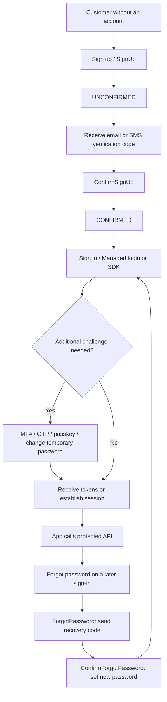
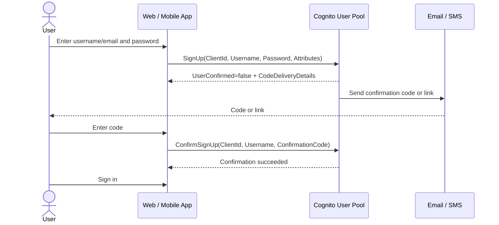
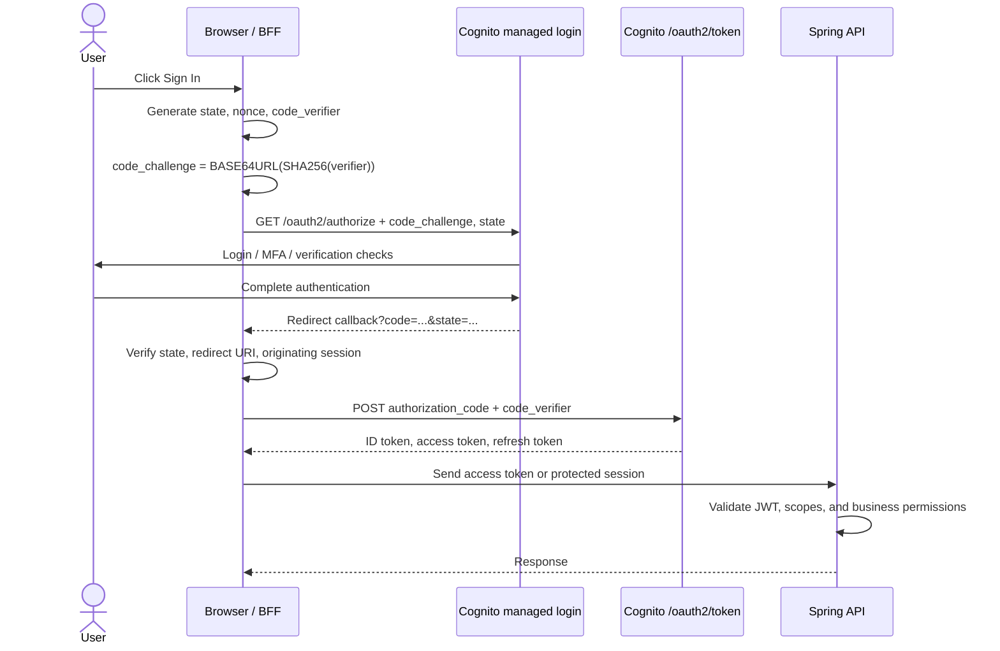
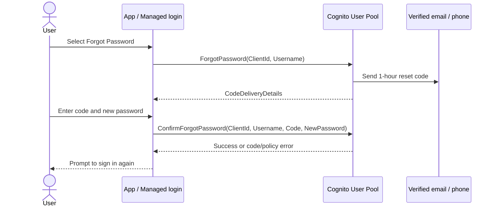
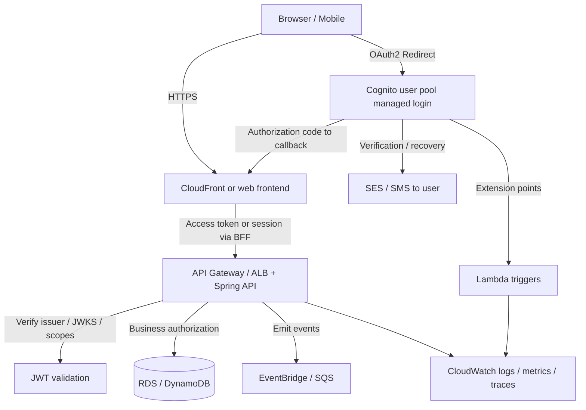
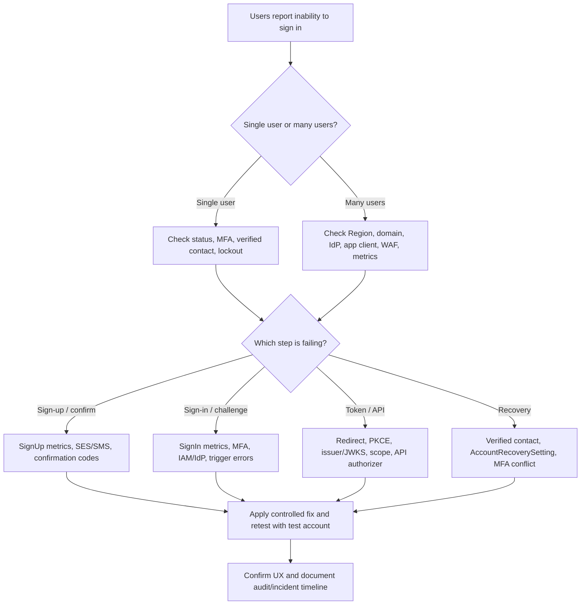

# Account Sign-Up, Verification, Sign-In, and Recovery

> **Chapter:** Application Identity with Cognito · **Module:** `CLOUD_PROVIDERS_AWS`

## 1. The Challenge: Managing the Complete User Account Lifecycle

An e-commerce application running Spring Boot on Amazon ECS or AWS Lambda needs to let customers **sign up, verify their email, sign in, change their password, reset their password, and sign out**. Building password storage, OTP delivery, session management, and fraud controls from scratch places heavy security, scalability, and operational responsibility on the engineering team.

**Amazon Cognito user pools** provide an AWS-managed user directory and authentication service. Cognito can store user profiles, verify passwords, orchestrate verification steps, support MFA/passkeys per configuration, issue **ID tokens, access tokens, and refresh tokens**, and federate with identity providers (IdPs). The application still must decide **what the user is allowed to do** in business logic, protect APIs, handle personal data, and build error-handling experiences.

Example user journey:



This diagram outlines a **local account with a password**. Signing in via social/SAML/OIDC federation or passkey/passwordless flows may skip some steps and follow different recovery policies. **Email verification** proves control of an address at the time of verification; **it does not prove a user's legal identity**.

Within the `CLOUD_PROVIDERS_AWS` module, this lesson connects **IAM, Region/AZ, VPC, API Gateway, ALB, Lambda, ECS, DynamoDB/RDS, SES/SNS, CloudWatch, security, resilience, and cost**. Cognito is an **application identity service**, distinct from IAM roles for workloads and distinct from AWS administrative sign-in via IAM Identity Center.

**After this lesson, learners can:**

1. Distinguish Cognito user pool, app client, domain, managed login, identity pool, IAM, and tokens.
2. Design **self-service sign-up** and account confirmation via email/SMS without storing passwords or OTPs in a custom database.
3. Explain the differences between **account confirmation**, **email/phone attribute verification**, and **MFA**.
4. Choose sign-in via **managed login + OAuth 2.0 Authorization Code/PKCE** or an appropriate custom UI/SDK.
5. Distinguish `UNCONFIRMED`, `CONFIRMED`, `FORCE_CHANGE_PASSWORD`, `RESET_REQUIRED`, and `EXTERNAL_PROVIDER` states.
6. Implement the **ForgotPassword → ConfirmForgotPassword** flow, design recovery contacts, and plan fallback paths when a user loses access to their contact channel.
7. Protect JWTs, sessions, IAM policies, email/SMS delivery, rate limits, and defend against account enumeration and abuse.
8. Build a monitoring, troubleshooting, and cost estimation runbook for identity flows.

## 2. Cognito Components to Understand First

### 2.1. User Pool, App Client, and Domain

| Component | Role | Illustrative Example |
| --- | --- | --- |
| **User pool** | User directory, password/MFA policies, attributes, sign-up/sign-in, token issuer, and user status. | `ap-southeast-1_Example123`. |
| **App client** | Configuration for an application accessing the user pool: client ID, with/without secret, auth flows, OAuth grants/scopes, and token expiration. | `shop-web-public`, `shop-bff-confidential`. |
| **User pool domain** | HTTPS address for managed login/OAuth endpoints, either a Cognito prefix or a custom domain. | `https://shop-login.auth.ap-southeast-1.amazoncognito.com`. |
| **Managed login** | Cognito-managed pages for sign-up, sign-in, confirmation, forgot password, and federation. | Sign-in form and code entry pages served by Cognito. |
| **User attributes** | `sub`, `email`, `email_verified`, `phone_number`, and defined custom attributes. | `sub` as a stable key linking business profiles. |
| **Groups / OAuth scopes** | Information supporting authorization via claims and tokens. | `orders.read`, `orders.write`. |
| **Lambda triggers** | Extension points for stages such as pre sign-up, custom message, post confirmation, and pre token generation. | Validating registration rules, creating customer profiles. |

A user pool lives in **a single AWS Region** and has its own issuer. Clients across multiple AZs can share the same user pool. **User pools do not automatically become multi-Region replicas for DR**; if a system requires multi-Region architecture or user migration, you must explicitly design user migration/failover, domains, and token issuers.

### 2.2. User Pools vs. Identity Pools and IAM Identity Center

| Service | Users/Principals | Primary Output |
| --- | --- | --- |
| **Cognito user pool** | Customers, employees using **applications**; local or federated identities. | User profiles and JWTs for sign-in/API calls. |
| **Cognito identity pool** | Authenticated users or guests needing **temporary AWS credentials** in supported use cases. | Federation to IAM roles and scoped STS credentials. |
| **AWS IAM** | AWS roles/users/service principals. | Policies permitting operations on AWS resources. |
| **IAM Identity Center** | Workforce access and IdP federation to access AWS accounts/business applications. | SSO and workforce permissions. |

A **Cognito access token is not itself an AWS access key**. If an app backend needs to write to S3/DynamoDB, the backend typically uses an **IAM execution/task role**, while the Cognito token proves user identity and the app checks business permissions. If browsers/mobile apps need direct access to certain AWS APIs via temporary credentials, evaluate an identity pool with tightly scoped IAM roles and associated risks.

### 2.3. Feature Plans and Choosing the Experience

User pools offer **Lite, Essentials, and Plus feature plans** with different capabilities. At the time of AWS documentation alignment, modern **managed login** is available in Essentials/Plus, while the **classic hosted UI** may be used in Lite. Capabilities such as passwordless/passkeys, email MFA, threat protection, and customization options can depend on the plan.

Do not assume a newly created user pool includes every sign-in method or fixed pricing across Regions. Before selecting a plan, compare: **MAU (monthly active users)**, sign-in methods, branding/managed login support, OTP/MFA, threat protection, email/SMS delivery, and enterprise integration needs. References: [User pool feature plans](https://docs.aws.amazon.com/cognito/latest/developerguide/cognito-sign-in-feature-plans.html) and [Cognito Pricing](https://aws.amazon.com/cognito/pricing/).

### 2.4. Public and Confidential Clients

| App Client Type | Secret | Example | Recommended Usage |
| --- | --- | --- | --- |
| **Public client** | **No client secret** | Browser SPA, mobile app, desktop app. | OAuth authorization code + **PKCE**; never embed a secret in frontend code. |
| **Confidential client** | Has a client secret kept securely on the backend. | Spring Boot BFF/server-side web application. | OIDC library keeps secret server-side with secure session cookies. |

If an app client is created **with a secret**, Cognito user-pools APIs such as `SignUp`, `ForgotPassword`, and certain auth flows may require **`SECRET_HASH`**; the HMAC-SHA256 algorithm applies per AWS documentation. Never embed the secret in JavaScript or a mobile app to "fix" `SecretHash does not match`; use a **public client without a secret** on the frontend or route requests through a confidential backend.

## 3. Designing Profiles, Usernames, and User Statuses

### 3.1. Username, Email, and `sub`

When creating a user pool, administrators choose **sign-in identifiers**: username, email, phone number, or aliases allowing sign-in with multiple values per supported configuration. These foundational choices can be difficult or impossible to change directly once users exist in the pool; decide before production.

| Attribute | Purpose | Use as business profile key? |
| --- | --- | --- |
| `sub` | Unique user identifier within the user pool, issued by Cognito. | **Recommended** alongside the user pool issuer; more stable than email/phone. |
| `email` | Contact or sign-in email address. | **Do not** use as an immutable primary key, as emails can change. |
| `phone_number` | Phone number typically in E.164 format (e.g., `+84901234567`). | **No**, as it can change or be recycled. |
| `preferred_username` | Display name/alias per configuration. | **No** for a long-term identity key. |
| `email_verified` / `phone_number_verified` | Marks whether control of the contact channel is verified. | Verify before trusting the contact channel. |

The backend **linking key** can be (`issuer`, `sub`) instead of email alone. Two different user pools may emit `sub` values in similar formats; include the issuer to ensure namespacing. If configuring federation/social linking, verify your user linking strategy before creating duplicate profiles.

### 3.2. Cognito Account Statuses

| `UserStatus` | Typical Meaning | What UX/Backend Should Do |
| --- | --- | --- |
| `UNCONFIRMED` | Self-registration created the account, but confirmation is not complete. | Prompt for the code or provide anti-spam resend. |
| `CONFIRMED` | Account has been confirmed per the applicable flow. | Allow sign-in unless disabled/blocked by another policy. |
| `FORCE_CHANGE_PASSWORD` | Admin-created user with a temporary password; must set a new password at sign-in. | Handle the `NEW_PASSWORD_REQUIRED` challenge securely. |
| `RESET_REQUIRED` | User must reset their password before continuing sign-in. | Guide through Forgot Password/administrator recovery per policy. |
| `EXTERNAL_PROVIDER` | User record linked to an external IdP. | Sign in/recover via the appropriate IdP; do not assume a local password exists. |

**Do not equate `UserStatus=CONFIRMED` with `Enabled=true` or "passed MFA".** A user may be disabled, rate-limited, or fail authorization checks even when confirmed. Furthermore, `email_verified=true` does not mean the user passed KYC identity proofing.

### 3.3. Required Attributes and Contact Changes

A user pool can require `email`, `phone_number`, or custom attributes; required fields must be supplied at sign-up per policy. Collect only attributes genuinely needed by business logic to avoid increasing personal data exposure.

When a user changes their email or phone number:

1. Call an API with a valid access token such as `UpdateUserAttributes` and send a verification code to the **new contact** per user pool settings.
2. Call `VerifyUserAttribute` with the code and access token to mark it verified.
3. Configure `AttributesRequireVerificationBeforeUpdate` appropriately to avoid promoting an unverified contact to the primary sign-in/recovery channel.
4. Notify the old channel about the change per policy to guard against account takeover.

A user who verified email A **is not automatically considered to have verified email B** simply because they hold an access token. Account modification workflows require appropriate verification and risk controls.

## 4. Account Registration: `SignUp`, Verification Codes, and Confirmation

### 4.1. Should Self-Service Registration Be Allowed?

When **self-registration** is enabled, users can create accounts themselves via managed login or the user-pools `SignUp` API. If the application is strictly for invited employees or partners, **disable self-registration** and use `AdminCreateUser`/internal invitation workflows.

Choosing the approach requires weighing **fraud prevention, email verification requirements, OTP costs, and abuse limits**. Do not let strangers create thousands of accounts if the application requires whitelisting or approval.

### 4.2. Standard Registration Flow



When using email/SMS verification in this flow, Cognito sends a **confirmation code valid for 24 hours**. `SignUp` can return an `UNCONFIRMED` account and `CodeDeliveryDetails` describing the **delivery channel**, without returning the raw OTP code to the frontend.

Some user pools use a **pre-sign-up Lambda trigger** to auto-confirm users or auto-verify attributes per policy, resulting in `UserConfirmed=true`. This is only appropriate when a **trusted mechanism already verified the identity/contact**; do not auto-confirm arbitrary Internet requests if the goal is preventing fake sign-ups.

### 4.3. Distinguishing Confirmation and Verification

| Concept | Question | API / Status |
| --- | --- | --- |
| **Account confirmation** | Is the user allowed to complete registration/sign-in? | `ConfirmSignUp`, `UNCONFIRMED → CONFIRMED`. |
| **Email verification** | Does the user control the specific email address? | `email_verified=true`, `VerifyUserAttribute` on email updates. |
| **Phone verification** | Does the user control the specific phone number? | `phone_number_verified=true`. |
| **MFA** | During this sign-in, did the user complete an additional authentication factor? | Challenges such as `SMS_MFA`, `SOFTWARE_TOKEN_MFA` per configuration. |

**Registering with both email and phone:** Cognito typically **verifies one contact** during confirmation based on delivery priority settings. If the app needs **both** verified, guide the user to sign in and then call `GetUserAttributeVerificationCode` and `VerifyUserAttribute` for the remaining channel. Never assume a confirmed account means both email and phone are verified.

### 4.4. When Codes Do Not Arrive or Expire

Common causes:

- The user mistyped the address, the email landed in spam, or SMS was blocked by country/carrier rules.
- The AWS account/Region is using **Cognito default email** with low sending limits or the **SNS SMS sandbox**, without required origination registration.
- `CodeMismatchException`: the entered code is incorrect.
- `ExpiredCodeException`: the code has expired or is no longer valid.
- `LimitExceededException`, `TooManyRequestsException`: hit code delivery limits or API throttling.
- The user is already confirmed, disabled, or the client ID/secret hash does not match.

A **Resend code** button should call `ResendConfirmationCode` after a cooldown period while enforcing **rate limits per account/IP/device**. Do not send emails/SMS on every page refresh; never store or log codes in analytics or request traces.

### 4.5. Confirmation Journey in Managed Login

Managed login provides pages for users to sign up, enter codes, resend codes, and confirm email via links when enabled. Depending on user pool/app client configuration, the UI navigates through paths such as:

```text
/signup
/confirm
/resendcode
/confirmUser
```

These URLs reside under the **user pool domain**, with navigation/routing and query parameters managed by Cognito. **Do not manually construct confirmation links or alter security parameters**; use the paths and OAuth integration per [Managed login endpoints](https://docs.aws.amazon.com/cognito/latest/developerguide/managed-login-endpoints.html). With a custom UI, the app builds the forms while Cognito still handles codes and confirmation states.

## 5. Custom Sign-Up Example with AWS SDK for Java 2.x

Suppose a Spring Boot/BFF application has a **public app client without a secret** for custom authentication and needs a custom registration form. The following example uses **AWS SDK for Java 2.x**; in a real application, use service beans, dependency injection, validation, centralized error mapping, and tests instead of placing all logic in a controller.

### 5.1. Java Sample: Sign-Up, Confirmation, and Resend Code

```java
import software.amazon.awssdk.regions.Region;
import software.amazon.awssdk.services.cognitoidentityprovider.CognitoIdentityProviderClient;
import software.amazon.awssdk.services.cognitoidentityprovider.model.AttributeType;
import software.amazon.awssdk.services.cognitoidentityprovider.model.SignUpRequest;
import software.amazon.awssdk.services.cognitoidentityprovider.model.SignUpResponse;
import software.amazon.awssdk.services.cognitoidentityprovider.model.ConfirmSignUpRequest;
import software.amazon.awssdk.services.cognitoidentityprovider.model.ResendConfirmationCodeRequest;

public final class CognitoRegistrationService implements AutoCloseable {
    private final CognitoIdentityProviderClient cognito;
    private final String clientId;

    public CognitoRegistrationService(String clientId) {
        this.clientId = clientId; // Load from deployment config, do not hard-code.
        this.cognito = CognitoIdentityProviderClient.builder()
                .region(Region.AP_SOUTHEAST_1)
                .build();
    }

    // password is received over HTTPS;
    // DO NOT log passwords or confirmation codes.
    public boolean signUp(String username, String email, String password) {
        SignUpResponse response = cognito.signUp(SignUpRequest.builder()
                .clientId(clientId)
                .username(username)
                .password(password)
                .userAttributes(AttributeType.builder()
                        .name("email")
                        .value(email)
                        .build())
                .build());
        return response.userConfirmed();
    }

    public void confirmSignUp(String username, String code) {
        cognito.confirmSignUp(ConfirmSignUpRequest.builder()
                .clientId(clientId)
                .username(username)
                .confirmationCode(code)
                .build());
    }

    public void resendConfirmationCode(String username) {
        cognito.resendConfirmationCode(
                ResendConfirmationCodeRequest.builder()
                        .clientId(clientId)
                        .username(username)
                        .build());
    }

    @Override
    public void close() {
        cognito.close();
    }
}
```

**Prerequisites to run:** the project includes the `software.amazon.awssdk:cognitoidentityprovider` dependency, a compatible Java version, HTTPS connectivity to the Cognito service endpoint, and an app client allowing self-sign-up. If using a **confidential app client with a secret**, compute and include `SecretHash` in the relevant requests; the example above intentionally demonstrates a **client without a secret**.

The `SignUp` SDK call can be invoked from a backend that holds AWS credentials, though the operation itself is designed for non-admin user flows. Distinguish the IAM permissions required for `AdminCreateUser`/`AdminConfirmSignUp` from `SignUp`/`ConfirmSignUp`. Never grant admin IAM permissions to a frontend or mobile app.

### 5.2. Input Validation and UX-Friendly Error Handling

At the application layer:

1. Validate email/phone format, input length, and password policy **before calling Cognito** for immediate UX guidance; Cognito still enforces final rules.
2. Do not trim/alter passwords or silently change username casing unless the user pool is configured accordingly.
3. Avoid logging `Password`, `ConfirmationCode`, or entire SDK request objects.
4. Translate exceptions such as `InvalidPasswordException`, `UsernameExistsException`, `CodeMismatchException`, `ExpiredCodeException`, and `TooManyRequestsException` into clear messages so users can correct errors.
5. Apply rate limiting and WAF/anti-bot controls as needed; do not let the resend-code API become an email/SMS spam tool.
6. For flows requiring **user enumeration** protection, consider a generic response that does not reveal whether an email exists, aligned with Cognito's anti-enumeration design.

**Example BFF API response:**

```json
{
  "status": "CONFIRMATION_REQUIRED",
  "message": "If the address is valid and requires verification, instructions have been sent.",
  "nextStep": "ENTER_CONFIRMATION_CODE"
}
```

This JSON is **application-designed**, not the raw `SignUp` response structure. Never return the confirmation code in the response. When `SignUpResponse.userConfirmed()==true`, the app can proceed directly to sign-in without a code entry screen.

### 5.3. How Admin-Created Users Differ from Self-Sign-Up

If an organization provisions internal accounts via `AdminCreateUser`, Cognito can send an invitation/temporary password. The user is placed in `FORCE_CHANGE_PASSWORD` status and at sign-in must complete the `NEW_PASSWORD_REQUIRED` challenge to set their own password. This **is not the same** as self-sign-up awaiting `ConfirmSignUp`.

This approach suits systems restricted to invited staff/partners, but requires controls for:

- Backend administrative IAM permissions, approvals, and auditing via CloudTrail.
- Verifying email/phone when contact details were entered by a third party.
- Temporary password expiration, invitation resend workflows, and never logging passwords.
- Users may still need account recovery support even after changing their password.

## 6. Signing In with Cognito Managed Login and OAuth 2.0/OIDC

### 6.1. Why Prefer Managed Login for Many Applications?

**Managed login** lets Cognito handle password/MFA/passkey prompts, account linking, and recovery screens according to enabled features. The application retains control over branding/domain, callbacks, session handling, and API authorization. This reduces the need to build custom UIs for complex challenges and helps minimize the risk of accidentally logging passwords in the backend.

For browser SPAs, mobile apps, or BFFs, the standard flow is **OAuth 2.0 Authorization Code Grant with PKCE**. Do not use **Implicit Grant** for new applications when authorization code + PKCE is available, because implicit passes tokens over the front channel and is harder to secure.

### 6.2. Authorization Code + PKCE



Security steps:

1. Generate a **cryptographically random `state`** to bind the redirect response to the login request and prevent CSRF.
2. If using ID tokens/OIDC, include **`nonce`** per your OIDC library/flow to prevent token replay or session mix-ups.
3. Generate a strong random **`code_verifier`**, derive `code_challenge = base64url(SHA256(code_verifier))` (without `=` padding), and send `code_challenge_method=S256`.
4. The redirect URI must be an **exact registered URL** in the app client; use HTTPS for production, with localhost exceptions only when supported and needed for development.
5. On callback, match `state`, check for OAuth errors, and exchange the authorization code at the **token endpoint** with `code_verifier`.
6. Validate JWTs and sessions; **never store refresh tokens in unprotected localStorage** or log query strings/codes.

### 6.3. Example Authorize Request

```text
GET https://shop-login.auth.ap-southeast-1.amazoncognito.com/oauth2/authorize
  ?response_type=code
  &client_id=example_public_app_client_id
  &redirect_uri=https%3A%2F%2Fshop.example.com%2Fauth%2Fcallback
  &scope=openid%20email%20profile
  &state=<cryptographically-random-state>
  &nonce=<cryptographically-random-nonce>
  &code_challenge=<base64url-sha256-verifier>
  &code_challenge_method=S256
```

This is a **multi-line readable example**, not a verbatim URL to call. Host domain, app client ID, callback URL, scopes, and random values must come from actual configuration. Never include `code_verifier` in the authorize URL; keep it secure until token exchange.

After the user finishes signing in, Cognito returns `code` to the callback. The application exchanges the code via:

```http
POST /oauth2/token HTTP/1.1
Host: shop-login.auth.ap-southeast-1.amazoncognito.com
Content-Type: application/x-www-form-urlencoded

grant_type=authorization_code&client_id=example_public_app_client_id&code=<one-time-code>&redirect_uri=https%3A%2F%2Fshop.example.com%2Fauth%2Fcallback&code_verifier=<original-code-verifier>
```

For confidential clients, the token endpoint also requires appropriate client authentication (client secret/HTTP Basic or supported method). Use a proven **OIDC/OAuth library** rather than hand-rolling HTTP form posts and JWT parsers in production apps. `code` is short-lived and single-use; reusing it will fail.

### 6.4. Sessions and Cookies in a Spring Boot BFF

If the frontend only needs a server-managed session, a **Backend-for-Frontend (BFF)** is a strong option:

1. The BFF handles the OAuth callback and keeps access/refresh tokens in a **protected server-side session store**.
2. The browser holds only a session cookie with `Secure`, `HttpOnly`, and `SameSite` aligned with the domain and redirects.
3. The BFF calls internal APIs under user authorization or forwards access tokens in a controlled manner.
4. CSRF defenses remain necessary for cookie-authenticated state-changing requests, especially across cross-site flows.
5. Logout must clear the app session and invoke Cognito logout/token revocation per actual semantics; merely deleting a cookie does not necessarily invalidate already-issued tokens.

If building an SPA that uses access tokens directly, consider an OIDC client library, keeping tokens in memory where feasible, refresh token rotation, and XSS risks. **Never use an ID token to authorize API calls** when the API is designed for access tokens. This is explained in section 8.

### 6.5. Managed Login and Federation

A user pool can federate **social logins** and enterprise IdPs using **SAML/OIDC**. Cognito can still issue tokens to the application via OAuth/OIDC, however:

- Sign-in and password recovery at an external IdP are governed by the **upstream IdP's policies**, not necessarily Cognito local `ForgotPassword`.
- Mapping attributes like email and `email_verified` must be configured carefully; never assume every external assertion is automatically trustworthy for business authorization.
- If a person has both a local user and a social identity, design **account linking** to avoid creating duplicate order profiles or merging the wrong accounts.
- During an IdP outage, users cannot recover via a Cognito local password if they do not have valid local credentials.

## 7. Custom Sign-In with Cognito SDK: Passwords, OTP, MFA, and Challenges

### 7.1. Key Authentication Flows

When building custom forms instead of managed login, the app interacts with **`InitiateAuth`/`RespondToAuthChallenge`** or corresponding admin APIs. The app client must **enable the authentication flow** requested by the app.

| `AuthFlow` | Function | Notes |
| --- | --- | --- |
| `USER_AUTH` | **Choice-based authentication**: server returns available choices such as password, email/SMS OTP, or WebAuthn passkey per config. | App client requires `ALLOW_USER_AUTH`; passwordless/passkeys require compatible feature plan/options. |
| `USER_SRP_AUTH` | Password authentication via **Secure Remote Password (SRP)**. | Client needs a library performing SRP math and challenges; does not send raw passwords. |
| `USER_PASSWORD_AUTH` | Sends username/password over a TLS-protected request for Cognito to verify. | Requires `ALLOW_USER_PASSWORD_AUTH`; weigh the risks of the app handling plaintext passwords. |
| `ADMIN_USER_PASSWORD_AUTH` | Server with IAM credentials performs admin authentication. | Never use in browser/mobile; requires administrative IAM permissions. |
| `CUSTOM_AUTH` | Authentication flow orchestrated by Lambda triggers. | Increases security and operational complexity; not directly compatible with managed login. |
| `REFRESH_TOKEN_AUTH` | Certain client-based refresh flows when refresh token rotation is off. | With rotation enabled, use supported refresh APIs/methods (e.g., `GetTokensFromRefreshToken`). |

**Do not confuse `USER_AUTH` with OAuth `authorization_code`.** One is calling the **user-pools API** to authenticate, while the other is an **OAuth 2.0 grant** at hosted authorization/token endpoints. Both can issue JWTs, but their prerequisites, federation support, and session handling differ.

### 7.2. Challenge-Response Flow

When Cognito requires another step, `InitiateAuth` does not return tokens immediately; instead it returns:

```json
{
  "ChallengeName": "SELECT_CHALLENGE",
  "AvailableChallenges": ["PASSWORD", "EMAIL_OTP"],
  "Session": "<opaque-authentication-session>"
}
```

This is a **conceptual sample**; actual fields/challenges depend on the user pool, app client, user, feature plan, and Cognito response. The application should:

1. Present only methods listed in `AvailableChallenges` (do not offer a method the user is not permitted to use).
2. Collect the corresponding input, such as a password or email OTP code.
3. Call `RespondToAuthChallenge` with `ChallengeName`, `ChallengeResponses`, and the **`Session`** returned by Cognito.
4. If another challenge is returned, continue the loop until `AuthenticationResult` or an error arrives.
5. Once tokens arrive, consider sign-in complete only after session setup, token validation, and application checks succeed.

Example logical request for a password challenge:

```json
{
  "ClientId": "example_public_client_id",
  "ChallengeName": "PASSWORD",
  "Session": "<session-returned-by-cognito>",
  "ChallengeResponses": {
    "USERNAME": "customer@example.com",
    "PASSWORD": "<user-entered-password>"
  }
}
```

**Never run examples with real sensitive data in shell history or send JSON payloads to logs.** With a client secret, `SECRET_HASH` is also required. `Session` is opaque, time-limited, and bound to that challenge round; never reuse it across different login sessions.

### 7.3. Common Challenges

| `ChallengeName` | Meaning | UX |
| --- | --- | --- |
| `PASSWORD_VERIFIER` | Verification step in SRP. | SDK/library computes the challenge proof. |
| `SELECT_CHALLENGE` | User can pick a method from the returned list. | Choose password/passkey/OTP as appropriate. |
| `PASSWORD` | Password required in choice-based flow. | Collect password via a protected UI. |
| `SMS_OTP` / `EMAIL_OTP` | **Passwordless first factor** using an OTP code. | Enter code from the verification channel. |
| `WEB_AUTHN` | Authentication via passkey/security key. | Browser/device executes WebAuthn. |
| `SMS_MFA` / `SOFTWARE_TOKEN_MFA` | **Second-factor challenge** after the first factor. | Enter SMS code or TOTP. |
| `MFA_SETUP` | User must enroll an MFA factor. | Register TOTP or supported channel, then complete the challenge. |
| `NEW_PASSWORD_REQUIRED` | Admin-created user must set a personal password. | Form to set a new password meeting policy. |

Challenge names and keys inside `ChallengeResponses` **vary by challenge**; consult [InitiateAuth](https://docs.aws.amazon.com/cognito-user-identity-pools/latest/APIReference/API_InitiateAuth.html) and [RespondToAuthChallenge](https://docs.aws.amazon.com/cognito-user-identity-pools/latest/APIReference/API_RespondToAuthChallenge.html) when implementing.

### 7.4. Username/Password Flows Must Not Bypass MFA

Suppose a user pool requires MFA. Even after a correct password, Cognito can return `SMS_MFA` or `SOFTWARE_TOKEN_MFA`; the app **must not mark login as successful before completing the challenge**. Never create an application session just because `InitiateAuth` returned HTTP `200`.

For `NEW_PASSWORD_REQUIRED`, collect the new password and respond to the challenge within the session rather than simply calling `ForgotPassword`. If an account is in `RESET_REQUIRED` due to an admin reset, follow the corresponding recovery flow.

### 7.5. Passkeys, Passwordless, and MFA Are Not the Same Thing

- **Passwordless OTP** (email/SMS) is a *first factor* in a choice-based flow; it does not mean **MFA** was performed.
- **MFA** requires an additional factor after a password, such as TOTP/SMS/email per configuration and supported plan.
- **Passkey (WebAuthn)** uses public-key credentials and can perform on-device user verification; in supported `MULTI_FACTOR_WITH_USER_VERIFICATION` configurations, a passkey with user verification can satisfy Cognito's MFA requirement, though it **is not a second factor added after a password**.
- User pools requiring MFA impose restrictions on one-time password first factors; do not enable `MFA required` and expect every passwordless method to keep working.

For new apps, prefer **managed login** to handle these complex interactions if your plan and UX allow, rather than implementing the entire WebAuthn/MFA ceremony yourself.

## 8. Tokens: Distinguishing ID, Access, and Refresh Tokens and Protecting Spring APIs

### 8.1. Three Token Types in Cognito

| Token | Purpose | Use as Bearer Token for Business APIs? |
| --- | --- | --- |
| **ID token** | User identity details for OIDC clients, with claims like `sub`, `email`, `aud`. | **Should not**, if the API authenticates with access tokens. |
| **Access token** | API access permissions and scopes/claims; carries `token_use=access` and `client_id`. | **Yes**, after validation and authorization checks. |
| **Refresh token** | Exchanged for new access/ID tokens while the session remains valid; typically longer-lived. | **Never** send to resource APIs as a Bearer token; store securely and limit exposure. |

JWTs typically have three parts: `header.payload.signature`. The payload is **Base64URL-encoded, not encrypted**: anyone holding the token can read its claims. Never put secrets into custom claims and never rely on "the payload looks encoded" to protect data.

### 8.2. Claims That Must Be Verified

A protected Spring Boot API should verify at minimum:

1. **JWT signature** using public keys from the exact Cognito user pool's JWKS, matching `kid` and handling key rotation.
2. **`iss`** matching the expected issuer/user pool/Region.
3. **`exp`, `nbf`** and timestamps against valid clock skew bounds.
4. **`token_use=access`** when the API accepts access tokens.
5. **Permitted app client `client_id`**; ID tokens carry `aud` for the client, whereas access tokens carry `client_id` and may carry `aud` **if bound to a resource server**.
6. **Scopes/roles/business authorization** for the endpoint; never rely solely on a valid token to allow reading another user's data.
7. **Revocation and session policy:** offline JWT validation does not automatically detect newly revoked tokens; an access token can remain cryptographically valid until expiry unless the system checks revocation state.

Issuer URL (example):

```text
https://cognito-idp.ap-southeast-1.amazonaws.com/ap-southeast-1_Example123
```

JWKS:

```text
https://cognito-idp.ap-southeast-1.amazonaws.com/ap-southeast-1_Example123/.well-known/jwks.json
```

**The issuer is not the hosted login domain URL.** For example, the user pool issuer uses `cognito-idp...amazonaws.com`, while OAuth authorization/token endpoints may live at `shop-login.auth...amazoncognito.com` or a custom domain. Mixing up the two breaks JWT validation.

### 8.3. Configuring Spring Security Resource Server

For Spring Boot using Spring Security OAuth2 Resource Server, configuration (values are **placeholders**):

```yaml
spring:
  security:
    oauth2:
      resourceserver:
        jwt:
          issuer-uri: https://cognito-idp.ap-southeast-1.amazonaws.com/ap-southeast-1_Example123
```

`issuer-uri` lets Spring configure discovery/JWKS and validate the issuer per framework behavior. To protect an API using Cognito **access tokens**, add validation for `token_use=access` and `client_id` when the app restricts access to one or more app clients. Example Java configuration validating those claims:

```java
import org.springframework.beans.factory.annotation.Value;
import org.springframework.context.annotation.Bean;
import org.springframework.context.annotation.Configuration;
import org.springframework.security.config.Customizer;
import org.springframework.security.config.annotation.web.builders.HttpSecurity;
import org.springframework.security.oauth2.core.OAuth2Error;
import org.springframework.security.oauth2.core.OAuth2TokenValidator;
import org.springframework.security.oauth2.core.OAuth2TokenValidatorResult;
import org.springframework.security.oauth2.core.DelegatingOAuth2TokenValidator;
import org.springframework.security.oauth2.jwt.Jwt;
import org.springframework.security.oauth2.jwt.JwtDecoder;
import org.springframework.security.oauth2.jwt.JwtValidators;
import org.springframework.security.oauth2.jwt.NimbusJwtDecoder;
import org.springframework.security.web.SecurityFilterChain;

@Configuration
public class ApiJwtSecurityConfig {
    @Bean
    JwtDecoder jwtDecoder(
            @Value("${security.cognito.issuer}") String issuer,
            @Value("${security.cognito.client-id}") String clientId) {

        NimbusJwtDecoder decoder = NimbusJwtDecoder.withIssuerLocation(issuer).build();
        OAuth2TokenValidator<Jwt> defaultChecks =
                JwtValidators.createDefaultWithIssuer(issuer);

        OAuth2TokenValidator<Jwt> cognitoAccessTokenChecks = jwt -> {
            boolean correctType = "access".equals(jwt.getClaimAsString("token_use"));
            boolean correctClient = clientId.equals(jwt.getClaimAsString("client_id"));
            if (!correctType || !correctClient) {
                return OAuth2TokenValidatorResult.failure(
                        new OAuth2Error("invalid_token",
                                "Wrong token type or Cognito app client", null));
            }
            return OAuth2TokenValidatorResult.success();
        };

        decoder.setJwtValidator(new DelegatingOAuth2TokenValidator<>(
                defaultChecks, cognitoAccessTokenChecks));
        return decoder;
    }

    @Bean
    SecurityFilterChain securityFilterChain(HttpSecurity http) throws Exception {
        return http.authorizeHttpRequests(auth -> auth
                .requestMatchers("/health").permitAll()
                .requestMatchers("/api/orders/**").hasAuthority("SCOPE_orders.read")
                .anyRequest().authenticated())
            .oauth2ResourceServer(oauth -> oauth.jwt(Customizer.withDefaults()))
            .build();
    }
}
```

This snippet requires the corresponding Spring Security dependencies, `security.cognito.issuer`/`client-id` properties, and tokens carrying the `orders.read` scope issued by the resource server/app client. **This is a skeleton example**—verify your exact Spring Security version, `HttpSecurity` CSRF/session policy, CORS, and scope converter before production. If the API serves **multiple legitimate app clients**, replace the single `client_id` equality check with a reviewed allowlist. For access tokens with resource binding `aud`, also validate the audience for the specific API per policy.

### 8.4. Authorization for Private Customer Data

A valid token with `sub=customer-A` and scope `orders.read` does not allow viewing `customer-B`'s orders. At the repository/business logic layer, enforce ownership:

```text
GET /api/orders/123
    ↓
Valid JWT + orders.read scope
    ↓
Load order 123 from database
    ↓
Verify order.ownerSub == jwt.sub within the right issuer
    ↓
Only then return data
```

Never rely on an email string as the sole access check, since emails can change; nor trust a `userId` supplied in the frontend request body without matching it against the authenticated identity. In multi-tenant apps, also verify tenant membership/role against trusted data.

### 8.5. Refresh Tokens, Sign-Out, and Session Revocation

Refresh token lifetime and access/ID token lifetimes are configured on the app client within service limits. When an access token expires:

- An OIDC client with managed login can use `grant_type=refresh_token` at the token endpoint per app client settings.
- With custom SDK flows and **refresh token rotation**, use supported mechanisms such as `GetTokensFromRefreshToken`; do not assume `REFRESH_TOKEN_AUTH` remains valid across all configurations.
- On sign-out, clear the app-side session and revoke refresh tokens or perform global sign-out per policy. **Already-issued JWTs may still pass offline signature checks until expiration** if the API does not perform additional revocation checks.
- Set short access token lifetimes proportional to risk, protect refresh tokens via server-side cookies/secure storage, and alert on anomalous refresh patterns.

Never log tokens in URL query strings, analytics, request logs, or locations readable by other apps. With a BFF, separate the session cookie from the access token to reduce exposure via browser JavaScript.

## 9. Secure Sign-In: MFA, Passkeys, OTP, and Defending Against Password Attacks

### 9.1. MFA Policy Is a Design Decision

Amazon Cognito lets you configure MFA at the user pool level, typically **OFF, OPTIONAL, or ON/required** per capability and UX needs. When MFA is enabled, users may be required to enroll a factor before completing sign-in. Common options:

| Method | Experience | Conditions / Risks |
| --- | --- | --- |
| **TOTP / software authenticator** | Authenticator app generates short-lived codes. | Needs setup and backup/recovery workflow; independent of SMS delivery. |
| **SMS MFA** | Receive code via phone number. | Costs, sandbox/registration, SIM swap, coverage/roaming, and rule barring the same channel for password reset. |
| **Email MFA** | Receive code via email. | Requires Essentials/Plus plan and **Amazon SES sending config** per AWS docs; cannot use that same email for password recovery when it is preferred MFA. |
| **Passkey/WebAuthn** | Authenticate via on-device key/security key. | Requires compatible feature plan, domain, and WebAuthn config; passkeys with user verification can satisfy MFA under specific rules. |
| **Email/SMS passwordless OTP** | Sign in without entering a password. | Acts as a first factor, not MFA by itself; `USER_AUTH` and `MFA required` have compatibility constraints. |

**`MFA required` may be incompatible with certain passwordless OTP methods.** Before enforcing "MFA required for all users", verify the exact methods you plan to deploy (especially `EMAIL_OTP`, `SMS_OTP`, `WEB_AUTHN`) against [MFA settings](https://docs.aws.amazon.com/cognito/latest/developerguide/user-pool-settings-mfa.html). Never weaken strong authentication requirements just to make a UX mockup work.

### 9.2. TOTP Enrollment Flow

In a custom UI, Cognito provides APIs such as:

1. `AssociateSoftwareToken`: generates the secret/seed for enrolling an authenticator app using an appropriate challenge session or access token.
2. `VerifySoftwareToken`: verifies the TOTP code generated by the authenticator.
3. `SetUserMFAPreference` or `AdminSetUserMFAPreference`: sets MFA preference per permissions and policy.
4. `RespondToAuthChallenge`: continues the authentication flow if the user is in `MFA_SETUP`.

Never log the **TOTP secret** or re-display it after enrollment completes; if showing a QR code, serve it over HTTPS in a secure session. Maintain a runbook for lost MFA devices and a support workflow with additional identity verification to defeat social engineering.

### 9.3. Brute Force Attacks and Sign-In Messaging

Cognito enforces lockout controls on repeated wrong password attempts. After multiple failures, wait times increase and it may return messages such as `Password attempts exceeded`. **Do not treat an observed attempt count or delay as a permanent quota**, as the underlying mechanism can evolve.

Applications should:

- Rate-limit login/OTP/reset endpoints at the BFF/API Gateway/WAF.
- Return error messages that do not reveal whether a user exists.
- Use exponential backoff on the client for `TooManyRequestsException` and never retry infinitely.
- Monitor credential stuffing, bot sign-ups, MFA bypasses, and network/user behavioral anomalies.
- Use **threat protection** where plan and data policies allow, while restricting access to sensitive risk signals.
- Never write raw passwords, OTPs, refresh tokens, or challenge `Session` strings to centralized logs.

### 9.4. Account Takeover via Email Changes and Resets

An attacker who hijacks a login session may try changing the email to their own address and using "Forgot Password" for persistent takeover. Defenses include:

1. Require verifying the **new contact** before using it as a sign-in/recovery channel (`AttributesRequireVerificationBeforeUpdate`).
2. Require step-up authentication when changing contacts or disabling MFA, if policy mandates.
3. Send alerts to the old channel after sensitive changes, without including passwords/codes.
4. Restrict admin permissions that can force `email_verified=true`/`phone_number_verified=true` without proving actual ownership.
5. Audit and alert on multiple recovery attempts or unusual contact updates.

**An OTP code only proves access to a channel at that moment**—it does not prove that every subsequent business action by the user is legitimate.

## 10. Account Recovery: `ForgotPassword` and `ConfirmForgotPassword`

### 10.1. Distinguishing Forgot Password, Change Password, and Forced Reset

| Case | User Has a Valid Session? | API or Workflow |
| --- | --- | --- |
| **Forgot password** | Usually **no**. | `ForgotPassword` sends code; `ConfirmForgotPassword` sets new password. |
| **Change password** | **Yes**, using a valid access token. | `ChangePassword` with current password and new password. |
| **Admin reset** | Admin with administrative IAM permissions. | `AdminResetUserPassword` sends code and transitions state to `RESET_REQUIRED`. |
| **Admin set password** | Admin acting under controlled policy. | `AdminSetUserPassword` to set a temporary or permanent password when appropriate. |
| **Lost all recovery channels** | Cannot prove control via verified email/phone. | Support/admin recovery with additional identity proofing and audit. |
| **Federated login** | Depends on IdP. | Recover at the **external identity provider**; do not assume a local Cognito password exists. |

**Cognito has no API to read back an old password.** The service stores protected password hashes, not plaintext passwords retrievable by administrators. When a user forgets their password, it must be **reset**, never emailed back in plaintext.

### 10.2. Self-Service Password Recovery Flow



A recovery code from `ForgotPassword` is valid for **1 hour**, distinct from the **24-hour sign-up confirmation** code in section 4. Never confuse a password reset code with an access token or an MFA code.

In managed login, users can use `/forgotPassword` and `/confirmforgotPassword` guided pages. In a custom UI, the app sends API calls and provides screens for entering the code/new password, handling errors, and enforcing resend cooldowns.

### 10.3. Configuring Recovery Channels by Priority

The user pool `AccountRecoverySetting` parameter selects verified recovery channels:

```json
{
  "AccountRecoverySetting": {
    "RecoveryMechanisms": [
      { "Name": "verified_email", "Priority": 1 },
      { "Name": "verified_phone_number", "Priority": 2 }
    ]
  }
}
```

`Priority=1` is higher than `2`. Cognito picks **one eligible channel** to send the code based on configuration and user state, rather than sending to both simultaneously just because both exist.

If an organization requires **admin-only recovery**:

```json
{
  "AccountRecoverySetting": {
    "RecoveryMechanisms": [
      { "Name": "admin_only", "Priority": 1 }
    ]
  }
}
```

`admin_only` **cannot be combined with other mechanisms** in the same configuration. These JSON snippets are **part of CreateUserPool/UpdateUserPool configuration**, not the body of a `ForgotPassword` request.

### 10.4. Design Trap: Never Use the Same Channel for MFA and Password Reset

Per Cognito account recovery behavior:

- If a user has **SMS as preferred MFA**, the system **will not use that SMS** to send password reset codes.
- If a user has **email as preferred MFA**, the system **will not use that email** to send password reset codes.
- If a user only has a verified email and uses email MFA, they **may have no self-service recovery path** without a backup verified phone.
- If a user only has SMS MFA and no verified email, the same lockout scenario applies.

Therefore, when using SMS/email MFA, provide **another verified recovery channel** or an **admin-support recovery process** with proper identity proofing. If the user pool verifies email at registration, proactively prompt users to verify a backup phone when business needs warrant it. Never mark a new contact as verified before proving ownership.

### 10.5. No Eligible Recovery Channel

`ForgotPassword` may return `InvalidParameterException` if the user lacks an eligible verified email or phone, depending on user-enumeration protections. To handle this safely:

1. On public UIs, return a generic message such as "If the account is eligible, instructions will be sent"; never confirm account existence.
2. Direct the user to an authenticated support channel without exposing email/phone addresses publicly.
3. Support verifies identity per formal procedures, auditing actions under least privilege.
4. Use `AdminResetUserPassword` or update a verified contact via admin APIs **only after verifying ownership**.
5. Alert/log sensitive changes and restrict which internal staff can override verified flags.

Resetting a password may not automatically create a new session; after reset, **require re-authentication**, and consider revoking existing refresh tokens/sessions per risk policy and current revocation capabilities.

### 10.6. Java SDK: Requesting and Confirming a Reset

Illustrative code with a **public app client without a secret**, reusing `CognitoIdentityProviderClient` from section 5:

```java
import software.amazon.awssdk.services.cognitoidentityprovider.CognitoIdentityProviderClient;
import software.amazon.awssdk.services.cognitoidentityprovider.model.ForgotPasswordRequest;
import software.amazon.awssdk.services.cognitoidentityprovider.model.ConfirmForgotPasswordRequest;

public final class PasswordRecoveryService {
    private final CognitoIdentityProviderClient cognito;
    private final String clientId;

    public PasswordRecoveryService(CognitoIdentityProviderClient cognito,
                                   String clientId) {
        this.cognito = cognito;
        this.clientId = clientId;
    }

    public void requestReset(String username) {
        cognito.forgotPassword(ForgotPasswordRequest.builder()
                .clientId(clientId)
                .username(username)
                .build());
    }

    public void confirmReset(String username, String oneTimeCode,
                             String newPassword) {
        cognito.confirmForgotPassword(ConfirmForgotPasswordRequest.builder()
                .clientId(clientId)
                .username(username)
                .confirmationCode(oneTimeCode)
                .password(newPassword)
                .build());
    }
}
```

Security notes:

- Receive `oneTimeCode`/`newPassword` over TLS from the **user**; never hard-code them in source or test logs.
- With an app client that has a secret, add `secretHash` per the API contract—never ship the client secret to the browser.
- `ConfirmForgotPassword` enforces password policy; handle `CodeMismatchException`, `ExpiredCodeException`, `InvalidPasswordException`, `LimitExceededException`, and ineligible account states.
- Mask user identifiers in observability; never log requests containing passwords/codes or expose raw exception stack traces to users.
- The UX should enforce resend cooldowns and generic messages to prevent enumeration/abuse.

### 10.7. Recovery Scenario Exercise

Customer A signs up with email, then enables email MFA **without adding a phone number**. A month later they forget their password. Regardless of `AccountRecoverySetting` putting email at priority 1, the email MFA channel **cannot be used for password reset**. The proper fix is establishing a backup verified phone during onboarding or an admin support workflow with identity proofing; **never arbitrarily disable MFA or email verification** just to push a reset through.

## 11. End-to-End Security Across the Identity Lifecycle

### 11.1. Threat Model by Screen and Flow

| Screen / Flow | Attack or Risk | Required Controls |
| --- | --- | --- |
| **Registration** | Mass bot account creation, email/SMS spam, account enumeration. | WAF/rate limits, anti-bot, CAPTCHA where appropriate, resend caps, contact verification. |
| **Verification** | OTP brute-forcing, leaking codes in logs, phishing or fake links. | TTL/cooldown, lockouts, no code logging, HTTPS, domain-aligned email branding. |
| **Sign-in** | Credential stuffing, brute force, phishing, session fixation. | MFA/passkeys, lockouts, threat protection, state/PKCE, session rotation, and rate limits. |
| **Token/session** | XSS token theft, token replay, accepting ID token as access token. | BFF/secure cookies, signature/issuer/type/scope checks, short token TTLs, and revocation strategy. |
| **Contact update** | Account takeover after changing email/phone. | Verify new contact, step-up auth, change alerts, logging/audit. |
| **Forgot password** | Enumeration, SMS abuse, reset channel hijacking, code brute-forcing. | Generic responses, verified contact, separate channel from MFA, rate limiting, and admin fallback. |
| **Support recovery** | Staff social engineering, unauthorized admin override of verified flags. | Multi-evidence identity proofing, least privilege, approvals, and audit trail. |
| **Federation** | Merging wrong identities or trusting unverified IdP assertions. | Signature/trust checks, issuer/audience validation, attribute mapping, proof-based linking. |

**Cognito manages the authentication service, not your business authorization.** The Spring API must still verify order ownership, tenant membership, roles/permissions, anti-CSRF when using cookies, and data protection rules.

### 11.2. Defending Against User Enumeration

**User enumeration** happens when an attacker distinguishes registered from unregistered emails via error messages or response timing. Cognito provides the app client setting `PreventUserExistenceErrors=ENABLED` to reduce information disclosure across certain authentication and recovery APIs. However:

- Not **every API/flow** responds identically; `SignUp` may still return `UsernameExistsException` in certain scenarios.
- The application/BFF should display a **generic message** for unknown email existence in Forgot Password flows.
- Minimize response timing variations, enforce rate limits, and monitor abuse; never echo full emails/phones in delivery notices.
- If a legitimate user enters the wrong password, the app should not advertise "account exists, only the password is wrong" in an easily scriptable way.

Example message:

```text
Your request has been received.
If the account is eligible, you will receive instructions through your registered channel.
```

This is a **UX template**, not a confirmation that an email was actually sent. Standardize how the app handles `UserNotFoundException`, `NotAuthorizedException`, and throttling while balancing real user support needs.

### 11.3. Password Policies and Retry Limits

A user pool can configure:

- Minimum length and required character classes; encourage long passphrases over weak passwords.
- Temporary password validity for admin-created users.
- Password reuse prevention on supported feature tiers.
- MFA/threat protection/rate limits aligned with risk.

**Do not blindly mandate "change password every 30 days"** without a policy/risk rationale; Cognito does not automatically expire regular passwords purely based on age. When users forget passwords, never display old passwords and never store them in the application.

For confirmation and recovery codes, Cognito enforces request limits and lockouts. Clients should use **exponential backoff + jitter**, never firing hundreds of parallel retries on `TooManyRequestsException`. Distinguish transient network retries from user-entered wrong passwords/codes, which should never be auto-retried.

### 11.4. Frontend, API, and Cookie Security

Key rules:

1. Frontends use **TLS/HTTPS**, CSP, and XSS defenses.
2. Browser SPAs/mobile apps are **public clients**; never embed a Cognito client secret.
3. For BFFs, session cookies use `Secure`, `HttpOnly`, and appropriate `SameSite` settings, with CSRF defenses on state-changing endpoints.
4. JWT decoders select the matching JWKS key by `kid` and validate signature, issuer, expiration, token type, and client/app scopes.
5. Never rely on `email_verified` to grant broad access: it proves contact control, not ownership of a resource.
6. Backends access DynamoDB/RDS via dedicated **IAM roles/service credentials** rather than treating Cognito JWTs as AWS access keys.
7. Secrets Manager/KMS/IAM grant least privilege for confidential client secrets and Lambda triggers.
8. Never log passwords, confirmation/recovery codes, access/refresh tokens, session identifiers, or unnecessary user PII.

### 11.5. AWS WAF, Threat Protection, and Fraud Monitoring

AWS WAF can be attached to a Cognito user pool for protected requests per supported features. It helps filter bots/anomalous traffic and adds rate-based controls, but **does not replace authentication or account recovery policies**. Cognito threat protection on eligible feature plans evaluates sign-in risk and reacts per configuration; verify pricing, data access permissions, and per-flow support.

Create alerts when:

- Sign-up/confirmation/resend rates spike unusually by IP, Region, or hour.
- `ForgotPassword` surges or invalid reset code rates spike.
- Repeated sign-in failures, lockouts, or incomplete MFA challenges increase.
- Users change email/phone/MFA right before sensitive actions.
- AWS SES/SMS spend spikes or quota rejections occur.

Never rely solely on IP/geo logs to automatically convict a user of fraud; maintain human review workflows, false-positive handling, and privacy policies.

## 12. Extending Workflows with Cognito Lambda Triggers

When built-in features fall short, a Cognito user pool can invoke **AWS Lambda triggers** at registration, authentication, and token issuance stages. Triggers are extension points **inside sensitive critical paths**: if a trigger is slow or fails, users may be unable to sign up or sign in. Design timeouts, IAM permissions, logging, retry behavior, and costs carefully.

### 12.1. Commonly Used Triggers

| Trigger | When Does It Run? | Safe Usage Example |
| --- | --- | --- |
| **Pre sign-up** | Before Cognito accepts registration. | Check allowlists/domains/anti-abuse; never auto-confirm indiscriminately. |
| **Custom message** | Before Cognito sends verification/invitation/MFA/recovery messages. | Localize email/SMS text, add branding and instructions. |
| **Post confirmation** | After confirmation and certain supported reset events. | Create user profile in DB, send welcome notification idempotently. |
| **Pre authentication / Post authentication** | Before or after successful sign-in per supported flows. | Check customer status, audit non-sensitive metadata. |
| **Define/Create/Verify auth challenge** | During custom authentication flows. | Implement custom auth logic after security review. |
| **Pre token generation** | Before Cognito issues tokens per trigger version. | Add needed claims/scopes fetched from trusted authorization data. |
| **User migration** | When Cognito authenticates a user not yet in the pool per policy. | Controlled migration from a legacy identity system. |
| **Custom email/SMS sender** | When using a supported custom delivery provider. | Integrate specialized notification delivery services. |

### 12.2. Pre Sign-Up Validation: Benefits and Traps

A pre-sign-up trigger can validate a **trusted** attribute (such as a backend-signed invitation token) before allowing account creation. However:

- A user-entered email domain **does not prove the email belongs to that person**.
- If you auto-confirm based on `email.endsWith("@example.com")` without real verification, attackers can register with corporate addresses they do not own.
- Triggers must apply policy per request type (`PreSignUp_SignUp`, `PreSignUp_AdminCreateUser`, or federation) according to supported semantics.
- Trigger responses should auto-confirm/auto-verify only with verified evidence and security review.

### 12.3. Custom Message: Do Not Lose the Verification Code

When customizing confirmation or recovery emails/SMS via a Custom Message Lambda, Cognito provides a **code placeholder** such as `{####}` in the event. The function must preserve the **code parameter** in the exact format so the user can verify, rather than inventing a custom code that Cognito will reject.

Conceptual message example:

```text
Hello!
Your account verification code is: {####}
Do not share this code with anyone. If you did not request it, please ignore this message.
```

Messages should clearly state expiration, sender identity, and never ask users to disclose passwords. Custom senders/SES have message size limits and separate sending permissions; test accented/Unicode text rendering in email and SMS before deployment.

### 12.4. Post Confirmation and Idempotency

Suppose the application creates a record in DynamoDB:

```text
PK: USER#<cognito-sub>
email: verified contact per policy
createdAt: backend timestamp
status: ACTIVE
```

**Never assume PostConfirmation runs only once per user or only at registration.** Cognito can invoke the trigger after `ConfirmSignUp`, `AdminConfirmSignUp`, and `ConfirmForgotPassword` depending on configuration/features. If the trigger inserts a fresh record unconditionally, a password reset could create duplicate profiles.

Design guidelines:

- Use `sub` paired with issuer as the user key.
- Use conditional writes/idempotency so repeated trigger invocations do not create duplicates.
- Send welcome emails only when confirming **initial registration**, not on every password reset.
- Avoid blocking sign-in if downstream analytics/marketing systems are temporarily unavailable; decouple non-blocking work via EventBridge/SQS.
- Scope the Lambda execution role and downstream permissions tightly.

### 12.5. Pre Token Generation Does Not Replace Business Authorization

The Pre Token Generation trigger can enrich claims or scopes under supported versions/conditions. However:

1. Claims must be derived from **trusted data sources**, never copying raw user input into `isAdmin=true`.
2. APIs must still validate token signature/issuer/type/client ID and resource-owner authorization.
3. Token claims can become **stale** after user permissions change until tokens refresh/expire; assess revocation/step-up needs accordingly.
4. Keep JWT sizes and claim counts bounded; never stuff entire order histories or company objects into tokens.
5. Monitor trigger logs/metrics and maintain a rollback plan in case a new trigger deployment breaks sign-in.

### 12.6. Observability and Safe Trigger Rollouts

For Lambda triggers, monitor `Errors`, `Duration`, `Throttles`, timeouts, memory, and downstream network calls. If a pre-auth trigger fails, users can be blocked from signing in even with valid credentials. When deploying triggers:

- Use **Lambda versions/aliases** for production where supported, running smoke tests before shifting traffic.
- Restrict IAM invocation permissions to the exact user pool principal and source ARN.
- Configure CloudWatch alarms and observe from the **login success rate** perspective.
- Never log full Cognito trigger events containing PII or secret/session fields.
- Maintain fast version rollback capabilities alongside reconciliation for any affected external data.

## 13. Reference Architecture: Cognito + Spring Boot + API Gateway

### 13.1. Frontend + Managed Login + Protected API Model

Suppose an e-commerce app has an SPA frontend or Spring Boot BFF, a Spring API backend running on ECS private subnets, and order data in RDS/DynamoDB:



In this diagram:

- **Cognito** proves user authentication and issues tokens.
- **Frontend/BFF** handles OAuth redirects/callbacks, sessions, CSRF, and PKCE.
- **API Gateway/ALB** receives API requests per configuration; it can run an authorizer or forward to Spring for JWT validation.
- **Spring API** verifies scopes and business ownership, then queries the database using its own credentials/role.
- **CloudWatch** monitors sign-in metrics, API errors, and Lambda triggers; SES/SMS carry separate delivery constraints and costs.

### 13.2. API Gateway JWT Authorizer vs. Spring-Side Validation

| Option | Strengths | Prerequisites |
| --- | --- | --- |
| **API Gateway HTTP API JWT authorizer** | Validates issuer/audience and scopes before forwarding requests to the backend. | Use access tokens matching audience/app client config; backend still verifies ownership/tenant. |
| **API Gateway REST API Cognito user pool authorizer** | Integrates Cognito per the supported REST API model. | Token/source/scope rules may differ from HTTP API; requires testing. |
| **Spring Security Resource Server** | Centralizes route/method/business authorization and custom claim validators. | Use exact JWKS/issuer, validate `token_use`, `client_id`/`aud`, scopes, cache keys, and handle outages. |
| **ALB authentication action** | ALB integrates OIDC/Cognito user sign-in for web applications. | Backend must understand ALB security headers/sessions and verify signed claims appropriately; never trust client-supplied headers. |

**Defense in depth:** A gateway authorizer can reject forged tokens before they reach the backend, yet the Spring API must still verify data access by `sub`/tenant/permission. If routing internal APIs and validating inside Spring alone, restrict SGs/networking so users cannot bypass designed controls.

### 13.3. Inspecting User Pool Configuration with AWS CLI (Read-Only)

Illustrative commands using placeholder user pool ID `ap-southeast-1_Example123`. Describe calls require AWS IAM credentials with config-read permissions; **do not pass verification codes, passwords, or user tokens**:

```bash
aws sts get-caller-identity

# Read policies and verification/recovery channels (without listing users).
aws cognito-idp describe-user-pool \
  --region ap-southeast-1 \
  --user-pool-id ap-southeast-1_Example123 \
  --query 'UserPool.{Id:Id,Name:Name,MfaConfiguration:MfaConfiguration,AutoVerifiedAttributes:AutoVerifiedAttributes,AccountRecoverySetting:AccountRecoverySetting,Policies:Policies,UserPoolTier:UserPoolTier}' \
  --output json

# Read app client config scoped to fields under review.
aws cognito-idp describe-user-pool-client \
  --region ap-southeast-1 \
  --user-pool-id ap-southeast-1_Example123 \
  --client-id example_public_app_client_id \
  --query 'UserPoolClient.{ClientId:ClientId,ExplicitAuthFlows:ExplicitAuthFlows,AllowedOAuthFlows:AllowedOAuthFlows,AllowedOAuthScopes:AllowedOAuthScopes,CallbackURLs:CallbackURLs,PreventUserExistenceErrors:PreventUserExistenceErrors,RefreshTokenValidity:RefreshTokenValidity}' \
  --output json
```

**Why query specific fields?** `DescribeUserPoolClient` can return **`ClientSecret`** for confidential app clients; never dump the entire response into logs or tickets unnecessarily. For public clients, no client secret exists. Never enable `--debug` when requesting Cognito credentials/tokens, as HTTP traces can expose sensitive data.

Inspect domains/managed login via the Console or corresponding APIs; do not assume a domain is missing solely from `DescribeUserPoolClient`. When provisioning production user pools/app clients, use **Infrastructure as Code** with change review and proper secret management.

### 13.4. Private VPC and Cognito APIs — Distinguishing AWS PrivateLink and Hosted Login

This is a critical architectural constraint because Cognito supports **VPC interface endpoints (AWS PrivateLink)** for certain SDK/REST API flows:

| Flow | Uses Cognito User Pool VPC Endpoint? | Notes |
| --- | --- | --- |
| **`cognito-idp` SDK/REST APIs** on a user pool **without a domain** | Yes, per support conditions and endpoint policies. | Endpoint service `com.amazonaws.<region>.cognito-idp`, SG TCP 443, Private DNS. |
| **Managed login, classic hosted UI, OAuth `/authorize` and `/token` on a domain** | **No** via VPC endpoint. | Traverses public domain/HTTPS; if a private-subnet backend must call the token endpoint, it needs an appropriate public egress path. |
| **User pool with a domain configured for managed login** | Per current AWS docs, **incompatible with PrivateLink for that user pool**. | Do not assume you can both require managed login and lock down all Cognito API calls through a VPC endpoint for the same user pool. |
| **Cognito identity pool APIs** | PrivateLink supported under conditions. | Service `com.amazonaws.<region>.cognito-identity`; IAM/STS mechanisms have separate considerations. |

For a Spring Boot backend in a private subnet using managed login, token exchange at `/oauth2/token` may require egress through a protected NAT/proxy or placing the frontend/BFF in a network tier with appropriate connectivity. If using only internal SDK APIs **without creating a user pool domain**, PrivateLink is an option to avoid Internet egress. Do not deploy endpoints from outdated guides assuming all OAuth/OIDC flows will traverse them.

Verification source: [Amazon Cognito VPC interface endpoints](https://docs.aws.amazon.com/cognito/latest/developerguide/vpc-interface-endpoints.html). Routing and Private DNS policies must align with whether the **user pool has a domain or not**, the Region, and actual sign-in/management needs.

### 13.5. Separating Dev, Staging, and Production Environments

Avoid sharing a single **production user pool** for email/SMS testing that risks polluting user data and spamming customers. A practical design:

- Separate user pools for **dev**, **staging**, and **production** when data/permission isolation is required; each pool has its own issuer, app clients, and potentially distinct domains.
- Keep password/MFA/callback URL/WAF policies and email templates consistent via IaC with per-environment overrides.
- Never use production refresh tokens to test staging APIs; backends must validate exact issuer and app client.
- Avoid overly broad callback whitelists or redirects to user-supplied domains.
- Use test user fixtures with permitted emails/phones rather than sending bulk real verification SMS messages.
- When changing user pools, recognize that `sub`/issuer may change; do not naively copy user rows and expect tokens from the old pool to work automatically.

## 14. Observability, Error Handling, and Cost Control

### 14.1. Cognito CloudWatch Metrics

User pools emit metrics in the `AWS/Cognito` namespace; usage/quota metrics live in `AWS/Usage`. Useful metrics:

| Metric | Meaning | Investigation Focus |
| --- | --- | --- |
| `SignUpSuccesses` | Success/failure signal for registration requests. | Are failures rising due to validation, email delivery, bots, or quotas? |
| `SignUpThrottles` | Number of throttled sign-up requests. | Bot traffic, retry storms, user creation quota. |
| `SignInSuccesses` | Sign-in requests that succeeded in issuing tokens; **excludes token refreshes**. | Sign-in rate drops after app client, MFA policy, or IdP changes. |
| `SignInThrottles` | Throttled authentication requests. | Credential stuffing, traffic surge, or quota limits. |
| `TokenRefreshSuccesses` | Token refresh signal. | App sessions failing refresh, token policy changes. |
| `TokenRefreshThrottles` | Throttled refresh requests. | Synchronized refresh spikes or retry loop bugs. |
| `FederationSuccesses` / `FederationThrottles` | Federated sign-in health. | IdP outages, callback mappings, provider throttling. |
| `CallCount` / `ThrottleCount` in `AWS/Usage` | API calls/limits by quota group per account/Region. | Capacity planning, detecting near-quota usage. |

**Choose the right statistic:** Per AWS documentation, `SignInSuccesses` and `SignUpSuccesses` are 0/1 per-request indicators; `Average` reflects the success rate over the sample, `Sum` counts successes, and `SampleCount` counts total requests. **Never treat `Sum` as total attempts.** When datapoints are absent, do not assume a 100% success rate.

Some metrics appear only when recent activity exists; metrics with no datapoints for roughly two weeks may disappear from `list-metrics`. Query with `get-metric-data` when needed using the exact `UserPool` and `UserPoolClient` dimensions; do not conclude the service stopped emitting metrics simply because an entry vanished from the Console.

### 14.2. Audit Logs, Message Delivery, and Risk Events

| Source | What It Shows | Limitations |
| --- | --- | --- |
| **AWS CloudTrail** | API actions on Cognito user pools/app clients, who changed configs, and selected activity. | Does not log full password/token contents; not a substitute for application tracing. |
| **CloudWatch Logs** | Logs from Lambda triggers, application/BFF, and configured Cognito log exports. | Must be enabled/configured; incurs storage/ingestion costs and PII/retention duties. |
| **Cognito user notification error logs** | Email/SMS delivery errors when log delivery is configured. | Does not prove "the user opened the email". |
| **Threat protection user-auth events** | Risk/sign-in activity details when feature/plan is enabled. | Subject to plan support, cost, and data governance rules. |
| **SES/SMS metrics** | Sends/failures/bounces/complaints/SMS delivery by service. | Delivery status does not prove the user received or read the code. |
| **App-level metrics** | Funnel completion for sign-up, reset, onboarding, and sessions. | Must be designed to prevent data leaks and avoid logging secrets. |

Cognito supports **exporting user notification ERROR logs** to CloudWatch Logs and threat protection user authentication events to supported destinations. Export capabilities differ from "every user-pool operation automatically gets a log stream". See [Exporting Cognito logs](https://docs.aws.amazon.com/cognito/latest/developerguide/exporting-quotas-and-usage.html).

### 14.3. Alerts to Configure

- `SignInSuccesses` Average dropping over a window with sufficient request volume; correlate with `SignInThrottles`.
- `SignUpThrottles` or `CallCount/ThrottleCount` surging abnormally.
- Email/SMS delivery failures preventing user confirmation or recovery.
- Lambda pre-sign-up/custom-message/pre-auth trigger errors or latency spikes.
- Sudden rise in token refresh failures after app client policy updates.
- CloudWatch log ingestion gaps or SES quota thresholds exceeded.
- SMS/SES spend or MAU exceeding expected budgets.

Alerts need owners, incident runbooks, appropriate aggregation windows, and protection against false alarms during low traffic. Synthetic journeys for **sign-up → verify → sign-in → forgot password** should use test identities/sandboxes and minimize real message sends rather than continuously creating production users that drive cost/abuse.

### 14.4. Incident Troubleshooting Table

| Symptom | Common Cause | Where to Check |
| --- | --- | --- |
| `SignUp` returns `UsernameExistsException` | Username/email alias already taken per pool sign-in identifiers. | Check policy; guide user to login/recovery without over-disclosing info. |
| `SignUp` returns `InvalidPasswordException` | Password violates user pool policy. | Read password policy; show general criteria, never log passwords. |
| Account stuck in `UNCONFIRMED` | Code not entered, delivery lost, delivery quota, misconfigured email/SMS. | `ResendConfirmationCode` with cooldown; SES/SNS, Cognito notification logs. |
| `ConfirmSignUp` returns `CodeMismatchException` | Wrong confirmation code entered. | Prompt re-entry; never brute-force; display clear UX guidance. |
| `ConfirmSignUp` returns `ExpiredCodeException` | Registration code expired or invalidated. | Resend code per policy; these codes are typically valid for 24 hours. |
| Sign-up succeeds but no code arrives | SES quota/identity, SNS sandbox, SMS registration/cost, broken template. | Email/SMS sending settings, delivery error logs, IAM/SES Region. |
| `InitiateAuth` fails with `UserNotConfirmedException` | Account unconfirmed. | Route to verification screen; do not try to bypass status. |
| `InitiateAuth` returns `NotAuthorizedException` | Bad credentials, client secret hash, disabled user, or unsupported flow. | Verify client ID/flow/status; never log passwords or leak sensitive analysis to users. |
| `USER_AUTH` lacks `EMAIL_OTP`/`WEB_AUTHN` | Feature plan, `ALLOW_USER_AUTH`, factor/user settings, or MFA policy conflict. | Inspect client ExplicitAuthFlows, plan, and authentication settings. |
| `RespondToAuthChallenge` session error | Session expired, reused, or missing `Session`/`USERNAME`. | Restart auth flow; never replay another user's session. |
| Correct password hits `NEW_PASSWORD_REQUIRED` | Admin-created account with temporary password. | Present new-password form and respond to the challenge. |
| OAuth callback reports `redirect_mismatch` or `invalid_request` | Callback URI not whitelisted/mismatched; wrong client ID, grant, or scopes. | Compare exact URL, scheme, port, path, and app client allowed flows. |
| Token exchange returns `invalid_grant` | Code reused/expired, wrong `code_verifier`, or redirect URI mismatch. | Check PKCE `S256`, state/session, callback; never print codes in logs. |
| Spring API returns 401 after frontend login | ID token sent instead of access token, wrong issuer/JWKS, expired token, client_id mismatch. | Verify `token_use`, `iss`, `exp`, `client_id`/`aud`, JWKS cache. |
| Spring API returns 403 with valid access token | Missing scope/role, route authorization, or ownership denial. | Check scopes, authorities converter, tenant/owner policy; never grant wildcard access to test. |
| `ForgotPassword` fails to send code | No eligible verified contact, `admin_only` recovery, or channel used for MFA. | Check `AccountRecoverySetting`, verified attrs, MFA preference, admin support. |
| `ConfirmForgotPassword` reports expired code | Reset code exceeded 1-hour TTL or was superseded/invalidated. | Request a new reset; avoid retrying old codes. |
| `TooManyRequestsException` / `LimitExceededException` | Rate quota, abuse, resend loop, or SES/SMS limit. | Backoff, CloudWatch `AWS/Usage`/Cognito, intentional quota increase. |
| Lambda trigger causes sign-up/login 5xx | Trigger timeout/exception, IAM/KMS/DB network failure, or contract mismatch. | Trigger CloudWatch Logs, `Errors`, `Duration`, roll back trigger version. |
| Social user forgets password; ForgotPassword fails | Password is managed by the external IdP. | Direct user to the IdP and supported account linking flow. |
| App in VPC times out calling OAuth token endpoint | Network cannot reach user pool **domain endpoint**; PrivateLink does not serve OAuth domains. | NAT/proxy/public egress, DNS/SG, PrivateLink compatibility per flow. |
| User resets password yet still has active sessions elsewhere | Refresh/access token lifetimes and app logout/revocation handling. | Check session revocation/global sign-out, access token TTL, and session source. |

**Separate service errors from business errors:** HTTP 200 from `ForgotPassword` does not prove the email reached the inbox; HTTP 200 from `InitiateAuth` may just be a challenge prompt rather than completed login; a valid JWT does not mean a user can view someone else's order.

### 14.5. Runbook for "Nobody Can Sign In"



Follow in order:

1. **Determine blast radius:** one user, one app client, one IdP, one Region, or all users; note timestamps and recent releases.
2. **Pinpoint the failing step:** sign-up, code delivery, confirmation, password/MFA challenge, OAuth callback, token exchange, or API authorization.
3. **Collect non-sensitive evidence:** `SignInSuccesses`, `SignInThrottles`, CloudTrail config changes, SES/SMS delivery errors, redacted Lambda trigger logs.
4. **Perform read-only config checks:** user pool, app client ExplicitAuthFlows, callback URLs, recovery methods, MFA plan, domain/PrivateLink.
5. **Apply the smallest fix:** restore IAM/domain/callback, roll back trigger, fix email/SMS, or guide user through verified recovery; never disable MFA pool-wide to fix one user.
6. **Verify end-to-end:** test with a test identity via valid browser/mobile flow, verifying post-login API calls access authorized resources.
7. **Monitor and close out:** confirm metrics/user reports return to baseline, document impact, root cause, security changes, and recurrence prevention.

### 14.6. Costs of a Cognito System

| Component | Cost Driver | How to Manage |
| --- | --- | --- |
| **User pool MAU** | Monthly active users; rates and included scope vary by **Lite/Essentials/Plus**. | Estimate active monthly users and feature tier; do not equate total created accounts with MAU. |
| **Federated MAU** | OIDC/SAML federation may be billed differently from local users. | Compare pricing for workforce/social users against real active users. |
| **M2M/API usage** | Grant/token operations and plan quota add-ons. | Use M2M only when needed; cache tokens and right-size quotas. |
| **Email via SES** | Verification, invitations, recovery, and MFA emails under SES config. | Clean templates, cooldowns, bounce/complaint monitoring, anti-spam. |
| **SMS** | Verification/MFA/recovery SMS by country, routing, and registration rules. | Encourage email/TOTP/passkeys where appropriate, stop bots, track SMS spend. |
| **Lambda triggers** | Invocations/duration, logs, downstream calls, and networking. | Keep triggers fast, idempotent, and free of unnecessary API calls. |
| **CloudWatch/CloudTrail/log export** | Ingestion, storage, queries, and retention. | Classify logs, redact PII, set compliance-reviewed retention. |
| **AWS WAF/threat protection** | Web ACL/rules/requests and threat protection features per plan. | Review plan/Region, false-positive impact, and cost. |
| **PrivateLink/NAT/egress** | Interface endpoint hourly/data charges, NAT hourly/data, outbound traffic. | Choose based on Cognito SDK vs. hosted domain; remove unused endpoints. |

**There is no single fixed USD/user rate for every architecture.** Track MAUs, SMS/SES, WAF, Lambda/CloudWatch, and callback/token request volume separately. For onboarding apps with many unverified sign-ups, **SMS and abuse costs** can accumulate even when successful sign-ins are low.

### 14.7. Reliability and Resilience

A user pool is a **Region-level** resource. Even though Cognito is AWS-managed, sign-ins can still fail when:

- User pool domain/OAuth callbacks are misconfigured or Internet/DNS paths break.
- External IdPs, SES/SMS, Lambda triggers, or KMS/Secrets Manager experience disruptions.
- An app client is deleted or client secrets are rotated out of sync.
- IAM/WAF policies block legitimate users.
- A Region experiences an outage affecting the issuer/domain/authentication availability.

**Do not assume switching Regions is enough to recover Cognito.** JWT issuers, user pool IDs, `sub`, signing keys, client IDs, and custom domain mappings are not automatically portable across pools. If multi-Region RTO/RPO is required, explicitly design identity replication/migration, user consent/credentials, recovery channels, token invalidation, and DR drills.

If backend APIs remain healthy while Cognito temporarily cannot issue new logins, existing valid sessions/access tokens may continue working if the backend caches JWKS keys and policy permits. However, never assume the system will **always** sustain logins or refreshes during a Cognito outage. Plan graceful degradation proportional to business sensitivity and security.

## 15. Hands-On Labs and Assessment Scenarios

### Lab 1 — Choosing Identity Architecture for Two Application Types

Two teams have requirements:

1. **Public storefront:** React SPA, Spring Boot API, customer self-registration, email verification, social login, and forgot password.
2. **Employee app:** Invite-only access, organization already operates a SAML IdP and requires step-up authentication.

Propose for each application:

- Cognito user pool, public/confidential app client, domain/managed login vs. custom UI.
- Allow self-registration or admin invitations?
- OAuth authorization code + PKCE or IdP federation—under which flow?
- Use access token or ID token when calling the API?
- How does a user pool differ from IAM Identity Center and an identity pool?
- Who manages recovery: Cognito local password, corporate/IdP, or support admin?

**Deliverable:** sign-in diagram, component table, and top three security risks. Never put an app client secret in the browser.

### Lab 2 — Sign-Up and Email Confirmation

In an **authorized lab user pool**, configure self-registration and email verification. If you do not have an AWS lab account, write out the API requests/expected responses on paper:

1. Choose email as contact and sign-in identifier (or appropriate username alias).
2. Create a **public app client without a secret**, enable compatible flows, and configure email delivery.
3. Call `SignUp` with username, email, and a password meeting the password policy.
4. Inspect `UserConfirmed`, `CodeDeliveryDetails`, and account status in the response.
5. Pass the received code to `ConfirmSignUp`; verify `CONFIRMED` status and `email_verified`.
6. Test wrong code, expired code (simulated if needed), resend code, and UX error handling.
7. If email/SMS does not arrive, list at least five causes unrelated to "AWS lost data".

**Pass criteria:** no junk accounts left behind, no passwords/OTPs written to logs, no production identities used, clear understanding that confirmation differs from verification. Clean up test resources/accounts per policy after the lab.

### Lab 3 — Managed Login, PKCE, and Backend Authorization

Suppose an app client enables `authorization_code` and callback `https://shop.example.com/auth/callback`. Perform:

1. Generate cryptographically random `state`, `nonce`, and `code_verifier`.
2. Compute `code_challenge=S256` (Base64URL SHA-256 of the verifier) and construct the authorize URL with client ID, redirect URI, and scopes.
3. Describe how the app verifies `state` at callback and exchanges the code at the token endpoint.
4. Identify which token is used to display profile info and which is used as the Bearer token for `GET /api/orders`.
5. List at least six checks for Spring JWT validation.
6. Explain how to protect the refresh token via a BFF session cookie and handle sign-out.
7. Test replacing the callback URI with `https://attacker.example/callback`, explaining why it is rejected.

**Pass criteria:** no implicit grant, no skipping PKCE/state, no refresh tokens in logs or unprotected localStorage, and API still checks ownership.

### Lab 4 — Separating Account Status and MFA Challenges

Given five users:

| User | Status | Next Action |
| --- | --- | --- |
| A | `UNCONFIRMED`, email code sent | ? |
| B | `CONFIRMED`, sign-in requires `SOFTWARE_TOKEN_MFA` | ? |
| C | `FORCE_CHANGE_PASSWORD` from AdminCreateUser | ? |
| D | `RESET_REQUIRED` from admin reset | ? |
| E | `EXTERNAL_PROVIDER`, signs in via SAML IdP | ? |

Fill in the correct action for each user and explain:

- Why can't A complete a normal password sign-in yet?
- Why isn't B granted a full app session just because their password matched?
- When must `NEW_PASSWORD_REQUIRED` be handled?
- Where should user E recover their password?
- Do `CONFIRMED` and `email_verified=true` prove MFA passed or authorize viewing an order?

### Lab 5 — Account Recovery in an MFA-Enabled System

A user pool has:

```json
{
  "AccountRecoverySetting": {
    "RecoveryMechanisms": [
      { "Name": "verified_email", "Priority": 1 },
      { "Name": "verified_phone_number", "Priority": 2 }
    ]
  }
}
```

Analyze three cases:

1. User A has verified email, TOTP MFA, no phone.
2. User B has verified email, email MFA (preferred), no phone.
3. User C has verified email and verified phone, SMS MFA (preferred).

For each user, which channel can Cognito select for password reset? Who needs admin support? Then write out `ForgotPassword → ConfirmForgotPassword → sign in`, noting the **1-hour** recovery code TTL versus the **24-hour** confirmation code TTL. Explain why admins must not simply "flip `email_verified=true`" without verifying the user truly controls the email.

### Lab 6 — Java Spring API Accepts the Wrong JWT Type

The `orders-api` application configures Spring Security to verify only signature and `exp`, **without checking `token_use`, issuer/user pool, client ID, or scope**. A frontend sends an ID token when calling `/api/orders/123`.

Perform:

1. Explain the risk when an ID token is accepted as an access token.
2. Add checks for `iss`, `exp`, `token_use`, `client_id` or appropriate `aud`, and the `orders.read` scope.
3. Explain why `sub` must be matched against `order.ownerSub` before returning data.
4. Design test cases: expired token, invalid signature, wrong app client, wrong issuer, ID token, missing scope, valid token for a different owner.
5. Explain what happens when an access token is still validly signed while its refresh token was just revoked, and how to handle immediate invalidation if required by business rules.

### Lab 7 — Designing Anti-Bot and Anti-Enumeration Defenses

An attacker scripts thousands of calls to `SignUp` and `ForgotPassword` to probe which emails have accounts while running up SMS costs:

- Propose generic responses, app client `PreventUserExistenceErrors`, WAF/anti-bot controls, rate limits, and cooldowns.
- Describe cases where `SignUp` can still reveal username existence; add application-layer handling instead of treating one toggle as sufficient.
- Identify metrics/alarms such as `SignUpThrottles`, `SignInThrottles`, `CallCount`, and SES/SMS spend.
- Design an error feedback channel that helps genuine users recover without offering a convenient enumeration API.
- Define logging rules, masking PII/OTP/passwords and restricting log access.

### Lab 8 — Cognito + Lambda Trigger + Downstream Database

An app team configured a **Post Confirmation** trigger to create customer profiles in DynamoDB, yet after a password reset a user ended up with **two profiles**.

1. Why can Post Confirmation run in multiple scenarios, not solely right after sign-up?
2. How should (`issuer`, `sub`) and conditional writes/idempotency be used?
3. How do you avoid sending welcome emails repeatedly when the trigger fires again?
4. If DynamoDB times out, should all sign-ups/logins fail? Compare mandatory synchronous writes against async handling with SQS/EventBridge.
5. Write a runbook to roll back the trigger version, monitor CloudWatch `Errors`, and reconcile duplicate records.

### Lab 9 — VPC PrivateLink and OAuth Domains

A Spring Boot BFF runs in a private subnet **with no NAT**, uses Cognito **managed login**, and needs to exchange `authorization_code` at `/oauth2/token`. Operations created a VPC endpoint `com.amazonaws.ap-southeast-1.cognito-idp`, yet the BFF still cannot reach the token endpoint.

Answer:

1. Why do managed login/OAuth endpoints **not traverse the Cognito user pool PrivateLink**?
2. Per current AWS documentation, how does assigning a domain to a user pool affect PrivateLink capability?
3. What valid network/architecture options allow the BFF to complete HTTPS token exchange?
4. When can an SDK-only flow work with PrivateLink?
5. Why shouldn't you open all outbound/inbound security groups just to troubleshoot this error?

### Lab 10 — Runbook and Budget Planning

Operations has 100,000 registered users with fluctuating monthly sign-ins. Simultaneously:

- SMTP/SES hits quota, delaying verification codes.
- SMS spend spikes abruptly.
- A new Lambda pre-auth trigger causes `SignInSuccesses` to plunge.
- A new Spring API release returns 401 due to a wrong Cognito issuer.

Prepare:

1. A dashboard separating `AWS/Cognito`, `AWS/Usage`, SES/SMS metrics, Lambda trigger errors, and API 401/403s.
2. Timeline and diagnostic order for each issue, separating user-facing incidents from quota/cost events.
3. Approved, audited rollback procedures for triggers/app/configs.
4. Cost estimates for MAUs across Lite/Essentials/Plus, SMS/SES, WAF, Lambda/CloudWatch, and VPC egress.
5. Recovery verification metrics: login completion, confirmation delivery, reset flow success, API authorization, and business transaction errors.

### Self-Check Questions

1. How does a Cognito user pool differ from a Cognito identity pool and IAM Identity Center?
2. What are user pools, app clients, and domains used for?
3. Why should browsers/mobile apps not store a client secret?
4. How does `sub` differ from `email` when linking to a business database?
5. How does `UNCONFIRMED` differ from `CONFIRMED`?
6. Does account confirmation automatically mark both email and phone as verified?
7. How long is a `ConfirmSignUp` code typically valid?
8. How does `ResendConfirmationCode` differ in purpose from `ForgotPassword`?
9. When should `AdminCreateUser` be used instead of self-sign-up?
10. Why is `NEW_PASSWORD_REQUIRED` different from self-service password reset?
11. What threat does OAuth Authorization Code + PKCE protect against?
12. What roles do `state` and `nonce` play in an OIDC flow?
13. How do access tokens, ID tokens, and refresh tokens differ?
14. Why must an API verify `token_use=access`?
15. How do a Cognito user pool's `iss` and JWKS URL differ from its managed login domain?
16. How do `USER_AUTH` and `USER_SRP_AUTH` differ?
17. Does passwordless email OTP automatically mean the user completed MFA?
18. Why can SMS MFA prevent a user from resetting their password via SMS?
19. How long is a `ForgotPassword` code typically valid?
20. Can `admin_only` in AccountRecoverySetting be combined with `verified_email`?
21. Why might federated users not use Cognito local `ForgotPassword`?
22. Does `PreventUserExistenceErrors` guarantee zero user enumeration across every API?
23. Why must a Post Confirmation trigger be designed idempotently?
24. Does CloudWatch `SignInSuccesses` include token refreshes?
25. Why cannot a Cognito user pool with a hosted domain use PrivateLink by default for OAuth token exchange?
26. Why is a valid JWT insufficient for user A to view user B's private data?

## 16. Official AWS Documentation for Reference

Cognito capabilities vary by **Region, user pool plan, app client, domain, OAuth protocol, and SDK version**. When implementing, consult official documentation before applying a production configuration:

### Overview, Sign-Up, and Verification

- [Amazon Cognito user pools — User Guide](https://docs.aws.amazon.com/cognito/latest/developerguide/cognito-user-pools.html)
- [Amazon Cognito — User pool feature plans](https://docs.aws.amazon.com/cognito/latest/developerguide/cognito-sign-in-feature-plans.html)
- [Amazon Cognito — Application-specific settings with app clients](https://docs.aws.amazon.com/cognito/latest/developerguide/user-pool-settings-client-apps.html)
- [Amazon Cognito — Signing up and confirming users](https://docs.aws.amazon.com/cognito/latest/developerguide/signing-up-users-in-your-app.html)
- [Amazon Cognito — Creating user accounts as administrator](https://docs.aws.amazon.com/cognito/latest/developerguide/how-to-create-user-accounts.html)
- [Amazon Cognito — Managed login endpoints](https://docs.aws.amazon.com/cognito/latest/developerguide/managed-login-endpoints.html)
- [Amazon Cognito — Email sending configuration](https://docs.aws.amazon.com/cognito/latest/developerguide/user-pool-email.html)
- [Amazon Cognito — SMS message settings](https://docs.aws.amazon.com/cognito/latest/developerguide/user-pool-sms-settings.html)

### Authentication, OAuth, MFA, and Tokens

- [Amazon Cognito — Authentication with user pools](https://docs.aws.amazon.com/cognito/latest/developerguide/authentication.html)
- [Amazon Cognito — Implement authentication flows](https://docs.aws.amazon.com/cognito/latest/developerguide/authentication-implement.html)
- [Amazon Cognito — Choice-based sign-in through SDK](https://docs.aws.amazon.com/cognito/latest/developerguide/authentication-flows-selection-sdk.html)
- [Amazon Cognito — OAuth authorization endpoint](https://docs.aws.amazon.com/cognito/latest/developerguide/authorization-endpoint.html)
- [Amazon Cognito — OAuth token endpoint](https://docs.aws.amazon.com/cognito/latest/developerguide/token-endpoint.html)
- [Amazon Cognito — PKCE in authorization code grant](https://docs.aws.amazon.com/cognito/latest/developerguide/using-pkce-in-authorization-code.html)
- [Amazon Cognito — MFA settings](https://docs.aws.amazon.com/cognito/latest/developerguide/user-pool-settings-mfa.html)
- [Amazon Cognito — SMS and email message MFA](https://docs.aws.amazon.com/cognito/latest/developerguide/user-pool-settings-mfa-sms-email-message.html)
- [Amazon Cognito — Verifying JSON Web Tokens](https://docs.aws.amazon.com/cognito/latest/developerguide/amazon-cognito-user-pools-using-tokens-verifying-a-jwt.html)
- [Amazon Cognito — User pool JWT claims](https://docs.aws.amazon.com/cognito/latest/developerguide/amazon-cognito-user-pools-using-the-access-token.html)
- [Amazon Cognito — InitiateAuth API](https://docs.aws.amazon.com/cognito-user-identity-pools/latest/APIReference/API_InitiateAuth.html)
- [Amazon Cognito — RespondToAuthChallenge API](https://docs.aws.amazon.com/cognito-user-identity-pools/latest/APIReference/API_RespondToAuthChallenge.html)

### Recovery, Security, and Lambda Triggers

- [Amazon Cognito — Passwords, recovery and password policies](https://docs.aws.amazon.com/cognito/latest/developerguide/managing-users-passwords.html)
- [Amazon Cognito — ForgotPassword API](https://docs.aws.amazon.com/cognito-user-identity-pools/latest/APIReference/API_ForgotPassword.html)
- [Amazon Cognito — Prevent user existence error responses](https://docs.aws.amazon.com/cognito/latest/developerguide/cognito-user-pool-managing-errors.html)
- [Amazon Cognito — Manage account attributes](https://docs.aws.amazon.com/cognito/latest/developerguide/how-to-manage-user-accounts.html)
- [Amazon Cognito — Lambda triggers overview](https://docs.aws.amazon.com/cognito/latest/developerguide/cognito-user-pools-working-with-lambda-triggers.html)
- [Amazon Cognito — Pre sign-up Lambda trigger](https://docs.aws.amazon.com/cognito/latest/developerguide/user-pool-lambda-pre-sign-up.html)
- [Amazon Cognito — Custom message Lambda trigger](https://docs.aws.amazon.com/cognito/latest/developerguide/user-pool-lambda-custom-message.html)
- [Amazon Cognito — Post confirmation Lambda trigger](https://docs.aws.amazon.com/cognito/latest/developerguide/user-pool-lambda-post-confirmation.html)
- [Amazon Cognito — Threat protection](https://docs.aws.amazon.com/cognito/latest/developerguide/cognito-user-pool-settings-threat-protection.html)

### Monitoring, Networking, Quotas, and Cost

- [Amazon Cognito — User pool metrics in CloudWatch](https://docs.aws.amazon.com/cognito/latest/developerguide/metrics-for-cognito-user-pools.html)
- [Amazon Cognito — Logging and monitoring](https://docs.aws.amazon.com/cognito/latest/developerguide/monitoring.html)
- [Amazon Cognito — Exporting user-pool activity/delivery logs](https://docs.aws.amazon.com/cognito/latest/developerguide/exporting-quotas-and-usage.html)
- [Amazon Cognito — CloudTrail logging](https://docs.aws.amazon.com/cognito/latest/developerguide/logging-using-cloudtrail.html)
- [Amazon Cognito — PrivateLink / VPC interface endpoints](https://docs.aws.amazon.com/cognito/latest/developerguide/vpc-interface-endpoints.html)
- [Amazon Cognito — Service quotas](https://docs.aws.amazon.com/cognito/latest/developerguide/quotas.html)
- [Amazon Cognito — Monitoring and managing costs](https://docs.aws.amazon.com/cognito/latest/developerguide/tracking-cost.html)
- [Amazon Cognito — Pricing](https://aws.amazon.com/cognito/pricing/)

**Key takeaway:** A trustworthy identity flow follows **controlled sign-up → contact verification → authentication/MFA completion → issuing the right token type → API authentication and authorization → recovery through a verified channel distinct from MFA when needed**. Cognito handles many difficult parts of an identity service, yet the application must still protect sessions, APIs, user data, defend against abuse, monitor telemetry, and plan recovery; **a valid OTP code or JWT does not automatically grant access to every resource**.
