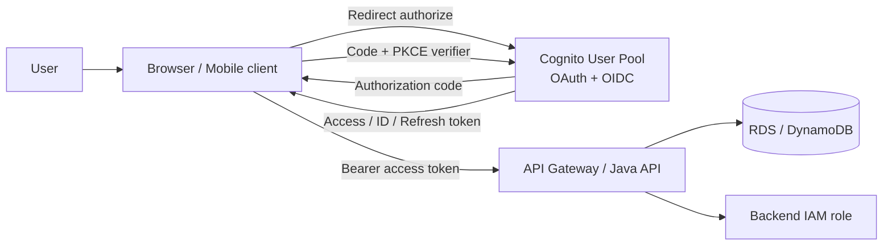
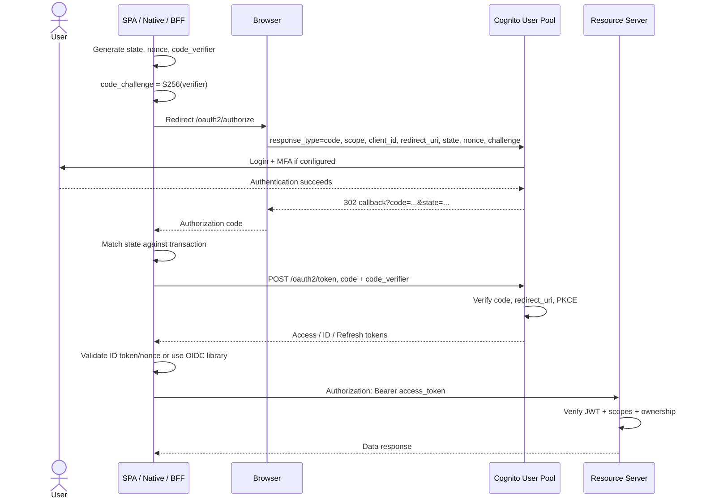
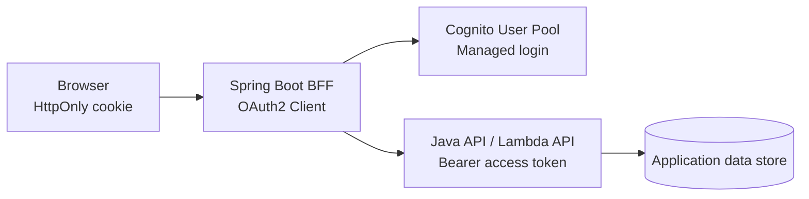
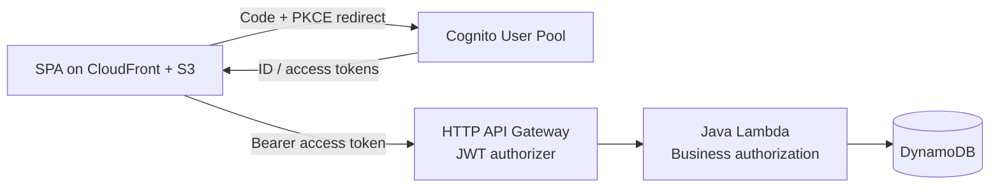
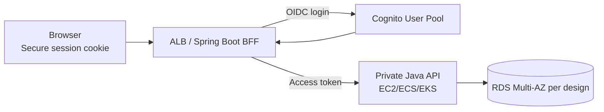

# OAuth 2.0, OpenID Connect, and Authorization Code with PKCE

In a web or mobile application, **a user signing in successfully**, **the app having permission to call an API**, and **the client safely exchanging tokens** are three related but distinct concerns. **OAuth 2.0** defines bounded access delegation; **OpenID Connect (OIDC)** adds an identity authentication layer; **Authorization Code Grant combined with PKCE** protects the transition from browser sign-in to tokens used for calling APIs. **Amazon Cognito User Pools** provide these capabilities for applications running on AWS.

This lesson belongs to the **Application Identity with Cognito** chapter of the **CLOUD_PROVIDERS_AWS** module. The material connects directly to IAM, VPC, API Gateway, Lambda, Java Spring Boot, storage/databases, security, monitoring, and resilience. The goal is not to memorize a sign-in URL, but to understand how to build, test, and operate a **secure identity flow** from user to business data.

> **Scope:** This lesson focuses on **Cognito User Pools** and user sign-in. **Cognito Identity Pools** (issuing temporary AWS credentials) and **IAM Identity Center** (workforce SSO) are separate services, mentioned only to prevent confusion. Domain names, IDs, tokens, and secrets in examples are illustrative placeholders.

## 1. Learning Objectives

After this lesson, you will be able to:

1. Distinguish **OAuth 2.0 authorization** from **OIDC authentication** and explain the roles of client, authorization server, resource server, and user agent.
2. Distinguish **ID token**, **access token**, **refresh token**, and **authorization code**.
3. Diagram the **Authorization Code + PKCE S256** flow from authorize redirect through token exchange and API calls.
4. Generate a cryptographically random `code_verifier`, compute `code_challenge`, and distinguish `state` from `nonce`.
5. Configure a **Cognito User Pool**, App Client, managed login/domain, callback/logout URLs, OAuth code grant, and scopes.
6. Explain why SPAs/native apps are **public clients** that must never hold a client secret, and when to use a **BFF/confidential client**.
7. Use Cognito authorize/token endpoints with the proper HTTP methods, parameters, URL encoding, and redirect URIs.
8. Set up sign-in patterns with **Spring Security OAuth2 Client** and protect Java APIs with **JWT Resource Server**.
9. Verify JWT/JWKS signatures, issuer, expiration, `token_use`, client ID/audience, and scopes while enforcing resource-level authorization.
10. Use Cognito JWTs safely with an **API Gateway HTTP API JWT authorizer**.
11. Troubleshoot common errors: redirect mismatch, invalid grant, missing PKCE, login loops, wrong token type, and refresh/logout issues.
12. Build a checklist covering MFA, session security, IAM, monitoring, recovery, and cost.

## 2. Roles in OAuth 2.0

| Role | Function | In AWS Architecture |
| --- | --- | --- |
| **Resource owner** | User who owns the resources/access rights | Customer/employee using the application |
| **Client** | Application requesting access | React SPA, native app, Spring Boot BFF |
| **Authorization server** | Authenticates and issues codes/tokens | Cognito User Pool |
| **Identity provider (IdP)** | Identity source used for sign-in | Cognito native, Google, Microsoft Entra, SAML |
| **User agent** | Browser participating in redirects | Browser or mobile system browser |
| **Resource server** | API validating access tokens and serving data | API Gateway + Lambda, Spring Boot API in VPC |



**Cognito User Pool issues user tokens; the backend's IAM role grants permissions to call AWS APIs.** A Cognito access token is not an AWS access key and does not grant a frontend permission to call S3, DynamoDB, or EC2 SDKs. If a browser genuinely needs temporary credentials to access AWS directly, evaluate **Cognito Identity Pool** and separate IAM policies.

## 3. OAuth 2.0 Does Not Equal OIDC Sign-In

### 3.1. OAuth 2.0: Authorization

OAuth 2.0 is designed for a client to receive **bounded access** to resources without knowing the user's password. The primary output is an **access token**. `scope`, expiration, and resource server checks determine how that access token may be used.

For example, an app receives the `orders/read` scope allowing it to call the order-reading API. That scope **does not prove** every order belongs to the user; checking `tenantId` and permission on `orderId` must still occur in the backend.

### 3.2. OpenID Connect: Authentication on Top of OAuth 2.0

**OIDC** adds an identity authentication layer, using the `openid` scope and an **ID token** with claims such as:

- `iss` — token issuer.
- `sub` — subject identifier within the issuer.
- `aud` — intended recipient application (for Cognito ID tokens, typically the App Client ID).
- `exp` and `iat` — expiration and issued-at timestamps.
- `auth_time`, `nonce` — when present in the flow/context.
- `email`, `email_verified`, or other profile claims if issued.

**Do not use email as an immutable identity key.** Emails can change or be recycled. Stable business identity keys typically rely on the pair of `iss` and `sub`, combined with account/federation management policies.

### 3.3. Four Frequently Confused Artifacts

| Artifact | Use For | Should Not Be Used For |
| --- | --- | --- |
| **Authorization code** | One-time exchange at the token endpoint | Calling business APIs |
| **ID token** | Client verifying user identity in OIDC | Substituting for an access token to authorize API calls |
| **Access token** | Sending `Authorization: Bearer` to a resource server | Acting as a long-lived session credential/refresh token |
| **Refresh token** | Obtaining new access/ID tokens via supported flows | Sending to business backend APIs or placing in URLs |

Cognito access tokens and ID tokens are **JWTs** with header, payload, and signature; refresh tokens are typically **opaque strings**. **Simply Base64-decoding a JWT is not validating the token.**

### 3.4. The `openid` Scope and Custom Scopes

Example authorization request:

```text
scope=openid email profile orders/read
```

- `openid`: requests OIDC; required when the app wants an ID token.
- `email`, `profile`: requests corresponding claims per provider policy.
- `orders/read`: example custom scope from a Cognito resource server.
- An App Client may only request scopes permitted in its configuration.
- Scopes grant permissions at the **action category** level; they do not authorize a user to read another tenant's data.

## 4. Components to Configure in Cognito

### 4.1. User Pool

**Cognito User Pool** manages application users and serves as the OIDC/OAuth server, including:

- Native users and account attributes.
- Managed login/hosted UI, sign-in and sign-out pages.
- MFA, email verification, account recovery, and sign-in protection mechanisms per configuration/tier.
- Federation with social IdPs, OIDC, or SAML providers.
- App Clients, custom resource servers/scopes, token validity, and refresh token settings.
- OIDC discovery and JWKS so backends can verify signatures.

A User Pool **does not store all application data** such as orders, transactions, or per-record authorization rules. Use RDS/DynamoDB/application logic to enforce those policies.

### 4.2. App Client

A single User Pool can have multiple App Clients serving applications with different trust levels.

| Client Type | Example | Client Secret | Recommended Grant |
| --- | --- | --- | --- |
| **Public SPA** | Browser React/Vue app | **No** | Authorization Code + PKCE |
| **Public native** | Android/iOS app | **No** | Authorization Code + PKCE |
| **Confidential web/BFF** | Spring Boot server-side login | Can hold secret on server | Authorization Code + client auth + PKCE where applicable |
| **Machine-to-machine** | Scheduled batch service | Can hold secret on server | Client Credentials, **not user login** |

Never bundle a client secret in JS bundles, mobile apps, public Git repositories, or URLs. **If a user can extract a secret from software they downloaded, it is not a secret.**

### 4.3. Domain and Managed Login

For an App Client to use the authorize endpoint, the User Pool needs a **domain**:

```text
Cognito managed login domain:
https://training-login.auth.ap-southeast-1.amazoncognito.com

Custom login domain, if configured:
https://login.example.com

OIDC issuer (different from login domain):
https://cognito-idp.ap-southeast-1.amazonaws.com/ap-southeast-1_EXAMPLE
```

**The OIDC issuer is the User Pool URL**, not the login domain. If a Java JWT validator is configured with `https://login.example.com` as the issuer while Cognito JWTs carry the `cognito-idp` URL, issuer verification will fail.

### 4.4. User Pool, Identity Pool, IAM Identity Center

| Service | Need |
| --- | --- |
| **Cognito User Pool** | App sign-in, issuing OIDC/OAuth JWTs |
| **Cognito Identity Pool** | Issuing temporary AWS credentials to authenticated/guest apps via IAM roles |
| **IAM Identity Center** | Workforce SSO and access to AWS accounts/enterprise applications |

A mobile app that only calls a Java API may only need **User Pool + API JWT authorization**, without needing an Identity Pool.

## 5. Why Is Authorization Code + PKCE Preferred?

Authorization Code Grant **does not place the access token directly into the redirect URL**. After the user signs in, Cognito issues a **short-lived, single-use code** to the client. The client exchanges that code for tokens in a subsequent request.

**PKCE (Proof Key for Code Exchange)** protects the code by requiring the client to prove possession of a random secret generated before sign-in began.

### 5.1. End-to-End Flow



**With a BFF:** code exchange and token storage occur on the server; the browser holds a session cookie. **With an SPA:** the browser performs the OAuth transaction through a trusted OIDC library. PKCE applies to both, though where state/verifier/tokens are stored differs.

### 5.2. Why Not Use the Implicit Flow?

Implicit flow and legacy patterns returning access tokens in redirect URLs/fragments make leakage, issuance control, and modern compatibility harder to secure. For SPAs/native apps, **Authorization Code + PKCE S256** is the preferred choice.

PKCE defends against **authorization code interception/injection** at the code exchange step; **it does not by itself block XSS**, malicious redirect URIs, session fixation, or misuse of an already stolen access token. Other defense layers remain necessary.

## 6. PKCE S256, State, and Nonce

### 6.1. code_verifier and code_challenge

The client generates a random, unpredictable `code_verifier` (RFC 7636 requires **43–128 characters**). A common implementation generates **32 CSPRNG bytes** and Base64URL-encodes them without padding, yielding 43 characters.

With `code_challenge_method=S256`:

\[
\mathrm{code\_challenge}
=\mathrm{BASE64URL\_NO\_PADDING}
(\mathrm{SHA256}(\mathrm{ASCII}(\mathrm{code\_verifier})))
\]

Send the **challenge** in the authorization request; keep the **verifier** for token exchange. **Never send the verifier in a URL** or write it to telemetry.

```text
Authorization request:
  code_challenge=SHA256_VERIFIER_BASE64URL
  code_challenge_method=S256

Token request:
  code_verifier=ORIGINAL_RANDOM_SECRET
```

### 6.2. Java 17+: Generating Verifier and Challenge Correctly

```java
package example;

import java.nio.charset.StandardCharsets;
import java.security.MessageDigest;
import java.security.SecureRandom;
import java.util.Base64;

public final class PkceExample {
    private static final SecureRandom RANDOM = new SecureRandom();

    private PkceExample() {}

    public static String randomValue() {
        byte[] bytes = new byte[32];
        RANDOM.nextBytes(bytes);
        return Base64.getUrlEncoder().withoutPadding().encodeToString(bytes);
    }

    public static String challengeS256(String verifier) throws Exception {
        byte[] hash = MessageDigest.getInstance("SHA-256")
            .digest(verifier.getBytes(StandardCharsets.US_ASCII));
        return Base64.getUrlEncoder().withoutPadding().encodeToString(hash);
    }

    public static void main(String[] args) throws Exception {
        String codeVerifier = randomValue();
        String codeChallenge = challengeS256(codeVerifier);
        String state = randomValue();
        String nonce = randomValue();

        // Only print challenge in local example.
        // Never log verifier/state/nonce/tokens in production.
        System.out.println("challenge=" + codeChallenge);
        System.out.println("method=S256");

        // Real apps store the verifier/state/nonce tuple per
        // authorization transaction in a protected session.
        if (codeVerifier.isEmpty() || state.isEmpty() || nonce.isEmpty()) {
            throw new IllegalStateException("Unexpected empty value");
        }
    }
}
```

This Java snippet demonstrates **the PKCE transformation**, not a complete OAuth client. In production apps, use a maintained OIDC/OAuth library to handle URL encoding, redirects, state, nonce, token exchange, and validation.

### 6.3. State and Nonce Do Not Replace PKCE

| Value | Where Used? | Role |
| --- | --- | --- |
| **`code_verifier`** | Token request body | Proves possession of the code |
| **`code_challenge`** | Authorize request | Commits hash of the verifier |
| **`code_challenge_method=S256`** | Authorize request | Selects SHA-256 transformation |
| **`state`** | Authorize request and callback | Binds callback to login transaction, prevents login CSRF |
| **`nonce`** | OIDC authorize request/ID token when present | Binds ID token to a specific authentication transaction |
| **`code`** | Callback and token request | Short-lived, single-use authorization code |

Generate **state, nonce, and verifier independently** with a CSPRNG. Store them per **authorization transaction**, never in a single global variable shared across users or login tabs.

If a callback arrives with a mismatched `state`, **abort the flow**. Never exchange the code first and check state afterward.

## 7. Cognito Endpoints: Authorize, Token, and Discovery

### 7.1. Key URLs

Suppose the Cognito domain prefix is `training-login` and the User Pool ID is `ap-southeast-1_EXAMPLE`:

```text
Authorize:
https://training-login.auth.ap-southeast-1.amazoncognito.com/oauth2/authorize

Token:
https://training-login.auth.ap-southeast-1.amazoncognito.com/oauth2/token

OIDC issuer:
https://cognito-idp.ap-southeast-1.amazonaws.com/ap-southeast-1_EXAMPLE

OIDC discovery:
https://cognito-idp.ap-southeast-1.amazonaws.com/ap-southeast-1_EXAMPLE/.well-known/openid-configuration

JWKS:
https://cognito-idp.ap-southeast-1.amazonaws.com/ap-southeast-1_EXAMPLE/.well-known/jwks.json
```

Additional endpoints include `/oauth2/userInfo`, `/logout`, and others per Cognito documentation. With a **custom login domain**, authorize/token/logout URLs change hostnames, but the **issuer remains the User Pool issuer**.

### 7.2. Authorize Request

```text
GET /oauth2/authorize?response_type=code
  &client_id=EXAMPLE_PUBLIC_CLIENT_ID
  &redirect_uri=https%3A%2F%2Fapp.example.com%2Fcallback
  &scope=openid%20email%20profile
  &state=STATE_RANDOM
  &nonce=NONCE_RANDOM
  &code_challenge=CHALLENGE_S256_BASE64URL
  &code_challenge_method=S256
```

This is a **multi-line parameter diagram**, not a URL to paste verbatim. The browser must be navigated to a valid HTTPS URL with properly encoded query parameters.

Meaning:

- `response_type=code`: uses Authorization Code Grant.
- `client_id`: exact registered App Client.
- `redirect_uri`: exact callback URI on the allowlist.
- `scope=openid ...`: requests OIDC + claims/permissions.
- `state`: must be verified upon callback return.
- `nonce`: verified when validating the ID token per library flow.
- `code_challenge` and `S256`: binds code exchange to the initiating client.

### 7.3. Callback

After sign-in, Cognito redirects to:

```text
https://app.example.com/callback?code=AUTH_CODE&state=STATE_RANDOM
```

The application must:

1. If the callback contains `error`, handle the error and terminate the transaction.
2. Verify `state` against the transaction saved prior to redirect.
3. Retrieve the **verifier belonging to this exact transaction**.
4. Exchange the code for tokens promptly; the code is short-lived and single-use.
5. Verify the ID token (and nonce if sent), then store session/tokens per architecture.
6. Clear the code and temporary state from browser history/URL where appropriate.

The callback **is never the place to put access tokens or client secrets in query strings**.

### 7.4. Token Exchange for a Public Client

The token endpoint accepts `POST` with `Content-Type: application/x-www-form-urlencoded`:

```http
POST /oauth2/token HTTP/1.1
Host: training-login.auth.ap-southeast-1.amazoncognito.com
Content-Type: application/x-www-form-urlencoded

grant_type=authorization_code&
client_id=EXAMPLE_PUBLIC_CLIENT_ID&
code=AUTH_CODE&
redirect_uri=https%3A%2F%2Fapp.example.com%2Fcallback&
code_verifier=ORIGINAL_SECRET_VERIFIER
```

The body above is split across lines for readability; applications send it as a **valid form-urlencoded string**. `redirect_uri` must match the URI used in the authorize request and registered on the App Client.

Conceptual curl example for understanding the API:

```bash
# DO NOT put real codes/verifiers into shared scripts or shell history.
curl -sS -X POST \
  "https://training-login.auth.ap-southeast-1.amazoncognito.com/oauth2/token" \
  -H "Content-Type: application/x-www-form-urlencoded" \
  --data-urlencode "grant_type=authorization_code" \
  --data-urlencode "client_id=EXAMPLE_PUBLIC_CLIENT_ID" \
  --data-urlencode "code=AUTH_CODE" \
  --data-urlencode "redirect_uri=https://app.example.com/callback" \
  --data-urlencode "code_verifier=ORIGINAL_SECRET_VERIFIER"
```

For a **confidential client**, the token request must also authenticate the client (e.g., HTTP Basic with client ID/secret) per configuration. **Never put the secret in a browser/native app**.

### 7.5. Token Response

```json
{
  "access_token": "ACCESS_TOKEN_REDACTED",
  "id_token": "ID_TOKEN_REDACTED",
  "refresh_token": "REFRESH_TOKEN_REDACTED",
  "token_type": "Bearer",
  "expires_in": 3600
}
```

The `3600` value is illustrative only, **not a guaranteed TTL for every App Client**. Rely on the actual response, `exp`, and configured settings. Never log or share real tokens.

## 8. Configuring User Pool and App Client in the Console

### 8.1. Preparation

1. Open the [Amazon Cognito Console](https://console.aws.amazon.com/cognito/) and select the right AWS account and Region.
2. Select or create a **User Pool**; decide email/username sign-in, MFA, and account recovery.
3. Determine whether users are Cognito native or federated via external OIDC/SAML/social IdPs.
4. Configure a **managed login domain** or a managed custom domain.
5. Confirm the User Pool ID and issuer URL for backend integration.

If a User Pool is used in production, never alter MFA/IdP/account recovery just to test a lesson exercise.

### 8.2. SPA/Native Public App Client

1. Inside the User Pool, select **App clients / Applications** and create an SPA/native client type.
2. **Do not generate/store a client secret** for clients running in browsers or mobile apps.
3. Enable **Authorization Code Grant** (`code`).
4. Configure exact callback URLs, e.g., `https://app.example.com/callback`.
5. Configure allowed sign-out URLs, e.g., `https://app.example.com/signed-out`.
6. Permit `openid`, `email`, `profile`, or required custom scopes.
7. Select permitted IdPs and managed login settings.
8. Configure token validity and refresh rotation per security requirements.
9. In the client app, use **PKCE S256** with state/nonce.
10. Test login/logout and callbacks in a sandbox before granting real user access.

**Never use flexible wildcard redirects or callbacks to uncontrolled domains.** `http://localhost` exceptions are solely for local development where permitted by the provider; production must use HTTPS.

### 8.3. Server-Side Java BFF Client

For a Spring Boot BFF that can keep a secret:

- Create a **confidential client** with its secret kept on the server.
- Set the callback such as `https://app.example.com/login/oauth2/code/cognito`.
- Use Authorization Code Grant and PKCE where appropriate.
- Never place the client secret in JS, APKs, public YAML, or Git.
- Keep tokens on the server; give the browser an HttpOnly/Secure session cookie.
- Protect against CSRF and bound session lifetimes.

### 8.4. External IdP Federation

When users sign in via Google, Microsoft, or a SAML IdP:

- Cognito redirects onward to the IdP and receives assertions/tokens back.
- The App Client still interacts with the **Cognito User Pool** as its OIDC issuer.
- User attribute mapping and account linking must be designed explicitly.
- Signing out of Cognito **does not always sign out sessions** at external IdPs.
- MFA policies may depend on where authentication occurs; do not assume enabling MFA in Cognito automatically enforces two factors across every external IdP.

## 9. AWS CLI: Read-Only Configuration Inspection

Use AWS CLI v2 with an authorized IAM Identity Center/role; the commands below **do not create new infrastructure**.

```bash
# Verify caller identity before viewing resources.
aws sts get-caller-identity --profile training

aws cognito-idp describe-user-pool \
  --user-pool-id ap-southeast-1_EXAMPLE \
  --region ap-southeast-1 --profile training

aws cognito-idp list-user-pool-clients \
  --user-pool-id ap-southeast-1_EXAMPLE \
  --region ap-southeast-1 --profile training

aws cognito-idp describe-user-pool-client \
  --user-pool-id ap-southeast-1_EXAMPLE \
  --client-id EXAMPLE_PUBLIC_CLIENT_ID \
  --region ap-southeast-1 --profile training
```

**Important:** `describe-user-pool-client` for a confidential client may return `ClientSecret`. Never share the raw response; redact before pasting into tickets, chats, or logs.

Verify:

| Field | Meaning |
| --- | --- |
| `AllowedOAuthFlowsUserPoolClient` | Enables OAuth flows on the app client |
| `AllowedOAuthFlows` | Whether `code` is enabled |
| `AllowedOAuthScopes` | Scopes the client may request |
| `CallbackURLs` | Allowlisted callback URIs |
| `LogoutURLs` | Allowlisted logout URIs |
| `SupportedIdentityProviders` | IdPs enabled for this client |
| `ClientSecret` | If present, sensitive credential; omit from reports |
| `AccessTokenValidity` / `IdTokenValidity` | JWT TTLs |
| `RefreshTokenValidity` | Refresh token TTL |

### 9.1. Illustrative Create App Client Command — Mutating

```bash
# Run only in an approved sandbox.
aws cognito-idp create-user-pool-client \
  --user-pool-id ap-southeast-1_EXAMPLE \
  --client-name spa-pkce-demo \
  --no-generate-secret \
  --allowed-o-auth-flows-user-pool-client \
  --allowed-o-auth-flows code \
  --allowed-o-auth-scopes openid email profile \
  --supported-identity-providers COGNITO \
  --callback-urls "http://localhost:8080/callback" \
  --logout-urls "http://localhost:8080/signed-out" \
  --region ap-southeast-1 --profile training
```

Creating a client **does not automatically create a domain, user accounts, or frontend callback pages**. Using `localhost` URIs here is strictly for local development; production must switch to HTTPS and registered callbacks.

## 10. Java Spring Boot BFF: Proper OAuth2 Login Role

### 10.1. What Is a BFF?

A **Backend-for-Frontend (BFF)** keeps the browser from having to manage access/refresh tokens directly:



The BFF acts as the OAuth client and stores tokens in a server-side session. The browser only sends a session cookie, reducing the surface area for JavaScript token theft. In return, the BFF must manage CSRF/cookies, session storage, scaling, and logout.

### 10.2. Dependencies

Spring Boot 3.x/Java 17+ typically requires:

- `spring-boot-starter-security`.
- `spring-boot-starter-oauth2-client`.
- `spring-boot-starter-web` or an appropriate WebFlux stack.
- Spring Session with Redis/DB session store for multi-instance deployments.
- Test framework coverage for login callbacks, CSRF, and session lifecycle.

### 10.3. Illustrative application.yml

```yaml
spring:
  security:
    oauth2:
      client:
        registration:
          cognito:
            client-id: ${COGNITO_CLIENT_ID}
            client-secret: ${COGNITO_CLIENT_SECRET}
            authorization-grant-type: authorization_code
            redirect-uri: "{baseUrl}/login/oauth2/code/{registrationId}"
            scope:
              - openid
              - email
              - profile
        provider:
          cognito:
            issuer-uri: https://cognito-idp.ap-southeast-1.amazonaws.com/ap-southeast-1_EXAMPLE

server:
  forward-headers-strategy: framework
  servlet:
    session:
      cookie:
        http-only: true
        secure: true
        same-site: lax
```

This example targets a **confidential BFF client**. Load the secret server-side via secret management, **never commit real values**. The `issuer-uri` must be the **User Pool issuer**, not the `amazoncognito.com` login domain.

For apps behind ALB/CloudFront, `forward-headers-strategy` must be paired with **trusted proxy** configuration. Never trust `X-Forwarded-*` headers forged by arbitrary Internet clients, or attackers can manipulate redirect URLs.

### 10.4. Spring Security Filter Chain

```java
package example.security;

import org.springframework.context.annotation.Bean;
import org.springframework.context.annotation.Configuration;
import org.springframework.security.config.Customizer;
import org.springframework.security.config.annotation.web.builders.HttpSecurity;
import org.springframework.security.web.SecurityFilterChain;

@Configuration
public class WebSecurityConfiguration {

    @Bean
    SecurityFilterChain webSecurity(HttpSecurity http) throws Exception {
        return http
            .authorizeHttpRequests(auth -> auth
                .requestMatchers("/health", "/public/**").permitAll()
                .anyRequest().authenticated()
            )
            .oauth2Login(Customizer.withDefaults())
            // Keep Spring Security CSRF protection enabled for web sessions.
            .build();
    }
}
```

This code relies on supported Spring Security APIs and is only a **basic security skeleton**. In production, address logout, auth failures, session fixation, session storage, scopes, and application permissions.

**Verify PKCE in practice:** `authorization-grant-type=authorization_code` does not guarantee every OIDC library version and client configuration sends `code_challenge`. Inspect the authorize request in a sandbox or configure OAuth2 customization per library to confirm **S256 is active**.

## 11. Java Resource Server: Validating Cognito JWTs

A Spring Boot backend/API does not redirect users to a login page on every request. Instead, it receives:

```http
GET /orders/42 HTTP/1.1
Host: api.example.com
Authorization: Bearer ACCESS_TOKEN
```

The resource server must verify:

1. JWT signature using the exact User Pool's **JWKS public key**.
2. `iss` matches the **issuer allowlist**.
3. `exp`/`nbf` (if present), `iat`, and reasonable clock skew.
4. **`token_use=access`**, never `id`.
5. Permitted app client: `client_id`/`aud` per Cognito token format and actual resource binding.
6. `scope`/roles for the route.
7. Business authorization on `orderId`, `tenantId`, and verified identity.

### 11.1. Claims to Recognize

| Claim | ID Token | Access Token | Notes |
| --- | --- | --- | --- |
| `iss` | Yes | Yes | Must match the User Pool issuer |
| `sub` | Yes | Yes | Subject, used alongside issuer |
| `aud` | Usually App Client ID | May be present when bound to a resource audience | Do not assume access tokens mirror ID tokens |
| `client_id` | Different role | Usually present | Controls which app clients may call the API |
| `token_use` | `id` | `access` | Distinguish token types accurately |
| `scope` | Not primary API authz | Granted scopes | Used for route authorization |
| `cognito:groups` | May be present | May be present | Supplemental RBAC |
| `exp` | Yes | Yes | Reject expired tokens |

Cognito ID tokens and access tokens can use **different signing keys** in JWKS. Validators look up the public key by `kid` header and check allowed algorithms. Never hard-code a single key for all tokens or skip signature verification.

### 11.2. Spring Security JWT Resource Server

Spring Boot 3.x example with `spring-boot-starter-oauth2-resource-server`. Properties:

```properties
app.cognito.issuer=https://cognito-idp.ap-southeast-1.amazonaws.com/ap-southeast-1_EXAMPLE
app.cognito.client-id=EXAMPLE_PUBLIC_CLIENT_ID
```

Java configuration:

```java
package example.security;

import org.springframework.beans.factory.annotation.Value;
import org.springframework.context.annotation.Bean;
import org.springframework.context.annotation.Configuration;
import org.springframework.security.config.Customizer;
import org.springframework.security.config.annotation.web.builders.HttpSecurity;
import org.springframework.security.oauth2.core.OAuth2Error;
import org.springframework.security.oauth2.core.OAuth2TokenValidator;
import org.springframework.security.oauth2.core.OAuth2TokenValidatorResult;
import org.springframework.security.oauth2.core.DelegatingOAuth2TokenValidator;
import org.springframework.security.oauth2.jwt.Jwt;
import org.springframework.security.oauth2.jwt.JwtDecoder;
import org.springframework.security.oauth2.jwt.JwtValidators;
import org.springframework.security.oauth2.jwt.NimbusJwtDecoder;
import org.springframework.security.web.SecurityFilterChain;

@Configuration
public class CognitoResourceServerSecurity {

    @Bean
    JwtDecoder jwtDecoder(
            @Value("${app.cognito.issuer}") String issuer,
            @Value("${app.cognito.client-id}") String clientId) {

        NimbusJwtDecoder decoder = NimbusJwtDecoder
            .withJwkSetUri(issuer + "/.well-known/jwks.json")
            .build();

        OAuth2TokenValidator<Jwt> tokenUseAndClient = jwt -> {
            boolean isAccess = "access".equals(
                jwt.getClaimAsString("token_use"));
            boolean isAllowedClient = clientId.equals(
                jwt.getClaimAsString("client_id"));
            if (isAccess && isAllowedClient) {
                return OAuth2TokenValidatorResult.success();
            }
            return OAuth2TokenValidatorResult.failure(
                new OAuth2Error("invalid_token",
                    "Token type or client is not authorized", null)
            );
        };

        decoder.setJwtValidator(new DelegatingOAuth2TokenValidator<>(
            JwtValidators.createDefaultWithIssuer(issuer),
            tokenUseAndClient
        ));
        return decoder;
    }

    @Bean
    SecurityFilterChain securityFilterChain(HttpSecurity http)
            throws Exception {
        return http
            .authorizeHttpRequests(auth -> auth
                .requestMatchers("/health").permitAll()
                .requestMatchers("/orders/**")
                    .hasAuthority("SCOPE_orders/read")
                .anyRequest().authenticated()
            )
            .oauth2ResourceServer(oauth ->
                oauth.jwt(Customizer.withDefaults())
            )
            .build();
    }
}
```

**Important:**

- `JwtValidators.createDefaultWithIssuer` validates standard JWT checks and issuer; the custom validator checks `token_use` and `client_id`.
- The code demonstrates **one** app client ID. With multiple clients, use a reviewed allowlist and/or verify API audience if tokens are resource-bound.
- Spring Security typically maps `scope` to `SCOPE_...` authorities, but verify against actual token claims and add a custom converter if needed.
- Enforce **resource-level authorization** in services/repositories: the `orders/read` scope **does not grant permission to read someone else's orders**.
- A Bearer API example does not cover full CSRF protections if the app simultaneously uses cookie auth; evaluate specifically rather than disabling CSRF blindly.
- Never fetch the JWKS URI from a user-supplied token or header; derive it strictly from the **trusted issuer configured by the application**.

## 12. API Gateway HTTP API JWT Authorizer

If the Java API is exposed via API Gateway HTTP API, a **JWT authorizer** can validate tokens before invoking the integration.

### 12.1. Logical Configuration

```text
HTTP API:
  GET /orders/{id}
    Authorization: JWT
    Issuer:
      https://cognito-idp.ap-southeast-1.amazonaws.com/ap-southeast-1_EXAMPLE
    Audience:
      EXAMPLE_PUBLIC_CLIENT_ID
    Required scopes:
      orders/read
    Integration:
      Java Lambda or VPC Link to ALB/Java backend
```

**Subtle detail:** HTTP API's JWT authorizer evaluates `aud` when present, falling back to `client_id` per service rules. For Cognito access tokens, `client_id` is usually the client indicator; do not infer access tokens from ID tokens.

The HTTP API JWT authorizer **does not validate every custom claim** an app might require, including cases needing strict `token_use=access` enforcement. Use **required authorization scopes** on routes and/or verify `token_use` in a backend/Lambda authorizer per security policy.

### 12.2. Scopes and Record-Level Authorization

Suppose Cognito resource server identifier `orders` defines scopes `read` and `write`:

| Route | Scope | Business Check |
| --- | --- | --- |
| `GET /orders` | `orders/read` | Filter by tenant/user |
| `GET /orders/{id}` | `orders/read` | Verify ownership |
| `POST /orders` | `orders/write` | Validation + idempotency |
| `DELETE /orders/{id}` | Dedicated scope or write permission | Business controls and audit |
| `GET /health` | Optionally unauthenticated per design | Never expose secrets |

**Scopes do not replace IAM roles:** the Java Lambda backend uses its execution role to read DynamoDB; the access token identifies the client/user and route scope. Both layers must align.

### 12.3. Cognito Groups and Custom Claims

Cognito groups can populate the `cognito:groups` claim. This supports coarse RBAC roles like `support`, `sales`, and `admin`, without granting blanket access to all orders. A stronger access condition:

```text
Allow GET /orders/{id} if:
  JWT signature and issuer valid
  AND token_use == access
  AND scope includes orders/read
  AND user's tenantId == order.tenantId
  AND user has an allowed business role.
```

Never trust a `tenantId` from a URL/body without matching it against the verified principal.

## 13. Protecting Tokens in SPA, Mobile, and BFF

### 13.1. Browser SPA

JavaScript SPAs cannot keep a client secret. Use an **OAuth/OIDC library** supporting PKCE and Web Crypto API:

- CSPRNG for verifier/state/nonce.
- Full-page redirect to Cognito managed login.
- Verify state before code exchange.
- Choose token storage that limits XSS impact; avoid keeping long-lived refresh tokens in `localStorage`.
- Enforce CSP, output escaping, dependency hygiene, and defenses against third-party script injection.
- Strip the query code from browser history once the callback completes.
- Never log `Authorization` headers or refresh tokens.

If token exfiltration risk is too high, evaluate a **BFF** so the browser never holds tokens.

### 13.2. Mobile Native

- Use the **system browser/auth session** instead of collecting passwords inside an uncontrolled WebView.
- Authorization Code + PKCE S256; no client secret.
- Use universal/app links or loopback redirect URIs per platform guidelines.
- Guard against deep-link interception; bind state to the auth transaction.
- Store refresh credentials in **Keychain/Keystore** or equivalent OS secure storage.
- Design reconnect, app restart, logout, and rotation handling.
- Never leak tokens via logs, clipboard, or unprotected intents.

### 13.3. BFF

- Keep access/refresh tokens **server-side**.
- Browser holds only `HttpOnly`, `Secure`, `SameSite` cookies.
- Enforce CSRF protection on state-changing actions.
- Session storage must support multi-AZ and Auto Scaling.
- Implement session timeouts, rotation, and logout.
- Never forward refresh tokens down to the browser simply for "API convenience".

A BFF reduces browser token exposure at the cost of increased session-store and backend operational responsibility.

## 14. Refresh Token Rotation, Logout, and Session Lifecycle

### 14.1. Token Expiry Does Not Equal Session Expiry

Three distinct lifetimes:

| Component | Managed By | Meaning |
| --- | --- | --- |
| **Access/ID token `exp`** | Cognito App Client | How long the JWT remains valid |
| **Refresh token validity** | Cognito/flow | Can request new tokens until expired/revoked |
| **Browser/BFF session** | Managed login/application | Cookies/sessions follow their own lifecycle |

Never assume an expired access token logs the browser out immediately, or that signing out of a BFF terminates every IdP session.

### 14.2. Refresh Token Rotation

Cognito supports **refresh token rotation** on app clients in supported configurations:

- Each refresh can return a new refresh token.
- Clients must store the new token safely and handle grace periods/race conditions.
- Avoid concurrent refresh requests racing on the same token.
- When rotation is enabled, **do not use the `REFRESH_TOKEN_AUTH` flow** if incompatible with rotation.
- Use the Cognito-supported grant/SDK flow for your configured app client.

If a refresh token leaks, rotation/revocation narrows the exposure window, but does not replace secure storage, MFA, and monitoring.

### 14.3. Logout

Proper sign-out typically involves:

1. Clearing/invalidating the application session.
2. Revoking refresh tokens or calling sign-out APIs per flow where appropriate.
3. Ending the managed login session via `/logout` if needed.
4. For external IdPs, designing separate upstream IdP session logout behavior.
5. For sensitive actions, considering server-side revocation/session tracking.

Illustrative URL:

```text
https://training-login.auth.ap-southeast-1.amazoncognito.com/logout
  ?client_id=EXAMPLE_PUBLIC_CLIENT_ID
  &logout_uri=https%3A%2F%2Fapp.example.com%2Fsigned-out
```

`logout_uri` must be on the allowlist. This URL merely shows structure; construct and encode it accurately when implementing.

**Never assume revoking a refresh token instantly rejects all previously issued access JWTs at every resource server.** An API checking only signatures and expiry will continue accepting existing JWTs until they expire. Use short access-token TTLs and additional checks for sensitive resources.

## 15. IAM, Cognito Identity Pools, and Resource Permissions

Cognito User Pool tokens tell the application about the user, client, and scopes. For a Java backend to call AWS services:

- Lambda uses an **execution role**.
- ECS tasks use a **task role**.
- EKS workloads use **Pod Identity/IRSA** per supported compute.
- EC2 uses an **instance profile IAM role**.

For example, a Java API receives a JWT and calls S3 to read `reports/tenant-42/...`: the **IAM role** allows `s3:GetObject` on the allowed prefix, while the **backend enforces tenant/user isolation** from the verified token.

If a mobile app needs direct S3 uploads, two options exist:

1. **Backend presigned URL**: backend authenticates the user, checks file permissions, and generates a TTL- and key-scoped URL.
2. **Cognito Identity Pool**: issues temporary AWS credentials via an IAM role with strict policies and conditions.

Never pass a Cognito User Pool access token directly to the AWS SDK expecting it to work as IAM credentials.

## 16. Threat Model and Security Checklist

| Risk | Cause | Mitigation |
| --- | --- | --- |
| Stolen authorization code | Intercepted deep link/callback | PKCE S256, secure redirect URIs |
| Login CSRF | Callback unbound to initiating request | Random `state` and transaction store |
| ID token replay | Missing nonce/transaction check | OIDC `nonce` and proper validation |
| Exposed client secret | Secret placed in SPA/mobile | Public client with no secret |
| Open redirect | Dynamic callbacks to arbitrary domains | Exact URI allowlist |
| XSS token theft | Tokens stored in JS-readable storage | BFF where suitable, CSP, XSS defenses |
| JWT forgery | Base64-decoding without verifying signature | JWKS signature + algorithm + issuer |
| JWT from another User Pool | Missing `iss` check | Trust only configured issuer |
| ID token used as access token | Missing `token_use` check | Accept only `access` at resource servers |
| Overbroad scopes | Granting all scopes to all clients | Least-privilege scope/client design |
| Broken object authorization | Checking scope without tenant/ownership | Resource-level permissions |
| Refresh token leak | Logs/LocalStorage/traces | Secure storage, rotation, redaction |
| Authorization code replay | Callback processed twice | Single-use code, transaction state, idempotent callback |
| HTTP redirect URI in production | Code/tokens exposed in transit | HTTPS, localhost exception for dev only |
| Signing key rotation | Caching JWKS forever | Refresh JWKS dynamically by `kid` |
| Credential stuffing | Compromised passwords | MFA/threat protection/rate controls |
| Incomplete external IdP logout | Clearing only local cookies | Design logout across layers/IdPs |
| Clock skew | Server clock drift | NTP and bounded skew tolerance |

**Never disable JWT signature verification, skip PKCE/state, or open wildcard callbacks** just to make a sign-in error appear to "go away". Those shortcuts break security boundaries.

### 16.1. MFA Is Not PKCE

- **MFA**: protects proving the user's identity.
- **PKCE**: protects exchanging the **authorization code**.
- **HTTPS**: protects transport confidentiality/integrity.
- **state/nonce**: binds steps inside an OIDC transaction.
- **JWT validation + authorization**: protects the resource server.

A system needs all layers working together, never relying on one layer to replace the others.

## 17. AWS Deployment Diagrams

### 17.1. SPA + API Gateway HTTP API + Lambda



**Controls to verify:** Cognito domain, callback URI, code verifier/state, JWT scopes at gateway, ownership in Lambda, IAM execution role, and redacted CloudWatch logs.

### 17.2. Spring Boot BFF + Private Java API



**Controls to verify:** session store/CSRF, trusted proxy headers, TLS, RDS security groups, backups, data authorization, and multi-AZ resilience.

### 17.3. Common Networking Misconceptions

- Running an API inside a VPC **does not automatically verify JWTs**.
- Cognito User Pool OAuth URLs are HTTPS endpoints; backends need connectivity to discovery/JWKS/token services per architecture.
- HTTP API JWT authorizers check JWTs at the gateway; backends must still implement per-record authorization logic.
- Route 53/CloudFront/ALB do not replace OIDC identity validation.
- A Lambda's IAM role does not mean end users are authorized to view everything Lambda can read.

## 18. Troubleshooting Cognito OAuth/OIDC PKCE

| Symptom | Possible Cause | How to Verify |
| --- | --- | --- |
| Authorize error | Wrong domain, client ID, flow, or scope | App Client settings, domain, URL encoding |
| Redirect rejected | Callback URI not allowlisted | Exact scheme, host, port, path match |
| No authorization code returned | `response_type` is not `code` | Check flow and callback error params |
| Token endpoint `invalid_grant` | Expired/reused code, wrong verifier or redirect URI | Start fresh transaction, compare parameters |
| PKCE mismatch | Standard Base64 instead of Base64URL, padding left in, verifier changed | Check S256 math and transaction store |
| Callback `state` mismatch | Lost session, multiple tabs, CSRF | Store state per transaction and cookie/session |
| `nonce` mismatch | ID token not tied to login transaction | OIDC library nonce validation |
| Java BFF login loop | Session cookie dropped or wrong proxy scheme | Secure/SameSite/trusted proxy, session store |
| API returns 401 | Expired token, wrong issuer, ID token used instead of access token | JWT claims, JWKS, `token_use` |
| API returns 403 | Valid JWT but missing scope or data permission | JWT `scope`, tenant/resource ownership |
| JWKS `kid` not found | Stale JWKS cache or wrong User Pool | Discovery/JWKS for exact issuer, key rotation |
| Access token has `client_id` but no `aud` | Backend assumes ID/access tokens share identical claims | Separate validators by token type |
| SPA API call fails with CORS | Misconfigured API Gateway/backend CORS | Allowed origins/headers/methods; do not alter auth |
| Native app misses callback | Redirect scheme/app links misregistered | OS deep link/universal link and callback URI |
| S3 fetch fails despite valid Cognito JWT | JWT is not IAM credentials | Backend IAM/presigned URL/Identity Pool |
| User signs back in without password after logout | Cognito/external IdP session still active | Sign out across layers; check expected SSO behavior |
| Refresh fails after enabling rotation | Client uses legacy flow or concurrent refresh race | App Client rotation settings, SDK flow |

### 18.1. Layered Troubleshooting

1. **Account/Region:** are User Pool and App Client in the right environment?
2. **Domain & OAuth settings:** managed login, redirect/logout URLs, `code` grant, allowed scopes?
3. **Authorize request:** state, nonce, S256 challenge, `redirect_uri` encoding?
4. **Callback:** error or code; does `state` match?
5. **Token request:** verifier, single-use code, client auth, redirect URI?
6. **JWT:** issuer, JWKS, signature, expiry, `token_use`, client ID/aud, scopes?
7. **API:** Bearer token, authorizer settings, resource ownership, and backend IAM?
8. **Session:** cookies, CSRF, refresh rotation, external IdP logout?
9. **Operations:** logs, metrics, quotas, MFA failures, networking, and cost?

**Never paste raw authorization codes, access tokens, refresh tokens, or client secrets into tickets while debugging.** Use request IDs, error types, timestamps, and redacted issuer/client IDs.

## 19. Monitoring, Quotas, and Cost

### 19.1. Observability Sources

| Service | Signal | Purpose |
| --- | --- | --- |
| **Cognito/CloudTrail** | Changes to User Pools, App Clients, supported auth operations | Configuration and activity auditing |
| **CloudWatch** | Metrics, supported logs/events, and alarms | Sign-in/token failures, anomalies |
| **API Gateway** | 401/403/429/5XX, latency, request IDs | Isolate gateway vs. backend errors |
| **Spring Security** | Redacted authentication failures and session events | Diagnose callbacks, cookies, logout |
| **WAF/CloudFront** | HTTP abuse and anomalous traffic | Web-layer protection |
| **Cost Explorer/Budgets** | User pool costs, SMS, logs, Lambda/API backend | Prevent budget overruns |

**Never turn on DEBUG logging that prints tokens or authorization headers** in production to troubleshoot. Prefer correlation IDs and secret-free structured logs.

### 19.2. Quotas and Retry Risks

- Token/authorize endpoints and Cognito APIs have quotas and rate controls.
- When throttled, retry with **exponential backoff + jitter**; never create infinite login loops.
- Authorization codes are **single-use**; never auto-retry a token exchange with a previously sent code blindly.
- Monitor abnormal sign-in/refresh failure rates and user pool threat-protection events per enabled plan.
- Maintain incident revocation procedures for credentials and keys.

### 19.3. Cost Estimation

Cognito User Pools use a pricing model based on **tier/features/MAUs and usage**, varying by time and Region. Ancillary costs can include:

- MFA SMS/email or related messaging services.
- Threat protection/adaptive authentication per tier.
- API Gateway, Lambda/EC2/ECS/EKS, and RDS/DynamoDB.
- CloudWatch Logs, CloudTrail, WAF, Route 53/CloudFront.
- NAT/VPC endpoints when backends reach external services.
- Session store and BFF infrastructure if used.

Never assume one fixed USD price across all environments. Consult [Amazon Cognito pricing](https://aws.amazon.com/cognito/pricing/) and the [AWS Pricing Calculator](https://calculator.aws/).

## 20. Hands-On Practice: OAuth/OIDC Design Simulation

You do not need to create a billable User Pool to complete these paper exercises. If you have an authorized sandbox, run only the read-only commands from section 9.

### 20.1. Exercise A — Choosing Grants and Client Types

| Application | Client Type | Grant | PKCE and Secret |
| --- | --- | --- | --- |
| Browser SPA | Public | Authorization Code | S256; **no secret** |
| Android/iOS | Public | Authorization Code | S256; **no secret** |
| Spring Boot BFF | Confidential | Authorization Code | Server-side secret; PKCE where appropriate |
| Machine-to-machine worker | Confidential | Client Credentials | Not user login; uses custom scopes |

Explain: why does putting a client secret inside a mobile app fail to make it a confidential client?

### 20.2. Exercise B — Ordering the PKCE Flow

Given steps:

```text
A. Client generates state, nonce, code_verifier
B. Client computes S256(code_verifier) -> code_challenge
C. Browser goes to /oauth2/authorize with challenge
D. Cognito authenticates user and redirects ?code=...&state=...
E. Client verifies state and retrieves transaction's verifier
F. Client POSTs /oauth2/token with code + verifier
G. Client receives/validates ID token; stores tokens or session securely
H. Client calls API with access token
I. API verifies JWT, scopes, and resource permissions
```

**Expected order:** A → B → C → D → E → F → G → H → I. Explain why E must happen **before** F.

### 20.3. Exercise C — Spot the Security Flaws

```text
response_type=token
client_id=SPA_CLIENT_WITH_SECRET
redirect_uri=http://app.example.com/callback
scope=openid
code_challenge_method=plain
state=12345
```

Identify **at least five** errors/risks:

- Not using code grant.
- SPA holding a client secret.
- HTTP callback in production.
- PKCE not using S256/proper challenge.
- Predictable state.
- Missing nonce/transaction validation per OIDC security design.
- Missing redirect URI allowlist and scope/API authorization considerations.

### 20.4. Exercise D — API Returns 401/403

A mobile app signed in and received an ID token and access token. The gateway requires `orders/read` on `GET /orders/42`:

1. Which token should be sent in `Authorization: Bearer`?
2. May a validly signed ID token be used instead of an access token?
3. How does a token missing `orders/read` fail authorization?
4. If the scope is present yet the order belongs to a different tenant, how should the backend respond?
5. Which claims besides `exp` must the backend/authorizer verify?

### 20.5. Exercise E — Multi-AZ BFF

A Spring Boot BFF runs two instances behind an ALB and stores refresh tokens server-side. Design a checklist covering:

- Shared/HA session store, session timeout.
- HttpOnly/Secure/SameSite cookies; CSRF controls.
- HTTPS/trusted proxy headers and callback URI.
- BFF/Cognito and external IdP logout.
- Refresh token rotation, retries, secret storage.
- JWT scopes and resource ownership.
- Redacted CloudWatch logging and incident response.
- Session storage cost/backup plan.

### 20.6. Exercise F — Read-Only Cognito Audit

1. Verify AWS account/Region.
2. Inspect User Pool/App Client settings via AWS CLI `describe`.
3. Verify `AllowedOAuthFlows` includes `code` and appropriate OAuth scopes.
4. Check whether public App Clients lack secrets **without printing any secret values**.
5. Cross-check callback URLs and logout URLs.
6. Confirm exact issuer URL/JWKS in Java/API Gateway.
7. Review scope grants and refresh/logout policies.
8. Write a risk report without modifying production resources in a read-only audit.

### 20.7. Report Template

```text
AWS Account / Region: ...
User Pool ID (redacted): ...
OIDC issuer: ...
Managed login / custom domain: ...
App Client Type: SPA / Native / Confidential BFF / M2M
Client ID (redacted): ...
Client Secret Present? Yes/No (do NOT include actual secret)
Allowed OAuth grant: ...
PKCE S256 configured and observed? ...
Callback URL / logout URL: ...
Requested / allowed scopes: ...
Identity Provider: ...
MFA / recovery policy: ...
Access / ID / refresh token validity: ...
Refresh rotation configuration: ...
JWT verification: issuer/JWKS/exp/token_use/client_id or aud
API scope + resource authorization: ...
Client token/session storage: ...
Errors/monitoring alerts: ...
Security concerns and owner: ...
Cost tier and reviewer date: ...
```

**Completion criteria:** learners choose the right client type and code + PKCE, distinguish OAuth/OIDC and token types, verify JWTs rather than blindly decoding them, and articulate user/API security and operational policies. Never collect real passwords, OTPs, codes, or refresh tokens.

## 21. Self-Check Questions

1. Is OAuth 2.0 primarily for authorization or authentication?
2. Which token does OIDC add for the client to verify identity?
3. Do access tokens and ID tokens serve the same purpose? State their corresponding `token_use` values.
4. Why can an SPA not be protected by embedding a client secret in JavaScript?
5. How does Authorization Code Grant reduce the risk of leaking access tokens in URLs compared to the implicit flow?
6. What source of randomness must be used to generate a PKCE code verifier?
7. Which hash and encoding does the S256 formula use?
8. Is the code challenge sent in the authorize request or token request? Where is the verifier sent?
9. Does `state` replace `nonce`? Why or why not?
10. When a callback returns a mismatched `state`, should the client still try exchanging the code?
11. Is the Cognito JWT issuer the managed login domain or the User Pool URL?
12. Which callback URLs may be permitted to use HTTP during development?
13. Where does a Java Spring Boot BFF store access/refresh tokens to reduce browser exposure?
14. Which claims must a resource server verify besides the JWT signature?
15. Why can checking `aud` the same way as an ID token fail for Cognito access tokens?
16. Does an API Gateway JWT authorizer automatically validate all custom claims and resource ownership?
17. Does the `orders/read` scope allow reading orders belonging to every tenant?
18. When is a Cognito Identity Pool needed instead of only a User Pool?
19. Why can refresh token rotation not replace secure storage?
20. Does signing out of Cognito immediately invalidate all JWTs previously accepted by resource servers?
21. How does JWKS key rotation affect JWT verification?
22. How do MFA and PKCE protect two different stages?
23. When an app behind an ALB redirects with the wrong callback scheme, which configuration should you inspect?
24. Why does placing a Java API inside a private subnet not replace authentication?
25. Which factors affect Cognito User Pools cost besides user count?

## 22. Official AWS Documentation and Standards

1. [Amazon Cognito User Pools](https://docs.aws.amazon.com/cognito/latest/developerguide/cognito-user-pools.html).
2. [User pool OAuth 2.0 authorization server](https://docs.aws.amazon.com/cognito/latest/developerguide/cognito-userpools-server-contract-reference.html).
3. [Cognito authorize endpoint](https://docs.aws.amazon.com/cognito/latest/developerguide/authorization-endpoint.html).
4. [Cognito token endpoint](https://docs.aws.amazon.com/cognito/latest/developerguide/token-endpoint.html).
5. [Cognito UserInfo endpoint](https://docs.aws.amazon.com/cognito/latest/developerguide/userinfo-endpoint.html).
6. [Cognito logout endpoint](https://docs.aws.amazon.com/cognito/latest/developerguide/logout-endpoint.html).
7. [Cognito user pool app clients](https://docs.aws.amazon.com/cognito/latest/developerguide/user-pool-settings-client-apps.html).
8. [Cognito access token claims](https://docs.aws.amazon.com/cognito/latest/developerguide/amazon-cognito-user-pools-using-the-access-token.html).
9. [Cognito ID token claims](https://docs.aws.amazon.com/cognito/latest/developerguide/amazon-cognito-user-pools-using-the-id-token.html).
10. [Verify Cognito JWTs](https://docs.aws.amazon.com/cognito/latest/developerguide/amazon-cognito-user-pools-using-tokens-verifying-a-jwt.html).
11. [Cognito refresh tokens](https://docs.aws.amazon.com/cognito/latest/developerguide/amazon-cognito-user-pools-using-the-refresh-token.html).
12. [Cognito custom resource servers/scopes](https://docs.aws.amazon.com/cognito/latest/developerguide/cognito-user-pools-define-resource-servers.html).
13. [Cognito OIDC IdP integration](https://docs.aws.amazon.com/cognito/latest/developerguide/cognito-user-pools-oidc-idp.html).
14. [API Gateway HTTP API JWT authorizer](https://docs.aws.amazon.com/apigateway/latest/developerguide/http-api-jwt-authorizer.html).
15. [AWS CLI cognito-idp](https://docs.aws.amazon.com/cli/latest/reference/cognito-idp/).
16. [Cognito pricing](https://aws.amazon.com/cognito/pricing/).
17. [OAuth 2.0 — RFC 6749](https://www.rfc-editor.org/rfc/rfc6749).
18. [Proof Key for Code Exchange — RFC 7636](https://www.rfc-editor.org/rfc/rfc7636).
19. [OAuth 2.0 for Native Apps — RFC 8252](https://www.rfc-editor.org/rfc/rfc8252).
20. [OpenID Connect Core 1.0](https://openid.net/specs/openid-connect-core-1_0.html).

> **Key takeaway:** **OAuth 2.0** is an authorization framework, **OIDC** provides identity via ID tokens, and **Authorization Code + PKCE S256** protects authorization code exchange. A secure Cognito deployment also requires **state/nonce, exact callbacks, proper public/confidential client types, JWT signature/issuer/token_use validation, scopes and resource permissions, protected sessions/refresh, MFA, monitoring, and cost control**.
