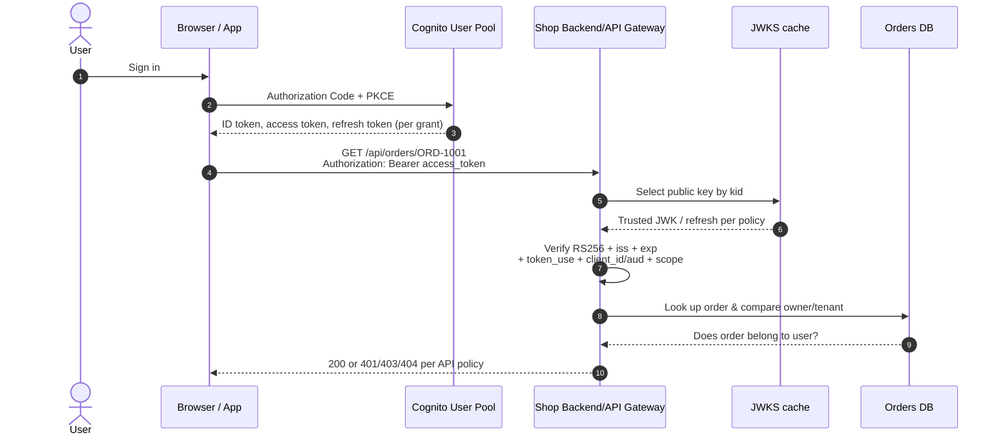
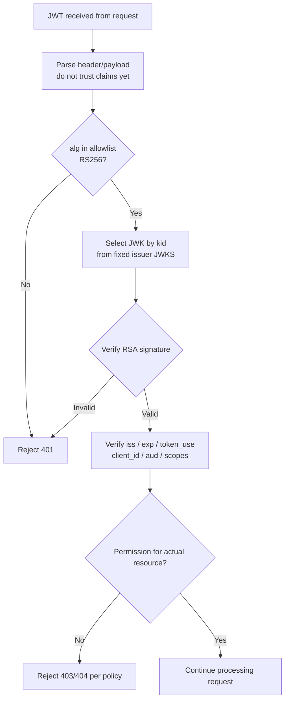
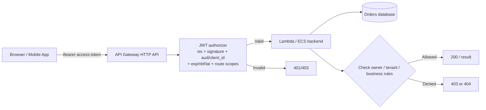
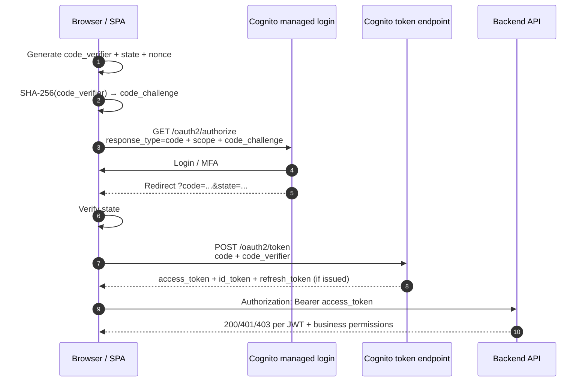
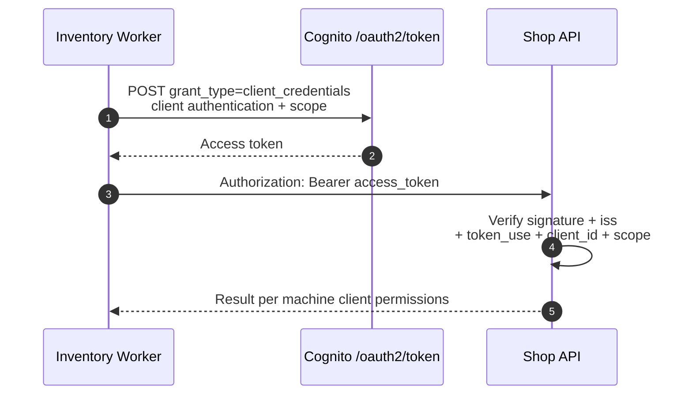
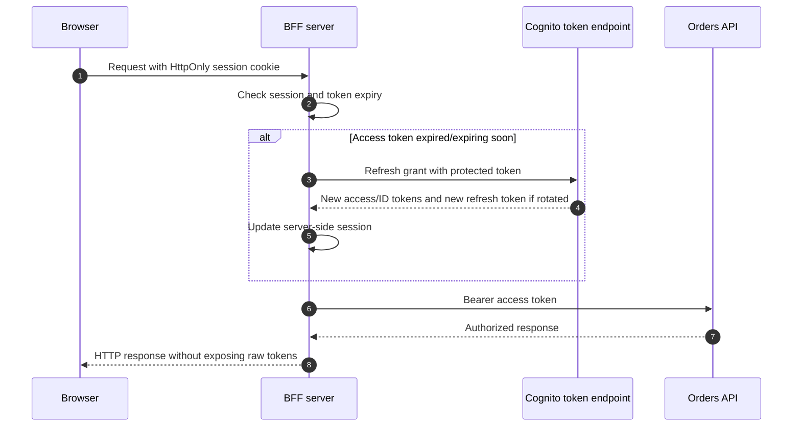
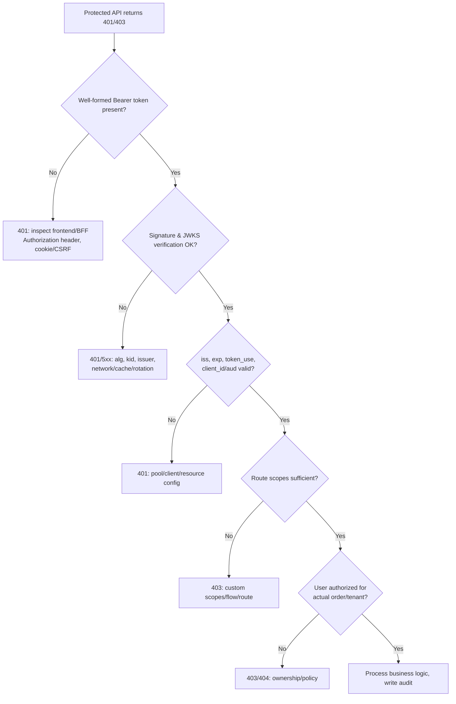
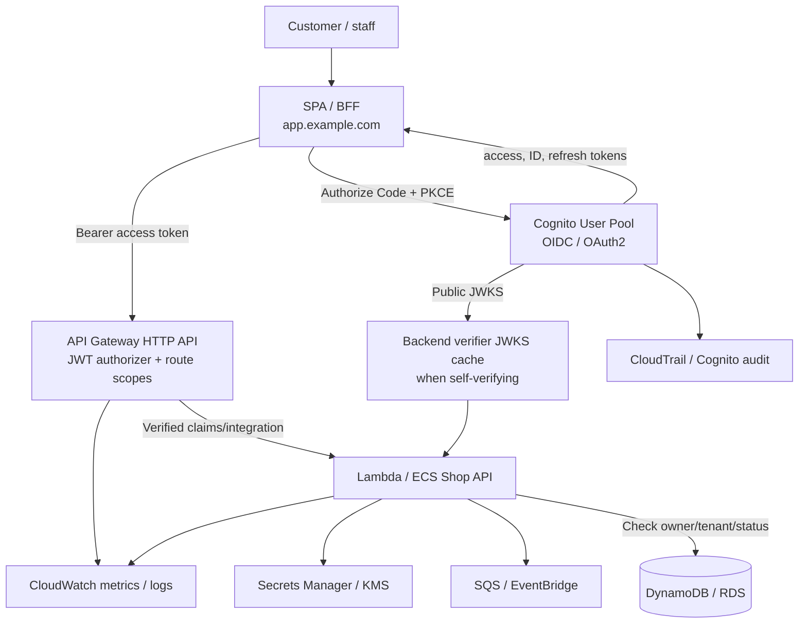

# JWTs, JWKS, Scopes, and Backend Token Verification with Amazon Cognito

A web application can sign in successfully via **Amazon Cognito**, receive a token string looking like `eyJ...eyJ...signature`, and send that token to a REST API. However, **successful sign-in does not mean every subsequent request is authorized**. The backend must verify **signature, issuer, validity window, token type, client/audience, scopes**, and finally **access permissions on the business resource** before processing the request.

This lesson belongs to the **Application Identity with Cognito** chapter in the **CLOUD_PROVIDERS_AWS** module. Learners are exploring the AWS ecosystem across Regions/AZs, IAM, VPC, compute, storage, databases, integration, and serverless; this topic connects Cognito to backends running on EC2, ECS, EKS, or Lambda/API Gateway to build **secure, observable, resilient, and cost-controlled** applications. The direct focus is on **JWTs, JWKS, scopes, and backend token verification**, rather than building a sign-in UI from scratch.

In this lesson, **Cognito User Pools** serve as the identity provider issuing ID/access/refresh tokens. **Cognito Identity Pools** are a separate feature used to issue temporary AWS credentials to applications needing direct AWS resource access; do not use an Identity Pool ID as the issuer of a User Pool JWT.

## 1. Objectives and Running Scenario

After this lesson, learners can:

1. Distinguish **authentication**, **OAuth 2.0 authorization**, **OIDC**, **JWT**, and **AWS IAM** by exact responsibility.
2. Explain the three **Cognito User Pool tokens—ID token, access token, and refresh token**—and identify which token is sent to backend APIs.
3. Read the JWT structure `header.payload.signature` and explain why **decoding is not verifying**.
4. Identify the issuer, JWKS URL, signing key `kid`, and verify `RS256` signatures with caching/rotation.
5. Validate `iss`, `exp`, `nbf` when present, `iat`, `token_use`, `client_id` or `aud`, and `scope` according to context.
6. Design **resource servers/custom scopes**, reject tokens from other app clients or APIs, and enforce object/tenant-level authorization.
7. Implement backend verification in Node.js and Spring Security/Java; understand when to use an API Gateway JWT authorizer.
8. Handle refresh, revocation, key rotation, logging, 401/403 responses, IAM/networking, and security scenarios.

**Shop API Scenario:** frontend `https://app.example.com` serves shoppers, and backend `https://api.example.com` exposes `GET /api/orders/{id}`, `POST /api/orders`, and `GET /api/admin/reports`. Users sign in via a Cognito User Pool in Region `ap-southeast-1`. Only the owner may view their own orders; staff may hold different business permissions, which must never rely on a client-editable claim.

## 2. Separating Identity and Authorization Layers

| Mechanism | Question Answered | Example |
|---|---|---|
| **Cognito User Pool** | Which user/app signed in and which tokens were issued? | User `user-42` authenticates via managed login |
| **OpenID Connect (OIDC)** | How does the app receive the signed-in user's identity? | ID token and standard claims |
| **OAuth 2.0** | Which scope of resource/API access was the client granted? | `shop-api/orders.read` |
| **JWT/JWS** | Were the token claims signed by a trusted issuer and are they still valid? | RS256 signature verified against JWKS |
| **Backend authorization** | Does this principal have permission for this **specific order**? | `order.ownerSub === claims.sub` |
| **AWS IAM** | Does the AWS principal have permission to call AWS APIs? | Lambda execution role reading DynamoDB |
| **WAF/rate limit/network** | Where do requests originate, and how are traffic and attack surface constrained? | API Gateway throttling, AWS WAF |

**A valid JWT only proves trustworthy claims within its issuer's scope.** It does not prove the request may read every order, modify tenants, or execute sensitive operations. Business decisions require the backend to fetch **the actual object from the database** and match it against the authenticated principal.

### 2.1. End-to-End Flow



This is a logical flow; backend JWT verification can execute inside the application, middleware, an API Gateway authorizer, or an equivalent protection layer. **Even when API Gateway has verified signature and scopes, the backend must still check permissions against business data**.

## 3. Three Token Types in Cognito User Pools

| Token | Purpose | Common Format | How Should a Backend REST API Handle It? |
|---|---|---|---|
| **ID token** | Proves user identity to the **client application** per OIDC; carries profile claims | Signed JWT | Do not substitute for an access token to protect resource APIs by default |
| **Access token** | Authorizes client calls to User Pool APIs or resource servers per scopes | Signed JWT | **Primary token** to verify at protected APIs |
| **Refresh token** | Exchanged for new access/ID tokens via supported flows | Sensitive token string, not a JWT sent to APIs | Send only to token endpoint/supported refresh flow; **never** use as a Bearer API token |

**An ID token is not "an access token with extra fields".** Their purposes differ: the ID token tells the client who signed in, while the access token authorizes API calls. A backend that verifies only the signature without checking `token_use` can **accidentally accept an ID token** on an endpoint that must require an access token.

### 3.1. ID Token

A Cognito ID token typically contains:

- `iss`: the User Pool issuer.
- `aud`: the **app client ID** to which the ID token was issued.
- `token_use: "id"`.
- `sub`: user identifier within the User Pool; profile claims such as `email`, `email_verified` if present/granted.
- `iat`, `exp`, `auth_time`, and optionally `nonce`.
- `cognito:groups` or custom claims if configured.

ID tokens are appropriate for the app to display a user profile or verify an OIDC sign-in step **after verification**; profile claims must never be treated as database update rights or AWS IAM permissions.

### 3.2. Access Token

A typical Cognito access token contains:

- `iss`: the User Pool issuer.
- `client_id`: the **app client ID** that authenticated the client/user.
- `token_use: "access"`.
- `scope`: space-delimited string of OAuth scopes.
- `sub` and `username` when representing a user; machine-to-machine flows carry different claims.
- `cognito:groups` when group memberships are included in tokens.
- `exp`, `iat`, `jti`, `origin_jti` under applicable feature configurations.
- **`aud` appears only when the access token is bound to an API/resource via resource binding**, as supported by Cognito.

Because standard access tokens use `client_id` rather than `aud` like ID tokens, **do not mechanically enforce `aud === appClientId` on every Cognito access token**. With resource-bound access tokens, the backend can verify both `client_id` and `aud` matching the expected resource URL.

### 3.3. Refresh Token

Refresh tokens have their own lifecycle, protection, and revocation mechanisms. They may be held by a **Backend-for-Frontend (BFF)** inside a server-side session, or by a public client under an appropriate security model. Never place refresh tokens in URL query strings, analytics, local logs, or broadcast them to every microservice.

When a user signs out, their refresh token can be revoked; that **does not mean every backend verifying JWTs offline immediately knows the access token was revoked**. Section 17 analyzes this limitation.

### 3.4. Differences in Signing Keys

Amazon Cognito User Pools sign ID/access tokens with **RS256** and may use **two different signing key pairs** for ID tokens and access tokens within the same User Pool. Consequently, an ID token's `kid` does not necessarily match an access token's `kid`. The backend must select the right JWK **using the `kid` of the received token itself**, never hardcoding one public key for both.

## 4. JWT Structure: Header, Payload, and Signature

A JSON Web Token has the structure:

```text
BASE64URL(UTF8(JWS header)) .
BASE64URL(UTF8(JWT claims)) .
BASE64URL(JWS signature)
```

Spaces around dots above are for readability; real tokens consist of **three parts joined by two dots, with no whitespace**.

### 4.1. Sample Header

```json
{
  "alg": "RS256",
  "kid": "example-key-id",
  "typ": "JWT"
}
```

- `alg` states the signing algorithm; for Cognito User Pools it must match the expected algorithm.
- `kid` is the key ID used to select the matching JWK from the trusted JWKS.
- `typ` is metadata and does not replace checking `token_use`.

### 4.2. Sample Access Token Payload

```json
{
  "iss": "https://cognito-idp.ap-southeast-1.amazonaws.com/ap-southeast-1_EXAMPLE",
  "sub": "9b2d0c9e-example-user-id",
  "client_id": "exampleappclientid123",
  "token_use": "access",
  "scope": "openid shop-api/orders.read shop-api/orders.write",
  "cognito:groups": ["shop-customers"],
  "iat": 1795128000,
  "exp": 1795131600,
  "jti": "sample-unique-token-id"
}
```

This payload **illustrates structure only**, not a real JWT or proof of permissions. `iat/exp` timestamps are Unix epoch seconds and sample values show numeric representation only.

### 4.3. Decoding Is Not Verifying

**Decode**: converting base64url strings into JSON to read them. Anyone can decode or **modify** a JWT header or payload.

**Verify**: validating the signature with a trusted public key and allowed algorithm, then checking claims against backend policy. If someone alters `scope` to `shop-api/orders.write` without Cognito's private signing key, the signature becomes invalid.



**Never place unverified claims into a trusted user context** that downstream middleware might read before verification completes. Header and payload may be parsed to pick a verifier or safe diagnostic metadata, but only **after verification succeeds** may they drive authorization decisions.

## 5. JWKS: Public Keys for Signature Verification

A **JSON Web Key Set (JWKS)** is a JSON document containing one or more **JSON Web Keys (JWKs)**. Cognito keeps private signing keys on the AWS side and publishes **public keys** via JWKS so resource servers can verify signatures.

### 5.1. Issuer and JWKS Endpoint

For illustrative User Pool ID `ap-southeast-1_EXAMPLE`:

```text
Issuer (iss):
  https://cognito-idp.ap-southeast-1.amazonaws.com/ap-southeast-1_EXAMPLE

JWKS:
  https://cognito-idp.ap-southeast-1.amazonaws.com/ap-southeast-1_EXAMPLE/.well-known/jwks.json

OIDC discovery:
  https://cognito-idp.ap-southeast-1.amazonaws.com/ap-southeast-1_EXAMPLE/.well-known/openid-configuration
```

**A Cognito managed login/custom domain and a Cognito User Pool issuer are two different contexts.** Never replace `iss` with a login page domain such as `auth.example.com`. For newer/multi-Region OIDC issuer features where supported, retrieve the canonical issuer/JWKS from OIDC configuration and current verification tooling rather than constructing URLs from assumptions that may not match actual settings.

### 5.2. Sample JWKS (Public Metadata)

```json
{
  "keys": [
    {
      "kty": "RSA",
      "kid": "example-key-id",
      "use": "sig",
      "alg": "RS256",
      "n": "sample-base64url-modulus",
      "e": "AQAB"
    }
  ]
}
```

The `n` value in this example **is not a valid modulus**; it illustrates the field only. In practice, the public key is constructed from `n` (modulus) and `e` (exponent). Use a standard JWT/JWK library rather than implementing RSA math yourself.

| Field | Meaning | How Does the Backend Use It? |
|---|---|---|
| `keys` | List of public JWKs | Locate matching key |
| `kid` | Key ID | Match against the JWT's `kid` header |
| `kty=RSA` | RSA key type | Verify key matches RS256 |
| `use=sig` | Key intended for signature verification | Avoid misusing keys meant for other purposes |
| `alg=RS256` if present | Declared algorithm | Must match verifier allowlist |
| `n`, `e` | RSA public parameters | Consumed by library to verify signatures |

### 5.3. Inspecting JWKS with curl (Read-Only)

```bash
curl --fail --silent --show-error \
  "https://cognito-idp.ap-southeast-1.amazonaws.com/ap-southeast-1_EXAMPLE/.well-known/jwks.json"
```

Illustrative command—substitute a real User Pool ID; do not run without an existing pool. Even though JWKS holds **public keys**, fetch it strictly from an HTTPS endpoint **preconfigured by the backend**. Never fetch a JWKS URL specified inside an untrusted JWT or request header, as that creates a vulnerability trusting attacker-controlled signing keys.

### 5.4. Caching and Key Rotation

Verifiers should not call the JWKS endpoint **on every request**:

1. Instantiate a shared verifier at the process/handler level (outside the per-request path).
2. Cache JWKs keyed by issuer and `kid` with an appropriate TTL/revalidation policy.
3. When a `kid` is missing from cache for a trusted issuer, attempt a **rate-limited JWKS refresh**.
4. If no matching key exists after refreshing, **reject the token**; never bypass signature checks.
5. Tolerate rotation windows where multiple keys coexist; never purge old keys immediately upon seeing a new key.
6. Monitor JWKS fetch errors and avoid making every API request depend on an outbound network call.

Cognito can **rotate signing keys**; apps must not hardcode a modulus/public key copied once at deploy time. Libraries like `aws-jwt-verify` or standard OIDC/JWK verifiers manage caching and key refresh more reliably than custom code.

### 5.5. Preventing Algorithm and JWKS Attacks

- Never accept `alg: "none"` or switch from RSA to HMAC just because the token header asks for it.
- Never load JWKs from `jku`/`x5u` or caller-supplied URLs; use only JWKS from **issuers in the backend's allowlist**.
- Never trust arbitrary issuers solely because a token claims `iss`.
- Bound token/JWKS sizes, refresh rates, and timeouts to mitigate DoS.
- Never log raw JWTs; anyone holding a valid token can replay it as a **bearer credential**.

## 6. Backend Token Verification Checklist

| Check | Valid Condition | If Omitted |
|---|---|---|
| **Format/size** | Well-formed JWT within API size limits | Reject instead of unbounded parsing |
| **Signature/algorithm** | RS256 using JWK from trusted issuer matching `kid` | JWT can be arbitrarily forged |
| **Issuer `iss`** | Exact permitted user pool issuer | Tokens from another pool/Region accepted |
| **Expiration `exp`** | Unexpired, with tightly bounded clock skew | Expired tokens accepted |
| **Not before `nbf` if present** | Current time meets validity start | Premature tokens accepted |
| **Issued at `iat`** | Reasonable timestamp, not far in the future | Anomalous tokens slip through |
| **Token type** | `token_use === "access"` for backend APIs | ID tokens accepted as access tokens |
| **App client** | `client_id` in API's approved clients list | Tokens issued to other app clients accepted |
| **Resource audience if required** | `aud` matches expected API/resource URL identifier | Token meant for API A replayed against API B |
| **Scope** | Contains required scope for the route | Caller lacks OAuth permission |
| **Tenant/object authorization** | User is permitted to access the target object | IDOR/BOLA despite valid JWT |
| **Revocation/session policy** | Matches early-revocation requirements | Revoked tokens still pass offline checks |

**Note:** `iat`, `nbf`, and `auth_time` have different meanings. Backends must not invent an arbitrary rule like "token must be newer than 5 minutes" without justification, since valid tokens often have longer TTLs. Validate timestamps per verifier/library defaults and enforce session-age checks on sensitive operations if needed.

### 6.1. Distinguishing 401 and 403

- **401 Unauthorized** per HTTP semantics: missing Bearer token or invalid token (bad signature/issuer/type/client, expired). Response may include `WWW-Authenticate: Bearer` without leaking internal details.
- **403 Forbidden**: token is authenticated, but lacks required scope or business permission, or policy blocks the identified principal.
- **404 Not Found** is sometimes returned instead of 403 for objects owned by someone else to avoid revealing existence, if designed consistently in the API contract.
- **503/5xx**: system errors such as an unreachable JWKS endpoint/cache; never fall back to "temporarily allow" when signatures cannot be verified.

A verifier misconfigured with the wrong `client_id` will consistently return 401 for valid tokens from another app client. Never "fix" this by setting client ID validation to `null` or disabling signature verification.

## 7. OAuth Scopes: Defining API Permissions

**OAuth scopes** describe the level of access a resource server allows a client to request/receive; Cognito issues them in the **access token** as a **space-separated string**. They are an authorization signal signed by a trusted token issuer, yet **they do not replace permission checks on specific data records**.

### 7.1. Scope Categories

| Category | Example | When Used? |
|---|---|---|
| **OIDC scopes** | `openid`, `email`, `profile`, `phone` | Requesting OIDC ID tokens/userinfo and user claims per client permissions |
| **Cognito reserved API scope** | `aws.cognito.signin.user.admin` | Allowing specific self-service Cognito User Pool APIs for the user |
| **Custom resource server scope** | `shop-api/orders.read`, `shop-api/orders.write` | Protecting business APIs such as Orders/Payments |

Custom scopes are configured with a **resource server identifier** (e.g., `shop-api`) and scope name (`orders.read`), emitted as `resource-server-identifier/scope-name` inside the access token. Choose stable names expressing semantic actions and plan versioning if long-term contracts change.

**Never use `openid` or `email` as permission to "edit orders"**. They govern OIDC context and profile data, not Orders API business actions.

### 7.2. Scopes Must Be Enabled on the App Client

A custom scope appears in an access token only if:

1. The resource server and scope are declared in the User Pool.
2. The app client is permitted to request that scope.
3. The actual flow requests and Cognito issues that scope.

If a frontend signs in using **Cognito User Pools API authentication** like `InitiateAuth` rather than the OAuth authorization endpoint, the resulting access token typically contains only `aws.cognito.signin.user.admin` and **does not automatically include custom resource server scopes**. To protect APIs with custom OAuth scopes, use the **OAuth authorization code flow** (PKCE for public clients) or another compatible grant.

### 7.3. Example Scopes for Shop API

| Endpoint | Method | Required Scope | Additional Business Check |
|---|---|---|---|
| `/api/orders` | GET | `shop-api/orders.read` | Return only orders belonging to principal/tenant |
| `/api/orders/{id}` | GET | `shop-api/orders.read` | `order.ownerSub === user.sub` or authorized support role |
| `/api/orders` | POST | `shop-api/orders.write` | Validate account owner, items, and limit policies |
| `/api/orders/{id}/cancel` | POST | `shop-api/orders.write` | Owner and order state permitting cancellation |
| `/api/admin/reports` | GET | `shop-api/reports.read` | Staff role and authorized data scope |

When a route lists multiple scopes, understand your library/gateway semantics. For example, **AWS API Gateway HTTP API JWT authorizer** authorizes a route when the token contains **at least one** of the route's configured authorization scopes. If business rules require **both A and B simultaneously**, the backend must verify both scopes or use a custom authorizer enforcing AND logic; never assume a gateway scope list means AND.

### 7.4. Parsing `scope` Correctly

Example claim:

```text
scope = "openid shop-api/orders.read shop-api/orders.write"
```

Do not use:

```javascript
// WRONG: substring causes orders.read.extra to match orders.read
if (payload.scope.includes("shop-api/orders.read")) {
  allow();
}
```

Split on whitespace and compare **exact values**:

```javascript
function hasScope(payload, requiredScope) {
  const scopes = new Set(
    typeof payload.scope === "string"
      ? payload.scope.trim().split(/\s+/).filter(Boolean)
      : []
  );
  return scopes.has(requiredScope);
}
```

Never accept scopes from client-supplied headers like `X-User-Scope`; scopes must come from **verified token claims** or controlled server-side policies.

### 7.5. Scopes Are Not a List of Every Resource a User May Read

A token carrying `shop-api/orders.read` does not let a user read someone else's order. The backend needs to know **which principal**, **which order**, **which tenant**, and **what ownership relationship**. This is the gap between **coarse-grained authorization (scopes)** and **fine-grained authorization (resource ownership/business ABAC/RBAC)**.

## 8. Audience, Client ID, and Resource Binding

This is one of the easiest areas to misconfigure when a backend consumes Cognito JWTs:

| Token / Context | Claim Identifying App Client | Claim for Intended Resource | Backend Policy |
|---|---|---|---|
| **ID token** | `aud = appClientId` | ID token targets the client, not business API access | Reject on APIs requiring access tokens |
| **Standard access token** | `client_id = appClientId` | `aud` is usually **absent** | Verify `token_use=access`, `client_id`, and scopes |
| **Resource-bound access token** | `client_id = appClientId` | `aud = API/resource URL` | Verify both `client_id` **and** the API's own resource `aud` |
| **M2M client credentials access token** | Client ID of machine client | User-flow resource binding unsupported | Verify grant/client, issuer, scopes, and M2M policy |

### 8.1. Why Is Resource Binding Useful?

Suppose an enterprise runs two APIs trusting the same Cognito User Pool:

- Orders API: `https://orders.example.com`
- Billing API: `https://billing.example.com`

An access token issued by the same User Pool and app client **without an API-specific audience** may need to be differentiated via scopes/API policies. Using **OAuth 2.0 Resource Indicators (RFC 8707)** supported by Cognito, the frontend can request:

```text
GET /oauth2/authorize?
  response_type=code&
  client_id=<APP_CLIENT_ID>&
  redirect_uri=https%3A%2F%2Fapp.example.com%2Fcallback&
  scope=openid%20shop-api%2Forders.read&
  resource=https%3A%2F%2Forders.example.com&
  code_challenge=<BASE64URL_SHA256>&
  code_challenge_method=S256&
  state=<RANDOM_STATE>
```

When supported by the flow/configuration and valid, Cognito can issue an access token with:

```json
{
  "token_use": "access",
  "client_id": "exampleappclientid123",
  "aud": "https://orders.example.com",
  "scope": "shop-api/orders.read"
}
```

Orders API verifies `aud === "https://orders.example.com"`. Billing API rejects that token because it expects its own audience `https://billing.example.com`.

**Limitation to remember:** per Cognito, resource binding works with OAuth endpoints/managed login user authentication; it is not supported for **client credentials M2M grants** and is absent in Cognito SDK auth flows that do not use the authorization endpoint. A backend must not require a resource-specific `aud` claim if the client does not obtain tokens via a supported flow.

### 8.2. How API Gateway HTTP API JWT Authorizer Handles Audience

With **API Gateway HTTP API JWT authorizer**:

1. The gateway validates signature, issuer, timestamp claims, and related fields.
2. If the JWT **contains `aud`**, the gateway compares `aud` against the configured audience list.
3. If the JWT **lacks `aud`**, the gateway uses `client_id` to match against the configured audience list.
4. If the route requires scopes, the gateway validates `scope`/`scp` per route policy.

Therefore:

- Cognito access tokens **without resource-bound `aud`**: audience config is typically the **app client ID**.
- Cognito access tokens **with resource-server `aud`**: audience config must match the **resource URL**, not merely the app client ID.
- An **ID token also carries `aud=appClientId`**, so configuring only issuer/audience **is not enough** to prevent the gateway from accepting an ID token for an API. When using the built-in Gateway JWT authorizer, require appropriate **custom resource scopes** on protected routes to distinguish access tokens; or use a Lambda authorizer/backend verifier that explicitly checks `token_use=access`.

**Never mechanically apply HTTP API JWT authorizer behavior to REST API authorizers or ALB authentication.** Each service/authorizer type has its own validation mechanics, claim forwarding, and configuration model.

### 8.3. Multiple App Clients and Multiple User Pools

A single backend may serve a mobile app client, SPA app client, and admin portal, but must allowlist **the exact approved client IDs**. For sensitive resources:

- Never let a mobile client access token inherit admin privileges simply because it shares the same issuer.
- Never trust any User Pool in the same Region as a valid issuer.
- If using multiple User Pools (e.g., customers vs. employees), configure separate verifiers by issuer/client/scopes and isolate access policies cleanly.
- Never set `clientId: null` or `audience: null` unless intentionally replaced with equivalent validation logic.

## 9. Cognito Groups, Roles, and Business Permissions

Cognito User Pools can emit `cognito:groups` listing a user's groups. Groups are helpful for application-level RBAC, but understand their limits:

### 9.1. A Group Claim Is Not a Backend IAM Role

| Concept | Example | Purpose |
|---|---|---|
| Cognito User Pool group | `shop-operators` | User organization/role in the User Pool |
| `cognito:groups` claim | `["shop-operators"]` | Referenced by the backend **after verification** |
| AWS IAM role | `arn:aws:iam::111122223333:role/shop-api-task-role` | Grants AWS API permissions to containers/Lambda |
| Resource ownership | `order.ownerSub` in database | Determines who can operate on a specific order |
| OAuth scope | `shop-api/orders.read` | Bounds the category of API operation |

Belonging to `shop-operators` does not authorize a container to call DynamoDB. The backend's DynamoDB permissions come from the backend's **IAM execution/task role**; a user's right to read an order comes from **application authorization logic**.

### 9.2. Tokens Can Carry Stale Group Memberships

If an admin just removed a user from a group, **previously issued access tokens still carry the old group claim** until refresh/expiration unless the backend checks live state. When business rules demand immediate revocation of admin rights:

- Use short access token TTLs.
- Check live status/permissions in a trusted data store for sensitive operations.
- Evaluate logout/revocation, session invalidation, and cache policies.
- Audit who granted or revoked group memberships, not just UI state.

**Never rely solely on `cognito:groups` inside a token as permanent proof** for fund transfers, sensitive exports, or critical administrative actions.

### 9.3. Pre Token Generation Trigger and Custom Claims

Cognito provides a **Pre Token Generation Lambda trigger** to customize claims/scopes under supported event versions/features. When injecting tenant/role custom claims:

- Derive claims only from **trusted sources** (databases, directories, server-side policies).
- Validate data and avoid putting unnecessary sensitive information into JWTs.
- Do not assume custom claims have identical shapes across every grant/version.
- Test actual issued tokens across user logins, machine clients, and refresh flows.
- Keep enforcing resource-level checks in the backend and detecting stale claims when risk warrants.

JWTs are typically sent on every API request, so never stuff thousands of permissions or personal details into a token; oversized tokens impact header limits, network overhead, gateway limits, and exposure risk.

## 10. Node.js/Express: Verifying Cognito Access Tokens in the Backend

AWS recommends the **`aws-jwt-verify`** library for Node.js. It handles RS256 signatures, issuer, token type, app client, expiry, and JWKS caching/rotation when configured properly.

### 10.1. Install Libraries

```bash
npm install express aws-jwt-verify
```

### 10.2. Middleware to Verify Access Tokens and Check Scopes

Node.js backend example using ESM imports and environment variables. **Populate the exact user pool ID and client ID** at deployment—never read these two values from browser requests:

```javascript
import express from "express";
import { CognitoJwtVerifier } from "aws-jwt-verify";

const poolId = process.env.COGNITO_USER_POOL_ID;
const appClientId = process.env.COGNITO_APP_CLIENT_ID;
const expectedApiAudience = process.env.COGNITO_API_AUDIENCE;

if (!poolId || !appClientId) {
  throw new Error("Cognito user pool and app client must be configured");
}

// Instantiate once to reuse the JWKS cache.
const verifier = CognitoJwtVerifier.create({
  userPoolId: poolId,
  clientId: appClientId,
  tokenUse: "access",
});

const app = express();
app.use(express.json({ limit: "64kb" }));

function requireAccessToken(requiredScope) {
  return async (req, res, next) => {
    const header = req.headers.authorization;
    const parts =
      typeof header === "string"
        ? /^Bearer ([^\s]+)$/i.exec(header)
        : null;

    if (!parts) {
      res.setHeader("WWW-Authenticate", "Bearer");
      return res.status(401).json({ error: "unauthorized" });
    }

    let claims;
    try {
      claims = await verifier.verify(parts[1]);
    } catch {
      // Never log raw JWTs or expose signature details to clients.
      res.setHeader("WWW-Authenticate", "Bearer error=\"invalid_token\"");
      return res.status(401).json({ error: "invalid_token" });
    }

    // Apply only when the frontend requests resource-bound access tokens.
    if (
      expectedApiAudience &&
      claims.aud !== expectedApiAudience
    ) {
      return res.status(401).json({ error: "invalid_audience" });
    }

    const scopes = new Set(
      typeof claims.scope === "string"
        ? claims.scope.trim().split(/\s+/).filter(Boolean)
        : []
    );
    if (requiredScope && !scopes.has(requiredScope)) {
      return res.status(403).json({ error: "insufficient_scope" });
    }

    // Populate request context only after signature/claims are verified.
    req.auth = {
      sub: claims.sub,
      clientId: claims.client_id,
      scopes,
      groups: Array.isArray(claims["cognito:groups"])
        ? claims["cognito:groups"]
        : [],
    };
    return next();
  };
}

app.get(
  "/api/orders/:orderId",
  requireAccessToken("shop-api/orders.read"),
  async (req, res) => {
    // Assumes a storage layer exists.
    const order = await loadOrderById(req.params.orderId);
    if (!order || order.ownerSub !== req.auth.sub) {
      // Prevent outsiders from probing whether an order exists.
      return res.status(404).json({ error: "not_found" });
    }
    return res.json({ id: order.id, status: order.status });
  }
);

app.listen(3000);
```

**This is a teaching skeleton**, not a complete production application: `loadOrderById` must be implemented, DB errors need dedicated middleware/error handling, all inputs must be validated, and logging/rate limiting/CORS/CSRF must fit production infrastructure.

Key points:

1. `CognitoJwtVerifier` is created once, **not per request**, to reuse its JWKS cache.
2. `tokenUse:"access"` guarantees ID tokens are rejected.
3. `clientId`/`userPoolId` come from backend config, never client claims.
4. Checking `aud` is **enforced in this example only when resource binding is enabled** and `COGNITO_API_AUDIENCE` is set. If you expect resource binding, you **must** set this variable at deployment; otherwise audience-bound protection is inactive.
5. Scopes use exact matching; every route must require its corresponding scope plus business authorization.
6. `req.auth.sub` comes from the verified token while `order.ownerSub` comes from the database—defending against **Broken Object Level Authorization (BOLA/IDOR)**.
7. Never log or return tokens in error responses; avoid letting attackers probe verification internals.

### 10.3. When Multiple App Clients Call the API

If a backend supports two approved app clients (e.g., SPA and mobile), configure the verifier with a list of client IDs as supported by the library, or maintain explicit verifiers with clear policies. Always confirm **each client** holds only appropriate permissions/scopes; never open access to every app client in the User Pool.

### 10.4. Scope AND vs. OR

In the Node.js example, each route requires **one specific scope**. When an endpoint requires both `orders.write` **and** `orders.approve`:

```javascript
function requireAllScopes(scopes, required) {
  return required.every(scope => scopes.has(scope));
}

// Example after claims are verified:
const required = [
  "shop-api/orders.write",
  "shop-api/orders.approve",
];
if (!requireAllScopes(req.auth.scopes, required)) {
  return res.status(403).json({ error: "insufficient_scope" });
}
```

Never pass a list of scopes to a verifier option assuming it checks **all** of them; `aws-jwt-verify` treats a scope array as matching **at least one** scope by default. For AND logic, check all required scopes explicitly **after verification** as shown above.

## 11. Java/Spring Security: Verifying Cognito Access Tokens

For Java Spring Boot backends, **Spring Security OAuth2 Resource Server** can verify JWTs using JWKS. However, **basic `issuer-uri` configuration is not enough for a Cognito API** if the backend must also enforce `token_use=access` and a specific `client_id`. Add custom validators and protect routes with OAuth scopes.

### 11.1. Dependencies and Configuration Principles

In a Spring Boot application using compatible Spring Security, include:

```text
spring-boot-starter-security
spring-boot-starter-oauth2-resource-server
```

Resource Server uses JWT/JWS support libraries (including `spring-security-oauth2-jose`), typically managed by Spring Boot's starter dependencies. Never hand-write RSA signature verification or base64url parsers.

Example environment variables provided via ECS task definition/Lambda/EC2 configuration:

```text
COGNITO_REGION=ap-southeast-1
COGNITO_USER_POOL_ID=ap-southeast-1_EXAMPLE
COGNITO_APP_CLIENT_ID=exampleappclientid123
COGNITO_API_AUDIENCE=https://orders.example.com  # if resource binding is required
```

Never configure a Cognito client secret in the browser. Server-side environment variables should avoid static secrets where IAM roles/Secrets Manager can be used; Region/Pool ID/Client ID are not secret credentials.

### 11.2. JwtDecoder with Issuer, RS256, token_use, and client_id

Modern Spring Security 6.x/7.x style example. Verify builder/API signatures match the exact library version in your project:

```java
package example.shop.security;

import java.util.Objects;

import org.springframework.context.annotation.Bean;
import org.springframework.context.annotation.Configuration;
import org.springframework.security.oauth2.core.OAuth2Error;
import org.springframework.security.oauth2.core.OAuth2TokenValidator;
import org.springframework.security.oauth2.core.OAuth2TokenValidatorResult;
import org.springframework.security.oauth2.core.DelegatingOAuth2TokenValidator;
import org.springframework.security.oauth2.jose.jws.SignatureAlgorithm;
import org.springframework.security.oauth2.jwt.Jwt;
import org.springframework.security.oauth2.jwt.JwtDecoder;
import org.springframework.security.oauth2.jwt.JwtValidators;
import org.springframework.security.oauth2.jwt.NimbusJwtDecoder;

@Configuration
public class CognitoJwtConfig {

    @Bean
    JwtDecoder jwtDecoder() {
        String region = Objects.requireNonNull(
            System.getenv("COGNITO_REGION"), "COGNITO_REGION missing");
        String poolId = Objects.requireNonNull(
            System.getenv("COGNITO_USER_POOL_ID"), "COGNITO_USER_POOL_ID missing");
        String clientId = Objects.requireNonNull(
            System.getenv("COGNITO_APP_CLIENT_ID"), "COGNITO_APP_CLIENT_ID missing");
        String apiAudience = System.getenv("COGNITO_API_AUDIENCE");

        String issuer = "https://cognito-idp." + region
                + ".amazonaws.com/" + poolId;
        String jwks = issuer + "/.well-known/jwks.json";

        NimbusJwtDecoder decoder = NimbusJwtDecoder
                .withJwkSetUri(jwks)
                .jwsAlgorithm(SignatureAlgorithm.RS256)
                .build();

        OAuth2TokenValidator<Jwt> cognitoClaims = jwt -> {
            boolean validType =
                    "access".equals(jwt.getClaimAsString("token_use"));
            boolean validClient =
                    clientId.equals(jwt.getClaimAsString("client_id"));

            // Enforce aud only when the flow requests resource-bound tokens.
            boolean validAudience = apiAudience == null
                    || jwt.getAudience().contains(apiAudience);

            if (validType && validClient && validAudience) {
                return OAuth2TokenValidatorResult.success();
            }
            return OAuth2TokenValidatorResult.failure(
                    new OAuth2Error(
                            "invalid_token",
                            "Cognito token type, client or audience invalid",
                            null));
        };

        decoder.setJwtValidator(new DelegatingOAuth2TokenValidator<>(
                JwtValidators.createDefaultWithIssuer(issuer),
                cognitoClaims));
        return decoder;
    }
}
```

**Key highlights:**

- `NimbusJwtDecoder` verifies JWT signatures using JWKs from the trusted JWKS and restricts algorithms to **RS256** via the builder.
- `JwtValidators.createDefaultWithIssuer(issuer)` adds issuer validation and default timestamp validators.
- The custom validator enforces `token_use=access` and exact `client_id`; if a resource audience is configured, it also enforces `aud` contains that resource ID.
- Do not rely on a default decoder checking `aud` as the app client ID, because **Cognito access tokens typically lack `aud`**.
- **If your user pool uses a newer/multi-Region OIDC issuer**, retrieve the canonical issuer and JWKS via OIDC discovery/supported config. Never construct the URL manually from Region/Pool ID if the actual issuer differs.
- For multiple app clients, enforce a server-side allowlist rather than removing client validation altogether.

### 11.3. SecurityFilterChain Requiring Access Token and Scopes

```java
package example.shop.security;

import org.springframework.context.annotation.Bean;
import org.springframework.context.annotation.Configuration;
import org.springframework.http.HttpMethod;
import org.springframework.security.config.Customizer;
import org.springframework.security.config.annotation.web.builders.HttpSecurity;
import org.springframework.security.config.http.SessionCreationPolicy;
import org.springframework.security.web.SecurityFilterChain;

@Configuration
public class ApiSecurityConfig {

    @Bean
    SecurityFilterChain securityFilterChain(HttpSecurity http)
            throws Exception {
        return http
                // Suitable for pure Bearer-header APIs without cookie sessions.
                .csrf(csrf -> csrf.disable())
                .sessionManagement(sm ->
                        sm.sessionCreationPolicy(SessionCreationPolicy.STATELESS))
                .authorizeHttpRequests(auth -> auth
                        .requestMatchers("/health").permitAll()
                        .requestMatchers(
                                HttpMethod.GET, "/api/orders/**")
                        .hasAuthority("SCOPE_shop-api/orders.read")
                        .requestMatchers(
                                HttpMethod.POST, "/api/orders/**")
                        .hasAuthority("SCOPE_shop-api/orders.write")
                        .anyRequest().authenticated())
                .oauth2ResourceServer(oauth2 ->
                        oauth2.jwt(Customizer.withDefaults()))
                .build();
    }
}
```

Spring Security maps JWT scopes to authorities prefixed with `SCOPE_`; thus `shop-api/orders.read` maps to `SCOPE_shop-api/orders.read`.

**Never disable CSRF like this if your application authenticates via cookies automatically sent by browsers or uses login sessions.** When using a Backend-for-Frontend (BFF)/cookies, design CSRF defenses alongside SameSite/cookie attributes and appropriate endpoints. The snippet above assumes clients send Bearer tokens in `Authorization` and the backend does not rely on credential cookies for API auth.

### 11.4. Checking Permissions on the Actual Order

Route authorities only solve the endpoint layer. Inside the controller/service, you still need:

```java
// Pseudocode inside service after Spring Security verifies the JWT.
String userSub = jwt.getSubject();
Order order = orderRepository.findById(orderId)
        .orElseThrow(NotFoundException::new);

if (!order.ownerSub().equals(userSub)) {
    throw new NotFoundException(); // or Forbidden per API policy
}
return toPublicOrderResponse(order);
```

This pseudocode assumes application-defined `Order`, `OrderRepository`, and `NotFoundException`. Never build read authorization solely from a browser-supplied `orderId` or from `email`, because emails can change; in a User Pool, **`sub` is the stable user identifier within the issuer**.

### 11.5. Deploying an API Across Multiple User Pools

If separate User Pools exist for customers and admins, use `AuthenticationManagerResolver`/multiple JWT decoders keyed by an issuer allowlist with strict policy separation. Never extract an arbitrary `iss` from an incoming JWT and fetch JWKS from that URL without checking a trusted issuer allowlist; doing so lets attackers sign their own tokens.

## 12. API Gateway JWT Authorizer vs. Backend Verification

The backend does not always need to download JWKS itself. **Amazon API Gateway HTTP API JWT authorizer** can validate JWTs before routing requests to Lambda/ECS backends. AWS API Gateway supports multiple authorizer and API types; the points below apply primarily to **HTTP API JWT authorizers**.

### 12.1. Architecture



### 12.2. Example JWT Authorizer Setup via AWS CLI

Suppose you have HTTP API ID `a1b2c3d4` and matching User Pool ID and app client ID:

```bash
aws apigatewayv2 create-authorizer \
  --api-id a1b2c3d4 \
  --name shop-cognito-jwt \
  --authorizer-type JWT \
  --identity-source '$request.header.Authorization' \
  --jwt-configuration '{"Audience":["exampleappclientid123"],"Issuer":"https://cognito-idp.ap-southeast-1.amazonaws.com/ap-southeast-1_EXAMPLE"}' \
  --region ap-southeast-1
```

This example uses **tokens without resource-bound audiences**. If the OAuth flow attaches `aud=https://orders.example.com` to access tokens, update the authorizer's `Audience` to match the resource URL, not just the app client ID.

Then attach the authorizer to a route, for example:

```bash
aws apigatewayv2 update-route \
  --api-id a1b2c3d4 \
  --route-id "<ROUTE_ID>" \
  --authorization-type JWT \
  --authorizer-id "<AUTHORIZER_ID>" \
  --authorization-scopes shop-api/orders.read \
  --region ap-southeast-1
```

**Note:** this example configures only one route. All other routes must be attached to appropriate authorizers and scopes; **never leave admin endpoints inadvertently public** by only protecting `GET /api/orders`.

### 12.3. What API Gateway Checks vs. What the Backend Checks

| Layer | Primary Responsibility | Vulnerability If Omitted |
|---|---|---|
| **HTTP API JWT authorizer** | Signature, issuer, audience/client_id, expiry, route scopes | Forged/wrong-issuer or under-scoped tokens reach backend |
| **Backend identity boundary** | Trust claims only from trusted authorizer or verify itself; enforce token type | ID tokens or spoofed headers sneak through loose configs |
| **Backend business authorization** | Ownership, tenant, live role, data state | Users read/modify someone else's orders |
| **Backend IAM role** | Permits Lambda/ECS to read/write DynamoDB/SQS/S3 | Overly broad AWS permissions if app suffers RCE |
| **Network/access policy** | Backend cannot be called bypassing the authorizer | Bypass via public ALB/Function URL/another container endpoint |

**Header forwarding is a trust boundary.** If the backend reads `X-User-Sub` or a claims header from API Gateway, ensure clients cannot inject/spoof that header and no direct path reaches the backend around the gateway. Otherwise, **verify the JWT directly in the backend** or use trusted AWS integration context.

### 12.4. Claims in a Lambda Proxy Event

With HTTP API Lambda integration payload format 2.0, post-authorizer claims appear at:

```javascript
const claims = event.requestContext?.authorizer?.jwt?.claims;
const scopes = event.requestContext?.authorizer?.jwt?.scopes;
```

This **shape depends on integration payload version and authorizer**. Do not rely on it for a public Lambda Function URL or direct HTTP traffic to ECS without an API Gateway JWT authorizer in front. In systems mixing HTTP APIs and REST APIs, event shapes and scope enforcement differ.

### 12.5. Limitations of Built-In JWT Authorizers

- Route scopes evaluate as **OR** when multiple scopes are listed; AND logic or business ABAC requires separate enforcement.
- ID tokens can pass issuer/audience checks if no route scope or access-token guardrail is configured. Do not assume the gateway automatically checks `token_use=access` across all JWTs per general guidance.
- Backends must still validate payloads, owners, tenants, and per-record permissions.
- Key caching/rotation and JWKS fetching are managed by the service; if immediate revocation or custom policies are required, add appropriate authorizer/backend logic.
- If the backend has any other public ingress bypassing the JWT authorizer, that endpoint must enforce equivalent protection.

## 13. Authorization Code + PKCE: How Frontends Safely Obtain Tokens

For **SPA/mobile public clients**, AWS Cognito supports **OAuth 2.0 Authorization Code Grant with PKCE S256**. This flow fits when frontends request custom scopes to call backends.



### 13.1. Purpose of state, nonce, and PKCE

| Value | Purpose | Who Verifies? |
|---|---|---|
| `state` | Binds redirect to client-initiated login session, preventing login CSRF/mix-ups | OAuth client on callback |
| `nonce` | Binds ID token to the OIDC auth request, mitigating replay | OIDC client when processing ID token |
| `code_verifier` | Random secret known only to client to exchange the authorization code | Cognito token endpoint |
| `code_challenge` | Base64url SHA-256 of verifier, sent upfront to authorize endpoint | Cognito compared against verifier |
| `redirect_uri` | Registered callback destination on the app client | Cognito, must match policy |

**PKCE does not replace `state`**, and `state` does not replace `nonce` when OIDC clients use nonces. Never use static values or predictable timestamps for PKCE/state; use a cryptographically secure random generator and a trusted OAuth/OIDC library.

### 13.2. Never Use Implicit Flow Just for Convenience

Implicit flow exposes tokens in redirect fragments and carries security and lifecycle drawbacks. For modern browser apps, prefer **Authorization Code + PKCE** rather than building a custom frontend token parser and treating it as complete auth.

### 13.3. Where Should Tokens Be Stored in the Browser?

No storage location is universally perfect:

- **In-memory** limits persistence, but tokens are lost on page refresh.
- **localStorage/sessionStorage** is simple to implement, but accessible to same-origin JavaScript if XSS occurs; especially avoid storing uncontrolled refresh tokens there.
- **HttpOnly + Secure + SameSite cookies** in a **Backend-for-Frontend (BFF)** prevent JavaScript from reading session cookies directly, at the cost of CSRF handling, cookie scoping, and session management.
- Mobile/native apps use secure OS credential stores and standard OAuth client libraries.

For high-security applications, a **BFF storing refresh/access tokens server-side while the browser holds only a protected session cookie** reduces JavaScript token theft risk, though it adds state/session management, CSRF, and operational cost.

**Never place access/refresh tokens in URL queries, web analytics, or error logs.** When frontends call APIs with Bearer tokens, use HTTPS and never send tokens to third-party domains.

### 13.4. Login Sessions Differ from Token Expiration

Cognito managed login maintains its own login session cookie with a separate lifecycle. An access token may expire after minutes while **the user can still re-authenticate without re-entering a password** as long as the login cookie remains active. Never confuse "token expired" with "user is logged out everywhere". Section 17 details revocation/refresh and backend security handling.

## 14. Machine-to-Machine (M2M): Client Credentials Differ from User Sign-In

Not every API client is a browser with a human user. A scheduled worker or backend service may need to call Shop API under a **machine** identity rather than representing a customer.

### 14.1. OAuth Client Credentials Grant

With Cognito User Pools, an eligible app client can use the **client credentials grant** to receive an **access token carrying custom scopes** granted to that client.



**An M2M access token is not a human user's ID token.** Backends must not expect `email`, `cognito:groups`, or customer `sub` ownership matching user flows. Separate principal types:

| Client | Business Principal | Example Permission |
|---|---|---|
| Browser user | `sub` in User Pool, tenant/customer record | View orders belonging to customer |
| Service-to-service | Approved app client, machine identity | Sync warehouse inventory |
| Admin portal user | User `sub` + group/role and update policy | Export reports per organization |

When using client credentials:

- The app client is typically a **confidential client** and must protect its client secret/credentials in Secrets Manager or an equivalent vault.
- Never place client secrets in frontend/mobile code. Public apps cannot keep long-term secrets safe.
- Request only genuinely needed custom scopes; configure grant types and secret rotation appropriately.
- Backends must allowlist machine client IDs and scopes separately—never treat a machine client's permissions like a human customer's.
- **Resource binding via Cognito's `resource` parameter is not supported in client-credentials M2M grants** under current feature scope; do not enforce resource-bound `aud` the same way as user authorization code flows.

### 14.2. Illustrative Request Example

```http
POST /oauth2/token HTTP/1.1
Host: shop-login.auth.ap-southeast-1.amazoncognito.com
Authorization: Basic <base64-client-id-colon-secret>
Content-Type: application/x-www-form-urlencoded

grant_type=client_credentials&scope=shop-api%2Finventory.write
```

The host and Basic header here are illustrative; in practice, obtain the token endpoint from configured Cognito/OIDC metadata and generate client secrets securely. **Never put real Basic headers into docs, logs, or shell history.**

### 14.3. Distinguishing Cognito M2M OAuth from AWS IAM

When two backends both run inside AWS, **IAM SigV4** (e.g., API Gateway `AWS_IAM`) or IAM role permissions can be a better fit than client credentials, especially when calling AWS APIs. When calling an HTTP API across multi-platform OAuth clients with independent scopes, Cognito M2M can fit well. Choose based on trust boundaries rather than defaulting to OAuth for every service.

## 15. Authorization by Tenant, Order, and Real Data

A verified JWT answers **who the caller is according to Cognito**, while the backend must answer **what the caller may do to which object**. This is the core defense against **Broken Object Level Authorization (BOLA)**.

### 15.1. Why Checking Scopes Alone Is Not Enough

Suppose user A holds a valid access token containing `shop-api/orders.read`. They change the URL:

```text
GET /api/orders/ORD-1001   # A's order
GET /api/orders/ORD-2002   # B's order
```

The scope is still `orders.read`. If the backend only checks the scope and fetches by ID, A can read B's data.

Include the principal in the query or check ownership explicitly:

```sql
-- Illustrative query for an Orders table storing trusted owner_sub.
SELECT order_id, status, total_amount
FROM orders
WHERE order_id = :orderId
  AND owner_sub = :verifiedSub;
```

For multi-tenant systems, also bind `tenant_id` to verified membership/permissions. **Never take `tenantId` from the request query and assume the user belongs to that tenant.**

### 15.2. `sub` Is Scoped to an Issuer

`sub` identifies a user within a User Pool. If an application accepts multiple User Pools, a safer business identifier key is **(issuer, sub)** rather than `sub` alone. If a user changes their email or username, ownership records should remain anchored to the immutable/mapped identifier per identity policy.

### 15.3. Separating Authorization Checks

| Check | Example | Where Should It Live? |
|---|---|---|
| JWT integrity | Signature, issuer, expiry | Gateway/middleware before business logic |
| OAuth operation scope | `orders.read` | Gateway or middleware |
| Group/role | `shop-support` | Backend authorization layer |
| Tenant ownership | User belongs to valid merchant/tenant | Database/authorization service |
| Resource ownership | User owns specific order | Query/service layer |
| Business state | Only cancel `CREATED` orders, not `SHIPPED` | Domain logic/transaction |
| Rate/abuse limits | Max 30 order creations/minute | Gateway/WAF/app rate limiter |
| Data masking | Support staff see partial info only | Response mapping/domain authorization |

When immediate permission updates matter, update policies in the database/authorization service and check at runtime rather than waiting for group claims to refresh. **Amazon Verified Permissions** can serve centralized policy-as-code authorization needs, though the JWT verifier still requires proper trust boundaries and principal mapping.

### 15.4. Avoiding Global Group-Based Admins

A user with `cognito:groups=["merchant-admins"]` is not automatically an admin of **every merchant**. Groups can indicate a **general role**, while the backend must still look up the `userSub ↔ merchantId ↔ role` relationship from business data.

If a multi-customer application shares one User Pool, never let a pool-wide group directly represent cross-tenant admin rights. Combine:

- Scopes for operation types.
- Groups for broad capabilities or user classifications.
- Database/Verified Permissions for actual memberships and relationships.
- Every query scoped by `(tenantId, resourceId, principal)`.

## 16. Refresh Tokens, Rotation, and Session Lifecycle

### 16.1. Why Short-Lived Tokens?

An access token is a **bearer credential**: anyone holding an unexpired token can exercise its granted permissions. Short TTLs narrow the abuse window if a token leaks, at the cost of more frequent refreshes.

| Component | Lifecycle | Control Point |
|---|---|---|
| **Access token** | Has `exp`, app client sets TTL within AWS limits | JWT verifier checks on every request |
| **ID token** | Has `exp`, serves OIDC client | Client verifies before using profile/identity |
| **Refresh token** | Longer TTL per config, exchanges for new tokens | Secure storage, rotation/revocation |
| **Managed login cookie** | Cognito-side browser session with separate lifetime | Distinct from access token TTL |
| **Backend/BFF session cookie** | Per application policy | Secure/HttpOnly/SameSite, CSRF, session revocation |

Cognito lets you configure access token expiration per app client within supported ranges (typically **5 minutes to 1 day**). Never pick the maximum TTL solely to avoid implementing refresh. For systems needing fast revocation, short TTLs paired with live state checks form part of the defense.

### 16.2. Refresh Token Rotation

**Refresh token rotation** issues a new refresh token upon refresh per supported mechanisms, limiting how long a single refresh token remains reusable. With rotation enabled, applications must:

1. Persist the **new** refresh token returned, never reusing old tokens indefinitely.
2. Handle grace/retry windows per Cognito configuration and feature constraints.
3. Prevent multiple tabs/requests from firing concurrent refreshes on the same token.
4. Handle failed refreshes or revoked tokens cleanly (prompting re-authentication).
5. Never log refresh tokens or send them to backend APIs that do not need them.

Authentication flows and `REFRESH_TOKEN_AUTH`/`GetTokensFromRefreshToken`/OAuth token endpoints behave differently when rotation is active; read Cognito documentation for your **chosen flow**. Never copy an old refresh API call into a new app without testing compatibility.

### 16.3. Refresh Example in a BFF



A BFF requires session store locking under concurrent requests, cookie/CSRF handling, session data encryption, and logout orchestration—a strong security pattern trading off added complexity and cost.

## 17. Token Revocation: Why Offline Verification Has Limits

Cognito supports revoking refresh tokens and sign-in sessions via `RevokeToken`/the revocation endpoint, `GlobalSignOut`, or `AdminUserGlobalSignOut` under corresponding conditions and permissions.

**Crucial insight:** JWTs are **self-contained**. A token revoked at Cognito can still **pass offline signature + expiration verification**, because its RS256 signature and `exp` do not mutate when the server marks it revoked. AWS Cognito APIs may reject revoked tokens, yet **offline JWT libraries do not automatically know revocation state**.

### 17.1. Comparing Operations

| Operation | Broad Effect Scope | Impact on Offline API Verification |
|---|---|---|
| `RevokeToken` / revocation endpoint | Revokes a refresh token and related child tokens | Already-issued JWTs may still pass offline signature/exp checks |
| `GlobalSignOut` | Revokes user sessions/tokens per Cognito behavior | Offline backend verifiers do not receive automatic revocation signals |
| `AdminUserGlobalSignOut` | Admin revokes sessions for a target user | Needs downstream mechanism to block before `exp` |
| Delete/disable user | Changes user status in Cognito | Does not sync instantaneously to JWT-only offline verifiers |
| Reaching `exp` | Known to every standard JWT verifier | Requests rejected after validity window |

### 17.2. Mechanisms to Strengthen Revocation

Depending on risk and security SLOs:

- **Short access token TTLs**: shrink the window during which stolen/revoked tokens work.
- **Server-side session/token state**: check session ID, revoked user ID, or token ID against a trusted cache/DB on sensitive operations.
- **Real-time authorization checks**: look up live user/permission status in the domain database for high-risk resources.
- **Revoke refresh tokens**: prevent minting new tokens in that session.
- **Incident playbook**: disable user, terminate sessions, rotate secrets, inspect audits, and handle still-live tokens.

Claims like `origin_jti` and `jti` identify token lineage and support Cognito's revocation tracking, though **they do not by themselves alert offline libraries to revocations**.

### 17.3. When Is Introspection or Online Checking Needed?

Cognito User Pools do not provide a **universal RFC 7662 OAuth introspection endpoint** like some other IdPs. Certain Cognito API operations reflect token revocation when called with that token, yet **never call `GetUser` on every request just to validate signatures/expiry**. AWS recommends verifying JWTs by signature and claims; if pre-expiration revocation is mandatory, build a **server-side revocation/session-state check with clear SLAs**, weighing latency, availability, and cost trade-offs.

When a security-sensitive API requires live user state, explicitly define **which online check runs**, cache TTLs, and fail-closed/open behavior if the state store is unreachable. Never claim "JWT has `exp` so logout blocks every request immediately".

## 18. Token/Key Rotation and Resilience

Signed tokens remain valid briefly while JWKS can change as Cognito rotates signing keys. Backends must preserve both **security correctness** and **availability**:

### 18.1. Scenarios and Handling

| Scenario | Action |
|---|---|
| `kid` present in cache and signature valid | Use cached JWK; do not fetch per request |
| `kid` missing from cache for trusted issuer | Refresh JWKS once with rate limiting/singleflight |
| `kid` still not found | Reject token; emit metric, never skip signature verification |
| JWKS endpoint temporarily down, cached key valid | Serve from cache within allowed policy and key age |
| JWKS endpoint down, unseen `kid` | Fail closed per availability policy; never trust unverified tokens |
| Minor clock skew between systems | Sync clocks (NTP) and allow tightly bounded skew grace |
| Key rotated while backend handles traffic | Retain multiple active JWKS keys and refresh cache smoothly |
| Stale CDN/proxy cache or wrong issuer | Monitor JWKS fetch age, HTTP caching headers, and issuer discovery |

### 18.2. VPCs and JWKS Reachability

Backends running in **EC2/ECS/EKS/Lambda private subnets** still need to fetch JWKS from the issuer's Cognito HTTPS endpoint at startup/key refresh. If the environment **lacks egress**, verifiers can fail during cold starts or key rotation.

Evaluate:

- Controlled NAT Gateway/proxy egress to the HTTPS JWKS endpoint.
- DNS, network ACLs, TLS trust stores, and timeouts.
- **VPC endpoints for Cognito service APIs do not automatically replace the public OIDC JWKS endpoint**; verify actual endpoint reachability.
- Caching, graceful reloads, and avoiding JWKS request storms when thousands of Lambda instances cold-start simultaneously.
- Never disable certificate validation or pin one public key forever to "fix" networking errors.

For systems requiring explicit unavailability guarantees, test **JWKS endpoint offline with valid cache**, **unseen `kid` during network outage**, and **out-of-hours key rotation**.

### 18.3. Safe HTTP Client and Key Refresh Settings

If configuring a generic JWT verifier:

1. Issuer allowlist controlled by deployment configuration.
2. TLS 1.2+ with standard certificate chain validation.
3. Bounded connect timeouts, read timeouts, and moderate retry/backoff.
4. Sensible JWKS cache TTL with singleflight/synchronization on cache misses.
5. Limits on key count, response size, and fetch frequency.
6. Metrics for cache hits, unknown `kid`, signature failures, and refresh failures.
7. Never follow attacker-supplied JWKS URLs, arbitrary host redirects, or non-allowlisted `alg` headers.

**Standard libraries like `aws-jwt-verify` and Nimbus/Spring Security handle much of this**, yet operators must still verify actual network and caching behavior in their deployment architecture.

## 19. Threat Modeling: The Most Dangerous JWT Pitfalls

When designing protected APIs, test scenarios where an attacker submits forged tokens, tokens from another pool, expired tokens, tokens from another app client, or **valid tokens lacking permission for the target object**.

| Vulnerability | Example | Required Control |
|---|---|---|
| **Decode only, no verify** | Reading `sub/admin` from payload and allowing | Verify RS256/JWKS and all claims first |
| **Algorithm confusion** | Token specifies `alg=none` or switches to HMAC | Enforce RS256 allowlist via standard library |
| **JWKS URL injection** | Token includes `jku` pointing to attacker domain | Load JWKS strictly from fixed issuer allowlist |
| **Accepting wrong-issuer tokens** | Dev User Pool token accepted in prod | Exact `iss` match or per-environment allowlist |
| **ID token accepted as access token** | ID token carries valid client `aud` | Enforce `token_use=access` in backend; custom scopes on routes |
| **Accepting another app client's token** | Token issued to another public app in same pool | Check `client_id` or audience per token type |
| **Cross-resource token substitution** | Billing API token sent to Orders API | Resource-bound `aud` where supported + distinct scopes |
| **Scope substring matching** | `orders.read.anything` contains `orders.read` | Split tokenized scopes and exact-match |
| **BOLA/IDOR** | User A GETs User B's order | Query by verified `sub`/tenant/permissions |
| **Stale group permissions** | User removed from admin, old token still carries group | Short TTLs, live authorization for sensitive actions |
| **Header spoofing / gateway bypass** | Calling backend directly with `X-User-Sub: admin` | Trust only verified authorizer context; block bypass paths |
| **Bearer token leakage** | Tokens in URLs/analytics/logs or browser XSS | HTTPS, careful token handling, CSP, log redaction |
| **Refresh token theft** | Refresh tokens stored long-term in plaintext | BFF/secure storage, rotation, revocation, monitoring |
| **Missing rate limits** | Token abuse/credential stuffing/API flooding | WAF, API Gateway throttling, sign-in protection |
| **Open redirect/OAuth misbinding** | Callback/`state` unbound to initiating request | Exact redirect URIs, state/nonce/PKCE |

### 19.1. "Verified JWT" Can Still Be Insufficient

Suppose user `alice` signed in properly and holds `shop-api/orders.write`. If the handler receives:

```json
{
  "orderId": "ORD-2002",
  "ownerSub": "bob",
  "newStatus": "CANCELLED"
}
```

Every field in the request body is caller-controlled. The backend **must never trust a browser-supplied `ownerSub`** to decide whether the user can cancel the order. It must extract the user from the verified token, load the real order, check ownership/tenant and state transitions, and only then update.

### 19.2. A Valid ID Token Is Not Enough to Protect Backend APIs

An attacker signed in through the right app client can hold an **ID token** with `aud=appClientId`. If an API checks only issuer, signature, and `aud`, an ID token can slip in as Bearer authorization—breaking the boundary between OIDC identity and OAuth resource authorization.

**Controls:**

- Backend resource servers check `token_use==="access"`.
- HTTP API Gateway JWT authorizers require **custom scopes** on protected routes, or use an authorizer/backend check enforcing token type.
- Accept only `Authorization: Bearer` access tokens; never repurpose ID tokens just because they carry profile claims.

### 19.3. Multi-Tenant: Groups and Scopes Do Not Guarantee Isolation

A user may belong to `merchant-admins` yet administer only Merchant A. If an API reads `merchantId` from the path and checks only the group, the user can access Merchant B. Protect via:

1. Server-side user/tenant/role relationships.
2. Data queries scoped by tenant conditions.
3. Ownership checks within transactions, never only after reading data.
4. Negative tests where User A tries reading/modifying User B's objects.
5. Auditing for privileged operations.

## 20. Observability, Auditing, and Cost

### 20.1. Log Enough to Investigate Without Leaking Tokens

An authenticated request can emit structured logs like:

```json
{
  "timestamp": "2026-11-20T08:00:00Z",
  "requestId": "req-1001",
  "route": "GET /api/orders/:id",
  "httpStatus": 403,
  "authResult": "authenticated_insufficient_scope",
  "issuerId": "shop-prod-cognito",
  "clientId": "exampleappclientid123",
  "principalRef": "user-hash-or-internal-id",
  "requiredScope": "shop-api/orders.read",
  "latencyMs": 48
}
```

**Never log raw `Authorization` headers, JWT signatures, ID tokens, refresh tokens, client secrets, passwords, or full profile payloads.** If your organization treats `sub` as sensitive, log a stable internal user ID/hash or apply appropriate pseudonymization.

### 20.2. Recommended Metrics

| Metric | Source | When to Alert |
|---|---|---|
| **401 rate** | API Gateway/ALB/backend | Abnormal spikes after deploy/JWKS rotation |
| **403 rate** | Backend/domain authorization | Sudden spikes, object probing, or policy regressions |
| **Invalid issuer/client ID** | Secret-free JWT verifier logs/metrics | Persistent tokens from dev/staging/wrong clients |
| **Unknown `kid` / signature failures** | JWT verifier | Broken key rotation, forged tokens, stale caches |
| **JWKS fetch failures/latency** | HTTP/JWK client | VPC egress/DNS issues, Cognito endpoint unreachable |
| **Expired token rate** | Verifier/BFF | Refresh races or abnormal browser sessions |
| **Insufficient scopes** | API auth middleware/gateway | Client requesting wrong scopes or unconfigured app client |
| **Cross-tenant denies** | Business authorization | Potential BOLA attack or client bug |
| **Token refresh failures** | OAuth/BFF/session service | Client secret rotation, expired sessions, refresh races |
| **p95/p99 API latency** | Backend/API Gateway | Per-request JWKS fetches or slow DB policy lookups |

Never alert on every single `401`, because normal token expirations before refresh generate occasional 401s. Use **baselines, error ratios, error categories, and post-deploy shifts**.

### 20.3. What CloudTrail Can and Cannot Tell You

| Activity Type | Appropriate Log Source |
|---|---|
| User Pool/App Client/Group changes, admin APIs | AWS CloudTrail and Cognito audit where supported |
| Auth attempts / managed login events | Cognito logs/metrics/features per configuration |
| HTTP requests carrying Bearer tokens | **Redacted** API Gateway/ALB/backend access logs |
| JWT signature/claims verification | Application verifier metrics/logs; not per-request CloudTrail |
| Specific order read permissions | Backend business audits and appropriate DB access/event logs |
| IAM task role/KMS/bucket policy changes | CloudTrail/AWS Config per resource |

**Offline JWT verification in the backend does not generate a Cognito API call per request.** Thus CloudTrail does not automatically record every time a user GETs an order from your backend. To audit API behavior, implement application/gateway logging with proper data protection.

### 20.4. Costs and Trade-Offs

| Component | Cost / Limit Driver | How to Manage |
|---|---|---|
| Cognito User Pool | Tier/usage charges such as MAUs, auth features, M2M grants per plan | Match tier and features to use case; check current pricing |
| Token endpoint | Refresh/login request volume, quotas/latency | Cache tokens for their TTL; avoid refreshing on every API call |
| Backend JWT verification | RSA verification CPU and JWKS caching | Reuse verifiers; benchmark latency/throughput |
| JWKS HTTPS egress | NAT/proxy/VPC network charges for private backends | Cache public keys, optimize networking, review NAT usage |
| API Gateway/JWT authorizer | API request charges and authorizer/integration type | Choose API type and authorizer/caching per requirements |
| Lambda/EC2/ECS | Backend compute, autoscaling/cold starts | Right-size and benchmark auth middleware |
| CloudWatch/X-Ray/CloudTrail | Log ingestion, retention, tracing/audit volume | Redact, tune retention, sample, partition data |
| Authorization database | Tenant/role lookups and caching | Set consistency SLAs, TTLs, and avoid redundant queries |

No single fixed Cognito cost fits every deployment. For budgeting, check **Amazon Cognito Pricing** and current AWS rates by Region/tier, including free tier limits where applicable. Offline token verification reduces per-request Cognito API calls while trading off **immediate revocation and claim freshness**.

### 20.5. SLOs and Reliability Testing

When designing backends:

- **Authentication SLO:** e.g., 99.9% of requests carrying valid JWTs are authenticated within a latency budget depending on network/cache.
- **Authorization SLO:** resource permissions must be exact; false allows are security incidents, false denies hurt availability.
- **JWKS rotation test:** a new `kid` appears and the backend refreshes/caches smoothly without dropping traffic.
- **Cognito outage test:** cached JWKs keep valid tokens working even if new logins/refreshes are impacted.
- **Token expiry/refresh race:** concurrent tabs/instances do not cause logout loops or mass 401s.
- **Policy rollback:** misconfigured scopes/groups can roll back via IaC without accidentally opening access.

Never trade **signature verification** for availability by disabling validation when Cognito/JWKS is unreachable.

## 21. Symptom-Based Troubleshooting for JWT, JWKS, and Scopes

| Symptom | Likely Cause | Checks |
|---|---|---|
| 401 right after login | Frontend sent ID token instead of access token | Check `token_use` via local diagnostic decode; send verified access token |
| 401 `Invalid issuer` | User Pool/Region/issuer differs from backend config | `iss`, configured pool, OIDC metadata |
| 401 `Invalid audience` | Wrong app client ID, or access token has a different resource `aud` | `client_id`, `aud`, gateway audience config |
| 401 `Token expired` | `exp` passed, refresh didn't run, or clock skew | Token TTL, refresh logs, clock sync |
| 401 `Invalid signature` | Tampered JWT, wrong JWK/alg, stale key cache | `alg`, `kid`, issuer JWKS, key rotation |
| 401 `Unknown kid` | Key rotation, stale cache, or token from another issuer | Rate-limited JWKS refresh, compare `iss` |
| 401 when backend is in private subnet | Cannot reach JWKS over HTTPS | DNS, NAT/proxy, TLS trust, endpoint |
| 403 `insufficient_scope` | App client lacks custom scope or frontend didn't request it | OAuth authorize scope, token `scope`, resource server |
| 403 on a single order | User lacks ownership/tenant permission | Authorization query, verified `sub`, DB record |
| BFF logout loop | Refresh token rotation/race/cookie/session error | Refresh logs, cookie SameSite, state/session store |
| Backend accepts token after revocation | Offline signature/exp checks are unaware of revocation state | TTL, session denylist/check, Cognito revoke event |
| API Gateway JWT authorizer accepts ID token | Configured only issuer/audience without route scope/`token_use` check | Custom authorization scopes or backend verifier |
| 401 only when resource binding is enabled | Token carries resource URL in `aud` instead of app client ID | Align audience config to resource URL |
| Large JWT triggers HTTP 431 | Token carries excessive groups/claims exceeding header limits | Reduce token claims and header/cookie size |
| 502/5xx after deploying auth | Verifier instantiated per request, no egress, poor exception handling | JWKS cache/init, networking, logs, error middleware |

### 21.1. Diagnostic Decision Tree



### 21.2. Debugging Without Leaking Tokens

1. Confirm endpoint, HTTP status, request ID/correlation ID, and timestamp.
2. Verify **trusted User Pool ID/issuer**, client ID allowlist, and expected API audience in that environment.
3. If inspecting JWT claims in a **secure environment**, decode locally inside a controlled process only; **never paste real tokens into public websites**.
4. Inspect `token_use`, `client_id`/`aud`, `scope`, `exp`, `iss`, and `kid` **without logging raw tokens**.
5. Compare `kid` against trusted JWKS; verify library cache/rotation and network egress.
6. If signature/claims pass yet 403 persists, inspect route scopes and resource-level business permissions.
7. If failures happen only after group changes, check **stale tokens** and domain policy caches.
8. Commit fixes in IaC/config, add regression tests, and restrict log access to identity data.

**Never "fix" issues by disabling `exp` checks, removing `token_use`, or dropping `client_id` validation.** Those guardrails are the reason the resource server exists.

## 22. Putting It Together: Shop API Protecting Orders and Reports

Suppose a company deploys:

- **Frontend:** SPA at `https://app.example.com`, signing in via Cognito managed login + Authorization Code/PKCE.
- **Cognito User Pool:** `ap-southeast-1_EXAMPLE`, app client `shop-web-client` (actual ID generated by Cognito), scopes `shop-api/orders.read`, `shop-api/orders.write`.
- **Gateway:** API Gateway HTTP API with a JWT authorizer for applicable routes.
- **Backend:** Lambda or ECS Java/Spring Boot using an IAM execution/task role to access DynamoDB/RDS/SQS.
- **Storage:** database storing `ownerSub` and `tenantId` per order.
- **Monitoring:** CloudWatch API/backend metrics with redacted logs; CloudTrail tracking AWS management API changes.
- **Advanced authorization:** staff status/tenant roles fetched from database or policy engine.

### 22.1. Diagram



This diagram illustrates trust boundaries—not that every request calls Cognito/JWKS over the network. Gateways/backends should **cache public keys**, performing JWT verification locally. When using a Gateway JWT authorizer, the backend need not re-fetch JWKS, provided **direct gateway-bypass paths are blocked**—otherwise verify directly in the backend.

### 22.2. Per-Route Permission Definitions

| Route | Required Token | Scope | Post-JWT Authorization |
|---|---|---|---|
| `GET /health` | None if health endpoint exposes only safe info | None | Expose no internal details |
| `GET /api/orders/{id}` | Cognito **access token** | `shop-api/orders.read` | Order belongs to verified user/tenant |
| `POST /api/orders` | Cognito access token | `shop-api/orders.write` | Business validation, owner derived from token |
| `POST /api/orders/{id}/cancel` | Cognito access token | `shop-api/orders.write` | Owner and order state allow cancellation |
| `GET /api/admin/reports` | Cognito access token | `shop-api/reports.read` | Employee/admin role and tenant scope |
| `POST /api/internal/inventory-sync` | M2M access token from dedicated client | `shop-api/inventory.write` | Machine client allowlist and payload validation |

Never grant `reports.read` to the customer frontend app client. The app client limits **which scopes may be requested**, while the backend still verifies scope issuance and data-level authorization.

### 22.3. Cross-Tenant Request Scenario

1. User A signs in and receives a token with `token_use=access`, valid `client_id`, and `shop-api/orders.read`.
2. A calls `GET /api/orders/ORD-2002`, which belongs to User B.
3. API Gateway lets it pass because signature/iss/audience/scope are valid.
4. The backend queries the database by `orderId` and **verified `sub`**, finding no authorized object.
5. The backend returns `404` (or `403` per policy) and logs a security event without exposing B's data.

This is **correct behavior**, not a gateway bug. OAuth scopes express permission categories, while object ownership must be enforced by the backend.

### 22.4. Staff Member Loses Admin Rights Mid-Session

1. A staff user holds an access token with group `shop-support` and scope `reports.read`.
2. An administrator revokes the staff permission in the authorization database.
3. The old token still passes signature/expiry checks and still carries the old group claim.
4. The backend checks **live** staff permissions before exporting sensitive reports and denies the request.
5. The organization proceeds to revoke associated refresh tokens/sessions, alert, and audit.

For high-impact actions, **live permissions in business data** outweigh how long ago a group claim was issued.

### 22.5. Issuer/JWKS Key Rotation Scenario

1. Cognito issues a new token with a `kid` not yet cached.
2. The verifier recognizes the valid issuer and refreshes JWKS per library logic.
3. The new JWK is cached; the verifier validates signature and claims.
4. If the refresh fails without the new key, the new token is rejected or errors per policy—**never bypassed without verification**.
5. Metrics highlight unknown `kid`/JWKS fetch failures for on-call response.

### 22.6. Auth Policy Release and Rollback Workflow

When changing scopes/clients:

- Define changes as IaC (CDK/CloudFormation/Terraform per your stack).
- Add new scopes to the Cognito resource server and approve eligible app clients.
- Deploy backend support **before** frontends request new scopes, preventing mass 401/403s.
- Test real tokens in dev/staging—both standard and resource-bound access tokens if used.
- Roll out gradually while monitoring 401/403s, JWT verifier failures, and business errors.
- Roll back safely; never delete old scopes while live clients/refresh tokens still depend on them.
- For permissions revoked due to security incidents, enforce server-side blocks immediately rather than waiting for token expiration.

## 23. Safe Hands-On Lab

Use only a User Pool and API inside an authorized **AWS lab/sandbox account**; never include real tokens, secrets, or personal data in submissions. This lab focuses on token verification without requiring a full website deployment.

### 23.1. Preparation

| Component | Illustrative Value |
|---|---|
| AWS Region | `ap-southeast-1` |
| User Pool ID | `ap-southeast-1_EXAMPLE` |
| App client ID | `exampleappclientid123` |
| Custom scope | `shop-api/orders.read` |
| Authorized frontend | `https://app.example.com` or approved lab localhost callback |
| JWKS endpoint | Issuer `/.well-known/jwks.json` |
| Backend | Node.js/Express or Spring Security Resource Server |

### 23.2. Step 1 — Inspect OIDC Metadata and JWKS

From a host with HTTPS egress:

```bash
# Use your real lab User Pool ID.
curl --fail --silent --show-error \
  "https://cognito-idp.ap-southeast-1.amazonaws.com/ap-southeast-1_EXAMPLE/.well-known/openid-configuration"

curl --fail --silent --show-error \
  "https://cognito-idp.ap-southeast-1.amazonaws.com/ap-southeast-1_EXAMPLE/.well-known/jwks.json"
```

**Record:** issuer, `jwks_uri`, public key count, `kid`, and algorithms. Public keys may rotate in the future; never paste keys into production code.

### 23.3. Step 2 — Obtain Tokens via an Approved Flow

Use **managed login Authorization Code + PKCE** or an approved OAuth client provided by the lab. Request `openid` and `shop-api/orders.read` enabled on the app client. Once tokens arrive:

1. Record the **token type** (ID/access), **without saving raw tokens in your submission**.
2. Use a local JWT library to **decode header/claims** for inspection.
3. Verify `iss`, `token_use`, `client_id`/`aud`, `scope`, `iat/exp`, and `kid`.
4. Locate the matching `kid` in JWKS.
5. Use a standard verifier to **verify the signature** before concluding the token is valid.

Never paste real tokens into public JWT-decoder websites; JWTs can carry PII or act as Bearer credentials if exposed.

### 23.4. Step 3 — Stand Up a Protected Endpoint

Using the Node.js middleware in section 10 or Spring Security in section 11, configure:

- Trusted User Pool ID/issuer from **environment**.
- Approved app client ID(s).
- `token_use=access`.
- Scope `shop-api/orders.read` on `GET /api/orders/{id}`.
- Business ownership check using verified `sub`.

If using an API Gateway HTTP API JWT authorizer, attach scopes to routes and ensure no bypass path reaches the backend. A solid lab needs **both 401 and 403** results; if every request returns 200, you have not proven protection works.

### 23.5. Step 4 — Test Matrix

| Test | Description | Expected Result |
|---|---|---|
| T1 | Omit Authorization header | 401 |
| T2 | Send malformed JWT string | 401 |
| T3 | Send token with edited payload and original signature | 401 |
| T4 | Send expired token | 401 |
| T5 | Send ID token instead of access token | 401 if backend checks type properly |
| T6 | Send access token from another User Pool | 401 |
| T7 | Send access token from right issuer, wrong app client | 401 |
| T8 | Send valid access token missing `orders.read` | 403 |
| T9 | Send access token with right scope for another user's order | 403/404 |
| T10 | Send access token with right scope for own order | 200 |
| T11 | Token with resource `aud` different from API's expectation | 401 |
| T12 | JWKS key rotation / cache expiry (lab simulation) | Controlled key refresh, never disable signature checks |

**Create forged/modified test tokens only inside an authorized lab**—never modify production policies or publish real tokens. You do not need Cognito's private signing key to prove a tampered token fails: altering a lab token's payload immediately breaks its signature.

### 23.6. Step 5 — Cross-Check Logs Without Leaking Secrets

In backend/gateway logs, verify:

- Request ID, HTTP status, route, and timestamp.
- Auth failure category: malformed, wrong token type, wrong issuer/client, expired, insufficient scope.
- JWT verification timing and cache hit/miss if supported by library/metrics.
- Business authorization denials due to resource ownership.
- Zero raw Bearer tokens, refresh tokens, emails, or secrets printed.

Submit the **T1–T12 results table**, a short architecture summary, scope configuration, code explanation, and redacted log screenshots; never submit raw tokens.

## 24. Exercises and Self-Check Questions

### Exercise A — Which Token Goes Where?

An SPA receives access, ID, and refresh tokens after sign-in. Fill in:

| Purpose | Appropriate Token | Explanation |
|---|---|---|
| Display verified user name in client | Verified ID token | Identity/profile claims |
| Call `GET /api/orders` | Access token | OAuth API scopes + backend ownership |
| Obtain a new access token after expiration | Refresh token | Sent only to valid token/refresh flow |
| Call `s3:GetObject` directly with AWS SDK | None of the three by default | Requires IAM credentials or backend-issued presigned URLs per architecture |

**Key point to explain:** Cognito Identity Pools/IAM or backend/presigned URLs govern AWS resource permissions; User Pool access tokens are not AWS IAM access keys.

### Exercise B — Why Is Decoding a JWT Insufficient?

An attacker takes a JWT with `scope="shop-api/orders.read"`, alters the payload to `scope="shop-api/orders.write"`, and leaves the signature unchanged.

**Hint:** decoding still shows the edited payload, yet **RS256 verification fails** because the signature no longer matches. The backend must never trust `scope` prior to signature verification.

### Exercise C — Spot the Middleware Bugs

```javascript
// INTENTIONALLY FLAWED example to practice spotting vulnerabilities.
const payload = JSON.parse(
  Buffer.from(token.split(".")[1], "base64url").toString("utf8")
);
if (payload.scope.includes("orders.read")) {
  return next();
}
```

Find at least five flaws:

1. Parses payload only; never verifies signature/JWKS.
2. Does not restrict trusted issuer.
3. Does not check expiry/not-before.
4. Does not check `token_use=access`.
5. Does not check `client_id`/resource audience.
6. Uses substring scope matching instead of exact match.
7. Lacks object ownership/tenant authorization.
8. Lacks token size/format bounds and safe parse error handling.

**Fix:** use a standard verifier, properly configured Node/Java trust middleware, exact scope matching, and then business authorization checks.

### Exercise D — Which Audience Is Right?

A resource-bound access token contains:

```json
{
  "token_use": "access",
  "client_id": "shop-web-client-id",
  "aud": "https://orders.example.com",
  "scope": "shop-api/orders.read"
}
```

Backend `https://billing.example.com` checks only `client_id` and issuer, ignoring `aud`.

**Hint:** the token's intended audience is the Orders API; Billing API must reject it if requiring resource-bound tokens for itself. Check `aud=https://billing.example.com`, Billing scopes, and its own policies—not just client ID.

### Exercise E — Do Scopes Replace Owner Permissions?

User A holds `shop-api/orders.read` and requests B's order.

**Hint:** the scope permits only the "read order" action class within backend-verified boundaries; User A must be blocked by ownership/tenant checks. Returning B's order is a **BOLA/IDOR** flaw, not a signature issue.

### Exercise F — Revoked at Logout Yet JWT Still Passes

The security team runs `AdminUserGlobalSignOut` on a user. An offline backend verifier continues accepting that user's access token for several minutes.

**Hint:** offline verifiers lack real-time revocation state; self-contained tokens still hold valid signatures/`exp`. Blocking faster requires a session denylist/live user-state check or designed online authorization, paired with shorter token TTLs and protected refresh tokens.

### Exercise G — Scope OR vs. AND?

An API Gateway HTTP API route sets authorizationScopes `["orders.read", "orders.write"]`. A token carries only `orders.read`.

**Hint:** the gateway evaluates route scopes as **at least one scope (OR)**; the token passes with just `orders.read`. If both read and write are mandatory, the backend/custom authorizer must enforce **AND**, or define a dedicated scope for that action.

### Exercise H — Unknown `kid` After Key Rotation

A backend hardcodes a single public key copied at deploy time, bypassing the JWKS endpoint. After key rotation, newly signed-in users hit mass 401 errors.

**Hint:** cache/refresh JWKS by issuer and `kid` using a standard library; retain old keys during transition windows, but never pin a single key forever. Never temporarily disable signature verification.

### Exercise I — M2M Lacks Expected User `sub`

An inventory worker uses the client credentials grant to call `POST /api/internal/inventory-sync`. The backend demands `cognito:groups=["staff"]`, causing 403.

**Hint:** client credentials are machine-to-machine, not user sessions. Use an app client ID allowlist + custom scope `shop-api/inventory.write` and a separate service-identity policy; never require user groups for machine clients.

### Exercise J — Multi-Tenant Authorization Design

A system has 50 merchants, one User Pool, and two app clients (customer web, staff portal). Design:

- Scopes for reading/writing orders, exporting reports, and syncing inventory.
- Which app clients may request each scope.
- Authoritative source for tenant membership and owner authorization.
- How to handle staff permissions revoked while a token remains valid.
- JWKS caching/rotation when the backend runs in a private subnet.
- T1–T12 test matrix plus at least one cross-tenant test.

**Criteria:** cleanly separate JWT verification, API scopes, and object-level authorization; apply AWS IAM at the right layer, avoid hardcoded access keys, and include auditing and revocation paths.

## 25. Production Checklist for Cognito JWTs and Backends

### User Pool, App Client, and OAuth Configuration

- [ ] User Pool/issuer matches the exact account, Region, and dev/staging/production environment.
- [ ] App client IDs and OAuth grants match the application type: SPA public client, confidential M2M client, or BFF.
- [ ] SPA/mobile apps use Authorization Code + PKCE S256 and validate `state`/`nonce` where applicable.
- [ ] Redirect URIs are strictly allowlisted; no arbitrary redirects permitted.
- [ ] Custom resource server scopes describe API actions; `openid` is never used as a business permission.
- [ ] App clients are granted only the scopes they genuinely need; production clients separated from dev.
- [ ] If resource binding is used, clients request the exact `resource` and APIs verify resource `aud`.
- [ ] Token TTLs and refresh token rotation match session/SLA requirements; no raw tokens in logs.

### Backend JWT/JWKS Verification

- [ ] Trust only issuer/JWKS URLs from server configuration, never URLs supplied by JWTs/requests.
- [ ] Verifier enforces RS256 appropriate for Cognito User Pools.
- [ ] JWT signature is verified before trusting any claim.
- [ ] `kid` is resolved from trusted JWKS with caching, rotation refresh, and rate limiting.
- [ ] Verify `exp`, `nbf` (if present), `iat`, and small policy-defined clock skew.
- [ ] Verify `token_use=access` on resource APIs; never accept ID tokens as access tokens.
- [ ] Verify `client_id` against approved app clients; add `aud` check when resource binding is required.
- [ ] Split scopes on whitespace and exact-match; know clearly when AND vs. OR applies.
- [ ] Every malformed/wrong-issuer/invalid-signature/wrong-client request fails closed.
- [ ] Distinguish 401 and 403 without leaking raw tokens or JWT validation internals.
- [ ] Share JWKS cache across the process/instance to avoid per-request network fetches.
- [ ] Plan JWKS refresh and private-subnet egress for cache misses and key rotations.

### Business Authorization

- [ ] Order read/write permissions verified against verified `sub`, tenant, and live data state.
- [ ] Admin routes require appropriate groups/roles/scopes, never relying on email strings.
- [ ] User A cannot read/modify User B's resources; cross-tenant negative tests exist.
- [ ] Critical operations check live permissions/state per SLA instead of trusting stale token claims alone.
- [ ] Machine clients follow dedicated policies, separate from human users.
- [ ] JWT user `sub` is never confused with IAM execution roles or backend service identities.
- [ ] No direct API access path bypasses the Gateway/authorizer unless the backend performs equivalent verification itself.
- [ ] Proxy/gateway context headers cannot be spoofed by clients.

### Session Security and Operations

- [ ] HTTPS from client to gateway/backend and from backend to JWKS endpoints.
- [ ] Frontend/BFF implements secure token storage, CSRF/XSS/CSP, and Secure/HttpOnly/SameSite cookies.
- [ ] Refresh tokens are protected with rotation/revocation/logout flows and race-condition handling.
- [ ] Never assume Cognito revocations are instantaneously detected by offline verifiers.
- [ ] Session denylists/online authorization exist for sensitive permissions if revocation SLAs demand it.
- [ ] WAF/rate limiting, login abuse protection, and anomaly alerts are active.
- [ ] CloudTrail, Cognito config changes, and redacted application auth logs follow retention policies.
- [ ] Logs are redacted—no Bearer/ID/refresh tokens or unnecessary PII stored.
- [ ] Monitor 401/403s, scope denies, unknown `kid`, JWKS fetch failures, p95 latency, and token refresh errors.
- [ ] Runbooks exist for wrong issuer, key rotation, Cognito outages, token leaks, and role revocations.
- [ ] Budgets cover Cognito tier/MAU/M2M, backend compute, NAT, API Gateway, and logging.
- [ ] Rehearsed auth policy rollbacks, login/refresh, and cross-tenant negative tests prior to release.

## 26. Summary and Key Principles

For Amazon Cognito User Pools, the backend needs a **strictly ordered verification pipeline**:

```text
1. Receive Authorization: Bearer <access_token>
2. Check JWT structure/size, alg=RS256
3. Fetch/select JWK by kid from trusted issuer JWKS
4. Verify cryptographic signature
5. Validate iss + exp + nbf/iat per policy
6. Validate token_use=access
7. Validate client_id; if resource-bound, validate API aud
8. Validate exact route scopes
9. Validate group/role + owner/tenant + business state in backend
10. Execute business logic, write redacted audit log, return response
```

**Five things never to confuse:**

1. **Decode ≠ Verify.** Base64url is just encoding, not signature proof.
2. **ID token ≠ Access token.** ID tokens prove identity to clients; resource APIs consume access tokens and verify `token_use`.
3. **Client ID ≠ Resource audience in all flows.** Cognito access tokens commonly use `client_id`; `aud` appears when resource binding applies.
4. **Scope ≠ Permission on real objects.** `orders.read` does not grant access to everyone's orders.
5. **Cognito revocation ≠ Instant offline awareness.** JWTs with valid signatures/`exp` still pass offline checks until expiry unless a session-state mechanism intervenes.

A secure system combines a **standard JWT verifier**, JWKS caching/rotation, meaningful custom scopes, object-level authorization, session controls, least-privilege IAM, audit logs, monitoring, and incident recovery plans. That is how learners in **CLOUD_PROVIDERS_AWS** turn Cognito sign-in into genuine backend protection—keeping applications on Lambda/EC2/ECS/EKS reliable, observable, and cost-controlled.

### Official AWS, OAuth/OIDC, and Spring Security References

- [Amazon Cognito — Verifying JSON web tokens](https://docs.aws.amazon.com/cognito/latest/developerguide/amazon-cognito-user-pools-using-tokens-verifying-a-jwt.html)
- [Amazon Cognito — Understanding the access token](https://docs.aws.amazon.com/cognito/latest/developerguide/amazon-cognito-user-pools-using-the-access-token.html)
- [Amazon Cognito — Understanding the ID token](https://docs.aws.amazon.com/cognito/latest/developerguide/amazon-cognito-user-pools-using-the-id-token.html)
- [Amazon Cognito — Scopes, M2M and resource servers](https://docs.aws.amazon.com/cognito/latest/developerguide/cognito-user-pools-define-resource-servers.html)
- [Amazon Cognito — Authorization endpoint and authorization code](https://docs.aws.amazon.com/cognito/latest/developerguide/authorization-endpoint.html)
- [Amazon Cognito — Token endpoint](https://docs.aws.amazon.com/cognito/latest/developerguide/token-endpoint.html)
- [Amazon Cognito — PKCE for authorization code grants](https://docs.aws.amazon.com/cognito/latest/developerguide/using-pkce-in-authorization-code.html)
- [Amazon Cognito — Refresh tokens and rotation](https://docs.aws.amazon.com/cognito/latest/developerguide/amazon-cognito-user-pools-using-the-refresh-token.html)
- [Amazon Cognito — Ending user sessions with token revocation](https://docs.aws.amazon.com/cognito/latest/developerguide/token-revocation.html)
- [Amazon Cognito — OAuth grants](https://docs.aws.amazon.com/cognito/latest/developerguide/federation-endpoints-oauth-grants.html)
- [Amazon Cognito — Troubleshooting](https://docs.aws.amazon.com/cognito/latest/developerguide/troubleshooting.html)
- [Amazon API Gateway — Control access to HTTP APIs with JWT authorizers](https://docs.aws.amazon.com/apigateway/latest/developerguide/http-api-jwt-authorizer.html)
- [Amazon API Gateway — Troubleshoot JWT authorizers](https://docs.aws.amazon.com/apigateway/latest/developerguide/http-api-troubleshooting-jwt.html)
- [AWS Labs — aws-jwt-verify Node.js library](https://github.com/awslabs/aws-jwt-verify)
- [Spring Security — OAuth2 Resource Server JWT](https://docs.spring.io/spring-security/reference/servlet/oauth2/resource-server/jwt.html)
- [IETF RFC 7519 — JSON Web Token (JWT)](https://datatracker.ietf.org/doc/html/rfc7519)
- [IETF RFC 7517 — JSON Web Key (JWK)](https://datatracker.ietf.org/doc/html/rfc7517)
- [IETF RFC 8707 — Resource Indicators for OAuth 2.0](https://datatracker.ietf.org/doc/html/rfc8707)
- [OpenID Connect Core 1.0](https://openid.net/specs/openid-connect-core-1_0.html)
- [Amazon Cognito pricing](https://aws.amazon.com/cognito/pricing/)
