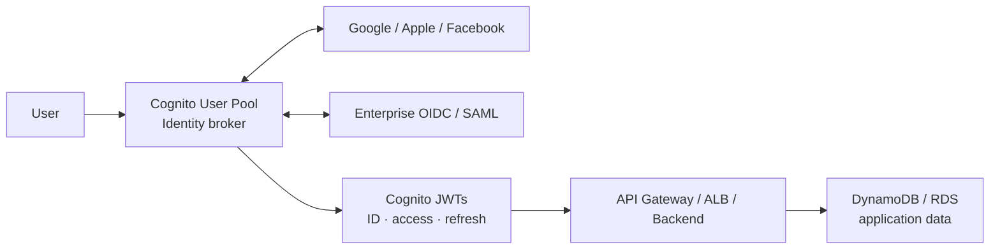
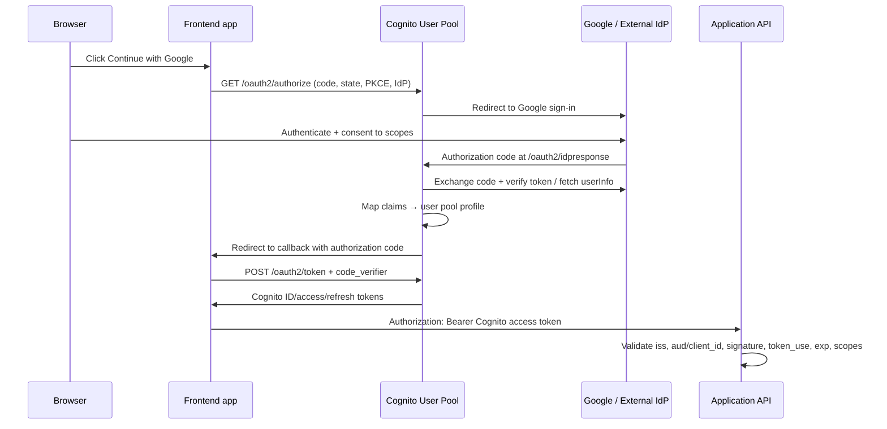
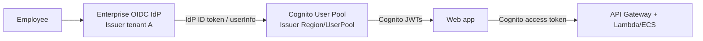
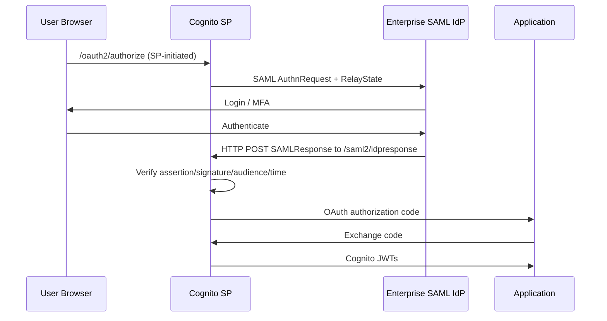
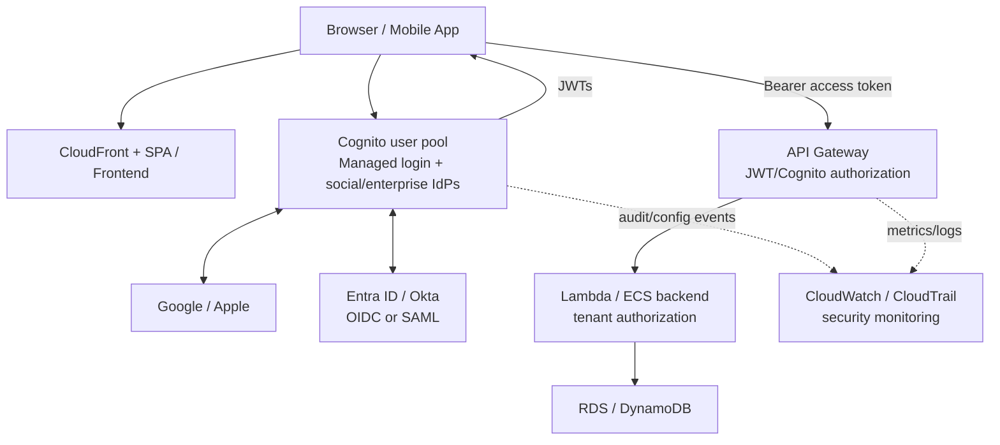
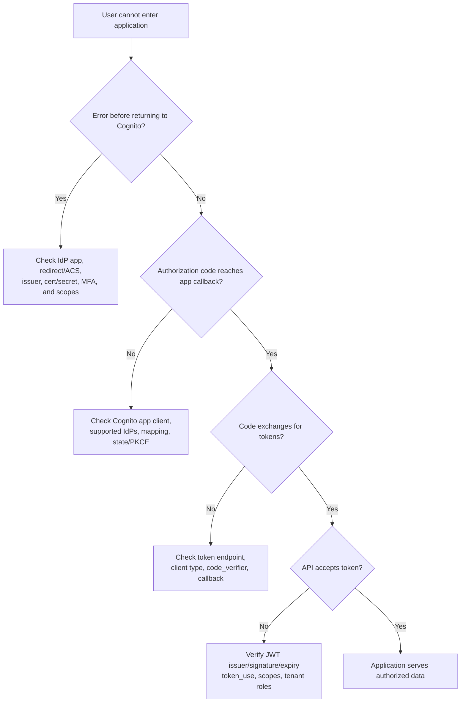

# Federating Social and Enterprise Identity Providers with Amazon Cognito

> **Chapter:** Application Identity with Cognito  
> **Module:** CLOUD_PROVIDERS_AWS  
> **Objective:** Configure and operate *federated sign-in* with Google, Apple, Facebook, Amazon, and enterprise identity providers via OpenID Connect (OIDC) or SAML 2.0. Learners will distinguish Cognito user pools/identity pools, protect callbacks and tokens, map claims, link user profiles, enforce multi-tenant authorization, and monitor/control costs.

## 1. The Challenge: One Application, Many Ways to Sign In

An e-commerce platform deployed in the AWS Singapore Region has two user groups:

- **B2C customers:** want to sign in with Google or Apple without creating a separate password.
- **B2B employees/partners:** already have accounts in Microsoft Entra ID, Okta, or Active Directory Federation Services (AD FS) and require single sign-on (SSO) under enterprise security policies.
- **Some users:** hold both an older email/password account and a social account; they want to keep their order history after switching sign-in methods.
- **Application:** web/mobile frontend, API Gateway + Lambda/ECS, order data in DynamoDB/RDS, and CloudWatch logging/alerting.

If every backend integrated directly with Google, Apple, Entra ID, and SAML, the system would have to manage multiple token formats, authentication standards, key rotations, sessions, and claim schemas. **Amazon Cognito user pools** can act as an **identity broker**: federating external providers, normalizing profiles, and issuing **one unified set of user pool JWTs** to the application.

Target outcomes:

1. Users pick a familiar identity provider and return safely to the application.
2. Backends verify JWTs **issued by the exact Cognito user pool**.
3. Order access is checked by **user ID/tenant**, not merely by email presence.
4. Customers can link multiple identities without account takeover risks.
5. Operations teams detect IdP certificate expirations, bad redirects, missing mappings, or invalid tokens.

**Core takeaway:** *federation authenticates a user through a third party; it does not prove that user is authorized to view all data belonging to a tenant.*

## 2. Choosing the Right Product: User Pool, Identity Pool, and IAM Identity Center

Several AWS services mention identity federation, yet serve different purposes.

| Service | Primary Role | Typical Output |
|---|---|---|
| **Amazon Cognito user pools** | Authenticates **application users**; supports local sign-in, social IdPs, OIDC IdPs, and SAML IdPs | Cognito-issued **ID token, access token, refresh token** |
| **Amazon Cognito identity pools** | Exchanges an identity from a configured provider for **temporary AWS credentials** via IAM roles | Temporary AWS access key, secret, and session token |
| **AWS IAM Identity Center** | Workforce SSO for employees entering AWS accounts and business applications | Workforce access/SSO under the IAM Identity Center model |
| **AWS IAM role + federation** | Grants AWS API access to trusted workloads/identities | AWS session credentials and IAM permissions |
| **Your application** | Business permissions by user, tenant, order, group, and action | Allow/deny application resources |

### 2.1. User Pools Federate IdPs; They Do Not Directly Issue IAM Credentials



Here the **Cognito access token** authorizes calls to protected APIs. If a client also needs direct Amazon S3/DynamoDB access via the AWS SDK with IAM permissions, combine an **identity pool** to exchange the token for temporary credentials. Never confuse the two steps.

### 2.2. A User Pool Plays Two Roles

- Toward **Google/Apple/Entra ID/AD FS**, the Cognito user pool acts as the **relying party (RP)** in OIDC or the **service provider (SP)** in SAML.
- Toward the **application frontend/backend**, the Cognito user pool acts as the **identity provider / OAuth 2.0 authorization server**, issuing JWTs per app client settings.

Thus there are **two consecutive trust relationships**: external IdP → Cognito, and Cognito → application. Backends do not need to know which token format each external provider uses.

## 3. Foundational Concepts to Master

| Term | Meaning | Example |
|---|---|---|
| **Identity Provider (IdP)** | System authenticating users and emitting identity info | Google, Apple, Microsoft Entra ID |
| **Relying Party (RP)** | App relying on an IdP's OIDC assertions/tokens | Cognito when interacting with an OIDC IdP |
| **Service Provider (SP)** | App consuming SAML assertions | Cognito when interacting with a SAML IdP |
| **Federation** | Linking authentication across identity systems | User signs in at Entra ID to enter a Cognito-backed app |
| **SSO** | User reuses an active IdP login session to enter another app | Employee signed into Entra ID enters a B2B app |
| **OIDC** | Identity authentication layer built on OAuth 2.0 | ID token, issuer, subject, userInfo |
| **SAML 2.0** | Standard exchanging XML assertions, common in enterprise SSO | SAMLResponse, ACS URL, metadata, signing cert |
| **OAuth 2.0 authorization code** | Mechanism obtaining a code to exchange for tokens | Frontend redirect → Cognito → token endpoint |
| **PKCE** | Protects authorization codes for public clients | `code_verifier` and `code_challenge` |
| **Claims / attributes** | Identity attributes emitted by an IdP | `sub`, `email`, `email_verified`, `groups` |
| **App client** | Configuration for an app using the user pool | Client ID, callback URL, allowed scopes/IdPs |
| **Managed login** | UI and OAuth endpoints hosted by Cognito | Page to choose Google/Apple/enterprise |
| **Account linking** | Attaching multiple IdP identities to one user pool profile | Google + Entra ID → one application user |

Never arbitrarily use display names or emails as unique identifiers. In OIDC, the **(issuer, subject)** pair is a strong stable identity anchor; Cognito backends typically rely on **user pool `sub`** paired with a tenant mapping table.

## 4. Identity Provider Types Supported by Cognito

### 4.1. Social Identity Providers

Cognito user pools provide built-in integrations for:

1. **Google**.
2. **Sign in with Apple**.
3. **Facebook**.
4. **Login with Amazon**.

Social integrations typically use OAuth 2.0/OIDC based on provider settings. AWS documentation maintains separate guides per provider because **dashboards, client credentials, redirects, and scopes differ**.

### 4.2. Enterprise Providers

Cognito user pools support:

- **Generic OIDC IdPs:** Microsoft Entra ID, Okta, Ping Identity, or any compliant OIDC system.
- **SAML 2.0 IdPs:** Microsoft Entra ID, Okta, AD FS, and compatible SAML solutions.

**Choose the protocol based on the IdP's capabilities and enterprise architecture**, rather than assuming a vendor supports only OIDC or only SAML. A single vendor often supports both.

### 4.3. Should You Choose Social, OIDC, or SAML?

| Criterion | Built-in Social | Enterprise OIDC | Enterprise SAML 2.0 |
|---|---|---|---|
| Users | B2C consumers | Employees/partners, also usable for B2C | Enterprise workforce/B2B |
| Config details | App/client ID, secret or Apple keys, scopes | Issuer, client ID/secret, discovery/endpoints, scopes | Metadata XML/URL, Entity ID, ACS, certificates |
| Identity payload | Social claims/profile | ID token + userInfo claims | SAML attributes/NameID |
| Callback to Cognito | `/oauth2/idpresponse` | `/oauth2/idpresponse` | `/saml2/idpresponse` |
| Key/cert management | Provider credentials/keys | Client secret and OIDC signing keys | X.509 metadata/signing certificates |
| Watchouts | Privacy/email relay, scopes | Issuer/audience/HTTPS, secret rotation | Assertion signature, clock skew, metadata/cert rotation |
| Best fit | Fast consumer sign-in | OIDC SSO supported by the IdP | Existing enterprise SAML SSO |

All three ultimately flow through the **Cognito user pool**, and the application client receives **Cognito JWTs** once sign-in completes.

## 5. End-to-End Federation Flow: Where Does the User Go?

Suppose a shopper visits `https://app.example.com` and selects **Continue with Google**.



**There are two distinct authorization code exchanges by role**:

1. The external provider returns an authorization code **to Cognito**, typically at `/oauth2/idpresponse`.
2. **Cognito** returns an authorization code **to the application's callback**, such as `https://app.example.com/callback`.

Therefore, registering **both callback URLs** accurately is mandatory.

### 5.1. Who Holds the Password?

When a user signs in via a social or enterprise provider:

- Passwords, passkeys, or corresponding MFA are handled by the **external IdP**.
- Cognito receives the federation result and creates/updates the profile per mappings.
- The application receives **Cognito JWTs**, never the raw IdP password.
- The client app also does not need raw SAML assertions or upstream Google/Entra ID access tokens just to call the application's backend.

The application remains responsible for **authorization, session handling, and token protection**.

## 6. Preparing User Pool, App Client, and Domain Before Connecting an IdP

### 6.1. Minimum Components

| Component | Critical Configuration |
|---|---|
| **User pool** | Region, required user attributes, appropriate MFA/threat protection/feature plan |
| **User pool domain** | Cognito domain prefix or HTTPS custom domain |
| **App client** | Client ID; public/confidential client; OAuth 2.0 grants; scopes; callback/logout URLs |
| **Managed login / hosted UI** | IdP chooser page or direct redirect from custom UI |
| **External IdP app** | Client ID/secret or SAML metadata, allowed redirect URL/ACS |
| **Identity provider in Cognito** | Provider name/type, credentials/metadata, attribute mapping |
| **App client identity providers** | Enable the provider on the exact app client in use |
| **Backend authorization** | JWT validation, app scopes, tenant/resource permissions |
| **Logging/monitoring** | CloudTrail, appropriate Cognito sign-in telemetry/logging, API metrics, alarms |

### 6.2. Managed Login vs. Classic Hosted UI

AWS currently offers **managed login** with richer UI customization alongside the legacy **classic hosted UI**.

- **Managed login** is the actively developed UI experience.
- **Classic hosted UI** still applies in some contexts, such as certain **Lite feature plan** setups.
- The user pool domain and app client branding/login settings must match the feature plan.
- Do not assume a domain can mix managed login and classic hosted UI arbitrarily in the same flow.

**Federation does not force users to view an AWS-designed page:** an app can render its own login buttons, yet must still **redirect the browser through Cognito's authorization endpoint** to execute social/OIDC/SAML federation per protocol.

### 6.3. Public Clients vs. Confidential Clients

| Application Type | Can Safely Keep a Client Secret? | Common Approach |
|---|---|---|
| Browser SPA | **No** | OAuth authorization code + **PKCE** |
| Native mobile app | **No** | Authorization code + PKCE via browser/system auth session |
| Server-rendered web/BFF | Yes, in server secret store | Code grant, client secret if appropriate, session cookie |
| Backend machine-to-machine | Yes | Client credentials or another service identity mechanism, not user social sign-in |

**Never put an app client secret in a JavaScript bundle or mobile binary** and pretend it stays secret. For public clients, use authorization code + PKCE and store tokens safely.

### 6.4. Callback URLs and HTTPS

Explicit callback layout:

```text
Application callback:
https://app.example.com/auth/callback

Cognito domain:
https://auth.example.com

External OIDC/social IdP return URL:
https://auth.example.com/oauth2/idpresponse

External SAML IdP ACS URL:
https://auth.example.com/saml2/idpresponse
```

In local development, `http://localhost` exceptions apply only under AWS/IdP-supported conditions. Production must use HTTPS and **exact allowlists** for callback/logout URLs—avoid wildcards and uncontrolled open redirects.

## 7. Integrating Google: Controlled Social Sign-In Example

### 7.1. Step 1 — Register an OAuth Application with Google

In **Google Auth Platform**:

1. Create/select your organization's project.
2. Configure branding/consent screen, audience, privacy details, and scopes.
3. Create an OAuth client for a web application.
4. Add the **Authorized redirect URI** pointing to **Cognito domain `/oauth2/idpresponse`**, e.g.:

```text
https://auth.example.com/oauth2/idpresponse
```

5. Store the **Google client ID** and **Google client secret** in an appropriate secrets vault.

**Never enter your application's `/auth/callback` into Google instead of Cognito's callback.** Your app is a client to Cognito; **Cognito is Google's OAuth client**.

### 7.2. Step 2 — Add the Google IdP in Cognito

In **Cognito → User pools → select pool → Social and external providers → Add identity provider → Google**:

- Enter the Google client ID and secret.
- Choose appropriate authorized scopes, typically `openid profile email`.
- Map needed attributes, such as `email → email`, `email_verified → email_verified`, `name → name`.
- Save the provider, then **enable Google on the exact app client**.

If the user pool marks `email` as required yet the provider does not return that claim or mapping is missing, sign-in will fail.

### 7.3. Step 3 — Test

Open the app client's managed login and select Google. After authentication succeeds:

- The browser returns to the **application's** callback with a code.
- The client exchanges the code for JWTs **issued by Cognito**.
- The user pool may contain a federated profile whose username begins with the provider name.
- The backend validates tokens and tenants—never treating a Google `email` as permission to access every account sharing that email.

**Warning:** map `email_verified` carefully and verify the IdP's semantics. An email claim alone does not prove it is verified.

## 8. Sign in with Apple: Privacy and Special Considerations

### 8.1. Configuration Values from Apple

Per current AWS documentation, Apple integration requires components such as:

- **App ID** with Sign in with Apple enabled.
- **Services ID** for web integration.
- **Team ID** of the Apple Developer organization.
- **Key ID** and **private key (.p8)** issued by Apple.

Apple's domain/return URL config must point to Cognito `/oauth2/idpresponse`, not arbitrarily to another URL.

In Cognito, enter the Services ID/Team ID/Key ID/private key in the provider form and choose scopes such as `email name` as needed.

### 8.2. Why Never Use Email as a Unique Key?

Apple allows users to **Hide My Email**. The IdP may return an address such as:

```text
random-alias@privaterelay.appleid.com
```

This address does not match the real email the same person uses with Google or Entra ID. A single user can use the same Apple account with a unique relay address. Therefore:

- **Never automatically link Apple with Google just because emails "look similar"**.
- Prefer the stable provider-specific **`sub`** identifier and a workflow proving the user owns **both identities**.
- If emailing relay addresses, configure sender domains/addresses per Apple's requirements.
- Apple may send **name only on the very first sign-in**; handle missing names on subsequent logins.
- `email_verified` may vary in data type/representation; never trust an unnormalized string.

### 8.3. Protecting the Apple Key

An Apple private key is sensitive material and must be:

1. Stored in a controlled secrets store.
2. Never committed directly to Git, CloudWatch logs, tickets, or CLI history.
3. Tracked with a clear owner of the Apple Developer account.
4. Covered by a rotation schedule with sign-in testing after key updates.
5. Monitored for expiration/revocation of dependent credentials.

**Never use real private keys in learning examples.**

## 9. Facebook and Login with Amazon

### 9.1. Facebook

For Facebook Login:

- Create an app in Facebook for Developers.
- Obtain the App ID and App Secret.
- Configure the redirect URI as Cognito `/oauth2/idpresponse`.
- Select a currently supported Facebook API version and appropriate scopes, e.g., `public_profile, email`.
- Map the claims actually returned by Facebook.
- Enable Facebook on the target Cognito app client.

**Facebook scopes are typically comma-separated**, unlike Google/OIDC scopes which are space-separated.

### 9.2. Login with Amazon

For Login with Amazon:

- Create a **security profile** in the Amazon Developer portal (distinct from the AWS Management Console).
- Obtain Client ID and Secret.
- Configure allowed origins and return URL pointing to Cognito.
- Choose minimal scopes, e.g., `profile`.
- Map actual attributes such as `email`, `name`, and provider-specific ID.

**Check carefully:** Login with Amazon does not necessarily emit `email_verified` like Google. AWS notes mapped emails may default to **unverified**. Never force `verified=true` just to make account linking easier without proper trust criteria and workflows.

### 9.3. Every Social Provider Has Its Own Lifecycle

Providers can change:

- Developer console/menus.
- OAuth scopes and consent requirements.
- API versions.
- Client secret/key rotation policies.
- Data protection policies and terms of use.

Consequently, assign an **operational owner per IdP** and run periodic sign-in checks after launch. "Google sign-in works today" does not guarantee it stays working after a secret expires or app consent is revoked.

## 10. Enterprise OIDC: Integrating Entra ID, Okta, or Ping Identity

### 10.1. Why Do Enterprises Choose OIDC?

OIDC builds on OAuth 2.0 and fits web/mobile applications well:

- The IdP issues an ID token carrying claims about the user.
- Exposes **issuer, authorization endpoint, token endpoint, userInfo endpoint, and JWKS**.
- Cognito consumes the IdP result and **issues the user pool's own JWTs**.
- Backend applications validate only Cognito JWTs, avoiding direct integration with multiple token issuers.

**Example:** a partner company's IT team manages staff in Entra ID; users authenticate at Entra ID, Cognito creates/updates their profile, and returns tokens to `partner-portal`.

### 10.2. Requirements an OIDC Provider Must Satisfy

Current Cognito documentation lists notable requirements for OIDC IdPs, such as:

- The IdP provides a **client ID and client secret** registered for Cognito.
- Supports the **`client_secret_post`** client authentication method at the token endpoint; Cognito **does not support `client_secret_basic`** as a fallback.
- Exposes HTTPS endpoints for OIDC discovery/userInfo/JWKS/token.
- Endpoints satisfy AWS-supported TLS, port, and certificate trust requirements.
- ID tokens contain `iss`, `aud`, `exp`, `sub`, and valid signing metadata, including `kid` and JWKS keys for asymmetric algorithms.
- Provides a valid discovery document, or manual endpoints.
- Provider APIs return required claims (such as email) matching requested scopes.

**Failure scenario:** an internal IdP only supports `client_secret_basic` and not `client_secret_post`. You cannot simply rename a field in Cognito to force support; you need a compatible IdP or an alternative federation standard such as SAML.

### 10.3. Configure the Enterprise IdP First

In Entra ID/Okta/Ping or another IdP:

1. Register an application (Cognito is the relying party / OIDC client of the IdP).
2. Set the redirect URI:

```text
https://auth.example.com/oauth2/idpresponse
```

3. Record the **issuer URL**, client ID/secret, and discovery URL.
4. Grant needed scopes, typically `openid profile email`.
5. Configure user/group assignments and MFA/Conditional Access at the IdP per enterprise policy.
6. Ensure Cognito can reach public HTTPS endpoints and JWKS as required.

**Never pass the IdP client secret to the frontend.** That secret belongs strictly to the **Cognito ↔ enterprise IdP** relationship and must be managed by authorized operators.

### 10.4. Configure OIDC in Cognito

Under **User pools → Social and external providers → Add identity provider → OpenID Connect**:

- Set a clear **Provider name**, e.g., `EntraPartnerA`.
- Enter the client ID and secret.
- Choose issuer/discovery or supply endpoints manually as required.
- Select scopes.
- Map claims such as `sub`, `email`, `email_verified`, `given_name`, and `family_name` accurately.
- Add the IdP to the app client.
- Test the authorization code flow, userInfo claims, and token validation.

Changing a provider name affects `identity_provider` in login URLs and identity mappings/linked identities. Never rename an IdP in production without assessing impact.

### 10.5. OIDC Tokens from an IdP Differ from Cognito Tokens



The backend **must not take a JWT issued by Entra ID and verify it against Cognito JWKS**: issuers, keys, and audiences differ. Once Cognito serves as the broker, enforce a **consistent trust boundary**: the backend accepts Cognito access tokens.

## 11. Enterprise SAML 2.0: When Companies Already Have Traditional SSO

### 11.1. Essential SAML Terms

| Component | Meaning |
|---|---|
| **SAML IdP** | Entra ID, Okta, AD FS, or SAML system authenticating users |
| **SAML SP** | Cognito user pool consuming assertions from the IdP |
| **Metadata XML** | Document containing Entity ID, SSO URLs, and signing certificates |
| **Entity ID / Audience** | Identifier of the SP for which the assertion is intended |
| **ACS URL** | Assertion Consumer Service receiving the `SAMLResponse` |
| **NameID** | User identifier inside the SAML assertion |
| **Attributes** | Email, name, department, roles/groups depending on IdP |
| **Signature** | Proves the assertion/response came from the trusted IdP |
| **RelayState** | State linking the sign-in request and post-auth redirect |
| **Single Logout (SLO)** | Coordinated logout when supported and configured by both IdP and Cognito |

For Cognito user pool ID `ap-southeast-1_Example123`, the Entity ID typically has the format:

```text
urn:amazon:cognito:sp:ap-southeast-1_Example123
```

The ACS URL has the format:

```text
https://auth.example.com/saml2/idpresponse
```

Both values must be configured accurately on the **enterprise SAML IdP**.

### 11.2. Configuring a SAML IdP in Cognito

1. Create/select a Cognito user pool and app client with a domain.
2. Under **Social and external providers**, add a **SAML 2.0 identity provider**.
3. Provide a public **metadata URL** or upload the metadata XML supplied by the IdP.
4. Decide whether to allow IdP-initiated sign-in; **prefer SP-initiated** unless specifically required.
5. Evaluate **request signing, encrypted responses, and sign-out flows** per IdP capabilities and security standards.
6. Map SAML attributes to user pool attributes; note that claim names are often long URIs.
7. Enable the IdP on the exact app client.
8. Test sign-in/logout, metadata/certificate rotation, and error paths.

AWS recommends a **metadata URL** when the IdP exposes a trusted endpoint so Cognito periodically refreshes metadata/certificates automatically. If uploading static XML, operations must proactively update it whenever the IdP rotates certificates.

### 11.3. SP-Initiated vs. IdP-Initiated



**SP-initiated** (recommended): requests start from Cognito, providing state/RelayState to bind responses to originating requests and mitigating login CSRF.

**IdP-initiated**: users start from an enterprise dashboard and the IdP sends an **unsolicited SAML assertion** to Cognito. This flow carries additional risks (CSRF/request spoofing) and app client/provider constraints; enable it only after evaluating business need.

### 11.4. SAML Metadata and Certificate Rotation

When a SAML IdP rotates its signing certificate:

- Cognito must receive the new certificate via metadata URL or uploaded metadata XML.
- Old and new certificates may need an overlap window per IdP capabilities.
- Check expiration, signing algorithms, audience, ACS, and clock skew.
- Never block certificate updates solely because a staging environment is active.
- Check SAML logout certificates/signing settings if using SLO.

**Critical mistake:** an expired certificate or stale metadata brings down all workforce SSO even when EC2, ALB, and API Gateway are healthy.

## 12. Comparing OIDC and SAML in the Enterprise

| Question | OIDC | SAML 2.0 |
|---|---|---|
| Identity artifact | JSON Web Token and userInfo | XML assertion |
| Metadata | `.well-known/openid-configuration`, JWKS | SAML XML metadata |
| Callback to Cognito | `/oauth2/idpresponse` | `/saml2/idpresponse` |
| Identity key | `iss + sub`, within trust model | Verified NameID/issuer and attributes |
| Client credentials | Client ID/secret between Cognito and IdP | Metadata, entity ID, signing/encryption certificates |
| Typical strengths | Modern app integration, OAuth/OIDC ecosystem | Legacy enterprise SSO, AD FS/IdP dashboards |
| Typical pitfalls | Wrong issuer/audience/secret/discovery/scopes | Wrong Entity ID, ACS, RelayState, cert/clock skew |
| Business authorization | Still decided by the application | Still decided by the application |

An enterprise supporting **both OIDC and SAML** can choose OIDC to leverage token-based APIs, or SAML if an established enterprise SSO ecosystem already exists. There is no need to integrate both just to "support more standards".

## 13. Authorization Code + PKCE: Protecting Sign-In Callbacks

### 13.1. Why Implicit Flow Is Discouraged

**Authorization code grant + PKCE** is the standard choice for browser/mobile public clients:

1. The client generates a random `code_verifier` of valid length.
2. Computes `code_challenge = BASE64URL(SHA256(code_verifier))` using S256.
3. Redirects the browser to Cognito's authorize endpoint with state/nonce where appropriate.
4. Cognito/IdP authenticates the user and returns an authorization code to the allowlisted callback.
5. The client verifies `state`, then submits `code_verifier` to exchange the code at the token endpoint.
6. Receives Cognito JWTs and establishes the app session.

Implicit grant passes tokens directly in browser fragments with security trade-offs; never pick it just for shorter URLs.

### 13.2. Example Authorize URL (Illustrative)

```text
https://auth.example.com/oauth2/authorize
  ?response_type=code
  &client_id=PUBLIC_APP_CLIENT_ID
  &redirect_uri=https%3A%2F%2Fapp.example.com%2Fauth%2Fcallback
  &scope=openid%20email%20profile
  &state=RANDOM_CSRF_STATE
  &nonce=RANDOM_NONCE
  &code_challenge=BASE64URL_SHA256_VERIFIER
  &code_challenge_method=S256
  &identity_provider=Google
```

In real implementations, the URL must be a **valid, properly URL-encoded single string**. `RANDOM_*` values must be generated securely at runtime and tied to one login transaction—never copy fixed strings from a guide.

### 13.3. Routing Directly to an Enterprise IdP

To skip the provider chooser in Cognito managed login, the authorize endpoint supports:

- `identity_provider=EntraPartnerA`: specifies the exact created **Provider name**.
- `idp_identifier=partner-a.example.com`: for SAML providers configured with identifiers/domain routing.

**Never treat a user's email domain as proof of tenant permissions.** IdP discovery/routing merely chooses *where to sign in*; the backend must still verify the authenticated user's tenant.

### 13.4. App Callbacks vs. IdP Callbacks

| Flow | Callback / Return URL | Where Registered |
|---|---|---|
| Google/Apple/Facebook/Amazon → Cognito | `https://auth.example.com/oauth2/idpresponse` | Social IdP developer console |
| Enterprise OIDC → Cognito | `https://auth.example.com/oauth2/idpresponse` | Enterprise IdP client registration |
| Enterprise SAML → Cognito | `https://auth.example.com/saml2/idpresponse` | Enterprise SAML SP/enterprise app settings |
| **Cognito → Application** | `https://app.example.com/auth/callback` | **Cognito app client callback URLs** |

**Redirect mismatch errors** very often happen when administrators paste the application's callback into the external IdP or vice versa.

## 14. Attribute Mapping: Turning External Claims into User Pool Profiles

### 14.1. What Are Mapped Attributes?

When receiving data from an IdP, Cognito maps claims into user pool attributes.

| External Provider Claim | User Pool Attribute | Things to Watch |
|---|---|---|
| `email` | `email` | May be missing or unverified |
| `email_verified` | `email_verified` | Map only when the provider emits a trustworthy claim |
| `given_name` | `given_name` | Not a user identifier |
| `family_name` | `family_name` | Can change over time |
| `name` | `name` | Display name, not an access-control key |
| `sub` or persistent ID | User provider identity | Must stay stable per issuer/provider |
| `groups`/`department` | Custom attributes or auth mapping mechanisms | Validate source, size, and freshness |
| SAML email URI | `email` | Claim names may be long URIs, not simply `email` |

**Every sign-in can update mapped attributes** in the user pool profile. This is login-time synchronization, **not continuous directory sync like SCIM provisioning**.

### 14.2. Required Attributes

If the user pool marks `email` as required, yet an OIDC provider omits `email` or lacks attribute mapping:

- Cognito can reject the sign-in.
- Request the proper scopes such as `openid email`.
- Inspect the IdP's ID token and userInfo endpoint.
- Map `email` to the exact claim in Cognito.
- Never "fix" this by fabricating an email or auto-generating unverified user IDs.

For SAML, required attributes must also be present in the assertion and mapped from the exact attribute statement.

### 14.3. Mutability and App Client Writable Attributes

Cognito enforces constraints on mapped attributes:

- Mapped attributes must be **writable** by the relevant app client.
- Mapped custom attributes must be **mutable** if updated on sign-in.
- If mapping to an already-populated immutable attribute, subsequent sign-ins may fail when Cognito attempts an update.
- Target attribute types/lengths must respect user pool constraints.
- If an IdP omits a claim on a later sign-in, Cognito **does not automatically clear the previous value** of the mapped attribute.

**Mistake:** mapping IdP `groups` or email into an immutable custom attribute—the first test sign-in succeeds, then the user's second sign-in fails.

### 14.4. App Permissions Do Not Live Solely in Mapped Groups

Never use a raw `department=finance` string to grant access to all financial records. Establish:

1. **Authority:** which organization is trusted to emit the claim?
2. **Tenant:** which company does the user belong to, per identity mapping?
3. **Permissions:** which claims are trusted for which roles?
4. **Freshness:** when a group/role is revoked at the IdP, when does it take effect in the app?
5. **Token validity:** existing JWTs may remain valid even after upstream rights change.

When needed, use a **pre token generation Lambda trigger** or authorization service to enrich/normalize claims after validating the source. Never treat mapped claims as IAM permissions.

## 15. Federated Profiles and Account Linking: Highest Account-Takeover Risk Area

### 15.1. When a User Signs In for the First Time

Typically, when Cognito finds no matching link, it creates **a new federated user profile** in the user pool. Usernames often follow a provider-prefixed format, e.g.:

```text
Google_<provider-user-id>
EntraPartnerA_<provider-user-id>
SignInWithApple_<provider-user-id>
```

**Never hard-code parsing logic around username formatting** as a permanent identity contract. Rely on the Cognito profile `sub` and API-supported identity metadata.

### 15.2. Why Can a User End Up with Two Accounts?

A customer has a native account `alice@example.com`, then signs in with Google using the same email. Cognito **does not automatically guarantee both identities merge into one profile**.

Without account linking:

- Native user A owns past orders.
- Federated profile B is created upon Google sign-in.
- The backend sees B's Cognito `sub` differs from A's.
- The user thinks their order history vanished or a duplicate account was created.

**Never "solve" this by changing every API query to `WHERE email = ...`.** Doing so opens severe tenant mix-up and account takeover risks.

### 15.3. AdminLinkProviderForUser

Amazon Cognito provides **`AdminLinkProviderForUser`** to link an external identity to an existing profile when sufficient trust evidence exists.

Key concepts:

- **DestinationUser:** existing user pool profile kept as the primary profile.
- **SourceUser:** provider name + provider subject/attribute being linked.
- One profile can link **up to five federated identities** per current AWS limits.
- Social providers use `ProviderAttributeName=Cognito_Subject` with the stable provider user ID.
- SAML/OIDC may use other link attributes per API support, but always select a trusted claim.

**This is a high-privilege administrative API:** linking an attacker's identity to a victim's profile lets the attacker sign in with the victim's privileges.

### 15.4. Safe Account Linking Workflow

Never auto-link solely because email strings match. A sound workflow:

1. User **signs into the destination profile** that owns the existing orders.
2. User explicitly selects "Link Google/Apple/Enterprise account".
3. User is redirected to **successfully authenticate with the source IdP**.
4. Backend validates state, nonce, token issuer, stable subject, and destination profile session.
5. Enforce tenant/organization policies and check for cross-tenant linking risks.
6. A backend with tightly scoped administrative permissions calls `AdminLinkProviderForUser`.
7. Log an audit event, notify the user, and support unlinking/revocation.
8. When the user later signs in via the source IdP, Cognito resolves to the linked profile.

If a separate federated profile was already created earlier, consolidating/linking requires a **migration runbook** based on AWS documentation; never delete production users without checking linked data and backups.

### 15.5. Be Careful with `email_verified`

- Google provides a mappable `email_verified` claim.
- Login with Amazon may lack an equivalent claim.
- Apple supports **private relay emails**, which differ from emails at other providers.
- Enterprise OIDC/SAML may supply directory emails whose **trustworthiness depends on tenant/IdP configuration**.
- **Emails can change or be recycled**, making them a poor technical identifier for account linking.

**Rule:** identity linking must rely on **proof of control** and trusted provider subject/issuer pairs—not merely matching emails or display names.

## 16. Post-Federation Tokens: What Should the Backend Check?

### 16.1. ID Token, Access Token, and Refresh Token

| Token | Goal | Where Used |
|---|---|---|
| **ID token** | Claims about the user's sign-in and identity/profile | Client application |
| **Access token** | Permissions/scopes for matching APIs | API Gateway/backend |
| **Refresh token** | Obtaining new access/ID tokens per app client policy | Client/BFF under protective controls |

**Never substitute an ID token for an access token in API authorization** just because it carries email/name. Backends must validate the token matching its intended purpose.

### 16.2. Verifying JWTs in the Backend

An API Gateway Cognito authorizer/JWT authorizer or backend JWT verifier must check at minimum:

1. **Signature** against public keys from the exact Cognito user pool's **JWKS**.
2. **`iss` (issuer)** matching the trusted user pool/Region.
3. **`token_use`** equal to `access` for API access.
4. **`client_id`** in access tokens or **`aud`** in ID tokens per app client policy.
5. **`exp`, `nbf`, `iat`** where applicable and clock skew policy.
6. **Scopes** and permissions required for the endpoint.
7. **Tenant/resource ownership** in the backend—never just the JWT signature.
8. **Revocation/logout/token lifetime** policies aligned with application risk.

Cognito JWKS has the format:

```text
https://cognito-idp.ap-southeast-1.amazonaws.com/ap-southeast-1_EXAMPLE/.well-known/jwks.json
```

**Never Base64-decode a JWT and treat it as "validated".** Decoding only reveals contents; you must verify signature, issuer/audience, and expiration using a tested library.

### 16.3. Scopes and Groups

Example custom resource server scopes:

```text
inventory-api/read
inventory-api/write
orders-api/read
orders-api/write
```

An API can require `orders-api/read`; the backend still checks that the user may read orders only for their own tenant.

**Cognito/IdP group memberships do not automatically equal IAM roles**; group-to-app-permission mappings must be explicitly designed. When a user's group is revoked at the IdP, previously issued JWTs can remain valid until expiration/invalidation per configured mechanisms.

## 17. Routing Users to the Right IdP in Multi-Tenant B2B

### 17.1. Multiple Enterprises, Multiple IdPs

Suppose an application serves:

| Tenant | Typical Email Domain | Provider | Approach |
|---|---|---|---|
| **Company A** | `@company-a.example` | Entra ID (OIDC) | Provider `EntraA` |
| **Company B** | `@company-b.example` | Okta (SAML) | Provider `OktaB` |
| **Consumer** | Various domains | Google/Apple | Social providers |
| **Internal Admin** | `@operator.example` | Enterprise SAML/OIDC | Dedicated IdP + MFA |

Options include:

- A **"Continue with Company A"** button routing directly via `identity_provider=EntraA`.
- **SAML IdP identifiers** with `idp_identifier=company-b.example` for domain-based routing.
- A tenant selector by registered domain URL/path that resolves the matching provider.
- Managed login letting users pick a provider at small scale.

### 17.2. Tenant Routing Is Not Tenant Authorization

Suppose a user types `ceo@company-a.example` so the app redirects to `EntraA`. Merely typing an email **proves no permission**. Wait until the IdP authenticates and Cognito issues tokens, then have the backend verify:

- Trusted issuer/provider and stable subject.
- Verified organization/tenant membership.
- User's permission for the requested tenant ID.
- Account is not suspended or deprovisioned.
- Token and claims remain valid per policy.

**Never build authorization rules like "email ends with @company-a.example → Company A admin".**

### 17.3. When Should User Pools Be Separated?

One user pool can host multiple IdPs, though splitting pools makes sense for:

- Compliance/data residency or separating B2C and B2B user populations.
- Different MFA, password, or recovery policies.
- Incident/tenant isolation and blast-radius containment.
- Scale, IdP quotas, feature plans, and billing separation.
- Delegating administrative boundaries across partners.

In exchange, multiple user pools add overhead for client configs, token issuers, user migrations, API authorizers, and operations. Choose boundaries based on security and product needs rather than defaulting to one pool per tenant.

## 18. SSO, Logout, and Session Lifecycles

### 18.1. Three Sign-In Session Layers

A federated user may simultaneously hold:

1. **External IdP session** (Google/Entra ID/Okta).
2. **Cognito managed login session** in the browser.
3. **Application session/tokens** (ID/access/refresh tokens or server cookies).

When a user clicks Logout in the app, decide explicitly which layers should end.

### 18.2. Cognito Logout Does Not Equal Google/Entra ID Logout

- Cognito `/logout` clears the managed login browser session and redirects per configuration.
- The app must clear/revoke its own tokens or session cookies per design.
- **The external IdP may still retain an active SSO session**. If the user clicks sign in again, the IdP may authenticate them "silently".
- For SAML, Cognito supports **Single Logout** when IdP/Cognito settings align, but never assume every IdP executes global logout.
- For social/OIDC, applications must understand provider-specific sign-out and user expectations.

**Logout is not just deleting one `localStorage` key** and assuming every access token on every other device instantly stops working.

### 18.3. Refresh Tokens and IdP Sessions

Cognito can issue refresh tokens after the authorization code flow. Clients exchange refresh tokens for fresh JWTs per app client lifetimes and settings.

Points to watch:

- Refresh token lifetime can differ from access token lifetime.
- Cognito refresh **does not automatically sync instantaneously** when a user is deleted from an enterprise directory.
- When an IdP session expires while Cognito refresh tokens remain valid, apply session policies aligned with workforce/compliance needs.
- Consider enabling **refresh token rotation**, securing token storage, and supporting revocation.
- For sensitive operations, consider re-authentication/step-up authentication where supported by the IdP/Cognito in your Region/tier.

**Deprovisioning** is a distinct operational workflow: deleting a user in the IdP does not make already-issued Cognito access tokens vanish immediately.

## 19. Securing Federation: Risks That Must Be Controlled

### 19.1. OAuth/OIDC Security

- Use **authorization code + PKCE** for public clients.
- Use random `state` against login CSRF and verify it on callback.
- Use `nonce` and verify it when consuming ID tokens per design.
- **Exact redirect URI allowlists**, HTTPS, no open redirects.
- Minimal scopes; never request unnecessary social data permissions.
- Never embed client secrets in browser/mobile code.
- Verify issuer/audience/signature/`exp`/`token_use`, caching JWKS with rotation handling.
- Limit token storage exposure: prefer BFF/HttpOnly secure cookies where suitable, managing CSRF/XSS.
- Never log authorization codes, access/refresh tokens, or secrets in URL logs or tickets.

### 19.2. SAML Security

- Validate SAML signature, issuer, audience/Entity ID, recipient/ACS, timestamps, and replay protections.
- Default to **SP-initiated SSO** whenever possible.
- Enable IdP-initiated SSO only after assessing login CSRF/unsolicited assertion risks.
- Monitor signing certificate and metadata rotation.
- Consider encrypted assertions when payload confidentiality is required.
- Never trust unsigned/unverified SAML attribute text merely because "it's corporate XML".

Cognito handles protocol-level validation at the federation layer, yet **the application must still validate Cognito tokens and business permissions**.

### 19.3. IAM and Administrative Separation

| Role | Permissions Potentially Needed | Limits |
|---|---|---|
| **Cognito administrator** | Manage user pools, app clients, IdPs | Does not need read access to order data |
| **Identity integration admin** | `cognito-idp:CreateIdentityProvider`, `UpdateIdentityProvider`, `DescribeIdentityProvider` | Separate approval when altering IdPs/secrets/issuers |
| **Account linking service** | `cognito-idp:AdminLinkProviderForUser` and necessary user lookups | Trusted backend only, with auditing and proof verification |
| **App deployment role** | Update callback URLs, scopes, app clients via IaC | Never open arbitrary wildcard callbacks |
| **Audit/monitoring** | Read-only Cognito/CloudTrail/log metrics | No secrets, raw tokens, or user-linking permissions |
| **Backend runtime role** | Scoped DynamoDB/RDS/Secrets/KMS access | Never attach Administrator policies to apps |

Specifically, **`AdminLinkProviderForUser` is nearly equivalent to identity takeover authority**—restrict it with IAM, audit every call, and verify source/destination profiles beforehand.

### 19.4. Multi-Tenant Linking and the Email Problem

Never allow someone signing in from Company B's IdP to link into Company A's admin account solely on matching email addresses. Define:

- Which tenant owns which identities?
- Which IdP may assert which claims?
- Who can approve cross-tenant links?
- Can stable subjects ever be recycled?
- When an employee leaves, how are linked identities unlinked, deactivated, and revoked?

In multi-tenant SaaS, **tenant isolation must be enforced in the backend and data access layer**, not only in the sign-in UI.

## 20. Integrating Frontend, API Gateway, ALB, and Lambda/ECS

### 20.1. Common AWS Architecture Pattern



Each component plays a distinct role:

- **CloudFront:** frontend distribution/caching; does not replace JWT validation.
- **Cognito:** authentication federation and token issuance.
- **API Gateway:** token/route/rate-limit enforcement per API type capabilities.
- **Lambda/ECS:** resource- and tenant-level authorization.
- **DynamoDB/RDS:** data storage accessed via application roles.
- **CloudWatch/CloudTrail:** monitoring requests, federation failures, and IdP configuration changes.
- **VPC:** governs backend networking; no need to force every external IdP into a private subnet endpoint.

### 20.2. Using the ALB Authenticate Action

An Application Load Balancer can execute **`authenticate-cognito`** or **`authenticate-oidc`** before forwarding requests to backends in supported setups. Understand:

- ALB `authenticate-cognito` uses user pool app clients/domains/OIDC flows.
- The backend must trust only the proxy path and identity headers injected by the ALB—never forged headers sent directly by clients.
- ALB auth differs from API Gateway Cognito/JWT authorizers in token handling, cookies, and scopes.
- Using ALB auth does not replace tenant/resource permission checks in the backend.

Choose **API Gateway + Cognito JWT** for token-centric mobile/API clients; choose **ALB authenticate actions** when fitting traditional web/backend apps, after validating redirect/session/security and cost trade-offs.

### 20.3. Regions and Multi-Region

A Cognito user pool belongs to **one AWS Region**. User pool IDs and issuers are Region-bound, so:

- Backends in other Regions must trust the exact issuer and JWKS.
- Federation IdP redirect URLs must point to the exact user pool domain.
- Disaster recovery to another Region typically requires **user pool/data migration**, app client/IdP callback reconfiguration, and an issuer/token cutover plan.
- Do not assume a "toggle multi-AZ" switch exists for user pools like EC2 ASGs; Cognito is AWS-managed, yet applications and dependent data still require explicit RTO/RPO design.

## 21. Read-Only AWS CLI: Inspecting Config Without Exposing Credentials

The following commands **do not create or modify resources**. They require AWS CLI v2, a profile with read permissions for Amazon Cognito, and an authorized Region. All IDs, domains, and account values are illustrative; substitute your lab environment.

### 21.1. List User Pools in a Region

```bash
aws cognito-idp list-user-pools \
  --region ap-southeast-1 \
  --max-results 30 \
  --query 'UserPools[].[Id,Name]' \
  --output table
```

A user pool ID looks like `ap-southeast-1_EXAMPLE`. Never accidentally select a staging pool when troubleshooting production.

### 21.2. Inspect User Pool and Domain

```bash
aws cognito-idp describe-user-pool \
  --region ap-southeast-1 \
  --user-pool-id ap-southeast-1_EXAMPLE \
  --query 'UserPool.{Id:Id,Name:Name,Domain:Domain,CustomDomain:CustomDomain,DeletionProtection:DeletionProtection}' \
  --output json
```

If using a custom domain, verify ACM/TLS/DNS settings. **Never assume** the current domain matches what is registered at every IdP; verify each provider individually.

### 21.3. List Identity Providers in the Pool

```bash
aws cognito-idp list-identity-providers \
  --region ap-southeast-1 \
  --user-pool-id ap-southeast-1_EXAMPLE \
  --max-results 60 \
  --query 'Providers[].[ProviderName,ProviderType]' \
  --output table
```

Output may list `Google`, `SignInWithApple`, OIDC providers like `EntraA`, or SAML providers like `OktaB`.

### 21.4. Inspect Attribute Mapping Without Printing Client Secrets

```bash
aws cognito-idp describe-identity-provider \
  --region ap-southeast-1 \
  --user-pool-id ap-southeast-1_EXAMPLE \
  --provider-name EntraA \
  --query 'IdentityProvider.{ProviderName:ProviderName,ProviderType:ProviderType,AttributeMapping:AttributeMapping}' \
  --output json
```

**Important:** the full response can include `ProviderDetails` containing OIDC/social client secrets or sensitive config. This example intentionally **omits `ProviderDetails`**. Only authorized administrators with legitimate need should inspect full details, and never print full outputs in CI logs.

### 21.5. Inspect App Clients

```bash
aws cognito-idp list-user-pool-clients \
  --region ap-southeast-1 \
  --user-pool-id ap-southeast-1_EXAMPLE \
  --max-results 60 \
  --query 'UserPoolClients[].[ClientId,ClientName]' \
  --output table
```

And inspect enabled URLs/scopes/IdPs:

```bash
aws cognito-idp describe-user-pool-client \
  --region ap-southeast-1 \
  --user-pool-id ap-southeast-1_EXAMPLE \
  --client-id EXAMPLE_APP_CLIENT_ID \
  --query 'UserPoolClient.{ClientId:ClientId,CallbackURLs:CallbackURLs,LogoutURLs:LogoutURLs,AllowedOAuthFlows:AllowedOAuthFlows,AllowedOAuthScopes:AllowedOAuthScopes,SupportedIdentityProviders:SupportedIdentityProviders}' \
  --output json
```

Never run unfiltered `describe-user-pool-client --output json` in shared channels if the client has a secret; project only needed fields.

### 21.6. Inspect Users Created via an IdP

Use `list-users` with an appropriate filter when authorized to handle personal data. Example:

```bash
# Use only in labs with authorized test users.
aws cognito-idp list-users \
  --region ap-southeast-1 \
  --user-pool-id ap-southeast-1_EXAMPLE \
  --filter 'email = "test-user@example.com"' \
  --query 'Users[].[Username,UserStatus,Enabled]' \
  --output table
```

Never print full `Attributes` (email/name/identities) to public logs. A federated profile may show `UserStatus=EXTERNAL_PROVIDER` per AWS representation; inspect profile/identity linking via authorized APIs.

### 21.7. Inspect Cognito OIDC Discovery and JWKS

These are read-only HTTP GETs; substitute your real pool ID:

```bash
curl --silent \
  'https://cognito-idp.ap-southeast-1.amazonaws.com/ap-southeast-1_EXAMPLE/.well-known/openid-configuration'

curl --silent \
  'https://cognito-idp.ap-southeast-1.amazonaws.com/ap-southeast-1_EXAMPLE/.well-known/jwks.json'
```

Use these to check **issuer, authorization/token/JWKS URLs** and configure JWT verifiers. **Never confuse JWKS public keys with private keys**: JWKS public keys are public by design, whereas app client secrets and refresh tokens must never appear in commands or logs.

## 22. Configuration Change Examples — Illustrative Only, Do Not Run in Production

> The APIs in this section **create or modify authentication configs** and can disrupt sign-in if misconfigured. Execute only through change approvals, lab environments, and secret-safe pipelines.

### 22.1. Create an OIDC IdP (CLI Sample)

```bash
# DO NOT run directly — structural example only.
# CLIENT_SECRET must be fetched securely, never stored in shell history/logs.
aws cognito-idp create-identity-provider \
  --region ap-southeast-1 \
  --user-pool-id ap-southeast-1_EXAMPLE \
  --provider-name EntraA \
  --provider-type OIDC \
  --provider-details \
      client_id=OIDC_CLIENT_ID,client_secret=CLIENT_SECRET,authorize_scopes="openid email profile",oidc_issuer=https://login.example-idp.com/tenant/v2.0 \
  --attribute-mapping email=email
```

Verify the sample syntax against **`ProviderDetails` schema**, your IdP's discovery document, and your AWS CLI version before deploying. **This CLI command does not automatically configure** app client `SupportedIdentityProviders`, external IdP callback URLs, or required attribute mappings. Configure every piece completely.

### 22.2. Link an External Identity to a Local Profile (Sample)

```bash
# ILLUSTRATIVE ONLY to understand the API — misuse can cause account takeover.
aws cognito-idp admin-link-provider-for-user \
  --region ap-southeast-1 \
  --user-pool-id ap-southeast-1_EXAMPLE \
  --destination-user ProviderName=Cognito,ProviderAttributeValue=local-user-id \
  --source-user ProviderName=Google,ProviderAttributeName=Cognito_Subject,ProviderAttributeValue=GOOGLE_SUBJECT
```

**Only a trusted backend that verified both the source identity and destination profile may call this.** For social IdPs use the exact stable subject; for enterprise IdPs verify issuer/provider/tenant. Never swap `GOOGLE_SUBJECT` for an email just because email is easier to find.

### 22.3. Infrastructure as Code and Secret Management

A deployment workflow can use CloudFormation/CDK/Terraform to manage:

- User pool and app clients.
- Managed login/domain/branding options.
- OIDC/SAML/social provider definitions.
- Attribute mappings.
- OAuth scopes, allowed flows, and callback/logout URLs.
- CloudTrail/monitoring and IAM permissions.

**Secrets concern:** IaC state files, CloudFormation parameters, pipeline logs, and change sets can expose provider client secrets if misconfigured. Use secrets stores and secure secret-injection mechanisms supported by your tooling; review permissions, encryption, state locking, and audits.

**Never recreate or migrate a production user pool** just to test an IdP, as pool IDs, issuers, and tokens will change and break all clients.

## 23. Troubleshooting: Users Cannot Sign In

| Symptom | Likely Causes to Check | Safe Investigation |
|---|---|---|
| Social login reports `redirect_uri_mismatch` | Wrong callback registered at IdP | Compare **Cognito `/oauth2/idpresponse`** with developer console |
| App reports `invalid_redirect_uri` | Cognito app client missing exact callback URL | Check `CallbackURLs`, URL encoding, and HTTPS |
| Google login succeeds yet Cognito issues no token | Missing required claim/mapping or client setting | Verify email/`email_verified` mappings, scopes, and app client providers |
| Apple Sign in fails with `invalid_client` | Wrong Services ID/Team/Key/return URL or invalid key/secret | Inspect Apple developer config and key rotation |
| Apple user receives no email notifications | Private relay sender not registered | Check relay email, sender domains, and Apple email setup |
| Login with Amazon shows `email_verified=false` | Provider does not send verified claim | Never force true; review verification/linking policy |
| SAML fails with `Audience restriction` | Entity ID mismatch | Verify `urn:amazon:cognito:sp:<pool-id>` |
| SAML reports invalid / `RelayState` error | Wrong ACS/RelayState or non-SP-initiated flow | Start from Cognito authorize endpoint; compare POST/ACS |
| SAML login breaks after IdP cert rotation | Stale metadata/certificate | Refresh metadata URL/XML and certificate chain |
| OIDC fails at token endpoint | `client_secret_post` unsupported by IdP or expired secret | Check IdP token auth method, secret, and TLS |
| OIDC issuer/audience mismatch | Wrong issuer URL or client ID | Compare discovery, ID token `iss`/`aud`, and app registration |
| OIDC fails to map email | Missing `email` scope or userInfo omits claim | Check scopes and attribute mapping |
| Provider exists in pool yet no login button appears | Provider not enabled on the **app client** | Check `SupportedIdentityProviders` and managed login settings |
| Sign-in succeeds yet API returns 401 | Backend validates wrong issuer/JWKS/`token_use`/audience | Inspect Cognito access token, authorizer, JWKS cache |
| API returns 403 despite valid token | Missing scope or tenant permission | Check RBAC/ABAC and backend logs |
| User has two profiles | Native and federated accounts unlinked | Implement ownership proof + `AdminLinkProviderForUser` |
| First login works, second fails | Mapped immutable/custom attribute, changed IdP claim | Check writability/mutability and token claims |
| User signs back in automatically after logout | External IdP SSO session still active | Distinguish Cognito logout from provider logout |
| Former employee removed at IdP still calls API | JWT/refresh session still valid or Cognito profile active | Check token lifetime, revocation, and app deprovisioning |
| Only one tenant fails sign-in | That tenant's IdP/client secret/cert/issuer failed | Inspect provider config and tenant-specific monitoring |
| All tenants fail simultaneously | Cognito app client/domain changes or broken callback | Inspect CloudTrail, deployment diff, endpoint health |
| Federated user created yet cannot enter app | User authenticated but lacks business permissions | Check onboarding/tenant binding; auth does not auto-grant permissions |

### 23.1. Layered Diagnostic Flow



**Analyzing a concrete case:** if the API returns 403 because the user does not belong to the tenant, **do not touch the Google OAuth client secret**. Authentication already succeeded; the failure is at the **application authorization** layer. Likewise, if Google returns redirect mismatch, increasing Lambda memory or opening security groups will not help.

## 24. Monitoring, Operations, and Compliance

### 24.1. Signals to Monitor

| Layer | Signal | Question |
|---|---|---|
| **User experience** | Sign-in success/failure rate by IdP and tenant | Which provider is failing? |
| **OAuth callback** | `invalid_redirect_uri`, `invalid_grant`, PKCE/state errors | Did a client or callback change? |
| **OIDC IdP** | Client secret expiry, issuer/discovery/JWKS errors | Is the external IdP still compatible? |
| **SAML IdP** | Metadata/cert expiry, ACS/Entity ID failures | Did certificates or SP settings change? |
| **Cognito user pool** | Sign-in failures, throttles, logs/threat indicators per feature plan | Service issue or abuse on the pool? |
| **API Gateway/ALB** | 401/403/5xx, latency, unauthorized calls | Are tokens reaching the right API? |
| **Backend** | Authorization denials, tenant mismatches, app errors | Permission issue or business bug? |
| **Security/Audit** | CloudTrail IdP/client config updates, `AdminLinkProviderForUser` | Who changed configs or linked users? |
| **Cost** | Cognito MAUs, advanced features, SMS/email traffic | Does spend match budget? |

Never log raw SAML assertions, ID/access/refresh tokens, Apple private keys, OIDC client secrets, or full user profile claims in broadly readable logs.

### 24.2. Rotation and Provider Ownership

For each IdP, maintain a runbook recording:

- **Provider owner** and individuals authorized for the developer/admin console.
- **Client ID/secret rotation window** and key/certificate expiration dates.
- Registered **Callback/ACS/Entity IDs**.
- **Scopes and claims contract** mapped by Cognito.
- Alert recipients and escalation paths when the provider fails.
- Lab accounts/test users for synthetic sign-in probes.
- Rollback plan for IdP/metadata/secret changes.
- Tenant offboarding and linked-identity revocation procedures.

An organization can rotate secrets quarterly, while accounting for provider limits and overlap procedures so rotation schedules do not trigger outages.

### 24.3. MFA and Enterprise Policy

When an external IdP performs authentication, **the IdP's MFA/conditional access policies** form a vital part of the trust model. However:

- Never assume "uses SAML/OIDC" automatically means the user completed MFA.
- `amr`/`acr` claims must be properly issued and trusted before relying on them for step-up authorization.
- Cognito capabilities around **step-up authentication for federated users** roll out progressively across user pools; verify actual availability before depending on them.
- Highly sensitive actions may require **re-authentication** or application-layer verification.

### 24.4. Data Privacy

A user pool stores personal data such as email, name, phone, custom attributes, and linked identities per configuration. Best practices:

1. Collect the **minimum** claims needed for the application.
2. Enforce retention/deletion policies compliant with applicable regulations.
3. Restrict IAM permissions for reading users, API logs, and backups.
4. Never spray groups, employee IDs, or phone numbers into tokens for every client.
5. Keep sensitive data out of browser tokens when unnecessary.
6. Govern cross-border data/Regions and tenant boundaries per organizational policy.

## 25. Costs When Federating Identity Providers

### 25.1. Cognito Typically Charges by Usage

Factors to check on the AWS Cognito pricing page:

- **Monthly active users (MAUs)** in user pools, per feature plan/tier and usage type.
- **Threat protection/advanced security** capabilities when enabled.
- SMS MFA/verification via Amazon SNS and email/SMS delivery.
- Custom domains/CloudFront/ACM, CloudWatch Logs, and dependent services.
- If using identity pools to issue AWS credentials, include the cost of AWS resources accessed by users.
- Separate external IdP fees/limits (especially workforce licenses).

**Never conflate "total accounts stored in the user pool" with "billable MAUs".** Billing follows AWS usage definitions—consult current pricing documentation and actual bills.

### 25.2. Linked Identities and MAUs

AWS notes that a single **user pool profile** can have multiple linked IdP identities while still counting as **one active user profile** under Cognito billing rules when properly linked. However:

- Never implement account linking solely to trim MAU billing without proof both identities belong to the same person.
- Wrongful linking introduces account-takeover risks far outweighing any cost savings.
- Feature plan, IdP availability, external licensing, and usage patterns still drive total cost.

### 25.3. Logical Cost Estimate Example

Suppose:

- 40,000 B2C customers sign in during the month.
- 3,000 B2B employees sign in via enterprise IdPs.
- 2,000 customers have both Google and Apple identities **properly linked** to the same user pool profile.
- Some users use SMS MFA, with 30-day CloudWatch log retention.

Do not mechanically sum 40,000 + 3,000 + 2,000 for MAUs if those 2,000 are **identities belonging to already-counted users**. Count active user profiles per AWS definitions, multiply by the feature plan pricing structure, and add SMS/email and monitoring charges. Never hard-code USD/MAU rates since pricing and free tiers can change.

## 26. Practice Exercises and Answers

### Exercise 1 — Choosing User Pool vs. Identity Pool

A web app wants users to sign in with Google and call a backend REST API using JWTs. Does it need an identity pool to obtain AWS credentials?

**Answer:** Usually a **Cognito user pool** is sufficient for federation and issuing JWTs to the API. Add an **identity pool** only when the client needs temporary AWS credentials to call AWS APIs directly under IAM roles.

### Exercise 2 — Two Callback URLs

A Google OAuth app registered `https://app.example.com/callback`, yet Cognito sign-in reports a redirect mismatch.

**Answer:** Google needs **Cognito's callback `https://auth.example.com/oauth2/idpresponse`**. The `https://app.example.com/callback` URL must be registered on the **Cognito app client**.

### Exercise 3 — Enterprise SAML ACS

A SAML IdP is POSTing assertions to `/oauth2/idpresponse`.

**Answer:** Wrong endpoint. Cognito's SAML ACS is `/saml2/idpresponse`; `/oauth2/idpresponse` is for social/OIDC authorization codes.

### Exercise 4 — OIDC Client Authentication

An enterprise OIDC provider supports only `client_secret_basic`, while the Cognito integration fails at the token endpoint.

**Answer:** Cognito requires `client_secret_post` for OIDC IdPs per current documentation. Configure the IdP to support it or choose another integration such as SAML rather than tweaking redirects.

### Exercise 5 — Google Email Claim

The user pool requires `email`, yet the Google provider has only the `openid` scope and sign-in fails.

**Answer:** Request the `email` scope per design and map `email → email` and `email_verified → email_verified` when returned by the IdP. Required attributes must have mappings and real values.

### Exercise 6 — Apple Hide My Email

A user has a real Google email and an Apple relay email; the team wants to auto-merge both identities by email.

**Answer:** Unsuitable. Apple can return `@privaterelay.appleid.com`; linking must rely on verifying the user owns both identities and stable provider subjects, not matching emails alone.

### Exercise 7 — One Person, Multiple IdPs

A user already has a native account with purchase history and now wants to sign in with Entra ID.

**Answer:** Design an **authorized account linking** flow using `AdminLinkProviderForUser` after verifying ownership/issuer/subject, instead of rewriting data queries to match on email.

### Exercise 8 — Mapped Immutable Attribute

An IdP sends a changing `department` across logins, and Cognito maps it to an immutable custom attribute.

**Answer:** Sign-in can fail when Cognito tries updating the attribute. Use a mutable/writable target attribute or change how claims are stored and authorization is managed.

### Exercise 9 — Social Claim as Admin Right

A backend sees `email=admin@company.example` from a social IdP and grants tenant admin rights.

**Answer:** Insufficiently trustworthy. Verify trusted issuer/subject, tenant mapping, verified authorization, and organization-granted roles.

### Exercise 10 — SAML Certificate Rotation

Entra ID sign-in worked for months and suddenly failed on the day the IdP rotated its signing certificate.

**Answer:** Inspect SAML metadata/certificates, metadata URL or uploaded XML, issuer/audience/ACS, and rotation procedures.

### Exercise 11 — SP-Initiated vs. IdP-Initiated

A B2B app has no requirement to launch logins from a corporate dashboard. Which flow should be preferred?

**Answer:** **SP-initiated** via Cognito's authorize endpoint, because state/RelayState binds responses to login requests, reducing unsolicited assertion/login CSRF risks.

### Exercise 12 — Wrong Token Issuer

A backend verifies Cognito access tokens using Google's JWKS.

**Answer:** Wrong trust boundary. The backend must use the **Cognito user pool JWKS** and verify `iss`, `client_id`, `token_use=access`, and app scopes.

### Exercise 13 — ID Token for an API

A mobile app sends the Cognito ID token instead of the access token to call an API because the ID token contains email.

**Answer:** Do not do this. API authorization must use access tokens with proper checks; ID tokens convey identity to the client. The backend must still enforce tenant/resource ownership.

### Exercise 14 — Immediate Re-Login After Logout

A user clicks logout in the app, selects Entra ID again, and gets signed back in without typing a password due to an active SSO session.

**Answer:** Potentially normal behavior. Cognito/app logout does not necessarily clear external IdP sessions; implement SSO/SAML SLO/re-authentication policies if business requirements demand it.

### Exercise 15 — Departing Employee

HR disables a user in Entra ID, yet an existing Cognito JWT keeps working for several minutes.

**Answer:** Issued tokens have their own lifetimes and revocation mechanics. Build an offboarding runbook: disable the Cognito profile/revoke refresh tokens as needed, keep token lifetimes short, and enforce live backend authorization for sensitive actions.

### Exercise 16 — Identity Provider Created Yet Missing on Sign-In Screen

Cognito lists provider `OktaB`, yet the app's sign-in screen does not show that option.

**Answer:** Check **`SupportedIdentityProviders` on the exact app client** and managed login/branding settings. Defining the provider at the pool level alone is not enough.

### Exercise 17 — Multi-Tenant Email Routing

A user types `ceo@company-a.example`, and the app redirects to Entra A and assigns tenant admin rights before login finishes.

**Answer:** Wrong. Email input only helps **pick the IdP**, not prove identity or roles. Grant permissions only after valid JWTs and app-level tenant authorization.

### Exercise 18 — Duplicate Social User Profile

A user previously signed in with Google, creating a separate federated profile; now the team wants to delete that profile immediately and link it to their native account.

**Answer:** Follow an account migration runbook checking ownership, profile-linked data, and user-deletion risks. `AdminLinkProviderForUser` has constraints for identities that already have profiles; never delete production profiles without backups and a plan.

### Exercise 19 — Provider Secret Exposed in Logs

A CI pipeline runs `describe-identity-provider --output json` and uploads the full JSON to public build logs.

**Answer:** This can leak `ProviderDetails`/client secrets. Restrict IAM, use CLI `--query` to select only safe fields, rotate exposed secrets immediately, and investigate access scope.

### Exercise 20 — Quotas and Costs

An app has 10,000 user pool profiles, but only 2,000 signed in this month; among those 2,000, several linked both Google and Apple.

**Answer:** Do not assume Cognito bills for 10,000 profiles or double-counts users with two linked IdP identities. Check exact **MAU**, linked-user, and feature-plan pricing definitions.

## 27. Production Deployment Checklist

1. **Classify users:** B2C social, B2B enterprise, admins, and service accounts.
2. **Choose products:** Cognito user pool for federation/JWTs; identity pool only when AWS credentials are required.
3. **Prepare pool:** Region, required attributes, MFA/threat protection, feature plan, and user pool domain.
4. **App client:** proper public/confidential type, OAuth code grant, PKCE, allowed scopes, callback/logout URLs.
5. **IdP credentials:** social app IDs/secrets/Apple private key, or enterprise OIDC client/secret/SAML metadata.
6. **Callbacks:** social/OIDC `/oauth2/idpresponse`, SAML `/saml2/idpresponse`, and Cognito → app callback separately.
7. **Provider enablement:** IdP exists in the pool **and** is enabled on the exact app client.
8. **OIDC:** verify issuer, discovery, HTTPS, `client_secret_post`, scopes/JWKS, and certificate trust.
9. **SAML:** Entity ID, ACS, metadata URL, certificate rotation, prefer SP-initiated.
10. **Attributes:** map required fields, verify `email_verified` semantics, ensure writable/mutable mappings.
11. **Linked accounts:** link only after ownership proof; enforce tenant isolation and audits; never link on email alone.
12. **Backend:** verify Cognito JWT signature/issuer/audience/`token_use`/`exp`/scopes and business authorization.
13. **MFA & compliance:** IdP policy, step-up where supported, onboarding/deprovisioning, and privacy.
14. **Sessions:** token lifetimes, refresh rotation, Cognito logout vs. IdP SSO logout.
15. **Security:** least-privilege IAM, IdP secret management, CSP/XSS/CSRF, PKCE/state/nonce, and HTTPS.
16. **Observability:** synthetic sign-in tests, provider failure rates, CloudTrail config changes, and backend auth metrics.
17. **Rotation:** secret/cert/metadata rotation schedule, owners, overlap windows, rollbacks, release approvals.
18. **Scale:** review quotas for user pools/app clients/IdPs, multi-Region recovery, and external provider SLAs.
19. **Cost:** MAUs by feature plan, advanced features, SMS/email, monitoring, and external IdP licensing.
20. **Drills:** test invalid callbacks, expired client secrets, SAML cert rollovers, duplicate identities, revoked users, and cross-tenant access attempts.

**Final takeaway:** in **Cognito user pools**, federating social or enterprise IdPs lets users **sign in with existing identities**, yet applications still rely on **Cognito-issued JWTs** and must enforce resource/tenant-level authorization. Social sign-in, OIDC, and SAML differ in **protocol, callbacks, credentials/metadata, and trust models**. Secure deployments design **OAuth code + PKCE, attribute mapping, proof-based account linking, token validation, logout/deprovisioning, and long-term monitoring**—not just a "Login with Google" button.

## AWS Documentation References

- [Authenticating users with Amazon Cognito user pools](https://docs.aws.amazon.com/cognito/latest/developerguide/cognito-user-pools.html)
- [User pool sign-in with third-party identity providers](https://docs.aws.amazon.com/cognito/latest/developerguide/cognito-user-pools-identity-federation.html)
- [Configuring identity providers for your user pool](https://docs.aws.amazon.com/cognito/latest/developerguide/cognito-user-pools-identity-provider.html)
- [Using social identity providers with a user pool](https://docs.aws.amazon.com/cognito/latest/developerguide/cognito-user-pools-social-idp.html)
- [Add Google as a social identity provider](https://docs.aws.amazon.com/cognito/latest/developerguide/cognito-user-pools-social-idp-google.html)
- [Add Sign in with Apple as a social identity provider](https://docs.aws.amazon.com/cognito/latest/developerguide/cognito-user-pools-social-idp-apple.html)
- [Add Facebook as a social identity provider](https://docs.aws.amazon.com/cognito/latest/developerguide/cognito-user-pools-social-idp-facebook.html)
- [Add Login with Amazon as a social identity provider](https://docs.aws.amazon.com/cognito/latest/developerguide/cognito-user-pools-social-idp-lwa.html)
- [Using OIDC identity providers with a user pool](https://docs.aws.amazon.com/cognito/latest/developerguide/cognito-user-pools-oidc-idp.html)
- [Managing SAML identity providers](https://docs.aws.amazon.com/cognito/latest/developerguide/cognito-user-pools-managing-saml-idp.html)
- [SAML session initiation](https://docs.aws.amazon.com/cognito/latest/developerguide/cognito-user-pools-SAML-session-initiation.html)
- [SAML signing and encryption](https://docs.aws.amazon.com/cognito/latest/developerguide/cognito-user-pools-SAML-signing-encryption.html)
- [Identity provider and relying party endpoints](https://docs.aws.amazon.com/cognito/latest/developerguide/federation-endpoints.html)
- [Cognito authorize endpoint and PKCE](https://docs.aws.amazon.com/cognito/latest/developerguide/authorization-endpoint.html)
- [User pool managed login](https://docs.aws.amazon.com/cognito/latest/developerguide/cognito-user-pools-managed-login.html)
- [Mapping IdP attributes to profiles and tokens](https://docs.aws.amazon.com/cognito/latest/developerguide/cognito-user-pools-specifying-attribute-mapping.html)
- [Linking federated users to an existing user profile](https://docs.aws.amazon.com/cognito/latest/developerguide/cognito-user-pools-identity-federation-consolidate-users.html)
- [Verifying Amazon Cognito JWTs](https://docs.aws.amazon.com/cognito/latest/developerguide/amazon-cognito-user-pools-using-tokens-verifying-a-jwt.html)
- [Amazon Cognito user pools and identity pools](https://docs.aws.amazon.com/cognito/latest/developerguide/amazon-cognito-integrating-user-pools-with-identity-pools.html)
- [Troubleshoot Amazon Cognito](https://docs.aws.amazon.com/cognito/latest/developerguide/troubleshooting.html)
- [Amazon Cognito pricing](https://aws.amazon.com/cognito/pricing/)
