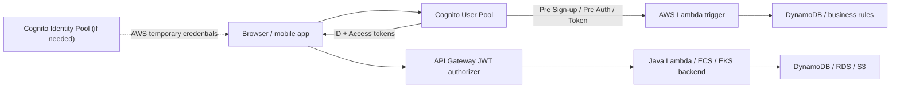
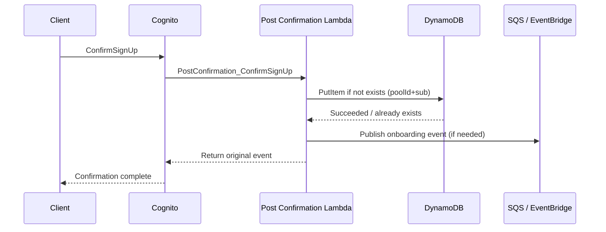
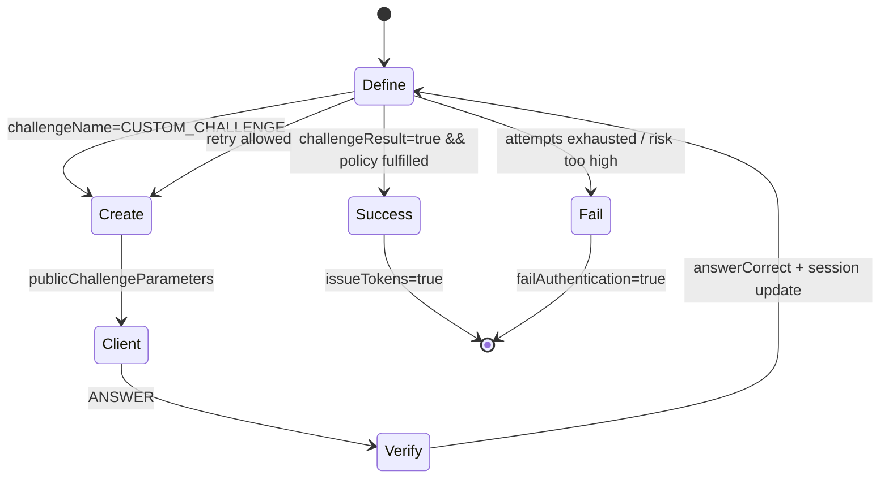
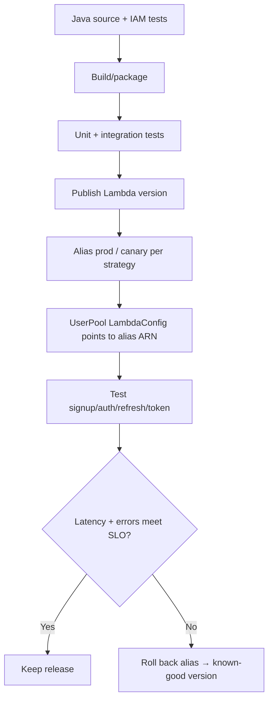
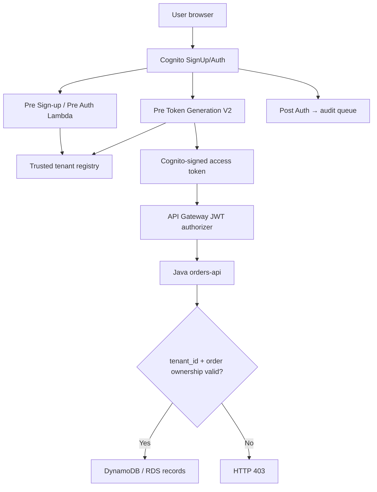

# Lambda Triggers and Customizing Authentication Workflows with Amazon Cognito

> **Chapter:** Application Identity with Cognito  
> **Module:** `CLOUD_PROVIDERS_AWS`  
> **Context:** Amazon Cognito User Pools manage user identities for web, mobile, and backend applications on AWS. This lesson dives into **Lambda triggers** to govern sign-up, authentication, token issuance, notifications, and legacy user migration; integrating IAM, API Gateway, Lambda, VPC, KMS, CloudWatch, and secure, resilient, cost-controlled operations.  
> **Audience:** Learners already familiar with core AWS IAM and Lambda principles who are designing Java/Spring Boot application architectures with Amazon Cognito.

## Learning Objectives

After this lesson, learners can:

1. Distinguish **Cognito User Pool**, **User Pool app client**, **Identity Pool**, **OAuth 2.0/OIDC tokens**, and the role of **Lambda triggers** in each authentication operation.
2. Identify and select the right trigger for sign-up, account confirmation, pre/post authentication, notifications, token generation, user migration, custom authentication, and federation.
3. Read the **Cognito trigger event** structure including `triggerSource`, `userPoolId`, `userName`, `callerContext`, `request`, and `response`; return events adhering to the contract.
4. Write Java handlers for **Pre Sign-up** and **Pre Token Generation V2_0**, avoiding trusting client-supplied data and preventing secret/PII leakage.
5. Explain the **Define → Create → Verify Auth Challenge** flow, session fields, `challengeName`, `issueTokens`, and `failAuthentication`; defend against brute force, replay, and user enumeration.
6. Distinguish **Pre Token Generation V1_0, V2_0, and V3_0**; understand ID tokens, access tokens, scopes, groups, and M2M.
7. Configure Lambda resource permissions for `cognito-idp.amazonaws.com`, least-privilege IAM execution roles, deploy triggers via IaC/CLI, and understand the risks of `UpdateUserPool`.
8. Design low-latency triggers within Cognito's deadline, measure errors, deploy via aliases/versions, test live flows, and roll back faulty triggers.
9. Estimate impacts on sign-in, retries, availability, and Lambda/Cognito/SES/SMS/KMS costs.

## 1. Cognito Manages Identity; Lambda Triggers Add Business Rules

**Amazon Cognito User Pools** manage accounts, user attributes, sign-in methods, email/phone verification, MFA, federation, and issuing OIDC/OAuth 2.0 tokens. Depending on the user pool feature plan, Cognito supports additional sign-in options such as passkeys or passwordless flows per service rules.

A **Lambda trigger** is a function invoked by Cognito at a **defined point in the workflow**. The handler receives an event matching Cognito's schema and can return permitted fields, enrich token information, reject the operation, transition to another challenge, or call supporting AWS services.

A typical architecture:



**Key point:** User Pools issue **JWTs** for application-layer authentication/authorization; **Identity Pools** (if used) federate identity providers to exchange an identity for temporary AWS credentials per role settings. **Adding a claim to a JWT does not automatically grant IAM permissions** to users or backends.

### 1.1 Three Commonly Confused Customization Mechanisms

| Mechanism | What Does It Handle? | Example |
|---|---|---|
| **User Pool Lambda trigger** | Hooks into Cognito-invoked points during sign-up/auth/token flows | Check registration domain, inject tenant claim |
| **API Gateway Lambda authorizer** | Authenticates/authorizes **HTTP requests** entering the API | Reject requests missing a route scope |
| **Backend Java authorization** | Enforces access permissions on **business resources** | User A cannot read User B's orders |

A user who signed in successfully may still **lack permission** to view invoices in another tenant. Triggers do not replace tenant, ownership, or record-level authorization checks in the API/backend.

### 1.2 Lambda Triggers Are Not Background Services

Not every Cognito API action invokes every trigger. When Cognito invokes a trigger, the handler usually sits **in the synchronous authentication critical path**, directly affecting latency, error messages, and sign-in availability.

Example:

```text
Client SignUp
  → Cognito Pre Sign-up trigger
  → Cognito creates account if valid
  → Cognito sends verification code (Custom Message if configured)
  → Client ConfirmSignUp
  → Post Confirmation trigger
  → Client InitiateAuth
  → Pre Authentication trigger
  → Cognito validates credentials / MFA per flow
  → Post Authentication trigger
  → Pre Token Generation trigger
  → Cognito signs JWT and returns tokens
```

This diagram shows a **typical** flow, not a mandatory sequence for every flow. Federation, admin-created users, refresh tokens, passkeys/passwordless, custom challenges, machine-to-machine, and user migration have distinct branches and trigger conditions.

## 2. Map of Trigger Types on Cognito User Pools

A User Pool can configure triggers at the following stages.

| Trigger | When It Runs / Primary Purpose | What Does It Return by Default? |
|---|---|---|
| **Pre Sign-up** | Before completing user creation from SignUp, AdminCreateUser, or first IdP sign-in | Can conditionally set `autoConfirmUser` / `autoVerifyEmail` / `autoVerifyPhone` |
| **Post Confirmation** | After a user confirms registration or completes password reset per eligible events | Returns event; runs side effects like creating a user profile |
| **Pre Authentication** | Before authentication checks in eligible sign-in flows | Can reject sign-in by throwing an error |
| **Post Authentication** | After successful authentication for corresponding trigger sources | Lightweight audit/risk signal; does not run by default on token refresh |
| **Pre Token Generation** | Before Cognito issues ID/access tokens | Customizes claims, groups, and scopes per event version |
| **Define Auth Challenge** | Orchestrates custom authentication challenge loops | Selects next challenge, `issueTokens`, or `failAuthentication` |
| **Create Auth Challenge** | Generates custom challenge questions/prompts | Public/private challenge parameters |
| **Verify Auth Challenge Response** | Validates custom challenge responses | `answerCorrect` |
| **Custom Message** | Customizes email/SMS content sent by Cognito | `emailSubject`, `emailMessage`, `smsMessage` per support |
| **Custom Email/SMS Sender** | Dispatches messages through a provider you control | Handler receives encrypted payload and sends the message itself |
| **Migrate User** | Migrates users from a legacy identity store during auth/forgot password | Returns attributes/status/confirmation per migration contract |
| **Inbound Federation** | Transforms inbound federated identity attributes before creating/updating a user | Returns mapping/response per trigger schema |

**Choose triggers strictly for the exact hook point needed**—never attach a Lambda to every trigger when a workflow only needs to add one claim.

### 2.1 Notable `triggerSource` Values

| Event | Representative Value |
|---|---|
| New sign-up | `PreSignUp_SignUp` |
| Admin creates user | `PreSignUp_AdminCreateUser` |
| First federated sign-in | `PreSignUp_ExternalProvider` |
| Sign-up confirmation | `PostConfirmation_ConfirmSignUp` |
| Forgot-password confirmation | `PostConfirmation_ConfirmForgotPassword` |
| Sign-in | `PreAuthentication_Authentication` |
| Post sign-in | `PostAuthentication_Authentication` |
| Define custom challenge | `DefineAuthChallenge_Authentication` |
| Create custom challenge | `CreateAuthChallenge_Authentication` |
| Verify custom challenge | `VerifyAuthChallengeResponse_Authentication` |
| Sign-in token issuance | `TokenGeneration_Authentication` |
| Refresh token | `TokenGeneration_RefreshTokens` |
| M2M client credentials | `TokenGeneration_ClientCredentials` when using V3_0 |
| Legacy migration | `UserMigration_Authentication` / `UserMigration_ForgotPassword` |
| Inbound federation | `InboundFederation_ExternalProvider` |

This list is **not exhaustive**: Cognito includes trigger sources for hosted/managed login, device auth, custom messages, custom senders, and other operations. When coding, read the exact list of event sources for your chosen trigger rather than relying only on prefixes.

## 3. Trigger Event Contract: Preserve the Structure

A User Pool Lambda trigger typically receives an event with this general structure:

```json
{
  "version": "1",
  "triggerSource": "PreSignUp_SignUp",
  "region": "ap-southeast-1",
  "userPoolId": "ap-southeast-1_ExAmplE",
  "userName": "alice-example",
  "callerContext": {
    "awsSdkVersion": "aws-sdk-unknown-unknown",
    "clientId": "exampleclientid123"
  },
  "request": {
    "userAttributes": {
      "email": "alice@example.org",
      "given_name": "Alice"
    },
    "clientMetadata": {
      "signupSource": "web"
    }
  },
  "response": {
    "autoConfirmUser": false,
    "autoVerifyEmail": false,
    "autoVerifyPhone": false
  }
}
```

This is an **illustrative Pre Sign-up event**, not the exact payload for every trigger type. Some fields may be absent; `request`/`response` vary by stage, and **Pre Token Generation** `version` has V1/V2/V3 variants.

### 3.1 Key Fields

- `triggerSource`: identifies **exactly** which branch invoked the handler; useful when one Lambda handles multiple trigger sources.
- `userPoolId`, `region`, `callerContext.clientId`: Cognito service-provided context; use to restrict allowed pools/clients.
- `userName`: name in the user pool, not necessarily the email; do not assume it is a globally unique immutable identifier across all contexts.
- `request.userAttributes`: profile/request attributes. A new attribute sent at SignUp **is not verified** simply because its key is `email`.
- `request.clientMetadata`: app/client-supplied metadata. **Untrusted for authorization**, as callers can pass arbitrary values.
- `response`: modify only fields supported by Cognito **for that exact trigger type**.

### 3.2 Handlers Must Return the **Event**, Not an HTTP Response

**Correct for a Cognito trigger:**

```json
{
  "version": "1",
  "triggerSource": "PreSignUp_SignUp",
  "region": "ap-southeast-1",
  "userPoolId": "ap-southeast-1_ExAmplE",
  "userName": "alice-example",
  "callerContext": {
    "clientId": "exampleclientid123"
  },
  "request": {
    "userAttributes": {
      "email": "alice@example.org"
    }
  },
  "response": {
    "autoConfirmUser": false,
    "autoVerifyEmail": false,
    "autoVerifyPhone": false
  }
}
```

**Wrong:** returning an API Gateway Lambda proxy envelope:

```json
{
  "statusCode": 200,
  "headers": {
    "content-type": "application/json"
  },
  "body": "{\"allow\":true}"
}
```

Cognito **does not read** `statusCode/body` like an HTTP proxy integration. Returning an invalid shape or dropping required event/request/response fields causes Cognito to throw **`InvalidLambdaResponseException`**; if the trigger fails to execute or times out, callers receive **`UnexpectedLambdaException`**.

### 3.3 Callers Control `ClientMetadata`

An attacker signs up with metadata:

```json
{
  "ClientMetadata": {
    "tenant": "enterprise",
    "role": "admin",
    "skipVerification": "true"
  }
}
```

If Pre Sign-up or Pre Token Generation trusts this input directly, the attacker escalates privileges. **Never grant roles, groups, or scopes from `ClientMetadata` without server-side verification.** Rely on trusted backend stores, verified mappings, admin-managed membership tables, or a policy engine.

Cognito **does not persist, validate, or encrypt `ClientMetadata` as a secret**, and which trigger receives it depends on the API/flow. Never send passwords, OTPs, or tokens in this field.

## 4. Special Operational Limit: Cognito Waits Roughly 5 Seconds

For most User Pool triggers, Cognito invokes Lambda **synchronously**, waits up to **5 seconds** for a response, and **this limit cannot be raised** by increasing the Lambda function's `Timeout`. If an invocation qualifies for retry, Cognito may retry; never assume strictly-once execution.

**Exception:** **Custom sender Lambda triggers** use a different invocation model; do not blindly apply synchronous/retry assumptions from other triggers to custom senders.

### 4.1 Design Consequences

Do not make a synchronous trigger:

- Run multi-second complex queries.
- Call five microservices sequentially over the network.
- Download large artifacts or configs from the Internet per invocation.
- Synchronize an entire CRM and block sign-in until it finishes.
- Dispatch email via a slow external service when blocking the request is unnecessary.

**Good design:** keep validation short, use local config or controlled caches, set tight timeouts on SDK/HTTP clients, and return the event fast. For non-blocking side effects (analytics, welcome workflows), offload to **EventBridge/SQS/Step Functions** as needed; wait only for queue acknowledgment if durability requires it.

### 4.2 Retries Can Cause Duplicate Side Effects

A Post Confirmation trigger might write a profile to DynamoDB. If the write succeeds yet the Lambda response times out, Cognito may retry under service conditions. Therefore:

- Use an **idempotency key** derived from User Pool ID, `sub`, and event type.
- Use `PutItem` with `attribute_not_exists` or conditional updates/transactions as appropriate.
- Never send duplicate welcome emails if the trigger runs twice.
- When enqueuing async events, include deduplication/tracing and recovery for failed downstream workers.

### 4.3 Rollout Propagation

AWS notes that adding, changing, or removing a trigger can take **up to roughly 70 seconds** to propagate across all requests in a User Pool. During rollout, invocations may hit either old or new settings. Use published Lambda versions/aliases and staging tests to lower risk, and avoid breaking schema changes between adjacent versions during rollout.

## 5. Pre Sign-up: Checks Before Account Creation

**Pre Sign-up** runs before Cognito finalizes local or federated user creation in applicable flows. Typical uses:

- Reject disallowed email domains in a **private B2B application**.
- Validate a **server-issued and verified** invitation code instead of trusting client metadata.
- Standardize onboarding rules by user source.
- Conditionally apply organization-approved auto-confirmation/auto-verification.

### 5.1 Three Response Fields

| Field | Meaning | Watchout |
|---|---|---|
| `autoConfirmUser` | Allows Cognito to auto-confirm the user | Does not automatically verify email/phone |
| `autoVerifyEmail` | Marks email as verified | Use only with strong proof; carries alias takeover risks |
| `autoVerifyPhone` | Marks phone number as verified | Use only after proving phone ownership via a trusted channel |

**Limitation:** When `triggerSource=PreSignUp_AdminCreateUser`, Cognito **ignores** all three response flags. The trigger can still inspect or reject the request, but cannot use these flags to alter admin user creation.

### 5.2 Never Auto-Verify Every Email Matching a Domain

Even if an email ends with `@company.example`, that does not prove the registrant controls the mailbox. Setting `autoVerifyEmail=true` on unverified addresses can enable spoofing or alias takeover.

In many systems, **use the domain allowlist solely to permit sign-up** while letting Cognito send the normal email verification code. Auto-verification should happen only with strong server-side proof such as a signed/verified invitation, a verified IdP, and properly designed identity linking.

### 5.3 Java Handler for Pre Sign-up

The example below uses the **AWS Lambda Java managed runtime** with `Map<String,Object>` events while preserving request fields. Illustrative policy: allow sign-ups only from corporate domain `example.org`, **without** auto-verifying email.

```java
package example.cognito;

import com.amazonaws.services.lambda.runtime.Context;
import com.amazonaws.services.lambda.runtime.RequestHandler;
import java.util.Locale;
import java.util.Map;

public final class PreSignUpHandler
        implements RequestHandler<Map<String, Object>, Map<String, Object>> {

    private static final String EXPECTED_POOL =
            "ap-southeast-1_ExAmplE";
    private static final String ALLOWED_DOMAIN = "example.org";

    @Override
    public Map<String, Object> handleRequest(
            Map<String, Object> event,
            Context context) {

        String source = String.valueOf(event.get("triggerSource"));
        if (!"PreSignUp_SignUp".equals(source)
                && !"PreSignUp_ExternalProvider".equals(source)
                && !"PreSignUp_AdminCreateUser".equals(source)) {
            throw new IllegalArgumentException("Unsupported trigger source");
        }

        if (!EXPECTED_POOL.equals(event.get("userPoolId"))) {
            throw new SecurityException("Unexpected user pool");
        }

        Map<String, Object> request = map(event.get("request"));
        Map<String, Object> attrs = map(request.get("userAttributes"));
        Object rawEmail = attrs.get("email");

        if (!(rawEmail instanceof String)) {
            throw new IllegalArgumentException("Email is required");
        }
        String email = ((String) rawEmail).trim()
                .toLowerCase(Locale.ROOT);
        int at = email.lastIndexOf('@');
        if (at <= 0 || at == email.length() - 1) {
            throw new IllegalArgumentException("Invalid email");
        }
        String domain = email.substring(at + 1);
        if (!ALLOWED_DOMAIN.equals(domain)) {
            throw new IllegalArgumentException("Sign-up not permitted");
        }

        Map<String, Object> response = map(event.get("response"));
        response.put("autoConfirmUser", false);
        response.put("autoVerifyEmail", false);
        response.put("autoVerifyPhone", false);
        event.put("response", response);

        context.getLogger().log(
                "PreSignUp accepted from permitted domain\n");
        return event; // Cognito expects the trigger event back.
    }

    @SuppressWarnings("unchecked")
    private static Map<String, Object> map(Object obj) {
        if (obj instanceof Map<?, ?>) {
            return (Map<String, Object>) obj;
        }
        return new java.util.HashMap<>();
    }
}
```

**Limitations of this example:** `EXPECTED_POOL` and `ALLOWED_DOMAIN` are placeholders; this email check targets a **domain-restricted B2B application**, not a universal User Pool policy. During federated sign-in, email attributes may be mapped differently, and strict rejection can block valid users. Production implementations should use versioned configuration, unit tests per `triggerSource`, and avoid logging user emails.

**Dependency:** `com.amazonaws:aws-lambda-java-core`. Handler configured as `example.cognito.PreSignUpHandler`.

### 5.4 Sample Test Event and Expectations

```json
{
  "version": "1",
  "triggerSource": "PreSignUp_SignUp",
  "region": "ap-southeast-1",
  "userPoolId": "ap-southeast-1_ExAmplE",
  "userName": "alice",
  "callerContext": {
    "clientId": "exampleclient123"
  },
  "request": {
    "userAttributes": {
      "email": "alice@example.org"
    },
    "clientMetadata": {
      "signupSource": "web"
    }
  },
  "response": {}
}
```

Expectations:

- Email `alice@example.org`: Lambda returns the event with flags `false`; Cognito proceeds to require email verification per flow.
- Email `alice@external.example`: Lambda throws an error; Cognito rejects sign-up per policy.
- Missing or malformed email: rejected.
- Client-supplied metadata `skipVerification=true`: **does not** alter the outcome.

**Never rely on a single Lambda Console test event to prove the full live flow works**: run `SignUp → ConfirmSignUp` against a staging User Pool to verify the app client, policies, permissions, and actual messages.

## 6. Post Confirmation: Creating Profiles and Starting Onboarding

**Post Confirmation** runs after eligible confirmation events such as `ConfirmSignUp` and `ConfirmForgotPassword`. It can:

- Create a default profile in DynamoDB.
- Start an onboarding workflow.
- Emit an audit event.
- Seed default preferences in another system.

**Important:** Post Confirmation **does not run for admin-created accounts in the same way** as self-sign-up users. Cognito distinguishes self-sign-up from admin-created accounts; never rely on this trigger alone to guarantee every admin-created user has an initialized profile.

### 6.1 Distinguish Sign-Up Confirmation from Password Reset Confirmation

```text
PostConfirmation_ConfirmSignUp
PostConfirmation_ConfirmForgotPassword
```

Do not send a "Welcome to your new account" email or insert a new profile record when a user **only completed a password reset**.

### 6.2 Suggested Workflow



Design points:

- Profile writes must be **idempotent**.
- Publishing the onboarding event can fail after the profile write succeeds; use a transactional outbox or retry/compensation if zero event loss is required.
- If a CRM/webhook is slow, never block synchronously inside Cognito's 5-second window.
- Transmit PII only to authorized destinations; address encryption, retention, and deletion per privacy rules.

## 7. Pre Authentication: Blocking Sign-In Using Trusted Conditions

**Pre Authentication** runs when a user attempts sign-in in supported flows, enabling custom policy checks before Cognito accepts the authentication step.

Use cases:

- Reject users marked `suspended` in a business registry.
- Restrict sign-in to a specific set of app clients.
- Check a policy or server-side risk signal.
- Temporarily pause sign-in flows during a protective incident response.

### 7.1 Key Rules

- The trigger does not verify passwords/OTPs on Cognito's behalf; it only adds policy checks.
- `request.userAttributes`/`clientMetadata` vary by flow; never treat client metadata as proof the user completed MFA.
- When `PreventUserExistenceErrors=ENABLED`, Cognito may pass `userNotFound` in relevant events. Keep UX and timing consistent to minimize **user enumeration**.
- **Refreshing an existing session does not invoke Pre Authentication**, so a policy placed solely in Pre Auth cannot re-check account suspension on a refreshed token.

When immediate access revocation is required, combine backend API checks, short token lifetimes, revocation/global sign-out, and live policy enforcement—never rely solely on Pre Authentication.

### 7.2 Controlled Exception Denials

Cognito denies the flow when the handler throws an exception or returns an invalid response. However, **never** return detailed errors like "This email already exists", "Your account is VIP", or "User has no MFA" to public clients when doing so helps attackers enumerate accounts.

Public error messages should stay generic; internal logs record event type and correlation ID (no PII), and metrics classify internal reason codes. Be careful because managed login can surface trigger error messages in the UI.

## 8. Post Authentication: After Successful Authentication

**Post Authentication** records sign-in activity, updates business timestamps, or emits analytics events on Cognito flows that trigger it.

Examples:

- Emit a `USER_SIGNED_IN` event to EventBridge/SQS.
- Update last successful sign-in in the business profile.
- Record lightweight risk signals or device tracking per applicable law.
- Sync audit trails to a SIEM.

### 8.1 Limitations

- Do not assume it runs on **every** token issuance path—especially **refresh tokens**, which are not new sign-ins.
- Never turn Post Authentication into a heavy logging service that blocks sign-in when downstream systems fail.
- Cognito offers advanced audit/security features per feature plan; do not replace them with a basic custom table and assume account takeover is solved.
- Side effects must be idempotent with fallback handling if an event queue is temporarily unavailable.

### 8.2 Availability vs. Audit Trade-Offs

If the SIEM is temporarily down, define the business policy:

- **Fail-open with queued audit**: users can still sign in, and audit delivery catches up upon recovery.
- **Fail-closed**: block sign-in whenever mandatory policy auditing fails; accept broader outage risk and maintain a runbook.

No single choice fits every application. Banking systems and low-sensitivity internal apps have different requirements.

## 9. Custom Authentication: Define → Create → Verify Challenge

Cognito supports **custom authentication** when the app client and flow are configured accordingly. The standard chain uses three Lambda triggers:

1. **Define Auth Challenge**: picks the next step based on session history.
2. **Create Auth Challenge**: generates challenge prompts and parameters.
3. **Verify Auth Challenge Response**: validates the answer and returns `answerCorrect`.

Use this when you need a specialized challenge flow under strict policy, such as out-of-band transaction verification. **Do not build custom OTP/passwordless flows merely to replicate built-in Cognito managed features** when passkeys, SMS/email OTP, or standard MFA already meet requirements.

### 9.1 State Machine Diagram



**Never set `issueTokens=true` simply because a client passed metadata like `"passed=true"`.** Issue tokens only when the session confirms every required challenge was verified cleanly.

### 9.2 Define Auth Challenge Event and Output

Shortened example on first invocation:

```json
{
  "triggerSource": "DefineAuthChallenge_Authentication",
  "request": {
    "userNotFound": false,
    "session": []
  },
  "response": {
    "challengeName": "CUSTOM_CHALLENGE",
    "issueTokens": false,
    "failAuthentication": false
  }
}
```

After Verify, `session` may contain:

```json
{
  "session": [
    {
      "challengeName": "CUSTOM_CHALLENGE",
      "challengeResult": true,
      "challengeMetadata": "OTP_V1"
    }
  ]
}
```

Check **both** `challengeName` and `challengeResult`. If a custom flow requires prior password/SRP and MFA steps, inspect the entire `session` array in order, not just the last element.

### 9.3 Safe Define Challenge Pseudocode

```text
function define(event):
    session = event.request.session or []
    userNotFound = event.request.userNotFound == true

    if session contains a verified success
       for the REQUIRED CUSTOM_CHALLENGE
       and required prior challenges are satisfied
       and not userNotFound:
        event.response.issueTokens = true
        event.response.failAuthentication = false

    else if session has 3 failed attempts OR policy denies:
        event.response.issueTokens = false
        event.response.failAuthentication = true

    else:
        event.response.challengeName = "CUSTOM_CHALLENGE"
        event.response.issueTokens = false
        event.response.failAuthentication = false

    return event
```

This is pseudocode. Production must add per-user/device/IP brute-force protection, server-side retry tracking, challenge lifetimes, and consistent timing/responses for nonexistent users.

### 9.4 Create Auth Challenge: Separating Public and Private Parameters

Cognito provides:

- `publicChallengeParameters`: sent to the client, e.g., `delivery=EMAIL` or `maskedDestination`.
- `privateChallengeParameters`: visible only to the Verify Lambda, never returned directly to the client.
- `challengeMetadata`: metadata recorded in session history.

Example response shape:

```json
{
  "response": {
    "publicChallengeParameters": {
      "delivery": "EMAIL",
      "maskedDestination": "a***@example.org"
    },
    "privateChallengeParameters": {
      "challengeId": "opaque-server-generated-id"
    },
    "challengeMetadata": "OTP_V1"
  }
}
```

**Never place OTPs or secret answers into `publicChallengeParameters`.** During Verify, check challenge ID, expiration, attempt count, replay, and ownership in a server-side store. `privateChallengeParameters` never reaches the client, yet does not replace server-side state and rate limiting when deep protection is needed.

### 9.5 Verify Auth Challenge Response

The Verify event carries `request.challengeAnswer` and `request.privateChallengeParameters`. The handler returns:

```json
{
  "response": {
    "answerCorrect": true
  }
}
```

In production:

1. Never log `challengeAnswer` or OTPs.
2. Use a cryptographically secure random generator for challenges/nonces; never use `Math.random` or timestamps as secrets.
3. Store hashed OTP/challenge state in DynamoDB or a secret-capable store with TTL and single-use **conditional updates**.
4. Use constant-time comparison primitives when comparing secret material.
5. Cap attempts and bind challenges to user/session/device so an OTP cannot be replayed.
6. When sending email/SMS, enforce resend rate limits/anti-spam and sensible fallback channels.
7. Never issue tokens when `userNotFound=true` or before all policy steps succeed.

### 9.6 Custom Auth and Choice-Based Sign-In

When building `CUSTOM_AUTH` flows, the app client must enable `ALLOW_CUSTOM_AUTH` and the client must initiate/respond via APIs like `InitiateAuth` and `RespondToAuthChallenge`. If the app client or flow only allows password/SRP, custom challenge triggers will not run.

Cognito also supports **`USER_AUTH` / choice-based authentication** for passwords, passwordless, and passkeys under supported conditions and feature plans. Do not confuse `USER_AUTH` with `CUSTOM_AUTH`; prefer managed features for standard passwordless sign-in, and design custom challenges only for genuinely specialized requirements. Consult current auth flow docs for your version and feature plan before combining mechanisms.

## 10. Pre Token Generation: Modifying Claims and Scopes Before Signing JWTs

**Pre Token Generation** is a critical trigger because it directly shapes **the token contents your backend trusts**. Cognito signs the JWT after applying valid modifications returned by the trigger.

### 10.1 ID Token, Access Token, and Refresh Token Differ

| Token | Purpose | What Must the Backend Do? |
|---|---|---|
| **ID token** | Identity/profile claims for the client per OIDC | Verify signature, issuer, audience/client, `token_use`, expiry when consumed |
| **Access token** | Authorizes access to resources/APIs per scopes/groups/claims | Validate access-token semantics, issuer, client, `token_use`, expiry, and scopes |
| **Refresh token** | Requests new tokens per client auth rules | Protect like a sensitive credential; never send to business APIs as an access token |

Adding `tenantId` to the ID token **does not automatically place** that claim in the access token; backend JWT authorizers typically evaluate **access tokens** with route scopes depending on API type and configuration.

### 10.2 Three Pre Token Generation Event Versions

| Event Version | Key Capabilities | Prerequisites |
|---|---|---|
| **V1_0** | Customizes **ID token** claims and group/role overrides; group overrides affect `cognito:groups` in access tokens | Basic User Pool feature |
| **V2_0** | Customizes claims, groups, and scopes in **ID + Access tokens** for human user identities | **Essentials or Plus** User Pool / equivalent feature tier |
| **V3_0** | Same as V2 plus **machine-to-machine (M2M)** client credentials flows | Compatible feature plan and V3_0 event configuration |

Cognito does not invoke Pre Token Generation for M2M client-credentials authorization if only V1/V2 is configured; **`V3_0`** is required for supported M2M event sources.

**Never assume "Lambda attached" means access token customization works.** Verify the User Pool plan, `PreTokenGenerationConfig.LambdaVersion`, and matching response schema.

### 10.3 V1 Response vs. V2/V3 Response

**V1_0**:

```json
{
  "response": {
    "claimsOverrideDetails": {
      "claimsToAddOrOverride": {
        "tenant_id": "tenant-a"
      },
      "claimsToSuppress": [],
      "groupOverrideDetails": {
        "groupsToOverride": ["basic-users"]
      }
    }
  }
}
```

**V2_0/V3_0**:

```json
{
  "response": {
    "claimsAndScopeOverrideDetails": {
      "idTokenGeneration": {
        "claimsToAddOrOverride": {
          "tenant_id": "tenant-a"
        }
      },
      "accessTokenGeneration": {
        "claimsToAddOrOverride": {
          "tenant_id": "tenant-a",
          "subscription_tier": "pro"
        },
        "scopesToAdd": [
          "orders/read"
        ]
      }
    }
  }
}
```

Claim/scope values here are illustrative only. **Never** assign `subscription_tier=pro` or add `orders/write` from self-declared metadata; rely on a trusted **entitlement source** and control token encoding/lifetimes.

### 10.4 Java Pre Token Generation V2_0 Handler

Example injecting `tenant_id` into both ID and access tokens **only when** the user pool attribute `custom:tenant_id` exists and is trusted by the architecture. This lesson assumes only a privileged backend/admin workflow may modify that attribute; if any app client has write permission on `custom:tenant_id`, this example is **insecure**.

```java
package example.cognito;

import com.amazonaws.services.lambda.runtime.Context;
import com.amazonaws.services.lambda.runtime.RequestHandler;
import java.util.HashMap;
import java.util.Map;

public final class PreTokenHandler
        implements RequestHandler<Map<String, Object>, Map<String, Object>> {

    @Override
    public Map<String, Object> handleRequest(
            Map<String, Object> event, Context context) {

        String version = String.valueOf(event.get("version"));
        String source = String.valueOf(event.get("triggerSource"));

        if (!"2".equals(version)) {
            throw new IllegalArgumentException("Expected V2_0 trigger event");
        }
        if (!source.startsWith("TokenGeneration_")) {
            throw new IllegalArgumentException("Unexpected trigger source");
        }

        Map<String, Object> request = map(event.get("request"));
        Map<String, Object> attrs = map(request.get("userAttributes"));

        Object tenantValue = attrs.get("custom:tenant_id");
        if (!(tenantValue instanceof String)
                || !((String) tenantValue).matches("[a-z0-9-]{1,48}")) {
            // Sample policy: refuse token issuance if tenant context is missing.
            throw new IllegalStateException("Trusted tenant context unavailable");
        }

        String tenantId = (String) tenantValue;
        Map<String, Object> id = new HashMap<>();
        id.put("claimsToAddOrOverride", Map.of("tenant_id", tenantId));

        Map<String, Object> access = new HashMap<>();
        access.put("claimsToAddOrOverride",
                   Map.of("tenant_id", tenantId));

        Map<String, Object> details = new HashMap<>();
        details.put("idTokenGeneration", id);
        details.put("accessTokenGeneration", access);

        Map<String, Object> response = map(event.get("response"));
        response.put("claimsAndScopeOverrideDetails", details);
        event.put("response", response);

        context.getLogger().log("Token claims policy applied\n");
        return event;
    }

    @SuppressWarnings("unchecked")
    private static Map<String, Object> map(Object obj) {
        if (obj instanceof Map<?, ?>) {
            return (Map<String, Object>) obj;
        }
        return new HashMap<>();
    }
}
```

Key takeaways:

- The Lambda handler does not sign the JWT itself; **Cognito** signs tokens after the trigger returns.
- Never add admin scopes by default.
- The code intentionally **does not alter `cognito:groups`** unnecessarily; when overriding groups, remember it replaces the entire group list.
- This Lambda rejects token issuance if tenant context is missing. You can instead fail safe to baseline permissions if business logic permits, as an intentional design choice.
- With **V3_0**, events in M2M flows may lack a normal user profile; do not reuse this handler verbatim without adding a branch for machine clients and their permissions.

### 10.5 Claims That Cannot Be Arbitrarily Modified

Cognito restricts certain reserved claims and token fields; you cannot arbitrarily overwrite `iss`, `exp`, `token_use`, `sub`, authentication timestamps, or locked system claims per documentation.

Never attempt to mint an "admin" by manually injecting `cognito:groups` via arbitrary claims when the service requires `groupOverrideDetails`. Review AWS documentation's reserved/restricted claims list before building claim-override logic.

### 10.6 Do Old Tokens Update Automatically?

**No.** Already-signed JWTs stay with the client until expiration or revocation handling. When a tenant entitlement changes:

- Tokens issued **afterward** reflect the new claims from Pre Token Generation.
- Tokens **already issued** remain valid until expiry unless the backend enforces live checks/revocation.
- For highly sensitive actions, APIs/backends may need live policy lookups or shorter token TTLs rather than trusting old claims.

## 11. Custom Message and Custom Sender: Two Levels of Notification Customization

### 11.1 Custom Message

**Custom Message** customizes how Cognito formats emails/SMS: wording, localization, and templates per event source. It receives `request.codeParameter` placeholder, user attributes, and response fields:

- `emailSubject` and `emailMessage` for email where supported.
- `smsMessage` for SMS.
- For invitations, username placeholders and template/code requirements may apply.

**Never replace the verification code placeholder with an arbitrary string**, or users will receive messages without a valid code. Example email:

```text
Hello,
Your account verification code is {####}.
If you did not request this action, please ignore this message.
```

`{####}` here is a common illustrative placeholder in Cognito guides, yet **the response must preserve the exact `codeParameter` passed in the event** and follow each event/message type's rules. Never hardcode `123456` or log verification codes.

If the user pool uses **`COGNITO_DEFAULT`** email sending, email subject/body customization via Custom Message is limited; **`DEVELOPER` email sending / SES** is typically required to use those email response fields. Check email configuration and AWS docs before concluding a template failed to apply.

### 11.2 Custom Email Sender / Custom SMS Sender

Custom sender triggers replace the **delivery mechanism** itself, not just the message body. The Lambda can send through Amazon SES/SNS or a third-party provider.

Key differences:

- Cognito encrypts verification codes/temporary passwords sent to custom senders using an **AWS KMS customer managed key** and the AWS Encryption SDK.
- The custom sender Lambda must **decrypt properly** before sending to the user, requiring KMS permissions and provider connectivity.
- Sender hooks have dedicated event sources like `CustomEmailSender_SignUp` and `CustomSMSSender_Authentication`.
- Configuring `CustomEmailSender`/`CustomSMSSender` and `KMSKeyID` typically requires **AWS CLI/SDK/IaC**, rather than standard Console dropdowns alone.
- Never log ciphertext, plaintext OTPs/temporary passwords, or full recipient details.

**Custom Senders carry significant operational responsibility.** If the email/SMS provider fails, sign-up, password reset, and MFA break. You must manage delivery retries, suppression lists, fraud throttling, provider failover, auditing, and messaging costs.

### 11.3 When Not to Use a Custom Sender

If Cognito's built-in email/SMS via SES and default templates already meet your needs, do not build a custom sender Lambda just to tweak an email subject. Custom senders expand both attack surface and operational dependencies.

## 12. User Migration and Inbound Federation

### 12.1 Migrate User: Moving Users from a Legacy System

**Migrate User** supports migrating users from a legacy identity store into a Cognito User Pool across eligible flows, such as:

```text
UserMigration_Authentication
UserMigration_ForgotPassword
```

For sign-in migration:

1. User attempts to sign in to Cognito with their credentials.
2. Cognito does not find the user in the User Pool and invokes the Migrate User trigger per conditions.
3. The trigger verifies credentials against the legacy system over a secure channel.
4. If valid, it returns profile/status fields per schema so Cognito creates the user.
5. Subsequent sign-ins authenticate directly against Cognito once migration finishes.

**Caution:** migration authentication involves passwords in requests and auth flow constraints; SRP flows do not pass plaintext passwords to the trigger like password-based flows. Design `USER_PASSWORD_AUTH`/doc-supported models, handle secrets strictly in memory, never log passwords, and never transmit them over plaintext HTTP to legacy systems.

### 12.2 Forgot Password Migration

`UserMigration_ForgotPassword` brings users not yet in Cognito into the recovery flow. Do not assume plaintext passwords exist in this flow; responses must match the schema and user status/attribute/verification requirements.

### 12.3 Inbound Federation

When apps sign in through external IdPs (SAML/OIDC/social), Cognito links and maps attributes into the User Pool. The **Inbound Federation trigger** can customize attribute mapping/validation before creating or updating the user, per supported features and schema.

Example checks:

- Email/tenant claims actually signed/asserted by the external IdP.
- Normalizing names/departments per policy.
- Preventing erroneous identity linking across two tenants.
- Avoiding auto-granting admin groups if IdP assertions are untrusted or the app client is unauthorized.

**Do not confuse** Pre Sign-up ExternalProvider with Inbound Federation: they can fire at different points in the federation workflow. Consult docs for your User Pool feature plan and exact trigger source.

## 13. Customization Must Never Break Security Boundaries

### 13.1 Never Elevate Privileges from Client Input

The following inputs always require verification:

- `ClientMetadata.role=admin`.
- Unverified `userAttributes.email`.
- Email domain strings without ownership proof.
- Browser/mobile-supplied `X-Tenant` headers.
- Group names passed by the app in `ClientMetadata`.
- OIDC claims whose issuer/audience/signature/mapping policy was not verified at the gateway.

**Right approach:** derive tenant roles/scopes solely from IAM/authorization services, server-side entitlement stores, managed group memberships, or verified identity sources. Restrict writes on sensitive attributes to privileged backends, never granting public app clients `WriteAttributes` on `custom:tenant_id`.

### 13.2 User Enumeration and Timing Leakage

With `PreventUserExistenceErrors=ENABLED`, Cognito reduces user-existence disclosure; custom triggers can still defeat this protection if they:

- Return distinct messages like "Email not found" on one branch.
- Make an extra 1-second database call only when a user exists.
- Vary retry counts or challenge types for unknown users.
- Leak user identities to broadly readable logs/telemetry.

Keep public error messages uniform, equalize processing latency reasonably, enforce rate limits, and design consistent flows for known vs. unknown users. Never confirm account existence just because the frontend wants a "friendlier" error message.

### 13.3 Cognito Tokens Must Be Validated by the Backend

Even when Pre Token Generation adds only trusted claims, APIs must still:

1. Verify JWT signatures using **JWKS from the exact issuer**.
2. Verify `iss`, `exp`, `token_use`, and matching client ID/audience.
3. Verify route scopes/groups/claims.
4. Enforce tenant/resource ownership at the business layer.
5. Guard against replay/enforce idempotency on writes.
6. Never Base64-decode tokens and trust claims without signature verification.

### 13.4 Execution Role vs. Invoke Permission

**Two separate permissions:**

| Permission | Principal | Purpose |
|---|---|---|
| Lambda **resource-based permission** | `cognito-idp.amazonaws.com` | Allows Cognito User Pool to invoke the function |
| Lambda **execution role** | Assumed by `lambda.amazonaws.com` | Allows Lambda code to read DynamoDB/Secrets Manager/KMS, etc. |
| CI/CD role | Resource deployment principal/pipeline | Calls `UpdateFunctionCode`, `UpdateUserPool`, `iam:PassRole` as needed |

Never grant DynamoDB permissions to the Cognito service principal just because a Pre Sign-up Lambda reads DynamoDB. Conversely, giving the Lambda execution role `dynamodb:GetItem` does not grant Cognito `lambda:InvokeFunction`.

## 14. Granting Invoke Permission to Cognito Properly

Cognito User Pools must be granted permission to invoke Lambda via the **function's resource-based policy**. AWS CLI sample:

```bash
aws lambda add-permission \
  --function-name arn:aws:lambda:ap-southeast-1:111122223333:function:cognito-presignup:prod \
  --statement-id allow-cognito-presignup-prod \
  --action lambda:InvokeFunction \
  --principal cognito-idp.amazonaws.com \
  --source-account 111122223333 \
  --source-arn arn:aws:cognito-idp:ap-southeast-1:111122223333:userpool/ap-southeast-1_ExAmplE \
  --region ap-southeast-1
```

ARNs, account IDs, and pool IDs are illustrative; **do not run** in production without real resource values.

Controls:

- `SourceArn` scopes exclusively to the authorized user pool.
- `SourceAccount` restricts the source account where supported by the API.
- If the user pool targets alias `:prod`, the permission must exist on the matching resource/qualifier.
- User Pool and Lambda trigger must align on **Region** requirements; never assume a Cognito trigger can invoke functions in arbitrary Regions.
- The Lambda execution role trust policy remains `lambda.amazonaws.com`.
- When removing a trigger from a User Pool, revoke unused permissions after verifying no other flows need them.

Inspecting the policy:

```bash
aws lambda get-policy \
  --function-name cognito-presignup \
  --qualifier prod \
  --region ap-southeast-1
```

Verify `Principal`, `Action`, and `AWS:SourceArn`/`AWS:SourceAccount` conditions. Never set `Principal:"*"` for invocation just to silence `AccessDeniedException`.

## 15. Configuring Lambda Triggers: Console, IaC, and AWS CLI

### 15.1 Read-Only Preflight

```bash
aws sts get-caller-identity

aws cognito-idp describe-user-pool \
  --user-pool-id ap-southeast-1_ExAmplE \
  --region ap-southeast-1 \
  --query 'UserPool.{Id:Id,Name:Name,LambdaConfig:LambdaConfig,UserPoolTier:UserPoolTier,Status:Status}' \
  --output json

aws cognito-idp describe-user-pool-client \
  --user-pool-id ap-southeast-1_ExAmplE \
  --client-id exampleclientid123 \
  --region ap-southeast-1 \
  --query 'UserPoolClient.{ClientId:ClientId,Flows:ExplicitAuthFlows,PreventUserExistenceErrors:PreventUserExistenceErrors,TokenValidityUnits:TokenValidityUnits}' \
  --output json
```

These commands read configuration only—they **do not call `GetUser`/`GetToken`** and do not print secrets. Inspect `LambdaConfig` before changing any trigger. If a CLI query omits fields due to API/version differences, check raw output and matching docs.

### 15.2 Configuring via IaC (Recommended)

**AWS CloudFormation**, **AWS CDK**, or Terraform can manage:

1. Lambda function code, role, and trust policy.
2. Stable versions and aliases.
3. Invoke permissions scoped to the User Pool ARN.
4. User Pool `LambdaConfig`.
5. Feature plan and trigger version (when using Pre Token).
6. CloudWatch log retention and alarms.
7. Rollbacks and change approvals.

**Never delete and recreate a production User Pool** just to swap a trigger; changing the User Pool ID breaks all users, JWT issuers, app clients, endpoints, and integrations.

### 15.3 `LambdaConfig` Shape in CloudFormation

Illustrative **property snippet** of `AWS::Cognito::UserPool`, not a complete stack:

```yaml
Type: AWS::Cognito::UserPool
Properties:
  UserPoolName: orders-users-staging
  LambdaConfig:
    PreSignUp: arn:aws:lambda:ap-southeast-1:111122223333:function:cognito-presignup:prod
    PreAuthentication: arn:aws:lambda:ap-southeast-1:111122223333:function:cognito-preauth:prod
    PreTokenGenerationConfig:
      LambdaArn: arn:aws:lambda:ap-southeast-1:111122223333:function:cognito-pretoken:prod
      LambdaVersion: V2_0
```

This snippet requires full template resources, IAM permissions, a compatible user pool feature plan, exact CloudFormation version syntax, and required stack properties. Preserve existing user pool settings when migrating legacy stacks.

### 15.4 Why You Must Be Careful with `UpdateUserPool`

`aws cognito-idp update-user-pool` carries serious risks:

- The API updates **broad User Pool settings**, rather than patching `LambdaConfig.PreSignUp` in isolation.
- Omitted parameters in some update calls can be **reset to defaults**, altering password policies, email/MFA settings, schemas, or other configurations.
- When passing `LambdaConfig`, you must **preserve all existing triggers** and critical sibling settings.
- Some changes take time to propagate.
- A broken Lambda trigger can break **all sign-in/sign-up** for affected flows.

Safe sequence: `describe-user-pool` → generate full configuration via IaC/state → review diff → back up/export metadata → deploy to staging → run live auth tests → roll out to production with monitoring → keep a rehearsed rollback ready.

**Never run an ad-hoc `--lambda-config PreSignUp=...` command on a production User Pool** without understanding which other settings might be overwritten or reset to defaults.

## 16. Lambda Aliases, Versioning, and Rollback

The Cognito Console often points to **`$LATEST`**; via API/IaC, point triggers to a **Lambda alias ARN** for controlled releases and rollbacks. Per AWS docs, do not configure raw published version ARNs arbitrarily as trigger targets—use aliases to control versions.

### 16.1 Safe Release Flow



When using aliases, **avoid API/IaC updates accidentally reverting pointers to `$LATEST`**. Avoid changing trigger schemas, feature plans, and SDK/client auth flows simultaneously without a migration plan.

### 16.2 Rollback Is Harder Than Swapping an Alias Once Data Changed

If a Pre Token V2 trigger issued wrong claims, clients still hold existing tokens; rolling back the alias only affects invocations and tokens issued **after** the rollback propagates. Plan token revocation/expiry and backend enforcement.

If a Pre Sign-up trigger mistakenly auto-confirmed many users, rolling back code does not undo already-modified user account states. Inventory affected accounts and run a separate data remediation script.

## 17. VPC, Timeouts, Cold Starts, and Reliability

### 17.1 Why 5 Seconds Matters Especially for Java

Java Lambdas can incur noticeable cold starts if packaged with heavy dependencies or eager initialization. Because Cognito waits roughly **5 seconds**, cold start + SDK initialization + business logic + network latency all consume the budget.

Suppose:

```text
JVM cold start + class loading:  1400 ms
Read config from DynamoDB:        120 ms
Policy evaluation:                 10 ms
Network retry:                   3000 ms
------------------------------------------
Total:                           4530 ms
```

A single extra HTTP retry can push the call past the deadline. These numbers are **illustrative**, not a default SLO.

### 17.2 Safe Optimizations

- Trim dependencies and unnecessary initialization; choose an appropriate Java runtime/layer setup.
- Initialize AWS SDK clients once per execution environment, watching for stale network connections on reuse.
- Set tight connect/read/overall API call timeouts and bounded retries.
- Never fetch oversized configs/secrets per request; cache with TTLs matching security policy.
- Call only essential services in the critical path; offload non-critical side effects via SQS/EventBridge.
- Consider **Provisioned Concurrency** when cold starts hurt high-traffic triggers and cost justifies it; verify runtime/alias compatibility.
- Minimize log payloads, PII, and cold-start telemetry overhead.

### 17.3 Should Triggers Run Inside a VPC?

If accessing RDS/Redis/private APIs, Lambda can run in private subnets. In that case:

- Ensure subnets and security groups have connectivity to required dependencies.
- If calling AWS public service endpoints, configure NAT or appropriate VPC endpoints.
- Internet access is not automatic just because Lambda is attached to a VPC.
- KMS/Secrets Manager/DynamoDB may require valid IAM, resource, and endpoint policies.
- Verify DNS and VPC IP capacity; never attach a trigger to a VPC merely assuming it makes things safer.

**A VPC/network timeout surfaces directly to end users** as a failed sign-in or sign-up whenever the trigger sits in the synchronous auth path.

### 17.4 Fail-Open or Fail-Closed?

For **blocking suspended accounts**, failing open on a policy check outage can be a security breach. For **optional sign-in analytics**, failing closed causes a full outage over telemetry.

Classify each trigger:

| Trigger / Function | Typical Failure Policy to Consider |
|---|---|
| Pre Auth enforcing mandatory user suspension | **Fail-closed** backed by high availability |
| Pre Sign-up validating mandatory invitations | **Fail-closed** |
| Pre Token injecting tenant claims used for authorization | Never issue privileged tokens when trusted data is missing |
| Post Auth routine auditing | Queue/durable event; avoid blocking sign-in |
| Post Confirmation welcome email | Async/retry outside critical path whenever possible |
| Custom sender OTP/MFA | Guarantee delivery or fail safely; never issue tokens without verified challenge |

Note: Cognito triggers are blocking calls in most flows; "fail-open" typically means the **handler itself catches non-critical dependency errors** and returns a valid event, not an automatic Cognito toggle.

## 18. Observing Errors from Cognito and Lambda

### 18.1 Prominent Errors

| Error / Symptom | Common Cause | Investigation Steps |
|---|---|---|
| `InvalidLambdaResponseException` | Handler returned wrong schema, missing `request/response`, or invalid version field | Log redacted event shape, unit-test serialization, verify response contract |
| `UnexpectedLambdaException` | Timeout, unhandled exception, Lambda could not be invoked | Check Cognito error, Lambda INIT/REPORT, IAM, quotas |
| `AccessDeniedException` when Cognito invokes trigger | Lambda resource policy lacks `cognito-idp.amazonaws.com` or wrong SourceArn/alias | Check `lambda get-policy`, user pool `LambdaConfig` |
| Valid-domain user sign-up blocked | Overly strict PreSignUp policy or unexpected event source | Compare SignUp/ExternalProvider/AdminCreateUser test cases |
| New user not auto-confirmed | `PreSignUp_AdminCreateUser` ignores flags, or wrong return flags | Check `triggerSource` and flow |
| Slow sign-in or 5s timeout | Cold starts, SDK retries, VPC/networking | Inspect `InitDuration`, `Duration`, dependency traces |
| Token holds stale claims | Issued before logic change or refresh hasn't run | Check token `iat`/`exp`, trigger logs, refresh behavior |
| Access token lacks custom claims | PreToken V1_0, plan lacks V2 support, wrong response schema | Check UserPool `LambdaConfig` + feature plan + JWT validation |
| M2M token does not fire trigger | V3_0 not enabled | Check pre-token event version and client credentials flow |
| Custom challenge issues no tokens | Define sets `issueTokens` wrong or Verify sets `answerCorrect` false | Inspect session trace, challenge result, and flow flags |
| Verify challenge never runs | App client lacks `CUSTOM_AUTH` / Define omits `CUSTOM_CHALLENGE` | Check client `ExplicitAuthFlows` and event logs |
| User enumeration leak | Error messages/timing differ for known vs. unknown users | Audit `PreventUserExistenceErrors` and custom handlers |
| Custom email lacks updated body | Not using supported SES/DEVELOPER email mode | Check User Pool email config and trigger response fields |
| Custom sender fails to send OTP | KMS decrypt denied, provider API/SES/SMS permissions | Check custom sender logs, KMS policy, delivery pipeline |
| Other triggers vanish after User Pool update | `UpdateUserPool` omitted existing `LambdaConfig`/params | Run IaC drift diff, `describe-user-pool`, and roll back |

### 18.2 Where to Observe

- **Lambda CloudWatch Logs**: `/aws/lambda/<function-name>` (or custom log group), platform logs, and app metrics.
- **CloudWatch Lambda Metrics**: `Invocations`, `Errors`, `Duration`, `Throttles`, `ConcurrentExecutions`.
- **Cognito User Pool logs/metrics**: auth, MAU, token request, and threat-protection metrics per plan and config.
- **CloudTrail**: User Pool changes, Lambda policy/alias/code updates, and IAM/KMS events per event config.
- **X-Ray / tracing**: instrumented Lambda calls to DynamoDB/Secrets Manager/HTTP endpoints.
- **EventBridge/SQS DLQs**: for async downstream workers launched by triggers, not a default DLQ for synchronous Cognito triggers.

**Never log the entire raw event**: events can carry emails, phone numbers, attributes, `challengeAnswer`, verification codes, or token-related data. Emit structured logs containing only `triggerSource`, `userPoolId`, request ID, status, duration, and redacted reason codes.

### 18.3 Illustrative CloudWatch Logs Insights Query

Assuming handlers log JSON fields `triggerSource`, `status`, and `durationMs`:

```sql
fields @timestamp, triggerSource, status, durationMs
| filter ispresent(triggerSource)
| stats count(*) as calls,
        pct(durationMs, 95) as p95Ms,
        sum(if(status = "ERROR", 1, 0)) as errors
  by triggerSource
| sort calls desc
```

This is an **example query**; CloudWatch Logs Insights supported functions and syntax depend on your log format and AWS documentation. Verify current syntax and actual log fields before building dashboards; do not assume every Lambda logs these fields by default.

## 19. AWS CLI: Inspecting and Testing Each Flow

> **Prerequisites:** AWS CLI v2, appropriate profile, and Region. All IDs, names, and emails are illustrative. `describe/get/list` commands below are read-only metadata queries; `sign-up`, `initiate-auth`, and `respond-to-auth-challenge` mutate state or authenticate and **must run only in authorized practice environments**.

### 19.1 Inspect User Pool and App Client

```bash
aws sts get-caller-identity

aws cognito-idp describe-user-pool \
  --user-pool-id ap-southeast-1_ExAmplE \
  --region ap-southeast-1 \
  --query 'UserPool.{Id:Id,Tier:UserPoolTier,LambdaConfig:LambdaConfig}' \
  --output json

aws cognito-idp describe-user-pool-client \
  --user-pool-id ap-southeast-1_ExAmplE \
  --client-id exampleclientid123 \
  --region ap-southeast-1 \
  --query 'UserPoolClient.{ClientId:ClientId,Flows:ExplicitAuthFlows,PreventUserExistenceErrors:PreventUserExistenceErrors}' \
  --output json
```

From `LambdaConfig`, inspect:

- `PreSignUp`, `PreAuthentication`, `PostAuthentication`, etc.
- `PreTokenGenerationConfig.LambdaArn` and `LambdaVersion`.
- `KMSKeyID`/`CustomEmailSender`/`CustomSMSSender` if using custom senders.
- Whether the alias ARN matches the expected release.
- Whether the feature plan supports V2/V3 token generation.

### 19.2 Inspect Lambda Aliases, Permissions, and Logs

```bash
aws lambda list-aliases \
  --function-name cognito-presignup \
  --region ap-southeast-1

aws lambda get-policy \
  --function-name cognito-presignup \
  --qualifier prod \
  --region ap-southeast-1

aws lambda get-function-configuration \
  --function-name cognito-presignup \
  --region ap-southeast-1 \
  --query '{Name:FunctionName,Runtime:Runtime,Handler:Handler,Timeout:Timeout,Role:Role,State:State}' \
  --output json

aws logs tail /aws/lambda/cognito-presignup \
  --since 30m \
  --region ap-southeast-1 \
  --format short
```

Note that setting Lambda `Timeout` above 5 seconds **does not extend Cognito's trigger response deadline**. When pointing to an alias qualifier, verify the policy on that exact target ARN.

### 19.3 Test Sign-Up in Staging

Only for a **public app client without a client secret**, or with a properly computed `SECRET_HASH` if the app client uses a secret:

```bash
aws cognito-idp sign-up \
  --client-id exampleclientid123 \
  --username alice-staging \
  --password '<test-only-strong-password>' \
  --user-attributes Name=email,Value=alice@example.org \
  --region ap-southeast-1
```

**Warning:** this command creates a user and places a password in CLI arguments, which can enter shell history or process monitoring. For real tests, use an **AWS SDK** with secure secret input—never paste real passwords into CLI commands or history. If the app client has a secret, compute `--secret-hash` properly; public clients must never embed secrets on the frontend.

Test confirmation using a safe test inbox/OTP without exposing OTP codes to unauthorized users.

### 19.4 Test `CUSTOM_AUTH` in Staging

```bash
aws cognito-idp initiate-auth \
  --client-id exampleclientid123 \
  --auth-flow CUSTOM_AUTH \
  --auth-parameters USERNAME=alice-staging,CHALLENGE_NAME=CUSTOM_CHALLENGE \
  --region ap-southeast-1
```

The response may return `ChallengeName=CUSTOM_CHALLENGE` and `Session`. The app then calls `RespondToAuthChallenge` with the **user's answer** and matching `Session`. **Never print `Session`, OTPs, codes, or tokens to public logs.**

If rejected, verify `ExplicitAuthFlows` includes `ALLOW_CUSTOM_AUTH` and all three Define/Create/Verify triggers are attached. Flows differ when combined with SRP/MFA/password resets; do not copy a fixed request across all users.

### 19.5 Verify Issued Tokens

After a valid sign-in, inspect/verify JWTs using an **OIDC/JWT library with signature verification**—never paste full tokens into public web decoders. Verify:

- `iss` matches the User Pool issuer.
- `token_use` is `id` or `access` matching the target endpoint.
- `exp` and related timestamps.
- `client_id`/`aud` per token type.
- `scope`, `cognito:groups`, `tenant_id` match policy.
- V2/V3 tokens contain expected claims when supported by the feature plan.

**Never call `GetUser` with an arbitrary access token from another app client without verifying scopes and permissions.**

## 20. Testing and Deployment Scenarios

### 20.1 Core Test Matrix

| Test Case | Primary Trigger | Expected Outcome |
|---|---|---|
| Sign-up from allowed domain, unverified email | Pre Sign-up | User created, still requires verification per policy |
| Sign-up from disallowed domain | Pre Sign-up | Rejected without disclosing other user details |
| `AdminCreateUser` with autoConfirm flags | Pre Sign-up | Flags ignored by Cognito per docs |
| User confirms sign-up | Post Confirmation | Profile created exactly once (idempotent) |
| User resets password | Post Confirmation | No duplicate profile or welcome email |
| Suspended user attempts sign-in | Pre Authentication | Rejected per server policy |
| Normal sign-in | Pre/Post Auth + Pre Token | Valid tokens, expected claims |
| Token refresh | Pre Token; no Pre Auth by default | Updated claims reflect policy if trigger applies |
| Password/SRP flow with custom challenge | Define/Create/Verify | Tokens issued only after all challenges pass |
| Repeated wrong OTPs | Define/Verify | Rejected, rate-limited, no user enumeration |
| Nonexistent user with `PreventUserExistenceErrors` | Custom auth / Pre Auth | Public behavior indistinguishable from real users |
| M2M client credentials | Pre Token V3_0 | Access token carries machine scopes/claims |
| Custom sender KMS key denied | Custom sender | Delivery fails with alert; OTP never leaked |
| Lambda timeout / VPC outage | All affected sync triggers | Fails cleanly without granting improper access |
| Alias rollback | Trigger pointing to alias | Flow recovers on approved version |

### 20.2 Unit Tests for Java Handlers

For Pre Sign-up, test:

- `triggerSource` variants: SignUp / ExternalProvider / AdminCreateUser.
- Null, blank, malformed emails, and lookalike domain suffixes (`evil-example.org`).
- Unexpected User Pool ID.
- `clientMetadata.role=admin` does not trigger auto-confirm.
- Response preserves unmodified fields.
- Exceptions do not leak emails or secrets.

For Pre Token V2, test:

- Correct vs. mismatched event version.
- `custom:tenant_id` present and controlled by a trusted source.
- No default admin scopes granted.
- Response matches `claimsAndScopeOverrideDetails` schema, not V1 `claimsOverrideDetails`.
- Sign-in vs. refresh trigger sources.
- Separate V3 branch/handler for M2M if implemented.

### 20.3 Mandatory Integration Tests

Unit tests with mock events **do not validate** IAM resource policies, Cognito execution, email delivery, or real JWT signing. Maintain a staging User Pool, app client, function alias, domain, authorized test email/SMS sinks, IAM/Secrets configs, and end-to-end tests.

Monitor during rollout:

- Sign-up and sign-in success/failure ratios.
- p95/p99 latency.
- Lambda `Errors`/`Duration`/`Throttles` and cold starts.
- Notification provider delivery errors.
- Count of malformed accounts/claims or failed user migrations.
- Service costs and outbound call volume.

## 21. Real-World Scenario: Multi-Tenant Auth for an Ordering App

Suppose a Java backend on ECS/EKS serves multiple businesses. The frontend authenticates via a Cognito User Pool, API Gateway validates JWTs, and the Java backend must reject cross-tenant access.

### 21.1 Policy Design

- **Pre Sign-up:** validate an invitation from the enterprise onboarding system before allowing user creation; **never** auto-verify email from domain alone.
- **Post Confirmation:** create profile with `sub` and onboarding status using idempotent writes.
- **Pre Authentication:** check whether the user is blocked in a trusted registry; never trust client metadata.
- **Pre Token Generation V2_0:** inject `tenant_id` into the access token from a trusted entitlement store or write-protected Cognito attribute.
- **Java backend:** validate JWT, `tenant_id`, and order permissions; never treat a tenant claim as blanket access to every record.
- **Refresh:** refresh token claims per policy while allowing backend live permission checks on sensitive actions.
- **Post Authentication:** emit lightweight audit events with async recovery.

### 21.2 Diagram



### 21.3 Design Risks

1. A user belongs to multiple tenants: the access token model must carry a server-verified **tenant context**, never blindly accepting a browser `tenant` header.
2. A user switches companies: old tokens retain the old tenant claim until expiry/revocation. Backends must protect high-risk operations.
3. A Cognito admin group **does not** prove admin rights across all tenants.
4. If the entitlement store fails, never issue broad-scoped tokens "to avoid disrupting users".
5. Post Confirmation does not guarantee admin-created users receive profiles; build dedicated onboarding/repair paths.
6. With M2M automation, evaluate V3_0 and separate machine permissions from human users.

## 22. Cost, Availability, and Architectural Decisions

### 22.1 Costs to Estimate

| Component | Cost Category |
|---|---|
| Cognito User Pool | Monthly active users (MAUs), feature plan, and optional add-on features per pricing |
| M2M clients | Token requests/feature pricing per service/plan |
| AWS Lambda | Invocations, memory × duration, Provisioned Concurrency if used |
| SES/SMS/custom provider | Email/SMS sends, deliverability, and delivery quotas |
| DynamoDB/Secrets Manager/KMS | API calls, storage, encryption, and rotation |
| CloudWatch/X-Ray | Logs, metrics, tracing, alarms, retention |
| NAT/VPC endpoints | Network connectivity if Lambda needs private/VPC resources |
| Advanced security/analytics | Essentials/Plus feature plans, threat protection, audit tools per config |

**One sign-in can invoke multiple triggers.** If each trigger makes multiple API calls, costs, latency, and failure coupling climb quickly. Prefer minimal triggers, lightweight logic, and built-in Cognito capabilities.

### 22.2 Availability Trade-Offs

If every sign-in runs three synchronous triggers and each depends on an external database or API, a brief downstream outage can **freeze all sign-ins**.

Mitigate risk by:

- Isolating strictly mandatory policy checks.
- Caching trusted configs with TTLs and invalidation plans.
- Enforcing bounded timeouts and appropriate circuit breakers/backoff.
- Decoupling auditing/notifications from the critical path.
- Alerting in CloudWatch on p95/p99 latency and error rates.
- Using canary/alias rollouts with rehearsed rollbacks.
- Maintaining a runbook to **properly detach** an unneeded trigger from the User Pool rather than deleting the Lambda function and leaving a dangling reference.

## 23. Exercises and Self-Check Questions

**Exercise 1 — Choosing Triggers.** An app restricts registration to corporate employees with company emails, yet must still verify mailbox ownership. Which trigger and response flags should be chosen?

**Exercise 2 — Event Contract.** A Cognito Java handler returns `{"statusCode":200,"body":"ok"}`. Why does Cognito throw `InvalidLambdaResponseException` even though the Lambda didn't throw an exception?

**Exercise 3 — 5-Second Deadline.** A Pre Authentication Lambda has `Timeout=30s`, yet Cognito still fails around 5 seconds when DynamoDB/APIs slow down. Why? Propose two improvements.

**Exercise 4 — AdminCreateUser.** Why does setting `autoConfirmUser=true` inside `PreSignUp_AdminCreateUser` not auto-confirm like regular `SignUp`?

**Exercise 5 — Post Confirmation.** A user resets their password several times, and the handler sends a welcome email / creates a profile every time. Which field must be checked to prevent duplicates?

**Exercise 6 — ClientMetadata.** An app passes `ClientMetadata.role=admin` during SignUp. May Pre Token Generation use this directly to grant an admin group? Why or why not?

**Exercise 7 — Custom Challenges.** List the sequence of Define → Create → Verify; when should `issueTokens` be set to true? Should an OTP ever go in `publicChallengeParameters`?

**Exercise 8 — PreventUserExistenceErrors.** When a username does not exist, a handler returns "User not found" in 50 ms, while existing users get "Wrong password" in 800 ms. What is wrong and how do you fix it?

**Exercise 9 — Token V1/V2/V3.** A User Pool currently uses V1_0 and needs to add `tenant_id` to user access tokens. What must change? What if it needs to customize scopes for M2M client credentials?

**Exercise 10 — Security.** You copy `custom:tenant_id` into access tokens. If a public app client can edit that attribute, what is the risk and how do you remediate it?

**Exercise 11 — JWT.** An API only Base64-decodes a JWT and trusts `admin=true`. Which verification checks are missing? Does Pre Token Lambda replace backend authorization?

**Exercise 12 — Custom Message/Sender.** Marketing wants to change an email subject. When is Custom Message enough? When are Custom Email Sender and KMS actually needed?

**Exercise 13 — IAM.** Cognito reports it cannot invoke the Lambda even though the Lambda's execution role has `dynamodb:GetItem`. What permission is missing?

**Exercise 14 — UpdateUserPool.** A team runs `update-user-pool --lambda-config PreSignUp=...` and other triggers disappear afterward. What likely caused this, and how should updates be deployed safely?

**Exercise 15 — Rollback.** Pre Token V2 issued improper permissions in access tokens 15 minutes ago before you rolled back the Lambda alias. Do already-issued tokens automatically update?

**Exercise 16 — User Migration.** Why must user passwords never be logged inside migration triggers? Why may SRP flows not work for password migration from a legacy directory?

**Exercise 17 — Cost/RTO.** A User Pool sees 100,000 sign-ins per day, each running 3 sync triggers calling external APIs. Which risk and cost drivers must be monitored?

<details>
<summary>Suggested Answers</summary>

1. Pre Sign-up validates the domain; keep `autoConfirmUser=false` and `autoVerifyEmail=false` so Cognito verifies the email through its normal flow.
2. Cognito triggers require the event/request/response schema, not an API Gateway HTTP envelope.
3. Cognito's ~5-second deadline is a hard service limit independent of Lambda `Timeout`; use bounded timeouts, caching, or offload async side effects.
4. Cognito ignores all three auto flags when Pre Sign-up is triggered by `AdminCreateUser`.
5. Check `triggerSource` to distinguish `PostConfirmation_ConfirmSignUp` from `PostConfirmation_ConfirmForgotPassword`; make writes idempotent.
6. No. `ClientMetadata` is caller-supplied, not privilege proof; read entitlements from a trusted server-side store.
7. Define picks the challenge, Create builds public/private parameters, Verify checks the answer; set `issueTokens=true` only after the session satisfies all policy steps. Never put OTPs in public parameters.
8. Leaks user existence via messages and timing; unify public responses, equalize latency, and enforce brute-force limits.
9. Use `V2_0` on Essentials/Plus to customize human access tokens; use `V3_0` for machine token flows.
10. Users can change their own tenant to escalate privileges. Restrict app client `WriteAttributes` and enforce authorization at the backend/entitlement service.
11. Missing signature/JWKS verification, issuer, audience/`client_id`, `token_use`, expiration, scope, and resource authorization.
12. Use Custom Message to adjust text/tone within email settings; use Custom Sender only when replacing the delivery transport/provider, handling KMS/Encryption SDK decryption.
13. Lambda resource-based policy granting `cognito-idp.amazonaws.com` invoke permission scoped to `SourceArn`/alias, not the execution role.
14. `UpdateUserPool` is not a simple field patch and can reset omitted parameters; use IaC/full diffs and config backups.
15. No. Signed tokens retain their lifetime/revocation rules; rollback affects only subsequent invocations and new tokens.
16. Passwords are ultra-sensitive secrets; SRP does not send plaintext passwords to Cognito's migration Lambda like password-based auth flows.
17. Monitor CloudWatch Lambda invocations/Duration/Errors/Throttles, external API quotas/latency, Cognito MAUs, SES/SMS, networking, KMS, and dependency availability.

</details>

## 24. Production Deployment Checklist

- [ ] Identified **User Pool** and app client/feature plan; not confused with Cognito Identity Pool.
- [ ] Selected the exact trigger for **sign-up, confirmation, authentication, token issuance, custom challenges, or migration**.
- [ ] Handlers return the complete **Cognito event**, never an API Gateway proxy response.
- [ ] Verified `triggerSource` and versioned event schemas.
- [ ] Never trust `ClientMetadata` or unverified emails as user permissions.
- [ ] Never auto-confirm/auto-verify without trustworthy proof of ownership or approval.
- [ ] Checked for user enumeration, timing leaks, brute force, and account takeover.
- [ ] Custom challenges use CSPRNGs, single-use state, expirations, and rate limits.
- [ ] Pre Token V1/V2/V3 selected to match ID/access/M2M requirements and feature plan.
- [ ] ID/access/refresh tokens strictly separated; backend verifies JWTs and enforces resource authorization.
- [ ] Token claims/scopes/groups come strictly from managed entitlements, never user-editable attributes.
- [ ] Lambda execution role holds only necessary DynamoDB/Secrets/KMS permissions; Cognito invoke permission scoped to exact `SourceArn`.
- [ ] Triggers finish well under Cognito's deadline, with bounded network timeouts and p95/p99 monitoring.
- [ ] User Pool/trigger configuration managed via IaC, with diff backups prior to `UpdateUserPool`.
- [ ] Lambda aliases/versions configured and rollout/rollback rehearsed.
- [ ] Dedicated tests cover `SignUp`, `AdminCreateUser`, federation, password reset, authentication, refresh, and M2M if used.
- [ ] Post Confirmation and audit side effects are idempotent and do not block sign-in on non-essential dependencies.
- [ ] Never log passwords, OTPs, tokens, raw Cognito events with PII, or custom sender ciphertexts.
- [ ] Custom senders handle KMS/Encryption SDK decryption, delivery retries, monitoring, messaging compliance, and alerts.
- [ ] Metrics/alarms cover Cognito auth failures, Lambda Errors/Throttles/Duration, with disable/rollback runbooks.
- [ ] Estimated costs for Cognito plan/MAUs, Lambda, Provisioned Concurrency, DynamoDB, SES/SMS, CloudWatch, and networking.

## Official AWS Documentation

- [Amazon Cognito — Customizing user pool workflows with Lambda triggers](https://docs.aws.amazon.com/cognito/latest/developerguide/cognito-user-pools-working-with-lambda-triggers.html)
- [Amazon Cognito — Pre sign-up Lambda trigger](https://docs.aws.amazon.com/cognito/latest/developerguide/user-pool-lambda-pre-sign-up.html)
- [Amazon Cognito — Post confirmation Lambda trigger](https://docs.aws.amazon.com/cognito/latest/developerguide/user-pool-lambda-post-confirmation.html)
- [Amazon Cognito — Pre authentication Lambda trigger](https://docs.aws.amazon.com/cognito/latest/developerguide/user-pool-lambda-pre-authentication.html)
- [Amazon Cognito — Post authentication Lambda trigger](https://docs.aws.amazon.com/cognito/latest/developerguide/user-pool-lambda-post-authentication.html)
- [Amazon Cognito — Custom authentication challenge Lambda triggers](https://docs.aws.amazon.com/cognito/latest/developerguide/user-pool-lambda-challenge.html)
- [Amazon Cognito — Define auth challenge Lambda trigger](https://docs.aws.amazon.com/cognito/latest/developerguide/user-pool-lambda-define-auth-challenge.html)
- [Amazon Cognito — Create auth challenge Lambda trigger](https://docs.aws.amazon.com/cognito/latest/developerguide/user-pool-lambda-create-auth-challenge.html)
- [Amazon Cognito — Verify auth challenge response](https://docs.aws.amazon.com/cognito/latest/developerguide/user-pool-lambda-verify-auth-challenge-response.html)
- [Amazon Cognito — Pre token generation Lambda trigger](https://docs.aws.amazon.com/cognito/latest/developerguide/user-pool-lambda-pre-token-generation.html)
- [Amazon Cognito — Custom message Lambda trigger](https://docs.aws.amazon.com/cognito/latest/developerguide/user-pool-lambda-custom-message.html)
- [Amazon Cognito — Custom sender Lambda triggers](https://docs.aws.amazon.com/cognito/latest/developerguide/user-pool-lambda-custom-sender-triggers.html)
- [Amazon Cognito — User migration Lambda trigger](https://docs.aws.amazon.com/cognito/latest/developerguide/user-pool-lambda-migrate-user.html)
- [Amazon Cognito — Authentication flows](https://docs.aws.amazon.com/cognito/latest/developerguide/authentication.html)
- [Amazon Cognito — Implement authentication flows](https://docs.aws.amazon.com/cognito/latest/developerguide/authentication-implement.html)
- [Amazon Cognito — User pool feature plans](https://docs.aws.amazon.com/cognito/latest/developerguide/cognito-sign-in-feature-plans.html)
- [Amazon Cognito — Troubleshooting](https://docs.aws.amazon.com/cognito/latest/developerguide/troubleshooting.html)
- [AWS CloudFormation — AWS::Cognito::UserPool LambdaConfig](https://docs.aws.amazon.com/AWSCloudFormation/latest/TemplateReference/aws-properties-cognito-userpool-lambdaconfig.html)
- [AWS CLI — cognito-idp commands](https://docs.aws.amazon.com/cli/latest/reference/cognito-idp/index.html)
- [AWS Lambda — Resource-based policies](https://docs.aws.amazon.com/lambda/latest/dg/access-control-resource-based.html)

**Key takeaways:** **Cognito User Pool Lambda triggers** are extension points with strict contracts and operational limits—not Lambda HTTP proxies. Use **Pre Sign-up/Pre Authentication** to enforce registration/sign-in policies, **Define/Create/Verify Challenge** for custom auth, **Pre Token Generation V1/V2/V3** to customize claims/scopes per feature plan, and **Custom Message/Sender** for notification customization. A secure design combines the **5-second deadline, valid event schema, least-privilege IAM, trusted entitlements, JWT validation, idempotency, secret-free logging, and tested rollbacks**.
