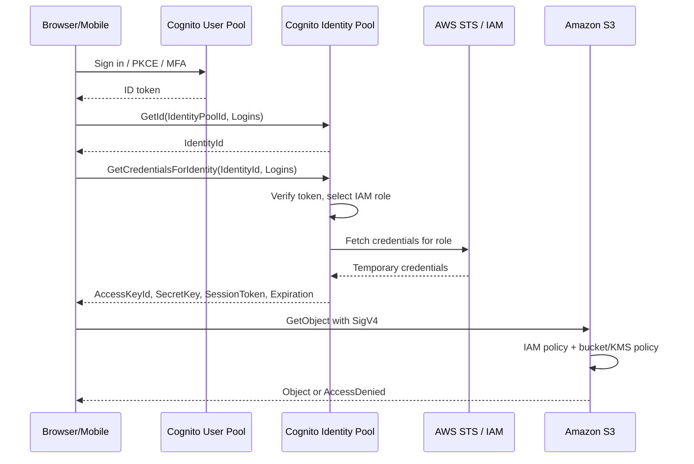
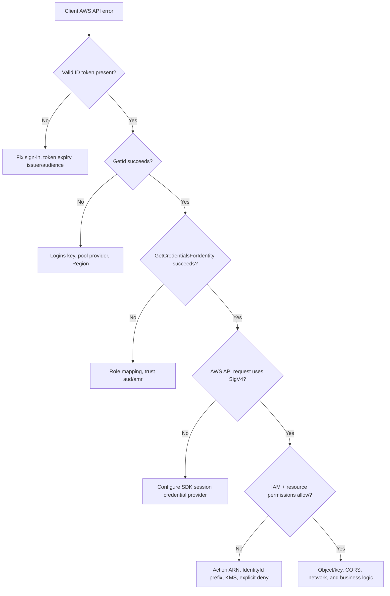

# Granting Temporary AWS Access via Identity Pools

> **Module:** CLOUD_PROVIDERS_AWS  
> **Chapter:** Application Identity with Cognito  
> **Lesson:** Granting Temporary AWS Access via Identity Pools  
> **Context:** An online learning platform on AWS needs web/mobile apps to download documents or call AWS APIs without embedding long-term IAM user access keys.

## 1. The Challenge: How to Grant Per-Student S3 Permissions?

A Java/Spring Boot learning application lets students sign in, view courses, and download personal documents from Amazon S3. Routing every file through the Spring Boot backend turns the server into a bottleneck as user counts grow. The team wants clients to call S3 directly while ensuring:

- Only signed-in students can read their personal files.
- Student A cannot read Student B's files even if they know the object key.
- IAM user `AWS_ACCESS_KEY_ID` and `AWS_SECRET_ACCESS_KEY` are never embedded in JavaScript or mobile apps.
- Permissions are scoped per user and expire automatically.
- Users can sign in via a Cognito User Pool or another identity provider as needed.
- There are mechanisms for monitoring, revocation/risk management, and cost estimation.

**Amazon Cognito Identity Pools** federate user/guest identities to AWS IAM roles and obtain **temporary AWS credentials** from AWS STS. The AWS SDK then signs requests to S3, AppSync, or API Gateway using **AWS Signature Version 4 (SigV4)**.

After this lesson, you will be able to distinguish User Pools from Identity Pools, execute the enhanced credentials flow, configure IAM trust/permission policies, scope access by Identity ID or principal tags, write Java/JavaScript examples, test permission-denied cases, and decide when to use Identity Pools versus presigned URLs.

## 2. Cognito User Pool vs. Cognito Identity Pool

| Criterion | User Pool | Identity Pool |
|---|---|---|
| Responsibility | Sign-up, sign-in, MFA, account and token management | Maps users from identity providers to AWS permissions |
| Output | ID token, access token, refresh token | Identity ID, temporary AWS credentials |
| User authentication | Yes, acts as an identity provider | Relies on proof from an IdP; **does not replace User Pool for sign-in** |
| IAM authorization | JWTs consumed by compatible API authorizers | Selects an IAM role, returns SigV4-capable credentials |
| Unauthenticated guests | Does not issue AWS guest roles | Yes, if unauthenticated identities are explicitly enabled |
| Used standalone | Yes, protects APIs with JWTs | Can trust social/OIDC/SAML/other IdPs without requiring a User Pool |

**Do not confuse:**

- **JWTs from a User Pool** are session/identity proofs, not AWS secret access keys.
- **Identity Pools** do not automatically grant S3 permissions just because a user signed in. They require an IAM role with the right **trust policy** and **permission policy**.
- **Identity Pool ID** is public client configuration metadata, **not a secret**.
- **Temporary credentials** remain sensitive secrets and can be abused while unexpired.

### 2.1. Identity Providers

Identity Pools support Cognito User Pools, certain OIDC/social providers, SAML providers, and developer-authenticated identities.

The input token type depends on the provider:

| IdP | Proof in `Logins` |
|---|---|
| **Cognito User Pool** | **ID token** of the signed-in user |
| Standard OIDC | ID token per IdP configuration |
| Certain social providers | Provider-issued access token |
| SAML | Assertion via supported integration mechanism |
| Developer provider | Token from a server-verified developer-authenticated flow |

**Never arbitrarily pass a Cognito User Pool access token** where the guide calls for an ID token. Conversely, for an API Gateway JWT authorizer, an access token is usually the right choice to authorize API scopes—that is a different problem.

### 2.2. Two Identifiers That Are Not the Same

Suppose a User Pool issues:

```text
User Pool sub: 7fe92d1c-0a71-4eab-a36d-1970af2b3d80
```

An Identity Pool may issue:

```text
IdentityId: ap-southeast-1:11111111-2222-4333-8444-555555555555
```

- User Pool `sub`: user identifier in the User Pool.
- Identity Pool `IdentityId`: federated identifier for the user in the Identity Pool.
- IAM condition key `cognito-identity.amazonaws.com:sub` = **Identity Pool identity ID**, not User Pool `sub`.
- IAM trust condition `cognito-identity.amazonaws.com:aud` = **Identity Pool ID**; meanwhile, the `aud` claim in a User Pool ID token is typically the **app client ID**.

Confusing these two IDs frequently leads to broken S3 policies or overly broad permissions.

## 3. Architecture Overview



This diagram uses the **enhanced (simplified) flow**. The Identity Pool selects the role and interacts with STS on the app's behalf. The client never calls AWS STS directly.

### 3.1. Four Layers of Protection

1. **IdP authentication:** token from the exact provider and app client, unexpired.
2. **IAM role trust:** exact Identity Pool and exact authenticated/unauthenticated state.
3. **IAM permission policy:** exact AWS action and resource ARN/prefix.
4. **Resource/business authorization:** bucket policy, KMS key policy, and application ownership/organization logic where needed.

Passing layer 1 **does not guarantee** authorization across layers 2–4.

## 4. Enhanced Flow vs. Basic/Classic Flow

### 4.1. Enhanced Flow — Default Choice

```text
Provider ID token
       |
       v
GetId(IdentityPoolId, Logins)
       |
       v
IdentityId
       |
       v
GetCredentialsForIdentity(IdentityId, Logins)
       |
       v
Identity Pool selects IAM role and calls STS
       |
       v
AWS temporary credentials
```

On the client, there are typically **two Cognito Identity API calls**: `GetId` and `GetCredentialsForIdentity`. The Identity Pool controls role mappings and supports RBAC/ABAC. Per AWS, credentials from the enhanced flow typically last **one hour**.

Advantages:

- Centralized role selection; clients never choose their own role.
- Fewer API calls and less sensitive client-side logic.
- SDK credential providers support credential caching and refresh.
- Additional scope-down policies apply to guest identities in the enhanced flow.

### 4.2. Basic/Classic Flow — Use Only for Specific Requirements

```text
GetId -> GetOpenIdToken -> STS AssumeRoleWithWebIdentity
      -> AWS temporary credentials
```

The basic flow shifts role selection and STS calls onto the application. Because browser/mobile code can be tampered with, **never trust role selection simply because client code hardcodes an ARN**.

Per AWS:

- Do not enable classic authentication when creating new pools unless a security-reviewed use case requires it.
- Basic flow **is incompatible with Identity Pool role mappings**; it can return `Basic (classic) flow is not supported with RoleMappings, please use enhanced flow`.
- Enhanced flow requires IAM roles in the same AWS account as the Identity Pool; basic flow can support cross-account roles under matching trust and STS rules.
- With cross-account basic auth, `aud` and `amr` conditions are even more critical; never use an overly broad trust policy.

**Conclusion:** Use the enhanced flow in new implementations in this lesson.

### 4.3. Developer-Authenticated Identities

When an application has its own sign-in system, a **trusted backend** can verify the user and call `GetOpenIdTokenForDeveloperIdentity` per AWS workflows. The backend must never trust an unverified client-supplied `userId`, and **must never pass long-term server IAM credentials down to the browser**.

## 5. Authenticated and Unauthenticated Users

| Group | Proof | Role |
|---|---|---|
| **Authenticated** | Valid token from a configured IdP | Default authenticated role or mapped role |
| **Unauthenticated** | No token; pool allows guests | Very narrow unauthenticated role |
| **No login + guest disabled** | No valid proof | Credential request denied |

**Guest access is not a secret.** Anyone on the Internet who knows the Identity Pool configuration can request guest credentials if guest access is enabled. Therefore, enable it only when you are **willing to grant the guest role's exact IAM permissions to anonymous strangers**.

### 5.1. How Narrow Should a Guest Role Be?

A guest role might only need to read a few public assets:

```json
{
  "Version": "2012-10-17",
  "Statement": [
    {
      "Effect": "Allow",
      "Action": "s3:GetObject",
      "Resource": "arn:aws:s3:::course-assets-demo-123456789012/public-lessons/*"
    }
  ]
}
```

Never let guests read student profiles, write arbitrary objects, or call `iam:*`, `secretsmanager:*`, or unbounded cost-generating APIs. If guest AWS access is unnecessary, **disable guest access**.

### 5.2. Transitioning from Guest to Logged-In User

Identity Pools can link/merge identities when a guest signs in or adds an identity provider. The `IdentityId` **can change** during linking; the SDK must update cached IDs, and data stored under a guest ID prefix may need a controlled migration workflow.

Do not use a guest `IdentityId` as an immutable business user ID. For course enrollment records, the backend should usually maintain its own user key and controlled mapping.

## 6. IAM Trust Policy: Exact Identity Pool, Exact Identity State

The **trust policy** defines who may assume the role; the **permission policy** defines what the role may do once assumed.

Example role for authenticated students:

```json
{
  "Version": "2012-10-17",
  "Statement": [
    {
      "Effect": "Allow",
      "Principal": {
        "Federated": "cognito-identity.amazonaws.com"
      },
      "Action": "sts:AssumeRoleWithWebIdentity",
      "Condition": {
        "StringEquals": {
          "cognito-identity.amazonaws.com:aud": "ap-southeast-1:11111111-2222-4333-8444-555555555555"
        },
        "ForAnyValue:StringLike": {
          "cognito-identity.amazonaws.com:amr": "authenticated"
        }
      }
    }
  ]
}
```

Explanation:

- `Principal.Federated` must be `cognito-identity.amazonaws.com` for Identity Pools.
- `cognito-identity.amazonaws.com:aud` restricts to the **exact Identity Pool ID**. AWS requires Identity Pool IAM role trust policies not to omit this condition.
- `cognito-identity.amazonaws.com:amr` checks `authenticated` or `unauthenticated` state. Since it is a multi-valued set, this example uses `ForAnyValue:StringLike`.
- `sts:AssumeRoleWithWebIdentity` lets the Identity Pool call STS for valid tokens.
- If using principal session tags for ABAC, also allow `sts:TagSession` per AWS documentation.

### 6.1. Trust Policy for Guests (Only When Needed)

```json
{
  "Version": "2012-10-17",
  "Statement": [
    {
      "Effect": "Allow",
      "Principal": {
        "Federated": "cognito-identity.amazonaws.com"
      },
      "Action": "sts:AssumeRoleWithWebIdentity",
      "Condition": {
        "StringEquals": {
          "cognito-identity.amazonaws.com:aud": "ap-southeast-1:11111111-2222-4333-8444-555555555555"
        },
        "ForAnyValue:StringLike": {
          "cognito-identity.amazonaws.com:amr": "unauthenticated"
        }
      }
    }
  ]
}
```

Guest roles must have a **separate, narrower permission policy**. Never share a broad role and rely solely on an `amr` condition.

### 6.2. What Never to Do

- Never set the principal to `cognito-idp.amazonaws.com` just because the IdP is a User Pool.
- Never substitute the **User Pool app client ID** for `aud`.
- Never grant `Resource:"*"` or broad IAM admin actions to user clients.
- Never let clients pick arbitrary roles in the basic flow when role trust is unrestricted.
- Never equate assuming a role with permission to read every S3 object.

## 7. Permission Policy: Each IdentityId Reads Only Its Own S3 Prefix

Example bucket layout:

```text
course-private-data-demo-123456789012/
  private/
    ap-southeast-1:11111111-2222-4333-8444-555555555555/
      report-2026.pdf
    ap-southeast-1:aaaaaaaa-bbbb-4ccc-8ddd-eeeeeeeeeeee/
      report-2026.pdf
```

IAM policy attached to the **authenticated role**:

```json
{
  "Version": "2012-10-17",
  "Statement": [
    {
      "Sid": "ListOwnPrefix",
      "Effect": "Allow",
      "Action": "s3:ListBucket",
      "Resource": "arn:aws:s3:::course-private-data-demo-123456789012",
      "Condition": {
        "StringLike": {
          "s3:prefix": [
            "private/${cognito-identity.amazonaws.com:sub}/*"
          ]
        }
      }
    },
    {
      "Sid": "ReadOwnObjects",
      "Effect": "Allow",
      "Action": "s3:GetObject",
      "Resource": "arn:aws:s3:::course-private-data-demo-123456789012/private/${cognito-identity.amazonaws.com:sub}/*"
    }
  ]
}
```

`${cognito-identity.amazonaws.com:sub}` is a **policy variable** resolved by IAM to the Identity Pool `IdentityId`—**not read from query parameters or User Pool `sub`**.

Notice the difference between:

- **Hiding a file in the UI**: users can bypass the UI and call the AWS API directly.
- **IAM policy scoping the ARN**: even if a user guesses another object key, IAM denies requests outside their granted prefix.

**Note:** `s3:ListBucket` targets the **bucket** ARN, whereas `s3:GetObject` targets the **object** ARN. When an object does not exist, S3 returns 403 or 404 depending on list permissions.

### 7.1. Adding Upload Permissions (If Needed)

Write access can be scoped strictly to the user's prefix:

```json
{
  "Version": "2012-10-17",
  "Statement": [
    {
      "Sid": "UploadOwnObjects",
      "Effect": "Allow",
      "Action": "s3:PutObject",
      "Resource": "arn:aws:s3:::course-private-data-demo-123456789012/private/${cognito-identity.amazonaws.com:sub}/*"
    }
  ]
}
```

However, prefix-scoped `PutObject` **does not automatically restrict** file size, content type, malware, object count, or upload budget. Add business validation, scanning pipelines, and alarms/quotas; if the backend must approve each file and enforce upload conditions, consider **presigned POST/URLs**.

### 7.2. SSE-KMS, Bucket Policies, and Other Denies

If the bucket uses SSE-KMS, callers may need KMS permissions (such as `kms:Decrypt` for reads) and matching key policy allowances. Bucket policies, SCPs, permissions boundaries, VPC endpoint policies, or explicit denies can still block access.

**Never "fix" errors by granting `s3:*` or `kms:*` across all resources.** Pinpoint the exact action, object, key, and condition first.

## 8. RBAC: Selecting Roles via Claims and Role Mappings

One pool can serve multiple user groups:

| Group | IAM Role | Suggested Permissions |
|---|---|---|
| Students | `CourseStudentRole` | Read personal S3 prefix |
| Instructors | `CourseInstructorRole` | Access controlled teaching material prefixes |
| Content editors | `CourseEditorRole` | Update assigned prefixes, not IAM admin |
| Guests | `CourseGuestRole` if enabled | Read-only public assets |

How Identity Pool selects a role:

1. **Default authenticated/unauthenticated role**.
2. **Rule-based role mappings**, evaluating trusted IdP claims.
3. With Cognito User Pools, selecting via `cognito:preferred_role` derived from user group IAM roles.
4. **Ambiguous/no-match role resolution**: fall back to the default authenticated role or **Deny** per config.

### 8.1. Claim-Based Role Mapping Example

IdP emits illustrative claim:

```json
{
  "sub": "7fe92d1c-0a71-4eab-a36d-1970af2b3d80",
  "custom:user_type": "instructor"
}
```

Illustrative rule:

```text
Claim: custom:user_type
MatchType: Equals
Value: instructor
Role: CourseInstructorRole
No match: Deny or Use authenticated role per business logic
```

**Never select `InstructorRole` from a client-supplied `role=instructor` parameter**. Rely only on claims signed by a trusted IdP, and restrict who can update custom attributes. If users can self-edit `custom:user_type`, role mapping becomes a privilege escalation path.

### 8.2. Rule Precedence and Fallback

- Rules are evaluated **in order**; the first matching rule can determine the role.
- Unmatched rules trigger either fallback or Deny.
- `cognito:preferred_role` must align with role mappings and role trust policies.
- Test missing or invalidated role claims too, not only the happy path.

## 9. ABAC: Mapping Claims to IAM Principal Session Tags

**ABAC** constrains access using verified attributes such as `tenant_id` or `department`.

IdP emits:

```json
{
  "sub": "7fe92d1c-0a71-4eab-a36d-1970af2b3d80",
  "custom:tenant_id": "school-01",
  "custom:department": "academics"
}
```

Under Identity Pool **Attributes for access control**, configure:

```text
custom:tenant_id -> aws:PrincipalTag/tenant
custom:department -> aws:PrincipalTag/department
```

To pass session tags, the IAM role trust policy must permit both actions:

```json
{
  "Version": "2012-10-17",
  "Statement": [
    {
      "Effect": "Allow",
      "Principal": {
        "Federated": "cognito-identity.amazonaws.com"
      },
      "Action": [
        "sts:AssumeRoleWithWebIdentity",
        "sts:TagSession"
      ],
      "Condition": {
        "StringEquals": {
          "cognito-identity.amazonaws.com:aud": "ap-southeast-1:11111111-2222-4333-8444-555555555555"
        },
        "ForAnyValue:StringLike": {
          "cognito-identity.amazonaws.com:amr": "authenticated"
        }
      }
    }
  ]
}
```

IAM permission policy:

```json
{
  "Version": "2012-10-17",
  "Statement": [
    {
      "Effect": "Allow",
      "Action": "s3:GetObject",
      "Resource": "arn:aws:s3:::course-private-data-demo-123456789012/tenants/${aws:PrincipalTag/tenant}/*"
    }
  ]
}
```

When principal tag `tenant=school-01`, the role can read the `tenants/school-01/` prefix. You may still need document-level ownership checks inside the tenant if data sensitivity requires it.

**Security note:** claims driving access must be IdP-controlled; never map a user-editable attribute into a sensitive IAM principal tag.

## 10. AWS Console: Creating an Identity Pool for a User Pool

Sandbox example:

```text
Region: ap-southeast-1
Account: 123456789012
User Pool: ap-southeast-1_EXAMPLE
User Pool app client: 7exampleclientid8
Identity Pool: ap-southeast-1:11111111-2222-4333-8444-555555555555
Authenticated role: CourseStudentRole
S3 bucket: course-private-data-demo-123456789012
```

All values are **illustrative**, not real IDs.

### 10.1. Prepare the IdP

1. Create or select your sandbox Cognito User Pool.
2. Configure the app client and sign-in flow, e.g., **Authorization Code + PKCE** for public browser/mobile clients.
3. Never embed an app client secret in JavaScript or mobile binaries.
4. Create a sandbox user and sign in through the proper flow.
5. Confirm the ID token carries `iss` matching the User Pool and `aud` matching the expected app client ID.
6. Verify token expiration and refresh behavior before attaching the Identity Pool.

### 10.2. Create the Identity Pool

1. Open **Amazon Cognito → Identity pools → Create identity pool**.
2. Select **Authenticated access**.
3. Choose **Amazon Cognito user pool** as the provider.
4. Select the configured User Pool and app client.
5. Create or select an authenticated IAM role whose trust policy enforces the exact `aud` and `amr`.
6. Configure role mappings or default role appropriately.
7. Leave **Guest access** off if the application does not need it.
8. Leave **Basic/classic flow** off unless specifically required.
9. If using ABAC, configure attributes for access control and trust `sts:TagSession`.
10. Review, create the pool, and record the Identity Pool ID and role ARNs.
11. Test with a sandbox user before enabling frontend traffic.

Console labels may vary across versions. Always verify the AWS account, Region, and linked identity providers before saving.

## 11. AWS CLI: Verifying Metadata and Role Configuration

To **read configuration** in an authorized account:

```bash
aws sts get-caller-identity

aws cognito-identity describe-identity-pool \
  --identity-pool-id ap-southeast-1:11111111-2222-4333-8444-555555555555 \
  --region ap-southeast-1

aws cognito-identity get-identity-pool-roles \
  --identity-pool-id ap-southeast-1:11111111-2222-4333-8444-555555555555 \
  --region ap-southeast-1

aws iam get-role \
  --role-name CourseStudentRole \
  --query 'Role.AssumeRolePolicyDocument' \
  --output json
```

Check:

- Is `AllowUnauthenticatedIdentities` inadvertently enabled?
- Are the User Pool provider and app client accurate?
- Do role mappings point to valid roles?
- Does the IAM trust policy enforce `aud` equal to the Identity Pool ID and accurate `amr`?
- Does the permission policy restrict resources to per-identity prefixes?

### 11.1. `GetId` and `GetCredentialsForIdentity` Request Structure

The provider key for a Cognito User Pool must follow:

```text
cognito-idp.{region}.amazonaws.com/{userPoolId}
```

Illustrative `GetId` request:

```json
{
  "IdentityPoolId": "ap-southeast-1:11111111-2222-4333-8444-555555555555",
  "Logins": {
    "cognito-idp.ap-southeast-1.amazonaws.com/ap-southeast-1_EXAMPLE": "ID_TOKEN_FROM_IDP"
  }
}
```

Response:

```json
{
  "IdentityId": "ap-southeast-1:aaaaaaaa-bbbb-4ccc-8ddd-eeeeeeeeeeee"
}
```

`GetCredentialsForIdentity` request:

```json
{
  "IdentityId": "ap-southeast-1:aaaaaaaa-bbbb-4ccc-8ddd-eeeeeeeeeeee",
  "Logins": {
    "cognito-idp.ap-southeast-1.amazonaws.com/ap-southeast-1_EXAMPLE": "ID_TOKEN_FROM_IDP"
  }
}
```

Real responses contain `Credentials.AccessKeyId`, `SecretKey`, `SessionToken`, and `Expiration`. **Never print real outputs into terminal logs, screenshots, tickets, chats, or commit them to repositories.** Prefer SDK credential providers that manage and refresh credentials rather than storing them manually.

**Do not confuse:** the `Logins` key is neither the `https://`-prefixed issuer nor the user's email. The token must be a **real ID token** issued by the linked User Pool.

## 12. Java 17 + AWS SDK for Java 2.x: Enhanced Flow

The example below suits a **controlled Java client/sandbox** holding an ID token from sign-in. It calls Cognito Identity APIs and uses temporary credentials to read S3 object metadata within its own prefix.

AWS SDK v2 dependencies: `software.amazon.awssdk:cognitoidentity`, `software.amazon.awssdk:s3` (plus transitive dependencies). Manage versions via your project's AWS SDK BOM.

```java
package example.course.identity;

import java.util.Map;

import software.amazon.awssdk.auth.credentials.AnonymousCredentialsProvider;
import software.amazon.awssdk.auth.credentials.AwsSessionCredentials;
import software.amazon.awssdk.auth.credentials.StaticCredentialsProvider;
import software.amazon.awssdk.regions.Region;
import software.amazon.awssdk.services.cognitoidentity.CognitoIdentityClient;
import software.amazon.awssdk.services.cognitoidentity.model.Credentials;
import software.amazon.awssdk.services.cognitoidentity.model.GetIdRequest;
import software.amazon.awssdk.services.cognitoidentity.model.GetIdResponse;
import software.amazon.awssdk.services.cognitoidentity.model.GetCredentialsForIdentityRequest;
import software.amazon.awssdk.services.cognitoidentity.model.GetCredentialsForIdentityResponse;
import software.amazon.awssdk.services.s3.S3Client;
import software.amazon.awssdk.services.s3.model.HeadObjectRequest;

public final class CourseIdentityExample {
    private static final Region REGION = Region.AP_SOUTHEAST_1;
    private static final String IDENTITY_POOL =
        "ap-southeast-1:11111111-2222-4333-8444-555555555555";
    private static final String PROVIDER =
        "cognito-idp.ap-southeast-1.amazonaws.com/ap-southeast-1_EXAMPLE";
    private static final String BUCKET =
        "course-private-data-demo-123456789012";

    public static void main(String[] args) {
        // Obtained from an authenticated sign-in flow; never hard-code.
        String idToken = System.getenv("COURSE_LAB_ID_TOKEN");
        if (idToken == null || idToken.isBlank()) {
            throw new IllegalStateException("Missing ID token for lab");
        }

        Map<String, String> logins = Map.of(PROVIDER, idToken);

        // These two identity APIs do not require pre-existing IAM user credentials.
        try (CognitoIdentityClient cognito = CognitoIdentityClient.builder()
                .region(REGION)
                .credentialsProvider(AnonymousCredentialsProvider.create())
                .build()) {

            GetIdResponse id = cognito.getId(GetIdRequest.builder()
                .identityPoolId(IDENTITY_POOL)
                .logins(logins)
                .build());

            GetCredentialsForIdentityResponse result =
                cognito.getCredentialsForIdentity(
                    GetCredentialsForIdentityRequest.builder()
                        .identityId(id.identityId())
                        .logins(logins)
                        .build());

            Credentials c = result.credentials();

            // Never log AccessKeyId/SecretKey/SessionToken.
            AwsSessionCredentials session = AwsSessionCredentials.create(
                c.accessKeyId(),
                c.secretKey(),
                c.sessionToken());

            try (S3Client s3 = S3Client.builder()
                    .region(REGION)
                    .credentialsProvider(
                        StaticCredentialsProvider.create(session))
                    .build()) {

                String identityId = result.identityId();
                String key = "private/" + identityId + "/profile.json";

                var obj = s3.headObject(HeadObjectRequest.builder()
                    .bucket(BUCKET)
                    .key(key)
                    .build());

                System.out.println("IdentityId: " + identityId);
                System.out.println("Object bytes: " + obj.contentLength());
            }
        }
    }
}
```

**Limitations of this example:**

- `StaticCredentialsProvider` holds one credential set and **does not auto-refresh** upon expiration. Use a refreshing credential provider in long-lived apps.
- `private/<IdentityId>/profile.json` must exist and the IAM role must have S3 permissions; missing objects return 403 or 404 depending on policy.
- In production browser/mobile apps, use built-in SDK credential providers rather than manually fetching/storing STS credentials.
- If a Spring Boot backend runs on EC2/ECS/Lambda, use the **backend's instance profile/task role/execution role**; do not add an Identity Pool just for the server to call S3 as itself.
- Whenever a backend acts on a user's behalf using user identity, enforce strict trust boundaries and never mix credentials across different users.

## 13. JavaScript SDK v3 for Browser/Mobile: Auto-Refreshing Provider

Example for a user signed in via a Cognito User Pool:

```javascript
import { S3Client, HeadObjectCommand } from "@aws-sdk/client-s3";
import { fromCognitoIdentityPool } from "@aws-sdk/credential-providers";

const region = "ap-southeast-1";
const identityPoolId =
  "ap-southeast-1:11111111-2222-4333-8444-555555555555";
const providerName =
  "cognito-idp.ap-southeast-1.amazonaws.com/ap-southeast-1_EXAMPLE";

// Function from your authentication layer, not a built-in SDK API.
// Returns an unexpired ID token from a trusted sign-in flow.
const idToken = await getCurrentIdToken();

const credentials = fromCognitoIdentityPool({
  identityPoolId,
  logins: { [providerName]: idToken },
  clientConfig: { region },
});

const s3 = new S3Client({ region, credentials });
const identityCredentials = await credentials();
const identityId = identityCredentials.identityId;
if (!identityId) {
  throw new Error("Cognito did not return an IdentityId");
}

// Build key from Cognito-returned IdentityId; never trust arbitrary client input.
const key = "private/" + identityId + "/profile.json";

await s3.send(new HeadObjectCommand({
  Bucket: "course-private-data-demo-123456789012",
  Key: key,
}));
```

**Explanation:**

- `fromCognitoIdentityPool` runs the enhanced flow, fetching the identity ID and session credentials per SDK behavior.
- Pass only the matching Cognito User Pool `ID token` in `logins`.
- When the ID token expires, the app must **refresh the IdP sign-in state** and supply the new token to the credentials provider; do not assume the credentials provider refreshes User Pool JWTs automatically without auth integration.
- Upon logout or account switch, clear cached AWS credentials and identity IDs from the prior session.
- Browsers calling S3 directly need **S3 CORS** for the right origins/methods/headers, though **CORS does not grant IAM permissions**.
- Never store long-lived AWS secret access keys/session tokens in `localStorage`; defend against XSS, enforce HTTPS, and set security headers.

### 13.1. Guest Credential Provider

Only when the guest role is explicitly enabled:

```javascript
const guestCredentials = fromCognitoIdentityPool({
  identityPoolId,
  clientConfig: { region },
  // No logins: unauthenticated flow if enabled on the pool.
});
```

Without `Logins` and with guest access disabled, no credentials are issued. Never use guest access to bypass login for private files.

## 14. Calling API Gateway or AppSync with Identity Pool Credentials

Temporary credentials are not limited to S3. They can invoke APIs configured with **`AWS_IAM` authorization**.

### 14.1. API Gateway IAM

Route:

```text
GET /student-files
AuthorizationType = AWS_IAM
```

IAM policy:

```json
{
  "Version": "2012-10-17",
  "Statement": [
    {
      "Effect": "Allow",
      "Action": "execute-api:Invoke",
      "Resource": "arn:aws:execute-api:ap-southeast-1:123456789012:abc123def4/prod/GET/student-files"
    }
  ]
}
```

The client must use an **AWS SigV4 signer** with session credentials. Sending `Bearer ID_TOKEN` **will not work** on a route configured exclusively for `AWS_IAM`.

### 14.2. AppSync GraphQL IAM

An IAM policy can restrict access to a specific GraphQL root field:

```json
{
  "Version": "2012-10-17",
  "Statement": [
    {
      "Effect": "Allow",
      "Action": "appsync:GraphQL",
      "Resource": "arn:aws:appsync:ap-southeast-1:123456789012:apis/graphqlexample123/types/Query/fields/myCourses"
    }
  ]
}
```

AppSync resolvers must still verify users see only courses they are permitted to view. **IAM field-level permissions do not replace object/tenant-level authorization.**

### 14.3. Which Credential for Which API?

| Target | Credential |
|---|---|
| Cognito User Pool sign-in | OAuth flow/password/MFA per config |
| Identity Pool `GetId` | User Pool ID token in `Logins` |
| S3 `GetObject`/`PutObject` | AWS session credentials + SigV4 |
| API Gateway HTTP API JWT authorizer | Bearer access JWT matching issuer/audience/scopes |
| API Gateway `AWS_IAM` | AWS session credentials + SigV4 |
| AppSync Cognito auth | User Pool token per mode |
| AppSync `AWS_IAM` | AWS session credentials + SigV4 |

One app can use **both JWTs and AWS credentials** because different APIs have different trust models. Never conflate their expirations, storage, or authorization semantics.

## 15. When to Use Presigned URLs Instead of Identity Pools

| Approach | Pros | Trade-Offs |
|---|---|---|
| **Identity Pool → direct AWS APIs** | Clients perform multiple operations under a tight IAM role; cuts proxy traffic | Clients hold temporary credentials; role/prefix/ABAC must be rock-solid |
| **Backend issues presigned S3 URL/POST** | Backend verifies business ownership before issuing each URL; limits action and TTL | URL acts as a bearer capability; protect and keep TTL/conditions tight |
| **Backend S3 proxy** | All authorization/validation centralized on server | Increases backend bandwidth/CPU for large file streams |
| **CloudFront signed URL/cookie** | CDN content distribution, ideal for heavy downloads | Must manage signing keys and CloudFront origin access |

If read permission depends on **RDS enrollment**, course status, or payment verification, those rules may not map cleanly to an S3 IAM prefix. In such cases, a presigned URL issued after backend authorization or an API proxy can be safer and easier to control.

**Never grant** the authenticated role `s3:GetObject` across the entire bucket hoping your backend API will block requests **that bypass the backend**.

## 16. Production Security and Access Revocation

### 16.1. Temporary Does Not Mean Harmless

An AWS session includes:

- Access Key ID.
- Secret Access Key.
- Session Token.
- Expiration.

Anyone who captures those three credential fields can call whatever AWS APIs the session's IAM role permits **until expiration**. Never log credentials/tokens or put them in URLs, crash reports, or chats.

### 16.2. Layered Checklist

| Layer | Controls |
|---|---|
| IdP | PKCE, MFA where needed, issuer/audience validation, token protection |
| Identity Pool | Only valid providers, role mappings, guest disabled unless needed |
| IAM role trust | Exact pool ID `aud`, exact `amr` state, `TagSession` when using ABAC |
| Permission policy | Narrow actions/resources/prefixes, no admin wildcards |
| S3/KMS | Bucket policies, Block Public Access, encryption, KMS key policies |
| Browser/mobile | HTTPS, CSP/XSS defenses, session cache isolation, logout cleanup |
| Backend | Owner/tenant/role checks, input validation, auditing |
| Logs | No leaked secrets, CloudTrail S3 data events where needed, retention |
| Operations | Monitor credential expirations, revocation policies, incident response |

### 16.3. Logout Does Not Guarantee Immediate Credential Revocation

When a user signs out or loses access in the User Pool, **previously issued AWS credentials can remain usable** until they expire or until an IAM/resource deny takes effect.

If business requirements demand **immediate revocation**, consider:

- Backend checking authorization right before issuing short-TTL presigned URLs.
- Explicit denies, resource policies, or role session revocation with verification workflows.
- Never relying solely on cached IAM credentials to guard data requiring instant revocation.
- Evaluating authorization dynamically against live data rather than long-lived client-held permissions.

**MFA protects sign-in**, yet cannot substitute for IAM least privilege on issued AWS credentials.

## 17. Observability and Cost

Per [Amazon Cognito pricing](https://aws.amazon.com/cognito/pricing/), **Identity Pools for authenticating identities and generating unique identifiers currently incur no separate charge** for that capability. That **does not mean the architecture is free**.

| Component | Cost / Observability |
|---|---|
| Cognito User Pool | Lite/Essentials/Plus tier, MAUs, SAML/OIDC federation, MFA/SMS |
| S3 | Storage, GET/PUT/LIST requests, KMS, data transfer |
| API Gateway / AppSync | Requests and bandwidth |
| Lambda / EC2 / ECS / RDS | Compute and backend operations |
| CloudWatch / CloudTrail | Logs, metrics, audit data events |
| VPC / NAT / endpoints | Routing/transfer per architecture |
| Third-party identity provider | Authentication/tier fees outside AWS |

### 17.1. Key Metrics and Audits

- Cognito sign-in success/failure rates.
- `GetId` and `GetCredentialsForIdentity` error counts by type.
- AWS API `AccessDenied` counts by action/resource.
- Error rates from expired token/session credentials.
- S3 4xx/5xx counts, requests, and data transfer.
- CloudTrail management events for IAM/Identity Pool changes; S3 data events when object-access auditing is required.
- AWS Budgets/Cost Explorer tracking S3, KMS, logs, and related services.

Never print ID tokens or secret access keys to debug. Instead, use request IDs, error codes, provider names, Regions, and redacted action/resource ARNs.

## 18. Systematic Troubleshooting

| Symptom | Likely Cause | How to Check |
|---|---|---|
| `NotAuthorizedException` from `GetId` | Expired IdP token, wrong provider or audience | Check `iss`/`aud`, app client, `Logins` key |
| `Token is not from a supported provider` | Wrong `Logins` key or unlinked provider | Use exact `cognito-idp.{region}.amazonaws.com/{userPoolId}` |
| `Unauthenticated access is not supported` | Missing `Logins` with guest disabled | Sign in or enable guest only if business requires it |
| `Invalid identity pool configuration. Check assigned IAM roles for this pool.` | Missing role or broken trust policy | `GetIdentityPoolRoles`, trust `aud`/`amr` |
| `AccessDenied: sts:AssumeRoleWithWebIdentity` | Role trust denied or wrong basic flow | Check `aud`/`amr`/account/role |
| `Basic flow is not supported with RoleMappings` | Classic flow used alongside mappings | Switch to enhanced flow |
| `GetCredentialsForIdentity` succeeds, S3 returns `AccessDenied` | IAM permissions, resource policy, or KMS | Check prefix and policy variables |
| S3 403 or 404 | Missing object or missing `ListBucket` | Verify exact key and `IdentityId` |
| User A reads User B's file | Role permissions too broad | Narrow resource ARNs; run cross-identity negative tests |
| Works only right after sign-in | ID token/credentials expired, stale cache | Check refresh token flow and provider state |
| Guest-to-login loses old files | `IdentityId` merged/changed prefix | Controlled data migration workflow |
| Browser reports CORS | S3 CORS lacks origin/headers/methods | Fix CORS; **never widen IAM permissions to fix CORS** |
| SSE-KMS `AccessDenied` | Missing KMS decrypt/generate-data-key or key policy | Verify permissions per operation |
| Role mapping picks wrong role | Missing claim, rule order, overly broad fallback | Inspect ID token and mapping rules |
| Permissions revoked yet requests still succeed | Cached session credentials not yet expired | Implement IAM deny / revocation policy |
| IAM valid yet requests time out | DNS, routing, endpoint, or client network | Troubleshoot networking separately from authorization |

### 18.1. Layered Debugging Diagram



Never blame Cognito sign-in for every `AccessDenied`. Pinpoint whether the fault is in the **IdP**, **credential issuance**, **IAM permissions**, **resource policy**, **CORS**, or **network**.

## 19. Capstone Lab: Students Read Only Their Own S3 Files

**Scenario:** An online learning app uses a Cognito User Pool for sign-in. Clients must download pre-generated reports from S3. The lab uses the Identity Pool enhanced flow for authenticated users only, disallowing file deletion or modification.

### 19.1. Tasks

1. Diagram the flow User Pool → Identity Pool → STS → S3.
2. Contrast User Pool `sub` against Identity Pool `IdentityId`.
3. Configure an Identity Pool allowing only authenticated users from the specified User Pool/app client.
4. Create a trust policy enforcing `cognito-identity.amazonaws.com:aud` and `amr=authenticated`.
5. Create a permission policy allowing only `s3:GetObject` under `private/${cognito-identity.amazonaws.com:sub}/*`.
6. Sign in with a sandbox user, obtain the ID token, and map `Logins` with the exact provider key.
7. Call `GetId` and `GetCredentialsForIdentity` via SDK without logging credentials.
8. Use the credentials to read Identity A's object.
9. Attempt to read Identity B's object; verify it is denied.
10. Attempt `s3:DeleteObject`; verify it is denied.
11. Test an ID token with the wrong issuer/app client or expired token.
12. Test omitting `Logins` while guest access is disabled.
13. Observe session expiration and refresh behavior.
14. Write a cleanup checklist so shared resources are not accidentally deleted.

### 19.2. Negative Test Matrix

| Test | Input | Expected Result |
|---|---|---|
| T1 | User A valid token + A's key | Allow if object exists |
| T2 | User A valid token + B's key | Deny |
| T3 | User A attempts `DeleteObject` | Deny |
| T4 | Token with wrong IdP issuer/audience | No authenticated credentials issued |
| T5 | Expired token | Requires refresh / valid token |
| T6 | No `Logins`, guest disabled | No guest credentials issued |
| T7 | Wrong `aud`/`amr` in sandbox role trust policy | Assume role denied |
| T8 | Using expired credentials | AWS API errors until refreshed |
| T9 | Browser origin outside CORS allowlist | Browser blocks response |
| T10 | Role mapping mistakenly assigns `InstructorRole` | Detect and fix claim/mapping |

**Never intentionally alter trust policies on production roles for testing.** Use sandbox roles/pools and record results.

### 19.3. Analysis Questions

- If a user is disabled after already receiving AWS credentials, how far do revocation controls need to go?
- If files belong to specific courses, how do you verify enrollment when IAM lacks a corresponding condition?
- If each user belongs to multiple schools (tenants), should you issue per-tenant roles or use presigned URLs?
- If a browser suffers XSS, does an Identity Pool prevent attackers from stealing credentials from the active session?
- Why should a Spring Boot backend use an ECS task role/EC2 instance profile when the backend itself calls AWS APIs?

## 20. Self-Check Questions

**1. Do User Pools and Identity Pools serve the same function?**  
No. User Pools manage sign-in and JWTs; Identity Pools issue temporary AWS credentials via IAM roles.

**2. Does an Identity Pool return a JWT for S3 to inspect directly as a bearer token?**  
No. IAM access to S3 requires requests signed with AWS session credentials/SigV4.

**3. When using a User Pool as an IdP for an Identity Pool, which token goes in `Logins`?**  
The User Pool **ID token**.

**4. Is the trust condition `cognito-identity.amazonaws.com:aud` the User Pool app client ID?**  
No, it is the **Identity Pool ID**.

**5. Is IAM `cognito-identity.amazonaws.com:sub` the same as User Pool `sub`?**  
No, it is the **Identity Pool identity ID**.

**6. When guest access is enabled, can only registered users receive credentials?**  
No. Guest permissions must be treated as permissions grantable to any unauthenticated Internet user.

**7. Does the enhanced flow require the client to call STS `AssumeRoleWithWebIdentity` itself?**  
No, Cognito Identity Pool handles that on the client's behalf.

**8. Should the basic flow be enabled by default when using role mappings?**  
No. Basic flow is incompatible with role mappings and AWS advises against enabling it by default.

**9. Is a trust policy allowing assume-role enough for `s3:GetObject` to succeed?**  
No. You also need permission policies and any applicable resource/KMS policies.

**10. Can Identity Pool credentials access API Gateway `AWS_IAM` and AppSync `AWS_IAM`?**  
Yes, if the IAM role permits it and the client signs requests properly with SigV4.

**11. Can you use `aws:PrincipalTag/tenant` without configuring claim mappings and `TagSession`?**  
No. Attributes for access control and valid IAM session tagging are required.

**12. Does logout immediately revoke all previously issued STS credentials?**  
Not necessarily; existing credentials can persist until expiry unless blocked by explicit deny policies.

**13. Does adding S3 CORS alone grant a user IAM permissions?**  
No. CORS is a browser enforcement mechanism, not IAM authorization.

**14. When a Java backend already uses an ECS task role, does the backend itself need an Identity Pool to read S3?**  
Not required. Using the backend's workload IAM role is usually more appropriate.

## 21. Summary and AWS References

**Cognito Identity Pools** provide a way to grant **temporary, least-privilege AWS credentials** to clients based on authenticated identities or explicitly permitted guests. An Identity Pool **does not replace a User Pool**, **does not turn JWTs into IAM access keys**, and does not grant resource access without matching IAM and resource permissions.

Sound designs use the **enhanced flow**, trust policies enforcing **`aud` and `amr`**, permission policies scoped by `IdentityId` or verified principal tags, SDK credential refresh, strict guest controls, business authorization where required, and error/cost monitoring. Never embed long-term IAM user keys in mobile or browser apps.

Official documentation:

- [Amazon Cognito — Identity pools](https://docs.aws.amazon.com/cognito/latest/developerguide/identity-pools.html)
- [Amazon Cognito — Create identity pools](https://docs.aws.amazon.com/cognito/latest/developerguide/getting-started-with-identity-pools.html)
- [Amazon Cognito — Identity pools authentication flow](https://docs.aws.amazon.com/cognito/latest/developerguide/authentication-flow.html)
- [Amazon Cognito — Getting credentials](https://docs.aws.amazon.com/cognito/latest/developerguide/getting-credentials.html)
- [Amazon Cognito — User Pool sign-in to Identity Pool AWS credentials](https://docs.aws.amazon.com/cognito/latest/developerguide/amazon-cognito-integrating-user-pools-with-identity-pools.html)
- [Amazon Cognito — IAM roles and trust policies](https://docs.aws.amazon.com/cognito/latest/developerguide/iam-roles.html)
- [Amazon Cognito — Using role-based access control](https://docs.aws.amazon.com/cognito/latest/developerguide/role-based-access-control.html)
- [Amazon Cognito — Attributes for access control](https://docs.aws.amazon.com/cognito/latest/developerguide/attributes-for-access-control.html)
- [Amazon Cognito — Identity pool security best practices](https://docs.aws.amazon.com/cognito/latest/developerguide/identity-pools-security-best-practices.html)
- [Amazon Cognito — Troubleshooting](https://docs.aws.amazon.com/cognito/latest/developerguide/troubleshooting.html)
- [AWS IAM — S3 policy for Cognito identity users](https://docs.aws.amazon.com/IAM/latest/UserGuide/reference_policies_examples_s3_cognito-bucket.html)
- [AWS SDK for Java 2.x — Cognito Identity code examples](https://docs.aws.amazon.com/sdk-for-java/latest/developer-guide/java_cognito-identity_code_examples.html)
- [AWS SDK for JavaScript v3 — Browser Cognito identity credentials](https://docs.aws.amazon.com/sdk-for-javascript/v3/developer-guide/loading-browser-credentials-cognito.html)
- [AWS STS — AssumeRoleWithWebIdentity](https://docs.aws.amazon.com/STS/latest/APIReference/API_AssumeRoleWithWebIdentity.html)
- [Amazon Cognito — Pricing](https://aws.amazon.com/cognito/pricing/)

> **Note:** Account IDs, Identity Pool/User Pool IDs, ARNs, bucket names, code, and token payloads in this lesson are illustrative. Configure test setups only in authorized accounts, and never send real credentials or tokens into logs, chats, or repositories. Test negative cases, data ownership, session refreshes, and rollback plans before deploying to production.
