# Choosing Between SQS, SNS, and Amazon MQ

## Learning Objectives

After this lesson, you will be able to:

1. Explain the differences between a **work queue**, a **publish/subscribe topic**, and a **message broker (an intermediary server supporting messaging protocols)**.
2. Choose **Amazon SQS**, **Amazon SNS**, **Amazon MQ**, or a combination of them based on buffering, fanout, ordering, delivery guarantees, protocols, operations, security, and cost requirements.
3. Distinguish between **SQS Standard and FIFO**, and understand `visibility timeout`, `long polling`, `message retention`, `dead-letter queue (DLQ)`, `redrive`, `MessageGroupId`, and `MessageDeduplicationId`.
4. Explain **SNS Standard/FIFO topics**, subscription types, message filtering, SQS subscription queue policies, retries, delivery status, and the **SNS → multiple SQS queues** architecture.
5. Understand when **Amazon MQ for ActiveMQ Classic** or **Amazon MQ for RabbitMQ** is needed to preserve protocols/clients such as JMS, OpenWire, AMQP, MQTT, or STOMP, while accepting broker operations responsibility.
6. Design **at-least-once** event processing with consumer idempotency, recoverability, duplicate-processing prevention, PII protection, and backlog monitoring.
7. Practice using AWS CLI/CloudFormation to create a topic that fans out to queues, verify with Java AWS SDK v2, analyze IAM/KMS/networking, and estimate costs.

## 1. Why Do Systems Need Queues and Notifications?

Suppose a sales service written in Java/Spring Boot receives an **order placement** request. After the transaction is written to the database, other tasks must happen: calculating reward points, sending an email, generating a PDF invoice, and updating the analytics system.

If the API synchronously calls all four services sequentially:

- API latency increases by the processing time of each downstream system.
- An email provider failure could make the customer think the order failed even though the database already committed it.
- During peak hours, a single slow service can cause a **cascading failure**.
- Adding a new subscriber often forces changes to the producer or tight coupling with a new endpoint.

An asynchronous architecture decouples **when an event occurs** from **when it is processed**:

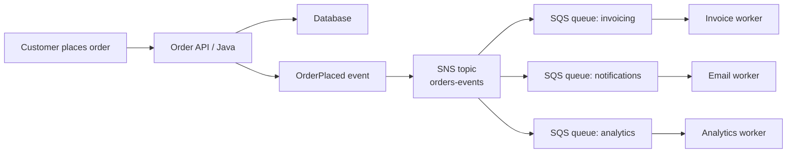

When the producer publishes successfully, **each subscribed queue receives a copy of the event** and holds the message for its respective consumer. The Invoice worker can be slower than the Email worker without making the Email worker wait.

**Point of caution:** if the Order API writes to the database and then publishes to SNS, those two operations are not **an atomic transaction** by default. If the application crashes after the DB commit but before publishing, the event can be lost. Section 14 covers the **transactional outbox** pattern to close that gap.

## 2. Three Fundamental Models: Queue, Topic, and Broker

### 2.1. Work queue: multiple workers sharing work

An **SQS queue** stores messages for a retention period, allowing consumers to **poll** and receive a message. After finishing processing, the consumer calls `DeleteMessage` using the receipt handle to acknowledge and remove it.

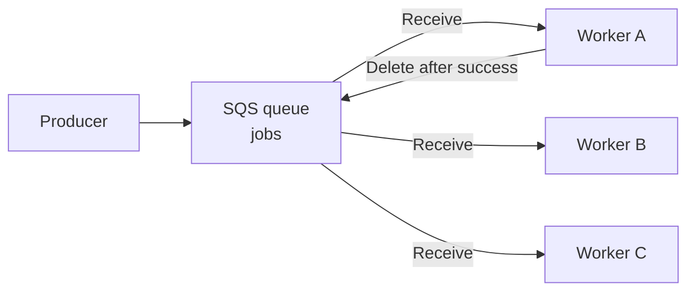

Logically, **each message copy in a queue** should be successfully processed by **one** worker. If a worker fails or does not delete the message in time, the message can become visible again and another worker can process it. Therefore, **never equate a queue with an absolute guarantee of single business execution**.

### 2.2. Publish/subscribe: one event sent to multiple recipients

With an **SNS topic**, the producer **publishes** once; SNS **pushes** notifications to matching subscriptions. A single topic can fan out to SQS queues, Lambda functions, HTTP(S) endpoints, and other channels depending on features and topic type.

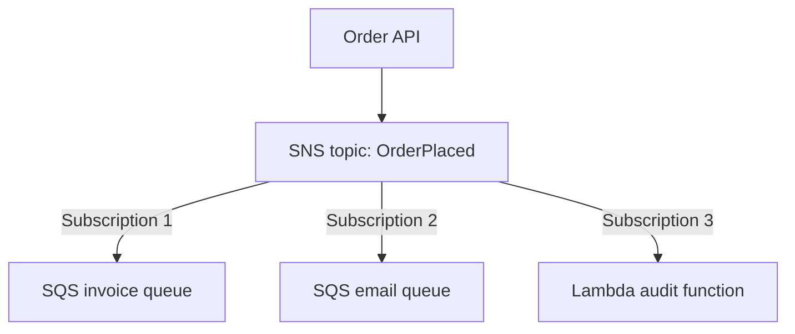

SNS **is not a traditional work queue**: it handles publishing and delivering notifications to subscribers with retry policies, but **an SNS Standard topic does not hold every event like an SQS queue for application workers to poll at any time**. For durable buffering and per-consumer backpressure, **subscribe an SQS queue** rather than relying only on HTTP callbacks.

### 2.3. Message broker: messaging protocols and rich topology

**Amazon MQ** is a managed service for **ActiveMQ Classic** or **RabbitMQ** brokers on AWS. Clients use protocols supported by the engine, maintain connections to the broker, and publish/consume using queues, topics/exchanges, and broker-style consumer acknowledgments.

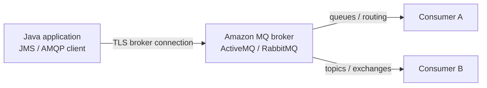

Amazon MQ is suitable when a system **already depends on broker protocols, JMS libraries, exchange routing, or specific broker features**. If you only need an AWS-native work queue, Amazon MQ usually requires more operational overhead than SQS without delivering proportional benefits.

## 3. Comparison Table: SQS, SNS, and Amazon MQ

| Criterion | Amazon SQS | Amazon SNS | Amazon MQ |
| --- | --- | --- | --- |
| **Primary model** | Queue: stores jobs for workers to poll. | Topic: fanout/push notifications. | Broker: queues, topics/exchanges, protocol clients. |
| **Consumers / targets** | Consumers using AWS API/SDK or Lambda event source mapping. | SQS, Lambda, HTTP(S), email/SMS/mobile push, and other supported endpoints. | Apps using JMS/AMQP/OpenWire/MQTT/STOMP depending on engine/version. |
| **Load buffering when workers are slow** | **Strong**, message backlog stays in the queue. | Not like a queue; typically combined with SQS for isolated buffering. | Can hold messages in the broker, but limited by broker capacity/storage. |
| **One message serving multiple groups** | A single queue does not deliver a separate copy to every worker group. | **Fanout** to each subscription. | Topics/exchanges can route to multiple queues/subscribers. |
| **Ordering** | Standard: best effort; FIFO: per message group. | FIFO topic preserves order when delivering to corresponding SQS FIFO queues. | Depends on engine/queue topology, consumer count, prefetch, redelivery. |
| **Delivery semantics** | Standard at-least-once; FIFO ordering/dedup, consumers still need idempotency. | Depends on topic type and subscriber; retries/dedup with FIFO. | Acknowledgment/persistence/retry depend on broker/client configuration. |
| **Infrastructure management** | Serverless, no brokers to manage. | Serverless, no brokers to manage. | AWS partially manages broker nodes/patching; you still manage instance, engine version, capacity, and topology. |
| **Network** | AWS public API or VPC interface endpoint. | AWS public API or VPC interface endpoint for publishers where supported. | Connects to broker endpoint/VPC and SGs over TLS protocols. |
| **Pricing** | Per request/payload and related services. | Per publish/delivery/API and endpoint. | **Broker instance-hours + storage** and supporting infrastructure costs. |
| **When to choose** | Background jobs, buffer spikes, retry/DLQ. | One-to-many notifications, subscription filtering. | Migrating on-prem JMS/RabbitMQ/AMQP with minimal code changes. |

**SQS and SNS are not mutually exclusive competitors**: many systems use **SNS + SQS** to achieve both fanout and durable buffering. **Amazon MQ** is not a “more powerful version of SNS”; it solves **protocol compatibility and broker semantics** requirements.

## 4. Amazon SQS: Lifecycle of a Message

### 4.1. Send → Receive → Process → Delete

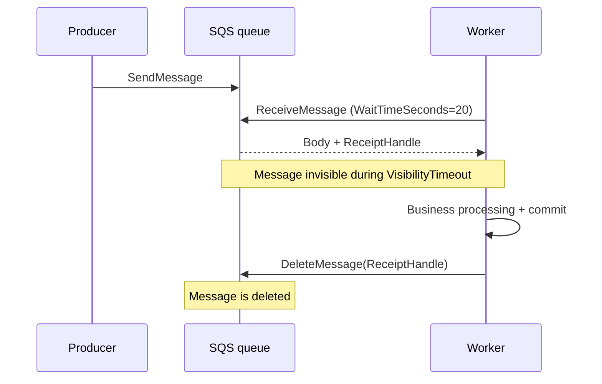

If a worker crashes before `DeleteMessage`, the message **does not disappear**. After the `visibility timeout`, SQS can make the message available again for another consumer to receive. If a worker finishes processing but the delete request fails, **an already processed message can be redelivered**.

**ReceiptHandle is different from MessageId:** you must use the **latest receipt handle** from the receive call to delete; do not call DeleteMessage with `MessageId`.

### 4.2. Key Parameters

| Attribute | Common SQS values/limits | Meaning |
| --- | --- | --- |
| `VisibilityTimeout` | Default **30 seconds**; configurable up to **12 hours**. | Message is temporarily hidden after a worker receives it. |
| `MessageRetentionPeriod` | Default **4 days**; maximum **14 days**. | Maximum duration an undeleted message is retained. |
| `ReceiveMessageWaitTimeSeconds` | **0–20 seconds**. | Long polling to reduce empty responses/API calls. |
| `DelaySeconds` | Up to **15 minutes**. | Delays when a message first becomes visible; not a long-term scheduler. |
| Message size | Up to **1 MiB** per current SQS documentation. | Large payloads should be stored in S3 with a pointer/metadata sent instead. |
| `MaxNumberOfMessages` | Up to **10** in a single ReceiveMessage call. | Batch reading reduces API requests, but per-message error handling is required. |
| DLQ `maxReceiveCount` | When receive count exceeds the configured threshold, the message moves to the DLQ. | Isolates poison messages for investigation. |

Other parameters/quotas such as in-flight messages, FIFO throughput, or queue policy size should be verified by Region at deployment time rather than assumed from a lab configuration.

### 4.3. Choosing visibility timeout based on processing duration

If a worker processes a PDF in 45 seconds on average, a `VisibilityTimeout=30` seconds can cause the message to be received again before the first worker finishes. Depending on the workload:

- Set visibility timeout greater than the expected processing time, with a safety margin.
- When processing time varies, call `ChangeMessageVisibility` periodically (heartbeat) to extend it.
- Total invisibility duration from the first receive **cannot exceed the 12-hour limit**; for longer workflows, break them up or use Step Functions.
- When using **Lambda SQS event source mapping**, also check `function timeout`, batch window, batch size, and visibility timeout recommendations in the Lambda documentation; do not rely solely on average duration.

A visibility timeout that is too long causes **slow retries** when a worker crashes. One that is too short causes **duplicate processing** or abnormally high receive counts. Measure `Duration`/P99 and tune using real data.

### 4.4. Dead-letter queues and redrive

A **DLQ** is a queue that receives messages that fail to process successfully after `maxReceiveCount`. SQS **does not create a DLQ automatically**; you must create it and configure `RedrivePolicy` on the source queue.

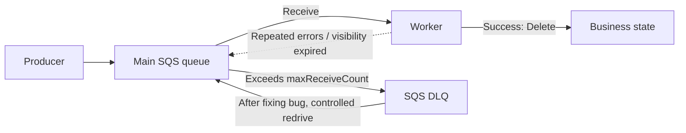

**Operational points:**

- **Standard source queue → Standard DLQ**; **FIFO source queue → FIFO DLQ**.
- The DLQ needs a retention period long enough for investigation; configure an alarm whenever new messages arrive in the DLQ.
- **Redrive** is not a risk-free “retry all” button: before running it, analyze the root cause, poison messages, and idempotency safeguards.
- With FIFO, moving a message to a DLQ can allow the next message in the same group to run, **breaking strict business ordering**. If ordering is a legal or accounting requirement, you need a blocking/handling strategy instead of unconditional auto-DLQ.

### 4.5. Long polling and backpressure

`ReceiveMessage(WaitTimeSeconds=20)` reduces empty requests when the queue has low traffic. Multiple consumers can open long polls concurrently; you still need to bound **thread pools**, **JDBC connections**, Lambda concurrency, or EC2 Auto Scaling so downstream systems are not overwhelmed.

A large message backlog does not cause the producer to fail immediately; that is a key benefit of a queue, but it also represents **accumulated work debt**. Monitor the age of the oldest message, number of waiting messages, and processing throughput rather than looking only at worker CPU.

## 5. SQS Standard vs. FIFO: Where Do They Differ?

### 5.1. Standard queue

**SQS Standard** is optimized for high throughput, nearly unlimited under current service quotas, **at-least-once delivery**, and **best-effort ordering**. Under distributed conditions and retries, messages can be delivered **more than once** or **out of order**.

Well suited for:

- Sending emails, generating thumbnails, building reports, ingesting logs.
- Independent tasks or results where out-of-order processing is acceptable.
- Systems with idempotency keys, safe retries, and flexible consumer scaling.

**Important note:** SQS Standard supports `MessageGroupId` for **fair queues** in certain multi-tenant workloads; this **does not turn a Standard queue into FIFO** and provides no ordering guarantee.

### 5.2. FIFO queue

**SQS FIFO** queues have names ending in `.fifo` and use:

- **`MessageGroupId`** to identify a sequence of messages that must be processed in order, such as `order-101` or `account-889`.
- **`MessageDeduplicationId`** or `ContentBasedDeduplication` to prevent duplicate message sends within an **approximately 5-minute deduplication window**.

Example:

```text
Group order-101:
  OrderPlaced → PaymentAuthorized → OrderShipped

Group order-202:
  OrderPlaced → PaymentRejected
```

Messages in the **same group** are delivered sequentially, while **different groups** can be processed in parallel. Using a single group ID like `all-orders` for every message can unintentionally create a **bottleneck**.

| Criterion | Standard | FIFO |
| --- | --- | --- |
| Queue name | `orders-jobs` | `orders-events.fifo` |
| Ordering | Best effort. | Within **a single MessageGroupId**. |
| Delivery duplication | At-least-once. | Includes deduplication within a 5-minute window. |
| Throughput | Very high. | Governed by quota/throughput mode and number of active groups. |
| Idempotent consumer needed? | **Yes.** | **Still yes**, to ensure safe business outcomes. |
| When to choose | Jobs independent of ordering. | Operations on the same entity that require sequential order. |

**Critical boundary:** “FIFO exactly-once” refers to **delivery/deduplication behavior under service conditions**; it does not guarantee that RDS/DynamoDB transactions, external emails, or payments occur only once. A consumer can commit to the database and then fail before deleting the message, or a client can republish the same content **outside** the 5-minute window. Use a **business idempotency key** with unique constraints or conditional writes.

### 5.3. Queue types cannot be changed in place

Switching **Standard → FIFO** or vice versa **is not a toggleable attribute** after creation. You must create a new queue, update producers/consumers, IAM policies, subscriptions, event source mappings, and monitoring, and migrate the backlog according to a plan.

In addition, **S3 Event Notifications do not deliver directly to an SQS FIFO queue**; if FIFO is required downstream, **S3 → EventBridge → SQS FIFO** is commonly used when supported by the configuration.

## 6. Amazon SNS: Push Notifications, Fanout, and Filtering

### 6.1. Standard SNS topic

SNS Standard fits when a producer emits one event but has multiple subscribers:

```text
OrderPlaced
  ├── SQS invoicing-queue         → stores events for invoice workers
  ├── SQS loyalty-queue           → stores events for loyalty workers
  ├── Lambda audit-function       → processes events directly
  └── HTTP(S) partner webhook     → requires retries/auth and a resilient receiver
```

An SNS topic only knows how to **deliver** events to subscriptions; each subscriber has its own failure modes, quotas, retry policies, and delivery observability. For unstable partner webhooks, using an **intermediary SQS queue + worker** provides better control over retries and rate limiting than direct HTTP push.

### 6.2. Subscription protocols

| Protocol | Target | Operational reality |
| --- | --- | --- |
| `sqs` | SQS queue. | **Durable load buffering**; queue policy must grant SNS `sqs:SendMessage`. |
| `lambda` | Lambda function. | Resource-based policy must allow SNS invocation; tune concurrency and retries. |
| `https`/`http` | Webhook endpoint. | Requires endpoint confirmation, HTTP delivery policy, authentication, and replay protection. |
| `email`/`email-json` | Email address. | Recipient must confirm the subscription; unsuitable for workflows needing transaction guarantees. |
| `sms` | Phone number. | Subject to regional/country regulations/quotas and AWS End User Messaging. |
| `application` | Mobile push endpoint. | Depends on platform endpoints/credentials and device state. |
| `firehose` | Amazon Data Firehose delivery stream. | Streaming/archiving/analytics subject to IAM role permissions and limits. |

**Not all protocols work with SNS FIFO.** Choose the topic type only after knowing your exact subscribers.

### 6.3. Subscription filter policy

Instead of the producer knowing how many consumers exist, each subscription can receive a **subset of events** via `FilterPolicy`.

Publish example:

```json
{
  "eventId": "evt-901",
  "eventType": "OrderPlaced",
  "orderId": "ord-101",
  "schemaVersion": 1
}
```

Message attributes:

```json
{
  "eventType": {
    "DataType": "String",
    "StringValue": "OrderPlaced"
  }
}
```

Filter policy on the invoice subscription:

```json
{
  "eventType": ["OrderPlaced", "PaymentAuthorized"]
}
```

With `FilterPolicyScope=MessageAttributes` (the default), SNS evaluates attributes and **does not automatically parse fields inside the body**. If `FilterPolicyScope=MessageBody` is used, the policy applies to a valid JSON body subject to SNS rules. A message that does not match the filter **is not delivered** to that subscription; this is content-based routing, not a delivery error.

### 6.4. SNS Standard vs. SNS FIFO

| Attribute | SNS Standard | SNS FIFO |
| --- | --- | --- |
| Fanout | Many subscriber protocols. | Primarily **SQS Standard/FIFO**; some integrations via Firehose where supported; does not support standard email/SMS/HTTP(S). |
| Message ordering | No strict ordering guarantee. | Preserves order per **message group** to compatible SQS FIFO queues. |
| Deduplication | Does not provide FIFO dedup. | `MessageDeduplicationId`/content-based dedup and configurable scope. |
| Topic name | `orders-events` | `orders-events.fifo` |
| Filtering | Yes, applied to message attributes or body. | Yes; filtering affects delivery/exactness conditions. |
| Preferred pattern | Broad notifications across diverse endpoint types. | Fanout of streams requiring ordering/dedup through SQS FIFO. |

If an SNS FIFO topic delivers to an **SQS Standard** queue, the downstream queue **can still experience duplicates or out-of-order messages**. To preserve end-to-end ordering from SNS to consumer, choose **SNS FIFO → SQS FIFO**, configure group/dedup IDs at the producer, and handle retries and idempotency.

With SNS FIFO using **subscription filtering**, delivery/exactness semantics have constraints because unmatched messages are filtered out; do not interpret “exactly once” as guaranteeing every business event is received once by all subscribers.

### 6.5. Message size and archive/replay

**According to current SNS documentation**:

- Standard topics accept messages up to **256 KiB** by default.
- You can set the topic attribute `MaximumMessageSize` up to **1 MiB**, but messages over 256 KiB are only supported for specific subscribers (**SQS, Lambda, Amazon Data Firehose**) and total topic subscriptions face additional limits. Check before raising the limit on topics with email/HTTP subscriptions.
- For large payloads, send an **S3 object pointer** instead of embedding PDF/image files in the message.
- **SNS FIFO** supports **message archiving and replay** when configured with `ArchivePolicy`/`ReplayPolicy`, retaining messages up to **365 days** subject to feature/pricing terms; SNS Standard lacks the same built-in replay mechanism and requires a separate archive architecture if needed.

To stay safe, design small events with schema versioning and avoid placing PII or credentials in the body unnecessarily.

## 7. Amazon MQ: When Message Broker Protocols Are Needed

### 7.1. Amazon MQ is not a serverless API like SQS

Amazon MQ manages the lifecycle of **message brokers** deployed on provisioned compute and storage resources. It takes over much of the installation, patching, and maintenance of self-managed brokers, but **it does not eliminate the operations team's responsibility for capacity planning, queue topology, version upgrades, connection management, and failover testing**.

Two engines are currently supported by Amazon MQ:

1. **Apache ActiveMQ Classic:** common in Java applications using **JMS**, OpenWire, virtual destinations, durable topics, enterprise integration, and legacy systems.
2. **RabbitMQ:** popular with **AMQP** and exchange/binding/routing-key mechanisms, consumer acknowledgments, publisher confirms, queue types, and polyglot client libraries.

| Topic | Amazon MQ for ActiveMQ Classic | Amazon MQ for RabbitMQ |
| --- | --- | --- |
| Model | JMS queues/topics, broker destinations. | Exchange → bindings → queues → consumers. |
| Typical protocols | **OpenWire**, AMQP, MQTT, STOMP; JMS clients via appropriate drivers. | **AMQP 0-9-1**, AMQP 1.0, and JMS with supported versions/plugins. |
| Java integration | Legacy `javax.jms` or `jakarta.jms` depending on library/broker, Spring JMS. | Spring AMQP, RabbitMQ Java client; JMS supported conditionally by engine version/plugin. |
| HA deployment | Two-AZ active/standby for supported broker types. | Three-node multi-AZ cluster per Amazon MQ architecture. |
| Cost | Broker instances, storage, networking, and monitoring. | Broker instances, storage, networking, and monitoring. |
| Operational risks | Broker limits, destination count, failover clients, KahaDB/EFS. | Queue topology, quorum/mirroring per engine version, connections/channels, broker memory/disk alarms. |

**Do not assume Amazon MQ for RabbitMQ includes every plugin/feature of self-hosted RabbitMQ**, or that ActiveMQ Classic supports every JMS capability of other brokers. Amazon MQ manages engine versions, plugin policies, and configurations according to AWS-supported lists.

### 7.2. RabbitMQ routing: exchange, queue, binding

RabbitMQ decouples producers from queues via an **exchange**:

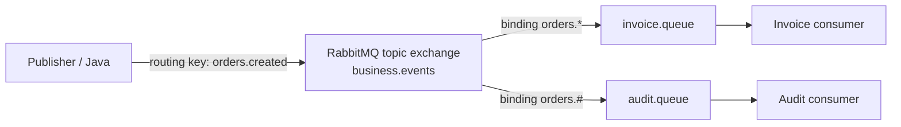

- **Direct exchange:** routes by exact routing key match.
- **Topic exchange:** routes by patterns such as `orders.*` or `orders.#`.
- **Fanout exchange:** broadcasts to all bound queues matching the exchange.
- **Headers exchange:** can route based on message headers.

Publishers typically use **publisher confirms** to know the broker accepted the publish; consumers use **manual acknowledgment** to confirm after processing. These mechanisms require configuring **durable queues**, persistent messages, and appropriate queue types when durability is required.

**An exchange named `orders` is not an Amazon SNS topic**, even if broadcasting to multiple destinations looks similar. Protocols, access control, failover, operations, and pricing are completely different.

### 7.3. ActiveMQ Classic and JMS

A long-lived Java system might contain code like:

```java
// Illustrates the JMS concept; packages and connection factory depend on
// the selected JMS/Spring/ActiveMQ client version.
ConnectionFactory connectionFactory = /* managed broker client */;
// Producers/consumers connect to the broker endpoint over TLS.
```

When migrating from a self-hosted broker to Amazon MQ for ActiveMQ Classic, the development team can keep most of their JMS queue/topic models and ack/transaction patterns, but still must update **broker URLs, TLS trust, credentials, failover transport, and network routes**, and retest producers/consumers during maintenance.

Amazon MQ **does not turn ActiveMQ into SQS**: it has no `SendMessage`/`ReceiveMessage` API with SQS semantics. Do not use the AWS SDK `SqsClient` to connect to Amazon MQ.

### 7.4. Single-instance or high availability?

| Amazon MQ option | Characteristics | When to consider |
| --- | --- | --- |
| ActiveMQ single-instance | Broker in one AZ; more limited capacity/HA. | Labs, testing, applications that can tolerate downtime. |
| ActiveMQ active/standby | Two brokers across two AZs as a failover pair. | Need higher availability while keeping ActiveMQ Classic semantics. |
| RabbitMQ single-instance | One RabbitMQ broker with a service-managed endpoint. | Testing or low traffic that can tolerate a single point of failure. |
| RabbitMQ cluster deployment | Multi-node cluster, typically **three nodes** across AZs with HA mechanisms. | Production requiring HA and willing to manage cluster/queue replication. |

**HA does not mean “zero connection drops”:** broker maintenance or failover can sever **TCP/TLS connections**; producers must retry, consumers must reconnect/resubscribe, and messaging clients must support broker failover. Upgrading a **major engine version** can incur downtime per release notes, even if the endpoint name stays the same.

### 7.5. Amazon MQ Security

**IAM** controls **AWS control plane** operations such as creating, modifying, or deleting Amazon MQ brokers; it **does not by default replace message protocol authentication**. When a Java application connects to the broker:

- Use **broker users/credentials** and engine-level permissions/vhosts/ACLs; store secrets in **AWS Secrets Manager** and rotate them on a schedule.
- Use **TLS**, verify certificates, and avoid disabling TLS verification.
- Choose a **private broker endpoint inside a VPC** for internal workloads, with security groups restricted to the right client subnets/ports and proper routing.
- Control access to the broker management console, metrics, and connection/channel counts.

Never open all broker ports to `0.0.0.0/0` just to test connectivity. If on-premises clients need access, design a **VPN/Direct Connect** or supported network path; granting IAM permissions to an AWS user **does not create network connectivity**.

### 7.6. When should you migrate off MQ?

If a system uses JMS solely to send messages to a single queue and does not rely on broker-specific features, consider **SQS** by updating the producer/consumer adapter and verifying semantics. If it uses complex RabbitMQ exchange topologies, transactions, or protocol-specific plugins, migration costs may outweigh short-term benefits.

Suggested progression pattern:

1. Inventory protocols, destinations/queues, message sizes, ordering, acks, transactions, retries, DLQs, and consumer groups.
2. Map to equivalent AWS-native capabilities (SQS/FIFO, SNS fanout, EventBridge routing) where feasible.
3. Build an adapter layer for Java clients, and test schema/versioning and idempotency.
4. Run in parallel or controlled dual-write, measuring loss, duplication, and lag.
5. Cut over consumers/publishers group by group with a rollback plan and backlog draining.

Do not switch brokers just because “managed” service names sound similar; **comparing delivery semantics and business invariants** is the deciding criterion.

## 8. Service Selection Workflow for Real Requirements

### 8.1. Short decision tree

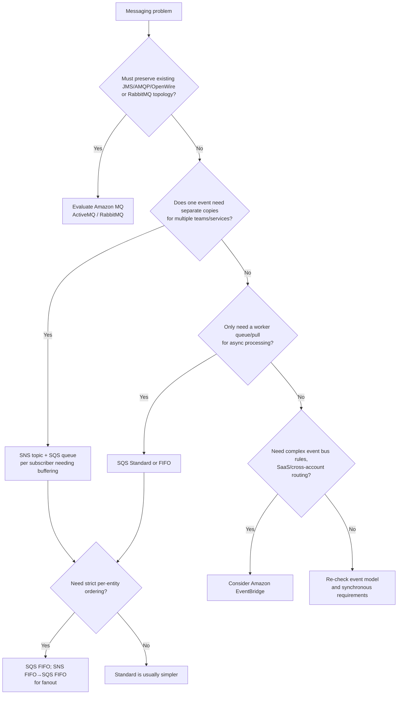

**Amazon EventBridge** is included here only as an adjacent comparison: an event bus fits when you need content-based routing rules, integration across many AWS/SaaS sources, API destinations, and schema/archive/replay features. It **does not replace a durable per-consumer queue** when workers need polling/backpressure; many systems use **EventBridge → SQS**.

### 8.2. Requirements matrix

| Specific requirement | Starting choice | Why |
| --- | --- | --- |
| Offload thumbnail creation tasks from Java API to multiple workers | **SQS Standard** | Buffering, competing worker consumers, high throughput. |
| Order status updates must stay strictly ordered per order | **SQS FIFO** | `MessageGroupId=orderId` preserves order per entity. |
| One OrderPlaced event must reach three independent teams | **SNS Standard → 3 SQS Standard** | Fanout plus an isolated backlog queue per team. |
| One event needs fanout and all queues must preserve per-account ordering | **SNS FIFO → SQS FIFO** | End-to-end group ordering under supported conditions. |
| Send emails/SMS/mobile push to users | **SNS Standard** or dedicated messaging service | Supports notification endpoints; do not use SNS FIFO for email/SMS. |
| Legacy banking system using JMS/OpenWire and broker transactions | **Amazon MQ for ActiveMQ Classic** | Minimizes code/protocol changes while preserving legacy semantics. |
| Microservices using RabbitMQ topic exchanges and AMQP clients | **Amazon MQ for RabbitMQ** | Preserves exchange topology/protocol with AWS-managed broker operations. |
| Rules routing events to dozens of AWS/SaaS destinations | **EventBridge** (optionally to SQS) | Event bus routing and integrations. |
| Multi-step workflow with waits, timeouts, and compensation | **AWS Step Functions** (with SQS/SNS if needed) | State orchestration rather than forcing queues to handle orchestration. |

### 8.3. Six questions to answer before choosing

1. **Is it an event or a command?** `OrderPlaced` is an event; `GenerateInvoice` is a command/job. An event can fan out; a job is usually handled by one worker.
2. **One or multiple consumer groups?** One queue suffices for a shared worker pool; multiple independent groups need multiple queues or topic fanout.
3. **Is ordering truly required?** Per-`orderId` FIFO differs from a global system order. Avoid FIFO when there is no business constraint.
4. **How variable is the traffic rate?** If producers spike and consumers lag, plan for buffering, backpressure, queue depth, and scaling strategies.
5. **Are there protocol constraints?** If already tied to JMS/AMQP, evaluate MQ; if code can change and broker-specific features are unnecessary, SQS/SNS is usually simpler.
6. **What are the operational and cost limits?** Who is on call for brokers, failover, certificates, storage, IAM/KMS, queues, DLQs, logs, and quotas?

## 9. Ordering, Delivery Guarantees, and Idempotency

### 9.1. Which layer is “exactly once” really about?

Suppose a consumer receives an event:

```json
{
  "eventId": "evt-payment-7788",
  "orderId": "ORD-7788",
  "eventType": "PaymentCaptured",
  "amount": 125000,
  "currency": "VND"
}
```

The worker updates `payment_status=PAID` in the database and then crashes before `DeleteMessage`. When the message reappears, a new worker may call the database and third parties again.

**A FIFO queue cannot automatically roll back or confirm an external database commit.** Therefore:

- Use a unique **eventId/commandId** as a business idempotency key.
- Persist the processed state within the same transaction as the business outcome (unique constraint, conditional write, or inbox table).
- For payment APIs, pass an **idempotency key** downstream if the provider supports it.
- Only **ACK/DeleteMessage after a successful commit**; otherwise, let it retry while ensuring repeated processing is safe.
- Define retryable errors, poison messages, and DLQ investigation procedures.

### 9.2. Example inbox pattern against duplicate processing

A simple PostgreSQL schema:

```sql
CREATE TABLE processed_events (
    consumer_name VARCHAR(100) NOT NULL,
    event_id      VARCHAR(100) NOT NULL,
    processed_at  TIMESTAMPTZ NOT NULL DEFAULT CURRENT_TIMESTAMP,
    PRIMARY KEY (consumer_name, event_id)
);
```

Inside a database transaction:

```text
BEGIN
  INSERT processed_events(consumer_name, event_id)
     ON CONFLICT DO NOTHING
  IF already exists:
     COMMIT, treat as redelivery and ACK safely
  ELSE:
     update business data
     COMMIT
Only after COMMIT, call DeleteMessage/ACK
```

For **side effects outside the database** (sending emails, calling payment APIs), an inbox table alone is sufficient only if combined with **outbox/external idempotency** or safe recording of side-effect state. A single DB commit cannot atomically commit an external email provider.

### 9.3. Message ordering and partitioning

Ordering should be defined by **aggregate/business entity**, for example:

| MessageGroupId | Sequence | Requirement |
| --- | --- | --- |
| `order-101` | Placed → Paid → Shipped | Ordered **within the same order**. |
| `order-202` | Placed → Cancelled | Can be processed in parallel with order-101. |
| `customer-77` | KYCUpdated → AccountActivated | Ordered **within the same customer**. |

Avoid choosing a random timestamp as the group ID if per-order ordering is required. Conversely, avoid funneling all messages into `group=global` unless a single sequential stream is strictly necessary, as that limits throughput.

**Head-of-line blocking:** in FIFO, an unprocessed or redelivered message can block subsequent messages in the same group from **advancing**. Monitor message age and retries, and design poison-message handling that is safe for your ordering requirements.

### 9.4. Retries and DLQs differ at each layer

| Layer | Who controls retries? | What to configure |
| --- | --- | --- |
| Application-polled SQS consumer | Worker code + visibility timeout/redrive. | Do not delete on error, maxReceiveCount, backoff, idempotency. |
| Lambda polling SQS | Lambda event source mapping. | Batch size, visibility/timeout, `ReportBatchItemFailures`, concurrency, queue DLQ. |
| SNS → HTTP(S) | SNS delivery policy/retry; optional subscription DLQ. | Endpoint HTTP status codes, confirmation, authentication, redrive. |
| SNS → SQS | SNS delivers to queue; then SQS consumer processes. | **SQS queue policy**, queue retention/DLQ, consumer retry. |
| Amazon MQ consumer | Broker/client ack/nack/requeue, dead-letter exchange/queue per engine. | Manual ack, TTL, prefetch, DLX, poison-message policy. |

If you add an **SNS subscription DLQ** to capture failed notification deliveries, that is the **DLQ for the SNS delivery step**, separate from the **SQS source queue DLQ** when the business worker fails to process. Both DLQs can coexist, but they address two different classes of failures.

## 10. Security: IAM, Queue/Topic Policies, KMS, and Networking

### 10.1. Three principals to separate

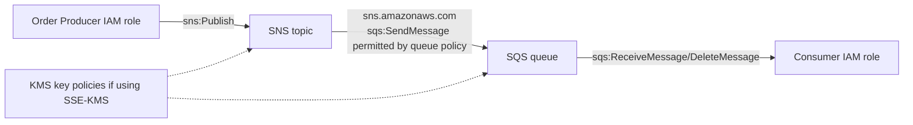

| Actor | Typical identity/resource permissions | Should NOT be granted |
| --- | --- | --- |
| Producer app role | `sns:Publish` on the specific topic ARN. | `sqs:DeleteMessage` on any queue. |
| SNS service | Queue **resource policy** allowing `sns.amazonaws.com` to call `sqs:SendMessage` from the exact topic `aws:SourceArn`. | Unconditional `sqs:*` or `Principal: "*"`. |
| Worker app role | `sqs:ReceiveMessage`, `sqs:DeleteMessage`, `sqs:ChangeMessageVisibility`, `sqs:GetQueueAttributes` on the specific queue ARN. | `sns:Publish` or `iam:*` if unnecessary. |
| Deployment role | Create/update topics, queues, policies, subscriptions via IaC. | Does not require runtime message-processing permissions. |
| Amazon MQ client | Engine-level broker credentials and permissions. | An IAM role does not replace broker username/password. |

### 10.2. Queue policy allowing SNS to send messages to SQS

Example **placed on the SQS queue**, not on the SNS topic:

```json
{
  "Version": "2012-10-17",
  "Statement": [
    {
      "Sid": "AllowSpecificSnsTopicToPublishToQueue",
      "Effect": "Allow",
      "Principal": {
        "Service": "sns.amazonaws.com"
      },
      "Action": "sqs:SendMessage",
      "Resource": "arn:aws:sqs:ap-southeast-1:111122223333:orders-invoice-lab",
      "Condition": {
        "ArnEquals": {
          "aws:SourceArn": "arn:aws:sns:ap-southeast-1:111122223333:orders-events-lab"
        }
      }
    }
  ]
}
```

- `Resource` is the **queue ARN**, not the QueueUrl.
- `aws:SourceArn` is the **SNS topic ARN**, preventing confused deputy issues.
- In cross-account setups, you may also need a **topic policy for `sns:Subscribe`**, a queue policy granted by the queue owner, plus appropriate IAM and KMS permissions.
- `SetQueueAttributes` overwrites the **entire Policy attribute value**. Always read/diff/merge any existing policy before writing; never replace a shared production policy with a single-statement example.

### 10.3. KMS encryption

SQS and SNS support encryption at rest through service-managed mechanisms and **SSE-KMS**. When using a **customer managed KMS key**:

- Publishers, consumers, and service principals need the appropriate `kms:GenerateDataKey` and `kms:Decrypt` permissions along with KMS key policies/conditions matching the data flow.
- A topic or queue encrypted with a cross-account key, or an AWS service delivering to a queue, may require specific grants or key policies.
- Verify the event-emitting service's integration support and key policy; do not assume adding `sqs:SendMessage` alone is enough if KMS denies access.
- Never grant `kms:*` across all keys as a “quick fix” for errors.

KMS keys, API calls, and data key caching can impact cost and latency. Choose between default encryption and customer managed keys based on actual compliance, audit, and operational needs.

### 10.4. Networking and private access

**SQS and SNS are AWS API services**; they do not require a TCP broker running in your subnet. Applications on EC2/ECS/EKS/Lambda can:

- Call public AWS endpoints over the Internet/NAT as appropriate; or
- Use **interface VPC endpoints (AWS PrivateLink)** for SQS/SNS where supported, configured with private DNS, security groups, routes, and endpoint policies.

**Amazon MQ**, by contrast, exposes broker endpoints in a VPC depending on deployment mode, requiring security groups for TLS protocol ports, DNS resolution, VPC/peering/TGW/VPN connectivity, and broker credentials. You cannot use an **SQS interface endpoint** to connect via the RabbitMQ protocol.

### 10.5. Do not put sensitive data in messages carelessly

Events should contain **IDs/references**, `schemaVersion`, timestamps, and minimal fields. For sensitive content:

- Avoid placing credentials, tokens, or full customer profiles in SNS email/SMS bodies or CloudWatch logs.
- Use S3 object pointers with IAM/KMS access control when payloads are large or sensitive.
- Separate dev and prod topics/queues, accounts/roles, encryption keys, retention periods, and DLQ access.
- Configure log retention and avoid logging raw payloads if they contain PII.

## 11. AWS CLI Lab: SNS Fanout to Two SQS Standard Queues

Lab objective: create topic `lesson-orders-events` and two queues `lesson-invoices`, `lesson-audit`. The **invoice queue** receives only `OrderPlaced` events, while the **audit queue** receives all events. After publishing, verify each message arrives in the expected queue.

> **Scope:** these are **sample commands**, not actions executed against a live AWS account. You need AWS CLI with IAM permissions to create/modify topics, queues, policies, and subscriptions, plus a Bash shell with `jq`. If using PowerShell, adapt variable syntax and quoting accordingly. Fixed names must be changed if resources with the same names already exist; never modify a production queue policy.

### 11.1. Verify account and set variables

```bash
export AWS_REGION=ap-southeast-1

aws sts get-caller-identity
ACCOUNT_ID=$(aws sts get-caller-identity --query Account --output text)

printf 'Region=%s Account=%s\n' "$AWS_REGION" "$ACCOUNT_ID"
```

If the account or Region is not your lab environment, **stop** before creating any resources.

### 11.2. Create the topic and two queues

```bash
TOPIC_ARN=$(aws sns create-topic \
  --name lesson-orders-events \
  --region "$AWS_REGION" \
  --query TopicArn --output text)

INVOICE_URL=$(aws sqs create-queue \
  --queue-name lesson-invoices \
  --attributes VisibilityTimeout=120,ReceiveMessageWaitTimeSeconds=20,MessageRetentionPeriod=345600 \
  --region "$AWS_REGION" \
  --query QueueUrl --output text)

AUDIT_URL=$(aws sqs create-queue \
  --queue-name lesson-audit \
  --attributes VisibilityTimeout=120,ReceiveMessageWaitTimeSeconds=20,MessageRetentionPeriod=345600 \
  --region "$AWS_REGION" \
  --query QueueUrl --output text)

INVOICE_ARN=$(aws sqs get-queue-attributes \
  --queue-url "$INVOICE_URL" \
  --attribute-names QueueArn \
  --region "$AWS_REGION" \
  --query 'Attributes.QueueArn' --output text)

AUDIT_ARN=$(aws sqs get-queue-attributes \
  --queue-url "$AUDIT_URL" \
  --attribute-names QueueArn \
  --region "$AWS_REGION" \
  --query 'Attributes.QueueArn' --output text)

printf 'Topic: %s\nInvoice: %s\nAudit: %s\n' \
  "$TOPIC_ARN" "$INVOICE_ARN" "$AUDIT_ARN"
```

**QueueUrl vs. QueueArn:** `ReceiveMessage`/`DeleteMessage` typically require **QueueUrl**, whereas SNS subscription `--notification-endpoint` and IAM/resource policies use **QueueArn**.

### 11.3. Allow the SNS topic to send to each queue

Generate the queue attribute JSON using `jq` to avoid nested JSON escaping errors. The following commands are **only for newly created lab queues**, because they overwrite the **existing `Policy` value**:

```bash
jq -n --arg q "$INVOICE_ARN" --arg t "$TOPIC_ARN" '
{
  Policy: ({
    Version: "2012-10-17",
    Statement: [{
      Sid: "AllowOrdersTopic",
      Effect: "Allow",
      Principal: {Service: "sns.amazonaws.com"},
      Action: "sqs:SendMessage",
      Resource: $q,
      Condition: {ArnEquals: {"aws:SourceArn": $t}}
    }]
  } | tojson)
}' > invoice-queue-attributes.json

jq -n --arg q "$AUDIT_ARN" --arg t "$TOPIC_ARN" '
{
  Policy: ({
    Version: "2012-10-17",
    Statement: [{
      Sid: "AllowOrdersTopic",
      Effect: "Allow",
      Principal: {Service: "sns.amazonaws.com"},
      Action: "sqs:SendMessage",
      Resource: $q,
      Condition: {ArnEquals: {"aws:SourceArn": $t}}
    }]
  } | tojson)
}' > audit-queue-attributes.json

aws sqs set-queue-attributes \
  --queue-url "$INVOICE_URL" \
  --attributes file://invoice-queue-attributes.json \
  --region "$AWS_REGION"

aws sqs set-queue-attributes \
  --queue-url "$AUDIT_URL" \
  --attributes file://audit-queue-attributes.json \
  --region "$AWS_REGION"
```

After updating the policy, you can verify it:

```bash
aws sqs get-queue-attributes \
  --queue-url "$INVOICE_URL" \
  --attribute-names Policy \
  --region "$AWS_REGION"
```

In production, you must **read, merge, and review the existing policy** before calling `set-queue-attributes`. The `jq` example above creates a single statement, suitable for new lab queues, but would erase other valid statements if applied to a shared queue.

### 11.4. Register two SQS subscriptions

```bash
INVOICE_SUB_ARN=$(aws sns subscribe \
  --topic-arn "$TOPIC_ARN" \
  --protocol sqs \
  --notification-endpoint "$INVOICE_ARN" \
  --attributes RawMessageDelivery=true \
  --region "$AWS_REGION" \
  --query SubscriptionArn --output text)

AUDIT_SUB_ARN=$(aws sns subscribe \
  --topic-arn "$TOPIC_ARN" \
  --protocol sqs \
  --notification-endpoint "$AUDIT_ARN" \
  --attributes RawMessageDelivery=true \
  --region "$AWS_REGION" \
  --query SubscriptionArn --output text)

aws sns list-subscriptions-by-topic \
  --topic-arn "$TOPIC_ARN" \
  --region "$AWS_REGION"
```

For subscriptions in the **same account with valid permissions**, SNS→SQS is usually confirmed automatically. In cross-account scenarios, check for **pending confirmation** and the queue owner's confirmation procedure; do not call `set-subscription-attributes` while `SubscriptionArn` is still pending.

**RawMessageDelivery=true** makes the SQS message body equal to the raw payload instead of the SNS JSON envelope. Without it, workers must parse the `Message` field inside the SNS envelope before processing the event. With SQS raw delivery, the number of forwarded message attributes is subject to limits in SNS documentation; verify if your events carry many attributes.

### 11.5. Enable filtering on the invoice queue

```bash
aws sns set-subscription-attributes \
  --subscription-arn "$INVOICE_SUB_ARN" \
  --attribute-name FilterPolicyScope \
  --attribute-value MessageAttributes \
  --region "$AWS_REGION"

aws sns set-subscription-attributes \
  --subscription-arn "$INVOICE_SUB_ARN" \
  --attribute-name FilterPolicy \
  --attribute-value '{"eventType":["OrderPlaced"]}' \
  --region "$AWS_REGION"
```

SNS subscription filter changes have **eventual consistency latency**; per AWS guidance, propagation can take up to roughly **15 minutes**. Do not treat immediate results right after the change as proof the filter is broken: wait, inspect the attributes, and retest.

### 11.6. Publish two events and inspect the results

```bash
aws sns publish \
  --topic-arn "$TOPIC_ARN" \
  --message '{"eventId":"evt-lab-1","eventType":"OrderPlaced","orderId":"ORD-101"}' \
  --message-attributes '{"eventType":{"DataType":"String","StringValue":"OrderPlaced"}}' \
  --region "$AWS_REGION"

aws sns publish \
  --topic-arn "$TOPIC_ARN" \
  --message '{"eventId":"evt-lab-2","eventType":"RefundRequested","orderId":"ORD-202"}' \
  --message-attributes '{"eventType":{"DataType":"String","StringValue":"RefundRequested"}}' \
  --region "$AWS_REGION"

aws sqs receive-message \
  --queue-url "$INVOICE_URL" \
  --max-number-of-messages 10 \
  --wait-time-seconds 20 \
  --message-attribute-names All \
  --region "$AWS_REGION"

aws sqs receive-message \
  --queue-url "$AUDIT_URL" \
  --max-number-of-messages 10 \
  --wait-time-seconds 20 \
  --message-attribute-names All \
  --region "$AWS_REGION"
```

**Expected outcome once the filter has propagated**:

- The invoice queue receives **OrderPlaced** and **does not receive RefundRequested**.
- The audit queue receives **both** events.
- The two queues have different `MessageId`/`ReceiptHandle` values and process independently.
- If a receive returns empty, the message may not have arrived yet, visibility timeout may be hiding it, the policy/subscription may be misconfigured, or the filter has not propagated yet; do not assume an SNS outage.

After **successful processing**, a real consumer must call:

```bash
aws sqs delete-message \
  --queue-url "$INVOICE_URL" \
  --receipt-handle "<latest-receipt-handle-from-receive-message>" \
  --region "$AWS_REGION"
```

The command above is a **syntax example**; do not blindly delete unverified messages. For the audit queue, use the QueueUrl and ReceiptHandle **of the audit message itself**. Without `DeleteMessage`, the message can be received again once the visibility timeout expires.

### 11.7. Clean up lab resources

Only clean up **lab resources you created yourself**. Confirm there are no active consumers or real data, and note the subscription ARNs:

```bash
aws sns unsubscribe \
  --subscription-arn "$INVOICE_SUB_ARN" \
  --region "$AWS_REGION"

aws sns unsubscribe \
  --subscription-arn "$AUDIT_SUB_ARN" \
  --region "$AWS_REGION"

aws sns delete-topic \
  --topic-arn "$TOPIC_ARN" \
  --region "$AWS_REGION"

aws sqs delete-queue \
  --queue-url "$INVOICE_URL" \
  --region "$AWS_REGION"

aws sqs delete-queue \
  --queue-url "$AUDIT_URL" \
  --region "$AWS_REGION"
```

**Deleting a queue permanently removes any messages remaining in it.** Never run cleanup commands if a resource existed before the lab or is being used by consumers.

## 12. Infrastructure as Code: SNS → Two SQS Queues with DLQs

The following CloudFormation example serves as a **design starting point** for an isolated lab:

- One **SNS Standard topic**.
- Two **SQS Standard queues** (invoice and audit), each with its own DLQ.
- Queue policies allowing **only this SNS topic** to send messages.
- Invoice subscription accepts only `eventType=OrderPlaced`; Audit receives all events.
- `RawMessageDelivery=true` so Java consumers read the event JSON directly.

Save the template as `orders-fanout.yml` in a lab directory:

```yaml
AWSTemplateFormatVersion: '2010-09-09'
Description: SNS fanout to two standard SQS queues with DLQs

Resources:
  OrdersTopic:
    Type: AWS::SNS::Topic
    Properties:
      TopicName: !Sub 'lesson-orders-${AWS::StackName}'

  InvoiceDLQ:
    Type: AWS::SQS::Queue
    Properties:
      QueueName: !Sub 'lesson-invoice-dlq-${AWS::StackName}'
      MessageRetentionPeriod: 1209600

  AuditDLQ:
    Type: AWS::SQS::Queue
    Properties:
      QueueName: !Sub 'lesson-audit-dlq-${AWS::StackName}'
      MessageRetentionPeriod: 1209600

  InvoiceQueue:
    Type: AWS::SQS::Queue
    Properties:
      QueueName: !Sub 'lesson-invoice-${AWS::StackName}'
      VisibilityTimeout: 120
      ReceiveMessageWaitTimeSeconds: 20
      MessageRetentionPeriod: 345600
      RedrivePolicy:
        deadLetterTargetArn: !GetAtt InvoiceDLQ.Arn
        maxReceiveCount: 5

  AuditQueue:
    Type: AWS::SQS::Queue
    Properties:
      QueueName: !Sub 'lesson-audit-${AWS::StackName}'
      VisibilityTimeout: 120
      ReceiveMessageWaitTimeSeconds: 20
      MessageRetentionPeriod: 345600
      RedrivePolicy:
        deadLetterTargetArn: !GetAtt AuditDLQ.Arn
        maxReceiveCount: 5

  OrdersQueuePolicy:
    Type: AWS::SQS::QueuePolicy
    Properties:
      Queues:
        - !Ref InvoiceQueue
        - !Ref AuditQueue
      PolicyDocument:
        Version: '2012-10-17'
        Statement:
          - Sid: AllowOrdersTopicPublish
            Effect: Allow
            Principal:
              Service: sns.amazonaws.com
            Action: sqs:SendMessage
            Resource:
              - !GetAtt InvoiceQueue.Arn
              - !GetAtt AuditQueue.Arn
            Condition:
              ArnEquals:
                aws:SourceArn: !Ref OrdersTopic

  InvoiceSubscription:
    Type: AWS::SNS::Subscription
    DependsOn: OrdersQueuePolicy
    Properties:
      TopicArn: !Ref OrdersTopic
      Protocol: sqs
      Endpoint: !GetAtt InvoiceQueue.Arn
      RawMessageDelivery: true
      FilterPolicyScope: MessageAttributes
      FilterPolicy:
        eventType:
          - OrderPlaced

  AuditSubscription:
    Type: AWS::SNS::Subscription
    DependsOn: OrdersQueuePolicy
    Properties:
      TopicArn: !Ref OrdersTopic
      Protocol: sqs
      Endpoint: !GetAtt AuditQueue.Arn
      RawMessageDelivery: true

Outputs:
  TopicArn:
    Value: !Ref OrdersTopic
  InvoiceQueueUrl:
    Value: !Ref InvoiceQueue
  InvoiceQueueArn:
    Value: !GetAtt InvoiceQueue.Arn
  AuditQueueUrl:
    Value: !Ref AuditQueue
  AuditQueueArn:
    Value: !GetAtt AuditQueue.Arn
  InvoiceDLQUrl:
    Value: !Ref InvoiceDLQ
  AuditDLQUrl:
    Value: !Ref AuditDLQ
```

**Configuration walkthrough:**

1. `OrdersTopic` is a Standard topic, without the `.fifo` suffix.
2. Each queue has a **Standard DLQ of the same type**, so invoice poison messages do not pollute audit.
3. `maxReceiveCount: 5` is the per-worker receive threshold, not the SNS publish retry count.
4. `OrdersQueuePolicy` allows `sns.amazonaws.com` to send only from the **specific topic ARN**; an IAM user does not automatically gain `ReceiveMessage` just because this policy exists.
5. `DependsOn` ensures the queue policy exists before subscriptions are created; it does not guarantee instantaneous global eventual consistency.
6. `FilterPolicyScope: MessageAttributes` requires the producer to publish the `eventType` message attribute. Having `eventType` solely inside the JSON body is not enough for filtering.
7. `RawMessageDelivery=true` puts the event JSON directly in the SQS body rather than an SNS envelope.
8. The template does not yet configure SSE-KMS customer managed keys, consumer IAM roles, CloudWatch alarms, or autoscaling; production deployments need these additions.

### Deploy, test, and delete the stack

```bash
aws cloudformation deploy \
  --template-file orders-fanout.yml \
  --stack-name lesson-orders-fanout \
  --region ap-southeast-1

aws cloudformation describe-stacks \
  --stack-name lesson-orders-fanout \
  --region ap-southeast-1 \
  --query 'Stacks[0].Outputs' \
  --output table
```

Retrieve the TopicArn and QueueUrls from Outputs and test `aws sns publish` + `aws sqs receive-message` as in section 11, substituting the actual values. When deleting the stack, **all queues and any messages remaining in the stack's queues may be deleted**:

```bash
aws cloudformation delete-stack \
  --stack-name lesson-orders-fanout \
  --region ap-southeast-1
```

Never test a template that creates colliding resource names in production. Use distinct names/stacks and enforce guardrails/IaC reviews in live environments.

## 13. Java Examples with AWS SDK v2

In Java application development modules, **AWS SDK for Java 2.x** provides `SnsClient` and `SqsClient` to publish and poll messages without manually implementing HTTP APIs, request signing, or connection management.

### 13.1. Publisher: Java publishing an OrderPlaced event to SNS

Dependencies require `software.amazon.awssdk:sns` and the SDK platform/BOM at the version managed by your project. Below is a standalone API example:

```java
import java.util.Map;
import software.amazon.awssdk.regions.Region;
import software.amazon.awssdk.services.sns.SnsClient;
import software.amazon.awssdk.services.sns.model.MessageAttributeValue;
import software.amazon.awssdk.services.sns.model.PublishRequest;
import software.amazon.awssdk.services.sns.model.PublishResponse;

public final class OrderEventPublisher {
    private OrderEventPublisher() {}

    public static void main(String[] args) {
        String topicArn = System.getenv("ORDERS_TOPIC_ARN");
        if (topicArn == null || topicArn.isBlank()) {
            throw new IllegalStateException("ORDERS_TOPIC_ARN is required");
        }

        String payload = """
                {
                  "eventId": "evt-example-1001",
                  "eventType": "OrderPlaced",
                  "schemaVersion": 1,
                  "orderId": "ORD-1001"
                }
                """;

        try (SnsClient sns = SnsClient.builder()
                .region(Region.AP_SOUTHEAST_1)
                .build()) {
            PublishResponse response = sns.publish(
                    PublishRequest.builder()
                            .topicArn(topicArn)
                            .message(payload)
                            .messageAttributes(Map.of(
                                    "eventType",
                                    MessageAttributeValue.builder()
                                            .dataType("String")
                                            .stringValue("OrderPlaced")
                                            .build()
                            ))
                            .build()
            );

            System.out.println("SNS publish request accepted; messageId="
                    + response.messageId());
        }
    }
}
```

**Explanation:**

- The SDK resolves AWS credentials via the **default credentials provider chain** (IAM role on EC2/ECS/EKS, dev profile, Identity Center, etc.). **Never hardcode AWS access keys** in Java source code.
- `ORDERS_TOPIC_ARN` targets a specific topic, allowing the IAM role to restrict `sns:Publish` to that topic alone.
- `eventId` is a business-meaningful ID; in production, generate a unique ID and persist it alongside the order rather than using a fixed literal.
- `messageAttributes.eventType` lets the subscription filter policy from section 11 decide which queues receive the event.
- `PublishResponse.messageId()` proves SNS accepted the **publish request**, **not that every subscriber processed the business logic successfully**.

### 13.2. Consumer: Java polling SQS and ACKing only after processing

Add the `software.amazon.awssdk:sqs` dependency. With Java 17+:

```java
import java.nio.charset.StandardCharsets;
import software.amazon.awssdk.regions.Region;
import software.amazon.awssdk.services.sqs.SqsClient;
import software.amazon.awssdk.services.sqs.model.DeleteMessageRequest;
import software.amazon.awssdk.services.sqs.model.Message;
import software.amazon.awssdk.services.sqs.model.ReceiveMessageRequest;

public final class OrderQueueConsumer {
    private OrderQueueConsumer() {}

    public static void main(String[] args) {
        String queueUrl = System.getenv("ORDERS_QUEUE_URL");
        if (queueUrl == null || queueUrl.isBlank()) {
            throw new IllegalStateException("ORDERS_QUEUE_URL is required");
        }

        try (SqsClient sqs = SqsClient.builder()
                .region(Region.AP_SOUTHEAST_1)
                .build()) {
            var result = sqs.receiveMessage(ReceiveMessageRequest.builder()
                    .queueUrl(queueUrl)
                    .waitTimeSeconds(20)
                    .maxNumberOfMessages(10)
                    .visibilityTimeout(120)
                    .build());

            for (Message message : result.messages()) {
                try {
                    processBusinessEvent(message.body());

                    sqs.deleteMessage(DeleteMessageRequest.builder()
                            .queueUrl(queueUrl)
                            .receiptHandle(message.receiptHandle())
                            .build());
                } catch (RuntimeException ex) {
                    // Demo only: log error metadata, let SQS retry after
                    // visibility timeout. Never ACK before business success.
                    System.err.println("Failed to process SQS messageId="
                            + message.messageId()
                            + ", errorType=" + ex.getClass().getSimpleName());
                }
            }
        }
    }

    private static void processBusinessEvent(String body) {
        if (body == null || body.isBlank()) {
            throw new IllegalArgumentException("Empty business event");
        }
        // TODO production:
        // 1) Parse/validate schemaVersion, eventId, eventType.
        // 2) Check eventId in a persistent idempotency/inbox store.
        // 3) Apply business side effects in a transaction.
        // 4) Throw on failure so DeleteMessage is NOT called.
        System.out.println("Event received, bytes="
                + body.getBytes(StandardCharsets.UTF_8).length);
    }
}
```

**This is an API example, not a production worker**: `processBusinessEvent` currently only checks the body and therefore **has no business transaction or idempotency**. Running in production requires JSON parsing/schema validation, persistence, retries, metrics, and graceful shutdown. It polls **once** for clarity; production services typically use loops/schedulers/containers or **Lambda event source mapping**.

### 13.3. When using Lambda as an SQS consumer

With Lambda, you do not write the `ReceiveMessage/DeleteMessage` loop yourself; the Lambda service polls the queue and invokes your function via event source mapping. Example:

```bash
aws lambda create-event-source-mapping \
  --function-name orders-invoice-worker \
  --event-source-arn arn:aws:sqs:ap-southeast-1:111122223333:lesson-invoices \
  --batch-size 10 \
  --function-response-types ReportBatchItemFailures \
  --region ap-southeast-1
```

The function's execution role needs `sqs:ReceiveMessage`, `sqs:DeleteMessage`, `sqs:GetQueueAttributes`, and KMS permissions when the queue is encrypted with a customer managed key. SQS does not **push** messages to the function via `lambda:InvokeFunction` the way SNS does.

**Partial batch failure:** when using `ReportBatchItemFailures`, the handler must return the exact list of failed message IDs; without this mechanism, a single exception can cause the entire batch to be reprocessed and create duplicate side effects.

## 14. Reliable Architecture Patterns: Transactional Outbox, Inbox, Replay

### 14.1. Why publishing directly right after database commit can lose events

Application flow:

```text
BEGIN transaction
  INSERT orders (order_id, ...)
COMMIT

SNS Publish(OrderPlaced)
```

If the process crashes **after COMMIT but before Publish**, the database has the order, yet the email and invoice consumers **never receive the event**.

### 14.2. Transactional outbox

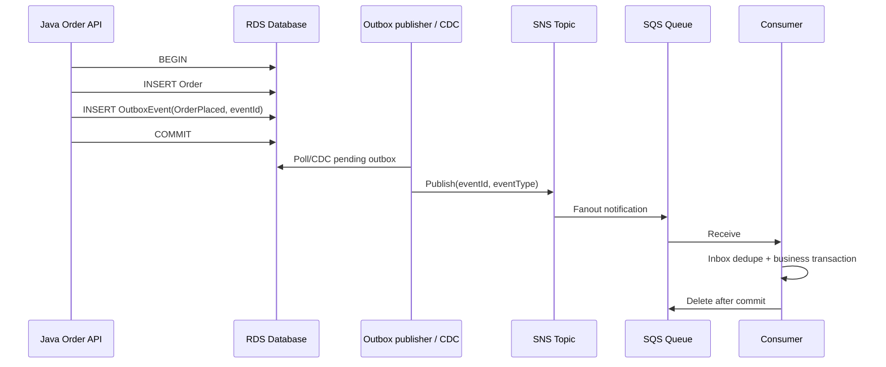

**Principle:** the order and the outbox event are written inside the **same DB transaction**. A separate publisher process or CDC reads the outbox and sends to SNS. If the publisher crashes after publishing but before marking the outbox row delivered, the event may be republished — consumers still require **idempotency**.

With DynamoDB, you can use conditional writes/transactions together with streams or EventBridge Pipes as needed to achieve the same controlled goal of “committing state and event trace together”.

### 14.3. Inbox deduplication

Each consumer maintains `consumerName + eventId` independently. If the invoice worker receives `evt-901` again, it checks the unique key:

```text
if inbox("invoice", "evt-901") already processed:
    ACK / DeleteMessage
else:
    within transaction:
        process invoice
        insert inbox("invoice", "evt-901")
    COMMIT
    ACK / DeleteMessage
```

Do not use SQS `MessageId` as the unique business key when an event can be republished with a new MessageId. Use an `eventId` generated by the business producer and stored durably.

### 14.4. Retry policies and poison messages

A structured strategy:

1. **Transient error** (DB/API timeout): retry with jitter/backoff; do not delete the message before success.
2. **Invalid schema**: flag as a permanent error or route to a DLQ after a suitable threshold; avoid infinite loops.
3. **Partial side effect**: design idempotency/outbox or business-level saga compensation.
4. **DLQ alert**: preserve payload and trace IDs for investigation; never blindly redrive.
5. **Replay/re-drive**: determine batch sizes, quotas, rate limits, and ordering impact; test on staging when possible.

**SNS FIFO archive/replay** lets subscribers recover events within supported capabilities; it does not replace replay from an outbox or event store when long-term business history recovery is needed.

### 14.5. Backpressure and concurrency control

- An SQS queue backlog shields the API producer from waiting on slow workers, but a continuously growing backlog signals **insufficient capacity or downstream failures**.
- Lambda event source mapping supports **maximum concurrency** and batching settings; EC2/ECS consumers can scale on CPU or queue backlog per worker based on target message age.
- Do not over-scale concurrency to the point of exhausting RDS connection pools, payment gateways, or email API quotas; worker throughput must match downstream capacity.
- Maximum processing time, visibility timeout, PDB/termination grace periods, and retry strategies must be aligned.

### 14.6. Schema versioning

A practical event contract should include:

```json
{
  "eventId": "evt-901",
  "eventType": "OrderPlaced",
  "schemaVersion": 2,
  "occurredAt": "2026-11-20T08:30:00Z",
  "aggregateId": "ORD-101",
  "correlationId": "req-5521",
  "data": {
    "currency": "VND",
    "amount": 125000
  }
}
```

Producers and consumers should support **backward/forward compatibility** across schema changes, backed by contract tests and a rollout strategy. `correlationId` enables tracing across SNS/SQS/workers, `eventId` drives dedup/inbox checks, and `aggregateId` can serve as the FIFO message group.

## 15. Operational Monitoring: Queues, Topics, and Brokers

### 15.1. SQS CloudWatch metrics

SQS metrics belong to the `AWS/SQS` namespace. Depending on usage, several metrics are **approximate** and do not update instantaneously, especially when message volume changes rapidly.

| SQS Metric | Meaning | Typical action |
| --- | --- | --- |
| `ApproximateNumberOfMessagesVisible` | Estimated number of messages ready to be received. | Alert on rising backlog; scale workers in a controlled manner. |
| `ApproximateNumberOfMessagesNotVisible` | Estimated messages currently in-flight. | Detect workers holding many messages or long visibility durations. |
| `ApproximateAgeOfOldestMessage` | Age of the oldest message as calculated by SQS. | Alert on SLO breaches; for DLQ/FIFO, pay attention to measurement behavior and poison messages. |
| `NumberOfMessagesSent` | Number of messages sent to the queue. | Track producer rate and fanout volume. |
| `NumberOfMessagesReceived` | Number of message receives. | Can exceed unique events due to redelivery/retries. |
| `NumberOfMessagesDeleted` | Number of successful deletes. | Not synonymous with unique business transactions. |
| `NumberOfEmptyReceives` | Number of polls returning no messages. | Audit long polling configuration and empty-call costs. |
| `ApproximateNumberOfMessagesDelayed` | Estimated delayed messages. | Distinguish intentional delays from missing workers. |

**DLQ alert:** create an alarm on `ApproximateNumberOfMessagesVisible` on the DLQ greater than 0 over an appropriate evaluation window and notify the on-call team. For high-volume systems, also track the **rate of new messages entering the DLQ** and redrive processing time, not just the backlog count.

Example listing metrics:

```bash
aws cloudwatch list-metrics \
  --namespace AWS/SQS \
  --metric-name ApproximateNumberOfMessagesVisible \
  --region ap-southeast-1
```

Figures such as optimal worker count cannot be inferred directly from `NumberOfMessagesReceived`, because a message can be received multiple times. To measure business success, emit **application counters** such as `invoice_completed_total` keyed by unique event IDs.

### 15.2. SNS CloudWatch metrics

The `AWS/SNS` namespace provides typical metrics:

| SNS Metric | Meaning |
| --- | --- |
| `NumberOfMessagesPublished` | Number of producer publish requests accepted by SNS. |
| `NumberOfNotificationsDelivered` | Notifications successfully delivered to subscriber endpoints per service semantics. |
| `NumberOfNotificationsFailed` | Failed notification deliveries. |
| `NumberOfNotificationsFilteredOut` | Messages dropped by a subscription filter; not necessarily an error. |
| `NumberOfNotificationsFilteredOut-NoMessageAttributes` | Attribute-based filter active, but the message lacked the required attributes. |
| `PublishSize` | Payload/message-batch size for quota tracking. |

A successful `NumberOfNotificationsDelivered` to **SQS** only proves SNS placed the message into the queue; it **does not prove a worker processed it successfully and deleted the message**. End-to-end measurement requires combining SNS, SQS, and application metrics.

### 15.3. Amazon MQ metrics

Amazon MQ sends broker metrics to **CloudWatch**, with namespace and metric names differing by engine. Useful signal groups include:

- **Broker CPU, memory, disk/storage usage**, connections/channels.
- **Queue depth/queue size**, consumer counts, enqueued/dequeued message rates.
- **Unacknowledged messages**, blocked publishers, RabbitMQ memory/disk alarms, or ActiveMQ broker limits.
- Broker state, maintenance/restarts/failovers, and application reconnect errors.

With RabbitMQ 4.2+, AWS also supports **Prometheus metrics endpoints** per release notes; design authentication, networking, and scrape targets appropriately. Never assume every metric from self-hosted RabbitMQ or ActiveMQ exists identically on Amazon MQ.

### 15.4. How should alarms be configured?

A good dashboard answers key **questions**:

1. Are producer publishes succeeding or failing?
2. Is the topic delivering notifications to subscribers?
3. Are queues receiving messages and are workers keeping up?
4. Are new DLQ messages appearing?
5. Has P95 or oldest message age breached the SLA?
6. Are backend business operations completing per **unique eventId**?
7. Are polling/delivery costs or broker capacity rising abnormally?

Set alarms based on **business SLOs** and infrastructure metrics—for example, “95% of invoices complete within 2 minutes” alongside “DLQ visible messages > 0”. Watching only for queue depth equal to 0 can mislead you when **producers are failing to publish events**.

## 16. Cost, Performance, and Quotas

### 16.1. SQS: pricing per request and payload

SQS is generally billed by **API requests** and payload/request units per current pricing schedules, plus additional items:

- `SendMessage`, `ReceiveMessage`, `DeleteMessage`, batch requests, visibility changes.
- Data transfer, KMS requests if using an SSE-KMS customer managed key.
- VPC interface endpoints, CloudWatch metrics/alarms, or logs you configure.
- **Excessive empty receives** if short polling runs too frequently.

**Optimization:**

- Use `WaitTimeSeconds` from 1–20 seconds for long polling where suitable.
- Use batch sends/receives/deletes up to API limits, while designing **per-message** error handling.
- Autoscale based on backlog per worker or message age; do not scale unboundedly past database capacity.
- For large payloads, store data in S3 and pass a reference, factoring in S3 storage/GET fees and access permissions.

### 16.2. SNS: one publish can generate multiple deliveries

For example, publishing **100,000 OrderPlaced events** to an SNS topic with **three SQS subscriptions** and no filtering:

```text
100,000 SNS Publish requests
   × 3 subscriptions
 = up to 300,000 SQS message deliveries (before errors/retries/quotas)
```

These numbers illustrate logical fanout, **not an exact invoice**. Actual costs can include SNS API publish/deliver, SQS Send/Receive/Delete, payload units, data transfer, and KMS/CloudWatch. If a filter matches 20% of events, total deliveries for that subscription change accordingly.

SNS pricing can vary by **destination protocol** (SQS, Lambda, email, SMS, HTTP/S, or Firehose). SMS pricing and quotas differ from email or queue delivery. Verify with the AWS Pricing Calculator and each service's pricing page.

### 16.3. Amazon MQ: brokers run continuously, even with few messages

Amazon MQ typically incurs charges for **broker instance-hours**, **storage**, data transfer, logs/monitoring, and supporting network/infrastructure costs. A multi-AZ RabbitMQ cluster requires **multiple broker nodes** and higher storage/replication capacity than a single-instance broker.

For workloads of only a few thousand events per day without specialized JMS/AMQP requirements, **serverless SQS/SNS is usually simpler and more cost-effective**. For systems deeply integrated with JMS/OpenWire, the **cost of application rewrites, migration, and operational risk** can outweigh the AWS bill difference.

### 16.4. Quotas and limits to review during design

| Topic | Questions before load testing |
| --- | --- |
| SQS Standard | API TPS, in-flight quotas, long polling/concurrency, message size, and max backlog age. |
| SQS FIFO | Number of **message groups**, high-throughput mode, batch/partition quotas, dedup scope. |
| SNS Standard | Regional publish TPS, subscriptions/filters, protocols, and message size. |
| SNS FIFO | Throughput scope (`Topic`/`MessageGroup`), group distribution, downstream SQS FIFO capacity. |
| Amazon MQ | Broker instance type/engine version, connections/channels, destinations/queues, storage, disk/memory alarms, maintenance windows. |
| Lambda consumer | Reserved/max concurrency, event source mapping batch/visibility/timeout, downstream quotas. |
| IAM/KMS/PrivateLink | Service policies, KMS throttling/cost, network endpoints, and cross-account policies. |

**AWS features and quotas evolve over time and vary by Region**, so rely on Service Quotas/console, actual metrics, and load tests. Do not size an entire architecture from a single throughput figure in an old blog post.

## 17. Troubleshooting by Symptom

| Symptom | Possible cause | What to check |
| --- | --- | --- |
| `sns:Publish` returns `AccessDenied` | Producer role lacks `sns:Publish`, or topic policy/SCP/KMS blocks it. | IAM identity, topic policy, KMS key, and CloudTrail. |
| Topic publish succeeds, but SQS has no messages | Queue policy does not allow `sns.amazonaws.com` SendMessage, subscription is PendingConfirmation, or filter dropped the message. | Queue `Policy`, topic/queue ARNs, subscription status/filter. |
| SNS→SQS fails with `KMSAccessDenied` | Queue SSE-KMS uses a key policy missing permissions for SNS/publisher. | KMS key policy, encryption config, CloudTrail. |
| SQS queue appears empty after first ReceiveMessage | Message is **invisible** during visibility timeout. | `ApproximateNumberOfMessagesNotVisible`, retry after timeout, receipt handle. |
| Worker receives the same event twice | Redelivery, failed delete, visibility too short, or duplicate producer publish. | Idempotency key, message receive count, `DeleteMessage`, visibility/timeout. |
| `ReceiptHandleIsInvalid` | Using MessageId, an expired handle, or the wrong queue. | Use only the latest receipt handle with the matching QueueUrl. |
| Backlog growing fast, message age rising | Slow downstream, insufficient worker capacity, or DB/network errors. | Worker metrics, scaling, DB capacity, DLQ, and oldest age. |
| DLQ accumulating poison messages | Incompatible schema, code bug, missing permissions, or timeouts. | Sample safely, inspect logs/correlation IDs, fix code, then redrive in a controlled manner. |
| FIFO queue effectively has only one active consumer | All messages share one `MessageGroupId`, no parallel groups. | Partition groups by order/account; verify ordering requirements. |
| SQS FIFO `SendMessage` fails | Missing `MessageGroupId`, or missing `MessageDeduplicationId` without content-based dedup. | Queue attributes, message metadata, and `.fifo` suffix. |
| S3 Event Notifications will not target SQS FIFO directly | Source integration does not support FIFO targets. | Use an EventBridge intermediary per AWS docs. |
| SNS FIFO rejects email/SMS/HTTP subscriptions | Those endpoint types do not preserve required ordering. | Use a separate SNS Standard topic or adjust the pattern. |
| SNS filter does not take effect immediately | Eventual consistency or filtering on body instead of message attributes. | `FilterPolicyScope`, attribute JSON, and wait for propagation. |
| Java SQS consumer fails to parse JSON | SNS raw delivery is disabled, so body contains the SNS envelope. | `RawMessageDelivery`, parse the envelope, or update the subscription. |
| Lambda consumer repeatedly retries the batch | Handler throws, timeout, misaligned visibility, or missing partial failure config. | `ReportBatchItemFailures`, Lambda logs, per-record idempotency. |
| Amazon MQ client cannot connect | SG, VPC route, wrong broker endpoint/port, bad TLS/credentials, or broker maintenance. | Broker state/engine endpoints, network, TLS trust chain, broker user. |
| RabbitMQ publish ACKed, but consumer has not processed | Publisher confirm and consumer acknowledgment are separate steps. | Queue depth, consumer count, unacked messages, DLQ/requeue. |
| Amazon MQ memory/disk alarm | Insufficient broker capacity, queue backlog, too many connections/queues. | CloudWatch broker metrics, scale or purge **per procedure**, topology. |
| Cross-account SNS→SQS does not work | Missing topic Subscribe policy or queue SendMessage policy/KMS grants. | Both account owners, ARNs, principals, source account, and key policy. |

### End-to-end diagnostic workflow

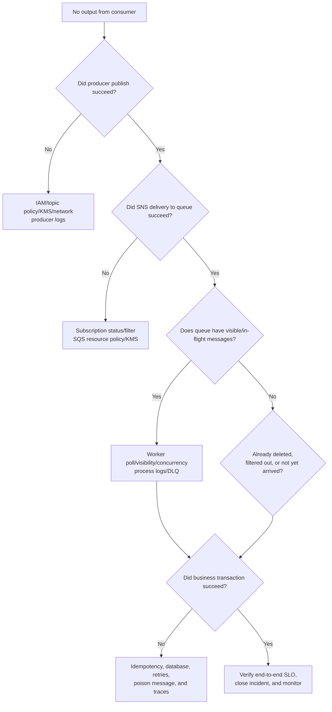

**Do not troubleshoot by granting `sqs:*`/`sns:*` to every principal**, disabling KMS, or immediately purging a queue with backlog. Isolate whether the failure lies at the producer, routing, queue, consumer, or downstream layer first, then make the smallest necessary permission or configuration change.

## 18. Design Scenario: Omnichannel Sales Platform

### Context

An enterprise operates:

- A **Java Order API** receiving **15,000 orders/minute** during promotional events, versus 100 orders/minute normally.
- An **Invoice** system generating PDFs, taking 10–90 seconds per message.
- A **Marketing** system sending event-triggered emails that can tolerate a few minutes of delay.
- An **Inventory** system that must process `StockReserved` followed by `StockReleased` in **strict order per SKU**.
- A legacy partner using **JMS/OpenWire ActiveMQ** receiving events over a broker connection.
- SLOs: no lost committed orders, no double-charging, and failed messages must be investigable and replayable.

### 18.1. Proposed architecture

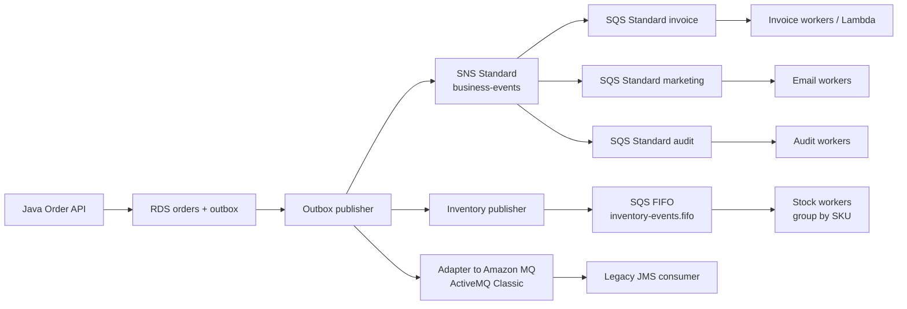

**Key point:** the diagram shows **multiple publish targets** from the outbox publisher. When both standard and FIFO messaging are required, design dedicated adapters or channels. Do not publish to an SNS Standard topic and expect a downstream SQS FIFO queue to reconstruct ordering for ungrouped events.

### 18.2. Why this design?

1. **Outbox:** guarantees the order and event record are written in the same DB transaction; publisher retries may emit duplicates, which consumer inboxes handle idempotently.
2. **SNS Standard + SQS Standard:** invoice, marketing, and audit each get independent queue backlogs, throughput, and DLQs, handling traffic spikes cleanly.
3. **Invoice worker:** visibility timeout sized from P99 processing duration, heartbeat if needed, concurrency capped to PDF storage/API quotas, and a suitable DLQ maxReceiveCount.
4. **Inventory SQS FIFO:** `MessageGroupId=skuId` preserves ordering per SKU while allowing different SKUs to run in parallel. `MessageDeduplicationId=eventId` reduces duplicates inside the dedup window, alongside unique business checks.
5. **Legacy JMS:** retains **Amazon MQ for ActiveMQ Classic** where legacy protocol/semantics are required; the adapter from outbox/event bus to the broker needs its own retries, acks, and idempotency.
6. **DLQ/replay:** separate DLQs for invoice, marketing, and audit; for inventory FIFO, evaluate how poison messages impact group ordering before redriving.
7. **Security:** IAM roles for publishers/consumers, queue policies restricted to the SNS topic, KMS key policies, and broker credentials in Secrets Manager.
8. **Monitoring:** SNS delivered/failed, SQS backlog/age/DLQ, MQ queue depth/connections, plus business metrics `orders_committed_total`/`invoices_completed_total`.

### 18.3. Options to reject

| Idea | Why is it unsuitable? |
| --- | --- |
| A single SQS queue shared by invoice/marketing/audit | Whichever group's worker polls first consumes the message; each group does not get its own copy. |
| Using SNS HTTP push directly to invoice workers to buffer spikes | Endpoints can be overwhelmed; no per-group queue backlog or consumer-controlled backpressure. |
| Using a single FIFO group for all SKUs | Preserves global ordering but severely throttles concurrency. |
| Using Amazon MQ for everything just because a legacy broker exists | Introduces unnecessary capacity and operational overhead for AWS-native jobs. |
| Assuming a FIFO queue eliminates all double-payment bugs | Queues do not enforce idempotency across payment gateways or database transactions. |
| Purging DLQ messages to make the dashboard green | Destroys failure evidence and replay capability, risking business data inconsistency. |

### 18.4. Staging verification checklist

1. Publish the same `eventId` twice and verify the **business side effect executes only once**.
2. Crash the Invoice worker after DB commit but before `DeleteMessage`; verify retry and inbox deduplication.
3. Stop invoice workers for 10 minutes; verify the queue backlog grows while Marketing continues operating, and Invoice catches up when workers return.
4. Publish `StockReserved`/`StockReleased` for the same SKU via FIFO, using multiple groups to test concurrency.
5. Intentionally send an unsupported `schemaVersion`; verify the DLQ alarm and the fix/redrive workflow.
6. Block the broker connection in the lab and test adapter reconnection and idempotency without impacting committed orders.
7. Test misconfigured KMS/queue policies in the lab to observe delivery errors, then restore least-privilege policies.
8. Track SQS request, SNS fanout, KMS, CloudWatch, and Amazon MQ broker costs during load testing.

## 19. Common Misconceptions When Choosing a Service

**Misconception 1: “An SQS queue sends every message to all consumers.”**

No. Consumers polling **a single queue** compete for work; if each business team needs its own copy, use **multiple queues** or **SNS fanout**.

**Misconception 2: “SNS is a queue and can be polled like SQS.”**

No. SNS primarily **publishes/pushes to subscriptions**; if you need consumer polling, backlog storage, and backpressure, subscribe an **SQS queue**.

**Misconception 3: “SQS Standard always delivers messages once and in order.”**

No. Standard provides **at-least-once** delivery and best-effort ordering; consumers need idempotency and out-of-order handling if required by the business.

**Misconception 4: “SQS FIFO guarantees payments will never be duplicated.”**

No. FIFO provides ordering and deduplication within an **approximately 5-minute window** under service conditions; it does not coordinate transactions across payment gateways or RDS.

**Misconception 5: “Passing MessageGroupId on a Standard queue turns it into FIFO.”**

No. SQS Standard fair-queue behavior does not provide strict ordering; sequential ordering requires a **FIFO queue**.

**Misconception 6: “Just setting a huge VisibilityTimeout handles retries well.”**

No. An overly long timeout delays retries when a worker crashes; an overly short one causes premature redelivery. Measure processing time and use bounded heartbeats via `ChangeMessageVisibility`.

**Misconception 7: “A successful ReceiveMessage means the message is done.”**

No. You must **process/commit and then call DeleteMessage** with the latest receipt handle. Forgetting to delete causes the message to reappear.

**Misconception 8: “DLQs are created automatically and fix bad data on their own.”**

No. You must create and configure the DLQ, investigate root causes, and redrive carefully. A DLQ can significantly affect FIFO ordering.

**Misconception 9: “A successful SNS publish means all three subscribers finished processing.”**

No. SNS accepting a publish does not prove notifications reached every endpoint, much less that business consumers committed successfully.

**Misconception 10: “Subscribing SQS to SNS is enough for the queue to receive messages.”**

Not enough. The SQS **resource policy** must grant the SNS topic `sqs:SendMessage` with `SourceArn`; cross-account or KMS setups may require extra permissions.

**Misconception 11: “SNS FIFO sends email/SMS/HTTP just like Standard.”**

No. SNS FIFO restricts protocols; specifically, email/SMS/HTTP(S) lack strict ordering guarantees and are not supported like in Standard.

**Misconception 12: “SNS always supports only 256 KiB.”**

No longer accurate for SNS topics using the newer `MaximumMessageSize` setting: it can go up to **1 MiB** when subscriber constraints are met; the default remains **256 KiB**.

**Misconception 13: “SNS message filtering does not affect delivery semantics.”**

Not entirely. Unmatched messages are dropped; with FIFO, the interaction between exactly-once semantics and filtering requires care so you do not assume every subscriber receives every event.

**Misconception 14: “SQS and Amazon MQ share the same APIs and protocols.”**

No. SQS uses AWS APIs/SDKs with visibility timeouts; Amazon MQ uses broker protocols and native ack semantics such as JMS or AMQP.

**Misconception 15: “Amazon MQ is fully serverless and needs no capacity management.”**

No. AWS manages many broker operations, but you still choose instance/storage/topology, engine version, maintenance, networking, credentials, HA, and monitoring.

**Misconception 16: “Attaching an IAM role to a Java app is enough to log in to a RabbitMQ broker.”**

No. IAM governs the **AWS control plane** for Amazon MQ, whereas **protocol connections** typically rely on broker credentials/TLS and engine-level permissions.

**Misconception 17: “With SQS, an event can never be lost after a DB commit.”**

No. If the producer crashes before publishing, SQS never received the event; use **transactional outbox/CDC** when DB state and event emission must stay consistent.

**Misconception 18: “Adding more parallel consumers always makes processing faster.”**

Not necessarily. Databases, API quotas, FIFO group counts, RabbitMQ broker capacity, and networks can become bottlenecks; unbounded concurrency can trigger cascading failures.

## 20. Self-Check Questions

**Question 1.** A Java API needs to process image resizing asynchronously with multiple workers pulling jobs and no ordering requirement. What should you start with?

**Answer:** **SQS Standard** with polling workers or a Lambda event source mapping, backed by idempotency, visibility timeout, and a DLQ.

**Question 2.** An `OrderPlaced` event must reach three independent systems, each with its own retry handling. Which architecture fits?

**Answer:** **SNS Standard topic → three SQS Standard queues** (or the FIFO equivalents if ordering is mandatory), giving each group its own consumers, monitoring, and DLQ.

**Question 3.** Does SQS Standard guarantee ordering and exactly-once business processing?

**Answer:** **No.** It provides at-least-once delivery and best-effort ordering; the application must handle idempotency, retries, and out-of-order events.

**Question 4.** For SQS FIFO, what should `MessageGroupId` be set to if per-order sequencing is needed?

**Answer:** **To `orderId` or the aggregate ID**, so events for one order are sequential while other orders run in parallel.

**Question 5.** Why is idempotency still needed even when using FIFO?

**Answer:** FIFO deduplication spans an approximately **5-minute window** and does not track whether a business transaction, HTTP API call, or DB commit already succeeded before a consumer failure or redelivery.

**Question 6.** A consumer processes a message successfully and crashes before calling `DeleteMessage`. What can happen?

**Answer:** The message can become visible again after the visibility timeout; another consumer must use **`eventId`/inbox** checks to avoid repeating business side effects.

**Question 7.** An SNS topic publish succeeds, yet the SQS subscriber sees no message; what are the first three things to check?

**Answer:** Verify **subscription status**, the **SQS queue policy for `sns.amazonaws.com` and the matching `SourceArn`**, and then **FilterPolicy/FilterPolicyScope** and KMS.

**Question 8.** Can SNS FIFO deliver directly to email/SMS like SNS Standard?

**Answer:** Not within SNS FIFO's supported scope; use a separate **SNS Standard** topic or a different notification design.

**Question 9.** A team runs Java JMS/OpenWire on self-hosted ActiveMQ. Which service minimizes protocol changes?

**Answer:** **Amazon MQ for ActiveMQ Classic**, after verifying engine compatibility, TLS, broker endpoints, HA, and cost.

**Question 10.** A RabbitMQ client publishes successfully, but consumers have not processed the message; what should you inspect?

**Answer:** Exchange/binding/queue configuration, publisher confirms, queue depth, consumer count, ACK/nack behavior, dead-letter routing, and broker metrics—not just publisher success.

**Question 11.** What is SNS's current `MaximumMessageSize`?

**Answer:** **256 KiB by default**, configurable up to **1 MiB** for AWS-supported subscriptions and protocols. SQS also supports messages up to **1 MiB** per current documentation.

**Question 12.** When is a transactional outbox needed?

**Answer:** When database state and event emission must remain consistent, preventing the case where **the DB commit succeeds but the process crashes before publishing**.

**Question 13.** A FIFO queue has a DLQ; why does redrive require caution?

**Answer:** A poison message and moving messages to the DLQ can alter business execution order within a group, and redriving carries the risk of duplicate side effects.

**Question 14.** Which metrics are critical to tell if workers are falling behind?

**Answer:** `ApproximateAgeOfOldestMessage`, `ApproximateNumberOfMessagesVisible/NotVisible`, DLQ counts, successful processing rate, and business latency.

**Question 15.** Between SQS, SNS, and Amazon MQ, which should be preferred when there is no legacy broker protocol requirement, but one-to-many notifications are needed?

**Answer:** Typically choose **SNS** for fanout, adding an **SQS queue per subscriber** needing buffering/retries. A broker is unnecessary just for basic fanout.

## Official AWS References

- [Amazon SQS — Developer Guide](https://docs.aws.amazon.com/AWSSimpleQueueService/latest/SQSDeveloperGuide/welcome.html)
- [Amazon SQS — Standard queues](https://docs.aws.amazon.com/AWSSimpleQueueService/latest/SQSDeveloperGuide/standard-queues.html)
- [Amazon SQS — FIFO queues](https://docs.aws.amazon.com/AWSSimpleQueueService/latest/SQSDeveloperGuide/sqs-fifo-queues.html)
- [Amazon SQS — Queue types and choosing Standard/FIFO](https://docs.aws.amazon.com/AWSSimpleQueueService/latest/SQSDeveloperGuide/sqs-queue-types.html)
- [Amazon SQS — Visibility timeout](https://docs.aws.amazon.com/AWSSimpleQueueService/latest/SQSDeveloperGuide/sqs-visibility-timeout.html)
- [Amazon SQS — Dead-letter queues](https://docs.aws.amazon.com/AWSSimpleQueueService/latest/SQSDeveloperGuide/sqs-dead-letter-queues.html)
- [Amazon SQS — Message quotas](https://docs.aws.amazon.com/AWSSimpleQueueService/latest/SQSDeveloperGuide/quotas-messages.html)
- [Amazon SQS — FIFO message identifiers](https://docs.aws.amazon.com/AWSSimpleQueueService/latest/SQSDeveloperGuide/sqs-fifo-queue-message-identifiers.html)
- [Amazon SNS — What is Amazon SNS?](https://docs.aws.amazon.com/sns/latest/dg/welcome.html)
- [Amazon SNS — Subscribe SQS queue to topic](https://docs.aws.amazon.com/sns/latest/dg/subscribe-sqs-queue-to-sns-topic.html)
- [Amazon SNS — FIFO topics and deduplication](https://docs.aws.amazon.com/sns/latest/dg/sns-fifo-topics.html)
- [Amazon SNS — FIFO delivery to SQS](https://docs.aws.amazon.com/sns/latest/dg/fifo-message-delivery.html)
- [Amazon SNS — Message filtering for FIFO topics](https://docs.aws.amazon.com/sns/latest/dg/fifo-message-filtering.html)
- [Amazon SNS — Publishing large messages](https://docs.aws.amazon.com/sns/latest/dg/large-message-payloads.html)
- [Amazon SNS — Archiving and replay](https://docs.aws.amazon.com/sns/latest/dg/message-archiving-and-analytics.html)
- [Amazon MQ — Developer Guide](https://docs.aws.amazon.com/amazon-mq/latest/developer-guide/)
- [Amazon MQ — ActiveMQ Classic brokers](https://docs.aws.amazon.com/amazon-mq/latest/developer-guide/working-with-activemq.html)
- [Amazon MQ — RabbitMQ brokers](https://docs.aws.amazon.com/amazon-mq/latest/developer-guide/working-with-rabbitmq.html)
- [Amazon MQ — RabbitMQ deployment architecture](https://docs.aws.amazon.com/amazon-mq/latest/developer-guide/rabbitmq-broker-architecture.html)
- [Amazon MQ — Supported RabbitMQ protocols](https://docs.aws.amazon.com/amazon-mq/latest/developer-guide/rabbitmq-supported-protocols.html)
- [Amazon MQ — CloudWatch monitoring](https://docs.aws.amazon.com/amazon-mq/latest/developer-guide/security-logging-monitoring.html)
- [AWS Decision Guide — SQS, SNS or EventBridge](https://docs.aws.amazon.com/decision-guides/latest/decision-guides/sns-or-sqs-or-eventbridge.html)
- [AWS Lambda — SQS event source mapping](https://docs.aws.amazon.com/lambda/latest/dg/with-sqs.html)
- [AWS Pricing — SQS](https://aws.amazon.com/sqs/pricing/)
- [AWS Pricing — SNS](https://aws.amazon.com/sns/pricing/)
- [AWS Pricing — Amazon MQ](https://aws.amazon.com/amazon-mq/pricing/)

**Key takeaway:** Choose **SQS** when you need a **durable work queue and backpressure**, choose **SNS** when you need **fanout/notifications to multiple subscribers**, and choose **Amazon MQ** when your system must preserve **message broker protocols/semantics** such as JMS or AMQP. In practice, **SNS → SQS** is often the most flexible pairing for AWS event-driven architectures. Whether using Standard or FIFO, design **idempotency, outbox, retry/DLQ, IAM/KMS, monitoring, HA, and cost** around business requirements; never treat a messaging service as a substitute for application-level transactions and recoverability.
