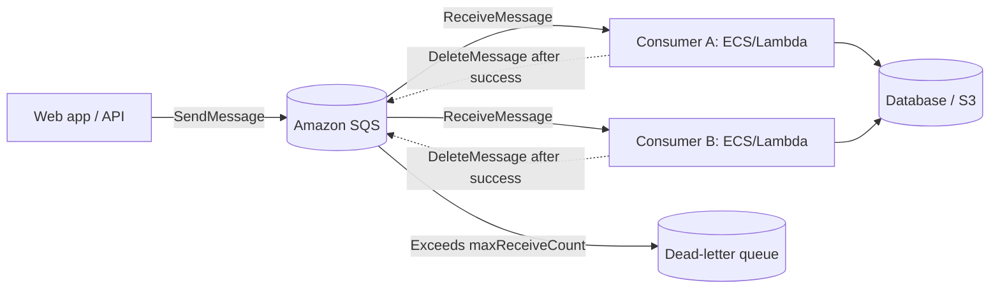
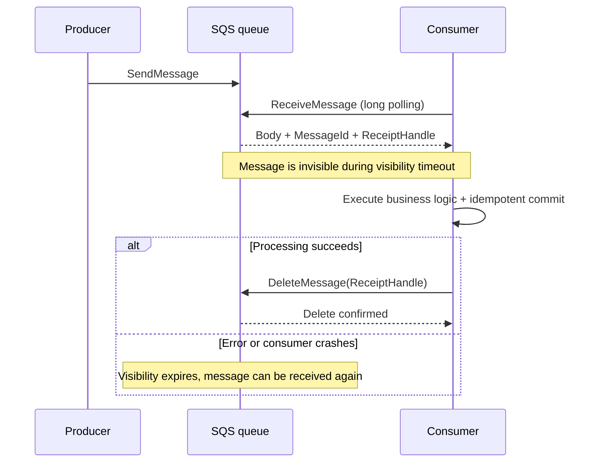
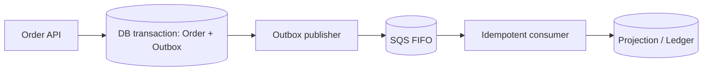
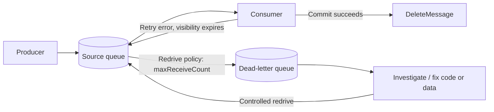
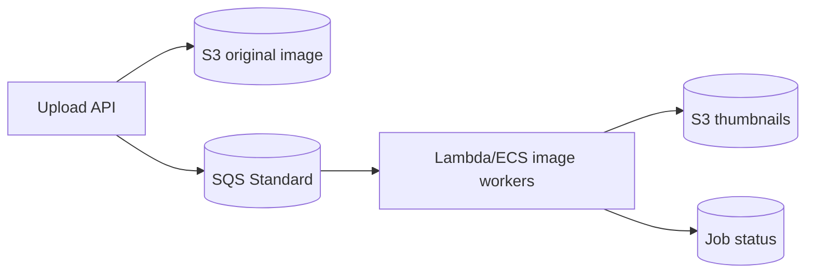
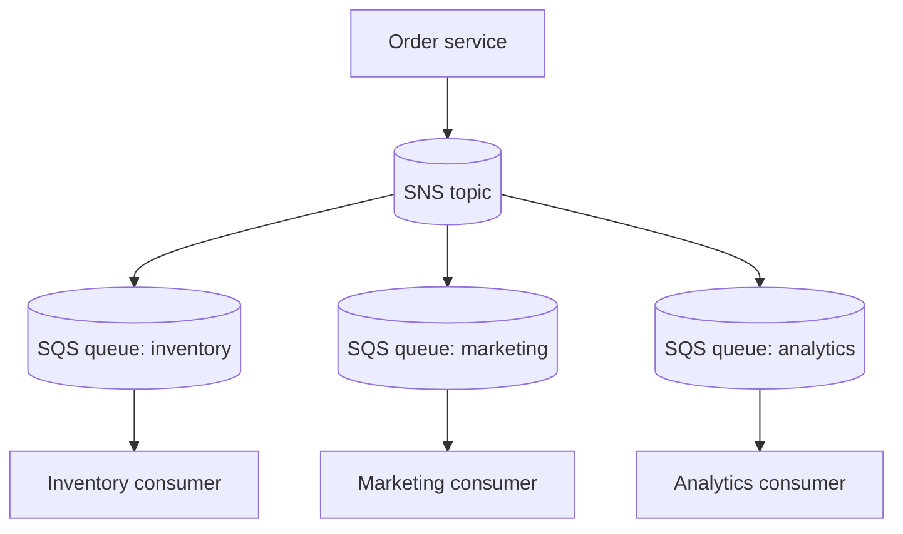
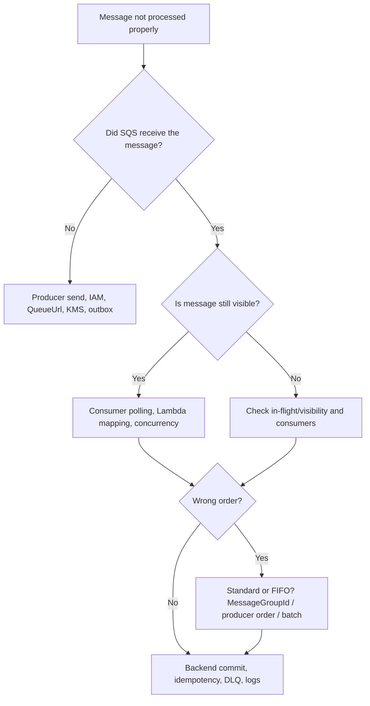
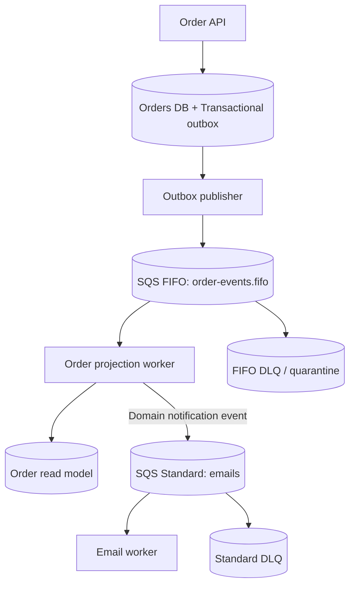

# SQS Standard, FIFO, and Message Processing Order

## 1. Why Do Enterprises Need Queues and Ordering Control?

An e-commerce system receives thousands of orders per minute. The order creation API must respond quickly to customers, while downstream operations such as inventory checks, sending emails, ledger recording, and partner notifications may take several seconds or fail temporarily. If the API synchronously calls every downstream system, a single slow dependency increases latency and the risk of cascading failures.

**Amazon Simple Queue Service (Amazon SQS)** decouples the **producer** (which emits work) from the **consumer** (which processes work). The producer sends messages into a queue; consumers pull messages as they have capacity, execute business logic, and **delete each message** after processing succeeds.

However, not every business flow shares the same ordering requirements:

- Sending confirmation emails for **independent** orders can tolerate out-of-order arrivals and multiple retries. **SQS Standard** is typically suitable.
- For the same **order**, events like `OrderCreated → PaymentCaptured → OrderCancelled` may need to be consumed in the **exact order they occurred**. **SQS FIFO** with `MessageGroupId` is a better fit when producers design the stream properly.
- A data ingestion pipeline may want to process hundreds of customers concurrently, yet **sequentially per customer**. FIFO can use **each customerId/orderId as a message group**.

This lesson belongs to the **Queues and Notifications** chapter in the **CLOUD_PROVIDERS_AWS** track, connecting with Regions/AZs, IAM, VPC, compute, storage, databases, integration, and serverless. Learners need to know how to choose services and build secure, observable, recoverable, and cost-controlled systems. The content focuses on **SQS Standard, FIFO, and message processing order**; services such as SNS, EventBridge, Lambda, and ECS are covered where they help build real-world queue architectures.

After this lesson, you will be able to:

- Distinguish Standard's **best-effort ordering** from FIFO's **strict ordering within each message group**.
- Describe at-least-once delivery, visibility timeout, long polling, the deduplication window, and the message lifecycle.
- Choose `MessageGroupId` and `MessageDeduplicationId` aligned with business keys.
- Write producers and consumers capable of **retries and idempotency**, avoiding confusing FIFO with system-wide exactly-once transactions.
- Use the AWS CLI to create queues, send/receive/delete messages, and observe ordering and failure behavior.
- Design DLQ/redrive, scaling, IAM/KMS, CloudWatch alarms, and backlog/latency monitoring.

## 2. SQS Is a Work Queue, Not a Synchronous Call

SQS is a **managed message queue** service. Producers do not have to wait for consumers to finish directly before proceeding; both sides can scale and deploy independently.



A **queue** differs from a **topic**:

| Service | Primary model | Example |
| --- | --- | --- |
| **SQS** | Producer sends to a queue; consumers compete to process messages from the queue | Invoice generation queue |
| **SNS** | Publish/subscribe, fan-out notifications to multiple subscriptions | One event sent into multiple queues so multiple systems receive it |
| **EventBridge** | Event routing by rules/patterns to multiple matching targets | Business/AWS service events distributed by type |

If the same order must reach both an **inventory system** and an **analytics system**, having both consumer groups read from the **same queue** does not automatically give each group a copy of every message: consumers will compete for messages. Use SNS/EventBridge to fan out into **two separate queues**, and let each group consume its own queue.

### 2.1. SQS does not store business processing outcomes

When a producer successfully sends a message, SQS has accepted a unit of work; it **does not confirm** that the database, email, or inventory system has been updated. Once a consumer finishes processing, the result must be persisted in an appropriate durable store such as **RDS/Aurora, DynamoDB, or S3**. Messages still have a retention period and may require a DLQ if processing fails repeatedly.

In production systems, distinguish among:

1. **Accepted**: SQS has received the message.
2. **Delivered**: a consumer has received the message to attempt processing.
3. **Committed**: the business effect has been written/completed.
4. **Acknowledged**: the consumer successfully called `DeleteMessage` to remove the message from the queue.

These states can occur at different times. If a consumer **commits data and then crashes before `DeleteMessage`**, the message can reappear; that is why idempotency is essential.

## 3. Standard and FIFO: How Do Their Guarantees Differ?

Amazon SQS provides two main queue types: **Standard** and **FIFO (First-In-First-Out)**.

| Criterion | SQS Standard | SQS FIFO |
| --- | --- | --- |
| Message ordering | **Best-effort ordering**; no guarantee that every message is received in exact send order | Preserves order **within the same `MessageGroupId`** under FIFO conditions |
| Delivery | **At least once**; consumers must tolerate duplicate deliveries | Producer deduplication within a 5-minute window; still must handle retries/redeliveries |
| Duplicates from send retries | Does not automatically eliminate all business-level duplicate sends | Uses `MessageDeduplicationId` or content-based deduplication within **5 minutes** |
| Parallelism | Many consumers process independent messages; not constrained by FIFO ordering | Multiple **message groups** run in parallel; a single group is sequential |
| Throughput | Designed for very high throughput; suited to independent workloads | Depends on number of message groups, batching, and throughput/deduplication settings |
| Queue name | No special suffix required | **Must end with `.fifo`** |
| Send message fields | `MessageBody` is primary | Requires **`MessageGroupId`**, plus dedup ID unless content-based dedup is enabled |
| Use cases | Emails, logs, image resizing, independent jobs | Order status, per-account balance updates, sequential updates per entity |

**Key point:** the phrase “exactly-once processing” sometimes appears in FIFO descriptions, but **it does not guarantee that every side effect in a database or email occurs only once**. FIFO prevents duplicate acceptance when a **producer retries with the same deduplication ID within the deduplication window**. Consumers can still experience retries, visibility timeouts expiring, network errors, or failed deletes. Idempotent design remains mandatory.

### 3.1. Standard has no strict ordering

Producer sends sequentially:

```text
Message A: OrderCreated
Message B: PaymentCaptured
Message C: OrderShipped

Standard queue:
  Consumer 1 may receive B before Consumer 2 receives A.
  Consumer 3 may finish C before A completes.
  A message may reappear if visibility timeout expires or a duplicate occurs.
```

SQS Standard makes a best effort to preserve order in many situations, but **does not provide a FIFO contract**. Never treat ordering observed during light test loads as proof that order will always hold under scaling, failover, or retries.

### 3.2. FIFO guarantees order per group, not across the entire queue

In FIFO, the producer must specify a **MessageGroupId**. Messages with the **same group ID** are consumed in order; **different group IDs** can be processed in parallel, and ordering across them **is not guaranteed**.

```text
FIFO queue: order-events.fifo

MessageGroupId = order-101:
  M1 OrderCreated -> M2 PaymentCaptured -> M3 OrderShipped

MessageGroupId = order-202:
  N1 OrderCreated -> N2 PaymentFailed

Group order-101 processes sequentially.
Group order-202 can process in parallel with order-101.
No global ordering is enforced between M1 and N1.
```

If you assign **every message to the same MessageGroupId** (e.g., `global`), you effectively turn the entire FIFO queue into a single sequential stream, bottlenecking throughput whenever a consumer slows down. If you assign **each message a brand-new group ID**, you get high concurrency but **lose ordering between events for the same entity**. Choose the group based on the business key that requires sequencing, not the producer name or a random number.

## 4. Message Lifecycle: Send, Receive, Visibility, Delete

An SQS message is not deleted the moment a consumer receives it. SQS uses a **visibility timeout** to temporarily hide the message from other receive calls, giving the consumer time to process it.



### 4.1. Visibility timeout is not message retention

| Mechanism | Meaning | Common AWS values |
| --- | --- | --- |
| **Visibility timeout** | Duration a received message is hidden from other receive calls | Default **30 seconds**, configurable within service limits |
| **Message retention period** | Maximum time a message stays in the queue before expiring | Default **4 days**, configurable from **1 minute to 14 days** |
| **Receive message wait time** | Maximum time long polling waits when looking for messages | Up to **20 seconds** |
| **Delay seconds** | Delays when a newly sent message becomes visible | Up to **15 minutes** per queue/API capabilities |

If actual processing takes 50 seconds while visibility is only 30 seconds, the message can reappear before the original consumer commits and deletes it. With Standard, another consumer may process a duplicate **concurrently**; with FIFO, the message group may be held or redelivered depending on visibility and receive state. For long-running work, configure an adequate visibility timeout or use `ChangeMessageVisibility` to **extend it in a controlled manner** while the consumer is still actively working.

Do not set an extremely long visibility timeout “just to be safe” without considering recovery: if a consumer crashes, the message stays hidden too long before being retried, increasing recovery latency.

### 4.2. ReceiptHandle is different from MessageId

`MessageId` identifies the message returned by SQS upon sending. Each `ReceiveMessage` call returns a **ReceiptHandle** tied to that specific receive attempt. When deleting, use the **latest ReceiptHandle from the current receive**; never pass `MessageId` as the receipt handle.

Because deleting and backend processing do not share an atomic transaction with SQS, follow these steps:

1. Execute the business effect idempotently.
2. Commit the result if using a transaction.
3. Only then call `DeleteMessage` with the matching receipt handle.
4. If the delete fails or the connection drops before confirmation, be prepared for the message to return.

### 4.3. Long polling and handling empty queues

**Short polling** can return immediately with found messages or an empty response. **Long polling** (`WaitTimeSeconds` up to 20) waits when the queue is empty, reducing empty receives, API request count, and cost. Do not confuse long polling with processing time: this parameter only controls **how long to wait when receiving a message**.

For consumers running on ECS/EC2, long polling combined with graceful shutdown is a common pattern. With Lambda event source mapping, the **Lambda service polls SQS on behalf of the application**; the handler does not need to write a manual `ReceiveMessage` loop.

## 5. FIFO MessageGroupId and Actual Processing Order

**MessageGroupId** is the most important key determining order in SQS FIFO. It is a string sent by the producer with each message. SQS uses the group ID to prevent multiple consumers from processing messages in the **same group** in a way that violates delivery order.

### 5.1. SQS can return a batch containing multiple messages from one group

A single `ReceiveMessage` call can return **multiple messages from the same group**, in FIFO order. A consumer receiving a batch must process them **sequentially** if business logic requires it. Do not accidentally dispatch the whole batch concurrently across futures and assume SQS will preserve completion order.

Example:

```text
Group customer-42:
  1. CreditAdded(+100)
  2. Purchase(-40)
  3. Refund(+10)

Consumer receives 3 messages in the same batch:
  Correct: process(1) -> commit -> process(2) -> commit -> process(3)
  Wrong:   run all 3 concurrently and commit in arbitrary completion order
```

With FIFO, SQS can deliver messages from **different groups** to different consumers for parallel processing. While a group has an in-flight message, subsequent messages in that group are not handed to another consumer as an independent stream until the in-flight message is deleted or its visibility expires according to service rules.

### 5.2. Choosing groups along business invariant boundaries

| Requirement | Suggested MessageGroupId | Benefit | Risk to consider |
| --- | --- | --- | --- |
| Order of changes for a single order | `orderId` | Sequential within the same order | If a hot order group slows down, subsequent events wait |
| Order of updates for a single customer | `customerId` | Prevents reordering updates for the same customer | A customer with heavy activity can become a hot group |
| Ordering per payment account | `accountId` | Preserves account-level business sequence | Must pair with DB transactions/conditional updates |
| Independent log processing per device | `deviceId` | Many devices can run in parallel | Producers must choose group IDs consistently |
| No ordering required | Standard queue, or tailored design | Maximizes parallelism | Putting everything in one FIFO group creates a bottleneck |

If two producers emit events for the **same orderId**, the order SQS accepts messages depends on the **actual arrival order of `SendMessage` requests**, not the order business events occurred in the database. If producer B sends `OrderShipped` before producer A sends `OrderCreated`, FIFO preserves the **queue submission order**, without automatically fixing business order. You must design a **single-writer, transactional outbox, event sequence number, or coordinator mechanism** on the producer side.

### 5.3. FIFO does not guarantee completion order across different message groups

Suppose group A has a message taking 10 seconds and group B has a message taking 1 second. B can finish before A, even if A entered the queue earlier. This is **intended behavior** to increase throughput, not a FIFO bug.

A requirement that “every transaction across all customers has a single global order” differs sharply from “each customer has its own order”. If strict global ordering is mandatory, you must accept lower parallelism or use an appropriate data-layer transaction/coordination mechanism.

## 6. Deduplication: Preventing Duplicate Sends, Not Replacing Idempotency

SQS FIFO supports an **approximately 5-minute deduplication interval**. When a producer resends a message with the **same MessageDeduplicationId** within this window, SQS detects the duplicate and **does not deliver a new copy for consumers to process** under FIFO rules. The goal is to mitigate producer retries after network drops or unacknowledged `SendMessage` calls.

### 6.1. Explicit deduplication ID

A producer may send:

```json
{
  "MessageGroupId": "order-101",
  "MessageDeduplicationId": "order-101-event-v3",
  "MessageBody": "{\"orderId\":\"101\",\"version\":3,\"type\":\"PaymentCaptured\"}"
}
```

In practice, the dedup ID should be tied to a **logical event identity** or unique aggregate version, not fixed solely to `orderId`. Using `MessageDeduplicationId=order-101` for **every event** of an order can cause distinct events within the same 5 minutes to be treated as duplicates and **dropped**.

SQS remembers the dedup ID throughout the deduplication window even after the original message has been received and deleted; early retries with the same ID being dropped is expected behavior.

### 6.2. Content-based deduplication

If a queue enables `ContentBasedDeduplication=true` and the producer omits `MessageDeduplicationId`, SQS generates a dedup ID from a **SHA-256 hash of `MessageBody`**. **Message attributes are not included in that hash**.

For example, two sends with identical bodies but different attributes may still be treated as duplicates within the dedup window. Conversely, two bodies differing only in whitespace or JSON key order will yield different hashes despite identical business meaning. For events needing explicit identity, **explicit dedup IDs** are generally easier to reason about.

When a producer sends the **same dedup ID with a different body**, FIFO may drop the later send within the window. Do not rely on dedup IDs as a content or version validation mechanism; the application needs its own validation and event consistency checks.

### 6.3. What happens after 5 minutes?

If a producer replays an event **after the deduplication interval expires**, SQS can accept it as a new message. If a consumer already committed to the DB and crashed before `DeleteMessage`, the message can also be reprocessed via retry. **FIFO does not provide exactly-once business transactions across RDS/DynamoDB/S3/email**.

To achieve the effect of “each business event takes effect once”, combine:

- An event ID/version that stays unchanged across producer retries.
- A **`processed_events` table** with a unique key or a DynamoDB conditional write.
- Writing business data **and** the processed marker in the **same transaction** when the storage engine supports it.
- An **idempotent consumer**: receiving the same event a second time returns the already-processed outcome without deducting inventory or charging again.
- Application-level ordering by `aggregateVersion` when multiple producers or systems merge events.

## 7. AWS CLI Practice: Creating and Comparing Standard/FIFO Queues

The following examples are intended for a **sandbox/test account**. They create real queues and send/receive/delete real messages if executed. You need an authenticated AWS CLI, approved IAM permissions, and an AWS Region supporting SQS. Values such as `QUEUE_URL_HERE`, ARNs, account IDs, and queue names are **placeholders**; never run them verbatim against production data.

### 7.1. Verify account and create a Standard queue

```bash
# Before creating resources, verify the active identity
aws sts get-caller-identity

# Standard queue: no .fifo suffix required
aws sqs create-queue \
  --queue-name shop-emails-standard \
  --attributes VisibilityTimeout=60,MessageRetentionPeriod=345600,ReceiveMessageWaitTimeSeconds=20 \
  --region ap-southeast-1
```

`MessageRetentionPeriod=345600` means 4 days (in seconds); `VisibilityTimeout=60` is 60 seconds. Choose values based on actual consumer execution times and retry plans rather than copying lesson values blindly to other workloads.

### 7.2. Create a FIFO queue

```bash
# FIFO queue must end with .fifo and have FifoQueue=true
aws sqs create-queue \
  --queue-name shop-order-events.fifo \
  --attributes FifoQueue=true,ContentBasedDeduplication=false,VisibilityTimeout=60,MessageRetentionPeriod=345600,ReceiveMessageWaitTimeSeconds=20 \
  --region ap-southeast-1
```

Here **content-based deduplication is off**; producers must supply **`MessageDeduplicationId`** when sending FIFO messages. To use content-based deduplication, create or configure the queue with `ContentBasedDeduplication=true` and keep in mind it hashes only the **body**, not attributes.

To inspect current attributes:

```bash
aws sqs get-queue-url \
  --queue-name shop-order-events.fifo \
  --region ap-southeast-1

aws sqs get-queue-attributes \
  --queue-url 'FIFO_QUEUE_URL_HERE' \
  --attribute-names All \
  --region ap-southeast-1
```

The Queue URL is returned by SQS and typically looks like `https://sqs.ap-southeast-1.amazonaws.com/111122223333/shop-order-events.fifo`. **Never guess queue URLs** across multiple AWS accounts or Regions; use `get-queue-url`.

### 7.3. Send three events in the same group

```bash
aws sqs send-message \
  --queue-url 'FIFO_QUEUE_URL_HERE' \
  --message-group-id order-101 \
  --message-deduplication-id order-101-v1 \
  --message-body '{"orderId":"101","version":1,"type":"OrderCreated"}' \
  --region ap-southeast-1

aws sqs send-message \
  --queue-url 'FIFO_QUEUE_URL_HERE' \
  --message-group-id order-101 \
  --message-deduplication-id order-101-v2 \
  --message-body '{"orderId":"101","version":2,"type":"PaymentCaptured"}' \
  --region ap-southeast-1

aws sqs send-message \
  --queue-url 'FIFO_QUEUE_URL_HERE' \
  --message-group-id order-101 \
  --message-deduplication-id order-101-v3 \
  --message-body '{"orderId":"101","version":3,"type":"OrderShipped"}' \
  --region ap-southeast-1
```

Send additional events for `order-202` with a **different group ID** to observe concurrency across groups. The `send-message` calls above run sequentially; if multiple producers operate concurrently, the application must enforce business event order rather than relying on wall-clock timing across services.

### 7.4. Receive and delete messages

```bash
# Long polling up to 20 seconds, receiving up to 10 messages per call
aws sqs receive-message \
  --queue-url 'FIFO_QUEUE_URL_HERE' \
  --max-number-of-messages 10 \
  --wait-time-seconds 20 \
  --message-system-attribute-names All \
  --region ap-southeast-1

# After business processing succeeds, delete using the current receive's ReceiptHandle
aws sqs delete-message \
  --queue-url 'FIFO_QUEUE_URL_HERE' \
  --receipt-handle 'RECEIPT_HANDLE_FROM_RECEIVE' \
  --region ap-southeast-1
```

`receive-message` can return **fewer than 10 messages**, even when the queue holds many messages; the number is an upper bound, not a guarantee. If a consumer receives a batch from the same group, process them sequentially. Delete **only messages that committed successfully**, never the entire batch if part of the processing failed.

### 7.5. Test deduplication

Resend `order-101-v3` **within 5 minutes** with the same dedup ID:

```bash
aws sqs send-message \
  --queue-url 'FIFO_QUEUE_URL_HERE' \
  --message-group-id order-101 \
  --message-deduplication-id order-101-v3 \
  --message-body '{"orderId":"101","version":3,"type":"OrderShipped"}' \
  --region ap-southeast-1
```

SQS may return a successful send response while **not creating an extra message for consumers to process** because the dedup ID matches. If the test runs after 5 minutes, the dedup ID has expired from the retention window and can produce another message. This is not a reliable test for “exactly-once forever”.

### 7.6. Adjust visibility for long-running processing

If a consumer needs more processing time, use a **currently valid receipt handle**:

```bash
aws sqs change-message-visibility \
  --queue-url 'FIFO_QUEUE_URL_HERE' \
  --receipt-handle 'RECEIPT_HANDLE_FROM_RECEIVE' \
  --visibility-timeout 120 \
  --region ap-southeast-1
```

This API modifies the visibility duration of the in-flight message, **not the message retention period**. SQS enforces a maximum total visibility duration; for very long jobs, use controlled heartbeats/extensions or split/offload the work to Step Functions, ECS tasks, or an appropriate batch system.

## 8. Idempotent Consumers and Versioned Event Processing

SQS Standard can redeliver messages; FIFO also cannot combine a **DB update + `DeleteMessage`** into a single atomic transaction spanning both systems. Therefore, you must design **idempotent consumers**.

### 8.1. Transaction pattern in a relational database

Suppose each event carries a unique producer-generated `eventId`, an `orderId`, and a `version`. A design uses these tables:

```sql
CREATE TABLE processed_events (
    event_id VARCHAR(100) PRIMARY KEY,
    order_id VARCHAR(100) NOT NULL,
    processed_at TIMESTAMP NOT NULL DEFAULT CURRENT_TIMESTAMP
);

CREATE TABLE order_projection (
    order_id VARCHAR(100) PRIMARY KEY,
    event_version BIGINT NOT NULL,
    status VARCHAR(40) NOT NULL
);
```

Flow pseudocode:

```text
receive(message):
  parse and validate message schema/eventId/orderId/version

  BEGIN TRANSACTION
    if eventId already exists in processed_events:
       => do not execute side effect again
    else:
       validate order version/state transition
       update order_projection
       insert processed_events(eventId, orderId)
  COMMIT

  DeleteMessage(receiptHandle)
```

Some databases offer `INSERT ... ON CONFLICT` or unique constraints to enforce idempotency. **Specific syntax and isolation levels depend on the RDS engine**; what matters is recording the processed marker and mutating business data in the **same transaction**, otherwise you risk “marked processed but update failed” or vice versa.

If the side effect is **sending an email via an external system**, a database transaction cannot roll back an already sent email. Design a **delivery ledger**, send states, provider-side idempotency keys where supported, and a policy that accommodates at-least-once behavior for non-atomic actions.

### 8.2. FIFO still needs version checks with multiple producers

SQS FIFO preserves the order of messages **accepted into the same group**, not the order in which prior business transactions committed. If a producer for `v4` sends before `v3`, FIFO can receive `v4` first.

Mitigations:

1. Producers write the event and version transactionally with the aggregate.
2. A **transactional outbox** holds events to publish alongside database changes.
3. An ordered publisher or coordinator ensures events are published in `aggregateVersion` order per entity.
4. Consumers verify `version = lastProcessedVersion + 1` or handle replays/gaps by policy.
5. Upon detecting a gap, **do not mistakenly delete critical events**, and do not retry infinitely and stall the entire group; choose an appropriate retry/parking/alerting mechanism.

### 8.3. Transactional outbox solves “order in DB, missing event in SQS”

These two independent statements cannot be treated as one transaction:

```text
1. INSERT order into RDS  -> succeeds
2. SendMessage SQS       -> network error
```

If the producer retries naively, events may be lost or duplicated. The **transactional outbox** pattern writes both the **order and an outbox row** in the same database transaction. A worker/poller later publishes the event to SQS, marks the outbox row sent, and retries as needed. Because that worker can also crash after `SendMessage` but before marking sent, you still need **stable dedup IDs and idempotent consumers**.



This is a standard pattern whenever application state and event publishing must remain consistent. FIFO preserves message order once messages are sent in order; it **does not replace an outbox**.

## 9. High-Throughput FIFO and Concurrency Design

FIFO can be configured for **high-throughput mode** when service conditions are met. Relevant attributes include:

- `DeduplicationScope=queue` or `messageGroup`: sets the scope for deduplication evaluation.
- `FifoThroughputLimit=perQueue` or `perMessageGroupId`: sets whether throughput quotas apply per queue or per message group.
- To enable high-throughput FIFO as guided by AWS, typically select **`DeduplicationScope=messageGroup`** and **`FifoThroughputLimit=perMessageGroupId`**.

Example **test** queue configuration:

```bash
aws sqs create-queue \
  --queue-name shop-events-throughput.fifo \
  --attributes FifoQueue=true,ContentBasedDeduplication=false,DeduplicationScope=messageGroup,FifoThroughputLimit=perMessageGroupId \
  --region ap-southeast-1
```

Default and maximum throughput numbers depend on **Region, batching, API usage, and current quotas**; do not assume a fixed messages/second number across all accounts. Check Service Quotas and the high-throughput FIFO documentation at deployment time.

### 9.1. Concurrency depends on the number of active groups

Suppose 2,000 messages await processing, all sharing **a single MessageGroupId**. Adding 100 consumers will not turn that group into 100 parallel ordered streams. If there are 200 independent group IDs and sufficient capacity, multiple consumers can process different groups concurrently.

| Group ID strategy | Ordering | Parallelism |
| --- | --- | --- |
| One ID for the whole queue | Nearly completely sequential | Very low |
| One ID per order | Ordered per order | Scales with active orders |
| One ID per request | Does not group events for the same entity | High, but fails business ordering |
| One ID by intentional partition | Ordered within the partition | Must ensure entities always map to the same partition |

If one customer generates high transaction volume and becomes a **hot message group**, subsequent messages in that group wait behind slow or retrying messages. Evaluate whether sequencing is truly needed at the **customer** level or only at the **account/order** level; splitting groups too finely just to boost concurrency can break business invariants.

### 9.2. Batching for better efficiency

SQS supports `SendMessageBatch` and `DeleteMessageBatch`; a batch can hold up to **10 entries** under API limits. In FIFO, messages belonging to the same group are ordered according to their sequence in the batch. Do not assume the **entire batch is an atomic transaction**: responses can contain both **Successful** and **Failed** entries; producers must retry failed entries separately using stable dedup IDs/identities.

Example `send-order-events.json` file for three messages in the same group:

```json
[
  {
    "Id": "event-1",
    "MessageBody": "{\"eventId\":\"ev101-v1\",\"orderId\":\"101\",\"version\":1,\"type\":\"OrderCreated\"}",
    "MessageGroupId": "order-101",
    "MessageDeduplicationId": "ev101-v1"
  },
  {
    "Id": "event-2",
    "MessageBody": "{\"eventId\":\"ev101-v2\",\"orderId\":\"101\",\"version\":2,\"type\":\"PaymentCaptured\"}",
    "MessageGroupId": "order-101",
    "MessageDeduplicationId": "ev101-v2"
  },
  {
    "Id": "event-3",
    "MessageBody": "{\"eventId\":\"ev101-v3\",\"orderId\":\"101\",\"version\":3,\"type\":\"OrderShipped\"}",
    "MessageGroupId": "order-101",
    "MessageDeduplicationId": "ev101-v3"
  }
]
```

```bash
aws sqs send-message-batch \
  --queue-url 'FIFO_QUEUE_URL_HERE' \
  --entries file://send-order-events.json \
  --region ap-southeast-1
```

**Inspect the `Failed` list**, not just the exit code. With FIFO and messages in the same group, producers need a strategy to retry or reconcile ordering gaps if an entry is rejected; partial batch success does not automatically uphold business contracts if code ignores the response details.

## 10. Lambda Consumers with SQS Standard and FIFO

**AWS Lambda event source mapping** can poll SQS and invoke a Lambda function with a **batch** of messages. Lambda manages pollers on your behalf, adjusts concurrency within limits, and handles receive/delete mechanics based on invocation outcome. The handler must accurately report **success or failure**; if code swallows exceptions and returns success, Lambda may delete messages even when business processing failed.

### 10.1. Standard queue: flexible concurrency

Standard queues allow Lambda to process multiple batches concurrently within capacity and quotas. Ordering across batches and backend commit order **are not guaranteed**. If the handler fails, the entire batch may reappear after the visibility timeout depending on configuration; previously successful messages in the batch may also be reprocessed unless partial batch response is enabled.

### 10.2. FIFO queue: concurrency by MessageGroupId

With FIFO, the Lambda event source mapping respects **in-group ordering** and does not concurrently process batches from the same group in a way that breaks order; it can process **different groups in parallel**. Effective concurrency depends on active message groups, event source mapping maximum concurrency (when configured), reserved concurrency, and other quotas.

**The maximum batch size for an SQS FIFO event source mapping is 10 messages** under the Lambda SQS FIFO model; the backend still requires idempotency.

### 10.3. Partial batch responses and FIFO ordering

When `ReportBatchItemFailures` is enabled, a Lambda handler can return the list of **failed** message IDs so successful items are not retried unnecessarily. With **FIFO**, to preserve ordering, AWS recommends **stopping processing at the first error** and returning failures for **the failed message plus all unprocessed messages** remaining in the batch.

Pseudocode example:

```python
def handler(event, context):
    failures = []
    records = event.get("Records", [])

    # FIFO: process records sequentially in batch order.
    for index, record in enumerate(records):
        try:
            process_idempotently(record)  # Safe DB commit/side effects
        except Exception:
            # Report the failing record and all UNPROCESSED records.
            failures = [
                {"itemIdentifier": r["messageId"]}
                for r in records[index:]
            ]
            break

    return {"batchItemFailures": failures}
```

This is pseudocode; `process_idempotently` must be implemented by your application, and the event source mapping must enable partial batch response. If a batch contains messages from multiple groups, you can optimize by isolating failures per group without violating in-group order; the simple example above intentionally stops the whole batch to avoid breaking the contract.

### 10.4. Visibility timeout and Lambda timeout

When attaching SQS to Lambda, AWS recommends setting the visibility timeout **long enough relative to the Lambda function timeout and batch window**, with headroom for retries and throttling. A common guideline is a visibility timeout of **at least roughly six times the Lambda timeout plus the batching window** in the relevant configuration. This is a **guideline**, not a substitute for measurement and queue/function limits.

If batch processing runs longer than visibility, another invocation may pick up the message before the first finishes. **Event source mapping does not automatically provide exactly-once side effects**. Add business deduplication, RDS/DynamoDB transactions, and concurrency/backend limits.

## 11. Dead-Letter Queues, Redrive, and FIFO Ordering Risks

A message can fail repeatedly due to malformed data, unsupported schemas, database unavailability, or consumer bugs. If failing messages retry infinitely in the main queue, throughput drops, costs rise, and a **hot FIFO message group** can block every subsequent event for that entity.

A **dead-letter queue (DLQ)** is a dedicated queue that holds messages after receive attempts exceed **`maxReceiveCount`** in the **redrive policy**. Operators can investigate, fix the root cause, and send messages back to the source via **DLQ redrive** or controlled reprocessing tooling.



### 11.1. Standard and FIFO DLQs must match their source type

- **Standard source** → **Standard DLQ**.
- **FIFO source** → **FIFO DLQ**.

Configure a **redrive allow policy** to restrict which source queues may use a queue as a DLQ. Use IAM to restrict who can read DLQ messages, trigger redrives, delete queues, and edit attributes; never let every application drain DLQs or purge data freely.

### 11.2. A FIFO DLQ can break strict ordering requirements

Suppose group `order-101` has `v1 → v2 → v3`. Event `v2` is a poison message and moves to the DLQ after repeated failures. Subsequent events can continue processing in the source queue while `v2` sits in the DLQ. At that point, the **actual order of side effects** no longer matches the original v1-v2-v3 sequence.

**If skipping a message mid-sequence is unacceptable**, do not blindly attach a DLQ to FIFO. AWS also advises against using a DLQ with FIFO when doing so breaks ordering correctness—such as a mandatory sequence of business steps where none can be skipped.

Explicit workarounds must be designed:

1. Pause processing for the **affected group** via business logic, rather than disabling the entire queue unnecessarily.
2. Route bad events to a **parking lot/quarantine** while recording the entity/version and blocked state.
3. Fix the data, schema, or consumer, replay events in order, and then unpause the group.
4. If the business allows skipping the failing event, require an explicit decision, audit record, and compensating logic.

**Do not assume a DLQ preserves global system order automatically.** A redrive job can also change relative order between redriven messages and newly arriving ones; coordinate producers and consumers during recovery.

### 11.3. CLI configuration for DLQ

First create a DLQ of the matching type:

```bash
aws sqs create-queue \
  --queue-name shop-order-errors.fifo \
  --attributes FifoQueue=true,ContentBasedDeduplication=true,MessageRetentionPeriod=1209600 \
  --region ap-southeast-1

# Read the real QueueArn of the DLQ after creation
aws sqs get-queue-attributes \
  --queue-url 'FIFO_DLQ_URL_HERE' \
  --attribute-names QueueArn \
  --region ap-southeast-1
```

`MessageRetentionPeriod=1209600` equals 14 days. Save a `redrive-policy.json` file for `set-queue-attributes` (note that the value inside `Attributes.RedrivePolicy` is a **JSON string**):

```json
{
  "Attributes": {
    "RedrivePolicy": "{\"deadLetterTargetArn\":\"arn:aws:sqs:ap-southeast-1:111122223333:shop-order-errors.fifo\",\"maxReceiveCount\":\"5\"}"
  }
}
```

```bash
aws sqs set-queue-attributes \
  --queue-url 'FIFO_QUEUE_URL_HERE' \
  --attributes file://redrive-policy.json \
  --region ap-southeast-1
```

**Execution requires a real DLQ ARN**, both queues in the same Region, and matching IAM permissions. Also check the redrive allow policy if restricting permitted source queues. Do not copy this example to a production queue without evaluating `maxReceiveCount=5`, retention, ordering impact, and operational runbooks.

### 11.4. Message age in a DLQ

SQS Standard and FIFO differ when messages move to a DLQ, particularly in **enqueue timestamps and how `AgeOfOldestMessage` is interpreted**. Do not rely on a single metric to calculate time remaining before the DLQ expires a message; inspect the retention policy, queue type, and timestamps accurately.

A practical rule: **DLQ retention must be long enough for operations to detect, investigate, fix, and replay**. You can set DLQ retention longer than the source queue to avoid losing evidence, while staying within data-protection policies and budget.

## 12. Delay Queues, Visibility, and Appropriate Retry Mechanisms

**Delay** and **visibility** serve different stages:

- **DelaySeconds:** delays when a **newly sent** message first becomes visible.
- **VisibilityTimeout:** temporarily hides an **already received** message so the consumer can process it.
- **MessageRetentionPeriod:** limits how long SQS retains an undeleted message.
- **DLQ redrive policy:** conditions for moving failing messages to a DLQ.

Do not use the 15-minute delay as a substitute for hourly or daily scheduling. For business logic scheduled far in the future, consider **EventBridge Scheduler**, Step Functions Wait states, or a suitable durable scheduler.

### 12.1. FIFO and delivery delays

SQS FIFO supports **queue-level delays**, but does not support **per-message delay timers** the way Standard queues do. Before passing `--delay-seconds` per message on FIFO, verify support; standard practice is queue-level `DelaySeconds` or a dedicated scheduling system.

A failed message becoming visible again after visibility timeout also **does not mean it is following an automatic exponential backoff schedule**. If extended backoff is required, build retry orchestration (e.g., controlled visibility updates, parking queues/Step Functions, or a scheduler).

### 12.2. Poison messages must not block forever

A consumer encountering invalid input generally has two paths:

1. **Transient failure**: database timeout, HTTP 503; retry with bounded backoff.
2. **Permanent failure**: missing required field, undecodable event; log safely and route into quarantine/DLQ per business rules.

With FIFO, retrying a failing message **blocks later messages in the same group**. When ordering must be preserved, this is an explicit trade-off to accept or handle via a side workflow—never delete failing messages just to boost throughput metrics.

## 13. SQS Security: IAM, Queue Policies, SSE-KMS, and VPC

SQS is a managed service outside your VPC, accessed via AWS APIs. **A message is not a backend HTTP request running inside the queue**, and SQS does not read or write RDS on your application's behalf. Every producer and consumer needs appropriate IAM identities.

### 13.1. Separating producer and consumer permissions

| Principal | Typical permissions needed | Should NOT be granted |
| --- | --- | --- |
| **Producer** (Lambda/ECS/EC2) | `sqs:SendMessage` on target queue | `sqs:DeleteMessage`, `sqs:PurgeQueue` unless needed |
| **Consumer** | `sqs:ReceiveMessage`, `sqs:DeleteMessage`, `sqs:ChangeMessageVisibility`, usually `sqs:GetQueueAttributes` | Queue admin or delete-queue permissions |
| **Admin/CI** | Scoped, approved permissions to create/edit queues and redrive | Account-wide `sqs:*` for every application |
| **Lambda poller via event source mapping** | Permissions in the Lambda execution role to poll/delete SQS, plus KMS if encrypted | Sharing a single overly broad role across all projects' Lambda functions |

Example producer IAM policy:

```json
{
  "Version": "2012-10-17",
  "Statement": [
    {
      "Effect": "Allow",
      "Action": "sqs:SendMessage",
      "Resource": "arn:aws:sqs:ap-southeast-1:111122223333:shop-order-events.fifo"
    }
  ]
}
```

The consumer's role needs different permissions; use **IAM role temporary credentials** via Lambda execution roles, ECS task roles, or EC2 instance profiles. Never bake static AWS access keys into environment variables or Docker images.

### 13.2. Queue resource policies and cross-account access

A **queue policy** is SQS's resource-based policy. It is useful when:

- An SNS topic in another account must send messages to the queue.
- A producer role in an authorized external account must send to the queue.
- Organizational rules must block unauthorized sources.

For SNS → SQS, typically specify principal `sns.amazonaws.com` with an `aws:SourceArn` condition scoped to the exact SNS topic ARN. Never allow every SNS topic in any account to send to your queue.

```json
{
  "Version": "2012-10-17",
  "Statement": [
    {
      "Sid": "AllowOneSnsTopicToPublish",
      "Effect": "Allow",
      "Principal": { "Service": "sns.amazonaws.com" },
      "Action": "sqs:SendMessage",
      "Resource": "arn:aws:sqs:ap-southeast-1:111122223333:shop-order-events.fifo",
      "Condition": {
        "ArnEquals": {
          "aws:SourceArn": "arn:aws:sns:ap-southeast-1:111122223333:order-events.fifo"
        }
      }
    }
  ]
}
```

This is a **single-statement example**, not a complete bucket policy or full SNS subscription setup. To preserve FIFO through SNS, you must use an **SNS FIFO topic** and compatible subscription/queue types; group ID and deduplication parameters must be passed according to the service contract. **An SNS topic sending to a Standard queue does not turn that queue into FIFO**, even if SNS emits events in order.

### 13.3. Encryption in transit and at rest

SQS supports HTTPS/TLS for API requests and **server-side encryption** for message data at rest. Depending on requirements, use **SSE-SQS** managed by SQS or **SSE-KMS** with an appropriate KMS key. SSE-KMS requires reviewing the **key policy**, identity policies, and actual producer/consumer permissions:

- Producers may need KMS permissions such as `kms:GenerateDataKey` and `kms:Decrypt` per SQS SSE-KMS mechanics.
- Consumers need `kms:Decrypt` when reading from a KMS-encrypted queue.
- Cross-account flows, SNS subscriptions, and AWS managed KMS keys carry specific constraints; a **customer managed key** gives clearer permission control in certain integration models.

**Encryption does not replace authorization.** A principal permitted to read both the queue and the KMS key can still receive messages; encryption alone does not block unintended consumers.

### 13.4. Private connectivity

Consumers running on EC2/ECS/EKS in private subnets can reach SQS over a **VPC interface endpoint for SQS (AWS PrivateLink)** where supported, instead of routing through a NAT Gateway or public Internet. You need:

- Compatible private DNS/endpoints enabled in the right Region.
- A security group on the interface endpoint allowing TLS 443 from workloads.
- Valid endpoint policies, queue policies, and IAM permissions.
- Proper routes, DNS, and NACLs.

A VPC endpoint **does not replace** IAM permissions or queue encryption/KMS. If using NAT, also account for NAT/data processing charges and outbound network controls. Reaching SQS over public HTTPS is still TLS-protected, though it is not a private VPC path.

## 14. CloudWatch: Metrics That Show Whether a Queue Is Backed Up

SQS emits metrics under the **`AWS/SQS`** namespace. Many metrics are **approximate**, not a global transactional database. CloudWatch also has aggregation delay, so do not rely on a single metric reading to assert the exact message count at that instant.

| Metric | Meaning | Interpretation |
| --- | --- | --- |
| `ApproximateNumberOfMessagesVisible` | Estimated messages ready to receive | Unprocessed backlog |
| `ApproximateNumberOfMessagesNotVisible` | Messages currently in-flight/hidden | Consumers actively processing or stuck holding visibility |
| `ApproximateAgeOfOldestMessage` | Age of the oldest message as recorded by SQS | Key signal for system processing latency |
| `NumberOfMessagesSent` | Send operations recorded by the metric | Tracks producer activity; not automatically unique business events |
| `NumberOfMessagesReceived` | Number of message receives | Can rise due to redeliveries; not unique messages |
| `NumberOfMessagesDeleted` | Delete operations recorded | Does not equal exact completed business events |
| `NumberOfEmptyReceives` | Polls returning no messages | Can be reduced with long polling |
| `SentMessageSize` | Sent message size | Helps track payload size and cost |

### 14.1. Alert on message age, not just count

A queue with 50,000 messages and 500 healthy consumers clearing them in 2 minutes may still meet its SLO. Conversely, just 100 messages where the oldest has waited 2 hours can indicate a severe incident.

Dashboards should track:

1. **Messages visible** and send/receive/delete rates.
2. **AgeOfOldestMessage** against SLO thresholds.
3. Sustained spikes in **NotVisible** (excessive visibility timeouts, hung consumers).
4. **DLQ backlog/age** and arrival rate of poison messages.
5. **Lambda errors/throttles/duration/concurrency** or ECS CPU/memory/healthy tasks.
6. **Business metrics**: committed orders, sent emails, skipped duplicate events, and order version gaps.

For FIFO specifically, message age can climb because a single **hot group is blocked**, even while all other groups remain healthy. Supplement with application logs/telemetry keyed by group ID or entity ID (without putting PII into CloudWatch logs).

### 14.2. Commands to inspect queue attributes and metrics

```bash
aws sqs get-queue-attributes \
  --queue-url 'FIFO_QUEUE_URL_HERE' \
  --attribute-names ApproximateNumberOfMessages ApproximateNumberOfMessagesDelayed ApproximateNumberOfMessagesNotVisible \
  --region ap-southeast-1

# CloudWatch dashboards/alarms can use AWS/SQS metrics with the QueueName dimension.
# When querying metrics, specify namespace, metric name, dimension, and statistics.
```

Queue attributes are **approximate**, and attribute names in the SQS API do not always match CloudWatch metric names verbatim. For example, `ApproximateNumberOfMessages` in Queue Attributes reflects visible messages per API definition, while CloudWatch names it `ApproximateNumberOfMessagesVisible`.

### 14.3. CloudTrail and application logging

CloudTrail audits SQS configuration and management actions. If you need to audit **data-plane APIs** such as `SendMessage`/`ReceiveMessage`, verify support scope and enable **CloudTrail data events** as required; never assume message bodies are logged by CloudTrail.

SQS **does not replace application logs**: include `eventId`, `orderId` (in a security-safe form), `MessageGroupId`, `attempt`, trace ID, and commit timestamp in structured logs. Never log access tokens, payment data, passwords, or full sensitive payloads.

## 15. Capacity Planning, Throughput, and Cost

### 15.1. Estimating required consumer concurrency

Suppose a queue receives an average of **500 messages/second**, each taking **200 ms** to process independently. Using a simple Little's Law model:

```text
Concurrent messages needed
    ≈ arrival rate × processing time
    = 500 messages/s × 0.2 s
    = 100 concurrent processing slots

With 30% headroom:
    100 × 1.3 = 130 slots (starting estimate)
```

This is only a **processing capacity estimate**, not an AWS SQS/Lambda quota. Real-world latency is skewed—many messages may take 5–10 seconds, consumers get throttled, databases cap connections, and batching adds overhead. Run **load tests** with peak traffic and measure p95/p99 processing duration, queue age, and completion rate.

**With Standard**, consumers scale freely with independent workloads and quotas. **With FIFO**, concurrency for a single entity is constrained by group ordering. If 500 messages/second all share **one MessageGroupId** and take 200 ms each, a single sequential stream completes only around **5 messages/second** under the simple model; backlog will explode no matter how many workers you add. You must change the processing architecture or business partitioning rather than merely raising Lambda concurrency.

### 15.2. Distinguishing producer throughput from commit rate

```text
Producer throughput: 800 messages/s
Consumer commit throughput: 500 messages/s

Backlog grows roughly: 800 - 500 = 300 messages/s
After 10 minutes (600 s): ~180,000 extra messages waiting
```

This calculation ignores message delays, retries, batching, traffic variance, and retention. It highlights that a queue **absorbs bursts** without providing free compute: if ingress exceeds processing rate over a sustained period, backlog and age will keep rising.

When hunting bottlenecks, ask in order:

1. Is the producer sending the right messages with proper `eventId`/group IDs?
2. Is the queue Standard or FIFO, and how many **active groups** exist?
3. Are visibility timeout and batch processing constraining concurrency?
4. Are consumer CPU, DB, or HTTP dependencies hitting throttling, connection exhaustion, or rate limits?
5. Is a poison message or hot group blocking progress?
6. Does adding workers actually raise **successful commits/s** without introducing duplicate errors?

### 15.3. SQS Standard fair queues are not FIFO

In AWS-supported **SQS Standard fair queue** configurations, producers can supply `MessageGroupId` to promote fair processing allocation across tenants/groups (*noisy-neighbor fairness*). **This does not convert a Standard queue into FIFO and provides no strict in-group ordering guarantee**. If business logic requires strict event sequencing, choose FIFO or an application-level sequencer rather than merely adding group IDs to Standard.

### 15.4. Cost components to account for

| Cost item | Driver |
| --- | --- |
| **SQS API requests** | Send, Receive, Delete, ChangeVisibility, batch actions, and AWS request/chunk counting |
| **Message payload** | Message size affects billable request units per pricing schedules |
| **Lambda/ECS consumers** | Compute, memory, duration, concurrency, container images/logs |
| **DLQ/redrive** | Requests and storage during retries/replays |
| **SSE-KMS** | KMS API calls and key usage per design |
| **VPC interface endpoints/NAT** | Networking infrastructure charges when consumers run in private subnets |
| **CloudWatch/CloudTrail** | Logs, alarms, metrics, and audit configuration |
| **SNS/EventBridge** | If used upstream of SQS for fan-out or routing |

**Batching** and **long polling** reduce SQS API calls; however, oversized batches can raise processing latency and widen the retry blast radius on failure. With FIFO, choose batch sizes and group counts so **ordering remains intact** and the database can sustain the concurrency.

Do not hardcode unit prices or fixed throughput numbers because pricing and quotas vary by Region, mode, and time. Use the **AWS Pricing Calculator, Service Quotas, and current SQS/Lambda/KMS/CloudWatch pricing** for your target Region when budgeting.

## 16. Availability, Retention, and Disaster Recovery

Amazon SQS is a managed service with high durability and availability **within an AWS Region**, which does not mean a queue automatically serves across all Regions or replicates independently to a DR Region.

### 16.1. If a consumer or AZ fails

Consumers on EC2/ECS can span multiple Availability Zones; when an instance or AZ fails, undeleted messages become visible again after the visibility timeout for another consumer to process. With Lambda, event source mapping and the Lambda service handle much of the scaling and retry loop, though backend databases, IAM, and networking must still remain healthy.

Requirements:

- Stateless consumers or durable checkpoints.
- Idempotent handling of redelivered events.
- Well-tuned visibility timeouts—not so long that recovery slows down.
- Multiple workers/AZs for Standard, or many active groups for FIFO under heavy load.
- Monitoring `AgeOfOldestMessage` and DLQ backlog, not just `RUNNING` task counts.

### 16.2. If the primary Region becomes unavailable

An SQS queue is scoped to **a specific Region**. There is no “single flag” that **automatically and order-preservingly** replicates all queued messages to a FIFO queue in another Region like a multi-Region database.

If your business has strict cross-Region RTO/RPO targets, design:

1. Recreating queues/DLQs, IAM, KMS, consumers, and alarms in the DR Region (IaC).
2. Identifying which durable source of truth can regenerate/replay messages, such as a transactional outbox or durable event log.
3. Ensuring **idempotency keys and order versions** remain valid across Regions.
4. Activating producers and consumers in the target Region without emitting uncontrolled duplicates or out-of-order events.
5. Testing failover/failback end-to-end across databases, DNS, VPCs, permissions, and operators.

**SQS is not infinite backup storage:** messages expire after at most 14 days and could vanish before operators finish intervening. For long-term event retention or auditing, persist payloads or event sources in S3, a database, or an appropriate event log.

### 16.3. Poison messages and ordering during recovery

A DLQ message might be event `v2` for `order-101` while the source queue already holds `v3`. Redriving `v2` straight back into the FIFO source while producers keep sending `v4` can leave **side-effect ordering unrecoverable**. Establish a **procedure to pause the entity/group, verify versions, replay in order, confirm final state, and resume traffic**.

## 17. Recommended Architectural Patterns

### 17.1. Standard queue for independent jobs

An API accepts image thumbnail generation requests:



Customer A's images and Customer B's images do not need ordering between them. **Standard** with multiple workers and long polling fits well. Workers use an idempotency key/record to avoid writing twice or doing redundant work on redelivery.

### 17.2. FIFO queue for order state per orderId

A service emits events:

```text
order-101:
  v1 OrderCreated
  v2 PaymentCaptured
  v3 OrderShipped

order-202:
  v1 OrderCreated
  v2 PaymentFailed
```

The producer sets `MessageGroupId=orderId` and `MessageDeduplicationId=eventId`. Consumers process **sequentially within each group**, while running multiple orders in parallel. To guard against producer bugs and failover, events carry `aggregateVersion`; the projection consumer only accepts valid forward version transitions and records processed events.

### 17.3. Fan-out with SNS and separate queues

An `OrderCreated` event needs to reach **inventory**, **marketing**, and **analytics**:



If each branch must **preserve per-order ordering** via SNS, evaluate **SNS FIFO topic → SQS FIFO queues** and pass proper group IDs and deduplication IDs. Do not assume publishing from SNS FIFO to a **Standard queue** preserves FIFO semantics at the destination. Each system needs its own DLQ, retries, and metrics so one slow consumer never stalls the others.

### 17.4. EventBridge in front of SQS

EventBridge rules can route different events to SQS queues, keeping routing logic out of producers. However, **EventBridge is an event router** and does not replace SQS message-group ordering semantics. If FIFO is required, check `MessageGroupId`/target parameter mapping support and configure it per EventBridge documentation; never assume any event field automatically becomes FIFO grouping.

## 18. Troubleshooting: Diagnose Before Changing Configuration

| Symptom | Likely cause | Remediation |
| --- | --- | --- |
| Standard receives `PaymentCaptured` before `OrderCreated` | Standard does not guarantee order | Use FIFO with proper groups or a backend version gate |
| FIFO send fails with “MessageGroupId required” | Producer omitted group ID | Pass group ID tied to business key |
| FIFO “send succeeded, but no message appears” | Dedup ID/body treated as duplicate within 5 minutes | Check dedup ID, `ContentBasedDeduplication`, and send retries |
| FIFO processes only ~1 group despite adding workers | All messages share one group | Partition by entity/partition where invariants allow |
| Message processed twice | Visibility expired, delete failed, redelivery | Add idempotency, tune visibility, use latest receipt handle |
| `NumberOfMessagesNotVisible` stays elevated | Slow consumer, high visibility, missing delete | Inspect consumer logs, timeouts, commit errors, and receipts |
| `AgeOfOldestMessage` keeps climbing | Producer outpaces consumer, hot FIFO group, or poison message | Scale capacity appropriately, inspect groups, check DLQ |
| FIFO stuck behind a poison message | Same MessageGroupId waiting on failing message | Fix consumer, quarantine/replay in a controlled manner |
| DLQ accumulating many messages | Errors unresolved within `maxReceiveCount` | Classify transient vs. permanent, safely inspect payloads, redrive |
| Consumer in VPC times out reaching SQS | Missing DNS/SG/NAT/VPC endpoint | Check endpoint policy, TLS 443, routes, and IAM |
| SendMessage `AccessDenied` | Producer IAM or queue policy denies action | Inspect IAM role, queue resource policy, SCPs, CloudTrail |
| KMS error on send/receive | Missing KMS key policy/permissions | Check SSE-KMS grants for producer/consumer roles |
| Lambda SQS batch retries already-succeeded messages | Handler failed whole batch without partial batch response | Enable `ReportBatchItemFailures` and stop FIFO batches cleanly on error |
| Producer saved to DB, but message never appeared | DB commit and `SendMessage` are not atomic | Use transactional outbox and publish retries |

### 18.1. Quick diagnostic tree



### 18.2. Read-only inspection commands

```bash
# Read queue configuration without changing state
aws sqs get-queue-attributes \
  --queue-url 'FIFO_QUEUE_URL_HERE' \
  --attribute-names All \
  --region ap-southeast-1

# Read queue ARN/status and redrive policy
aws sqs get-queue-attributes \
  --queue-url 'FIFO_QUEUE_URL_HERE' \
  --attribute-names QueueArn RedrivePolicy FifoQueue ContentBasedDeduplication \
  --region ap-southeast-1
```

Although `ReceiveMessage` does not alter the body, it **makes messages invisible for the visibility timeout**, so do not treat it as a “zero-impact read”. Never run `ReceiveMessage` from a laptop to debug a production queue without coordinating with the consumer team.

## 19. Case Study: Payment Processing and Confirmation Emails

An enterprise has two flows:

1. **Order state transitions** must follow sequence per order: Created → PaymentCaptured → Fulfilled.
2. **Notification emails** can retry independently with no cross-customer ordering requirement.

### 19.1. Proposed design



**FIFO stream:**

- Use `MessageGroupId=orderId` and `MessageDeduplicationId=eventId`.
- Producer publishes from the outbox ordered by `aggregateVersion`.
- Consumer validates `eventId`, version, and transaction before `DeleteMessage`.
- On poison events, do not rely blindly on auto-DLQ redrive without ordering controls; maintain quarantine, alerts, and runbooks.

**Standard stream:**

- Emit email jobs with a unique `notificationId`.
- Workers use a delivery ledger and provider idempotency keys where supported.
- Configure retries with backoff and a DLQ so one customer's failure never blocks others.

### 19.2. Mandatory test cases

| Test | Expected outcome |
| --- | --- |
| Send `order-101` v1/v2/v3 in sequence | FIFO consumer commits `order-101` in exact order |
| Interleave `order-202` events with `order-101` | Concurrency across both groups, no global order required |
| Retry `SendMessage` with same dedup ID within 5 minutes | No duplicate business message created by producer retry |
| Redeliver message after visibility timeout expires | Idempotent consumer produces no duplicate side effects |
| Consumer crashes after DB commit before `DeleteMessage` | Redelivery handled safely; no double charge or inventory deduction |
| Producer commits DB then loses connection to SQS | Outbox publisher retries publish; no lost event |
| Event v2 has schema error and goes to DLQ | System alerts/parks the group without silently committing v3 |
| Email provider returns 503 | Standard queue retries and DLQ without blocking other orders |
| One AZ's consumers go down | Consumers in other AZs continue; backlog/age stays within SLO |

### 19.3. Why not use FIFO for everything?

FIFO provides **per-group ordering guarantees** and useful producer deduplication, but requires selecting group IDs, respecting batch/visibility rules, and risking hot-group bottlenecks. For independent images, unordered emails, and decoupled batch jobs, Standard is simpler and scales parallelism easily. **Choose Standard whenever ordering is truly unnecessary**, not as an excuse to skip backend consistency design.

## 20. Self-Check Questions

**Question 1.** Does a Standard queue guarantee receiving `OrderCreated` before `OrderShipped` if the producer sends them in order?

**Hint:** No. Standard provides best-effort ordering only. When ordering is required for an order, use FIFO with a matching group ID and producer-side ordering/versioning.

**Question 2.** Why might a FIFO queue with 1,000 messages still process slowly even after adding 100 consumers?

**Hint:** Check whether all messages share **a single MessageGroupId**. SQS prevents parallel processing of messages in the same group that would violate order.

**Question 3.** Should `MessageDeduplicationId` be set to `orderId` for all events of the same order?

**Hint:** No. Different events within the 5-minute window would be treated as duplicates. Use `eventId` or `orderId + version`.

**Question 4.** Does FIFO guarantee that `UPDATE orders SET status=...` executes only once?

**Hint:** No. A consumer can commit to the DB and crash before `DeleteMessage`. Idempotency, transactions, and unique `eventId` checks are still required.

**Question 5.** Two producers send events with the same `MessageGroupId`; producer B sends `v3` before producer A sends `v2`. Will FIFO reorder them by version?

**Hint:** No. FIFO preserves the order messages were accepted into the queue, not business versions; use an outbox/coordinator and version gates.

**Question 6.** Why can a FIFO DLQ break business ordering?

**Hint:** Moving a failing `v2` message to the DLQ can allow the source queue to keep processing `v3`. Use group quarantine/blocking and version-ordered replay.

**Question 7.** A producer uses content-based deduplication and sends two messages with identical bodies but different attributes within 5 minutes. Will both be processed?

**Hint:** Possibly not. Content-based deduplication hashes only the **body**, ignoring message attributes.

**Question 8.** Does `WaitTimeSeconds=20` mean the consumer has at most 20 seconds to process a message?

**Hint:** No. That is the **long polling wait time** on `ReceiveMessage`, not the visibility timeout or business processing limit.

**Question 9.** Queue metrics show high `NotVisible`, yet all consumer tasks are `RUNNING`. Can you conclude the system is healthy?

**Hint:** No. Check processing/commit/delete success, overly long visibility timeouts, backpressure, DLQ, `AgeOfOldestMessage`, and logs.

**Question 10.** An event must reach three independent systems. Will three groups polling a single SQS queue each get their own copy?

**Hint:** No. Consumers on the same queue compete. Use SNS/EventBridge fan-out into separate queues.

**Question 11.** A consumer in a private subnet cannot connect to the SQS API, even though the security group allows the database port. What should you check?

**Hint:** SQS is an HTTPS API: check NAT or an SQS interface VPC endpoint, DNS/SG port 443, and IAM/queue/KMS policies. Database ports do not enable SQS egress.

**Question 12.** When does a Standard queue with `MessageGroupId` still fall short of FIFO requirements?

**Hint:** Standard fair queues can use groups to improve fairness, but **do not provide strict per-group ordering** like FIFO.

## 21. Key Takeaways and References

**SQS Standard** fits independent workloads needing high throughput, **at-least-once delivery**, and **best-effort ordering**. **SQS FIFO** preserves **order within each `MessageGroupId`** and uses a **5-minute deduplication window** via `MessageDeduplicationId` or a content-based hash. FIFO **does not guarantee exactly-once side effects**: you still need idempotent consumers, unique event IDs, a transactional outbox, and producer order control.

To operate reliably, understand **`ReceiveMessage` → visibility timeout → commit → `DeleteMessage`**, use long polling and batching judiciously, monitor message age and backlog, align DLQs/redrive with ordering constraints, protect IAM/KMS/queue policies, and plan consumer capacity **around active groups and backend limits**. When an event sequence must remain strictly sequential, failing messages moved to a DLQ must never be silently skipped in the business flow.

In AWS architectures, **SQS acts as the decoupling boundary between producers and consumers**, while SNS/EventBridge handle fan-out and routing where needed. Choosing Standard vs. FIFO properly and designing durable state transitions are how you meet SLOs, recover from failures, and optimize cost.

### Official AWS References

- [Amazon SQS — What is Amazon SQS?](https://docs.aws.amazon.com/AWSSimpleQueueService/latest/SQSDeveloperGuide/welcome.html)
- [Amazon SQS — Queue types](https://docs.aws.amazon.com/AWSSimpleQueueService/latest/SQSDeveloperGuide/sqs-queue-types.html)
- [Amazon SQS — Standard queues](https://docs.aws.amazon.com/AWSSimpleQueueService/latest/SQSDeveloperGuide/standard-queues.html)
- [Amazon SQS — FIFO queues](https://docs.aws.amazon.com/AWSSimpleQueueService/latest/SQSDeveloperGuide/sqs-fifo-queues.html)
- [Amazon SQS — Ordering in FIFO queues](https://docs.aws.amazon.com/AWSSimpleQueueService/latest/SQSDeveloperGuide/FIFO-queues-understanding-logic.html)
- [Amazon SQS — Exactly-once processing in FIFO queues](https://docs.aws.amazon.com/AWSSimpleQueueService/latest/SQSDeveloperGuide/FIFO-queues-exactly-once-processing.html)
- [Amazon SQS — Message deduplication and grouping](https://docs.aws.amazon.com/AWSSimpleQueueService/latest/SQSDeveloperGuide/FIFO-key-terms.html)
- [Amazon SQS — High throughput for FIFO queues](https://docs.aws.amazon.com/AWSSimpleQueueService/latest/SQSDeveloperGuide/high-throughput-fifo.html)
- [Amazon SQS — Visibility timeout](https://docs.aws.amazon.com/AWSSimpleQueueService/latest/SQSDeveloperGuide/sqs-visibility-timeout.html)
- [Amazon SQS — Long polling](https://docs.aws.amazon.com/AWSSimpleQueueService/latest/SQSDeveloperGuide/sqs-short-and-long-polling.html)
- [Amazon SQS — Dead-letter queues](https://docs.aws.amazon.com/AWSSimpleQueueService/latest/SQSDeveloperGuide/sqs-dead-letter-queues.html)
- [Amazon SQS — Queue attributes and configuration](https://docs.aws.amazon.com/AWSSimpleQueueService/latest/SQSDeveloperGuide/sqs-configure-queue.html)
- [Amazon SQS — CloudWatch metrics](https://docs.aws.amazon.com/AWSSimpleQueueService/latest/SQSDeveloperGuide/sqs-available-cloudwatch-metrics.html)
- [Amazon SQS — Server-side encryption](https://docs.aws.amazon.com/AWSSimpleQueueService/latest/SQSDeveloperGuide/sqs-server-side-encryption.html)
- [Amazon SQS — IAM and queue policies](https://docs.aws.amazon.com/AWSSimpleQueueService/latest/SQSDeveloperGuide/sqs-using-identity-based-policies.html)
- [Amazon SQS — VPC endpoints](https://docs.aws.amazon.com/AWSSimpleQueueService/latest/SQSDeveloperGuide/sqs-internetwork-traffic-privacy.html)
- [AWS Lambda — Use an Amazon SQS trigger](https://docs.aws.amazon.com/lambda/latest/dg/with-sqs.html)
- [AWS Lambda — SQS event source mappings](https://docs.aws.amazon.com/lambda/latest/dg/services-sqs-configure.html)
- [AWS Lambda — Handle SQS partial batch responses](https://docs.aws.amazon.com/lambda/latest/dg/services-sqs-errorhandling.html)
- [AWS SNS — Fanout to Amazon SQS queues](https://docs.aws.amazon.com/sns/latest/dg/sns-sqs-as-subscriber.html)
- [Amazon SQS pricing](https://aws.amazon.com/sqs/pricing/)


