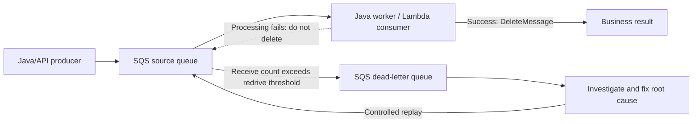
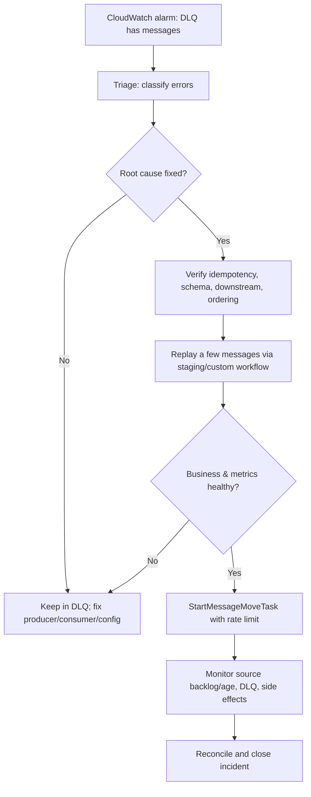
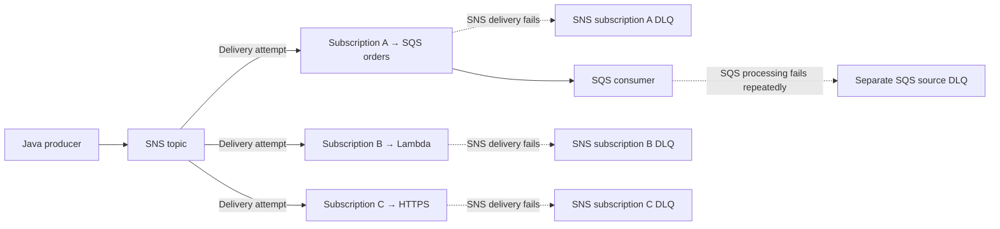

# Dead-Letter Queues, Redrive Policies, and Poison Messages on AWS

A Java application sends order-creation events to **Amazon Simple Queue Service (Amazon SQS)** for asynchronous processing. Each message may cause a consumer to write to a database, deduct inventory, or send an email. However, if a message contains schema-invalid JSON, references a nonexistent record, or repeatedly fails when calling an external service, it can be redelivered multiple times without ever succeeding. That is a **poison message** scenario.

Without isolation, a single bad message can jam the processing flow, inflate Lambda/EC2 invocations, drive up costs, and obscure which jobs actually succeeded. **Dead-letter queues (DLQs)**, **redrive policies**, and a structured **triage → fix root cause → controlled replay** workflow are essential tools for handling it.

This lesson belongs to the **Queues and Notifications** chapter of the **CLOUD_PROVIDERS_AWS** module. Learners will connect AWS Regions/AZs, IAM, VPC, SQS/SNS, Java/Lambda, DynamoDB, CloudWatch, security, resilience, and cost to build reliable messaging systems. The primary scope is **SQS source queue → SQS DLQ**, while distinguishing **SNS subscription DLQs**, **Lambda asynchronous DLQs**, and **stream on-failure destinations**.

## 1. Learning Objectives

After this lesson, you will be able to:

1. Describe the message lifecycle in SQS and the roles of **visibility timeout**, **retention period**, and **receive count**.
2. Distinguish **transient errors**, **permanent data errors**, **poison messages**, **duplicate deliveries**, and **backpressure**.
3. Configure an **SQS source-queue redrive policy** with `deadLetterTargetArn` and `maxReceiveCount`.
4. Configure a **DLQ redrive allow policy** with `allowAll`, `byQueue`, or `denyAll` and know where each policy belongs.
5. Understand differences between **SQS Standard** and **SQS FIFO**, especially regarding **ordering** and **message retention when moved to a DLQ**.
6. Design **Java SDK v2** or **Lambda SQS trigger** consumers to avoid deleting messages that did not process successfully.
7. Use **partial batch failure responses** properly when some messages in a Lambda batch fail.
8. Design **idempotency**, handling for business errors with unknown outcomes, and safe **DLQ redrive/replay** workflows.
9. Monitor queue age, backlog, DLQ depth, retries, consumer failures, and cost boundaries.
10. Troubleshoot SQS/SNS/IAM/KMS incidents and rehearse recovery under least privilege.

## 2. What Problem Does a DLQ Solve?

A **dead-letter queue** is a destination for messages that cannot be processed or delivered successfully under the applicable retry policy. In the SQS source-queue model, **a DLQ is simply a regular SQS queue** configured as the target of a source queue.



A DLQ helps **isolate**, **preserve evidence of**, and **replay** work after a fix. However, a DLQ:

- **Does not auto-fix malformed JSON** or replace broken business rules.
- **Does not guarantee once-only processing**.
- **Does not emit alerts on its own** without metrics and alarms.
- **Does not auto-replay once the root cause is fixed**.
- **Is not permanent storage**: SQS retention is bounded and differs between Standard and FIFO.
- **Does not preserve business ordering** after pulling a message out of a FIFO stream and replaying it.
- **Is not the catch-all bucket for every AWS failure**: SNS delivery failures, Lambda async failures, and stream discards each have separate mechanisms.

A production system should treat “message in DLQ” as **incomplete business work requiring action**, not a terminal success state.

## 3. Lifecycle of an SQS Message

### 3.1. Send, receive, hide, delete, or retry

1. Producer calls `SendMessage`; SQS stores the message according to retention settings.
2. Consumer calls `ReceiveMessage`, or a Lambda event source mapping polls SQS.
3. The message becomes **in-flight** and stays hidden for the **visibility timeout**.
4. If processing succeeds, the consumer calls `DeleteMessage` using the **current receive's receipt handle**; with a Lambda SQS trigger, the event source mapping deletes messages deemed successful.
5. If processing fails or times out without deletion, the message can **reappear** when visibility expires.
6. Each time SQS delivers the message, **`ApproximateReceiveCount`** can increment.
7. If the source queue has a redrive policy and the message fails to be deleted after exceeding the threshold, SQS moves it to the DLQ.

```text
AVAILABLE ──ReceiveMessage──► IN_FLIGHT
   ▲                               │
   │                               ├─ DeleteMessage succeeds ─► DONE
   │                               │
   └── Visibility timeout expires ◄┘
                  │
       Receive count exceeds threshold
                  ▼
                 DLQ
```

**Important:** a message received 5 times **does not necessarily** equate to 5 exceptions in application code. Receive count tracks **SQS receives**, which are affected by consumer crashes, timeouts, visibility, failovers, and batch handling.

### 3.2. Durations that must not be conflated

| Setting | Where configured | Meaning |
|---|---|---|
| `VisibilityTimeout` | SQS queue or per receive | Temporarily hides a message after delivery |
| `MessageRetentionPeriod` | SQS queue | Duration SQS retains an undeleted message before expiry |
| `maxReceiveCount` | **Source queue `RedrivePolicy`** | Receive threshold before moving to DLQ |
| `WaitTimeSeconds` | `ReceiveMessage` / queue-level polling | Long polling wait for message availability |
| `Timeout` | Lambda function | Maximum duration of one Lambda invocation |
| `MaximumBatchingWindowInSeconds` | Lambda event source mapping | Maximum window to gather messages before invoking |
| `DelaySeconds` | SQS message or queue | Delays initial visibility; not a full retry-backoff engine |

In SQS, message retention can be set from **1 minute to 14 days**; never treat a DLQ as an infinite archival store. Visibility timeout caps at **12 hours**, though overly long settings slow down retries.

### 3.3. Visibility timeout is not an absolute lock

SQS Standard has **at-least-once** semantics. Even while in-flight, duplicate deliveries can happen due to distributed delivery mechanics; consumers still require idempotency.

If processing exceeds visibility, the message may reappear while the first worker is still running. You can use `ChangeMessageVisibility` for longer tasks, provided you:

- Bound actual processing duration with timeouts and heartbeats.
- Never extend indefinitely to hold onto a failing message forever.
- Enforce idempotency/leases outside the queue when side effects are risky.
- Avoid multi-hour workflows inside a single Lambda invocation since Lambda has execution caps; consider Step Functions or splitting work.

## 4. What Is a Poison Message?

A **poison message** is a message that a consumer repeatedly fails to process due to its content, business state, or a permanent incompatibility; prolonged system outages can also make valid data “look like” a poison message temporarily.

Examples:

| Scenario | Likely failure class | What to do |
|---|---|---|
| Malformed JSON, missing `orderId` | Permanent data/schema error | Quarantine, fix producer and contract |
| `eventVersion=99` while consumer supports 1–3 | Version incompatibility | Roll out updated consumer or controlled converter |
| Order references a deleted record | Business integrity issue | Reconcile data; may require manual handling |
| DynamoDB/HTTP returns `ProvisionedThroughputExceeded` or 429 | Transient/overload | Retry with backoff; reduce concurrency |
| KMS `AccessDenied` after policy change | Configuration/authorization incident | Alert, fix IAM/key policy; blind retries will not help |
| Payment API times out after accepting request | Unknown outcome | Idempotency key + reconciliation before retrying |
| 25 MB payload in a workflow expecting tiny SQS bodies | Payload design/schema | Use S3 reference pattern; never log full payload |
| Third-party service down for 30 minutes | Temporary dependency outage | Circuit breaker, retries, and backlog SLOs |
| Event with same `operationId` already processed | Duplicate | Detect via durable idempotency store; skip side effects |

**Never delete a message just because “it keeps throwing errors”.** Establish clear policies for unfixable errors, preserve evidence safely, and maintain an audit/quarantine path.

### 4.1. Retry storms and the snowball anti-pattern

When many messages keep reappearing, they can:

- Consume Lambda/EC2 concurrency and budget.
- Hammer databases or external APIs with failing requests.
- Drive up `ApproximateAgeOfOldestMessage` and backlog.
- Push healthy messages behind retries, hurting business throughput.
- Trigger a **snowball anti-pattern** if producers/consumers keep amplifying failing work without a DLQ or partial batch handling.

Fixing this requires more than raising `maxReceiveCount`: classify errors, attach a DLQ, cap concurrency, add exponential backoff with jitter, emit metrics, and verify the true source of truth.

## 5. SQS Redrive Policy: Configured on the Source Queue

**RedrivePolicy** is an attribute of the **source SQS queue**. It specifies the **DLQ ARN** and the **maximum receive count**:

```json
{
  "deadLetterTargetArn": "arn:aws:sqs:ap-southeast-1:111122223333:orders-dlq",
  "maxReceiveCount": "5"
}
```

Meaning:

- `deadLetterTargetArn`: target SQS DLQ.
- `maxReceiveCount`: number of times a consumer can receive a message before SQS moves it to the DLQ if not deleted.
- This is **not the Java exception catch count**, nor a timer like “retry every 5 seconds”.
- SQS performs redrive internally; actual move timing depends on receives, visibility, and retention.

AWS recommends setting `maxReceiveCount` to **at least 5** with Lambda SQS source mappings to avoid sending messages to the DLQ prematurely on transient hiccups.

### 5.1. Choosing `maxReceiveCount` practically

| Workload type | Reference range | Trade-off |
|---|---|---|
| Clean input data, mostly transient failures | `5–8` | Good chance to recover automatically |
| Workflows facing prolonged API rate limits | `5–10` paired with backoff/visibility and circuit breakers | Raising count alone without backoff still causes retry storms |
| Permanent validation errors | Huge counts will not fix them | Detect quickly, quarantine, and fix the producer |
| Sensitive payment flows | Count tied to reconciliation and idempotency | Avoid double-charging; never retry blindly |

These numbers are **directional examples**, not mandatory defaults. Tune them to SLOs, retention, retry cadence, DLQ monitoring, and business risk.

### 5.2. Queue compatibility

For SQS-managed DLQs:

- Source and DLQ must be in the **same AWS account and Region**.
- **Standard source → Standard DLQ**.
- **FIFO source → FIFO DLQ**.
- One DLQ can serve multiple source queues when policies permit, though production is usually easier to monitor and manage when **separated by application or error domain**.
- Sharing one DLQ across prod/dev or unisolated tenants can mix sensitive data and complicate replays.

Source: [Using dead-letter queues in Amazon SQS](https://docs.aws.amazon.com/AWSSimpleQueueService/latest/SQSDeveloperGuide/sqs-dead-letter-queues.html).

## 6. Redrive Allow Policy: Configured on the DLQ

**RedriveAllowPolicy** lives on the **DLQ** and controls **which source queues are permitted to use this DLQ**. This is separate from `RedrivePolicy`.

| `redrivePermission` | Effect | When to choose |
|---|---|---|
| `allowAll` | Allows any eligible source queue to use the DLQ | Default; simple, but broad boundary |
| `byQueue` | Allows only listed source queue ARNs | Production needing least privilege |
| `denyAll` | Blocks all source queues from using this queue as a DLQ | Isolation / queues not meant to act as DLQs |

AWS limits `byQueue` to a **maximum of 10 source queue ARNs**. If more sources are needed, create additional DLQs or adjust authorization architecture.

Example policy on **`orders-dlq`**:

```json
{
  "redrivePermission": "byQueue",
  "sourceQueueArns": [
    "arn:aws:sqs:ap-southeast-1:111122223333:orders-main"
  ]
}
```

**Do not confuse** `RedriveAllowPolicy` with the **queue access policy**. A queue access policy uses IAM-style statements for `SendMessage`/`ReceiveMessage`/etc. by principal, whereas a redrive allow policy restricts **source → DLQ** relationships. For SNS → SQS, you also need a queue resource policy granting the SNS publisher access.

### 6.1. Before changing the policy

- Inventory all source queues currently pointing to the DLQ.
- Check IaC definitions across all sources.
- When switching from `allowAll` to `byQueue`, make sure no needed source queues are omitted.
- Never apply `denyAll` to an active DLQ without a plan, as it can block failing messages from moving.
- Review cross-account policies in adjacent flows; **SQS-managed DLQs** here require the same account and Region.

## 7. SQS Standard vs. FIFO: Ordering Considerations

### 7.1. Standard queue

SQS Standard offers **at-least-once** delivery and best-effort ordering. Repeatedly failing messages can drift toward the back of the queue; after multiple failed receives, the oldest-message-age metric may reflect a different message than the original poison item.

Advantage: high throughput without strict ordering locks. Even if one message takes 5 receives to reach the DLQ, other healthy messages keep flowing.

### 7.2. FIFO queue

FIFO queues preserve order per **`MessageGroupId`** under SQS FIFO rules. While the leading message of a group has not been processed/deleted or its visibility has not expired, subsequent messages in that group wait.

Example:

```text
MessageGroupId = ORDER#123

M1: CreateOrder      → success
M2: ReserveInventory → poison
M3: ChargePayment    → waits for M2 to finish or move to DLQ
M4: SendReceipt      → waits for M2 to finish or move to DLQ
```

Moving M2 to the DLQ unblocks the group, yet **can break business ordering** if M3/M4 proceed without an inventory reservation. AWS cautions **against using a DLQ with FIFO when out-of-order execution is unacceptable**.

**Never infer** that “FIFO exactly-once processing” means once-only side effects on DynamoDB or a Payment API. Consumers still need idempotency and handling for crashes between committing and deleting the message.

### 7.3. DLQs and redrive do not preserve absolute order

When replaying messages from a DLQ back to a FIFO source:

- Redriven messages can **interleave** with newer messages sent by active producers.
- Messages that bypassed the poison item may already have mutated state before the fix.
- Decide on **pausing producers/consumers**, replay order by business key, reconciliation, and idempotency.
- Never click “Redrive messages” on a strictly ordered workflow without evaluating domain invariants first.

## 8. Retention Period: How Standard Differs from FIFO

An important SQS DLQ distinction:

| Characteristic | **Standard source/DLQ** | **FIFO source/DLQ** |
|---|---|---|
| When moved to DLQ | **Original enqueue timestamp is preserved** for expiry calculations | Enqueue timestamp **resets** upon moving to the DLQ |
| `ApproximateAgeOfOldestMessage` on DLQ | Time since the message entered the DLQ, **not age since initial send** | Time since the message entered the DLQ |
| Remaining time in DLQ | DLQ retention minus time already spent in source | Full DLQ retention starting from DLQ arrival |
| Recommendation | **Set DLQ retention longer than source retention** | Set retention long enough for triage and replay |

Standard example:

```text
Source retention = 4 days
Message spent 1 day in source before moving to DLQ
DLQ retention    = 4 days

The message only has ~3 days left in the DLQ,
even though DLQ ApproximateAgeOfOldestMessage starts at 0 on move.
```

With FIFO in the equivalent scenario, retention restarts upon entering the DLQ, leaving nearly 4 full days.

**Production example:** 4-day source retention and 14-day DLQ retention to give teams room to investigate and replay. Still, on Standard, expiry depends on initial enqueue time—never wait until the last minute.

**During an official DLQ redrive**, SQS treats moved messages as new messages, assigning **new message IDs and enqueue timestamps** and resetting retention at the destination. Thus never use SQS `messageId` as a business idempotency key across redrive cycles.

Sources: [SQS DLQ retention](https://docs.aws.amazon.com/AWSSimpleQueueService/latest/SQSDeveloperGuide/sqs-dead-letter-queues.html), [Redrive messages from a DLQ](https://docs.aws.amazon.com/AWSSimpleQueueService/latest/SQSDeveloperGuide/sqs-configure-dead-letter-queue-redrive.html).

## 9. Java SQS Consumer: Delete Only After Processing Succeeds

For Java workloads on EC2, ECS, EKS, or standalone workers, AWS SDK for Java v2 polls SQS via `SqsClient`. Use **long polling**, the **current receive's receipt handle**, and strict deletion rules.

### 9.1. Java SDK v2 example

```java
import software.amazon.awssdk.services.sqs.SqsClient;
import software.amazon.awssdk.services.sqs.model.DeleteMessageRequest;
import software.amazon.awssdk.services.sqs.model.Message;
import software.amazon.awssdk.services.sqs.model.ReceiveMessageRequest;
import software.amazon.awssdk.services.sqs.model.ReceiveMessageResponse;
import java.util.List;

public final class OrdersWorker {
    private final SqsClient sqs;
    private final String queueUrl;

    public OrdersWorker(SqsClient sqs, String queueUrl) {
        this.sqs = sqs;
        this.queueUrl = queueUrl;
    }

    public void pollOnce() {
        ReceiveMessageResponse response = sqs.receiveMessage(
            ReceiveMessageRequest.builder()
                .queueUrl(queueUrl)
                .maxNumberOfMessages(10)
                .waitTimeSeconds(20)
                .build()
        );

        List<Message> messages = response.messages();

        for (Message message : messages) {
            try {
                // 1. Validate schema and event version.
                // 2. Check business idempotency.
                // 3. Commit durable business operation.
                process(message.body());

                // Delete ONLY after business operation succeeds.
                sqs.deleteMessage(
                    DeleteMessageRequest.builder()
                        .queueUrl(queueUrl)
                        .receiptHandle(message.receiptHandle())
                        .build()
                );
            } catch (Exception error) {
                // Leave message in queue. It will become visible after
                // visibility timeout and may eventually move to DLQ.
                System.err.println(
                    "SQS processing failed; messageId="
                    + message.messageId()
                    + ", errorType=" + error.getClass().getSimpleName()
                );
            }
        }
    }

    private void process(String json) {
        if (json == null || json.isBlank()) {
            throw new IllegalArgumentException("Empty event");
        }
        // TODO: real JSON validation, idempotency & durable side effects.
    }
}
```

**This is an educational skeleton**, not a complete production consumer. `process` does not commit anything yet; running it as-is would delete non-empty messages without performing real work. Replace it with real business logic, retries/idempotency, error policies, logging, lifecycle management, and graceful shutdown.

### 9.2. Principles for self-polling workers

- Call `DeleteMessage` only after **durable business confirmation**, never right after deserializing.
- Never use `messageId` as the idempotency key for business events republished as new SQS messages.
- If a consumer crashes after commit and before delete, the message can be redelivered → idempotency is mandatory.
- If processing exceeds visibility timeout, extend with `ChangeMessageVisibility` and monitor so two workers do not collide.
- Log `messageId` and `businessOperationId`; never log raw PII or credentials.
- On JVM workers, use the SDK credentials provider chain (IAM task role or instance profile), never hardcoded access keys.
- Long polling lowers empty receives and cost, but will not fix broken queue permissions or networking.

### 9.3. Should you edit messages directly inside a DLQ?

SQS message bodies **cannot be edited in place** after sending. To normalize a poison message, publish a **corrected new message** through an approved workflow (validation + audit + target destination) before disposing of the old message per policy, avoiding lost evidence or duplicates.

## 10. Lambda SQS Trigger: Whole-Batch Failures vs. Partial Failures

With **Lambda event source mapping**, the Lambda service polls SQS and invokes your function with a batch of one or more messages.

```text
Batch: M1 M2 M3 M4 M5
       ✓  ✓  ✗  ✓  ✓
```

If the handler **throws an exception** outward:

- Lambda treats the **entire invocation as failed**.
- The whole batch can reappear after visibility expires, including records whose side effects already ran.
- One poisoned message causes healthy records to be retried unnecessarily.

If the handler catches M3's error and **returns an empty success**, M3 may be deleted unprocessed. The proper pattern for SQS Standard is **partial batch response**.

### 10.1. Enabling `ReportBatchItemFailures`

On the **Lambda event source mapping**:

```text
FunctionResponseTypes = [ReportBatchItemFailures]
```

Response:

```json
{
  "batchItemFailures": [
    { "itemIdentifier": "message-id-M3" }
  ]
}
```

**`itemIdentifier` must be the SQS `messageId` of the failed record**, not the business `orderId`, receipt handle, or stream sequence number.

When configured properly, Lambda deletes succeeded messages and lets failed ones retry. **If the handler throws an exception** or returns a malformed response or an ID outside the batch, the **entire batch** can be marked failed. If you forget to enable `ReportBatchItemFailures` on the mapping, returning partial failures **will not trigger retries as intended** and risks dropping failed records.

### 10.2. Java Lambda handler example

```java
import com.amazonaws.services.lambda.runtime.Context;
import com.amazonaws.services.lambda.runtime.RequestHandler;
import com.amazonaws.services.lambda.runtime.events.SQSEvent;
import com.amazonaws.services.lambda.runtime.events.SQSBatchResponse;

import java.util.ArrayList;
import java.util.List;

public final class OrdersLambdaHandler
        implements RequestHandler<SQSEvent, SQSBatchResponse> {

    @Override
    public SQSBatchResponse handleRequest(SQSEvent event, Context context) {
        List<SQSBatchResponse.BatchItemFailure> failures = new ArrayList<>();

        for (SQSEvent.SQSMessage message : event.getRecords()) {
            try {
                processIdempotently(message.getBody());
            } catch (Exception error) {
                context.getLogger().log(
                    "Failed messageId=" + message.getMessageId()
                    + ", errorType=" + error.getClass().getSimpleName()
                );
                failures.add(
                    new SQSBatchResponse.BatchItemFailure(message.getMessageId())
                );
            }
        }
        return new SQSBatchResponse(failures);
    }

    private void processIdempotently(String body) {
        if (body == null || body.isBlank()) {
            throw new IllegalArgumentException("Empty event");
        }
        // TODO: schema validation, durable idempotency and side effects.
        // This skeleton must NOT be used to acknowledge real orders.
    }
}
```

The Java application needs runtime-compatible `aws-lambda-java-core` and `aws-lambda-java-events` dependencies, a properly configured handler class, and matching IAM/KMS permissions.

**With SQS FIFO:** stop after the first failing record and include **all failed and unprocessed records** in `batchItemFailures` to preserve order. Never process records in the same message group concurrently without control.

### 10.3. Partial failure does not replace a DLQ

Partial responses avoid retrying healthy records; **failing records still retry and can eventually land in a DLQ** per `maxReceiveCount`. Also, Lambda's `Errors` metric stays 0 when a handler returns a valid partial failure response even though business records failed. Emit a dedicated `RecordFailures` metric and alarm on DLQ depth and queue age.

Sources: [Lambda SQS error handling](https://docs.aws.amazon.com/lambda/latest/dg/services-sqs-errorhandling.html), [SQS Lambda integration](https://docs.aws.amazon.com/lambda/latest/dg/with-sqs.html).

## 11. Idempotency: Guardrails Against Harmful Retries

**Idempotent processing** means executing the same **business operation** multiple times produces no unintended duplicate side effects.

```text
Producer: orderId=ORD-123, operation=ChargePayment

First delivery:
  charge once → persist provider transaction ID → ACK message

Duplicate delivery/replay:
  find completed operation → do NOT charge again → ACK message
```

### 11.1. Choosing an idempotency key

| Key | Recommended? | Why? |
|---|---|---|
| `tenantId + orderId + operationType` | Usually good when business rules define it cleanly | Maps 1:1 to a logical operation |
| `paymentIntentId` | Good with payment providers supporting idempotency | Remains stable across retries |
| Stable `producerEventId` | Can be good | Producer must reuse the same ID when resending the same event |
| `SQS messageId` | Insufficient for business replay across new messages | Redrive can assign a new ID |
| `customerId` | Insufficient | One customer can place multiple orders |
| Full JSON body hash | Only if schema/canonicalization is strict | Metadata or field-order changes alter the hash |

### 11.2. DynamoDB conditional write as durable dedup

A design might create a `ProcessedOperations` table with primary key `operationId` and a condition expression:

```json
{
  "ConditionExpression": "attribute_not_exists(operationId)"
}
```

AWS SDK for Java v2 example:

```java
import java.util.Map;
import software.amazon.awssdk.services.dynamodb.DynamoDbClient;
import software.amazon.awssdk.services.dynamodb.model.AttributeValue;
import software.amazon.awssdk.services.dynamodb.model.PutItemRequest;

public final class DedupStore {
    public void claim(DynamoDbClient ddb, String operationId) {
        ddb.putItem(
            PutItemRequest.builder()
                .tableName("ProcessedOperations")
                .item(Map.of(
                    "operationId", AttributeValue.fromS(operationId),
                    "state", AttributeValue.fromS("IN_PROGRESS")
                ))
                .conditionExpression("attribute_not_exists(operationId)")
                .build()
        );
    }
}
```

**Do not treat the snippet above as complete idempotency handling.** You must handle `ConditionalCheckFailedException`, compare business content, distinguish `IN_PROGRESS` vs. `COMPLETED`, manage lease expiration, conflicts, and business outcomes.

In particular, **never write `COMPLETED` before an external side effect**: if Lambda crashes after writing the marker but before charging, retries will skip an unexecuted charge. Conversely, charging first and writing `COMPLETED` afterward risks double-charging on a crash in between. Use **provider idempotency keys** paired with appropriate reconciliation, outbox, or transaction patterns.

### 11.3. TTL must be long enough

If a DLQ message sits for 10 days before replay while the idempotency record expires after 1 hour, the system could re-execute the operation as if brand new. Base TTL on **SQS retention, DLQ replay horizon, business transaction windows, and compliance**, not just Lambda invocation duration.

For critical payments or orders, retain operation keys long-term or enforce unique constraints across the business lifecycle.

## 12. Back from the DLQ to the Source: Redrive Tasks

**DLQ redrive** moves quarantined messages from a DLQ back to the **original source SQS queue** or a **custom destination queue**.

AWS provides the asynchronous **`StartMessageMoveTask`** API for **SQS DLQs whose source is an SQS queue**. When calling it:

- `SourceArn` is the **DLQ's ARN**, not the original source queue.
- `DestinationArn` can specify a **target SQS queue**; if omitted, SQS redrives back to the respective source queues recorded in metadata.
- `MaxNumberOfMessagesPerSecond`, when specified, sets a **fixed rate limit** up to **500 messages/second**.
- Only **one active message move task per DLQ** is allowed at a time.
- Monitor tasks via `ListMessageMoveTasks` and cancel running tasks with `CancelMessageMoveTask`.

**Redrive does not edit message bodies**, run schema migrations, guarantee original business order, or automatically filter “only fixed messages”. Always inspect a batch before replaying.

### 12.1. Safe workflow



### 12.2. Pre-replay checklist

1. **Freeze the cause**: confirm which code/config change or data fix resolved the poison issue.
2. **Preserve appropriate evidence**: original message ID, operation ID, event version, exception type, receive count, timestamp (redact PII).
3. **Check for valid messages in the DLQ** caused by an outage, not just poison payloads.
4. **Verify consumer schema** and backward compatibility against older messages.
5. **Confirm idempotency** is still valid; redrive generates **new message IDs**.
6. **If FIFO**, evaluate ordering, groups, live producers, and pausing options.
7. **Ensure downstream capacity** can absorb the replay rate (RDS connections, API quotas, DynamoDB WCU).
8. Run a canary first, then ramp up speed while monitoring.
9. Reconcile total events, successes, remaining errors, and side effects.
10. Prepare a runbook to cancel the move task if the DLQ climbs again or downstream overloads.

### 12.3. Illustrative AWS CLI commands

```bash
# Read-only inspection of DLQ and source queue attributes; substitute real URLs/ARNs.
aws sqs get-queue-attributes \
  --queue-url https://sqs.ap-southeast-1.amazonaws.com/111122223333/orders-main \
  --attribute-names RedrivePolicy VisibilityTimeout MessageRetentionPeriod \
  --region ap-southeast-1

aws sqs get-queue-attributes \
  --queue-url https://sqs.ap-southeast-1.amazonaws.com/111122223333/orders-dlq \
  --attribute-names RedriveAllowPolicy ApproximateNumberOfMessages \
  --region ap-southeast-1
```

To inspect move tasks:

```bash
aws sqs list-message-move-tasks \
  --source-arn arn:aws:sqs:ap-southeast-1:111122223333:orders-dlq \
  --region ap-southeast-1
```

**Write commands** should only run under an approved runbook:

```bash
# ILLUSTRATIVE ONLY: moves up to 10 messages/second;
# never run in production without impact analysis.
aws sqs start-message-move-task \
  --source-arn arn:aws:sqs:ap-southeast-1:111122223333:orders-dlq \
  --destination-arn arn:aws:sqs:ap-southeast-1:111122223333:orders-main \
  --max-number-of-messages-per-second 10 \
  --region ap-southeast-1
```

In the AWS Console, you can use **Start DLQ redrive** when conditions and permissions allow. Always check destination, rate, source, task status, and IAM/KMS policies.

Sources: [StartMessageMoveTask API](https://docs.aws.amazon.com/AWSSimpleQueueService/latest/APIReference/API_StartMessageMoveTask.html), [Configure dead-letter queue redrive](https://docs.aws.amazon.com/AWSSimpleQueueService/latest/SQSDeveloperGuide/sqs-configure-dead-letter-queue-redrive.html).

## 13. When NOT to Use Native `StartMessageMoveTask`

Native SQS redrive only supports **DLQs whose source is an SQS queue** per the API specification. It **does not** automatically redrive arbitrary messages in an SQS queue back to a non-SQS logical source.

Examples:

- An SQS queue acting as an **SNS subscription DLQ**: the logical source is SNS delivery, not an SQS source queue with a `RedrivePolicy`.
- A Lambda **asynchronous invocation DLQ** targeting an SQS queue.
- EventBridge/Lambda streams using an SQS destination to record failed event metadata.

In those cases, build a **custom replay workflow** tailored to the event payload, envelope format, and target destination. Never assume `StartMessageMoveTask` will replay notifications into an SNS topic or re-trigger async Lambda invocations automatically.

### 13.1. Custom replays must preserve correctness

If building a Java replay worker:

- Read the SQS DLQ in a controlled manner; never treat queue-inspection tools as delete operations.
- Validate event origin, signatures/schemas/versions, target destination, and authorization.
- Enforce operation idempotency, including across replays.
- Send only to allowlisted SQS/SNS/EventBridge targets; never trust arbitrary ARNs embedded in messages.
- Delete the DLQ message **only after** the target confirms durable storage/publishing.
- Emit audit/correlation IDs and counters, and retry or re-quarantine if publishing fails.
- Reconcile message counts and side effects to prevent duplicates after worker crashes.

When FIFO ordering is required, custom replays must also account for preserving `MessageGroupId`, deduplication IDs, business ordering keys, and concurrent producers.

## 14. How Is an SNS Subscription DLQ Different from an SQS Source DLQ?

Amazon SNS publishes messages to **subscriptions** (SQS, Lambda, HTTP/S, etc.). An **SNS dead-letter queue** is attached to a **subscription** and uses an SQS queue to capture messages that **SNS failed to deliver to the subscriber**.



### 14.1. Two distinct failure classes

| Issue | Where it lands |
|---|---|
| SNS cannot **deliver** to SQS due to broken queue policy/KMS/endpoint | **SNS subscription DLQ** |
| SNS delivers to SQS, then Java/Lambda consumer fails 5 times | **SQS source DLQ** |
| SNS cannot deliver to Lambda due to resource policy or Lambda service failure | **SNS subscription DLQ** |
| Lambda is invoked async and function code throws an exception | **Lambda async retry/on-failure** per configuration, not necessarily SNS subscription DLQ |
| HTTP/S subscriber returns errors while receiving an SNS notification | SNS retry/delivery policy, then **subscription DLQ** once retries exhaust |

An SNS DLQ is configured via the **SNS subscription's `RedrivePolicy`**, which is distinct from an **SQS source queue's `RedrivePolicy`** despite sharing the attribute name.

### 14.2. SNS DLQ rules

Per AWS:

- The SNS subscription and SQS DLQ must be in the **same AWS account and Region** per service conditions.
- Match the **SQS queue type** to the topic/subscription type per SNS FIFO/Standard rules.
- The SQS queue **access policy** must allow `sns.amazonaws.com` to send from the matching `aws:SourceArn`; if using a customer-managed KMS key, grant SNS key permissions as well.
- SNS delivery retries depend on endpoint type. For AWS-managed endpoints like SQS and Lambda, certain server-side errors are retried for a very long time; never assume a single fixed timeout across all protocols.
- An SNS DLQ stores only **delivery failures** after retry exhaustion, not business processing failures after the subscriber received the message.

Sources: [Amazon SNS dead-letter queues](https://docs.aws.amazon.com/sns/latest/dg/sns-dead-letter-queues.html), [SNS delivery retries](https://docs.aws.amazon.com/sns/latest/dg/sns-message-delivery-retries.html).

## 15. Lambda Asynchronous DLQs and Stream Failure Destinations

Other AWS event sources have related error-handling features that are **not identical to SQS redrive**:

| Model | Delivery path | Failure mechanism to inspect |
|---|---|---|
| **Lambda reading SQS** | ESM polls SQS, invokes function synchronously | SQS `RedrivePolicy` + DLQ, Lambda partial batch responses |
| **Lambda async invocation** | Events queued in Lambda's internal async queue | Lambda async retries, maximum event age, **on-failure destination** or DLQ if supported |
| **Lambda reading DynamoDB Streams/Kinesis** | Stream ESM/iterator | Retries/record age, `BisectBatchOnFunctionError`, ESM on-failure destination |
| **SNS topic → SQS subscription** | SNS delivers to queue | SNS subscription DLQ on delivery failure; SQS source DLQ on consumer error |
| **EventBridge rule target** | EventBridge delivers event to target | Target retry policy and per-target DLQ |
| **Step Functions workflow** | State machine transitions | Retry/Catch, compensation, workflow failure handling |

If a Lambda handler receives batches from **Kinesis or DynamoDB Streams**, partial failures return a **sequence number** to advance the checkpoint; SQS partial failures return **`messageId`**. Never mix their schemas or identifiers blindly.

**An SQS DLQ may simply be a container holding failure records from another service.** Always understand the **failure envelope format** and original replay semantics before running redrive tools.

## 16. IaC: Creating an SQS Source Queue and DLQ with CloudFormation

Illustrative example within **one AWS account and Region**. Requirements: Standard queues, 4-day source retention, 14-day DLQ retention, 3-minute visibility timeout, maximum 5 receives before moving to DLQ.

```yaml
AWSTemplateFormatVersion: '2010-09-09'
Description: SQS source queue with isolated DLQ and redrive policy

Resources:
  OrdersDlq:
    Type: AWS::SQS::Queue
    Properties:
      QueueName: orders-dlq
      MessageRetentionPeriod: 1209600  # 14 days
      SqsManagedSseEnabled: true
      RedriveAllowPolicy:
        redrivePermission: byQueue
        sourceQueueArns:
          - !Sub 'arn:${AWS::Partition}:sqs:${AWS::Region}:${AWS::AccountId}:orders-main'

  OrdersQueue:
    Type: AWS::SQS::Queue
    Properties:
      QueueName: orders-main
      VisibilityTimeout: 180
      MessageRetentionPeriod: 345600  # 4 days
      ReceiveMessageWaitTimeSeconds: 20
      SqsManagedSseEnabled: true
      RedrivePolicy:
        deadLetterTargetArn: !GetAtt OrdersDlq.Arn
        maxReceiveCount: 5

Outputs:
  SourceQueueUrl:
    Value: !Ref OrdersQueue
  DeadLetterQueueArn:
    Value: !GetAtt OrdersDlq.Arn
```

**Why `!Sub` constructs a static source ARN from the queue name:** it avoids a CloudFormation circular dependency: the source queue needs the DLQ ARN, while the DLQ's `RedriveAllowPolicy` needs the source ARN. Using `!Sub` with a known queue name breaks the dependency cycle in this template. Adjust the ARN if deploying across different stack names or suffixes.

Production stacks should add: queue resource policies, IAM execution roles, CloudWatch alarms, AWS Budgets, tags, KMS policies if using customer-managed keys, and appropriate deletion/rollback policies. **`SSE-SQS`** here is SQS-managed encryption—not SSE-KMS—so it requires no KMS CMK policy.

### 16.1. If FIFO is desired

Both the source queue and DLQ must be FIFO, e.g., `orders-main.fifo` / `orders-dlq.fifo`, with `FifoQueue: true` on both, and producers must supply `MessageGroupId` and deduplication parameters.

**Never just append `.fifo` to the queue name** while forgetting the `FifoQueue` attribute or failing to evaluate business ordering when moving messages to a DLQ.

## 17. IAM, Queue Policies, and KMS

### 17.1. Permissions for a Java producer

Producers need only minimal permissions, such as:

```json
{
  "Version": "2012-10-17",
  "Statement": [
    {
      "Effect": "Allow",
      "Action": ["sqs:SendMessage"],
      "Resource": "arn:aws:sqs:ap-southeast-1:111122223333:orders-main"
    }
  ]
}
```

### 17.2. Permissions for a Java worker / Lambda execution role

Consumers typically need:

- `sqs:ReceiveMessage`
- `sqs:DeleteMessage`
- `sqs:GetQueueAttributes`
- `sqs:ChangeMessageVisibility` if actively extending visibility
- DynamoDB/RDS/Secrets/CloudWatch permissions needed for side effects

For Lambda SQS triggers, you can reference `AWSLambdaSQSQueueExecutionRole` as a baseline and scope permissions/resources down further. Never grant consumers `sqs:SendMessage` to the DLQ if relying on SQS redrive policy rather than manual forwarding.

### 17.3. Permissions for redrive operators

Running `StartMessageMoveTask` requires appropriate SQS permissions on the **DLQ, source, and destination**, plus KMS permissions to read from the source and write to the destination when SSE-KMS is enabled. Consult current AWS docs for `sqs:StartMessageMoveTask`, `sqs:ListMessageMoveTasks`, `sqs:CancelMessageMoveTask`, `ReceiveMessage`/`DeleteMessage`/`SendMessage`, and queue-level policies. **Never grant `sqs:*` across all queues** just to execute redrives.

### 17.4. Queue resource policies vs. IAM identity policies

When SNS publishes to SQS, the queue policy must allow the **SNS service principal** to send to that specific queue, constrained by `aws:SourceArn` to the right topic; typical IAM producers rely on role identity policies, alongside queue policies for cross-account or service integrations.

Keep these distinct:

- **Identity policy**: what actions an IAM role/user may perform.
- **SQS resource policy**: who may access the queue externally or across services.
- **`RedriveAllowPolicy`**: which source queues may target the DLQ.
- **KMS key policy**: which principals/services may use the encryption key.
- **SCPs / permission boundaries**: guardrails defined by AWS Organizations.

### 17.5. Protecting DLQ data

DLQs often accumulate failing messages containing sensitive data. Always:

- Enable encryption (`SSE-SQS` or `SSE-KMS`).
- Restrict `sqs:ReceiveMessage`/`DeleteMessage` on the DLQ solely to authorized operations personnel.
- Never open DLQs broadly to the Internet or arbitrary cross-account principals.
- Redact PII and tokens from application logs, support tickets, and audit exports.
- Set retention long enough for investigation while complying with data retention policies.
- Audit DLQ access and all redrive tasks.
- For Lambda/VPC workloads, ensure private egress to AWS APIs if code calls SQS directly; ESM polling itself is managed by Lambda.

## 18. Monitoring DLQs and Poison Messages

### 18.1. CloudWatch dashboard

| Metric/signal | Meaning | Common misconception |
|---|---|---|
| `ApproximateNumberOfMessagesVisible` (DLQ) | How many messages await investigation | Approximate, not an exact transaction count |
| `ApproximateAgeOfOldestMessage` (source) | How fast the backlog is aging | On Standard, a repeatedly retried poison message may not be the one measured |
| `ApproximateAgeOfOldestMessage` (DLQ) | Age since entering the DLQ | On Standard, **not** the original age used for retention expiry |
| `ApproximateNumberOfMessagesNotVisible` | In-flight messages | Sustained highs can indicate consumer timeouts or visibility issues |
| `NumberOfMessagesReceived` | Total message receives | Can exceed business events due to retries |
| `NumberOfMessagesDeleted` | Delete operations recorded | Not equal to unique business operations |
| `Lambda Errors / Throttles / Duration` | Invocation errors and performance | Valid partial failures may leave `Errors` at 0 |
| **Custom `RecordFailures` / `PoisonByType`** | Application error counts by record/type | Must be instrumented in Java/Lambda |
| `DynamoDB ConditionalCheckFailed` | Idempotency conflict/duplicate | Not always a business failure |
| SNS delivery failure metrics/logs | Whether SNS delivered to the subscriber | Does not measure downstream SQS consumer processing |

**Important:** if a DLQ holds messages and nobody looks at it, the system is **effectively accepting business data loss** even while messages remain temporarily retained. Assign an owner, alarm routing, handling SLAs, and runbooks.

### 18.2. Key alarm examples

- DLQ `ApproximateNumberOfMessagesVisible > 0` for two consecutive periods or per SLO threshold.
- Source `ApproximateAgeOfOldestMessage` climbing high.
- Surge of messages entering the DLQ right after a deployment.
- Lambda function errors/throttles, SQS backlog, or duration approaching timeout.
- `RecordFailures` climbing even when Lambda `Errors = 0` due to partial batch responses.
- Unusual spikes in duplicate/idempotency conflicts.
- Remaining source/DLQ retention getting too tight relative to remediation time.

### 18.3. Structured logging

Example log **excluding message body**:

```json
{
  "severity": "WARN",
  "event": "order_event_failed",
  "queue": "orders-main",
  "messageId": "example-sqs-id",
  "operationId": "tenant-A:ORD-123:ReserveInventory",
  "receiveCount": 4,
  "errorType": "MissingOrderReference",
  "retryable": false,
  "traceId": "trace-example"
}
```

Receive count can be read from SQS system attributes; confirm its source and never treat it as an exact exception count. Combine consumer logs, CloudTrail management events for queue/policy changes, and CloudWatch metrics for full traceability.

## 19. Cost and Resilience Impact

### 19.1. The cost of a failing message

A single poison message can generate:

- Repeated `ReceiveMessage` and `Delete/ChangeVisibility` API requests or Lambda batch invocations.
- Compute CPU/GB-seconds, cold starts, CloudWatch Logs, and X-Ray traces.
- Calls to RDS, DynamoDB, and third-party APIs—including external vendor charges.
- S3/storage/log retention during triage.
- Data transfer, VPC endpoint, or NAT charges if consumers call AWS APIs privately.
- Engineering hours spent investigating and recovering.
- Customer and SLO impact, hard to quantify on an AWS bill.

Reduce costs properly using **partial failures, idempotency, proper backoff, concurrency limits, DLQ monitoring, and early triage of permanent errors**—never by swallowing exceptions and deleting messages.

### 19.2. Distinguishing HA from DR

SQS is an AWS service engineered for fault tolerance within a Region, which does not mean:

- Your consumer application automatically spans enough AZs or nodes.
- A poison message fixes itself after a failover.
- A DLQ backs up or operates as a long-term archive.
- Backend RDS or financial systems are automatically backed up.
- Queues or SNS subscriptions in another Region automatically receive replays.

If cross-Region **RPO/RTO** targets exist, design dedicated replication, durable source-of-truth data, replay permissions, and recovery drills. A DLQ is an **operational recovery** tool for messages, not full-system disaster recovery.

## 20. Phased Production Rollout Process

### Phase A — Design the message contract

1. Define event types, versions, `eventId`, and a stable business operation ID.
2. Validate schemas, tenant isolation, permissions, and what data may enter messages.
3. Classify errors into retryable, permanent, and unknown-outcome categories.
4. Pick Standard vs. FIFO based on actual ordering needs, not habit.
5. Define idempotency TTL/horizon and replay policies.

### Phase B — Provision queues and DLQs

1. Place source and DLQ in the same account/Region with matching Standard/FIFO type.
2. Size source retention/visibility and give the DLQ ample retention for triage.
3. Configure source `RedrivePolicy` with `maxReceiveCount` aligned to SLOs and retry cadence.
4. Configure DLQ `RedriveAllowPolicy` restricting allowed sources.
5. Apply least-privilege IAM, queue, and KMS policies.
6. Create CloudWatch alarms and dashboards for both source and DLQ.

### Phase C — Implement the consumer

1. Poll SQS with long polling or use Lambda ESM.
2. Validate each record and execute durable, idempotent business logic.
3. Delete only on success; never fake-ACK failures.
4. For Lambda, enable `ReportBatchItemFailures` and return record-level failures.
5. For FIFO, preserve group order; avoid blind parallel processing.
6. Bound concurrency and downstream connections.

### Phase D — Test and operate

1. Test happy paths, duplicate deliveries, poisoned JSON, and permission denials.
2. Test source retries, receive counts, and DLQ routing.
3. Verify retention/age behavior for Standard vs. FIFO where relevant.
4. Rehearse redrive workflows and prove replayed messages do not duplicate side effects.
5. Test downstream outages, throttling, and deployment rollbacks.
6. Periodically review DLQs, ownership, IAM access, metrics/costs, and schema versions.

## 21. Design Scenario: Java + SQS + Lambda Order System

A retail company has a Java API accepting orders and emitting messages:

```json
{
  "eventId": "evt-123",
  "tenantId": "tenant-a",
  "orderId": "ORD-123",
  "operation": "ReserveInventory",
  "eventVersion": 2,
  "occurredAt": "2026-11-20T02:00:00Z"
}
```

Design:

| Component | Choice | Rationale |
|---|---|---|
| Java API producer | Sends SQS message with stable `eventId` | Decouples HTTP request from slow downstream work |
| Source SQS Standard | 4-day retention, visibility matched to function, long polling | Balances backlog buffering and retries |
| SQS DLQ | 14-day retention, `byQueue` allow policy | Isolates errors and restricts source queues |
| Redrive policy | `maxReceiveCount=5` | Gives transient errors room to recover |
| Lambda handler | Partial failure + per-record logging | Prevents one poison record from retrying healthy records |
| DynamoDB | Idempotency record keyed by tenant/order/operation | Prevents duplicate processing and unsafe replays |
| Inventory service | Supports idempotency keys or reconciliation | Prevents double inventory deduction |
| Monitoring | Queue age, DLQ visible, record errors, Lambda failures | Detects incidents promptly |
| Operations | Triage runbook + initial 10 msg/s replay rate | Limits blast radius during recovery |

### 21.1. End-to-end incident walkthrough

- 09:00: new producer version emits `eventVersion=3`.
- 09:05: consumer only understands version 2; all v3 events fail validation.
- 09:10: v3 messages retry repeatedly and move to the DLQ after hitting the threshold.
- 09:12: DLQ depth > 0 alarm pages on-call.
- 09:20: team identifies schema mismatch and halts the v3 producer rollout.
- 09:40: team deploys a consumer supporting version 3 and validates against controlled test samples.
- 09:50: team verifies business idempotency keys and tests replaying a small batch.
- 10:00: team starts DLQ redrive at a low rate limit while watching Lambda and Inventory.
- 10:20: all orders confirmed processed, DLQ remains quiet; postmortem recorded.

Timestamps are **illustrative**, not mandatory SLO targets.

### 21.2. Why not replay immediately at 09:12?

Because the consumer did not yet support schema v3, replaying immediately would only generate more failing retries and bounce the messages straight back to the DLQ. **Fix the root cause first, replay second**, while watching change impact and rollback readiness.

## 22. Failure Testing Matrix

| Test | Expectation | What to verify |
|---|---|---|
| Valid message | Consumer processes, calls `DeleteMessage`, DLQ stays empty | DB/business state |
| Schema-invalid JSON | Not deleted, redelivered, eventually routed to DLQ | Message stays intact; error logs |
| One error in Standard Lambda batch | Only failed message retries when ESM partial batch is enabled | `FunctionResponseTypes`, message IDs |
| Middle error in FIFO Lambda batch | Failed and all subsequent unprocessed records reported | Group ordering |
| Duplicate message with same operation ID | No extra side effects | DynamoDB idempotency state |
| Timeout after successful inventory call | No duplicate reservation on retry | External idempotency / reconciliation |
| Visibility shorter than actual processing | Concurrent duplicate execution risk | Race tests, metrics |
| Source queue / `RedriveAllowPolicy` mismatch | DLQ configuration or delivery rejected | `RedriveAllowPolicy` and IAM |
| DLQ retention too short | Messages expire before triage | Retention policy / age |
| Redrive after code fix | Messages return to source and succeed | Business event counts |
| Redrive while consumer is still broken | DLQ fills up again | Stop task / circuit breaker |
| SNS delivers to SQS, consumer fails | SQS source DLQ grows; SNS subscription DLQ does not | Separation of delivery vs. processing |
| SQS FIFO replay alongside live producers | Messages interleave; business order may shift | `MessageGroupId` & reconciliation |

## 23. Diagnosing Common Incidents

### 23.1. DLQ stays empty despite numerous exceptions

Possible reasons:

- Source queue lacks a `RedrivePolicy` or points to the wrong DLQ.
- Messages have not exceeded `maxReceiveCount` yet.
- Consumer **catches exceptions and deletes/ACKs** before retries can happen.
- Visibility timeout is so long that subsequent receives have not occurred yet.
- Messages hit retention expiration before reaching the DLQ.
- Alarm points to the wrong account, Region, or queue.
- Confusing a Lambda async DLQ with an SQS source DLQ.

**Investigation:** read source `RedrivePolicy`, `ApproximateReceiveCount` in logs, `NumberOfMessagesDeleted`, consumer code, and queue metrics.

### 23.2. DLQ spikes right after a deployment

Possible causes include schema incompatibility, IAM/KMS errors, broken routes/VPC endpoints, overly tight timeouts, or a downstream outage. **Do not rush to redrive** before classifying the root cause, weighing pausing producers/consumers, and rolling back broken code.

### 23.3. `StartMessageMoveTask` fails to start

Possible reasons:

- `SourceArn` points to the **original source queue** instead of the **DLQ**.
- The DLQ has no SQS source configured (e.g., it is an SNS subscription DLQ).
- Missing IAM/queue permissions or missing KMS decrypt/encrypt permissions.
- Another move task is already active on that DLQ.
- `DestinationArn` has the wrong Region, queue type, or permissions.
- Source or destination queue was deleted or experienced policy drift.

Inspect the API error and `ListMessageMoveTasks`; never grant account-wide `sqs:*` as a first resort.

### 23.4. Messages remain in the DLQ after replay

Possible causes: some messages are still poisoned, operator picked the wrong destination/rate or canceled the task, consumers still run older code, idempotency state conflicts, or new failures arrived during replay.

Reconcile using business operation IDs and source logs rather than judging success solely by “DLQ count went down”.

### 23.5. FIFO group stays stalled for a long time

A failing message at the head of a group blocks messages behind it. Scaling consumer concurrency will not help if there is only **one `MessageGroupId`** or order cannot be split. Fix the poison issue, decide on DLQ ordering semantics, and redesign group keys if feasible.

## 24. Scenario Exercises

### Exercise A — Distinguishing the two policies

Source `orders-main` has `RedrivePolicy.maxReceiveCount=5`. DLQ `orders-dlq` has `RedriveAllowPolicy.redrivePermission=byQueue` listing the allowed source ARN.

**Question:** Which policy controls when a message enters the DLQ? Which policy controls which source queues may use the DLQ?

**Answer:** The **source queue's `RedrivePolicy`** defines the target and `maxReceiveCount`; the **DLQ's `RedriveAllowPolicy`** defines which source queues are permitted.

### Exercise B — Calculating Standard DLQ retention

A Standard message sits in the source queue for 2 days before moving to the DLQ. DLQ retention is 7 days.

**Question:** How much time remains before expiry under retention rules?

**Answer:** Roughly **5 days**, because Standard preserves the original enqueue timestamp when moving. The DLQ's `ApproximateAgeOfOldestMessage` starts counting upon DLQ arrival and therefore **does not reflect total age toward expiration**.

### Exercise C — FIFO business ordering

Workflow `DebitAccount → CreditAccount → NotifyUser` shares one `MessageGroupId`. The Debit message fails and moves to the DLQ, so Credit runs anyway.

**Question:** Is the system safe simply because it uses FIFO?

**Answer:** **No**. Moving to the DLQ broke business-process ordering by skipping the first step. Use transactional/compensating workflows, business-key blocking, or decide against a DLQ if order cannot be broken.

### Exercise D — Lambda partial batch

Input IDs are `m1,m2,m3,m4`. `m2` fails; the others succeed.

**Output:**

```json
{
  "batchItemFailures": [
    {"itemIdentifier": "m2"}
  ]
}
```

**Condition:** ESM must enable `ReportBatchItemFailures`. Never substitute `orderId` for `messageId`.

### Exercise E — Redrive generates new message IDs

A Java consumer stores idempotency keys using `SQS messageId`. After a redrive, the same order gets processed twice.

**Answer:** Redrive can assign a new `messageId`. Use a **stable business operation ID** and a durable idempotency record with a TTL covering the full replay horizon.

### Exercise F — SNS DLQ vs. consumer DLQ

An SNS topic delivers to a source SQS queue successfully; the Java consumer crashes after receiving the message.

**Question:** Does the error land in the SNS subscription DLQ or the SQS source DLQ?

**Answer:** Because the consumer failed **after SNS delivered successfully**, it routes to the **SQS source DLQ** via the queue's redrive policy. An SNS subscription DLQ captures failures **during SNS delivery**.

### Exercise G — Choosing a redrive rate

A DLQ holds 30,000 messages. Downstream can absorb at most 20 extra messages/second under normal live traffic.

**Guidance:** pick a rate with headroom—such as **10 messages/second**, test a canary first, and adjust via telemetry. At a steady 10/s, 30,000 messages take roughly **3,000 seconds (50 minutes)** in theory, though real task and consumer behavior/limits vary; monitor costs, business latency, and DLQ retention.

### Exercise H — Diagnosing `AccessDenied`

Queues use an SSE-KMS customer-managed key. An operator has `sqs:StartMessageMoveTask`, yet redrive fails.

**Guidance:** check queue permissions, `sqs:ReceiveMessage`/`DeleteMessage` on the source DLQ, `sqs:SendMessage` on the destination, and **KMS decrypt/encrypt/generate data key** grants on the relevant keys—never grant `kms:*` indiscriminately.

### Exercise I — Calculating visibility timeout

Lambda timeout is 25 seconds; SQS Standard batch window is 4 seconds.

**Guidance:** AWS Lambda recommends a visibility timeout of **at least 6 × 25 + 4 = 154 seconds** for retry/throttling headroom; also verify real requirements, function duration, and batch behavior.

### Review Questions

1. Must a poison message always be malformed JSON?
2. Does an SQS DLQ auto-repair messages or auto-replay them?
3. Which queue and policy own `maxReceiveCount`?
4. Does `RedriveAllowPolicy` live on the source queue or the DLQ?
5. What are the three `redrivePermission` values?
6. Can a Standard source queue use a FIFO DLQ?
7. Why can a FIFO DLQ break business ordering?
8. Is `ApproximateReceiveCount` the exact count of Java exceptions?
9. How do Standard and FIFO differ on enqueue timestamps when moving to a DLQ?
10. What age does `ApproximateAgeOfOldestMessage` report on a Standard DLQ?
11. Why should source and DLQ retention periods differ?
12. Which queue does `StartMessageMoveTask.SourceArn` point to?
13. Does native DLQ redrive automatically replay SNS subscription notifications?
14. Does an SQS `messageId` stay unchanged after a redrive?
15. Why is idempotency still required even with SQS FIFO?
16. What happens if a Java worker deletes a failing SQS message before committing?
17. When does Lambda's `ReportBatchItemFailures` take effect?
18. In a FIFO Lambda batch, why report unprocessed items too?
19. Does an SNS subscription DLQ catch delivery failures or Java consumer processing errors?
20. How can DLQ depth climb while Lambda `Errors` remains 0?
21. Why shouldn't you replay immediately while downstream is still broken?
22. How does a redrive rate limit protect databases and APIs?
23. Which CloudWatch alarms should be enabled immediately on a DLQ?
24. Why must a DLQ never be used as a permanent data archive?

**Brief answers:** (1) no, it can stem from state, permissions, or dependencies; (2) no; (3) source `RedrivePolicy`; (4) DLQ; (5) `allowAll`/`byQueue`/`denyAll`; (6) no; (7) skipping a failed message; (8) no; (9) Standard preserves original timestamp, FIFO resets it; (10) time since entering the DLQ; (11) Standard needs triage headroom including time spent in source; (12) DLQ ARN; (13) no; (14) do not assume it stays the same, redrive issues new IDs; (15) at-least-once delivery and non-atomic side effects; (16) lost business work; (17) when enabled on the ESM; (18) to avoid false ACKs and preserve ordering; (19) delivery; (20) partial batch responses return success, so per-record failures are not invocation `Errors`; (21) it only triggers a retry storm; (22) shields downstream capacity and SLOs; (23) visible message count and age; (24) finite retention.

## 25. Production Checklist

- [ ] Identified the exact source type and DLQ purpose: SQS consumer, SNS delivery, Lambda async, or stream.
- [ ] Source and DLQ are in the same Region/account with matching Standard/FIFO type.
- [ ] Source `RedrivePolicy` targets the right DLQ ARN with `maxReceiveCount` aligned to retries and SLOs.
- [ ] DLQ `RedriveAllowPolicy` restricts sources and is not confused with IAM/queue resource policies.
- [ ] Message retention accounts for Standard vs. FIFO semantics and gives enough triage/replay time.
- [ ] Visibility timeout fits processing time and Lambda timeout/batch window where applicable.
- [ ] Producers supply stable event schemas/versions and business `operationId`s.
- [ ] Consumers ACK/delete only after durable business success.
- [ ] Lambda SQS ESM enables partial failures whenever the handler returns `batchItemFailures`.
- [ ] FIFO preserves ordering; DLQ impact on message groups has been evaluated.
- [ ] Durable idempotency store/unique constraints, downstream idempotency, and reconciliation are in place.
- [ ] Permanent errors are quarantined; transient errors use backoff and concurrency caps.
- [ ] Least-privilege IAM and KMS across SQS, Lambda, SNS, DynamoDB, and RDS.
- [ ] DLQ data is encrypted, read/delete access is restricted, and PII is redacted from logs.
- [ ] CloudWatch alerts cover DLQ depth, age, backlog, and per-record failure rates.
- [ ] Owner/on-call, triage SOP, replay criteria, and write-permission approvals exist.
- [ ] Before redrive: verify fix, version compatibility, and idempotency TTL.
- [ ] Redrive uses a canary, rate limit, dashboards, and a stop/rollback runbook.
- [ ] Tested poison messages, duplicates, post-side-effect timeouts, and missing KMS permissions.
- [ ] Budgeted for SQS, Lambda, DynamoDB, observability, networking, and retry costs.
- [ ] Practiced FIFO incidents, SNS subscription DLQs, and replays from non-SQS sources.

## 26. Summary

A **dead-letter queue** is the isolation layer for work that fails to process successfully. In SQS, **`RedrivePolicy` lives on the source queue**, defining the target DLQ and `maxReceiveCount`; **`RedriveAllowPolicy` lives on the DLQ**, restricting which source queues may use it.

Rules never to forget:

- **Never fake a successful ACK** when business logic fails; delete messages only after a safe commit.
- **SQS Standard and FIFO differ** in ordering guarantees and retention timestamps upon moving to a DLQ.
- **Replay does not repair data**, can repeat side effects, and does not guarantee order; require triage, fixes, idempotency, rate limits, and reconciliation.
- **Lambda partial batch responses** only prevent retrying healthy records when the ESM is configured properly; they do not provide exactly-once execution.
- **SNS subscription DLQs** handle delivery failures; **SQS source DLQs** handle consumer failures; never confuse them with Lambda async or stream failure destinations.
- **Metrics/alarms, IAM/KMS, runbooks, cost controls, and ownership** are part of the design, not an afterthought after an outage.

By pairing DLQs with Java consumers, Lambda/SQS, DynamoDB idempotency, CloudWatch, and controlled recovery workflows, an AWS queuing architecture can keep processing healthy messages, isolate broken records, and recover without accidentally duplicating transactions.

### Official AWS Documentation

1. [Using dead-letter queues in Amazon SQS](https://docs.aws.amazon.com/AWSSimpleQueueService/latest/SQSDeveloperGuide/sqs-dead-letter-queues.html)
2. [Configure DLQ redrive](https://docs.aws.amazon.com/AWSSimpleQueueService/latest/SQSDeveloperGuide/sqs-configure-dead-letter-queue-redrive.html)
3. [StartMessageMoveTask API](https://docs.aws.amazon.com/AWSSimpleQueueService/latest/APIReference/API_StartMessageMoveTask.html)
4. [Troubleshoot DLQ redrive](https://docs.aws.amazon.com/AWSSimpleQueueService/latest/SQSDeveloperGuide/troubleshooting-dlq-redrive.html)
5. [SQS best practices](https://docs.aws.amazon.com/AWSSimpleQueueService/latest/SQSDeveloperGuide/sqs-best-practices.html)
6. [SQS visibility timeout](https://docs.aws.amazon.com/AWSSimpleQueueService/latest/SQSDeveloperGuide/sqs-visibility-timeout.html)
7. [SQS message retention periods](https://docs.aws.amazon.com/AWSSimpleQueueService/latest/SQSDeveloperGuide/sqs-message-retention-periods.html)
8. [Lambda with SQS](https://docs.aws.amazon.com/lambda/latest/dg/with-sqs.html)
9. [Lambda SQS error handling and partial batches](https://docs.aws.amazon.com/lambda/latest/dg/services-sqs-errorhandling.html)
10. [Lambda SQS event source mapping configuration](https://docs.aws.amazon.com/lambda/latest/dg/services-sqs-configure.html)
11. [AWS prescriptive guidance: partial batch response best practices](https://docs.aws.amazon.com/prescriptive-guidance/latest/lambda-event-filtering-partial-batch-responses-for-sqs/best-practices-partial-batch-responses.html)
12. [Amazon SNS dead-letter queues](https://docs.aws.amazon.com/sns/latest/dg/sns-dead-letter-queues.html)
13. [Amazon SNS delivery retries](https://docs.aws.amazon.com/sns/latest/dg/sns-message-delivery-retries.html)
14. [Amazon SQS Java SDK v2 examples](https://docs.aws.amazon.com/sdk-for-java/latest/developer-guide/java_sqs_code_examples.html)
15. [Amazon DynamoDB condition expressions](https://docs.aws.amazon.com/amazondynamodb/latest/developerguide/Expressions.ConditionExpressions.html)
16. [Amazon SQS pricing](https://aws.amazon.com/sqs/pricing/)
17. [AWS Lambda pricing](https://aws.amazon.com/lambda/pricing/)
18. [Amazon CloudWatch pricing](https://aws.amazon.com/cloudwatch/pricing/)
