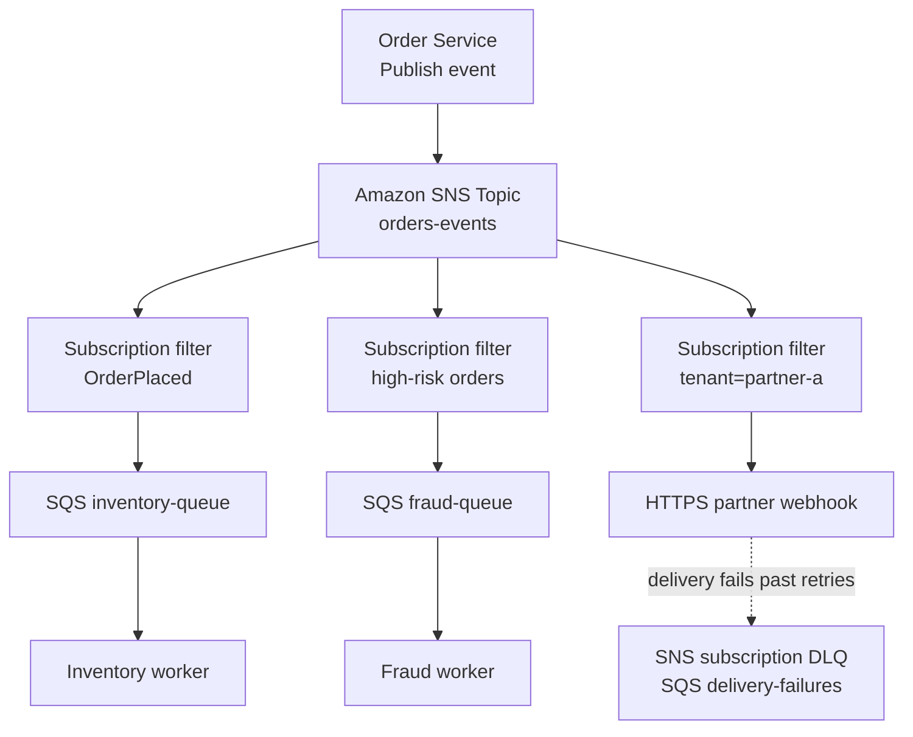
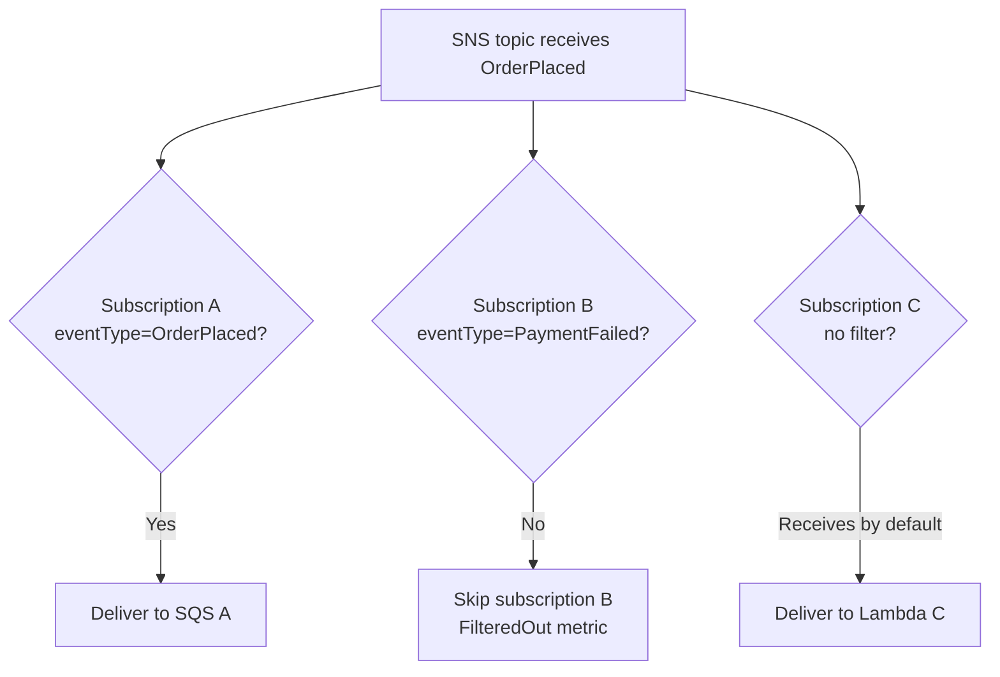
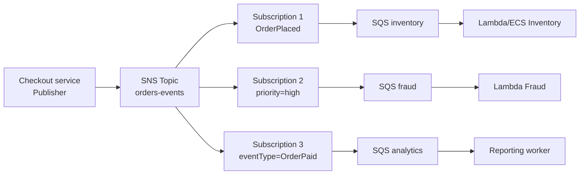
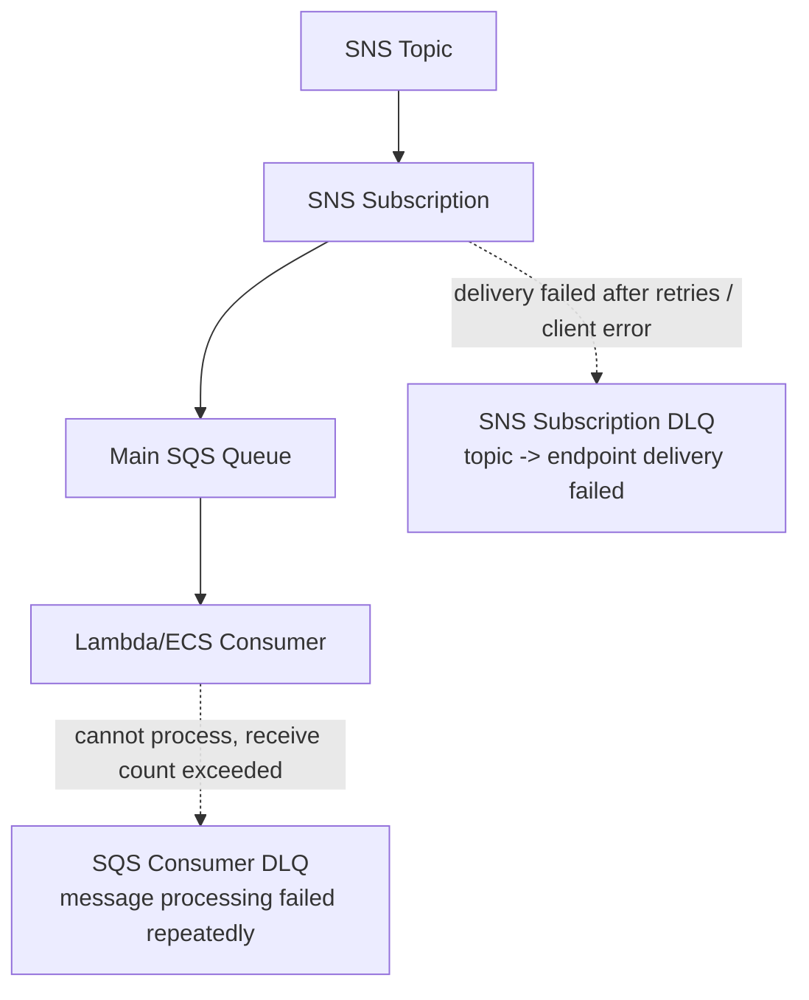
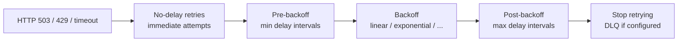
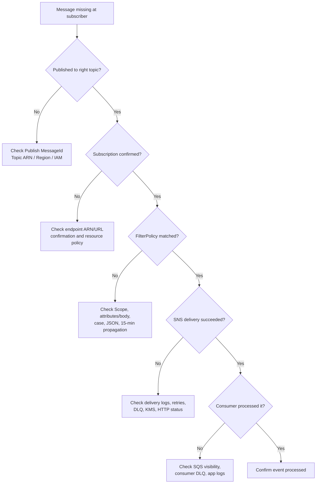

# SNS Message Filtering and Delivery Policies on Amazon SNS

> **Chapter:** Queues and Notifications  
> **Module:** CLOUD_PROVIDERS_AWS  
> **Objective:** design event-type fan-out, filter messages per subscription, configure delivery policies/retries for HTTP/S endpoints, protect undeliverable messages with dead-letter queues, monitor reliability, and control costs.
>
> **Scope:** Amazon Simple Notification Service (Amazon SNS) Standard/FIFO topics; subscribers using Amazon SQS, AWS Lambda, HTTP/S, and SNS-supported protocols. All IDs, ARNs, events, accounts, customer limits, and URLs below are illustrative. State-mutating commands are explicitly marked and must not be run in production without approval.

## 1. Real-World Problem: One Order Event, Many Recipients

A sales application running on Amazon ECS/Fargate and Lambda emits an event when a new order is placed:

```json
{
  "eventId": "evt-2026-001",
  "eventType": "OrderPlaced",
  "tenantId": "shop-a",
  "region": "VN",
  "priority": "high",
  "orderId": "O-12345",
  "totalAmount": 850000,
  "currency": "VND"
}
```

Multiple systems need to react:

- **Inventory worker:** updates stock for all `OrderPlaced` events.
- **Fraud worker:** inspects orders with `priority=high` or large total amounts.
- **Notification service:** sends confirmation emails/SMS per application policy.
- **Reporting service:** cares only about `OrderPlaced` and `OrderCancelled`.
- **Partner HTTP webhook:** receives events belonging to its tenant, though its endpoint occasionally returns HTTP 503 or 429.

If the publisher calls each service directly, adding a subscriber forces changes to publisher code, and a slow webhook can degrade the publisher. An **Amazon SNS topic** provides a **publish/subscribe fan-out** model in which the publisher sends **one message** to the topic, while subscriptions determine whether to receive it and over which protocol.



There are **two independent decisions**:

1. **Message filtering:** should this message **be sent to this subscription at all?**
2. **Delivery policy:** **if selected for delivery and the endpoint fails, how should SNS retry?**

This is the most important distinction in this lesson.

## 2. Core SNS Objects

| Component | Role | Example |
|---|---|---|
| **Topic** | Publishing hub distributing one message to many subscriptions | `orders-events` |
| **Publisher** | App/service calling `Publish` or `PublishBatch` | ECS order service |
| **Message body** | Main content of the message | Order JSON |
| **Message attributes** | Name/type/value pairs attached to the message | `eventType=OrderPlaced` |
| **Subscription** | Link between a topic and a specific endpoint/protocol | Topic → SQS queue |
| **`FilterPolicy`** | Matching condition for a subscription to receive a message | Accept only `eventType=OrderPlaced` |
| **`FilterPolicyScope`** | Whether filtering evaluates attributes or JSON body | `MessageAttributes` / `MessageBody` |
| **`DeliveryPolicy`** | Delivery retry/throttling rules, customizable for HTTP/S | Exponential backoff up to 60 seconds |
| **`RedrivePolicy`** | Specifies the **SNS subscription DLQ** for undeliverable messages | SQS DLQ ARN |
| **`RawMessageDelivery`** | Whether to send raw body or wrapped SNS envelope by protocol | SQS receives raw JSON body |
| **Delivery status logging** | Logs endpoint delivery outcomes to CloudWatch Logs | HTTP 503 and retry attempts |

**`FilterPolicy`, `DeliveryPolicy`, and `RedrivePolicy` are three separate configurations.** None of them replaces or implies another.

### 2.1. A topic does not “know” each consumer's business logic

Publishers should emit events with **clear schemas and semantics**; each consumer subscribes and receives the relevant slice. The topic does not need to invoke fraud or inventory code to decide “is this order risky?” if a filter policy expresses it cleanly.

Still, an SNS filter is **only an attribute/JSON matcher**, not an arbitrary business-rules engine. If risk scoring requires ML or DB lookups, compute it at the publisher or a dedicated upstream consumer first, then emit an event carrying a validated `riskClass` field.

### 2.2. Standard topics vs. FIFO topics

**SNS Standard** fits large-scale fan-out where messages may be delivered **at least once** without strict ordering guarantees per subscriber.

**SNS FIFO** targets cases needing per-**`MessageGroupId`** ordering, paired with deduplication and SNS/SQS FIFO guarantees. Simply appending `.fifo` to a topic name does not magically give every downstream endpoint application-level exactly-once execution.

| Criterion | Standard SNS | FIFO SNS |
|---|---|---|
| Ordering | Best effort | Ordered within the same message group where supported |
| Duplicates | Consumers must tolerate them | Deduplication within AWS windows/limits; apps still need idempotency |
| Fan-out to SQS | Primarily Standard queues | SQS FIFO to preserve FIFO semantics |
| Filter policy | Yes | Yes, though filtering can drop events from a sequence |
| DLQ | Supported subscription DLQ | FIFO DLQ per source requirements |
| Use case | Diverse service events | Workflows with ordering/dedup constraints |

**In every model, never equate “delivered to SQS” with “consumer succeeded”.** Those two stages have separate retry and DLQ mechanisms.

## 3. What Does SNS Deliver by Default?

An SNS subscription **without a filter policy** is eligible to receive **every message** published to the topic, provided protocol, permissions, and delivery succeed.

When a filter policy is configured:

- SNS evaluates **message attributes** or the **JSON message body**, depending on `FilterPolicyScope`.
- Each subscription is evaluated **independently**.
- If matched, SNS attempts delivery to that subscription's endpoint.
- If unmatched, the message is **filtered out of that subscription**; this is **not a delivery failure**.
- Other subscriptions on the same topic still receive the message if their own policies match.



If a message is filtered out of the Fraud subscription, it is **not** sent to the Fraud DLQ; by design, that subscription was not meant to receive it.

## 4. The Two Filter Policy Scopes

`FilterPolicyScope` is a **subscription attribute** with two values.

| Scope | What it filters on | When to use |
|---|---|---|
| **`MessageAttributes`** (**default**) | Message attributes attached separately to SNS Publish | Events with explicit routing metadata |
| **`MessageBody`** | Properties inside the **JSON object** of the message body | Events already carrying a JSON schema without duplicating metadata |

**A subscription has one scope at a time**; you cannot write a single `FilterPolicy` that ANDs an attribute `eventType` directly with a body field `tenantId` without aligning them into the same scope.

### 4.1. `MessageAttributes`: publisher sends separate metadata

Publisher sends body:

```json
{
  "eventId": "evt-001",
  "orderId": "O-12345",
  "totalAmount": 850000
}
```

Along with attributes:

```json
{
  "eventType": {
    "DataType": "String",
    "StringValue": "OrderPlaced"
  },
  "priority": {
    "DataType": "String",
    "StringValue": "high"
  },
  "amount": {
    "DataType": "Number",
    "StringValue": "850000"
  },
  "tenantId": {
    "DataType": "String",
    "StringValue": "shop-a"
  }
}
```

Inventory subscription filter:

```json
{
  "eventType": ["OrderPlaced"]
}
```

Priority fulfillment subscription filter:

```json
{
  "eventType": ["OrderPlaced"],
  "priority": ["high"]
}
```

**Benefit:** clear routing metadata without deep-parsing JSON bodies to select subscribers. **Trade-off:** the publisher must keep metadata synchronized with the body; if the body says `OrderCancelled` while the attribute says `OrderPlaced`, consumers receive unexpected events.

### 4.2. `MessageBody`: filtering JSON directly

Publisher sends JSON:

```json
{
  "eventType": "OrderPlaced",
  "tenantId": "shop-a",
  "risk": {
    "level": "high",
    "score": 92
  },
  "shipping": {
    "country": "VN"
  },
  "orderId": "O-12345"
}
```

Set `FilterPolicyScope=MessageBody` and filter:

```json
{
  "eventType": ["OrderPlaced"],
  "risk": {
    "level": ["high"],
    "score": [
      { "numeric": [">=", 80] }
    ]
  }
}
```

This is a **nested filter policy** valid for `MessageBody`. Never use nested objects in an attributes-based policy, as SNS does not support nested attribute filters.

### 4.3. Body must be a valid JSON object

With scope `MessageBody`, SNS requires the payload to be a **well-formed JSON object**.

Examples **unsuitable** for body filtering:

```text
Order O-12345 created
```

Or a bare JSON string:

```json
"OrderPlaced"
```

To filter on JSON properties, send an object like `{"eventType":"OrderPlaced"}`. If the body is not a valid JSON object, SNS increments **`NumberOfNotificationsFilteredOut-InvalidMessageBody`** instead of delivering to body-filtered subscriptions.

**You cannot fix this by enabling `RawMessageDelivery`.** Raw delivery controls **formatting after delivery to the endpoint**, whereas `FilterPolicyScope` controls **how SNS evaluates the message before delivery**.

## 5. Semantics: AND Across Keys, OR Across Values

Core rules:

1. All **top-level keys / property conditions** in the policy must match simultaneously — **AND** logic.
2. Within **a single key's value array**, only **one** value/operator needs to match — **OR** logic.
3. Body fields or attributes **not mentioned in the policy** are generally ignored during evaluation.
4. Key names and exact string matches are **case-sensitive** by default.

Example:

```json
{
  "eventType": ["OrderPlaced", "OrderPaid"],
  "region": ["VN", "SG"],
  "priority": ["high"]
}
```

Logical expression:

\[
(eventType = OrderPlaced \lor eventType = OrderPaid)
\land (region = VN \lor region = SG)
\land (priority = high)
\]

Truth table:

| Event | Region | Priority | Match? |
|---|---|---|---|
| `OrderPlaced` | `VN` | `high` | **Yes** |
| `OrderPaid` | `SG` | `high` | **Yes** |
| `OrderCancelled` | `VN` | `high` | No |
| `OrderPlaced` | `US` | `high` | No |
| `OrderPlaced` | `VN` | `low` | No |
| `OrderPlaced` | `VN` | *missing* | No |

**Note:** A field omitted from the policy imposes no constraint. Conversely, a **field required by the policy that is absent from the message** fails to match, unless an explicit condition like `exists:false` is used.

### 5.1. What if you want OR across multiple keys?

Policy:

```json
{
  "eventType": ["OrderPlaced"],
  "priority": ["high"]
}
```

does **not** mean “`eventType=OrderPlaced` **or** `priority=high`”. It is AND.

To express distinct conditional branches, check SNS's supported **`$or` operator** and exact syntax in the documentation, or split into **multiple subscriptions** if appropriate architecturally. Never drop a key quietly just to fake OR—you will receive far too many unwanted messages.

## 6. Useful Filter Operators

Amazon SNS supports operators for strings, numbers, field existence, and patterns.

| Operator | Example | Meaning |
|---|---|---|
| Exact string | `"eventType": ["OrderPlaced"]` | Exact string match |
| Numeric | `{"numeric":[">=",1000]}` | Matches numeric range |
| `anything-but` | `{"anything-but":["test","demo"]}` | Excludes listed values |
| `prefix` | `{"prefix":"vip-"}` | String starts with prefix |
| `suffix` | `{"suffix":".csv"}` | String ends with suffix |
| `equals-ignore-case` | `{"equals-ignore-case":"urgent"}` | Case-insensitive string match |
| `wildcard` | `{"wildcard":"order-*-created"}` | Wildcard string pattern |
| `cidr` | `{"cidr":"10.0.0.0/24"}` | Matches IPv4 string against CIDR |
| `exists` | `{"exists":true}` | Checks property presence per AWS semantics |
| OR operator | Dedicated SNS syntax | OR across conditional branches |

**Keep operators as simple as possible for easier testing and operations.** Never use wildcards to paper over an unstable event schema.

### 6.1. Numeric ranges

A worker caring only about orders >= 1,000,000 VND:

```json
{
  "eventType": ["OrderPlaced"],
  "amount": [
    { "numeric": [">=", 1000000] }
  ]
}
```

Multiple bounds can be combined:

```json
{
  "riskScore": [
    { "numeric": [">=", 70, "<", 90] }
  ]
}
```

Values are compared **numerically**, not lexicographically. With `MessageAttributes`, the publisher must use type `Number`; with `MessageBody`, the field must be a **JSON number**.

**Do not send `"850000"` as a JSON string assuming numeric filters will always coerce it.** Enforce consistent types in the schema contract.

### 6.2. Prefix, suffix, anything-but

Subscription matching only merchants whose ID starts with `vip-`:

```json
{
  "merchantId": [
    { "prefix": "vip-" }
  ]
}
```

Subscription handling CSV uploads:

```json
{
  "fileName": [
    { "suffix": ".csv" }
  ]
}
```

Subscription excluding demo events in the main environment:

```json
{
  "environment": [
    { "anything-but": ["demo", "sandbox"] }
  ]
}
```

**Verify behavior when the field is missing.** An `anything-but` policy does not mean “allow all messages lacking `environment`”; to handle absent fields, use `exists:false` or require the routing attribute.

### 6.3. `exists` and schema evolution

When migrating from v1 (no `riskScore`) to v2 (with `riskScore`), a subscription might need to catch messages missing the key. SNS supports `exists` conditions:

```json
{
  "riskScore": [
    { "exists": false }
  ]
}
```

However, `exists` semantics vary slightly across scopes, value types, and null/empty properties; always test with real sample messages. Never equate `exists:false` with “value is `null`”.

For critical events, the better long-term solution is **schema versioning**:

```json
{
  "schemaVersion": 2,
  "eventType": "OrderPlaced",
  "riskScore": 90
}
```

### 6.4. Case sensitivity and wildcard complexity

`"OrderPlaced"` and `"orderplaced"` are **two distinct strings** under exact matching. Standardize naming conventions for event names and tenant IDs (e.g., **PascalCase** or **snake_case**) and avoid arbitrary changes once subscribers exist.

Wildcards carry complexity limits; avoid policies repeating patterns like `"*a*b*c*d*"` across many values, which hit quotas quickly and are hard to reason about. Consult AWS docs on the maximum three wildcards per pattern and total wildcard complexity before using complex patterns.

## 7. Message Attribute Types and Pitfalls

SNS supports message attribute types including:

| DataType | Example | Notes |
|---|---|---|
| `String` | `eventType=OrderPlaced` | Exact string match, case-sensitive |
| `Number` | `amount=850000` | Numeric matching |
| `String.Array` | `tags=["vip","express"]` | Matches individual array elements |
| `Binary` | Binary data | **SNS subscription filters ignore `Binary` attributes** |

Common constraints:

- Attribute names are case-sensitive, have character restrictions, and cannot use reserved prefixes `AWS.` or `Amazon.`.
- Attributes used for filtering must follow proper **JSON encoding/escaping** per SDK/API docs, especially quotes and backslashes.
- Under `MessageAttributes`, SNS does not support **nested filter policies**; nested JSON is supported only under `MessageBody`.
- In **FIFO topics**, `MessageGroupId` and `MessageDeduplicationId` have dedicated SNS FIFO roles; never assume a filter policy can match them as message attributes unless the publisher passes them explicitly as attributes.
- Different protocols and delivery formats do not forward all attributes identically, even though SNS evaluates them when filtering.

### 7.1. `String.Array` example

Publisher sends:

```json
{
  "tags": {
    "DataType": "String.Array",
    "StringValue": "[\"vip\",\"fragile\",\"express\"]"
  }
}
```

Subscription filter:

```json
{
  "tags": ["express", "cold-chain"]
}
```

Because the array contains `express`, SNS matches it under `String.Array` rules. Never send a plain `String` literal `"vip,fragile,express"` expecting SNS to split it into an array.

## 8. Filter Policy Scale and Limits

Per AWS documentation on filter policy constraints, monitor these limits:

| Limit | AWS documented value | Meaning |
|---|---|---|
| Filter policy keys | Max **5** | For nested `MessageBody`, counts leaf keys |
| Match combinations | Max **150** | Product of choices per key; nested policies include a depth multiplier |
| `FilterPolicy` JSON size | Max **256 KB** | Do not use policies to replace database routing tables |
| Filter policies per topic | Default **200** | Quota increases may be requested |
| Filter policies per account | Default **10,000** | Quota increases may be requested |
| Wildcard complexity | Max **100 points** total | Avoid multi-wildcard patterns |
| Policy change propagation | Up to **15 minutes** | Never assume changes take effect instantaneously |

### 8.1. Calculating combinations for a flat policy

Policy:

```json
{
  "eventType": ["OrderPlaced", "OrderCancelled", "OrderReturned"],
  "region": ["VN", "SG"],
  "priority": ["high", "normal"]
}
```

Combinations =

\[
3\times 2\times 2=12
\]

Adding 10 values to each key without auditing causes complexity to grow multiplicatively, not additively. Exceeding the limit causes SNS to reject the policy update.

### 8.2. Nested policies factor in depth

With `MessageBody`:

```json
{
  "order": {
    "payment": {
      "status": ["PAID", "PENDING"]
    }
  },
  "shipping": {
    "country": ["VN", "SG"]
  }
}
```

AWS computes complexity using **leaf choices × nesting depth** per leaf and multiplying across branches. Deeply nested policies therefore hit the limit **sooner** than flat policies with the same value counts.

**Recommendation:** keep routing metadata small with few keys and stable across schema versions; if you need thousands of dynamic tenant-specific rules, evaluate separate topics, an application router, or EventBridge event patterns rather than stuffing every tenant ID into one filter policy.

### 8.3. Eventual consistency: updates do not apply immediately

Adding, editing, or deleting a filter policy can take up to **15 minutes** to propagate completely. During that window:

- Some deliveries may still evaluate the old policy.
- Some deliveries evaluate the new policy.
- Tests run right after deployment may yield inconsistent results.

For financial or security-sensitive events, **never treat the moment of a policy change as a hard access-control cutover**. Enforce authorization in the application/backend and plan explicit cutover windows.

## 9. Filter Policies Are Not an Authorization Engine

A publisher might emit:

```json
{
  "tenantId": "company-a",
  "eventType": "OrderPlaced"
}
```

A subscriber receives only `tenantId=company-a` via a filter. That alone is **insufficient for multi-tenant security**:

- Another publisher with `sns:Publish` could spoof `tenantId` unless sources are restricted.
- A subscriber with permission to subscribe or edit its policy could widen its filter to receive other tenants' events.
- If an SQS queue policy is overly broad, other topics could push messages into the queue.
- Filters exist for **routing**, not to replace IAM, KMS, or application-level data authorization.

**Multi-tenant isolation requires defense in depth:**

1. IAM topic/identity policies control who can publish or subscribe.
2. Queue resource policies allow `sns.amazonaws.com` to send only from the **exact Topic ARN** via `aws:SourceArn`.
3. KMS key policies restrict SNS/SQS key usage to the proper scope.
4. Consumers verify `tenantId` against a **trusted source** before persisting data.
5. Separate topics, accounts, or queues per tenant when compliance demands strict isolation.

## 10. Message Filtering and Fan-Out via SQS

### 10.1. Recommended architecture



**Why place SQS in between?**

- SNS fans out quickly; SQS buffers messages for consumers to process at their own pace.
- A temporary consumer outage does not force the publisher to retry directly.
- Queue depth and oldest message age surface backlogs cleanly.
- Each queue can have its own **SQS consumer DLQ** for messages failing repeatedly in business logic.
- Once SNS places the message into the queue, SNS considers delivery to the **SQS endpoint** complete; consumer failures belong to SQS/Lambda/ECS.

### 10.2. Distinguishing SNS subscription DLQs from SQS consumer DLQs



| DLQ type | Attached to | Captures what? |
|---|---|---|
| **SNS subscription DLQ** | **Subscription** via `RedrivePolicy` | Messages SNS **could not deliver to the endpoint** |
| **SQS consumer DLQ** | **SQS source queue** via SQS `RedrivePolicy` | Messages already in the queue that consumers **repeatedly failed to process** |

**No single DLQ protects every stage.** If delivery to SQS succeeds and Lambda code crashes, the SNS subscription DLQ will **not** receive that message; configure an SQS redrive policy or separate retry handling.

### 10.3. Give each subscription its own policy and DLQ when appropriate

A topic has three subscriptions; if only the HTTPS partner suffers an outage, the SQS subscribers keep receiving matching events cleanly. Attach DLQs **per subscription**, not at the topic level, to pinpoint which endpoint failed.

## 11. How Does Raw Message Delivery Interact with Filtering?

**`RawMessageDelivery`** controls formatting **when delivering a message to an endpoint**.

### 11.1. When `RawMessageDelivery = false`

An SQS subscriber normally receives an SNS notification envelope like:

```json
{
  "Type": "Notification",
  "MessageId": "example-uuid",
  "TopicArn": "arn:aws:sns:ap-southeast-1:111122223333:orders-events",
  "Message": "{\"eventType\":\"OrderPlaced\",\"orderId\":\"O-12345\"}",
  "Timestamp": "2026-11-20T00:00:00.000Z",
  "SignatureVersion": "1",
  "Signature": "EXAMPLE_SIGNATURE",
  "SigningCertURL": "EXAMPLE_CERT_URL"
}
```

The consumer must parse the SNS envelope and then parse `Message` if the business payload is a JSON string.

### 11.2. When `RawMessageDelivery = true`

SQS receives the body directly:

```json
{
  "eventType": "OrderPlaced",
  "orderId": "O-12345"
}
```

**Advantage:** the SQS consumer parses the business JSON only once. **Trade-off:** SNS wrapper metadata is absent from the body; on HTTP/S raw delivery, SNS sends an `x-amz-sns-rawdelivery: true` header and does not deliver message attributes the same way as wrapped delivery.

### 11.3. Message attribute limit on SQS raw delivery

AWS specifies that **SNS → SQS subscriptions with `RawMessageDelivery` enabled support at most 10 message attributes**. If a publisher sends more than 10 attributes to such a subscription, SNS may **discard the message for that subscription** as a client-side error.

Do not try to raise the filter policy key quota to fix this: **5 filter keys** and **10 raw message attributes** are **two completely different limits**.

### 11.4. Raw delivery does not enable or disable filtering

A subscription can **filter on `MessageAttributes`** and still deliver the raw body to SQS. Conversely, it can **filter on `MessageBody`** and deliver the SNS envelope when raw delivery is off. Filtering and raw delivery are independent settings.

## 12. Delivery Policies: When a Message Matches, Yet Delivery Fails

Once a filter matches, SNS begins **delivery**. The endpoint may:

- Respond and acknowledge success.
- Fail transiently due to timeouts, overload, or service unavailability.
- Fail permanently due to a deleted endpoint, missing permissions, or rejected requests.
- Be paced by the HTTP/S subscription's delivery rate settings.

A **delivery policy** defines **how SNS retries** endpoint delivery errors under service conditions. Once retries exhaust, SNS stops trying; if a **subscription DLQ** is configured, the undeliverable message is saved there for follow-up.

### 12.1. Which protocols allow custom retry policies?

Per AWS:

| Endpoint protocol | Customizable SNS retry delivery policy? | How it operates |
|---|---|---|
| **HTTP/S** | **Yes** | Customize `DeliveryPolicy` on the topic or subscription |
| **Amazon SQS** | **No** | AWS applies service-managed retry behavior |
| **AWS Lambda** | **No** | AWS applies service-managed retry behavior for SNS → Lambda handoff |
| **Email/SMTP** | **No** | SNS-managed policy |
| **SMS/mobile push** | **No** | SNS-managed policy |
| **Firehose** | Follows service retry behavior | Cannot be inferred from HTTP/S settings |

**Never set an HTTP/S `DeliveryPolicy` expecting to adjust retry counts for an SQS or Lambda subscription.** If your goal is to change **consumer** retries after Lambda fails processing an event, configure Lambda asynchronous invocation / `OnFailure` destinations or the **SQS redrive policy** at the corresponding stage.

### 12.2. Default retries for AWS-managed endpoints

Per AWS SNS delivery retry documentation:

- For **SQS and Lambda**, on server-side delivery failures, SNS can retry up to **100,015 attempts over roughly 23 days** under its service policy.
- For customer-managed protocols like email/SMS/mobile push, AWS uses shorter retry schedules (e.g., 50 attempts over ~6 hours depending on protocol and conditions).
- **HTTP/S** is customizable, with total retry policy duration capped at **3,600 seconds**.

**Never read “SNS → Lambda retries for 23 days” as meaning Lambda function code is retried for 23 days after Lambda already accepted the invocation.** SNS manages only the **delivery/handoff step** into the Lambda service.

### 12.3. Which errors retry and which terminate?

For **HTTP/S delivery** per AWS docs:

| HTTP response | How SNS treats it | Action |
|---|---|---|
| **2xx** | Delivery success | Do not retry |
| **5xx** | Retryable server-side failure | Retry per delivery policy |
| **429 Too Many Requests** | Retryable throttling | Retry per delivery policy |
| **Other 4xx** (e.g., 400/401/403/404) | Usually permanent client-side error | **No retry** under HTTP/S policy |
| Timeout / network / server unavailable | Retryable under service rules | Retry with backoff |
| Missing permissions on SQS/Lambda endpoint | Client-side / permanent failure | May route to DLQ; fix IAM/resource policy |

**Warning:** if your webhook returns **HTTP 200 before durably persisting the event**, SNS considers delivery successful. If the app crashes right after returning 200, SNS will not retry and the subscription DLQ cannot rescue the event. HTTP endpoints should **persist durably or enqueue internally before returning 2xx** whenever guaranteed handling is required.

## 13. Components of an HTTP/S `DeliveryPolicy`

AWS lets you attach delivery policies at:

- **Topic level:** applies to HTTP/S subscriptions inheriting the topic policy.
- **Subscription level:** overrides for one HTTP/S subscriber; inspect `EffectiveDeliveryPolicy` to see what is actively enforced.

Main sections:

| Policy | Attributes | Purpose |
|---|---|---|
| **`healthyRetryPolicy`** | `minDelayTarget`, `maxDelayTarget`, `numRetries`, `numNoDelayRetries`, `numMinDelayRetries`, `numMaxDelayRetries`, `backoffFunction` | Configures retry counts and backoff schedule |
| **`throttlePolicy`** | `maxReceivesPerSecond` | Caps average delivery rate to an HTTP/S subscription |
| **`requestPolicy`** | `headerContentType` | Sets the HTTP/S notification `Content-Type` header |

### 13.1. Four retry phases



**Explanation:**

1. **No-delay:** immediate retries, helpful for ultra-brief glitches; too many can worsen overload.
2. **Pre-backoff:** retries spaced by `minDelayTarget`.
3. **Backoff:** wait intervals grow per `backoffFunction` across middle retries.
4. **Post-backoff:** retries spaced by `maxDelayTarget` at the end of the schedule.

SNS also adds **jitter** to prevent synchronized subscriber retries from creating thundering herds.

### 13.2. Example `DeliveryPolicy` for a partner webhook

```json
{
  "healthyRetryPolicy": {
    "minDelayTarget": 1,
    "maxDelayTarget": 60,
    "numRetries": 50,
    "numNoDelayRetries": 3,
    "numMinDelayRetries": 2,
    "numMaxDelayRetries": 35,
    "backoffFunction": "exponential"
  },
  "throttlePolicy": {
    "maxReceivesPerSecond": 10
  },
  "requestPolicy": {
    "headerContentType": "application/json"
  }
}
```

This follows an AWS documentation example: out of `numRetries=50`, there are **3** immediate retries, **2** pre-backoff retries, **35** post-backoff retries, and the remaining retries in the backoff phase.

**Never equate `numRetries=50` with a guarantee that the endpoint will be called exactly 50 times.** AWS accounts for attempts vs. retries, jitter, permanent failures, and the total retry duration cap. Inspect delivery status logs to observe actual behavior.

### 13.3. Meaning of min/max delay and backoff

| Field | Practical meaning |
|---|---|
| `minDelayTarget` | Minimum wait target in the policy, in seconds |
| `maxDelayTarget` | Maximum wait target in the policy, within AWS limits |
| `numRetries` | Total retry attempts configured across phases |
| `numNoDelayRetries` | Retries with no delay |
| `numMinDelayRetries` | Retries at minimum delay |
| `numMaxDelayRetries` | Retries at maximum delay |
| `backoffFunction` | `arithmetic`, `exponential`, `geometric`, or `linear` |
| `maxReceivesPerSecond` | Target **average** max delivery rate per HTTP/S subscription |
| `headerContentType` | Selects `Content-Type`, e.g., `application/json` |

AWS caps **total HTTP/S retry policy duration at ≤ 3,600 seconds**, **`numRetries` between 0 and 100**, and enforces constraints across delay and phase fields. Validate via CLI/SDK before committing to production IaC.

**Do not set min/max delays of 600 seconds with 100 retries** thinking SNS will hold the message for days; SNS enforces a separate **total retry window cap**.

## 14. What Is `throttlePolicy.maxReceivesPerSecond`?

Example:

```json
{
  "throttlePolicy": {
    "maxReceivesPerSecond": 10
  }
}
```

This paces the average delivery rate to **a single HTTP/S subscription**—it does not limit how fast publishers can publish to the topic.

Per AWS documentation:

- It is an **average delivery rate target**, not a strict hard real-time cap.
- Short bursts above the configured rate can still occur.
- Messages slowed by SNS due to this setting are re-queued to wait for capacity and **do not count against endpoint-failure retries**.
- If producers publish faster than the subscriber's delivery rate, **delivery backlog and latency** will rise.

**Do not misunderstand:** `maxReceivesPerSecond=10` will not protect an endpoint that crashes if 11 requests land in a single second. The endpoint still needs its own **rate limiting, concurrency controls, queue/worker buffering, and idempotency**.

## 15. `requestPolicy` and `Content-Type`

Per AWS, HTTP/S deliveries default to a `Content-Type` such as:

```text
text/plain; charset=UTF-8
```

If a webhook expects JSON and requires `Content-Type: application/json`, configure:

```json
{
  "requestPolicy": {
    "headerContentType": "application/json"
  }
}
```

**`Content-Type` does not convert a plain-text body into valid JSON.** It only sets an HTTP header; the publisher must send valid content, and the subscriber must handle the SNS envelope or raw format properly.

When raw delivery is **off**, SNS sends a **JSON envelope** wrapping the `Message` field; when raw delivery is **on**, the webhook receives the raw body. Test both with your HTTP framework before rolling out.

### 15.1. Authenticating SNS notifications sent to HTTPS endpoints

Enabling HTTPS alone does not prove every request hitting `/webhook` came from SNS:

- With **wrapped SNS notifications**, AWS includes a cryptographic signature and certificate URL; endpoints should verify the **signature**, trusted topic ARN, and message type per AWS guidance.
- Validate that the certificate URL uses the expected AWS hostname and HTTPS protocol; never fetch arbitrary URLs from payloads to prevent SSRF.
- Handle **`SubscriptionConfirmation`** and **`UnsubscribeConfirmation`** via trusted validation logic.
- With **`RawMessageDelivery`** on HTTP/S, SNS strips the SNS JSON envelope metadata and signature from the body; design an appropriate origin-authentication mechanism (such as an authenticated endpoint/proxy or AWS-verified pattern).
- Never rely on **`User-Agent`** or easily spoofed headers as sole authentication.

**Risk:** without origin verification and idempotency, an endpoint accepting forged requests could create fake orders or trigger payments.

## 16. SNS Subscription DLQs: Last Resort After Delivery Failure

When an endpoint returns a permanent error or exhausts retries, if the subscription has a **`RedrivePolicy`**, SNS routes the message to an **Amazon SQS dead-letter queue**. This is a critical data-preservation layer.

Example:

```json
{
  "deadLetterTargetArn": "arn:aws:sqs:ap-southeast-1:111122223333:partner-webhook-dlq"
}
```

### 16.1. Prerequisites to verify

Per AWS:

- The DLQ must be an **SQS queue in the same AWS account and Region** as the SNS subscription.
- **Standard topic** subscriptions use an **SQS Standard queue** as their DLQ; FIFO topic subscriptions use a compatible **FIFO queue** per rules.
- The SQS DLQ needs a **resource policy** allowing the SNS principal `sqs:SendMessage` from the exact topic ARN.
- If the DLQ uses SSE-KMS, the customer-managed KMS key policy must permit SNS to use KMS per documentation.
- Set retention long enough for operations to recover; AWS commonly recommends up to **14 days** when appropriate.
- Set CloudWatch alarms when messages land in the DLQ and maintain a **controlled replay** runbook.

**Note:** SNS does not treat filtered-out messages as “failed deliveries”; unmatched messages do not go to the DLQ.

### 16.2. Example SQS resource policy for SNS

```json
{
  "Version": "2012-10-17",
  "Statement": [
    {
      "Sid": "AllowSpecificSnsTopic",
      "Effect": "Allow",
      "Principal": {
        "Service": "sns.amazonaws.com"
      },
      "Action": "sqs:SendMessage",
      "Resource": "arn:aws:sqs:ap-southeast-1:111122223333:partner-webhook-dlq",
      "Condition": {
        "ArnEquals": {
          "aws:SourceArn": "arn:aws:sns:ap-southeast-1:111122223333:orders-events"
        }
      }
    }
  ]
}
```

**Scoping `aws:SourceArn`** prevents granting `SendMessage` to arbitrary SNS topics. In cross-account topologies, also check ownership, KMS permissions, Regions, and service requirements.

### 16.3. Remember that DLQ delivery itself can fail

If the DLQ is deleted, its queue policy blocks SNS, or its KMS policy denies encryption, even **redriving to the DLQ** fails.

Monitor:

- `NumberOfNotificationsRedrivenToDlq`.
- `NumberOfNotificationsFailedToRedriveToDlq`.
- SQS DLQ `ApproximateNumberOfMessagesVisible`.

**Specifically:** SQS's `NumberOfMessagesSent` metric **is not a reliable way to track SNS redrives into a DLQ** per AWS guidance; alert on `ApproximateNumberOfMessagesVisible` for active DLQ backlog.

## 17. Should Every Subscription Have a DLQ?

The answer depends on event criticality.

| Subscriber | Impact of delivery failure | Recommendation |
|---|---|---|
| Fraud detection queue | Can weaken risk controls | **Use an SNS DLQ** and an SQS consumer DLQ |
| Analytics queue | Delayed processing may be acceptable | SNS DLQ if data completeness matters |
| Critical partner webhook | Lost events cause reconciliation mismatches | **Strongly recommend an SNS DLQ** |
| Best-effort promotional notification | Replay may be unnecessary | Set appropriate retention/alert policies |
| Temporary test endpoint | High availability not required | Still consider a DLQ for debugging |

**Never automatically replay an entire DLQ back into the original topic** during an incident. If filters or policies are still broken, replays fail again; if consumers lack idempotency, replays duplicate business effects.

A replay runbook should:

1. Fix the root cause.
2. Inspect schemas and origins of messages in the DLQ.
3. Confirm events remain valid in time and order.
4. Ensure consumers are idempotent via `eventId`/dedup keys.
5. Replay in controlled batches while watching metrics.
6. Record an audit trail while respecting privacy and retention rules.

## 18. Monitoring: Knowing Whether Messages Were Filtered or Failed Delivery

### 18.1. Key `AWS/SNS` metrics

| Metric | What to watch | Interpretation |
|---|---|---|
| **`NumberOfMessagesPublished`** | How many messages producers published | Does not equal delivered across every subscriber |
| **`NumberOfNotificationsDelivered`** | Notifications delivered successfully by SNS | Interpret alongside protocol and dimensions |
| **`NumberOfNotificationsFailed`** | Failed deliveries | For HTTP/S, may count each failed retry attempt |
| **`NumberOfNotificationsFilteredOut`** | Messages rejected by filters | **Not a delivery failure** |
| **`NumberOfNotificationsFilteredOut-MessageAttributes`** | Did not match attribute filter | Check metadata, casing, and types |
| **`NumberOfNotificationsFilteredOut-MessageBody`** | Did not match JSON body filter | Check body fields and values |
| **`NumberOfNotificationsFilteredOut-InvalidAttributes`** | Invalid attributes for filtering | Check JSON escaping and types |
| **`NumberOfNotificationsFilteredOut-NoMessageAttributes`** | Missing required attributes | Check publisher and `FilterPolicyScope` |
| **`NumberOfNotificationsFilteredOut-InvalidMessageBody`** | Body is not valid JSON | Check producer schema and body |
| **`NumberOfNotificationsRedrivenToDlq`** | Messages moved to DLQ | Investigate endpoint failures |
| **`NumberOfNotificationsFailedToRedriveToDlq`** | Failed to deliver to DLQ | Check SQS policy and KMS |
| **`PublishSize`** | Track message sizes | Cost and payload limits |

**Note:** these metrics are usually topic-scoped with corresponding dimensions; not every metric breaks out individual subscriptions directly. To debug a specific subscriber, combine **SNS delivery status logs**, endpoint logs, SQS metrics, and correlation IDs.

### 18.2. Watching SQS backlog

In `AWS/SQS`, monitor:

- `ApproximateNumberOfMessagesVisible`: backlog waiting for consumers.
- `ApproximateAgeOfOldestMessage`: approximate maximum wait latency.
- `ApproximateNumberOfMessagesNotVisible`: in-flight messages.
- DLQ `ApproximateNumberOfMessagesVisible`: messages awaiting triage/replay.

If topic publishes rise while queue depth stays flat, check whether:

1. Messages **did not match the filter**.
2. The subscription is inactive or unconfirmed.
3. The queue policy is blocking SNS delivery.
4. You are inspecting the wrong topic, Region, or account.
5. Consumers are draining the queue so fast that depth stays near zero.

Never conclude “SNS lost messages” just because a queue looks empty at one point in time.

### 18.3. Delivery status logging

SNS can write delivery statuses for supported endpoint protocols—such as SQS, Lambda, HTTP/S, and Firehose—to **CloudWatch Logs**.

Configure:

- Enable delivery status logging on the topic for the relevant protocol.
- Assign IAM roles allowing SNS to write logs.
- Choose a sensible **success sample rate** alongside full failure logging.
- Look up log groups named `sns/<region>/<account-id>/<topic-name>`.
- Inspect request/message IDs, endpoints, and provider responses in logs.
- Set retention to avoid unbounded log storage costs.

**Never enable 100% success logging on high-volume topics without calculating CloudWatch costs and checking what data might appear in logs.**

### 18.4. Sample production alert table

| Signal | Suggested condition | Impact |
|---|---|---|
| `FilteredOut-InvalidMessageBody > 0` | Malformed `MessageBody` schema | Producer publishing invalid payloads |
| Rising `FilteredOut-NoMessageAttributes` | `MessageAttributes` filter active, producer omitted attrs | Consumers missing expected events |
| Rising `NumberOfNotificationsFailed` | HTTP retries / endpoint failures | Partner deliveries delayed or dropped |
| `RedrivenToDlq > 0` | Final delivery failed | Incident response and replay needed |
| `FailedToRedriveToDlq > 0` | DLQ safety net broken | Urgent policy/KMS investigation |
| Rising SQS oldest message age | Slow or stopped consumers | Scale consumers or fix downstream |
| Sustained HTTP 429/503 | Subscriber overloaded | Tune rate/retries and backend capacity |

Base thresholds on baseline traffic rather than alarming on normal policy filtering. **High `FilteredOut` counts can be completely healthy** when a subscription only wants one event type out of dozens.

## 19. Complete Design Example: Orders Topic and Three Subscriber Types

### 19.1. Standardized event payload

Producer should publish:

```json
{
  "schemaVersion": 1,
  "eventId": "evt-001",
  "eventType": "OrderPlaced",
  "tenantId": "shop-a",
  "orderId": "O-12345",
  "riskScore": 85,
  "currency": "VND",
  "amount": 850000
}
```

Conventions:

- `eventId` is a unique business event ID for idempotency.
- `schemaVersion` supports schema evolution.
- `eventType` uses consistent naming.
- `tenantId` comes from a **trusted application context**, never raw user input.
- `riskScore` is a true JSON number when using numeric filters.
- Omit unnecessary PII and payment secrets.

### 19.2. Subscription A — inventory

`FilterPolicyScope=MessageBody`:

```json
{
  "eventType": ["OrderPlaced"]
}
```

All `OrderPlaced` events flow to SQS inventory. The consumer enforces idempotency via `eventId` to avoid deducting stock twice on retries or redrives.

### 19.3. Subscription B — fraud

`FilterPolicyScope=MessageBody`:

```json
{
  "eventType": ["OrderPlaced"],
  "riskScore": [
    { "numeric": [">=", 80] }
  ]
}
```

Only orders with `riskScore >= 80` enter the fraud queue. If the business rule is **high priority OR large amount**, use exact OR operator syntax or emit an authoritative `requiresFraudReview=true` field from a trusted service.

### 19.4. Subscription C — partner webhook

`FilterPolicyScope=MessageBody`:

```json
{
  "eventType": ["OrderPlaced", "OrderPaid"],
  "tenantId": ["shop-a"]
}
```

`DeliveryPolicy`:

```json
{
  "healthyRetryPolicy": {
    "minDelayTarget": 1,
    "maxDelayTarget": 60,
    "numRetries": 50,
    "numNoDelayRetries": 3,
    "numMinDelayRetries": 2,
    "numMaxDelayRetries": 35,
    "backoffFunction": "exponential"
  },
  "throttlePolicy": {
    "maxReceivesPerSecond": 10
  },
  "requestPolicy": {
    "headerContentType": "application/json"
  }
}
```

The HTTPS endpoint requires:

- A valid public HTTPS URL and completed subscription confirmation.
- SNS message signature verification or an equivalent origin-trust check per format.
- Duplicate handling and durable persistence before returning 2xx.
- An SQS subscription DLQ, alarms, and a replay runbook.
- Backend tenant authorization rather than relying on the filter policy as a security boundary.

## 20. Step-by-Step Console Configuration

### 20.1. Step 0 — Preflight

Before modifying production:

1. Confirm exact **Region, account, topic ARN, and subscription ARN**.
2. Document active subscriptions and protocols.
3. Back up current `FilterPolicy`, `FilterPolicyScope`, `DeliveryPolicy`/`EffectiveDeliveryPolicy`, `RedrivePolicy`, and `RawMessageDelivery`.
4. Confirm event schemas and valid/invalid sample messages.
5. Verify SQS/HTTP endpoint health, queue policies, and KMS key policies.
6. Prepare a rollback plan and on-call coverage since filter updates can take up to **15 minutes**.
7. Confirm CloudWatch metrics/logging and approved costs.

### 20.2. Step 1 — Create or select the topic

Navigate to **Amazon SNS → Topics** and choose Standard or FIFO appropriately.

- Ensure topic name and ARN match the right Region.
- Topic policy grants `sns:Publish` only to authorized publishers.
- If using SSE-KMS, KMS key policy permits required principals and cross-service interactions.
- For FIFO, verify `MessageGroupId`/dedup and downstream FIFO queues.

### 20.3. Step 2 — Create the subscription

Select:

- Protocol `sqs`, `lambda`, or `https` matching the endpoint.
- Exact endpoint ARN or HTTPS URL.
- Confirm the subscription where required, especially HTTP/S.
- For SQS, add an SQS queue resource policy allowing `sns.amazonaws.com` from the exact topic.
- For Lambda, ensure the function resource-based policy permits SNS invocation.

While unconfirmed (`PendingConfirmation`), even a perfect filter will not deliver messages.

### 20.4. Step 3 — Set filter scope and JSON

Go to **Subscriptions → select subscription → Edit → Subscription filter policy**:

1. Choose **Message attributes** or **Message body**.
2. Enter the `FilterPolicy` JSON.
3. Save and wait for propagation.
4. Publish matching and non-matching test messages.
5. Check CloudWatch filtered-out metrics and endpoint deliveries.

**Caution:** switching scope from `MessageAttributes` to `MessageBody` while producers only send attributes causes every message to be filtered out because the body lacks matching keys.

### 20.5. Step 4 — HTTP/S `DeliveryPolicy`

For HTTPS subscriptions:

- Choose a retry policy covering brief outages without exceeding the 3,600-second cap.
- Match `maxReceivesPerSecond` to endpoint capacity.
- Set `headerContentType` if the app expects it.
- Attach an **SNS subscription DLQ**.
- Enable delivery status logging and watch failed deliveries.
- Test HTTP 503, 429, and 400 responses to verify retry semantics.

### 20.6. Step 5 — Release and rollback

- Record the exact timestamp of the filter change.
- Observe for at least SNS's propagation window.
- Compare delivered, filtered, and DLQ metrics before and after.
- If broken, restore `FilterPolicy`/`FilterPolicyScope` via IaC, noting **rollbacks also experience propagation delay**.
- For critical events during the transition window, plan to replay from a durable source event store if supported by your architecture.

**Updating a policy cannot automatically “recover” previously filtered-out messages from SNS itself.** Replaying requires an upstream event store, SQS buffer, or durable source ledger.

## 21. Read-Only AWS CLI: Inspecting Topics, Subscriptions, and Config

> These commands neither create nor modify resources. Substitute real ARNs/Regions once granted read access. AWS CLI shell syntax differs between Bash and PowerShell; the blocks below use **Bash** for illustration. Never print secrets or real order data to public logs.

### 21.1. List topics

```bash
aws sns list-topics \
  --region ap-southeast-1 \
  --query 'Topics[].TopicArn' \
  --output table
```

Confirm the exact topic, account, and Region; identically named topics in other Regions are separate resources.

### 21.2. Inspect topic attributes

```bash
aws sns get-topic-attributes \
  --region ap-southeast-1 \
  --topic-arn arn:aws:sns:ap-southeast-1:111122223333:orders-events \
  --query 'Attributes.{TopicArn:TopicArn,FifoTopic:FifoTopic,KmsMasterKeyId:KmsMasterKeyId,DeliveryPolicy:DeliveryPolicy}' \
  --output json
```

A **topic-level** `DeliveryPolicy` does not mean every subscriber uses custom retries; check each protocol and subscription's `EffectiveDeliveryPolicy`.

### 21.3. List subscriptions on a topic

```bash
aws sns list-subscriptions-by-topic \
  --region ap-southeast-1 \
  --topic-arn arn:aws:sns:ap-southeast-1:111122223333:orders-events \
  --query 'Subscriptions[].[SubscriptionArn,Protocol,Endpoint]' \
  --output table
```

If `SubscriptionArn` shows `PendingConfirmation`, complete valid confirmation before expecting deliveries.

### 21.4. Inspect active filter and delivery policies

```bash
aws sns get-subscription-attributes \
  --region ap-southeast-1 \
  --subscription-arn arn:aws:sns:ap-southeast-1:111122223333:orders-events:SUBSCRIPTION_UUID \
  --query 'Attributes.{Protocol:Protocol,Endpoint:Endpoint,FilterPolicy:FilterPolicy,FilterPolicyScope:FilterPolicyScope,DeliveryPolicy:DeliveryPolicy,EffectiveDeliveryPolicy:EffectiveDeliveryPolicy,RedrivePolicy:RedrivePolicy,RawMessageDelivery:RawMessageDelivery}' \
  --output json
```

Read:

- `FilterPolicy` is a JSON string inside the attribute and may require unescaping.
- `FilterPolicyScope` is `MessageAttributes` or `MessageBody`.
- `DeliveryPolicy` and `EffectiveDeliveryPolicy` can differ due to topic/subscription inheritance.
- `RedrivePolicy` holds the DLQ ARN if configured.
- `RawMessageDelivery` is `true`/`false` per subscription.

**Never assume an empty `FilterPolicy` means SNS is broken.** No filter means **accept all messages** from the topic.

### 21.5. Check SQS queue policy and DLQ settings

```bash
aws sqs get-queue-attributes \
  --region ap-southeast-1 \
  --queue-url https://sqs.ap-southeast-1.amazonaws.com/111122223333/orders-inventory \
  --attribute-names Policy RedrivePolicy KmsMasterKeyId ApproximateNumberOfMessages \
  --output json
```

**Note:** `ApproximateNumberOfMessages` is the valid `SQS GetQueueAttributes` API attribute name for **available messages**; counts are approximate due to SQS's distributed architecture. For time-series charts, use CloudWatch metric `ApproximateNumberOfMessagesVisible`. Do not confuse **API attribute names** with **CloudWatch metric names**.

### 21.6. Inspect CloudWatch metrics

```bash
aws cloudwatch list-metrics \
  --region ap-southeast-1 \
  --namespace AWS/SNS \
  --metric-name NumberOfNotificationsFilteredOut \
  --output json

aws cloudwatch list-metrics \
  --region ap-southeast-1 \
  --namespace AWS/SNS \
  --metric-name NumberOfNotificationsRedrivenToDlq \
  --output json
```

`list-metrics` lists only metrics/dimensions with recent data; it **does not print a timeline**. To view per-minute error counts, use the CloudWatch console or `get-metric-data` with exact dimensions and time ranges.

### 21.7. Check whether the DLQ holds messages

```bash
aws sqs get-queue-attributes \
  --region ap-southeast-1 \
  --queue-url https://sqs.ap-southeast-1.amazonaws.com/111122223333/partner-webhook-dlq \
  --attribute-names ApproximateNumberOfMessages \
  --query 'Attributes.ApproximateNumberOfMessages' \
  --output text
```

**Never run `receive-message` on a production DLQ just to peek, as it changes message visibility timeouts.** Use CloudWatch or the SQS console with safe inspection procedures when examining contents.

## 22. State-Mutating AWS CLI Commands: Lab Use Only

> The commands below **alter routing/retries** or publish real messages; they can drop deliveries, incur charges, or hit external recipients. Run only on authorized lab topics/subscriptions with approval and testing.

### 22.1. Set `FilterPolicy`

Assuming a valid SQS subscription ARN:

```bash
aws sns set-subscription-attributes \
  --region ap-southeast-1 \
  --subscription-arn arn:aws:sns:ap-southeast-1:111122223333:orders-events:SUBSCRIPTION_UUID \
  --attribute-name FilterPolicy \
  --attribute-value '{"eventType":["OrderPlaced"],"priority":["high"]}'
```

The **default** scope is `MessageAttributes`. If the producer sends fields only in the body, this filter will not match as expected.

### 22.2. Set `FilterPolicyScope=MessageBody`

```bash
aws sns set-subscription-attributes \
  --region ap-southeast-1 \
  --subscription-arn arn:aws:sns:ap-southeast-1:111122223333:orders-events:SUBSCRIPTION_UUID \
  --attribute-name FilterPolicyScope \
  --attribute-value MessageBody
```

After updating, test with a JSON body and allow for propagation. If changing both `FilterPolicy` and `FilterPolicyScope` across two separate API calls, an **intermediate mismatched state** can occur briefly; plan deployment steps or buffer critical events upstream.

### 22.3. Publish a test message with attributes

```bash
aws sns publish \
  --region ap-southeast-1 \
  --topic-arn arn:aws:sns:ap-southeast-1:111122223333:orders-events \
  --message '{"eventId":"evt-test-001","orderId":"O-test"}' \
  --message-attributes '{
    "eventType":{"DataType":"String","StringValue":"OrderPlaced"},
    "priority":{"DataType":"String","StringValue":"high"}
  }'
```

This command publishes a real message. Never target a production topic; active email/SMS/webhook subscriptions will receive it.

### 22.4. Set `DeliveryPolicy` for an HTTPS subscription

Example building the JSON policy in a lab shell variable:

```bash
DELIVERY_POLICY='{
  "healthyRetryPolicy":{
    "minDelayTarget":1,
    "maxDelayTarget":60,
    "numRetries":50,
    "numNoDelayRetries":3,
    "numMinDelayRetries":2,
    "numMaxDelayRetries":35,
    "backoffFunction":"exponential"
  },
  "throttlePolicy":{"maxReceivesPerSecond":10},
  "requestPolicy":{"headerContentType":"application/json"}
}'

aws sns set-subscription-attributes \
  --region ap-southeast-1 \
  --subscription-arn arn:aws:sns:ap-southeast-1:111122223333:orders-events:HTTPS_SUBSCRIPTION_UUID \
  --attribute-name DeliveryPolicy \
  --attribute-value "$DELIVERY_POLICY"
```

This uses **Bash syntax**. PowerShell escapes JSON and quotes arguments differently; adapt before running.

### 22.5. Set `RedrivePolicy` for a subscription

```bash
aws sns set-subscription-attributes \
  --region ap-southeast-1 \
  --subscription-arn arn:aws:sns:ap-southeast-1:111122223333:orders-events:HTTPS_SUBSCRIPTION_UUID \
  --attribute-name RedrivePolicy \
  --attribute-value '{"deadLetterTargetArn":"arn:aws:sqs:ap-southeast-1:111122223333:partner-webhook-dlq"}'
```

Before running this, the SQS DLQ must already exist in the same account and Region with proper resource and KMS policies. Setting the ARN **does not create the queue or grant `SendMessage`**.

## 23. CloudFormation: Versioning Subscription Filters and DLQs

IaC helps prevent drift between staging and production. The snippet below demonstrates an **SNS Standard topic → SQS queue** with JSON body filtering and an SNS subscription DLQ.

```yaml
AWSTemplateFormatVersion: '2010-09-09'
Description: SNS filter + delivery DLQ (lab example)
Resources:
  OrdersTopic:
    Type: AWS::SNS::Topic
    Properties:
      TopicName: lab-orders-events

  InventoryQueue:
    Type: AWS::SQS::Queue
    Properties:
      QueueName: lab-inventory-events

  InventoryDeliveryDlq:
    Type: AWS::SQS::Queue
    Properties:
      QueueName: lab-inventory-delivery-dlq
      MessageRetentionPeriod: 1209600

  QueueAccessPolicy:
    Type: AWS::SQS::QueuePolicy
    Properties:
      Queues:
        - !Ref InventoryQueue
        - !Ref InventoryDeliveryDlq
      PolicyDocument:
        Version: '2012-10-17'
        Statement:
          - Sid: AllowSnsToDeliverInventory
            Effect: Allow
            Principal:
              Service: sns.amazonaws.com
            Action: sqs:SendMessage
            Resource: !GetAtt InventoryQueue.Arn
            Condition:
              ArnEquals:
                aws:SourceArn: !Ref OrdersTopic
          - Sid: AllowSnsToRedriveDeliveryFailure
            Effect: Allow
            Principal:
              Service: sns.amazonaws.com
            Action: sqs:SendMessage
            Resource: !GetAtt InventoryDeliveryDlq.Arn
            Condition:
              ArnEquals:
                aws:SourceArn: !Ref OrdersTopic

  InventorySubscription:
    Type: AWS::SNS::Subscription
    DependsOn: QueueAccessPolicy
    Properties:
      TopicArn: !Ref OrdersTopic
      Protocol: sqs
      Endpoint: !GetAtt InventoryQueue.Arn
      FilterPolicyScope: MessageBody
      FilterPolicy:
        eventType:
          - OrderPlaced
      RawMessageDelivery: true
      RedrivePolicy:
        deadLetterTargetArn: !GetAtt InventoryDeliveryDlq.Arn
```

**These lab resources incur costs when deployed; never deploy without controls**. For production:

- Add KMS encryption and key policies if required.
- Configure queue retention, visibility timeouts, and a separate SQS consumer DLQ.
- Scope resource policies and deployment roles tightly.
- Add tags, CloudWatch alarms, logging, and deletion protection.
- Remember CloudFormation updates to filter scope still experience propagation delay.
- This example **omits `DeliveryPolicy`** because the endpoint is **SQS**, not HTTP/S.

### 23.1. HTTPS subscriptions can use dedicated IaC

Illustrative properties for `AWS::SNS::Subscription`:

```yaml
PartnerWebhookSubscription:
  Type: AWS::SNS::Subscription
  Properties:
    TopicArn: !Ref OrdersTopic
    Protocol: https
    Endpoint: https://partner.example.com/sns/events
    FilterPolicyScope: MessageBody
    FilterPolicy:
      tenantId:
        - shop-a
      eventType:
        - OrderPlaced
        - OrderPaid
    DeliveryPolicy:
      healthyRetryPolicy:
        minDelayTarget: 1
        maxDelayTarget: 60
        numRetries: 50
        numNoDelayRetries: 3
        numMinDelayRetries: 2
        numMaxDelayRetries: 35
        backoffFunction: exponential
      throttlePolicy:
        maxReceivesPerSecond: 10
      requestPolicy:
        headerContentType: application/json
    RedrivePolicy:
      deadLetterTargetArn: !GetAtt PartnerDeliveryDlq.Arn
```

**Partial template illustration only.** `PartnerDeliveryDlq` is not defined in this snippet, and the HTTPS endpoint must implement subscription confirmation and signature verification. Do not deploy without a real endpoint, SQS DLQ/KMS/resource policies, valid IaC references, and full runbooks.

## 24. Common Errors and How to Fix Them

| Symptom | Causes worth checking | Fix at the right layer |
|---|---|---|
| Publish succeeds, yet SQS queue stays empty | Filter mismatch, unconfirmed, queue policy blocking | Check scope, policy, ARN, permissions, and metrics |
| Body filter drops every event | Body is not a JSON object, wrong field, nested mismatch | Check `FilterPolicyScope`, event JSON, and `InvalidMessageBody` |
| Attribute filter fails to match | Producer omitted attributes, wrong type/case, JSON escaping | Inspect actual attributes and `FilterPolicy` |
| Filter behaves inconsistently right after edit | SNS eventual consistency | Wait up to 15 minutes for propagation and retest |
| `FilterPolicy` rejected by SNS | > 5 keys, > 150 combinations, wildcard complexity, or invalid JSON | Simplify policy and schema |
| Unmatched message never reaches DLQ | Filtered out is **not a delivery failure** | Replay from an upstream event store/buffer if needed |
| HTTP webhook receives nonstop retries | Endpoint returns 503/429 continuously within retry window | Check app capacity and `DeliveryPolicy` |
| HTTP 400 fails once and vanishes | Non-429 4xx codes are usually permanent failures | Fix endpoint validation/contract; attach SNS DLQ |
| `maxReceivesPerSecond=10` shows bursts > 10/s | Average throttle, not a hard per-second cap | Enforce rate limiting/backpressure on the endpoint |
| HTTP delivery policy on SQS has no effect | Custom policy applies only to HTTP/S | Use SQS/Lambda retry mechanics at the right stage |
| SNS DLQ empty despite endpoint failures | SNS delivery succeeded; downstream processing failed | Check **consumer DLQ** and application logs |
| SNS DLQ has messages, cannot replay | Missing runbook/idempotency; source event expired | Assign replay ownership and verify data |
| `FailedToRedriveToDlq` climbing | Broken SQS policy or SSE-KMS, or deleted queue | Fix DLQ permissions/KMS in the same account/Region |
| Raw SQS enabled, messages with > 10 attrs vanish | Raw delivery attribute cap | Reduce attributes or disable raw delivery |
| HTTP handler fails JSON parsing | Envelope vs. raw mismatch, wrong `Content-Type` | Align `RawMessageDelivery` and `requestPolicy` |
| Webhook accepts forged requests | No signature/topic ARN/origin verification | Validate SNS signature/cert and authenticate endpoint |
| SQS backlog grows while SNS is healthy | Slow consumer, throttled Lambda, DB errors | Inspect SQS metrics/consumer logs, scaling, capacity |
| Delivery latency climbs | Retries/backoff, publish rate > `maxReceivesPerSecond`, network | Inspect CloudWatch logs and endpoint metrics |
| Filter policy accepts wrong tenant | Untrusted `tenantId` source or loose filter | Tighten publisher IAM, tenant auth, schema validation |
| FIFO consumer misses events in sequence | Some events filtered out, or dedup/group ID mismatch | Review contract and ordering dependencies |

### 24.1. Step-by-step diagnostic flow



**Do not blindly raise retries when a filter is misconfigured.** If SNS intentionally filtered out a message from a subscription, HTTP retry policies never even execute.

## 25. Security, IAM, Encryption, and Change Control

### 25.1. IAM permissions by role

| Actor | AWS permissions potentially needed | Scope strictly to |
|---|---|---|
| Publisher | `sns:Publish` | Exact topic ARN |
| Subscription administrator | `sns:Subscribe`, `sns:SetSubscriptionAttributes`, `sns:GetSubscriptionAttributes` | Managed subscriptions/topics only |
| Topic administrator | `sns:SetTopicAttributes`, `sns:GetTopicAttributes` | Authorized topics and policies |
| SQS delivery endpoint | `sqs:SendMessage` via queue policy for SNS | `SourceArn` = topic ARN |
| Lambda subscription | `lambda:InvokeFunction` via resource-based permission | SNS principal + source ARN |
| DLQ operator | Controlled `sqs:GetQueueAttributes`, `sqs:ReceiveMessage`, `sqs:DeleteMessage` | DLQ only, with auditing & least privilege |
| Audit/monitoring | Read-only CloudWatch / CloudTrail | PII-restricted logs |
| KMS key administrator | Key policy/management permissions | Do not grant casual disable/delete access |

**Never grant account-wide `sns:*` or `sqs:*` to runtime consumers** just to tweak subscriptions. In particular, `SetSubscriptionAttributes` lets a caller widen `FilterPolicy` to receive extra tenants, breaking data isolation.

### 25.2. SSE-KMS and cross-service delivery

When SNS topics or SQS queues use AWS KMS customer-managed keys:

- Publishers, consumers, and service principals need IAM/KMS permissions matching how SNS/SQS use the key.
- For SNS → encrypted SQS queue, the **KMS key policy** must authorize the SNS service principal for required operations.
- For an **encrypted SNS subscription DLQ**, SNS also needs KMS permissions to write into the DLQ.
- If a key is disabled, scheduled for deletion, or has its policy altered, delivery fails even when `FilterPolicy` matches.
- Use `aws:SourceArn`, `aws:SourceAccount`, and IAM conditions where supported to mitigate confused deputy risks.

Avoid placing unnecessary sensitive data in message bodies. **SSE-KMS protects data at rest**; it does not enforce application-level authorization.

### 25.3. Event schemas and PII

A fanned-out event reaches many consumers. If a publisher stuffs payment cards or customer emails into the body on a broad topic, **every authorized subscriber on that topic sees it**.

Best practices:

- Emit minimal IDs and metadata.
- Enforce data classification and schema documentation.
- Define retention and DLQ access controls.
- Watch CloudWatch logs and HTTP delivery logs for PII leaks.
- Combine IAM/resource policies, encryption, and tenant isolation.

**Filtering is not field redaction.** Matched subscribers receive the **entire message** in its delivered format, not just the fields matched by the filter.

## 26. Costs Across Fan-Out, Filtering, and Retries

### 26.1. Common cost drivers

| Item | Cost source |
|---|---|
| **SNS Publish** | API requests / ingested payload units per topic type and current pricing |
| **SNS deliveries** | Notifications delivered to endpoints by protocol |
| **Message filtering** | Potential payload scanning/filtering charges for certain scopes and tiers |
| **HTTP/S retries** | Repeated delivery attempts consuming delivery and endpoint resources |
| **SQS** | Messages, requests, retention, and DLQ processing |
| **Lambda/ECS consumers** | Invocations, duration, EC2/Fargate compute |
| **CloudWatch Logs/metrics** | Delivery status logs, retention, alarms |
| **KMS** | Keys and API calls per configuration |
| **Networking** | Cross-Region/cross-AZ data transfer and VPC charges per topology |

Do not hardcode USD prices because pricing varies by Region, endpoint protocol, Standard vs. FIFO, payload size, and features. Check current SNS/SQS/CloudWatch pricing schedules.

### 26.2. Fan-out multiplies downstream volume

Suppose a publisher emits **100,000 messages/day** to a topic with **5 subscriptions** whose filters match respectively:

| Subscription | Match rate | Deliveries/day |
|---|---:|---:|
| Inventory | 100% | 100,000 |
| Fraud | 10% | 10,000 |
| Analytics | 60% | 60,000 |
| Partner webhook | 15% | 15,000 |
| Notifications | 50% | 50,000 |
| **Total** | — | **235,000** |

Total deliveries can **exceed** published messages because of fan-out. Filtering cuts unnecessary downstream work, yet you must still budget for SNS requests, SQS operations, retries, and endpoint compute.

### 26.3. Keep filters simple to reduce operational burden

An overly complex policy can:

- Break easily during schema changes.
- Hit combination or wildcard quotas.
- Cause false negatives where critical events are dropped silently.
- Obscure incident ownership.
- Force publishers to maintain bloated message attributes.

**A good design makes it immediately obvious why each subscriber receives or skips every event.**

## 27. Scenario Exercises with Answers

### Exercise 1 — AND and OR

Policy:

```json
{
  "eventType": ["OrderPlaced", "OrderPaid"],
  "region": ["VN"],
  "priority": ["high", "normal"]
}
```

Does event `OrderPaid`, `VN`, `low` match?

**Answer:** **No.** Keys combine with AND; `priority=low` is not in the OR-list `high/normal`.

### Exercise 2 — No filter

An SQS subscription has no `FilterPolicy`. Will it receive every message published to the topic?

**Answer:** **It is eligible to receive all of them**, assuming the subscription is active and delivery/permissions succeed. Having no filter does **not** mean deny-all.

### Exercise 3 — Scope mismatch

Publisher sends only JSON body `{"eventType":"OrderPlaced"}`; subscription sets `FilterPolicy={"eventType":["OrderPlaced"]}` with the default scope.

**Answer:** Default scope is **`MessageAttributes`**; since the event lacks matching attributes, it will not match. Switch `FilterPolicyScope=MessageBody` or publish matching attributes.

### Exercise 4 — Nested filter

Policy has `{"order":{"risk":{"level":["high"]}}}` under scope `MessageAttributes`.

**Answer:** Invalid; nested filters are supported only under **`MessageBody`**. Use JSON body filtering or flatten the attribute.

### Exercise 5 — Missing attribute

Policy `{"priority":["high"]}`. Message omits `priority`.

**Answer:** No match. It does not default to `high`; design schemas or `exists` explicitly if missing fields should match.

### Exercise 6 — Numeric vs. string

Body sends `{"amount":"850000"}`, while filter uses numeric `[">=",800000]`.

**Answer:** Send a **JSON number** rather than relying on string coercion. Schema contracts and type tests are mandatory.

### Exercise 7 — Where do filtered-out messages go?

A message matches no subscription filter. Does it go to an SNS DLQ automatically?

**Answer:** **No.** Filtering out is normal routing behavior, not a delivery error. Replaying requires a durable upstream event store.

### Exercise 8 — Propagation

A team edits `FilterPolicy`, tests 30 seconds later, and sees the old policy still matching.

**Answer:** SNS can take up to **15 minutes** to propagate changes. Do not immediately assume the API call failed.

### Exercise 9 — Combinations

A policy has three keys with 3, 5, and 10 values respectively. How many combinations?

**Answer:** \(3\times5\times10=150\), right at the standard limit; adding one value to any key exceeds 150.

### Exercise 10 — Retrying SQS using an HTTP `DeliveryPolicy`

A team adds `healthyRetryPolicy` to an SQS subscription expecting to reduce SNS → SQS retries down to 3.

**Answer:** Incorrect. SNS supports custom delivery retry policies only for **HTTP/S**. SQS and Lambda use SNS-managed retry behavior.

### Exercise 11 — HTTP 503

An HTTPS webhook returns 503 during a deployment. Will SNS retry?

**Answer:** **Yes**, per the HTTP/S delivery policy, up to its configured retry counts, duration cap, and service rules. Attach a subscription DLQ.

### Exercise 12 — HTTP 400

An HTTPS webhook returns 400 for an invalid request body and has no DLQ.

**Answer:** Non-429 4xx responses are usually **permanent client errors**; SNS does not retry and the message may be discarded. Fix the contract and attach a subscription DLQ for critical events.

### Exercise 13 — HTTP 429

A webhook intentionally rate-limits and returns 429. Will SNS retry?

**Answer:** **Yes**, SNS treats 429 as retryable. Pair backoff/`throttlePolicy` with capacity planning.

### Exercise 14 — 10 receives/s

A subscription sets `maxReceivesPerSecond=10`, yet 12 deliveries are observed in one second.

**Answer:** That setting is an **average delivery rate target**, not a strict per-second hard cap. Endpoints still need their own protections.

### Exercise 15 — SNS DLQ or SQS DLQ?

SNS delivers a message cleanly to SQS. The Lambda consumer reads it, crashes three times, and the queue redrives it to a DLQ.

**Answer:** That is the **SQS consumer DLQ**. The SNS subscription DLQ receives nothing because the SNS → SQS delivery succeeded.

### Exercise 16 — KMS policy

An SQS DLQ enables SSE-KMS and allows SNS `SendMessage` in its queue policy, yet `NumberOfNotificationsFailedToRedriveToDlq` climbs.

**Answer:** Check the customer-managed KMS key policy/grants for SNS, key state, queue policy, and matching account/Region.

### Exercise 17 — Raw delivery and 12 attributes

An SQS subscription enables `RawMessageDelivery`, and a publisher sends 12 message attributes.

**Answer:** Exceeds the **10-attribute** limit for SQS raw delivery; SNS may discard delivery for that subscription as a client-side failure. Reduce attributes or disable raw delivery.

### Exercise 18 — Wrapped vs. raw HTTP

An HTTP handler expects only order JSON in the body, yet receives an object containing `Type`, `TopicArn`, and `Message`.

**Answer:** The subscription is delivering the **SNS envelope**. Parse the envelope and verify signatures, or evaluate raw delivery alongside proper origin authentication.

### Exercise 19 — Topic-level `DeliveryPolicy`

A topic has both HTTP/S and Lambda subscriptions. An admin edits the topic-level `DeliveryPolicy` expecting Lambda delivery failures to adopt the custom exponential policy.

**Answer:** No. Custom delivery policies apply only to **HTTP/S**. Lambda uses SNS-managed delivery retries, while downstream code failures use separate mechanisms.

### Exercise 20 — Filters and tenant isolation

A developer adds `tenantId=["partner-a"]` to a filter and removes all IAM/authorization checks.

**Answer:** Unsafe. Filters control routing, not publisher/topic IAM policies, SQS permissions, KMS, or backend tenant authorization.

### Exercise 21 — Can filtered-out messages be recovered?

A team accidentally sets a filter to `eventType=OrderPaid` only for 2 hours, causing Inventory to miss `OrderPlaced`. Then they fix the filter.

**Answer:** Fixing the filter **does not make SNS replay** previously filtered-out messages. You need a replayable upstream event store/ledger and idempotent consumers.

### Exercise 22 — Which CloudWatch metric?

A subscription uses `MessageBody` filtering, yet the publisher sends non-JSON payloads. Which metric should you inspect?

**Answer:** `NumberOfNotificationsFilteredOut-InvalidMessageBody`, along with `FilterPolicyScope`, producer schema, and logs.

### Exercise 23 — DLQ visibility

A DLQ receives messages, yet the SQS CloudWatch metric `NumberOfMessagesSent` does not rise as expected.

**Answer:** SNS redrives into a DLQ are not necessarily reflected in `NumberOfMessagesSent` like normal sends. AWS recommends **`ApproximateNumberOfMessagesVisible`** to alarm on DLQ backlogs.

### Exercise 24 — HTTP 200 yet lost business work

A webhook returns HTTP 200 before writing the event to the DB, and the process crashes right after 200.

**Answer:** SNS treats delivery as complete and does not retry or DLQ it. Persist or enqueue durably before returning 2xx, and enforce idempotency.

### Exercise 25 — Fan-out cost

A topic publishes 10,000 messages/day across 4 subscriptions with match rates of 100%, 50%, 25%, and 10%. What is the expected total notifications delivered/day assuming no retries or failures?

**Answer:** \(10{,}000\times(1+0.5+0.25+0.10)=18{,}500\) deliveries/day. Add publish, delivery, SQS/endpoint/CloudWatch/KMS charges per actual pricing tables.

## 28. Pre-Production Deployment Checklist

1. **Event contract:** `eventType`, `schemaVersion`, `eventId`, tenant, and data types standardized.
2. **Topic choice:** Standard vs. FIFO aligned with ordering/dedup needs in the right account and Region.
3. **Publisher:** `sns:Publish` and topic policies restricted to trusted sources; no unnecessary PII.
4. **Subscriptions:** confirmed active, exact endpoint/ARN/protocol, and valid queue resource policies.
5. **Filter scope:** explicit `MessageAttributes` or `MessageBody`; never mix both in one policy.
6. **Filter logic:** AND across keys, OR across values, nested scope, case sensitivity, numeric types, missing fields.
7. **Constraints:** ≤ 5 keys, ≤ 150 combinations, ≤ 256 KB, wildcard complexity, and current quotas.
8. **Propagation:** filter updates can take 15 minutes; buffer deploys and rollbacks.
9. **HTTP/S `DeliveryPolicy`:** custom policies only for HTTP/S; 5xx/429 retryable, other 4xx usually permanent.
10. **Retry limits:** ≤ 3,600-second total retry window for HTTP/S; aligned with outage/error budgets.
11. **`ThrottlePolicy`:** `maxReceivesPerSecond` is an average target, not a hard real-time cap.
12. **Raw delivery:** understand SNS envelopes and the 10-attribute limit on SQS raw subscriptions.
13. **DLQs:** separate SNS subscription DLQs and SQS consumer DLQs for each stage requiring protection.
14. **Permissions/KMS:** SQS `SendMessage` scoped to exact topic `SourceArn`; SSE-KMS key policy grants SNS.
15. **HTTPS security:** signature/origin verification, idempotency, and durable persistence before 2xx ACK.
16. **Monitoring:** filtered-out/invalid counts, failed deliveries, DLQ redrive failures, SQS queue age.
17. **Logs:** SNS delivery status logs, tuned success sampling/retention, no secrets or PII leaked.
18. **Resilience:** backpressure, endpoint capacity, retries + jitter, replay runbooks, and idempotency.
19. **Cost:** publishes, deliveries, payload scanning/filtering, SQS, HTTP retries, KMS, CloudWatch, and compute.
20. **Drills:** test matching/nonmatching/invalid JSON, HTTP 429/500/400, KMS denials, and DLQ replays.
21. **Change control:** versioned IaC, least privilege, approvals, and verified rollbacks.
22. **Separation of concerns:** routing filters are not authorization; SNS delivery is not consumer completion.

**Lesson summary:** **SNS message filtering** lets each subscription receive only messages matching its **attributes** or **JSON body**. **HTTP/S delivery policies** govern SNS retries, backoff, and throttling when delivering to webhooks, without altering SNS-managed retry behavior for SQS or Lambda. **`RedrivePolicy`** and **subscription DLQs** preserve undeliverable messages, while **consumer DLQs** protect downstream processing. Reliable designs always combine **IAM/KMS, stable schemas, idempotency, metrics, logging, retry/replay workflows, and cost controls**.

## Official AWS References

- [Amazon SNS message filtering](https://docs.aws.amazon.com/sns/latest/dg/sns-message-filtering.html)
- [Amazon SNS subscription filter policies](https://docs.aws.amazon.com/sns/latest/dg/sns-subscription-filter-policies.html)
- [Subscription filter policy scope](https://docs.aws.amazon.com/sns/latest/dg/sns-message-filtering-scope.html)
- [Applying a subscription filter policy](https://docs.aws.amazon.com/sns/latest/dg/message-filtering-apply.html)
- [SNS filter policy constraints](https://docs.aws.amazon.com/sns/latest/dg/subscription-filter-policy-constraints.html)
- [Amazon SNS string value matching](https://docs.aws.amazon.com/sns/latest/dg/string-value-matching.html)
- [Amazon SNS numeric value matching](https://docs.aws.amazon.com/sns/latest/dg/numeric-value-matching.html)
- [Amazon SNS message attributes](https://docs.aws.amazon.com/sns/latest/dg/sns-message-attributes.html)
- [SNS raw message delivery](https://docs.aws.amazon.com/sns/latest/dg/sns-large-payload-raw-message-delivery.html)
- [Amazon SNS message delivery retries](https://docs.aws.amazon.com/sns/latest/dg/sns-message-delivery-retries.html)
- [Amazon SNS dead-letter queues](https://docs.aws.amazon.com/sns/latest/dg/sns-dead-letter-queues.html)
- [Configuring an SNS subscription DLQ](https://docs.aws.amazon.com/sns/latest/dg/sns-configure-dead-letter-queue.html)
- [Monitoring SNS topics with CloudWatch](https://docs.aws.amazon.com/sns/latest/dg/sns-monitoring-using-cloudwatch.html)
- [SNS message delivery status logging](https://docs.aws.amazon.com/sns/latest/dg/sns-topic-attributes.html)
- [AWS SNS topics and attributes](https://docs.aws.amazon.com/sns/latest/dg/sns-create-topic.html)
- [AWS SNS API SetSubscriptionAttributes](https://docs.aws.amazon.com/sns/latest/api/API_SetSubscriptionAttributes.html)
- [AWS::SNS::Subscription CloudFormation reference](https://docs.aws.amazon.com/AWSCloudFormation/latest/TemplateReference/aws-resource-sns-subscription.html)
- [Amazon SNS pricing](https://aws.amazon.com/sns/pricing/)
- [Amazon SQS pricing](https://aws.amazon.com/sqs/pricing/)
