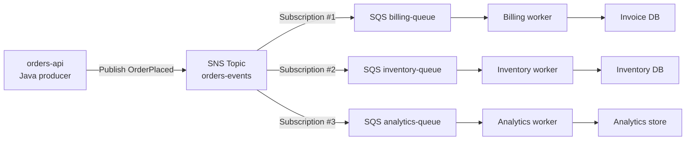
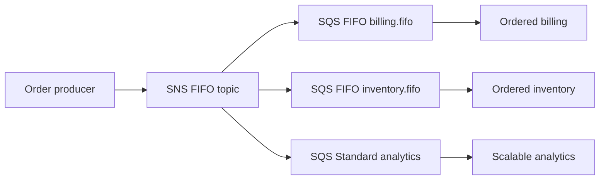
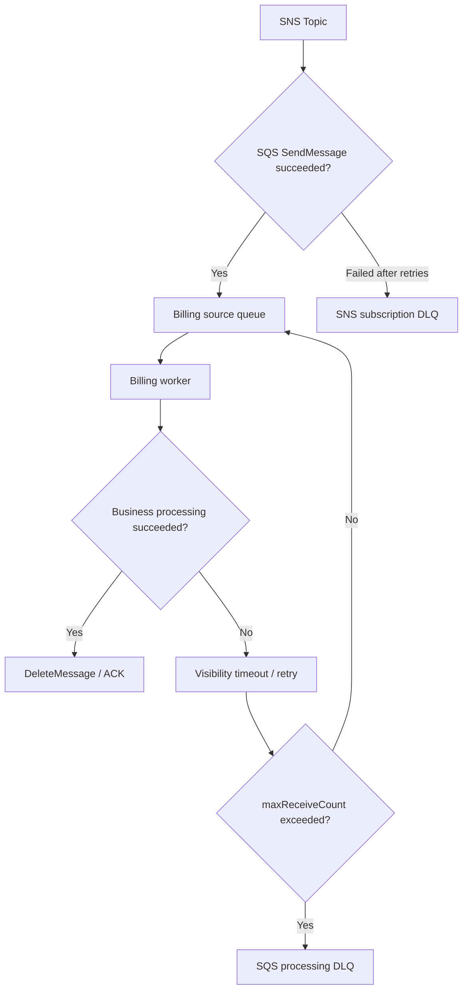
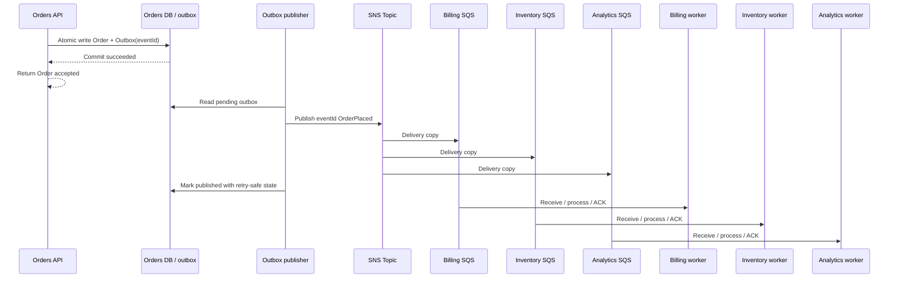

# SNS-to-Multiple-SQS Fan-Out Pattern on AWS

> **Chapter:** Queues and Notifications  
> **Module:** `CLOUD_PROVIDERS_AWS`  
> **Context:** Building event-driven architectures for Java applications on AWS combining Amazon Simple Notification Service (SNS) and Amazon Simple Queue Service (SQS). Learners practice distributing one event to multiple independent systems, choosing Standard vs. FIFO, filtering messages, handling errors and replays, scoping IAM/KMS, monitoring, recovering, and controlling costs.

## Learning Objectives

After this lesson, learners will be able to:

1. Explain **publish–subscribe**, **fan-out**, **topic**, **subscription**, **queue**, **producer**, and **consumer**; distinguish SNS pushing events from SQS storing them for active consumer polling.
2. Design an SNS topic delivering events to **multiple independent SQS queues**, letting each business domain scale, retry, pause, and deploy separately.
3. Distinguish **SNS Standard + SQS Standard** from **SNS FIFO + SQS FIFO/Standard**, understanding ordering, message groups, deduplication, and the boundaries of “exactly once” claims.
4. Configure **subscription filter policies** on `MessageAttributes` or `MessageBody` and choose **raw message delivery** when appropriate.
5. Author an **SQS queue resource policy** allowing only a specific SNS topic to send messages, and separate IAM permissions for publishers, subscribers, and consumers.
6. Understand the **two dead-letter queue (DLQ) tiers**: SNS subscription DLQs when SNS **fails to deliver** a message to SQS, and SQS redrive DLQs when the **consumer fails to process** it.
7. Design idempotent Java/Lambda consumers with visibility timeouts, retries, partial batch responses, poison-message handling, and backpressure.
8. Diagnose fan-out failures using the AWS CLI, CloudWatch metrics/logs, IAM/KMS, and subscription state; test cross-account and encrypted queues.
9. Evaluate trade-offs across message copies, latency, per-request costs, retention, and downstream bottleneck risks.

## 1. The Problem: One Event, Multiple Processing Teams

Suppose an e-commerce application emits an **`OrderPlaced`** event when an order is confirmed. Three independent services must receive it:

- **Billing:** prepares invoices and calculates tax.
- **Inventory:** reserves or deducts stock.
- **Analytics:** aggregates dashboards and measures campaign performance.

If the publisher sends direct HTTP calls sequentially to all three services:

```text
orders-api
  ├─ HTTP → billing
  ├─ HTTP → inventory
  └─ HTTP → analytics
```

then the publisher must know every consumer's address, timeout, API contract, and health. When analytics slows down or goes offline, the order-creation API risks higher latency or complex retry logic.

**SNS → SQS fan-out** decouples those responsibilities:



A single valid publish creates **an independent message copy in each qualifying SQS subscription**. Each queue buffers its own messages and each consumer tracks its own progress.

### 1.1 Fan-out is not load balancing

Do not confuse them:

| Pattern | Who receives the messages? | Example |
|---|---|---|
| **SNS → 3 SQS queues fan-out** | **Every matching queue** receives its own copy | Billing, Inventory, and Analytics all process `OrderPlaced` |
| **Competing consumers on one SQS queue** | Multiple workers **share** reading from **the same queue** | 10 billing workers split the invoices to generate |
| **SNS subscription filtering** | Only subscriptions matching the policy receive copies | Inventory receives only `OrderPlaced`/`OrderCancelled` |
| **Direct HTTP integration** | Producer calls backend directly | RPC requiring an immediate response |
| **EventBridge rules → targets** | Pattern-based event routing to multiple targets | Integrating diverse AWS or SaaS event sources |

Having **two workers poll the same SQS queue** does not give two separate business domains reliable duplicate copies. Once one worker receives and deletes a message, the other worker will generally never see it.

### 1.2 Three meanings of “success”

1. **Producer → SNS:** a successful `Publish` means SNS accepted the message at the API.
2. **SNS → SQS:** SNS delivers a copy to each matching subscription; one subscription can fail even while others succeed.
3. **SQS → Consumer:** the worker receives, processes, and **acknowledges via `DeleteMessage`**, or the Lambda event source mapping deletes it after the handler succeeds.

**Never conflate all three steps.** `Publish` returning a `MessageId` does not prove Billing, Inventory, and Analytics all completed their business logic.

## 2. Roles of SNS and SQS in the Same Architecture

### 2.1 SNS: topics and subscriptions

Amazon SNS is a **publish–subscribe** service. Producers send messages to a **topic ARN**; SNS distributes them to **subscriptions** such as SQS, Lambda, HTTPS, Firehose, or email/SMS depending on topic type and supported features.

An SNS → SQS subscription includes:

- **`TopicArn`**: where publishers send events.
- **`Protocol: sqs`**: endpoint is SQS.
- **`Endpoint`**: the **Queue ARN**, not the Queue URL.
- **`SubscriptionArn`**: subscription identifier used to edit policies, raw delivery, or DLQ settings.
- **`FilterPolicy` and `FilterPolicyScope`**: optional filtering rules.
- **`RawMessageDelivery`**: controls message wrapping.
- **`RedrivePolicy`**: optional SNS subscription DLQ for delivery failures.

Never use `SubscriptionArn` as the target of `Publish`; publishers always target **`TopicArn`**.

### 2.2 SQS: store, temporarily hide, delete

Amazon SQS is a **queue** that decouples producers and consumers across time.

A consumer:

1. Calls `ReceiveMessage` or relies on a Lambda event source mapping to poll on its behalf.
2. Receives the message and a **receipt handle**.
3. The message stays hidden during the **visibility timeout**.
4. The consumer completes business processing.
5. Calls `DeleteMessage` with the **latest receipt handle**; with a Lambda mapping, the service deletes messages once the handler succeeds.
6. If not deleted, the message reappears when visibility expires and can be reprocessed.

SQS **is not a permanent transactional state table**: retention is finite. Default retention is typically **4 days**, configurable up to **14 days**; persist durable business state in DynamoDB, RDS, or S3 as needed.

### 2.3 Resource types and identifiers

| Resource | Illustrative example | Where used |
|---|---|---|
| SNS Topic ARN | `arn:aws:sns:ap-southeast-1:111122223333:orders-events` | `Publish.topicArn`, subscriptions, SQS policy `SourceArn` |
| SQS Queue ARN | `arn:aws:sqs:ap-southeast-1:111122223333:orders-billing` | Subscription `Endpoint`, IAM resource ARN |
| SQS Queue URL | `https://sqs.ap-southeast-1.amazonaws.com/111122223333/orders-billing` | `ReceiveMessage`, `DeleteMessage`, `GetQueueAttributes` |
| SNS Subscription ARN | `arn:aws:sns:ap-southeast-1:111122223333:orders-events:xxxxxxxx-xxxx-xxxx-xxxx-xxxxxxxxxxxx` | `SetSubscriptionAttributes` |
| SNS `MessageId` | UUID returned by `Publish` | Tracing at SNS layer; not a business event ID |
| SQS `MessageId` | Message ID within SQS | Delivery/receipt tracking; should not be the sole business key |

All ARNs and URLs above are **dummy examples**, not live resources.

## 3. Why Does Each Consumer Need Its Own Queue?

If one consumer stops running:

- The Billing queue continues accepting messages while the **Billing worker is down**.
- The Inventory worker keeps processing smoothly on its own queue.
- Analytics can deploy a new version, replay a backlog, or scale concurrency without changing Billing's queue depth.
- Processing errors in one consumer move messages into **that queue's SQS DLQ** instead of stalling the whole platform.

### 3.1 Isolation is not absolute

A shared SNS topic remains a **common dependency**. If producers cannot publish, or topic permissions, quotas, or KMS settings break, all downstream teams miss events.

Each queue also faces its own risks:

- **Deleted or unconfirmed subscription**: no new messages arrive.
- **Queue policy blocks SNS**: delivery fails.
- **Misconfigured KMS key policy**: SNS cannot write to the encrypted queue.
- **Mismatched subscription filter**: validly filtered out and not delivered.
- **SQS retention expires**: unprocessed backlogs can disappear.
- **Non-idempotent consumer**: duplicates trigger repeated side effects.

Therefore, monitor both **SNS delivery** and **SQS processing**.

### 3.2 Failure isolation example

Suppose 10,000 `OrderPlaced` events arrive in 15 minutes:

| Component | Status | Consequence |
|---|---|---|
| SNS topic | Publish and delivery healthy | Subscriptions receive matching events |
| Billing queue/worker | Healthy | Processes invoices at normal capacity |
| Inventory queue/worker | Healthy | Updates stock independently |
| Analytics queue | Receives messages; worker crashes | Backlog grows without halting Billing or Inventory |
| Analytics DLQ | Catches poison messages after retries | Preserves failure evidence for fixing and redriving |

This provides **eventual consistency** across domains. There is no automatic distributed transaction spanning all three queues and workers.

If payment and inventory must commit atomically before order confirmation, fan-out alone cannot enforce it—design explicit transactions, sagas/compensation, and clear business states.

## 4. Standard vs. FIFO: Choosing the Right Delivery Semantics

SNS offers two topic types: **Standard** and **FIFO**. SQS likewise offers **Standard** and **FIFO** queues.

### 4.1 Selection matrix

| Combination | Supported? | Primary semantics | When to use |
|---|---|---|---|
| **SNS Standard → SQS Standard** | Yes | At-least-once, best-effort ordering | Event notifications, analytics, duplicate/reorder-tolerant workloads |
| **SNS FIFO → SQS FIFO** | Yes | Per-message-group ordering and dedup within service limits | Per-order/customer sequences, ordered ledger workflows |
| **SNS FIFO → SQS Standard** | Yes | Standard queue may duplicate or reorder | One topic fanning out to both order-sensitive and unordered consumers |
| **SNS Standard → SQS FIFO** | Not a supported pattern for FIFO guarantees | Never use as a “turn Standard into FIFO” trick | Use SNS FIFO when end-to-end FIFO is needed |

**SNS FIFO → SQS FIFO** reduces duplicates at the messaging layer, yet **does not guarantee exactly-once execution of business handlers**. For instance, a worker can commit to the DB and time out before deleting the message, causing reprocessing. Always enforce consumer idempotency.

### 4.2 Standard: no ordering guarantees

With Standard topics and queues:

- A producer may publish A then B, yet a consumer receives B before A.
- Duplicate deliveries can happen even if the producer published once.
- A single message can be processed multiple times due to visibility timeouts or retries.
- SQS scales effortlessly for many event-driven workloads.

If business logic requires `OrderPlaced` to process before `OrderCancelled` for the same order, **never** rely solely on publish order over Standard.

### 4.3 FIFO: `MessageGroupId` and `MessageDeduplicationId`

SNS FIFO topic names end in `.fifo`; SQS FIFO queue names also end in `.fifo`.

Producers publishing FIFO events typically supply:

- **`MessageGroupId`**: defines an ordered stream, such as `order-O-1001` or `customer-42`.
- **`MessageDeduplicationId`**: identifier letting SNS/SQS suppress resends within the **5-minute dedup window**, unless content-based deduplication is enabled appropriately.

```text
MessageGroupId=order-O-1001

OrderPlaced(v1)   → PaymentCaptured(v2) → OrderShipped(v3)

MessageGroupId=order-O-1002

OrderPlaced(v1)   → OrderCancelled(v2)
```

Ordering is preserved **within each message group**; distinct groups can run concurrently.

### 4.4 One message group for all orders creates a bottleneck

If you set:

```text
MessageGroupId = "orders"
```

every message queues into a single sequential lane, severely capping concurrency. When appropriate, key the group by the **aggregate business key**:

```text
MessageGroupId = "order-" + orderId
```

Events for the same order stay sequential while different orders process in parallel. Choosing the wrong key also carries risk: if sequencing must span multiple orders under one account, grouping by `orderId` will not enforce it.

### 4.5 Deduplication is not durable duplicate prevention

FIFO deduplication typically remembers IDs for roughly **5 minutes**. If a producer retries after 10 minutes with a different ID, or the application replays events, consumers can still see them again.

Therefore:

- Use a **stable `eventId`** issued by the business origin.
- Persist processed event IDs / aggregate versions in a DB using conditional writes.
- Never use a fresh `MessageId` from each publish as the duplicate-prevention key.
- Never rely solely on SQS FIFO dedup to replace idempotency or transaction controls.
- If content-based dedup hashes the **message body**, changing timestamps or metadata inside the body produces a different hash for the same business event.

### 4.6 A FIFO topic can deliver to an SQS Standard queue

One `orders-events.fifo` topic can fan out:



**Never assume the analytics queue preserves order just because the source is SNS FIFO.** Consumers of SQS Standard still experience at-least-once delivery and best-effort ordering.

### 4.7 High-throughput FIFO and configuration constraints

On SNS FIFO, `FifoThroughputScope` can be `Topic` or `MessageGroup` to adjust deduplication scope and throughput. AWS supports high-throughput FIFO modes with quotas and pricing varying by Region and account.

**Note per current documentation:** once `FifoThroughputScope` is switched to `MessageGroup`, reverting back to `Topic` may **not be supported**; never toggle it casually in production. Subscribed FIFO queues also need matching high-throughput settings under heavy traffic.

## 5. Event Contracts: Producers and Consumers Must Agree

Regardless of Standard or FIFO, prefer publishing an application-owned **business event envelope**. Example `OrderPlaced`:

```json
{
  "eventId": "evt-9a7b2e",
  "eventType": "OrderPlaced",
  "schemaVersion": 1,
  "aggregateType": "Order",
  "aggregateId": "O-1001",
  "occurredAt": "2026-11-20T03:00:00Z",
  "tenantId": "tenant-a",
  "data": {
    "orderId": "O-1001",
    "totalAmountMinor": 150000,
    "currency": "VND"
  }
}
```

IDs and data here are illustrative. **Never publish card details, raw access tokens, passwords, or unnecessary PII** just so consumers can handle an event.

### 5.1 Recommended fields

| Field | Meaning | Why it matters |
|---|---|---|
| `eventId` | Unique, stable ID for the business event | Idempotency and correlation |
| `eventType` | Business event category | Filtering and dispatching |
| `schemaVersion` | Payload contract version | Backward compatibility |
| `aggregateId` | Target resource/order/customer | Message grouping and stale-event checks |
| `occurredAt` | Timestamp at source | Auditing and handling late arrivals |
| `tenantId` | Tenant partition when needed | Authorization, isolation, routing |
| `data` | Minimal payload needed by consumers | Avoids unnecessary coupling |

`occurredAt` does not prove ordering; distributed clocks drift. When causal ordering matters, include a monotonically increasing **aggregate version** or source-database sequence number.

### 5.2 Who owns the schema?

Producers own event semantics and **contract versioning**. Consumers must tolerate:

- New optional fields.
- Unknown event types if subscribed broadly.
- Out-of-order arrivals and retries/duplicates.
- Version skew during staggered deployments.
- Old events replayed days or months later.

Never redefine `OrderPlaced` from “order created” to “order paid” while keeping the same name and schema version.

### 5.3 Publish events after committing data

An anti-pattern:

```text
1. Publish OrderPlaced to SNS succeeds
2. Save order to DynamoDB
3. DynamoDB write fails
→ Consumers receive OrderPlaced, yet the Order does not exist
```

Reversing the order also carries risk:

```text
1. Save order succeeds
2. Publish to SNS fails
→ Order sits in DB, yet consumers never receive the event
```

Practical fix: **Transactional Outbox** or an equivalent reliable event emission pattern—write the Order and an outbox record inside the **same DynamoDB transaction** or relational DB transaction, then have a worker or stream relay the outbox to SNS with retries and idempotency.

### 5.4 Eventual consistency is by design, not a bug

After a publish, Billing, Inventory, and Analytics may finish at different times. An API returning `Order accepted` does not mean every downstream side effect has completed.

Define explicit business states such as `PENDING_INVENTORY`, `PENDING_BILLING`, `COMPLETED`, or `COMPENSATION_REQUIRED` and expose progress appropriately.

## 6. Default SNS Envelope vs. Raw Message Delivery

When an SNS topic delivers to SQS, consumers read the **SQS message body**. However, that body **does not look identical** across all subscriptions.

### 6.1 Raw Message Delivery off: SQS body is the SNS notification envelope

Abbreviated SQS body example:

```json
{
  "Type": "Notification",
  "MessageId": "5d3bc5d2-example",
  "TopicArn": "arn:aws:sns:ap-southeast-1:111122223333:orders-events",
  "Subject": "OrderPlaced",
  "Message": "{\"eventId\":\"evt-9a7b2e\",\"eventType\":\"OrderPlaced\",\"schemaVersion\":1,\"data\":{\"orderId\":\"O-1001\"}}",
  "Timestamp": "2026-11-20T03:00:01Z",
  "MessageAttributes": {
    "eventType": {
      "Type": "String",
      "Value": "OrderPlaced"
    }
  }
}
```

Here `Message` is an **escaped JSON string**, not a nested object. The consumer must:

1. Parse SQS `body` as an SNS envelope.
2. Extract the `Message` field.
3. Parse `Message` as the business event.

**Never rely on `Type: Notification` to assume a message came from a trusted SNS topic.** Restrict `sqs:SendMessage` in the queue policy and validate sources architecturally.

### 6.2 Raw Message Delivery on: SQS body is the exact message published

Example:

```json
{
  "eventId": "evt-9a7b2e",
  "eventType": "OrderPlaced",
  "schemaVersion": 1,
  "data": {
    "orderId": "O-1001"
  }
}
```

The consumer parses only once. SNS envelope metadata (such as `TopicArn`/`Timestamp`/`Signature`) **is omitted from the message body**.

This simplifies handlers, though you must put `eventId`, `eventType`, `source`, and `traceId` in your business payload or attributes for observability. If raw delivery is enabled on one queue and disabled on another, **their two consumers require different parsers**.

### 6.3 Comparison

| Criterion | `Raw=false` | `Raw=true` |
|---|---|---|
| SQS body | SNS envelope JSON | Original message |
| Business event parsing | Parse outer → `Message` → inner | Parse body directly |
| SNS metadata in body | Yes | No |
| Fits existing JSON handlers | Needs adapter | Yes |
| Message attributes | Inside SNS envelope | Forwarded as SQS message attributes where supported |
| SNS → SQS attribute limit | Per SNS/integration limits | **Maximum 10 message attributes** |

**Critical limit:** for SQS subscriptions with raw delivery enabled, if SNS publishes **more than 10 message attributes**, SNS treats it as a client-side error and can **discard the message for that subscription**. If more than 10 attributes are needed, disable raw delivery or trim attributes.

### 6.4 A Java consumer must know the subscription contract

Never write:

```java
OrderEvent event = mapper.readValue(sqsMessage.body(), OrderEvent.class);
```

assuming it works for every queue. When `raw=false`, `OrderEvent` will fail to match the outer envelope. Build a configurable adapter or standardize `raw=true` across managed queues.

## 7. Subscription Filter Policies: Routing the Right Events to Each Queue

In fan-out, not every consumer needs every message. **SNS message filtering** drops irrelevant messages **before** delivering to SQS.

Example:

- Billing: receives `OrderPlaced`, `OrderRefunded`.
- Inventory: receives `OrderPlaced`, `OrderCancelled`.
- Analytics: receives all events.

### 7.1 Filtering on `MessageAttributes`

Producer attaches SNS message attributes:

```json
{
  "eventType": {
    "DataType": "String",
    "StringValue": "OrderPlaced"
  },
  "schemaVersion": {
    "DataType": "Number",
    "StringValue": "1"
  }
}
```

Billing subscription `FilterPolicy`:

```json
{
  "eventType": [
    "OrderPlaced",
    "OrderRefunded"
  ]
}
```

Inventory subscription:

```json
{
  "eventType": [
    "OrderPlaced",
    "OrderCancelled"
  ]
}
```

Analytics has no filter policy and receives all messages delivered on the topic.

### 7.2 `FilterPolicyScope`

The subscription attribute `FilterPolicyScope` has two choices:

| Value | Inspected data | When to use |
|---|---|---|
| `MessageAttributes` (default) | SNS message attributes outside the body | Producer supplies structured metadata; low parsing overhead |
| `MessageBody` | Properties of the **JSON object in the message body** | Event already includes `eventType`/`tenantId` in payload; avoids duplicating attributes |

With body filtering, the payload must be valid JSON for SNS to evaluate. If a producer sends plain text that is not a JSON object, the subscription will not receive it even if the string `OrderPlaced` appears inside.

### 7.3 Filtering on `MessageBody`

Given the event JSON in section 5, a subscription could use:

```json
{
  "eventType": ["OrderPlaced"],
  "tenantId": ["tenant-a", "tenant-b"]
}
```

Keys combine with **AND**: `eventType` must match **and** `tenantId` must match the list. Values within a list combine with **OR**. AWS also supports operators like `anything-but`, `prefix`, `suffix`, `numeric`, `exists`, and `cidr` per documentation.

**Never rely on an SNS filter policy as your sole tenant security control.** A producer permitted to send a spoofed `tenantId=tenant-a` could route events into tenant-a's queue. Consumers must still validate identity and tenant authorization before writing data.

### 7.4 Filter changes do not take effect instantaneously

Per AWS docs, **adding or modifying a filter policy can take up to 15 minutes** to propagate completely. During that window, messages may be evaluated under either the old or new policy.

When deploying a new filter:

1. Create contract tests for attributes/body.
2. Deploy producer support for new event types/attributes **first** or with backward compatibility.
3. Update the filter policy via IaC.
4. Watch delivered/filtered counts and queue depth.
5. Test with dedicated synthetic events, waiting for propagation as needed.
6. Never use a single publish seconds after a change as proof the filter is settled.

### 7.5 Filtered messages are not delivery errors

If a subscription only accepts `OrderPlaced` and SNS publishes `OrderCancelled`, the subscription **not receiving** it is expected. It does not go to the SNS subscription DLQ and does not increment `NumberOfNotificationsFailed`.

**Never use a DLQ to “recover” events intentionally dropped by a filter.** If analytics needs every event, give it an unfiltered subscription or a dedicated archive.

### 7.6 One message can reach multiple queues or zero queues

Subscriber sets are independent per event type. There is no “only one subscriber matches” rule unless policies are designed that way. An `OrderPlaced` event can match Billing, Inventory, and Analytics; an `UnknownEvent` may reach only Analytics—or zero queues if all have restrictive filters.

## 8. Two Completely Different DLQs in SNS → SQS

This is the most critical operational distinction in the fan-out pattern.

### 8.1 SNS subscription DLQ: SNS failed to deliver to SQS

Suppose SNS tries to deliver `OrderPlaced` to `billing-queue`, but:

- The SQS queue was deleted.
- The queue resource policy denies `sqs:SendMessage`.
- An encrypted queue's KMS key policy denies SNS.
- The destination fails and SNS exhausts delivery retries.

Configure an **SNS subscription redrive policy**:

```json
{
  "deadLetterTargetArn": "arn:aws:sqs:ap-southeast-1:111122223333:orders-billing-subscription-dlq"
}
```

Once SNS **exhausts delivery attempts** per service rules, the message is sent to the **subscription DLQ** for investigation and controlled redrive. The subscription DLQ itself also needs proper IAM, KMS, and queue policies.

**Per documentation:** a subscription DLQ is an SQS queue in the same **Account and Region** as the SNS subscription. FIFO topic subscriptions require an **SQS FIFO** DLQ; Standard topic subscriptions use an **SQS Standard** DLQ.

### 8.2 SQS queue DLQ: consumer failed to process

Suppose SNS delivered the message cleanly to `billing-queue`, yet the Billing worker crashes repeatedly on invalid JSON.

Configure the SQS source queue's `RedrivePolicy`:

```json
{
  "deadLetterTargetArn": "arn:aws:sqs:ap-southeast-1:111122223333:orders-billing-processing-dlq",
  "maxReceiveCount": 5
}
```

After exceeding the receive threshold, SQS moves the message to the **processing DLQ**. **The SNS subscription DLQ never sees this error** because SNS already delivered to SQS successfully.

### 8.3 Comparing both failure tiers



| Item | SNS subscription DLQ | SQS processing DLQ |
|---|---|---|
| Config owner | **SNS subscription** `RedrivePolicy` | **SQS source queue** `RedrivePolicy` |
| Failures captured | SNS could not deliver to endpoint | Consumer could not finish processing message |
| Failures NOT captured | Java worker parse errors after SQS received it | SNS failing to deliver into SQS |
| What to inspect | SNS delivery errors, subscription state, queue/KMS policy | Receive count, visibility, worker logs, poison messages |
| Replay | Fix delivery, then resend/redrive carefully | SQS DLQ redrive or consumer repair |
| Relationship | Two independent layers | Can be used together |

**Never share a single DLQ across all purposes** when root-cause isolation, access control, retention, and replay differ. Name them `*-subscription-dlq` and `*-processing-dlq` to avoid confusion.

### 8.4 Redrive vs. archive replay

- **SQS DLQ redrive:** moves messages from a dead-letter queue back to the source or another queue to retry past failures.
- **SNS FIFO archive/replay:** archives messages at the topic per archive policy and replays within a window to a subscription.
- **Producer re-publish:** application re-emits events using a stable business `eventId`.

All three differ in semantics, IAM, costs, and duplicate risk. Review carefully before replaying events that already mutated state.

## 9. IAM: Topic Policies, Queue Policies, and Consumer Roles

A working fan-out requires **at least three permission boundaries**:

1. **Publisher IAM role** permitted to call `sns:Publish` on the exact topic.
2. **SQS queue resource policy** granting `sns.amazonaws.com` `sqs:SendMessage` from the exact topic.
3. **Consumer IAM role** permitted to call `sqs:ReceiveMessage`, `sqs:DeleteMessage`, and `sqs:ChangeMessageVisibility` (if needed) on the exact queue.

Never grant one role `sns:*` and `sqs:*` on `Resource: "*"` just to make things work.

### 9.1 Sample publisher role policy

```json
{
  "Version": "2012-10-17",
  "Statement": [
    {
      "Sid": "PublishOrderEvents",
      "Effect": "Allow",
      "Action": "sns:Publish",
      "Resource": "arn:aws:sns:ap-southeast-1:111122223333:orders-events"
    }
  ]
}
```

Java applications use a **task role** on ECS, a **Lambda execution role** on Lambda, or **EKS Pod Identity / IRSA** on EKS. Never embed long-lived access keys in Docker images or source repositories.

### 9.2 Queue policy for a specific SNS topic

Example resource policy attached to `orders-billing`:

```json
{
  "Version": "2012-10-17",
  "Statement": [
    {
      "Sid": "AllowOnlyOrdersTopicToSend",
      "Effect": "Allow",
      "Principal": {
        "Service": "sns.amazonaws.com"
      },
      "Action": "sqs:SendMessage",
      "Resource": "arn:aws:sqs:ap-southeast-1:111122223333:orders-billing",
      "Condition": {
        "ArnEquals": {
          "aws:SourceArn": "arn:aws:sns:ap-southeast-1:111122223333:orders-events"
        }
      }
    }
  ]
}
```

**`aws:SourceArn` mitigates confused deputy risks**: without this condition, other SNS topics could exploit that broad grant in unintended ways.

When multiple topics feed one queue, list the exact approved topic ARNs instead of opening to all SNS topics. When using `aws:SourceAccount` in cross-account patterns, verify permissions and context so valid traffic is not inadvertently blocked.

### 9.3 Sample consumer role policy

```json
{
  "Version": "2012-10-17",
  "Statement": [
    {
      "Sid": "ConsumeBillingQueue",
      "Effect": "Allow",
      "Action": [
        "sqs:ReceiveMessage",
        "sqs:DeleteMessage",
        "sqs:ChangeMessageVisibility",
        "sqs:GetQueueAttributes"
      ],
      "Resource": "arn:aws:sqs:ap-southeast-1:111122223333:orders-billing"
    }
  ]
}
```

Consumers **do not need** `sns:Publish` simply to read fanned-out messages from a queue. Likewise, the SNS service principal **does not need** `sqs:ReceiveMessage`.

### 9.4 Topic policies in cross-account setups

If the publisher resides in another AWS account, configure the **SNS topic resource policy** allowing that role/account to call `sns:Publish`, in addition to the publisher's own identity policy. If a queue resides in another account, the topic owner may need to grant the queue owner `sns:Subscribe`.

Keep them straight:

- **SNS topic policy:** who can publish, subscribe, or manage the topic?
- **SQS queue policy:** which SNS topic/service can send messages into the queue?
- **IAM consumer role:** which worker can receive and delete messages?

## 10. Encryption, KMS, and Sensitive Data

### 10.1 Encrypting SNS and SQS

- SNS topics can enable **server-side encryption (SSE)**.
- SQS queues can also enable SSE with supported key types.
- TLS protects API connections in transit.
- KMS key policies must allow the proper principals to use the key during service encryption/decryption.

When **SNS delivers to an SQS queue encrypted with a customer-managed KMS key**, the SQS queue's key policy must grant the **SNS service principal** `kms:GenerateDataKey` and `kms:Decrypt` per AWS requirements. Consumers also need KMS permissions to decrypt upon receiving, depending on key type and access path.

### 10.2 Example statement on an SQS customer-managed KMS key

```json
{
  "Sid": "AllowSnsToUseEncryptedQueueKey",
  "Effect": "Allow",
  "Principal": {
    "Service": "sns.amazonaws.com"
  },
  "Action": [
    "kms:GenerateDataKey",
    "kms:Decrypt"
  ],
  "Resource": "*"
}
```

This is a **KMS key policy fragment**, not an SQS queue resource policy or an IAM policy attached to a publisher. Inside a key policy, `Resource: "*"` refers only to that key itself. In production, evaluate adding `aws:SourceArn`/`aws:SourceAccount`, `kms:ViaService`, or encryption context conditions where supported by AWS to avoid overly broad key grants.

**Do not copy this snippet verbatim if your organization enforces stricter key policy, cross-account, or compliance constraints.** Test delivery with a non-sensitive event after updating policies.

### 10.3 How is only the message body encrypted?

Per SNS/SQS FIFO encryption documentation, the **message body** is encrypted by the service, while **message attributes, resource metadata, and metrics are not all encrypted the same way as the body**. Therefore:

- Never put tokens, passwords, card numbers, or sensitive emails inside **message attributes** just because the topic/queue uses SSE.
- Never put PII into topic/queue names, CloudWatch metric dimensions, or overly detailed `eventType` values.
- Never log full SNS envelopes or raw bodies containing sensitive info.
- Enforce data classification, retention, and least-privilege access per queue.

### 10.4 VPC endpoints and networking

Java applications in private subnets can reach SNS and SQS via **interface VPC endpoints (AWS PrivateLink)** or NAT depending on architecture. Workers in Lambda/ECS/EKS need:

- Proper DNS / Private DNS and VPC endpoint security groups.
- IAM and **VPC endpoint policies** that do not block required APIs.
- TLS/HTTPS on port 443.
- Connectivity to DynamoDB, S3, KMS, and downstream services if needed during processing.

**SNS delivers messages to SQS over AWS's internal service-to-service infrastructure**—consumers never need to expose an HTTP listener to receive SNS messages pushed via SQS. The queue resource policy must still permit delivery from the exact topic.

## 11. Cross-Account, Cross-Region, and Subscription Confirmation

### 11.1 Cross-account: topic in Account A, SQS in Account B

Example:

```text
Account A: sns:orders-events
Account B: sqs:orders-billing
```

Coordinate:

1. Topic policy in Account A allowing the queue owner/principal to subscribe if needed.
2. Queue policy in Account B granting Account A's SNS topic ARN `sqs:SendMessage`.
3. Subscription administrator IAM role with `sns:Subscribe` and related rights.
4. KMS key policies if the queue or topic is encrypted.
5. Proper **subscription confirmation** following ownership rules.

Per AWS, when the **queue owner creates the subscription** to an authorized topic, confirmation is usually automatic. When a **principal that does not own the queue** creates the subscription, it enters **`PendingConfirmation`** and the queue/subscription owner must confirm it explicitly.

**Never mistake a `"PendingConfirmation"` subscription ARN for an active ARN.** While unconfirmed, never expect deliveries.

### 11.2 Cross-Region

SNS can subscribe an SQS queue in another Region where supported. Verify:

- Cross-Region topic and queue policies.
- Per-Region KMS keys and encryption grants.
- Delivery quotas, latency, and cross-Region data transfer pricing.
- Disaster recovery and Regional failure isolation.

**Publishers publish only to the topic endpoint/ARN of the target Region**; cross-Region delivery is a subscription capability, not a magic feature letting you hit any regional SNS endpoint and auto-route to another Region's topic.

### 11.3 Cross-account alone does not guarantee security

Account separation reduces blast radius and clarifies ownership, yet still requires:

- Minimal principals permitted to subscribe or publish.
- Queue policies pinned to exact SNS `TopicArn`s.
- Consumer IAM roles restricted to their own team's queue.
- Centralized CloudTrail and CloudWatch visibility.
- No wildcards in KMS key policies in either account.

## 12. Provisioning Fan-Out with Infrastructure as Code

For this pattern, **IaC is strongly recommended** because many resources depend on each other: topics, queues, DLQs, queue policies, subscriptions, and filter policies. Managing them by hand easily leads to creating a subscription without an SQS policy, or deleting a `QueuePolicy` and silently breaking delivery.

### 12.1 Sample CloudFormation: one topic, two SQS queues

The YAML below demonstrates **SNS Standard → two SQS Standard queues**. Billing receives `OrderPlaced` and `OrderRefunded`; Analytics receives all events.

```yaml
AWSTemplateFormatVersion: '2010-09-09'
Description: SNS to SQS fan-out sample for learning

Resources:
  OrdersTopic:
    Type: AWS::SNS::Topic
    Properties:
      TopicName: orders-events-demo

  BillingDlq:
    Type: AWS::SQS::Queue
    Properties:
      QueueName: orders-billing-processing-dlq-demo
      MessageRetentionPeriod: 1209600

  BillingQueue:
    Type: AWS::SQS::Queue
    Properties:
      QueueName: orders-billing-demo
      VisibilityTimeout: 120
      MessageRetentionPeriod: 345600
      RedrivePolicy:
        deadLetterTargetArn: !GetAtt BillingDlq.Arn
        maxReceiveCount: 5

  AnalyticsQueue:
    Type: AWS::SQS::Queue
    Properties:
      QueueName: orders-analytics-demo
      VisibilityTimeout: 120
      MessageRetentionPeriod: 345600

  BillingQueuePolicy:
    Type: AWS::SQS::QueuePolicy
    Properties:
      Queues:
        - !Ref BillingQueue
      PolicyDocument:
        Version: '2012-10-17'
        Statement:
          - Sid: AllowOrdersTopic
            Effect: Allow
            Principal:
              Service: sns.amazonaws.com
            Action: sqs:SendMessage
            Resource: !GetAtt BillingQueue.Arn
            Condition:
              ArnEquals:
                aws:SourceArn: !Ref OrdersTopic

  AnalyticsQueuePolicy:
    Type: AWS::SQS::QueuePolicy
    Properties:
      Queues:
        - !Ref AnalyticsQueue
      PolicyDocument:
        Version: '2012-10-17'
        Statement:
          - Sid: AllowOrdersTopic
            Effect: Allow
            Principal:
              Service: sns.amazonaws.com
            Action: sqs:SendMessage
            Resource: !GetAtt AnalyticsQueue.Arn
            Condition:
              ArnEquals:
                aws:SourceArn: !Ref OrdersTopic

  BillingSubscription:
    Type: AWS::SNS::Subscription
    DependsOn: BillingQueuePolicy
    Properties:
      TopicArn: !Ref OrdersTopic
      Protocol: sqs
      Endpoint: !GetAtt BillingQueue.Arn
      RawMessageDelivery: true
      FilterPolicyScope: MessageAttributes
      FilterPolicy:
        eventType:
          - OrderPlaced
          - OrderRefunded

  AnalyticsSubscription:
    Type: AWS::SNS::Subscription
    DependsOn: AnalyticsQueuePolicy
    Properties:
      TopicArn: !Ref OrdersTopic
      Protocol: sqs
      Endpoint: !GetAtt AnalyticsQueue.Arn
      RawMessageDelivery: true

Outputs:
  TopicArn:
    Value: !Ref OrdersTopic
  BillingQueueUrl:
    Value: !Ref BillingQueue
  AnalyticsQueueUrl:
    Value: !Ref AnalyticsQueue
```

**This is a learning stack, not production-ready:** it lacks KMS encryption, SNS subscription DLQs, explicit redrive allow policies, full monitoring/alarms, tags, producer/consumer IAM roles, and org guardrails. All queues and the topic sit in the stack's Account and Region, and queue/topic names must be unique without colliding with existing resources.

### 12.2 Why is `DependsOn` helpful?

`BillingSubscription` depends on `BillingQueuePolicy` to avoid creating the SNS subscription before the queue allows the topic to send messages. Even with CloudFormation, policy/queue/subscription updates still require testing, as changes do not propagate instantaneously across every service edge.

### 12.3 Test deployment that mutates resources

After saving the template as `fanout-demo.yaml` in a lab environment:

```bash
aws cloudformation deploy \
  --template-file fanout-demo.yaml \
  --stack-name sns-sqs-fanout-lab \
  --region ap-southeast-1
```

**Warning:** this command provisions billable SNS/SQS resources. Never run it in a production account without review and approval. The author of this lesson **did not execute** these sample commands.

### 12.4 Adding an SNS subscription delivery DLQ in CloudFormation

To capture **SNS delivery failures** to the Billing queue, define a dedicated `BillingSubscriptionDlq`, grant the SNS topic queue/KMS permissions on it, and add:

```yaml
BillingSubscription:
  Type: AWS::SNS::Subscription
  Properties:
    TopicArn: !Ref OrdersTopic
    Protocol: sqs
    Endpoint: !GetAtt BillingQueue.Arn
    RedrivePolicy:
      deadLetterTargetArn: !GetAtt BillingSubscriptionDlq.Arn
```

This is an **illustrative fragment**, not a drop-in replacement for the full `BillingSubscription` resource above; in real use, **retain** `FilterPolicy`, `FilterPolicyScope`, `RawMessageDelivery`, `DependsOn`, and related delivery settings.

### 12.5 When to use CDK or Terraform

- Multiple Accounts/Regions repeating fan-out setups across teams.
- Automatically generating queue resource policies and KMS key policies.
- Enforcing reviews via pull requests, policy-as-code, and security scans.
- Managing DLQ redrive allow policies, alarms, dashboards, retention, and tags.
- Preventing drift caused by manual Console edits to subscription filters.

IaC does not replace runtime monitoring or integration tests; it makes configurations repeatable and auditable.

## 13. AWS CLI: Inspecting Topics, Queues, and Subscriptions

The commands below are read-only metadata checks. ARN and queue names are **placeholders**.

### 13.1 Verify account and topic

```bash
aws sts get-caller-identity

aws sns get-topic-attributes \
  --topic-arn arn:aws:sns:ap-southeast-1:111122223333:orders-events-demo \
  --region ap-southeast-1 \
  --query 'Attributes.{TopicArn:TopicArn,FifoTopic:FifoTopic,ContentBasedDeduplication:ContentBasedDeduplication,KmsMasterKeyId:KmsMasterKeyId,MaximumMessageSize:MaximumMessageSize}' \
  --output json
```

`FifoTopic`/`ContentBasedDeduplication` may be absent on Standard topics; check live attributes instead of assuming.

### 13.2 List subscriptions

```bash
aws sns list-subscriptions-by-topic \
  --topic-arn arn:aws:sns:ap-southeast-1:111122223333:orders-events-demo \
  --region ap-southeast-1 \
  --query 'Subscriptions[].{Arn:SubscriptionArn,Protocol:Protocol,Endpoint:Endpoint}' \
  --output table
```

Verify every expected queue is subscribed. If any subscription shows `PendingConfirmation`, complete ownership confirmation.

### 13.3 Inspect subscription raw/filter/DLQ settings

```bash
aws sns get-subscription-attributes \
  --subscription-arn arn:aws:sns:ap-southeast-1:111122223333:orders-events-demo:11111111-2222-3333-4444-555555555555 \
  --region ap-southeast-1 \
  --query 'Attributes.{TopicArn:TopicArn,Endpoint:Endpoint,RawMessageDelivery:RawMessageDelivery,FilterPolicy:FilterPolicy,FilterPolicyScope:FilterPolicyScope,RedrivePolicy:RedrivePolicy}' \
  --output json
```

If `FilterPolicy` is absent, the subscription accepts all messages meeting other conditions. If a filter was just edited, account for eventual consistency.

### 13.4 Check queue ARN and policy

```bash
aws sqs get-queue-attributes \
  --queue-url https://sqs.ap-southeast-1.amazonaws.com/111122223333/orders-billing-demo \
  --attribute-names QueueArn Policy RedrivePolicy VisibilityTimeout MessageRetentionPeriod KmsMasterKeyId \
  --region ap-southeast-1 \
  --output json
```

`Policy` is returned as a **JSON string**; parse it to verify exact `SourceArn` and `sqs:SendMessage`. If the policy is missing or wrong, SNS delivery fails even though the subscription ARN exists.

### 13.5 Test publish (mutates data)

```bash
aws sns publish \
  --topic-arn arn:aws:sns:ap-southeast-1:111122223333:orders-events-demo \
  --message '{"eventId":"evt-test-001","eventType":"OrderPlaced","schemaVersion":1,"data":{"orderId":"O-TEST-001"}}' \
  --message-attributes 'eventType={DataType=String,StringValue=OrderPlaced}' \
  --region ap-southeast-1
```

**Warning:** `Publish` emits a real event that **live consumers** will process. Run only in a sandbox/test environment with a synthetic `eventId` that cannot touch production business data. The JSON quoting above is for Bash; PowerShell/Windows may require `file://event.json` and a separate attributes JSON file.

### 13.6 Test receive (mutates visibility)

```bash
aws sqs receive-message \
  --queue-url https://sqs.ap-southeast-1.amazonaws.com/111122223333/orders-billing-demo \
  --max-number-of-messages 1 \
  --wait-time-seconds 5 \
  --message-system-attribute-names ApproximateReceiveCount \
  --message-attribute-names All \
  --region ap-southeast-1
```

`ReceiveMessage` **is not strictly read-only**: it hides messages temporarily and increments receive count, potentially disrupting live workers and redrive counts. Run only on a sandbox queue with no competing workers.

**Never delete a message just to prove you saw it.** Delete only once a consumer has committed its business side effects.

## 14. AWS SDK for Java v2: Producer Publishing an Event

Suppose `orders-api` committed an Order + outbox record, and an outbox publisher worker constructs the message and calls SNS.

### 14.1 Java SNS publisher

```java
package example.events;

import java.util.Map;
import software.amazon.awssdk.regions.Region;
import software.amazon.awssdk.services.sns.SnsClient;
import software.amazon.awssdk.services.sns.model.MessageAttributeValue;
import software.amazon.awssdk.services.sns.model.PublishRequest;
import software.amazon.awssdk.services.sns.model.PublishResponse;

public final class OrderEventPublisher implements AutoCloseable {
    private static final String TOPIC_ARN =
        "arn:aws:sns:ap-southeast-1:111122223333:orders-events-demo";

    private final SnsClient sns = SnsClient.builder()
        .region(Region.AP_SOUTHEAST_1)
        .build();

    public String publishOrderPlaced(String eventJson) {
        PublishRequest request = PublishRequest.builder()
            .topicArn(TOPIC_ARN)
            .message(eventJson)
            .messageAttributes(Map.of(
                "eventType",
                MessageAttributeValue.builder()
                    .dataType("String")
                    .stringValue("OrderPlaced")
                    .build()
            ))
            .build();

        PublishResponse response = sns.publish(request);
        return response.messageId();
    }

    @Override
    public void close() {
        sns.close();
    }
}
```

This sample requires Maven/Gradle dependency `software.amazon.awssdk:sns`. `eventJson` must be serialized cleanly from **committed** data; never manually concatenate JSON strings from unvalidated input.

**Production improvements:**

- Reuse a single `SnsClient` across invocations/requests instead of constructing one per event.
- Rely on the AWS SDK default credentials provider chain (Lambda execution role, ECS task role, EKS Pod Identity); never hardcode keys.
- Configure API call/connection timeouts, retries, and metrics.
- The outbox worker marks the record `PUBLISHED` once confirmed, while tolerating duplicates if it crashes after publishing and before updating the outbox; consumers must be idempotent.
- A publish `MessageId` does not prove all subscribers finished processing.
- Include `eventType` in both the body **and** SNS message attributes if filtering on attributes.

### 14.2 FIFO producer publish

If the topic is `orders-events.fifo`, supply group and dedup IDs:

```java
PublishRequest request = PublishRequest.builder()
    .topicArn(
        "arn:aws:sns:ap-southeast-1:111122223333:orders-events.fifo")
    .message(eventJson)
    .messageGroupId("order-O-1001")
    .messageDeduplicationId("evt-9a7b2e")
    .build();
```

`messageDeduplicationId` must stay constant for the same business event. When content-based dedup is enabled on the topic, this field can be omitted, though an explicit business `eventId` is usually easier to control when payloads contain changing metadata.

## 15. Java Consumer Reading SQS Idempotently

Consumers can run on an **ECS service**, **EKS Deployment**, **EC2 worker**, or **Lambda with an SQS event source mapping**.

### 15.1 Java SQS poller — SDK v2 illustration

```java
package example.events;

import java.util.List;
import software.amazon.awssdk.regions.Region;
import software.amazon.awssdk.services.sqs.SqsClient;
import software.amazon.awssdk.services.sqs.model.DeleteMessageRequest;
import software.amazon.awssdk.services.sqs.model.Message;
import software.amazon.awssdk.services.sqs.model.ReceiveMessageRequest;

public final class BillingWorker {
    private static final String QUEUE_URL =
        "https://sqs.ap-southeast-1.amazonaws.com/111122223333/orders-billing-demo";

    private static void process(String body) {
        // Production: parse JSON, validate schemaVersion/eventType,
        // enforce idempotency with a durable DB conditional write,
        // then commit business side effects.
        if (body == null || body.isBlank()) {
            throw new IllegalArgumentException("Empty event body");
        }
    }

    public static void main(String[] args) {
        try (SqsClient sqs = SqsClient.builder()
                .region(Region.AP_SOUTHEAST_1)
                .build()) {

            while (!Thread.currentThread().isInterrupted()) {
                List<Message> messages = sqs.receiveMessage(
                    ReceiveMessageRequest.builder()
                        .queueUrl(QUEUE_URL)
                        .maxNumberOfMessages(10)
                        .waitTimeSeconds(20)
                        .build()
                ).messages();

                for (Message message : messages) {
                    try {
                        process(message.body());

                        // Delete only AFTER durable processing succeeded.
                        sqs.deleteMessage(DeleteMessageRequest.builder()
                            .queueUrl(QUEUE_URL)
                            .receiptHandle(message.receiptHandle())
                            .build());
                    } catch (Exception e) {
                        System.err.println(
                            "Message processing failed; will retry");
                        // Do not print message body, credentials or PII.
                        // Message becomes visible again after timeout.
                    }
                }
            }
        }
    }
}
```

This is a **learning skeleton**, not a full production consumer. Add signal handling, thread interruption/shutdown, bounded retries, observability, JSON validation, outbox/inbox idempotency, connection pooling, metrics, and backpressure.

### 15.2 Why must deletion use the receipt handle?

Each receive returns a fresh **`ReceiptHandle`** for that attempt. `DeleteMessage` requires the receipt handle, **never `MessageId`**. When a message is redelivered, stale receipt handles from earlier receives should not be used to acknowledge.

### 15.3 Idempotency via DynamoDB conditional writes

Design pattern:

```text
PK = "consumer#billing#evt-9a7b2e"
status = "PROCESSING" / "DONE"
expiry = TTL timestamp

On message:
  1. Validate event schema + tenant + business key.
  2. Try conditional write to acquire processing key.
  3. If DONE already exists: ACK safely; no duplicate invoice.
  4. If PROCESSING: check lease/recovery, don't delete blindly.
  5. Execute business transaction (prefer atomic with inbox record).
  6. Mark DONE atomically or with repairable compensation.
  7. Delete SQS message only after durable success.
```

**Caution:** writing `PROCESSING` and crashing before committing side effects can cause a “permanent skip” if retries treat any existing record as `DONE`. Use lease timeouts, transactional inboxes, idempotent business keys, or a recovery state machine. TTL never replaces transaction correctness.

### 15.4 Standard queues vs. FIFO queues differ at consumption

- Standard queues can deliver duplicates of the same `eventId` out of order; consumers verify aggregate versions themselves.
- FIFO preserves per-message-group order within queue rules, though a poison message can stall its group.
- Never scale concurrency past DB limits or downstream rate limits.
- If work exceeds visibility timeout, extend via `ChangeMessageVisibility` within SQS caps (up to ~12 hours from receive) or split the task.
- For multi-hour jobs, launch dedicated Step Functions / AWS Batch / ECS tasks and ack SQS only after a durable handoff.

## 16. Lambda Event Source Mapping for SQS Subscriptions

A widespread architecture:

```text
SNS topic
  → SQS billing queue
  → Lambda event source mapping
  → BillingHandler
  → DynamoDB/RDS
```

**SNS does not invoke the billing Lambda directly in this pattern.** SNS delivers to SQS; the Lambda service polls SQS and invokes your function with a batch event.

### 16.1 Two layers of payload formatting

When **`RawMessageDelivery=false`**, the Lambda event contains:

```json
{
  "Records": [
    {
      "messageId": "sqs-id-1",
      "receiptHandle": "receipt-handle",
      "body": "{\"Type\":\"Notification\",\"Message\":\"{\\\"eventId\\\":\\\"evt-1\\\",\\\"eventType\\\":\\\"OrderPlaced\\\"}\"}",
      "eventSource": "aws:sqs"
    }
  ]
}
```

When **`RawMessageDelivery=true`**, `Records[].body` holds the business event JSON directly:

```json
{
  "Records": [
    {
      "messageId": "sqs-id-1",
      "body": "{\"eventId\":\"evt-1\",\"eventType\":\"OrderPlaced\"}",
      "eventSource": "aws:sqs"
    }
  ]
}
```

**Lambda SQS event source mappings always wrap payloads in `Records[]`**, regardless of whether SNS `raw` is `true` or `false`. Raw delivery affects only the **`body` inside each SQS record**.

### 16.2 Batch retries and duplicates

By default, if Lambda receives a 10-message SQS batch and the handler throws an exception, the **entire batch** can be reprocessed after visibility expires, including 9 messages that already succeeded.

With `FunctionResponseTypes=["ReportBatchItemFailures"]` enabled on the event source mapping, Lambda processes **partial batch responses** to retry only reported failures.

Response:

```json
{
  "batchItemFailures": [
    {
      "itemIdentifier": "sqs-message-id-that-failed"
    }
  ]
}
```

**Use the SQS `messageId`** in `itemIdentifier`, never the business `eventId` or receipt handle.

### 16.3 FIFO batch failures must preserve order

With SQS FIFO, if message #3 in a batch fails, the handler should **stop processing later messages** and return the failed message plus **all unprocessed** messages per AWS guidance. Processing #4/#5 and letting them be ACKed would violate business ordering.

In Java, **Powertools for AWS Lambda Batch Processing** can streamline partial batch logic and idempotency, provided you verify versions, FIFO semantics, and domain constraints.

### 16.4 Visibility timeout and Lambda timeout

AWS requires the Lambda function timeout **not to exceed the SQS queue's visibility timeout** when configuring an event source mapping. Leave headroom for polling, batching, retries, and throttling; AWS commonly recommends a visibility timeout of **at least ~6 times the Lambda timeout**, plus any batching window.

Example:

```text
Lambda Timeout = 30s
SQS VisibilityTimeout = 180s or higher per workload
SQS maxReceiveCount = 5 (sample)
```

These numbers are illustrative, not universally optimal. If a message can take 3 minutes while Lambda timeout is 30 seconds, optimize the work or move to a long-running worker.

### 16.5 One consumer can throttle concurrency independently

Billing can cap Lambda reserved concurrency or event source mapping maximum concurrency to shield its database, while Analytics scales freely. That is the core advantage of **one queue per business domain**.

Coordinate mapping `MaximumConcurrency` with function `ReservedConcurrentExecutions` to avoid unintended throttling and growing backlogs.

## 17. Monitoring from SNS to Consumer: Don't Count Only `Publish`

### 17.1 Key metrics

| Stage | Service / metric | Question answered |
|---|---|---|
| Publish | SNS `NumberOfMessagesPublished` | Are producers publishing events? |
| Delivery | SNS `NumberOfNotificationsDelivered` | How many notifications did SNS deliver? |
| Delivery errors | SNS `NumberOfNotificationsFailed` | Which subscriptions failed delivery? |
| Filtering | SNS filtered metrics by reason | Were events dropped by filter policies? |
| Backlog | SQS `ApproximateNumberOfMessagesVisible` | How many messages await processing? |
| In-flight | SQS `ApproximateNumberOfMessagesNotVisible` | How many messages are received but unacked? |
| Age | SQS `ApproximateAgeOfOldestMessage` | Are consumers lagging behind SLOs? |
| DLQs | SQS visible message count in each DLQ | Are poison messages or delivery failures piling up? |
| Workers | Lambda `Errors`/`Throttles`/`Duration` or ECS metrics | Are consumers failing or under-provisioned? |
| Business | Events accepted vs. invoices generated vs. stock reserved | Did the **business** outcome complete? |

SQS metrics are **approximate** and lagged; never treat `Visible=0` at one instant as proof no messages were ever lost. Combine `eventId` correlation, DLQ alerts, business state checks, and reconciliation jobs.

### 17.2 Tracing and correlation

Embed `eventId`, `traceId`, `aggregateId`, or correlation IDs in the business payload. SNS `MessageId` and each queue's SQS `messageId` differ across fan-out copies, making a **stable business `eventId`** a far better cross-service correlation key.

A single event might trace across logs as:

```text
orders-api: "eventId=evt-9a7b2e published"
SNS metrics: notifications delivered to 3 subscriptions
billing-worker: "eventId=evt-9a7b2e invoice_created"
inventory-worker: "eventId=evt-9a7b2e stock_reserved"
analytics-worker: "eventId=evt-9a7b2e metric_written"
```

Never log full order PII or card details. When using distributed tracing, remember SNS/SQS introduces async boundaries requiring explicit trace-context propagation via SDK/OTel/X-Ray.

### 17.3 Alarms and SLOs

Recommendations:

- Alarm on significant **SNS `NumberOfNotificationsFailed > 0`**.
- Alarm when **SQS `AgeOfOldestMessage`** breaches processing SLOs.
- Alarm on **`DLQ visible > 0`** for both SNS delivery DLQs and SQS processing DLQs.
- Alarm on Lambda/ECS consumer errors, throttles, CPU/memory, and backlog growth.
- Dashboard **events published** vs. **business actions completed** over time accounting for expected latency.
- Ensure retention windows are long enough to survive off-hours incidents.

### 17.4 Reconciliation is the final safety net

Even with SNS and SQS, deployment mistakes, misconfigured filters, or broken policies can cause missing side effects. Run a periodic **reconciliation job** comparing committed orders against billing/inventory status and re-emitting missing events using idempotent business keys.

This reduces the risk of silent data loss when metrics miss edge-case gaps.

## 18. Performance and Cost Control

### 18.1 One publish can trigger multiple billable actions

Suppose:

```text
1,000,000 OrderPlaced events/month
3 unfiltered SQS subscriptions
Each event delivers to 3 queues
→ Up to ~3,000,000 SQS deliveries
```

Costs can include:

- SNS Publish requests, filtering, and notifications per pricing tiers.
- SQS Send/Receive/Delete requests and batching.
- KMS API usage when SSE uses customer-managed keys.
- Lambda invocations/duration or ECS/EC2 workers.
- CloudWatch Logs/alarms and network egress where applicable.
- SNS FIFO archive/replay fees if enabled.
- DLQ retention/redrive/replay and downstream business API calls.

**Never budget for just one SNS Publish** while ignoring three queues and three consumer fleets. Actual request counts depend on batching, retries, filter match rates, and current service pricing.

### 18.2 Filtering shrinks downstream work

If Analytics consumes all events while Billing cares about only 10% of event types, accurate filtering slashes Billing's SQS messages and compute invocations. Conversely, broken filters or incompatible changes can **drop business events**—back them with contract tests.

### 18.3 Batching and long polling

- SQS long polling up to **20 seconds** cuts empty receives compared to tight short polling.
- Standard SQS `ReceiveMessage` returns up to **10 messages** per call.
- In Lambda SQS event source mappings, batch limits differ by Standard vs. FIFO: Standard supports batches > 10 (per quotas), while FIFO caps at 10.
- Batching trims API calls at the risk of retrying more items together without partial failure handling and idempotency.
- Oversized batches raise latency and memory usage.

### 18.4 Current SNS payload size limits

Per updated AWS documentation, an SNS topic has `MaximumMessageSize`:

- **Default 256 KiB**.
- Configurable up to **1 MiB** for supported endpoint types (including SQS, Lambda, and Firehose) via topic attribute `MaximumMessageSize`, subject to subscription-count limits.
- Topics raised above 256 KiB restrict allowed endpoint types and total subscriptions; check docs before changing.
- Beyond the limit, use the **S3 claim-check pattern**: store the large payload in S3, publish only the S3 key/URI + checksum/metadata via SNS, and grant consumers IAM access to S3.

Never store secrets inside S3 objects referenced by open messages or embed overly permissive/long-TTL pre-signed URLs; pass the S3 object key guarded by producer/consumer IAM.

### 18.5 FIFO archive/replay and cost

SNS FIFO topics support **archiving** messages at the topic and **replaying** to subscriptions for **up to 365 days** when enabled. Topic owners set `ArchivePolicy`; subscribers can request replays via `ReplayPolicy` per permissions/contracts.

SNS Standard **lacks this built-in replay**. For Standard replay, archive via Firehose/S3 or maintain an upstream outbox/event stream.

**Never treat FIFO archive as a free database transaction log.** Replays can re-deliver already-succeeded events, requiring consumer idempotency and awareness of schema changes over time.

## 19. Practical Architecture: `OrderPlaced` Fanned Out to Three Teams

### 19.1 Responsibility map

| Component | Owner | Role | Failure tolerance |
|---|---|---|---|
| `orders-api` / outbox publisher | Orders team | Commits Order + reliably emits event | Zero lost events after DB commit |
| SNS `orders-events` | Platform/Orders | Routes events to subscribers | Monitor delivery and filter failures |
| `billing-queue` | Billing team | Buffers invoice jobs | Needs idempotency and DLQ |
| `inventory-queue` | Inventory team | Buffers stock updates | Needs per-order sequence and DLQ |
| `analytics-queue` | Data team | Buffers analytics | Tolerates longer eventual consistency |
| DLQs | Each team + Platform | Separates delivery vs. processing errors | Redrive/replay runbooks |
| CloudWatch / Reconciliation | Platform + Business | End-to-end observability | Catches missing side effects |

### 19.2 Choosing Standard vs. FIFO for this application

If `OrderPlaced` is the only event and strict ordering is unnecessary, **SNS Standard + SQS Standard** keeps operations simple with great throughput and low cost.

If `OrderPlaced`, `OrderPaid`, and `OrderCancelled` must process **in order per order** for Inventory and Billing, consider **SNS FIFO + SQS FIFO** for those branches while optionally still delivering to an SQS Standard queue for Analytics.

### 19.3 Per-order sequencing and outbox



Outbox publication can **repeat** (if the publisher crashes after publishing and before marking sent), so consumers must be idempotent. The diagram is conceptual: real SQS ACK corresponds to `DeleteMessage` (or Lambda mapping deletion on success).

### 19.4 Failure scenario: Analytics stops for 3 hours

When the Analytics worker halts:

1. SNS keeps delivering events into the Analytics queue if policies and KMS work.
2. `ApproximateNumberOfMessagesVisible` and `ApproximateAgeOfOldestMessage` climb.
3. Billing and Inventory keep processing their own queues unaffected.
4. Once Analytics is fixed, workers scale out or raise Lambda concurrency in a controlled way.
5. If outage exceeds SQS retention, data can expire; retain upstream archives/replays/reconciliation long enough.
6. Poison messages move to the processing DLQ instead of blocking the entire queue (subject to Standard/FIFO and redrive settings).

### 19.5 Failure scenario: Billing's queue policy is misconfigured

1. SNS cannot call `SendMessage` on the Billing queue.
2. Billing queue backlog stays flat even as producers publish normally.
3. SNS delivery failure metrics/logs indicate authorization denials.
4. If an SNS subscription DLQ exists, undeliverable messages land there after retries.
5. Fix the queue/KMS policy, confirm subscription and routing.
6. Redrive the subscription DLQ or replay from archive/outbox per runbook while verifying idempotency.

**Do not just scale up Billing workers**: this failure happens **before messages even reach the queue**.

## 20. Troubleshooting by Symptom

| Symptom | Possible cause | What to check |
|---|---|---|
| `Publish` succeeds; Billing sees no messages | Filter mismatch, unconfirmed subscription, queue policy/KMS deny | `list-subscriptions-by-topic`, filter attrs, SNS delivery metrics |
| Only Analytics receives; Inventory misses | Filter policy confused `MessageAttributes` vs. `MessageBody` | `get-subscription-attributes` and published payload |
| Consumer immediately fails JSON parsing | `Raw=false`, yet parser expects raw business JSON | Check `RawMessageDelivery` and SNS envelope |
| `Raw=true` and messages vanish | More than 10 message attributes | Trim attributes or disable raw |
| SQS queue receives duplicate events | At-least-once, visibility timeout/retries, publisher retries | Business `eventId`, inbox idempotency, receive count |
| Messages out of order | Standard queues, concurrency, wrong groups | Topic/queue type, `MessageGroupId`, and processing order |
| FIFO group “stuck” | One failing unacked message, retries/visibility | Consumer logs, message group, DLQ, and batch strategy |
| SNS subscription DLQ growing | SNS cannot deliver to queue | Queue policy, KMS, deleted queue, cross-account permissions |
| SQS processing DLQ growing | Java/Lambda handler fails repeatedly | Poison messages, schema drift, dependencies, `maxReceiveCount` |
| Queue `AgeOfOldestMessage` rising | Under-provisioned workers, slow downstream | Lambda Errors/Throttles, ECS replicas, DB/APIs |
| Lambda batch reprocesses 9 succeeded messages | One record failed and retried whole batch | `ReportBatchItemFailures` + idempotency |
| Cannot create cross-account subscription | Missing topic/queue policy, pending confirmation | Topic owner & queue owner confirmation flow |
| Encrypted queue receives nothing or stalls | KMS key policy lacks SNS/consumer grants | KMS key policy, CloudTrail, SNS failure metrics |
| Newly edited filter does not work right away | Up to 15 minutes propagation | Wait for eventual consistency, watch filter metrics |
| Oversized message rejected | `MaximumMessageSize` lower than payload + attrs | Topic attribute; S3 claim-check |
| Sudden cost spike | Broad fan-out, retry storms, short polling, KMS calls | Cost Explorer/Budgets, per-queue metrics |
| All queues missing events | Producer publish/outbox bug, SNS topic policy/quota | Publisher logs, SNS Published vs. DB outbox reconciliation |

### 20.1 Effective diagnostic sequence

1. Confirm **Account, Region, SNS TopicArn, SubscriptionArn, SQS QueueArn/URL**, and Standard vs. FIFO type.
2. Verify the producer called `Publish` successfully; map business `eventId` to SNS `MessageId`.
3. Inspect the subscription list and confirmation state.
4. Check `FilterPolicyScope`, `FilterPolicy`, and payload/attributes; separate filtered-out from delivery failures.
5. Check `RawMessageDelivery` to confirm expected SQS body shape.
6. Verify SQS resource policy (`sns.amazonaws.com` + `SourceArn`), KMS key policy, and queue encryption.
7. Check SNS delivery failures / subscription DLQ if messages never entered the queue.
8. Once inside the queue, inspect SQS Visible/NotVisible/Age/ReceiveCount and the processing DLQ.
9. Inspect worker logs, Lambda errors, SQS batch partial failures, IAM, and downstream dependencies (DB).
10. After fixing, publish a **synthetic test event with a dedicated `eventId`** and verify business side effects, not just queue depth.

## 21. Pre-Production Test Scenarios

### 21.1 Test matrix

| Test case | Condition | Expectation |
|---|---|---|
| Basic fan-out | Publish `OrderPlaced` | Billing, Inventory, and Analytics each receive an appropriate copy |
| Subscription filter | Publish `OrderRefunded` | Billing + Analytics receive; Inventory filters it out |
| `Raw=true` | Publish business JSON | SQS body holds business JSON without SNS envelope |
| `Raw=false` | Publish same event | SQS body holds SNS envelope with stringified `Message` |
| `FilterPolicyScope=MessageBody` | Attributes omitted, body has `eventType` | Subscription matches on body |
| Filter update | Just edited filter | Observe eventual consistency and monitor mismatched counts |
| Delivery permission denied | Remove queue policy in controlled staging | SNS delivery fails / routes to subscription DLQ |
| KMS denied | Block key usage in staging | Delivery failure visible in logs |
| Consumer exception | Billing worker throws | SQS message retries after visibility |
| Poison message | Fails past `maxReceiveCount` | Processing DLQ receives message |
| Lambda SQS partial failure | 1 of 5 events fails | Only failed record retries when mapping/response match |
| FIFO ordering | 3 events in same order group | Ordering preserved within group |
| FIFO concurrent groups | Multiple orders | Orders process concurrently |
| Idempotency | Publish same `eventId` twice outside dedup window | Only one business side effect |
| Analytics outage | Stop Analytics worker | Billing/Inventory unaffected; analytics backlog grows |
| Cross-account | Queue owner subscribes | Policies and confirmation succeed |
| Replay/redrive | Fix code then redrive DLQ | Zero duplicate side effects |
| Retention | Prolonged backlog | Alarms/backups fire before expiration |

### 21.2 Meaningful performance testing

Measure:

- `T_publish_accept`: latency until producer receives SNS ACK.
- `T_delivery_to_queue`: latency from publish to queue arrival.
- `T_queue_to_consumer_start`: polling and scale-up wait.
- `T_business_commit`: end-to-end time from event emission to invoice/stock/analytics commit.
- % events filtered, % SNS delivery failures, SQS retries, and DLQ rates.
- Total cost per **single `OrderPlaced` completed across all three consumers**, not just Publish API calls.

Never treat average latency as sufficient for SLAs; measure tail percentiles during deployments, network congestion, and quota pressure.

## 22. Self-Check Exercises

**Exercise 1 — Fan-out vs. competing consumers.** Three Java workers poll one SQS queue. Does every worker process every message? How should you redesign so three distinct business domains all receive `OrderPlaced`?

**Exercise 2 — SNS vs. SQS differences.** Producer `Publish` returns a `MessageId`, yet the Billing DB has no invoice. Is this necessarily an SNS failure? Name three layers to check.

**Exercise 3 — Standard/FIFO.** A system requires `OrderPlaced` before `OrderCancelled` per order, with no ordering needed across orders. How should you choose SNS/SQS types and `MessageGroupId`?

**Exercise 4 — Deduplication.** A producer publishes the same business event twice 15 minutes apart. Is SQS FIFO deduplication enough to prevent issuing two invoices? Propose durable idempotency.

**Exercise 5 — Raw delivery.** The Billing queue uses `raw=false`, and the handler parses `Records[].body` directly into `OrderEvent` and fails. How many parsing steps are needed? Would `raw=true` differ?

**Exercise 6 — Attribute limit.** An SNS message carries 12 message attributes, and an SQS subscription has `raw=true`. Why can it be discarded, and how do you fix it?

**Exercise 7 — Filtering.** Billing filters on `MessageAttributes.eventType=["OrderPlaced"]`, yet the producer puts `eventType` only inside the JSON body. Why is nothing delivered, and what must change?

**Exercise 8 — Two-tier DLQs.** (a) KMS key policy blocks SNS from writing to SQS; (b) a Java worker fails parsing an event after receiving it. Which DLQ receives each failure when configured properly?

**Exercise 9 — Queue resource policy.** Why shouldn't `Principal=sns.amazonaws.com` be granted `sqs:SendMessage` without `SourceArn`?

**Exercise 10 — Cross-account.** SNS topic is in Account A; queue is in Account B. Who should create the subscription for automatic confirmation, and what permissions are needed on both sides?

**Exercise 11 — Lambda batch.** Lambda receives 10 SQS messages and fails on item 7 after committing 6 messages. What happens by default, and how do you use `ReportBatchItemFailures`?

**Exercise 12 — FIFO partial failure.** In a FIFO batch, item #3 fails. Should you continue processing #4–#10 and report only #3 as failed? Why or why not?

**Exercise 13 — Transactional outbox.** If saving an Order to the DB succeeds yet publishing to SNS fails, how do you ensure the event can be re-emitted without creating a second order?

**Exercise 14 — Cost.** One million events are published to 4 SQS subscriptions receiving everything. Why is budgeting for one million SNS requests insufficient?

**Exercise 15 — Retention.** The Analytics worker stops for 16 days while SQS max retention is 14 days. Can you rely solely on the queue for full recovery? What alternatives fit?

**Exercise 16 — KMS.** A queue already grants SNS permission to send, yet the encrypted queue still receives nothing. Which other policy and actions must be checked?

**Exercise 17 — Message body vs. attributes.** Why avoid placing API tokens or sensitive emails inside SNS message attributes, even when SSE is enabled on the topic?

**Exercise 18 — Schema evolution.** An older consumer does not recognize `schemaVersion=3`. How should it behave to avoid silently dropping events or retrying forever?

**Exercise 19 — Synchronized incident.** Billing queue backlog climbs while Inventory looks normal. Can inspecting SNS `NumberOfMessagesPublished` alone diagnose it? Which metrics should you check?

**Exercise 20 — Replay.** When replaying events from an SNS FIFO archive, can business side effects execute twice? Why shouldn't you rely on the 5-minute FIFO dedup window to prevent it?

<details>
<summary>Suggested Answers</summary>

1. No; competing consumers split one queue's workload. You need 3 SQS queues, each with its own SNS subscription.
2. No. Inspect publisher→SNS, SNS→SQS, and SQS→Billing consumer/DB.
3. SNS FIFO → SQS FIFO; group by `orderId`, dedup by `eventId`, separating groups across orders.
4. No; the dedup window is finite. Use `eventId` with conditional writes / idempotent transactions / inbox tables.
5. `Raw=false`: parse SQS body into SNS envelope, then parse `Message`; `raw=true`: parse body directly as the business event.
6. Raw SNS → SQS allows at most 10 attributes; trim attributes or turn off raw delivery.
7. Default filtering inspects attributes; add the message attribute on the producer or switch `FilterPolicyScope=MessageBody` with a valid JSON body.
8. (a) SNS subscription delivery DLQ; (b) SQS processing DLQ.
9. Omitting `SourceArn` creates confused-deputy / excessive-access risk; pin to the exact topic ARN.
10. Have the queue owner subscribe once permitted by the topic; configure topic policy, queue policy, IAM, KMS, and ownership confirmation.
11. The whole batch can retry; enable partial failures and return `itemIdentifier` as the SQS `messageId` for failed records, still keeping idempotency.
12. No. FIFO should stop at the first failure and report failed + unprocessed records to preserve ordering.
13. Write Order + outbox atomically; publisher retries outbox while consumers process idempotently.
14. Each event fans out 4 deliveries, plus SQS receive/delete calls, worker compute/KMS/logs, and retries.
15. No; SQS retention caps at 14 days. You need SNS FIFO archive (if used), Firehose/S3 archiving, outbox, or durable reconciliation.
16. The customer-managed KMS key policy must grant the SNS service principal `kms:GenerateDataKey` and `kms:Decrypt`, and consumers also need decrypt permissions per key setup.
17. Attributes and metadata may not be encrypted like message bodies; keep secrets in properly protected stores.
18. Maintain backward compatibility where possible; route unknown versions to DLQ/repair workflows with alerts rather than silently discarding or infinitely retrying.
19. Inspect Billing queue Visible/Age/NotVisible/DLQ, worker errors/throttles, and SNS delivered/failed/filter metrics.
20. Yes; replay creates a new delivery that may fall outside the dedup window. Rely on business `eventId` and durable idempotency.

</details>

## 23. Production Deployment Checklist

- [ ] Clearly distinguished **SNS fan-out** from **competing consumers** on a single SQS queue.
- [ ] Provisioned **one queue per business domain** where independent processing, retries, and retention are needed.
- [ ] Chose Standard vs. FIFO topics/queues based on actual **ordering and idempotency** requirements.
- [ ] For FIFO, chose `MessageGroupId` by business aggregate and supplied a stable `MessageDeduplicationId`.
- [ ] Events include `eventId`, `eventType`, `schemaVersion`, and reliable business keys.
- [ ] Used reliable publishing (outbox) whenever DB commits and event emissions must stay consistent.
- [ ] Tested subscription filter policies for attributes/body and propagation windows.
- [ ] Aligned `RawMessageDelivery` with consumer parsers; avoided > 10 attributes when `raw=true`.
- [ ] SQS queue resource policy allows `sqs:SendMessage` only from approved SNS topics via `aws:SourceArn`.
- [ ] Publisher role has only `sns:Publish`; consumer role has only SQS read/delete and required downstream permissions.
- [ ] Verified SNS/SQS encryption, KMS key policies, TLS, and data classification.
- [ ] Kept unnecessary secrets/PII out of SNS attributes, topic names, and logs.
- [ ] Configured **SNS subscription DLQs** for critical delivery failures.
- [ ] Configured **SQS processing DLQs** and sensible `maxReceiveCount` for consumer failures.
- [ ] Tuned visibility timeout, retention, and long polling to worker duration and batch size.
- [ ] Lambda SQS mappings implement partial batch failures, idempotency, and concurrency caps where needed.
- [ ] Consumers handle Standard duplicates/reordering or FIFO per-group ordering properly.
- [ ] Enabled alarms on SNS delivery failures, SQS `AgeOfOldestMessage`, DLQ counts, and worker errors.
- [ ] Maintained replay/redrive runbooks and business state reconciliation.
- [ ] Reviewed cross-account/cross-Region policies, subscription confirmations, and data transfer costs if used.
- [ ] Tested stopped workers, permission denials, KMS denials, poison messages, duplicate events, and replays.
- [ ] Set tags, budgets, and per-consumer cost dashboards across SNS/SQS/KMS/Lambda/ECS/CloudWatch.
- [ ] Managed subscription, filter, and queue policy deployments/rollbacks safely via IaC.

## Official AWS Documentation

- [Amazon SNS — Fanout notifications to Amazon SQS queues](https://docs.aws.amazon.com/sns/latest/dg/sns-sqs-as-subscriber.html)
- [Amazon SNS — Subscribe an SQS queue to a topic](https://docs.aws.amazon.com/sns/latest/dg/subscribe-sqs-queue-to-sns-topic.html)
- [Amazon SQS — Subscribe a queue to an SNS topic](https://docs.aws.amazon.com/AWSSimpleQueueService/latest/SQSDeveloperGuide/sqs-configure-subscribe-queue-sns-topic.html)
- [Amazon SNS — Message filtering](https://docs.aws.amazon.com/sns/latest/dg/sns-message-filtering.html)
- [Amazon SNS — Filter policy scope](https://docs.aws.amazon.com/sns/latest/dg/sns-message-filtering-scope.html)
- [Amazon SNS — Filter policies](https://docs.aws.amazon.com/sns/latest/dg/sns-subscription-filter-policies.html)
- [Amazon SNS — Raw message delivery](https://docs.aws.amazon.com/sns/latest/dg/sns-large-payload-raw-message-delivery.html)
- [Amazon SNS — Message attributes](https://docs.aws.amazon.com/sns/latest/dg/sns-message-attributes.html)
- [Amazon SNS — FIFO topic delivery](https://docs.aws.amazon.com/sns/latest/dg/fifo-message-delivery.html)
- [Amazon SNS — FIFO ordering](https://docs.aws.amazon.com/sns/latest/dg/fifo-topic-message-ordering.html)
- [Amazon SNS — High-throughput FIFO](https://docs.aws.amazon.com/sns/latest/dg/fifo-high-throughput.html)
- [Amazon SNS — Subscription dead-letter queues](https://docs.aws.amazon.com/sns/latest/dg/sns-dead-letter-queues.html)
- [Amazon SNS — Encrypted SNS topics and SQS subscriptions](https://docs.aws.amazon.com/sns/latest/dg/sns-enable-encryption-for-topic-sqs-queue-subscriptions.html)
- [Amazon SQS — Least-privilege permissions for encrypted queues](https://docs.aws.amazon.com/AWSSimpleQueueService/latest/SQSDeveloperGuide/sqs-least-privilege-policy.html)
- [Amazon SQS — Queue visibility timeout](https://docs.aws.amazon.com/AWSSimpleQueueService/latest/SQSDeveloperGuide/sqs-visibility-timeout.html)
- [Amazon SQS — SQS dead-letter queues](https://docs.aws.amazon.com/AWSSimpleQueueService/latest/SQSDeveloperGuide/sqs-dead-letter-queues.html)
- [AWS Lambda — Use Lambda with Amazon SQS](https://docs.aws.amazon.com/lambda/latest/dg/with-sqs.html)
- [AWS Lambda — SQS partial batch failures](https://docs.aws.amazon.com/lambda/latest/dg/services-sqs-errorhandling.html)
- [Amazon SNS — Archive and replay FIFO messages](https://docs.aws.amazon.com/sns/latest/dg/fifo-message-archiving-replay.html)
- [Amazon SNS — Large messages up to configured MaximumMessageSize](https://docs.aws.amazon.com/sns/latest/dg/large-message-payloads.html)
- [Amazon SNS — Monitoring with CloudWatch](https://docs.aws.amazon.com/sns/latest/dg/sns-monitoring-using-cloudwatch.html)
- [AWS CloudFormation — AWS::SNS::Subscription](https://docs.aws.amazon.com/AWSCloudFormation/latest/TemplateReference/aws-resource-sns-subscription.html)
- [AWS CloudFormation — AWS::SQS::QueuePolicy](https://docs.aws.amazon.com/AWSCloudFormation/latest/TemplateReference/aws-resource-sqs-queuepolicy.html)

**Key takeaway:** **SNS → multiple SQS queues fan-out** delivers one event to multiple independent consumers, giving each team its own buffer, retries, scaling, and DLQ. **SNS `Publish` success does not mean every business operation completed**; separate delivery from processing, design **idempotency and outboxes**, pick **Standard/FIFO** for true requirements, use **subscription filters + raw delivery** thoughtfully, distinguish **SNS subscription DLQs from SQS processing DLQs**, lock down IAM/KMS, and monitor end-to-end with metrics, logs, replays, and reconciliation.
