# Amazon MQ with ActiveMQ, RabbitMQ, and Messaging Protocols

In distributed systems, a single HTTP request may trigger multiple tasks: persisting an order, generating an invoice, deducting inventory, sending an email, or updating a legacy system. If all of these are called synchronously, a single slow or unavailable downstream service can cause the entire transaction to fail. A **message broker** lets producers send messages to an intermediary hub so consumers can process them independently and recover when backends are temporarily unavailable.

**Amazon MQ** is a managed broker service on AWS for applications that need compatibility with **Apache ActiveMQ** or **RabbitMQ**, along with existing messaging protocols and APIs. AWS handles provisioning and managing broker infrastructure, maintenance, and availability according to the chosen deployment mode; however, the application must still design **acknowledgments, retries, dead-lettering, idempotency, access control, monitoring, and cost management**.

This lesson belongs to the **Queues and Notifications** chapter of the **CLOUD_PROVIDERS_AWS** module. It connects Regions/Availability Zones, IAM, VPC, EC2/ECS/EKS/Lambda compute, storage, databases, and monitoring so learners know when to choose a broker over AWS-native services such as SQS and SNS.

> **Scope and version note:** RabbitMQ features on Amazon MQ **vary by engine version**. Current AWS documentation supports RabbitMQ 4.2/4.3 with newer capabilities such as **AMQP 1.0 and JMS via the RabbitMQ JMS client**, whereas RabbitMQ 3.x brokers have different constraints. Never assume every plugin or protocol from self-managed RabbitMQ is available on Amazon MQ. Always verify engine version, instance family, and supported feature lists before creating or upgrading a broker.

## 1. Learning Objectives

After this lesson, you will be able to:

1. Describe the **producer → broker → queue/exchange/topic → consumer** architecture and distinguish asynchronous messaging from synchronous HTTP.
2. Differentiate **Amazon MQ**, **Amazon SQS**, **Amazon SNS**, and EventBridge by protocol compatibility, broker management, fan-out, and load characteristics.
3. Choose **ActiveMQ** when legacy protocols/APIs (JMS, OpenWire, STOMP, MQTT) are needed, and **RabbitMQ** when AMQP routing/exchanges/bindings or the RabbitMQ ecosystem is needed.
4. Explain that **JMS is an API** rather than a wire protocol, and distinguish AMQP 0-9-1 from AMQP 1.0.
5. Compare **ActiveMQ single-instance/active-standby** with **RabbitMQ single-instance/multi-AZ clusters**, and the roles of EBS, EFS, and quorum queues.
6. Design queues/exchanges, routing keys, consumer acknowledgments, publisher confirms, durable messages, and retries/DLQs.
7. Write Java producers and consumers using the **RabbitMQ Java client** with TLS, manual acknowledgment, and publisher confirms.
8. Write an **ActiveMQ Classic JMS** example to produce and consume over OpenWire TLS while recognizing `javax.jms`/`jakarta.jms` compatibility.
9. Design IAM control-plane access, broker users/vhosts/permissions, security groups, Secrets Manager, TLS, and certificates.
10. Use the Console and AWS CLI to inspect brokers, endpoints, status, and versions, and identify state-mutating commands that incur charges.
11. Monitor throughput, queue depth, unacknowledged messages, memory/disk alarms, connections, and consumer failures.
12. Plan recovery, broker version upgrades, duplicate-message handling, and cost bounds for a multi-AZ Java system.

## 2. Why Do Systems Need a Message Broker?

### 2.1. Synchronous HTTP creates tight coupling

Consider a Java API handling `POST /orders`:

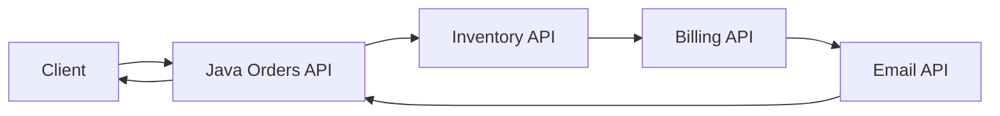

If `Email API` fails, the API can time out even though the order was already recorded. The deeper the synchronous call chain, the harder it becomes to manage latency, retries, and resilience.

### 2.2. Decoupling with a message broker

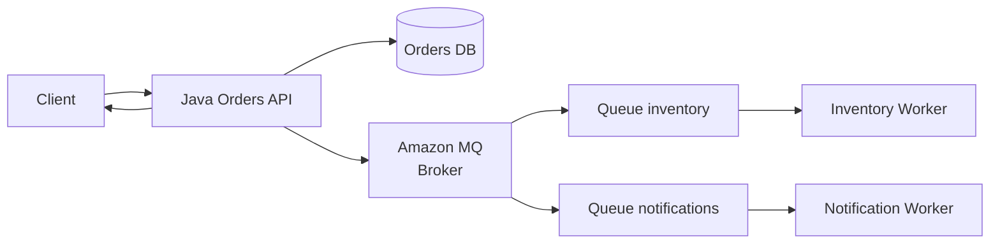

The producer can publish an `OrderCreated` message and return the HTTP response. Consumers process at their own pace; when consumers slow down, messages accumulate in the queue (within broker capacity limits).

**This provides decoupling, not magic reliability.** The broker still has CPU, memory, disk, connection, retention, and network limits. Acceptance by the broker does not mean business processing succeeded. Most applications still require **at-least-once processing and idempotency**.

### 2.3. Core terminology

| Term | Meaning | Example |
| --- | --- | --- |
| **Producer / publisher** | Sends messages to the broker | Java Orders API |
| **Consumer / subscriber** | Receives and processes messages | Inventory Worker |
| **Broker** | Intermediary server storing and routing messages | Amazon MQ broker |
| **Queue** | Buffer holding messages for consumer(s) | `orders.created.q` |
| **Topic / exchange** | Publishing and distribution target | JMS topic; RabbitMQ topic exchange |
| **Routing key / binding** | Rules routing messages to queues in RabbitMQ | `orders.created` |
| **Acknowledgment (ack)** | Consumer confirms receipt/processing per semantics | ACK after DB commit |
| **Nack / reject / redelivery** | Declines or requests reprocessing | Transient error |
| **Dead-letter queue (DLQ)** | Isolates messages that cannot be processed | `orders.failed.q` |
| **Durable / persistent** | Survives broker restarts per engine mechanics | Durable queue + persistent message |
| **Idempotency** | Reprocessing without causing duplicate side effects | Unique `eventId` |
| **Back pressure** | Throttling producers/regulating consumers under congestion | Memory/disk flow control |

## 3. How Amazon MQ Differs from SQS, SNS, and EventBridge

| Criterion | **Amazon MQ** | **Amazon SQS** | **Amazon SNS** | **Amazon EventBridge** |
| --- | --- | --- | --- | --- |
| Model | Managed **message broker** | Managed queue service | Managed pub/sub notifications | Managed event bus / routing |
| Standard broker protocols | **Yes**, per ActiveMQ/RabbitMQ | No direct JMS/OpenWire/AMQP socket broker | No | No |
| Must pick broker instance/type? | **Yes** | No | No | No |
| Queue consumer | Yes | Yes | Fans out to subscribers (e.g., SQS) | Routes to targets |
| Pub/sub / topic / exchange | Yes, per engine | Pair with SNS for fan-out | **Yes** | Event rules/patterns |
| Legacy JMS/OpenWire | **Good fit** | Requires app/adapter rewrite or SQS JMS library with different semantics | Not equivalent | Not equivalent |
| Operational profile | Monitor broker CPU/RAM/disk and versions | AWS operates queue fleet | AWS operates topic fleet | AWS operates event bus |
| Primary pricing | Broker instance-hours + storage/data transfer | Requests and data per pricing | Publishes/deliveries and data | Events/rules/targets per pricing |
| When to use | Broker migrations, protocol compatibility | AWS-native worker jobs/decoupling | Notifications and fan-out | Domain events and integration routing |

**Starting a greenfield project with a simple queue:** SQS is usually easier to operate, and SQS + SNS fits fan-out cleanly. **Amazon MQ** fits when existing code relies on ActiveMQ/RabbitMQ/JMS or needs specific broker routing and semantics. Never adopt MQ just to mimic a basic SQS queue.

**Do not treat these services as 1:1 drop-in replacements:** SQS uses visibility timeouts and receive/delete APIs; ActiveMQ/RabbitMQ use connection/session/ack/channel/exchange semantics. Migration entails rewriting clients, retries, observability, ordering, and authorization.

## 4. Amazon MQ Managed Architecture

### 4.1. Control plane vs. data plane

Amazon MQ has two planes:

- **AWS control plane:** creates/modifies brokers and manages engine versions, configs, networking, logs, KMS, and maintenance via Console/API/AWS CLI. Controlled by **IAM**.
- **Messaging data plane:** producers/consumers connect to the broker endpoint via a **protocol client** (OpenWire/AMQP, etc.), authenticate against the broker, and receive permissions on queues/exchanges/vhosts.

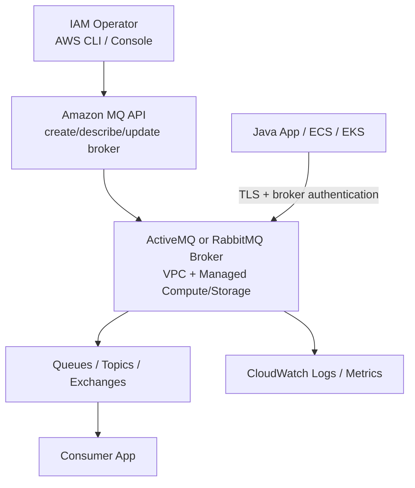

**Never confuse `mq:DescribeBroker` permission with permission to consume messages.** IAM access to the management API does not grant an AMQP connection permission to read queues. Newer RabbitMQ versions offer optional IAM/OAuth authentication/authorization configs; recognize those as **explicitly enabled broker authentication**, not default behavior on every broker.

### 4.2. Shared responsibility

| Managed by AWS | Still managed by you |
| --- | --- |
| Provisioning broker instances and storage | Choosing engine, version, instance type, and deployment mode |
| Broker infrastructure and partial patching/maintenance | Planning maintenance windows and verifying client compatibility |
| Availability/failover per deployment mode | Reconnect/backoff logic, backlogs, side-effect idempotency |
| TLS endpoints / encryption at rest | Security groups, broker permissions, TLS validation |
| Metrics/log integrations | Alarms, log redaction, queue-level operations |
| AWS API/IAM resource management | Broker users/vhosts/queues/exchanges and secret rotation |
| Partial configuration management | Broker config design, queue topology, retention, retry/DLX |

## 5. Choosing ActiveMQ vs. RabbitMQ

| Question | **Amazon MQ for ActiveMQ** | **Amazon MQ for RabbitMQ** |
| --- | --- | --- |
| Legacy Java workload using ActiveMQ Classic/JMS? | **Natural fit** | Can use JMS **on RabbitMQ 4** via RabbitMQ JMS client, subject to limitations |
| Code uses OpenWire? | **Yes** | No |
| Code uses STOMP/MQTT on Amazon MQ? | **Yes** | Not in AWS's published wire-level protocol list for managed RabbitMQ |
| Code uses RabbitMQ AMQP 0-9-1? | Not directly wire-compatible | **Yes** |
| Need direct/topic/fanout/headers exchanges and bindings? | Has its own destinations/JMS semantics | **RabbitMQ strength** |
| Need native AMQP 1.0? | ActiveMQ supports AMQP | **RabbitMQ 4** supports AMQP 1.0 with compatible clients/versions |
| Need JMS 1.1/2.0/3.1? | ActiveMQ Classic JMS clients per version/API compatibility | RabbitMQ 4 + RabbitMQ JMS client with caveats |
| Intra-Region HA | Active/standby across two AZs | Three-node RabbitMQ cluster across three AZs with quorum queues |
| Client libraries | ActiveMQ client, JMS provider, STOMP/MQTT/AMQP libraries | RabbitMQ Java AMQP client, RabbitMQ JMS client per version |
| Messaging model | Queues, topics, durable subscriptions, JMS semantics | Exchange → bindings → queues; ACK/confirm, vhosts |

**Never migrate from ActiveMQ to RabbitMQ simply by swapping the broker URL.** Destination semantics, transaction support, selectors, client ACKs, consumer redelivery, persistence, and topology all differ. Notably, the RabbitMQ JMS client **does not implement every JMS API available in ActiveMQ**.

## 6. Messaging Protocols: API vs. Wire Protocol

### 6.1. JMS is a Java API, not a wire protocol

**Java Message Service (JMS)** standardizes Java interfaces such as `ConnectionFactory`, `Session`/`JMSContext`, `MessageProducer`, `MessageConsumer`, `Queue`, and `Topic`. To talk to a broker, you need a **JMS provider/client library** that speaks an underlying wire protocol.

Examples:

- Apps using the **ActiveMQ Classic JMS client** typically speak **OpenWire** underneath.
- Apps using the **RabbitMQ JMS client** on **Amazon MQ RabbitMQ 4** rely on RabbitMQ/AMQP with the service-enabled JMS topic exchange plugin.
- **JMS 1.1, 2.0, and 3.1** differ in APIs, packages, and semantics; check framework and client versions carefully.

**You cannot open a raw MQTT socket and send a Java `JMS Message` without a compatible provider.**

### 6.2. Key protocols

| Protocol/API | Amazon MQ ActiveMQ | Amazon MQ RabbitMQ | Meaning |
| --- | --- | --- | --- |
| **OpenWire** | Yes | No | Primary protocol of ActiveMQ Classic clients |
| **AMQP 0-9-1** | Not a drop-in RabbitMQ replacement | Yes | Exchanges, queues, bindings, channels |
| **AMQP 1.0** | Yes per engine/connector | Yes on **RabbitMQ 4** | Distinct protocol from AMQP 0-9-1; use a compatible client |
| **STOMP** | Yes, including over WebSocket | Not in managed broker supported list | Text frames, polyglot |
| **MQTT** | Yes, including over WebSocket | Not in managed broker supported list | Pub/sub, lightweight IoT semantics |
| **JMS 1.1** | Yes via matching provider | Yes via RabbitMQ JMS client **4.x** | Java messaging API |
| **JMS 2.0 / 3.1** | Depends on provider/engine and namespace compatibility | RabbitMQ **4.x** via RabbitMQ JMS client, with caveats | Java/Jakarta messaging API |
| **HTTP broker management** | ActiveMQ web console | RabbitMQ web console/management API | Not a standard AMQP/OpenWire message transport |

**AMQP 0-9-1 and AMQP 1.0 are not wire-compatible.** Despite sharing “AMQP” in the name, their framing, client libraries, and architecture differ completely. A standard RabbitMQ Java AMQP 0-9-1 client does not speak AMQP 1.0.

### 6.3. Key updates in RabbitMQ 4

Per current AWS documentation:

- **RabbitMQ 4.2/4.3** is supported on Amazon MQ on compatible **`mq.m7g`** instance families.
- Port **5671 (AMQPS)** serves **AMQP 0-9-1**, and on RabbitMQ 4 also supports **AMQP 1.0**.
- RabbitMQ 4 adds the **RabbitMQ JMS client** for **JMS 1.1, 2.0, and 3.1** via the pre-enabled JMS topic exchange plugin.
- Certain JMS APIs are **unsupported**: **XA transactions**, server sessions, selectors on JMS Queue destinations, `NoLocal` subscriptions, and `JMSProducer.setDeliveryDelay`.
- RabbitMQ 4.2 makes **quorum** the default queue type in Amazon MQ's configuration; older versions did not necessarily do so.
- RabbitMQ 4.x has limitations around **CloudWatch per-queue metrics**, so inspect the management API or Prometheus endpoints.
- Amazon MQ for RabbitMQ **does not support RabbitMQ streams**; do not design around streams for event storage.

**Check version docs before deploying:** [Supported RabbitMQ protocols](https://docs.aws.amazon.com/amazon-mq/latest/developer-guide/rabbitmq-supported-protocols.html), [RabbitMQ JMS support](https://docs.aws.amazon.com/amazon-mq/latest/developer-guide/rabbitmq-jms-support.html), and [RabbitMQ 4 limitations](https://docs.aws.amazon.com/amazon-mq/latest/developer-guide/rabbitmq-4.html).

## 7. ActiveMQ: Queues, Topics, and JMS Semantics

### 7.1. Queue (point-to-point)

A **queue** holds messages for consumers to process. Multiple consumers can share work using the **competing consumers** pattern.

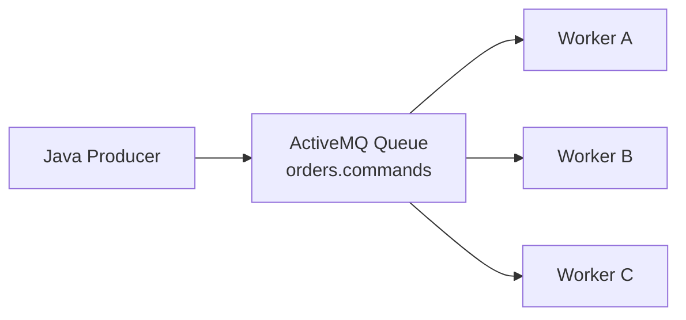

Normally a message is handed to one consumer at a time. However, if a consumer fails to ACK or its session drops, the message can be **redelivered** to another consumer. Applications must tolerate duplicates.

### 7.2. Topic (publish/subscribe)

A **JMS Topic** delivers events to multiple subscribers:

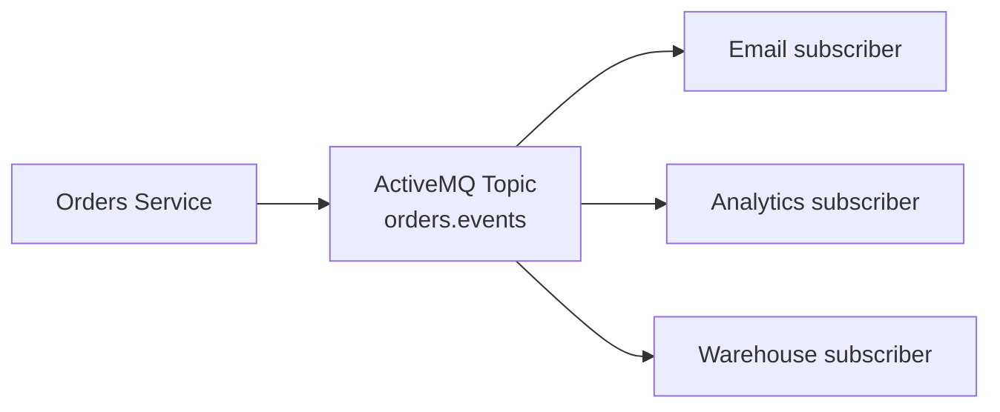

With **durable subscriptions**, the broker retains messages while a subscriber is offline subject to configuration and limits. Durable subscriptions still do not shield against retention/disk limits or chronically lagging consumers.

**A topic is not a queue:** a queue splits work across competing consumers, whereas a topic fans out each message to multiple subscriptions.

### 7.3. JMS sessions and acknowledgments

A JMS application can use:

| Mode | Meaning | Caveat |
| --- | --- | --- |
| `AUTO_ACKNOWLEDGE` | Session/client acknowledges per JMS provider semantics after receive/listener returns | Convenient, still must handle failures/duplicates |
| `CLIENT_ACKNOWLEDGE` | Client explicitly calls `acknowledge()` | In JMS 1.1, ACKing one message can acknowledge **all previously received messages on that Session** |
| `DUPS_OK_ACKNOWLEDGE` | Provider may defer/batch ACKs, risking duplicates | Use only when duplicates are harmless |
| **Transacted Session** | Commits/rolls back messages within the session | **Not** a distributed XA transaction with your database |

Never confuse a **JMS broker transaction** with an **ACID transaction spanning broker + RDS**. If an order commits to the DB and the MQ publish fails, you need a **transactional outbox** or reconciliation job.

## 8. Amazon MQ for ActiveMQ: Deployments and Storage

### 8.1. Single instance

A single broker runs in **one AZ**. Amazon MQ for ActiveMQ supports **EBS** or **EFS** depending on broker/instance type. Single-instance setups are simpler and fit testing or workloads that tolerate failover downtime.

### 8.2. Active/standby multi-AZ

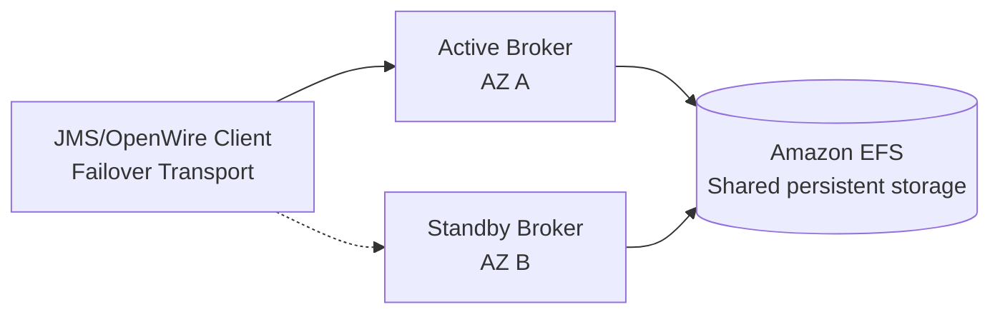

- Two brokers across **two Availability Zones**; normally only **one** serves active traffic at a time.
- Uses **EFS** for shared persistent storage.
- During active-node failure or maintenance, the standby takes over after a brief interval; clients must reconnect.
- Amazon MQ issues **a pair of protocol endpoints**; ActiveMQ clients should use **Failover Transport** with both.
- **EBS is unsupported for ActiveMQ active/standby deployments**, as EBS is single-AZ.
- Managed ActiveMQ on Amazon MQ uses **KahaDB** for persistence; do not assume custom JDBC store configs.

Storage and topology affect throughput and latency. Never assume active/standby EFS has identical performance or cost to single-instance EBS.

### 8.3. ActiveMQ Failover Transport

Obtain the real OpenWire TLS endpoint URIs from `DescribeBroker` and configure:

```text
failover:(ssl://BROKER_ENDPOINT_1:61617,ssl://BROKER_ENDPOINT_2:61617)?randomize=false
```

- `ssl://`: TLS over ActiveMQ's OpenWire listener.
- Always use the AWS-provided endpoint pair; **never construct DNS/ports from broker IDs yourself**.
- Configure truststores, certificate verification, and timeouts properly on the client.
- Failover can drop active connections and redeliver messages; **producers cannot know for sure whether a send succeeded or failed** if the socket drops right as the broker receives it.

## 9. RabbitMQ: Exchanges, Bindings, Queues, and Vhosts

RabbitMQ AMQP 0-9-1 uses a rich routing model:

1. Producers publish messages to an **exchange** with a **routing key**.
2. The exchange evaluates **bindings** to select target queues.
3. Consumers subscribe to one or more queues.
4. The broker delivers messages, and consumers **ack/nack** based on outcome.

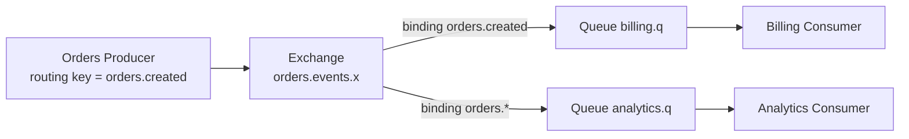

Assuming a **topic** exchange: two bindings matching the same routing key deliver copies to **both queues**, yet only once per queue.

### 9.1. Main exchange types

| Exchange type | Routing rule | When to use |
| --- | --- | --- |
| **Direct** | Routing key matches binding key exactly | Dispatching work by specific event type |
| **Topic** | Wildcard patterns with `*` (one word) and `#` (zero or more words) | Domain events like `orders.*`, `orders.#` |
| **Fanout** | Broadcasts to all bound queues, ignoring routing key | Broad event fan-out |
| **Headers** | Matches on message headers/binding arguments | Specialized header-based routing |
| **Default exchange** | Nameless direct exchange; every queue auto-bound by queue name | Simple direct-to-queue demos |

**Do not confuse a RabbitMQ topic exchange with a JMS topic.** Both enable pub/sub, yet client APIs, binding semantics, subscription durability, and implementation differ completely.

### 9.2. Virtual hosts (vhosts) and permissions

RabbitMQ uses **vhosts** to isolate exchange/queue namespaces and enforce access control:

- Producers and consumers can read, write, or configure only authorized vhosts and resources.
- Create dedicated users per application, environment, and role.
- Never share the administrator account across microservices.
- A user may need `configure`, `write`, and `read` permissions scoped to specific resource patterns.
- If an app only publishes to a pre-provisioned exchange, it does not need permissions to declare queues or exchanges.

Vhost `/` is the default, while production often uses `/orders` or `orders-prod`; remember to **URL-encode** vhost names inside connection URIs when needed.

## 10. Amazon MQ for RabbitMQ: Single Instance vs. Cluster

### 10.1. Single-instance broker

- One RabbitMQ broker node in one AZ.
- Endpoint sits behind a managed network load balancer; data uses EBS.
- Does not provide multi-AZ HA comparable to a cluster.
- Useful for sandboxes, dev environments, or workloads tolerating downtime.

### 10.2. Multi-AZ cluster

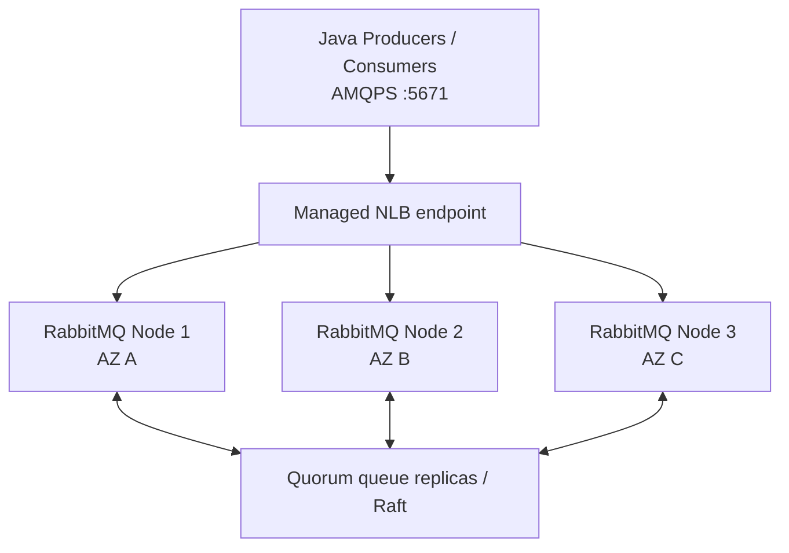

- Cluster deployments run **three nodes** across **three AZs**.
- Applications connect to the broker endpoint provided by Amazon MQ.
- RabbitMQ synchronizes topology state, queues, and users across nodes per engine/service design.
- For queue durability across node failures, **quorum queues** are recommended for production workloads.
- A cluster **does not automatically replicate every classic queue across three nodes**; queue type and replication configuration still matter.

### 10.3. Quorum queues and Raft

A **quorum queue** stores data with one leader and followers using **Raft majority consensus**. In a three-node cluster, if one node fails and a majority remains, a new leader is elected.

| Property | Quorum queue | Classic queue |
| --- | --- | --- |
| Replication / majority consensus | Built-in across cluster | Not equivalent to quorum replication |
| Suited for durable data | **Recommended by AWS** | Not the default for production HA in RabbitMQ 4 |
| Resource cost | Incurs replication/consensus overhead | Often lower overhead depending on workload |
| Poison handling | Supports delivery limits/TTL/DLX per version | Depends on queue settings/policies |
| Very deep backlogs | Requires careful memory/disk sizing | Not a substitute for infinite backlog storage |
| In-place queue type change | Never assume in-place conversion works | Migration typically requires a new queue |

**RabbitMQ 4.2 on Amazon MQ defaults to creating quorum queues when no type is specified.** Even so, explicitly declare **`x-queue-type=quorum`** in your design to avoid relying on environment/version defaults. **RabbitMQ 4.3** adds capabilities (such as delayed retries and quorum priorities), though APIs and limits must be verified for the exact version before use.

### 10.4. Do not use RabbitMQ streams on Amazon MQ

Although open-source RabbitMQ includes **Streams**, **Amazon MQ for RabbitMQ does not support streams** per AWS documentation. Never design long-term event logs, unbounded replays, or Kafka-style streaming on an unsupported feature; evaluate **Amazon MSK or Kinesis** for event streaming.

## 11. Message Delivery: ACKs, Confirms, Retries, and Idempotency

### 11.1. Publisher confirms vs. consumer acknowledgments

| Signal | Sent by | Proves what? | Does NOT prove |
| --- | --- | --- | --- |
| **Publisher confirm** | Broker → producer | Broker processed the publish per confirm semantics | Consumer finished business processing |
| **Consumer ACK** | Consumer → broker | Consumer accepted/acknowledged delivery | DB/side effects succeeded if code ACKs prematurely |
| **NACK / reject** | Consumer → broker | Consumer declined delivery (requeue or dead-letter) | Message will automatically succeed later |
| **RabbitMQ mandatory return** | Broker → producer | Message could not be routed to any queue | Does not replace publisher confirms |
| **DLQ / dead-letter** | Broker routing | Message isolated due to reject/expiration/delivery limit | Does not fix poisoned data |

**A publisher confirm can succeed even when a message routed to zero queues** if the producer omits `mandatory`/return handling or misconfigures topology. Reliable publishing requires **publisher confirms, routing validation, and return listeners**.

### 11.2. Why must you tolerate duplicates?

Example:

1. Consumer receives `OrderCreated(eventId=E123)`.
2. Consumer completes writing email/logs/database.
3. Consumer crashes **before sending ACK**.
4. Broker redelivers `E123`.
5. Without checking `eventId`, business logic runs twice.

Mitigation:

- Attach a sufficiently unique `eventId`/`messageId`.
- Record processed IDs in an **inbox/dedup table** with a unique constraint.
- Execute side effects and dedup writes inside the same transaction where possible.
- ACK **after** ensuring work and dedup records are committed.
- Pass idempotency keys to payment/email/third-party APIs where supported.

**Never promise “exactly-once side effects” solely because a broker uses persistent messages or quorum queues.** The standard reliable model is **at-least-once delivery + idempotent consumers**.

### 11.3. Retries and poison messages

Error classification:

| Error class | Example | Action |
| --- | --- | --- |
| **Transient** | DB timeout, API 503 | Retry with backoff and a **retry cap** |
| **Permanent validation** | Bad schema, missing required fields | Dead-letter/quarantine; never retry infinitely |
| **Unauthorized** | Service account lacks permissions | Alert operations; retry only after config fix |
| **Unknown** | Unclassified failure | Bounded retries, log correlation ID, then DLQ |
| **Duplicate event** | `eventId` already processed | Skip side effects, ACK safely |

**Repeatedly calling NACK with `requeue=true`** causes hot loops, spikes CPU/network usage, and balloons backlogs. Use **bounded retries**, delay/TTL/DLX patterns, or version-supported quorum delayed retries, routing to a failure queue once limits exhaust.

### 11.4. Dead-letter exchange (RabbitMQ)

A clean layout:

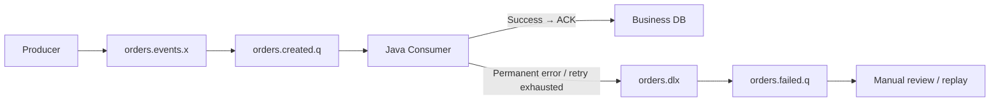

A **dead-letter exchange** can be applied via a broker policy; RabbitMQ docs often recommend **policies** over hardcoding `x-dead-letter-exchange` in application queue declarations, because changing queue arguments requires recreating the queue. **Never delete a live production queue holding messages** just to tweak DLX arguments.

## 12. Java RabbitMQ Producer: AMQPS, Durable Queues, and Confirms

### 12.1. Prerequisites

Assuming an Amazon MQ RabbitMQ cluster is provisioned:

- DNS endpoint from `DescribeBroker`, e.g., `b-EXAMPLE.mq.ap-southeast-1.amazonaws.com`.
- Port **5671** for **AMQPS**.
- Vhost, username/password, or configured auth mechanism.
- User permitted to publish/declare topology inside the test vhost.
- Java 17+ project with a team-approved **`com.rabbitmq:amqp-client`** version compatible with the broker.

Maven dependency (substitute a currently supported client version; never copy outdated versions from old tutorials):

```xml
<dependency>
    <groupId>com.rabbitmq</groupId>
    <artifactId>amqp-client</artifactId>
    <version>REPLACE_WITH_TESTED_VERSION</version>
</dependency>
```

### 12.2. Sample producer

```java
package example.mq;

import com.rabbitmq.client.AMQP;
import com.rabbitmq.client.Channel;
import com.rabbitmq.client.Connection;
import com.rabbitmq.client.ConnectionFactory;

import java.nio.charset.StandardCharsets;
import java.util.Map;
import java.util.UUID;
import java.util.concurrent.atomic.AtomicBoolean;

public final class RabbitOrdersPublisher {
    private static final String EXCHANGE = "orders.events.x";
    private static final String QUEUE = "orders.created.q";

    public static void main(String[] args) throws Exception {
        ConnectionFactory factory = new ConnectionFactory();
        factory.setHost(required("MQ_HOST")); // DNS from DescribeBroker
        factory.setPort(5671);
        factory.setUsername(required("MQ_USERNAME"));
        factory.setPassword(required("MQ_PASSWORD"));
        factory.setVirtualHost(System.getenv().getOrDefault("MQ_VHOST", "/"));
        factory.useSslProtocol();
        factory.enableHostnameVerification(); // Never disable TLS hostname check
        factory.setAutomaticRecoveryEnabled(true);
        factory.setRequestedHeartbeat(30);

        try (Connection connection = factory.newConnection("java-orders-publisher");
             Channel channel = connection.createChannel()) {

            channel.exchangeDeclare(EXCHANGE, "direct", true);

            Map<String, Object> queueArgs = Map.of(
                "x-queue-type", "quorum"
            );
            channel.queueDeclare(QUEUE, true, false, false, queueArgs);
            channel.queueBind(QUEUE, EXCHANGE, "orders.created");

            AtomicBoolean returned = new AtomicBoolean(false);
            channel.addReturnListener((replyCode, replyText, exchange,
                                       routingKey, properties, body) ->
                returned.set(true));

            channel.confirmSelect(); // Enable publisher confirms

            String eventId = UUID.randomUUID().toString();
            String payload = "{\"eventId\":\"" + eventId
                + "\",\"orderId\":\"order-42\",\"type\":\"OrderCreated\"}";

            AMQP.BasicProperties properties = new AMQP.BasicProperties.Builder()
                .contentType("application/json")
                .deliveryMode(2)  // persistent message
                .messageId(eventId)
                .build();

            // mandatory=true: broker returns unroutable messages.
            channel.basicPublish(EXCHANGE, "orders.created", true,
                properties, payload.getBytes(StandardCharsets.UTF_8));

            channel.waitForConfirmsOrDie(10000);

            if (returned.get()) {
                throw new IllegalStateException(
                    "Message was returned: no matching queue binding");
            }
            System.out.println("Confirmed publish eventId=" + eventId);
        }
    }

    private static String required(String name) {
        String value = System.getenv(name);
        if (value == null || value.isBlank()) {
            throw new IllegalArgumentException("Missing environment variable " + name);
        }
        return value;
    }
}
```

**Warnings before running:**

- This sample targets a **RabbitMQ 4 cluster** permitted to declare a **quorum queue**. If a queue of that name already exists with different arguments/type, `queueDeclare` throws an inequivalent-arguments error. In production, provision topology via IaC/ops and restrict apps to publishing only.
- Passwords must come from **Secrets Manager or runtime secret injection**—never hardcoded in source, Git, or logs. Env vars here are for sandbox labs; establish a rotation policy for production.
- Publisher confirms improve reliability, yet do not replace a **transactional outbox** when DB writes and MQ publishes must remain consistent.
- Multi-threaded or high-throughput publishers need **sequence tracking, async publisher confirms, connection/channel pooling, and thread-safety**; a single synchronous publish example does not reflect production throughput.
- Never enable `trust-all` SSL or disable hostname verification to silence TLS errors.

### 12.3. When the connection drops after publish

Suppose the broker received the message, yet the network drops before the client receives the confirm. The producer **cannot tell for certain** whether publishing succeeded. Retrying may produce a duplicate. That is why **`eventId`, outboxes, consumer idempotency, and reconciliation** are integral to a reliable design.

## 13. Java RabbitMQ Consumer: Manual ACK and DLQ

Example consumer processing a queue and ACKing only after business completion:

```java
package example.mq;

import com.rabbitmq.client.Channel;
import com.rabbitmq.client.Connection;
import com.rabbitmq.client.ConnectionFactory;
import java.nio.charset.StandardCharsets;
import java.util.concurrent.CountDownLatch;

public final class RabbitOrdersConsumer {
    private static final String QUEUE = "orders.created.q";

    public static void main(String[] args) throws Exception {
        ConnectionFactory factory = new ConnectionFactory();
        factory.setHost(required("MQ_HOST"));
        factory.setPort(5671);
        factory.setUsername(required("MQ_USERNAME"));
        factory.setPassword(required("MQ_PASSWORD"));
        factory.setVirtualHost(System.getenv().getOrDefault("MQ_VHOST", "/"));
        factory.useSslProtocol();
        factory.enableHostnameVerification();
        factory.setAutomaticRecoveryEnabled(true);
        factory.setRequestedHeartbeat(30);

        try (Connection connection = factory.newConnection("java-orders-consumer");
             Channel channel = connection.createChannel()) {
            channel.basicQos(20); // Cap unacknowledged deliveries

            channel.basicConsume(QUEUE, false, (consumerTag, delivery) -> {
                long tag = delivery.getEnvelope().getDeliveryTag();
                String payload = new String(
                    delivery.getBody(), StandardCharsets.UTF_8);
                try {
                    // REPLACE WITH validated business logic and DB idempotency
                    // using eventId/messageId; commit BEFORE ACK.
                    System.out.println("Processing: " + payload);
                    channel.basicAck(tag, false);
                } catch (Exception error) {
                    // requeue=false: routes to DLQ only if DLX is configured.
                    // WITHOUT a DLX, the message can be dropped!
                    channel.basicNack(tag, false, false);
                }
            }, consumerTag -> { });

            System.out.println("Consuming from " + QUEUE);
            new CountDownLatch(1).await();
        }
    }

    private static String required(String name) {
        String value = System.getenv(name);
        if (value == null || value.isBlank()) {
            throw new IllegalArgumentException("Missing environment variable " + name);
        }
        return value;
    }
}
```

**Required production additions:**

1. **Validate JSON/schema** before executing side effects.
2. Read `eventId` and check the unique constraint in an inbox/dedup store.
3. Separate transient vs. permanent errors; route transient errors through backed-off retries with a **retry cap** instead of infinite NACK-requeue loops.
4. **Configure DLX/DLQ before running**: calling `basicNack(..., requeue=false)` without dead-letter routing drops the message.
5. Respect connection/channel thread-safety: never share one channel concurrently across arbitrary application threads.
6. Instrument consumers with metrics: processing latency, success/failure counts, redelivery rate, and DLQ depth.
7. Run multiple consumers to scale while preserving ordering, idempotency, and prefetch sizing.

**`basicQos(20)`** bounds how many unacknowledged deliveries a consumer can hold at once (per client/broker QoS semantics). It does **not** mean “20 messages per second”.

## 14. Java ActiveMQ Classic JMS: Producer/Consumer over OpenWire

### 14.1. Dependencies and API namespaces

For applications using ActiveMQ Classic 5.x and **JMS 1.1 `javax.jms`**, typical dependency:

```xml
<dependency>
    <groupId>org.apache.activemq</groupId>
    <artifactId>activemq-client</artifactId>
    <version>REPLACE_WITH_COMPATIBLE_ACTIVEMQ_CLIENT_VERSION</version>
</dependency>
```

**Critical compatibility:** `javax.jms` and `jakarta.jms` are **two separate namespaces**. Spring Boot 3 / Spring Framework 6 use Jakarta APIs. When migrating, align the client/provider namespace and ActiveMQ version—never swap `javax.jms` imports to `jakarta.jms` while ignoring underlying provider compatibility.

### 14.2. JMS producer

```java
package example.mq;

import org.apache.activemq.ActiveMQConnectionFactory;
import javax.jms.Connection;
import javax.jms.DeliveryMode;
import javax.jms.MessageProducer;
import javax.jms.Queue;
import javax.jms.Session;
import javax.jms.TextMessage;

public final class ActiveMqOrdersProducer {
    public static void main(String[] args) throws Exception {
        String username = required("MQ_USERNAME");
        String password = required("MQ_PASSWORD");

        // Example URI from AWS DescribeBroker, endpoint pair for active/standby.
        String failoverUri = required("MQ_OPENWIRE_URI");

        ActiveMQConnectionFactory factory =
            new ActiveMQConnectionFactory(username, password, failoverUri);

        Connection connection = factory.createConnection();
        try {
            Session session =
                connection.createSession(false, Session.AUTO_ACKNOWLEDGE);
            try {
                Queue queue = session.createQueue("orders.commands");
                MessageProducer producer = session.createProducer(queue);
                try {
                    producer.setDeliveryMode(DeliveryMode.PERSISTENT);
                    TextMessage message =
                        session.createTextMessage("{\"eventId\":\"E123\"}");
                    message.setStringProperty("eventType", "OrderCreated");
                    producer.send(message);
                } finally {
                    producer.close();
                }
            } finally {
                session.close();
            }
        } finally {
            connection.close();
        }
    }

    private static String required(String name) {
        String value = System.getenv(name);
        if (value == null || value.isBlank()) {
            throw new IllegalArgumentException("Missing " + name);
        }
        return value;
    }
}
```

**Connections must use TLS**, for example:

```text
MQ_OPENWIRE_URI=failover:(ssl://BROKER_1:61617,ssl://BROKER_2:61617)?randomize=false
```

Endpoints must match the exact values returned by Amazon MQ. **Verify TLS truststore and hostname verification settings for your ActiveMQ client version**; never disable certificate validation on trust errors.

### 14.3. JMS consumer with client acknowledgment

```java
package example.mq;

import org.apache.activemq.ActiveMQConnectionFactory;
import javax.jms.Connection;
import javax.jms.Message;
import javax.jms.MessageConsumer;
import javax.jms.Queue;
import javax.jms.Session;
import javax.jms.TextMessage;

public final class ActiveMqOrdersConsumer {
    public static void main(String[] args) throws Exception {
        ActiveMQConnectionFactory factory =
            new ActiveMQConnectionFactory(
                required("MQ_USERNAME"),
                required("MQ_PASSWORD"),
                required("MQ_OPENWIRE_URI"));

        Connection connection = factory.createConnection();
        try {
            Session session =
                connection.createSession(false, Session.CLIENT_ACKNOWLEDGE);
            try {
                Queue queue = session.createQueue("orders.commands");
                MessageConsumer consumer = session.createConsumer(queue);
                try {
                    connection.start();
                    Message message = consumer.receive(10000);
                    if (message instanceof TextMessage text) {
                        // Replace with transactional/idempotent business processing.
                        System.out.println(text.getText());

                        // ACK ONLY AFTER side effects commit successfully.
                        message.acknowledge();
                    }
                } finally {
                    consumer.close();
                }
            } finally {
                session.close();
            }
        } finally {
            connection.close();
        }
    }

    private static String required(String name) {
        String value = System.getenv(name);
        if (value == null || value.isBlank()) {
            throw new IllegalArgumentException("Missing " + name);
        }
        return value;
    }
}
```

This uses the legacy **`javax.jms`** namespace and performs a single receive. With multiple messages on the same `Session.CLIENT_ACKNOWLEDGE` session, calling `message.acknowledge()` can acknowledge **all** previously received messages on that session, not just one message. If different transaction or ACK semantics are needed, design for the actual JMS provider—and never treat a JMS session transaction as an XA transaction spanning RDS and the broker.

## 15. Spring Boot: Choosing Spring AMQP vs. Spring JMS

| Application | Library / framework | What to verify |
| --- | --- | --- |
| Java service + RabbitMQ AMQP 0-9-1 | **Spring AMQP / Spring Rabbit** | `ConnectionFactory`, TLS, listeners, queues/exchanges, retries |
| Legacy Java + ActiveMQ Classic | **Spring JMS** | JMS provider, `javax`/`jakarta` compatibility, transactions |
| RabbitMQ 4 + JMS client | RabbitMQ JMS client, optionally paired with Spring JMS where supported | JMS API subset, plugins, version |
| Node.js/Python + RabbitMQ | RabbitMQ AMQP libraries | Same wire protocol; no JMS needed |
| IoT senders using MQTT | ActiveMQ MQTT endpoint or AWS IoT Core depending on scale/needs | QoS, MQTT topics, IoT scale |

### 15.1. Spring Rabbit consumer (illustrative)

```java
package example.mq;

import org.springframework.amqp.rabbit.annotation.RabbitListener;
import org.springframework.stereotype.Component;

@Component
public class OrdersListener {
    @RabbitListener(queues = "orders.created.q")
    public void onOrderCreated(String json) {
        // Validate schema, deduplicate eventId, commit business side effect.
        // ACK/retry behavior depends on listener container configuration.
        System.out.println("Order event length=" + json.length());
    }
}
```

Never assume the annotation alone guarantees safe retries, ACKs, and DLQs. Configure **listener container acknowledgment mode**, retry backoff, error handlers/recoverers, prefetch, and concurrency. If the framework auto-ACKs upon listener return, ensure DB commits complete safely before returning.

### 15.2. Spring JMS consumer (illustrative)

```java
package example.mq;

import org.springframework.jms.annotation.JmsListener;
import org.springframework.stereotype.Component;

@Component
public class LegacyOrdersListener {
    @JmsListener(destination = "orders.commands")
    public void onCommand(String body) {
        // Processes under JMS listener container transaction/ack settings.
        System.out.println("JMS message length=" + body.length());
    }
}
```

Neither example **runs standalone** without dependencies, connection properties, broker credentials, and container configuration. For modern Spring Boot versions, pick **Jakarta-compatible** providers when required.

## 16. VPC Networking, Ports, and TLS

### 16.1. Data path inside a private VPC

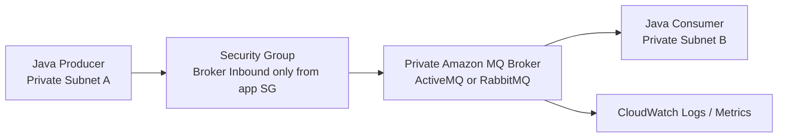

Recommendations:

- Create brokers with **public accessibility disabled** unless explicitly approved.
- Place producers and consumers inside the VPC or connect via approved VPN/Direct Connect/private paths.
- Broker security groups should allow **only authorized application security groups/CIDRs** on exact protocol ports.
- Separate management console/API access from application producer/consumer access.
- Configure route tables, DNS resolution, NACLs, AZs, and VPC peering/Transit Gateway for multi-VPC topologies.
- Never open broker or admin UI ports to `0.0.0.0/0` just to debug.

### 16.2. Key ports

| Engine | Protocol / interface | Common TLS port on Amazon MQ |
| --- | --- | --- |
| **ActiveMQ** | OpenWire over TLS | **61617** |
| **ActiveMQ** | AMQP over TLS | **5671** |
| **ActiveMQ** | MQTT over TLS | **8883** |
| **ActiveMQ** | STOMP over TLS | **61614** |
| **ActiveMQ** | MQTT/STOMP over WebSocket | **61619** per listener |
| **ActiveMQ** | Web console | AWS-configured HTTPS endpoint/port (commonly 8162) |
| **RabbitMQ** | AMQP 0-9-1 / AMQP 1.0 (RabbitMQ 4) | **5671** |
| **RabbitMQ** | Management console / API | **443** or **15671** |

**Do not concatenate ports onto hostnames yourself** when the AWS Console or `DescribeBroker` gives the full endpoint URI. Protocol support also depends on engine version, URI, and TLS settings.

### 16.3. TLS means more than “using `ssl://`”

Clients must:

1. Use the **AWS-published broker FQDN** as the server identity.
2. Verify the certificate chain/truststore, hostname, and `subjectAltName`.
3. Select strong TLS protocols/ciphers and never disable TLS validation.
4. Configure security groups, ports, and DNS properly.
5. Account for certificate rotation; never pin a leaf server certificate that will expire or rotate.
6. With RabbitMQ Java clients, call `enableHostnameVerification()` when supported.
7. Never swap the broker FQDN for an IP address or custom alias absent from the certificate.

Amazon MQ has been transitioning certain broker certificates from regional wildcards to **per-broker certificates**; always connect using the exact endpoint FQDN to avoid failures after certificate rotation.

### 16.4. Broker credentials and IAM

- **Default ActiveMQ:** broker users/groups and an authorization map, or LDAP authentication where supported.
- **Default RabbitMQ:** internal broker users and permissions per vhost/exchange/queue.
- **RabbitMQ 4 / select versions/configs:** OAuth2, IAM outbound federation, LDAP, HTTP auth, or mTLS client certificates supported under specific AWS conditions.
- **IAM for the AWS MQ API:** manages brokers and configs; does not grant default AMQP/OpenWire consume rights.

**ActiveMQ may not ship with a restrictive authorization map by default**, giving authenticated broker users overly broad access. Configure proper **authorization maps and group permissions**, checking `activemq-webconsole` permissions when adjusting policies.

Fetch secrets from **AWS Secrets Manager / Parameter Store** via the **application's IAM role**, pass them securely to the client, and maintain a rotation schedule. Never hardcode passwords in source code, shared command lines, or container images.

## 17. Reliable Message Publishing: Outbox and Inbox

### 17.1. The dual-write problem

Suppose a Java API executes:

```text
1. INSERT order INTO RDS      -> COMMIT
2. PUBLISH OrderCreated -> Amazon MQ
```

If the process crashes between steps 1 and 2, the order exists with **no event**. Reversing the steps risks consumers seeing an event for a rolled-back order.

### 17.2. Transactional outbox

A practical design:

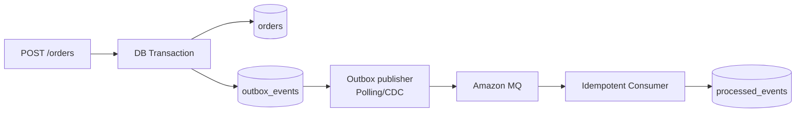

- Write the order and outbox event inside the **same RDS transaction**.
- The relay publishes to MQ, waits for publisher confirm, and marks the row sent.
- If the relay crashes, it may republish → consumers deduplicate by `eventId`.
- Consumers insert `processed_events` with a unique constraint in the same transaction as business updates when possible.
- ACK messages only after committing or confirming a duplicate.
- Back it up with reconciliation jobs, bounded retries, and DLQ handling.

**An outbox does not turn the broker into an exactly-once network protocol.** It eliminates lost events from dual writes by enabling safe retries.

### 17.3. Is ordering guaranteed?

Ordering depends on:

- Queue topology, producer count, and consumer concurrency.
- Requeues/redeliveries, retries, and dead-letter replays.
- Partitioning/sharding by `aggregateId`.
- RabbitMQ exchanges/bindings, queue types, and consumer behavior.
- JMS Message Groups / provider rules if using ActiveMQ.

**A single queue does not guarantee global execution order of side effects** when multiple consumers run in parallel or redeliveries happen. When per-order ordering matters, enforce per-aggregate sequencing via `orderId`, sequence numbers, or versions.

## 18. HA, Maintenance, and Disaster Recovery

### 18.1. What must clients do during broker failover?

- **ActiveMQ active/standby:** clients use **Failover Transport**, expect brief connection drops, reconnect, and handle redeliveries.
- **RabbitMQ cluster:** the RabbitMQ Java client offers **automatic network recovery** for dropped connections per config, while initial connection failures require backed-off retries.
- After reconnecting, verify topology, consumers, and channel state, and handle in-flight messages with uncertain ACK status.
- Bound timeouts, exponential backoff + jitter, circuit breakers, and producer buffers to avoid self-inflicted overload.
- **Never retry blindly forever** if broker memory/disk alarms fire or authentication is denied.

### 18.2. Intra-AZ HA is not cross-Region DR

| Scenario | Multi-AZ HA | Multi-Region Disaster Recovery |
| --- | --- | --- |
| Broker node failure | Standby/quorum recovers within Region | Does not necessarily require cross-Region |
| Full AZ failure | Multi-AZ design maintains availability | Still depends on the rest of the Region |
| Full Region outage | **Not solved by multi-AZ alone** | Requires standby Region architecture, replication, routing |
| Consistent message backlog | Depends on engine and queue type | Must account for async replication, lag, and RPO |
| Client connection URI | Can keep endpoint / HA pair | Usually requires switching broker endpoints |
| DB side effects | Requires dedicated DB HA | Requires DB replication and consistency strategy |

Amazon MQ offers certain **cross-Region replication** features depending on engine, version, and configuration; check official docs before committing to RPO/RTO targets. Broker replication **does not automatically replicate RDS** or guarantee single execution of emails/payments across Regional failovers.

### 18.3. Engine version upgrades

Before upgrading RabbitMQ 3.x → 4.x or ActiveMQ engines:

1. Read release notes, breaking changes, and supported engine versions.
2. Verify instance families, plugins, queue types, client libraries, and JMS compatibility.
3. Test in staging with production-like message shapes and load.
4. Plan maintenance, downtime, and reconnects; **in-place major upgrades from RabbitMQ 3.13 → 4.2 incur broker downtime** per AWS.
5. Prepare backups, recovery procedures, and realistic rollback plans—especially when changing message schemas or queue types.
6. Monitor queue depths, unacked counts, consumer lag, memory/disk, and app errors.
7. Update production only with an owner, approval, and customer communication plan.

Never assume RabbitMQ 4.3 on Amazon MQ supports every feature or plugin from open-source RabbitMQ 4.3. Amazon MQ governs plugin availability and service restrictions.

## 19. Creating a Broker in the AWS Console

> **Cost warning:** Brokers incur **hourly charges** while running, even with zero messages. Clusters, active/standby pairs, and storage carry meaningful costs. Provision only in an approved sandbox with budget sign-off; the read-only exercises below do not require creating a broker.

### 19.1. Choosing engine and deployment

1. Open the [Amazon MQ Console](https://console.aws.amazon.com/amazon-mq/) in your authorized **AWS account/Region**.
2. Choose **Create brokers**.
3. Select **Apache ActiveMQ** or **RabbitMQ** based on **protocol and client compatibility**.
4. Pick an AWS-supported version in that Region, verifying client compatibility and maintenance policies.
5. Choose **Single-instance** for sandboxes or **ActiveMQ active/standby / RabbitMQ cluster** for HA.
6. Select instance type and matching storage/deployment mode (ActiveMQ EFS/EBS constraints; RabbitMQ EBS/cluster).
7. Name the broker **without PII or secrets**.
8. Configure VPC/subnets/AZs/security groups, keeping **public accessibility disabled** unless explicitly approved.
9. Create initial admin credentials securely and store secrets properly.
10. Configure encryption/KMS, maintenance window, CloudWatch logging, tags, and monitoring.
11. Review costs and quotas, then create the broker.
12. Once `RUNNING`, capture the **AWS-issued endpoint(s)** and test connectivity from an authorized VPC client.

### 19.2. Two sample configuration profiles

| Property | ActiveMQ JMS migration | RabbitMQ order events |
| --- | --- | --- |
| Engine | Supported ActiveMQ Classic version | Supported RabbitMQ 4.3/4.2 version |
| Deployment | Multi-AZ active/standby | Multi-AZ 3-node cluster |
| Storage | EFS shared store | EBS-backed nodes + quorum queues |
| Protocol | OpenWire TLS `61617` | AMQP 0-9-1 TLS `5671` |
| App | Java JMS client | RabbitMQ Java client / Spring AMQP |
| Client HA | Failover Transport endpoint pair | Automatic network recovery + retries |
| Messaging pattern | Queues + durable topics | Topic/direct exchanges + quorum queues |
| Secrets | Broker user credentials / LDAP | Internal user/vhost or configured federation |
| Monitoring | Heap, queue depth, connections | Memory/disk, ready/unacked, quorum health |

## 20. AWS CLI: Safely Inspecting Brokers and Versions

Use AWS CLI v2 with the right IAM profile and Region:

```bash
# Check caller identity.
aws sts get-caller-identity --profile training

# List brokers in Region.
aws mq list-brokers \
  --region ap-southeast-1 \
  --profile training

# Inspect broker details, engine, deployment, endpoints, VPC/SG.
aws mq describe-broker \
  --broker-id b-EXAMPLE-BROKER-ID \
  --region ap-southeast-1 \
  --profile training

# Inspect supported instance types/options for an engine.
aws mq describe-broker-instance-options \
  --engine-type RABBITMQ \
  --region ap-southeast-1 \
  --profile training

# Inspect engine types and versions.
aws mq describe-broker-engine-types \
  --region ap-southeast-1 \
  --profile training
```

`b-EXAMPLE-BROKER-ID` is a placeholder. `describe-broker` output includes broker endpoints, SGs/VPCs, and user/config metadata; **never paste credentials into tickets or logs**. If a broker does not appear, check account, Region, and IAM permissions first.

### 20.1. Fields to record from `describe-broker`

| Field | Meaning |
| --- | --- |
| `EngineType` / `EngineVersion` | ActiveMQ/RabbitMQ and version |
| `DeploymentMode` | `SINGLE_INSTANCE`, `ACTIVE_STANDBY_MULTI_AZ`, or `CLUSTER_MULTI_AZ` per engine |
| `BrokerState` | `RUNNING`, `CREATING`, `FAILED`, etc. |
| `HostInstanceType` | Broker compute sizing |
| `StorageType` | Storage type where applicable |
| `Endpoints` | **AWS-provided** broker connection URLs |
| `SubnetIds` / `SecurityGroups` | VPC networking attachment |
| `PubliclyAccessible` | Whether public access is enabled |
| `Logs` / `MaintenanceWindowStartTime` | Observability and maintenance |
| `EncryptionOptions` | KMS encryption at rest |

Never attempt to change broker subnets or VPCs in place where unsupported; in many cases you must **provision a new broker and migrate clients/queues**. Do not modify infrastructure during read-only exercises.

### 20.2. State-mutating broker creation and configuration

Commands such as `aws mq create-broker`, `update-broker`, `reboot-broker`, and `delete-broker` incur costs or cause service disruption. Run them only in authorized sandboxes with an owner and rollback/cleanup plan. **Never pass broker passwords as plain command-line arguments** where shell history or process logs can capture them; use Secrets Manager or IaC with approved secret handling.

## 21. Monitoring and Alerting: What to Watch

### 21.1. ActiveMQ metrics

| Signal | Meaning | Action |
| --- | --- | --- |
| `CpuUtilization` | CPU usage | Evaluate peaks, throughput, instance sizing |
| `HeapUsage` | JVM heap pressure | Check memory, queue depth, GC |
| Queue/topic destination metrics | Backlog, enqueue/dequeue, consumer activity per support | Spot slow or missing consumers |
| Connections | Client lifecycle and churn | Detect reconnect loops or leaks |
| Broker logs/restarts/maintenance | Engine errors, policies, failovers | Correlate with app errors and event timestamps |

An ActiveMQ broker being `RUNNING` does not mean queues are draining within SLO. Monitor **oldest message age, backlog/processing latency, and DLQ handling** alongside broker metrics.

### 21.2. RabbitMQ metrics

| Signal | Meaning | When to alert |
| --- | --- | --- |
| `SystemCpuUtilization` | Broker node CPU | Sustained highs degrade throughput |
| `RabbitMQMemUsed` vs `RabbitMQMemLimit` | Memory high watermark | Approaching limit blocks publishes |
| `RabbitMQDiskFree` vs `RabbitMQDiskFreeLimit` | Disk free watermark | Low disk blocks producer traffic |
| `ConnectionCount` / `ChannelCount` | Connection and channel counts | Sudden churn or leaks |
| `ConsumerCount` | Active consumers | Drops to 0 on active queues |
| `MessageReadyCount` | Messages waiting delivery | Growing backlog |
| `MessageUnacknowledgedCount` | Delivered, awaiting ACK | Slow/hung consumers or excessive prefetch |
| RabbitMQ management / Prometheus | Per-queue, routing, quorum, and Raft metrics | Version-specific granular visibility |

**RabbitMQ 4.x caveat:** Amazon MQ **does not export per-queue metrics with `Queue`/`VirtualHost` dimensions to CloudWatch the same way RabbitMQ 3.x did**. Use the **RabbitMQ management API** or **Prometheus endpoints** (RabbitMQ 4.2+) for per-queue visibility. CloudWatch still emits broker/node metrics.

### 21.3. Root causes of backlogs

```text
Producer rate:    900 msg/s
Consumer rate:    600 msg/s
Backlog growth:   ~300 msg/s
After 10 minutes: ~180,000 extra messages
```

This illustrates a steady-state calculation; real traffic includes bursts, redeliveries, and batching.

**Adding broker nodes rarely speeds up slow consumers**: inspect DB capacity, consumer count, queue parallelism, prefetch, CPU, QoS, and processing latency. Scaling up consumers can overwhelm the DB if each consumer opens too many connections.

### 21.4. Logs and auditing

- **CloudWatch Logs:** broker general and audit logs per engine/support; set retention.
- **CloudWatch Alarms:** memory, disk, CPU, queue backlogs, and consumer drops.
- **CloudTrail:** records who created, edited, or rebooted brokers/configs on the AWS control plane.
- **Structured application logs:** `eventId`, queue, processing status, duration, `retryCount`, correlation ID — **never log messages containing PII or secrets**.
- **Tracing:** propagate trace IDs on publish/consume; never assume distributed traces connect automatically across a broker hop.

## 22. Least-Privilege Security

### 22.1. IAM + broker auth

**Separate four permission tiers:**

1. IAM Operator: views/creates/modifies brokers per IAM role.
2. Broker administrator: manages vhosts, users, queues, exchanges, or console.
3. Producer: can **write** only to authorized exchanges/destinations.
4. Consumer: can **read** only from required queues, with no permission to alter topology unnecessarily.

### 22.2. Secrets and TLS

- Deploy brokers in a **private VPC**, keeping public access disabled unless needed.
- Restrict SGs to the **exact protocol ports** from authorized workloads.
- Enable **TLS** and validate server FQDN and certificates.
- Enable **encryption at rest** via KMS per configuration.
- Never use the admin password in application services.
- Store secrets in Secrets Manager; restrict IAM `GetSecretValue`, KMS grants, and enforce rotation.
- Never leave `guest/guest` or default credentials active in production.
- Scope permissions by namespace/vhost/queue and broker policies.
- When using OAuth2, IAM federation, or mTLS on RabbitMQ, verify **engine version, plugins/config, scope mappings, and fallback auth**—never assume toggling one option makes it secure.

### 22.3. Message-level security

- Never put PII, tokens, or passwords in messages unless strictly required.
- Enforce schema versioning, data classification, retention/expiry, and extra encryption when compliance demands it.
- Both producers and consumers must validate schemas; treat event payloads as **untrusted input**.
- If payloads contain sensitive data, restrict read/log/preview permissions in management UIs and DLQs.
- DLQs retain failing payloads that may be sensitive; apply dedicated retention and ops access controls.
- When consumers call external AWS services, use workload IAM roles—never treat broker credentials as AWS credentials.

## 23. Cost and Capacity Planning

### 23.1. Major cost components

| Item | Notes |
| --- | --- |
| **Broker instance-hours** | Billed by engine, instance type, and broker node count (single / active-standby / cluster) |
| **Broker storage** | EBS/EFS provisioned and consumed capacity per config/service |
| **Data transfer** | Inter-AZ, cross-Region, VPC, and egress per pricing |
| **CloudWatch Logs/metrics** | Log ingestion, retention, monitoring, dashboards |
| **KMS / Secrets Manager** | When using customer-managed keys and secrets |
| **Networking** | NAT, VPN/Direct Connect, endpoints, auxiliary load balancers if any |
| **Application compute** | ECS/EC2/EKS/Lambda producers and consumers |
| **Data stores** | RDS/DynamoDB/S3, outbox/inbox/DLQ operations |

**A three-node RabbitMQ cluster does not cost the same as a single-instance broker.** ActiveMQ active/standby also differs in capacity and storage charges. Even an idle dev broker with zero messages still accrues broker-hours.

Consult [Amazon MQ pricing](https://aws.amazon.com/amazon-mq/pricing/) and the [AWS Pricing Calculator](https://calculator.aws/).

### 23.2. Estimating backlog and storage

Suppose:

- 200 messages/second.
- Average message size: 2 KiB.
- Consumers stop for 20 minutes.

Raw backlog growth:

\[
200 \times 1{,}200 = 240{,}000\ \text{messages}
\]

Raw payload volume:

\[
240{,}000 \times 2\ \mathrm{KiB}
= 480{,}000\ \mathrm{KiB}
\approx 469\ \mathrm{MiB}
\]

**This is not the final disk requirement.** Add headers/metadata, replication, journal/queue indices, persistence overhead, fragmentation, retries/DLQ, HA replicas, and safety margin. Memory or disk alarms can trigger well before the disk reaches 100% full.

### 23.3. Formula for consumer capacity

Suppose each worker sustains **25 messages/second** and peak producers send **300 messages/second**:

\[
N_{\text{consumers}}
\gtrsim
\left\lceil \frac{300}{25}\right\rceil=12
\]

Add headroom for AZ loss, downstream glitches, retries, and variance. **12 consumers** is only a rough floor, not a guarantee that the broker or DB can sustain 300 msg/s.

### 23.4. When should costs push you toward another service?

If your application needs no broker protocol compatibility, no JMS, and no RabbitMQ exchange routing, and your team prefers not to manage broker memory, disk, or engine versions, **SQS/SNS/EventBridge** are often cleaner and more economical for greenfield workloads. Amazon MQ is managed, yet remains **provisioned broker capacity**—not an infinitely scaling serverless queue.

## 24. Troubleshooting: Separating Connection Errors from Messaging Errors

| Symptom | Common cause | What to inspect |
| --- | --- | --- |
| Connect timeout | Bad SG/NACL/route/VPC/DNS | App subnet/VPC, broker endpoint, port |
| TLS handshake failure | Invalid truststore/cert/hostname | AWS-issued FQDN, cert chain validation, TLS |
| AMQP `ACCESS_REFUSED` | Bad username/password, vhost, or permissions | Broker users, vhost `read/write/configure` |
| AMQP `PRECONDITION_FAILED` on `queueDeclare` | Existing queue has different type/durable/arguments | Actual queue definition; never delete blindly |
| OpenWire failover not working | Client configured only one endpoint or bad URI | Failover Transport and both endpoints |
| JMS `ClassNotFound`/`NoClassDefFoundError` | `javax.jms`/`jakarta.jms` or dependency clash | JMS provider/version, Spring Boot compatibility |
| RabbitMQ publisher confirms, yet consumer sees nothing | Bad exchange binding/routing key, ignored mandatory return | Exchange type, bindings, routing key |
| Queue depth climbing | Slow consumers or downstream bottleneck | Processing latency, consumer count, DB/CPU |
| High unacked count | Consumers holding messages, high prefetch, missing ACKs | `basicQos`, ACK code, network |
| Redelivery loop | Unbounded NACK `requeue=true` | Bounded retries, DLX/DLQ, poison handling |
| DLQ empty despite NACK `requeue=false` | Missing DLX or broken routing to DLQ | Broker policies, DLX bindings |
| Publishes blocked | Memory/disk alarm | `RabbitMQMemUsed/Limit` and `DiskFree/Limit` |
| Quorum queue loses availability | Lost Raft majority or node/AZ outage | Cluster health, replicas, Raft metrics |
| Classic queue loses messages on node failure | Lacks quorum-style replication | Queue type, durability, backups |
| Duplicates after client reconnect | Confirm/ACK lost during failover | Idempotency, `eventId`, outbox |
| RabbitMQ 4 per-queue CloudWatch metrics empty | Engine 4 metric support change | Management API / Prometheus |
| MQTT/STOMP client cannot connect to RabbitMQ | Protocol unsupported on managed RabbitMQ | Use ActiveMQ or another broker |
| Java app cannot access S3 | Broker credentials are not the app's IAM role | Workload IAM role, SDK config |
| Workers slow down after scaling out | DB connection pool or third-party quota saturated | Downstream saturation, retries |
| Broker bill climbing | Cluster/active-standby sizing, storage/logs | Cost Explorer, owner, cleanup |

### Layered root-cause checklist

1. **Right environment?** AWS account/Region, broker state, engine/version.
2. **Right protocol?** AMQP 0-9-1 vs. AMQP 1.0, OpenWire, JMS namespace.
3. **Networking?** VPC, subnets, private/public access, SGs/NACLs, DNS, TLS.
4. **Auth?** Broker user/password, vhost/permissions, OAuth/IAM/mTLS if enabled.
5. **Topology?** Exchange type, bindings/routing keys, queue names/types, durable/autoDelete.
6. **Publishing?** Publisher confirms, mandatory returns, persistent delivery mode.
7. **Consuming?** Consumer count, prefetch, ACK/NACK, retries, DLX/DLQ.
8. **Downstream?** DB transactions, external APIs, idempotency, and message schemas.
9. **Broker health?** Memory/disk alarms, node/cluster/quorum status, maintenance.
10. **Cost & ops?** Backlogs, versions, logs, incident timeline, and budget.

**Never open a broker to the Internet, disable TLS verification, purge a backlogged queue, or blindly raise `MaxConnections`** to patch an undiagnosed failure.

## 25. Scenario Practice (No Paid Broker Creation Required)

### 25.1. Context

An enterprise operates:

- **Legacy Java accounting** using JMS/ActiveMQ Classic needing transaction-oriented commands.
- **Orders API** on Spring Boot 3 emitting `OrderCreated` for billing and analytics.
- **Notification Worker** sending emails that can fail transiently when the email provider glitches.
- **Reporting** tracking daily event counts.
- Requirements: private networking, at least two AZs for apps, and clear ownership of monitoring and cost.

### 25.2. Exercise A — Selecting engines and services

| Requirement | Suggested choice | Why |
| --- | --- | --- |
| Keep ActiveMQ JMS/OpenWire code intact | **Amazon MQ for ActiveMQ** | Client and protocol compatibility |
| Microservices using AMQP exchanges/bindings | **Amazon MQ for RabbitMQ** | Direct/topic/fanout routing |
| Simple AWS-native queue without broker dependencies | **Amazon SQS** | Avoids managing broker instances |
| Fan-out events to multiple SQS queues | **SNS + SQS** | Managed pub/sub + queues |
| GraphQL / real-time subscriptions | AppSync or suitable service | Not a default MQ use case |
| Rule/schema-based event routing | **EventBridge** | Event bus routing API |
| Long-term event streams / replay | MSK / Kinesis | RabbitMQ Streams are unsupported on Amazon MQ |

**Question:** if legacy Java no longer relies on JMS/ActiveMQ and needs only an async job queue, why evaluate SQS before provisioning a large broker?

### 25.3. Exercise B — Sketching RabbitMQ routing

Requirements:

- Producer emits `orders.created` and `orders.cancelled`.
- Billing wants only `orders.created`.
- Analytics wants all `orders.*`.
- Notification wants `orders.created` and needs its own DLQ.

Choose a **topic** exchange `orders.events.x` with bindings:

```text
orders.events.x [topic]
  -> billing.q      binding: orders.created
  -> analytics.q    binding: orders.*
  -> notification.q binding: orders.created

notification.q failures
  -> orders.dlx
  -> notification.failed.q
```

Add:

- Quorum queues per supported cluster/version.
- Publisher confirms + mandatory returns.
- Bounded retries + DLX policy.
- `eventId` idempotency.
- Ready/unacked metrics, DLQ depth, and consumer processing lag.

### 25.4. Exercise C — Tracing duplicates and lost messages

Given flow:

```text
1. Orders API commits Order 42 in RDS.
2. Orders API publishes OrderCreated E42.
3. Consumer writes audit entry.
4. Consumer crashes before ACK.
5. Broker redelivers E42.
```

Answer:

1. Why could the audit entry be written twice?
2. How do `eventId=E42` and a unique constraint prevent that?
3. At which step should ACK happen to minimize lost side effects?
4. If the API crashes between DB commit and MQ publish, how does a transactional outbox help?
5. Why does a publisher confirm not prove the consumer processed the event?

### 25.5. Exercise D — Designing HA

Select options:

- Legacy ActiveMQ production needing two AZs: **active/standby** with Failover Transport.
- Production RabbitMQ surviving a node/AZ loss: **3-node cluster + quorum queues**.
- Dev sandbox tolerating downtime: **single-instance**, with backup/cleanup ownership.

Discuss: if an entire Region goes down, why are these configurations alone insufficient to guarantee RPO=0 and instant continuity?

### 25.6. Exercise E — Quick backlog math

Suppose a queue receives **2,000 messages/minute**, while consumers process only **1,400 messages/minute** for 30 minutes.

Calculate:

\[
(2000-1400)\times 30 = 18{,}000\ \text{new backlogged messages}
\]

At 4 KiB per message, raw payload is roughly **70 MiB**, excluding broker overhead and replication. List the metrics and alarms you should inspect before simply adding more consumers.

### 25.7. Exercise F — Read-only broker inventory

If provided a sandbox with an existing broker, run only the read-only commands in section 20 and record:

```text
AWS Account / Region: ...
Broker name / ID (redacted): ...
Engine: ACTIVEMQ / RABBITMQ
Engine version: ...
Deployment: SINGLE_INSTANCE / ACTIVE_STANDBY_MULTI_AZ / CLUSTER_MULTI_AZ
Instance type / node count: ...
Storage: EBS/EFS ...
Publicly accessible: Yes/No
VPC / Subnets / AZs: ...
Security groups and allowed protocol ports: ...
Endpoints (redacted): ...
App protocol/client library: ...
Broker auth type / vhost / permissions: ...
Queue/exchange/topic topology: ...
Durability and ACK/confirm settings: ...
Retry policy / DLQ: ...
Monitoring: CPU/memory/disk/ready/unacked ...
Recovery/RPO/RTO plan: ...
Costs / owner / reviewer / date: ...
```

**Completion criteria:** learners accurately distinguish brokers, engines, and protocols, explain why JMS is not a wire protocol, design RabbitMQ exchange routing, configure ACK/confirm/retry/DLQ/idempotency, pick the right multi-AZ mode, and identify networking, IAM, and cost factors. No live broker creation, rebooting, or deletion is required.

## 26. Self-Check Questions

1. What kind of coupling seen in synchronous HTTP does a message broker solve?
2. How does Amazon MQ differ from SQS regarding broker instance selection and wire protocols?
3. When should you pick Amazon MQ ActiveMQ instead of RabbitMQ?
4. Is JMS a wire protocol or a Java API?
5. Why can't an AMQP 0-9-1 client connect interchangeably as an AMQP 1.0 client?
6. Which JMS versions does RabbitMQ 4 on Amazon MQ support, and with what notable limits?
7. Does managed RabbitMQ support direct MQTT/STOMP the way ActiveMQ does?
8. How does a queue differ from an ActiveMQ topic and a RabbitMQ exchange?
9. How do direct, topic, and fanout exchanges handle routing keys differently?
10. How do `*` and `#` differ in RabbitMQ topic bindings?
11. How many AZs and what storage does ActiveMQ active/standby use, and how must clients configure failover?
12. How many nodes does a multi-AZ RabbitMQ cluster have, and why use quorum queues?
13. What leader/follower/majority mechanism do quorum queues use?
14. Are RabbitMQ Streams supported on Amazon MQ?
15. Does a publisher confirm guarantee the consumer finished its DB transaction?
16. Why do you still need mandatory return handling alongside publisher confirms?
17. How does ACKing after DB commit avoid losing messages yet still allow duplicates?
18. How do you handle a consumer crashing after a side effect but before ACK?
19. When should you use NACK with `requeue=true`, and why is infinite requeue dangerous?
20. What can cause a DLQ to receive nothing even after NACK `requeue=false`?
21. What risk between RDS and MQ does a transactional outbox solve?
22. How do RabbitMQ vhosts/permissions differ from IAM `mq:DescribeBroker`?
23. Which TLS ports are typically used for OpenWire and AMQPS?
24. Why verify the broker FQDN instead of an IP or custom alias during certificate checks?
25. When must you check the management API or Prometheus instead of CloudWatch per-queue metrics in RabbitMQ 4?
26. Why doesn't a broker cluster automatically replicate RDS data to a DR Region?
27. When sizing broker storage, what factors beyond raw message payload must be included?
28. When should a greenfield system use SNS/SQS instead of maintaining a broker?

## 27. Official AWS and Protocol References

1. [Amazon MQ Developer Guide](https://docs.aws.amazon.com/amazon-mq/latest/developer-guide/).
2. [Amazon MQ for ActiveMQ brokers](https://docs.aws.amazon.com/amazon-mq/latest/developer-guide/amazon-mq-basic-elements.html).
3. [ActiveMQ deployment options](https://docs.aws.amazon.com/amazon-mq/latest/developer-guide/amazon-mq-broker-architecture.html).
4. [ActiveMQ storage types](https://docs.aws.amazon.com/amazon-mq/latest/developer-guide/broker-storage.html).
5. [Amazon MQ for RabbitMQ](https://docs.aws.amazon.com/amazon-mq/latest/developer-guide/working-with-rabbitmq.html).
6. [RabbitMQ deployment options](https://docs.aws.amazon.com/amazon-mq/latest/developer-guide/rabbitmq-broker-architecture.html).
7. [Amazon MQ RabbitMQ supported protocols](https://docs.aws.amazon.com/amazon-mq/latest/developer-guide/rabbitmq-supported-protocols.html).
8. [RabbitMQ JMS support](https://docs.aws.amazon.com/amazon-mq/latest/developer-guide/rabbitmq-jms-support.html).
9. [RabbitMQ 4 support and limitations](https://docs.aws.amazon.com/amazon-mq/latest/developer-guide/rabbitmq-4.html).
10. [RabbitMQ engine versions and support](https://docs.aws.amazon.com/amazon-mq/latest/developer-guide/rabbitmq-version-management.html).
11. [RabbitMQ quorum queues](https://docs.aws.amazon.com/amazon-mq/latest/developer-guide/quorum-queues.html).
12. [RabbitMQ best practices](https://docs.aws.amazon.com/amazon-mq/latest/developer-guide/best-practices-broker-setup.html).
13. [RabbitMQ network resilience](https://docs.aws.amazon.com/amazon-mq/latest/developer-guide/best-practices-network-resilience.html).
14. [Amazon MQ broker authentication and authorization](https://docs.aws.amazon.com/amazon-mq/latest/developer-guide/amazon-mq-access.html).
15. [Amazon MQ security best practices](https://docs.aws.amazon.com/amazon-mq/latest/developer-guide/using-amazon-mq-securely.html).
16. [Amazon MQ TLS certificates](https://docs.aws.amazon.com/amazon-mq/latest/developer-guide/amazon-mq-certificates.html).
17. [RabbitMQ broker CloudWatch metrics](https://docs.aws.amazon.com/amazon-mq/latest/developer-guide/rabbitmq-logging-monitoring.html).
18. [RabbitMQ Prometheus metrics](https://docs.aws.amazon.com/amazon-mq/latest/developer-guide/rabbitmq-prometheus-metrics.html).
19. [Amazon MQ logging and monitoring](https://docs.aws.amazon.com/amazon-mq/latest/developer-guide/security-logging-monitoring.html).
20. [AWS CLI MQ](https://docs.aws.amazon.com/cli/latest/reference/mq/).
21. [Amazon MQ pricing](https://aws.amazon.com/amazon-mq/pricing/).
22. [Amazon SQS vs SNS vs MQ](https://docs.aws.amazon.com/AWSSimpleQueueService/latest/SQSDeveloperGuide/welcome.html).
23. [RabbitMQ exchange routing (RabbitMQ docs)](https://www.rabbitmq.com/docs/exchanges).
24. [RabbitMQ publisher confirms (RabbitMQ docs)](https://www.rabbitmq.com/docs/confirms).
25. [RabbitMQ dead lettering (RabbitMQ docs)](https://www.rabbitmq.com/docs/dlx).

> **Key takeaway:** **Amazon MQ** is a managed message broker, not an infinitely scaling serverless queue. **ActiveMQ** fits JMS/OpenWire/STOMP/MQTT migrations; **RabbitMQ** excels at AMQP exchanges/queues/bindings and quorum queues, with RabbitMQ 4 adding AMQP 1.0 and JMS subject to specific limits. Building a reliable Java system requires combining **TLS + broker authorization, publisher confirms, consumer ACKs, bounded retries/DLQs, idempotency/outbox, multi-AZ HA, monitoring, and cost budgeting**.
