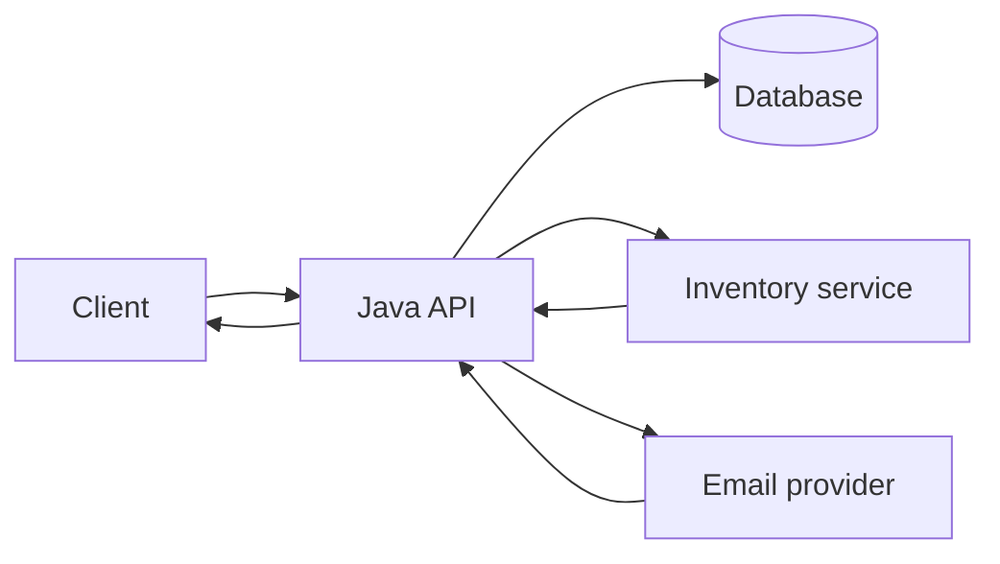
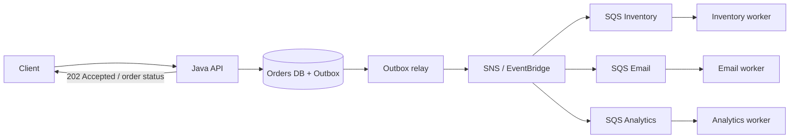
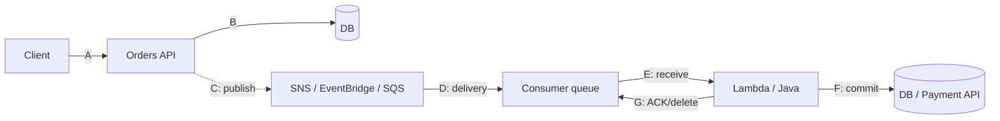
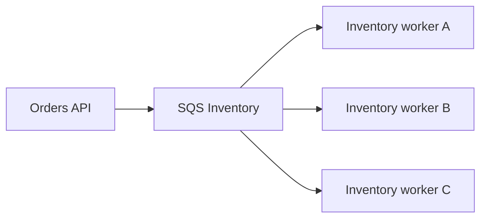
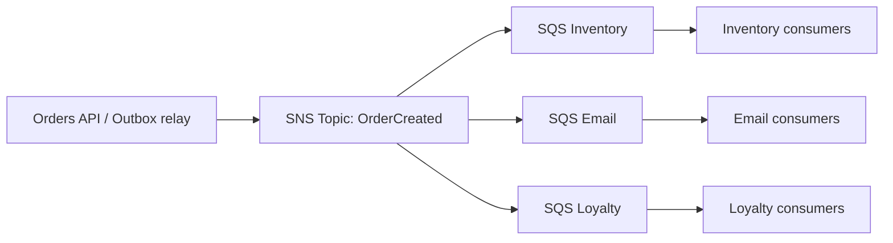
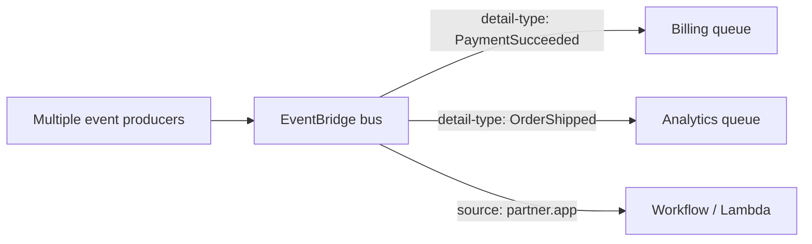
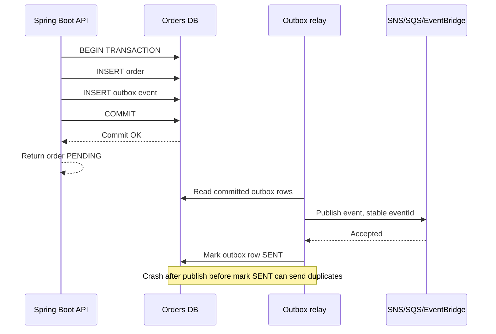
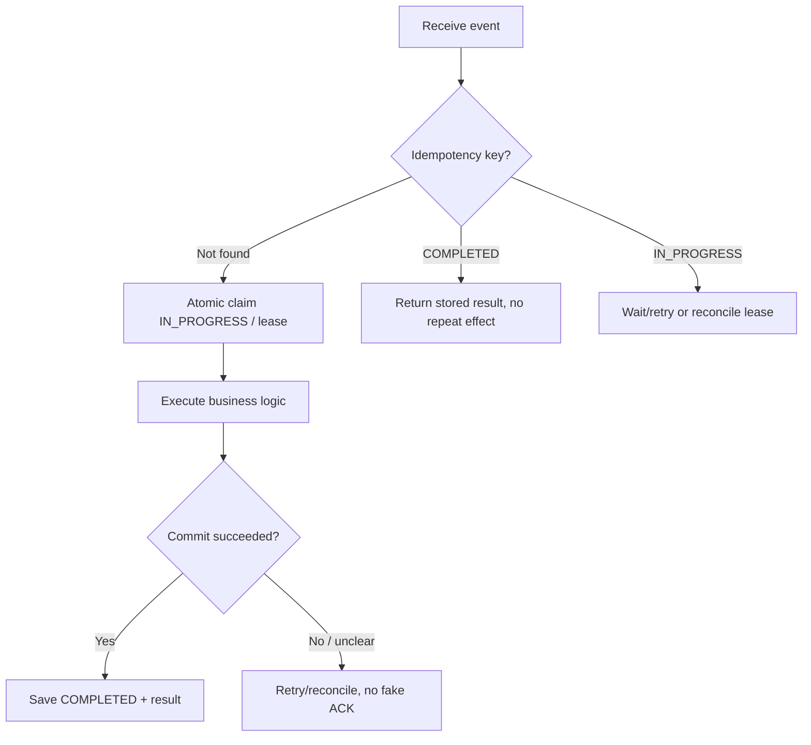
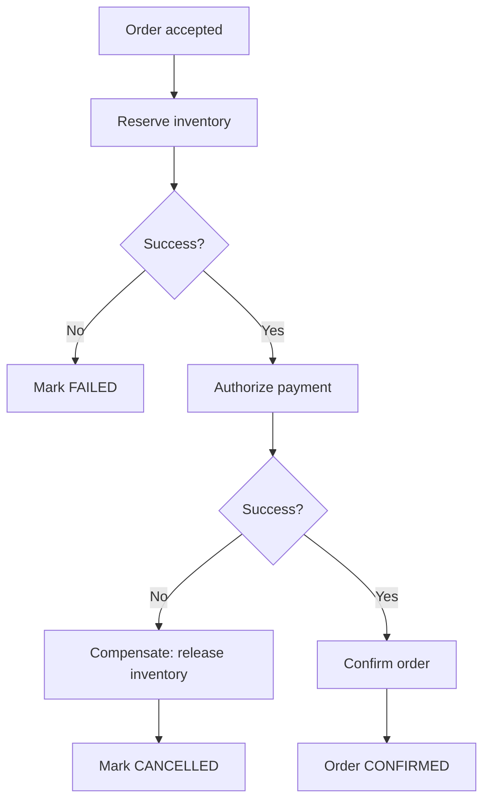
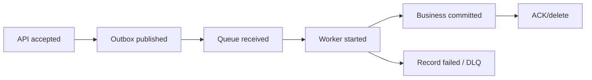

# Designing Asynchronous Processing with Appropriate Delivery Guarantees on AWS

An e-commerce system running **Java Spring Boot** receives orders via an API. After saving an order, the system needs to deduct inventory, send an email, calculate loyalty points, and update reports. If everything is executed synchronously within the HTTP request, a slow email service can cause the customer to wait a long time or receive an error even though the order was saved successfully. The typical solution is to emit an **event/message** and let **consumers** process it asynchronously.

However, simply "putting it into a queue" does not solve the entire reliability problem. What happens when:

- The database has committed, but the producer **has not yet sent** the message?
- SQS has received the message, but the send confirmation response **is lost**, so the producer resends?
- The consumer has deducted inventory, but **crashes before deleting** the SQS message?
- An `OrderShipped` event arrives before `OrderPaid`?
- One fan-out subscriber fails while the other subscribers succeed?
- The customer cancels the payment while the workflow is still waiting for a result from a third party?

Good design does not stop at choosing **Amazon SQS**, **Amazon SNS**, or **Amazon EventBridge**. You must choose the **appropriate delivery guarantee** for each branch: **at-most-once**, **at-least-once**, ordering within a valid scope, deduplication limits, **idempotency**, error handling, observability, and recovery.

This lesson belongs to the **Queues and Notifications** chapter in the **CLOUD_PROVIDERS_AWS** module. Its content connects IAM, VPC, Availability Zones (AZs), EC2/ECS/EKS, Lambda, storage, databases, integration, and serverless to deploy applications that are secure, scalable, observable, recoverable, and cost-controlled.

## 1. Learning Objectives

After this lesson, you will be able to:

1. Distinguish between **delivery guarantee**, **processing guarantee**, **ordering**, **durability**, and **business consistency**.
2. Explain why **at-least-once** is usually appropriate for critical tasks and why **end-to-end exactly-once side effects** do not come automatically from a queue.
3. Choose the right **SQS Standard**, **SQS FIFO**, **SNS Standard/FIFO**, **EventBridge**, **Lambda**, or **Step Functions** based on fan-out, routing, workflow, and ordering requirements.
4. Identify the **dual-write problem** and implement the **transactional outbox** concept.
5. Design a Java consumer using **ack/delete after commit**, idempotency keys, and DynamoDB conditional writes.
6. Configure **Lambda SQS partial batch response**, handle per-message failures, and preserve FIFO ordering.
7. Build retry/backoff/visibility timeout, **DLQ**, redrive, and poison message handling procedures.
8. Control concurrency, backpressure, SLOs, IAM/KMS/VPC security, and costs.
9. Test failures across every boundary: before/after commit, before/after publish/ack, outages, and replay.
10. Use diagrams, decision tables, Java/IaC examples, and checklists to select a production-ready architecture.

## 2. Why Do We Need Asynchronous Processing?

Synchronous processing has a simple path:



If inventory or email is slow, the HTTP request may time out. Retries from the client can create duplicate orders or side effects if the API is not idempotent.

The asynchronous model decouples **acceptance** from **execution**:



**Benefits:**

- **Decoupling:** the producer does not need to know whether the consumer is running on EC2, ECS, EKS, or Lambda.
- **Buffering:** the queue absorbs traffic bursts while consumers process steadily.
- **Independent scaling:** inventory and email have different throughput/concurrency profiles.
- **Resilience:** a consumer can pause while the API continues accepting orders as long as the queue and downstream remain within limits.
- **Fan-out:** a single event is distributed for multiple purposes without duplicating logic in the producer.

**Trade-offs:** data is **eventually consistent**, duplicates/out-of-order delivery can occur, plus additional IAM/network/logging, backlogs, retry/DLQ management, and operational responsibility.

### 2.1. Async Does Not Mean "Completed"

An API returning `202 Accepted` or a `PENDING` status usually only means **the work has been accepted and the intent to process has been durably stored**, not that the email has been sent or inventory has been deducted.

If the API returns "order completed" right after `SendMessage` succeeds, users may be misled about the actual state. You should provide an `orderId`, processing status, and an API/query to check results; WebSocket/SNS/mobile push can be used when updates are needed.

## 3. Three Common Delivery Guarantees

### 3.1. At-most-once

**At-most-once** means an event is delivered/processed **at most once** within the model's scope; it may be **lost** when a failure occurs.

Example of a custom-built "read message and ACK immediately, then process" flow:

```text
Receive M1
   ├─ ACK/delete immediately
   ├─ Worker crash
   └─ Business operation never ran → work lost
```

This approach can be acceptable for **best-effort telemetry** or transient signals where losing a few samples does not affect business logic, but it is unsuitable for payments or ledger posting.

**Note:** simply configuring retry = 0 does not guarantee end-to-end at-most-once; publisher, broker, SDK, and downstream paths must still be evaluated individually.

### 3.2. At-least-once

**At-least-once** means the system attempts to deliver an event **one or more times**, subject to configured limits on retention, permissions, retry/quotas, and service health. The price is **duplicates**.

```text
Receive M1
   ├─ Database write succeeds
   ├─ Worker crashes before ACK/delete
   ├─ Message reappears after visibility timeout
   └─ M1 is reprocessed if there is no idempotency
```

This is the practical model of **SQS Standard** and many event-driven AWS integrations. For critical business workflows, **at-least-once delivery + idempotent processing + DLQ/recovery** is usually more practical than trying to force the network to always deliver exactly once.

### 3.3. Exactly-once: You Must Ask "Exactly at Which Layer?"

The phrase **exactly-once** only has meaning when the **scope of the guarantee** is specified:

- **Producer deduplication:** the queue system does not store two duplicates with the same dedup ID within a time window.
- **Workflow execution semantics:** an orchestrator can guarantee how a state machine executes under its own contract.
- **Database write:** an `INSERT ... ON CONFLICT` or conditional write can write a unique record.
- **Business side effect:** deducting funds/inventory **only once** even if the consumer is invoked multiple times.

A system consisting of **SQS → Lambda → DynamoDB → payment API** does not become an exactly-once business process just by choosing **FIFO**. Data across multiple services does not reside in a single shared transaction; **crashing between two side effects** remains a problem that must be designed for.

### 3.4. Guarantee Selection Table

| Business Requirement | Target Guarantee | Required Mechanism |
|---|---|---|
| Telemetry events where some sample loss is acceptable | Best effort / at-most-once acceptable within clear scope | Avoid excessive retries, measure loss rate |
| Sending welcome emails | At-least-once + prevent duplicate emails when needed | Queue, retry, idempotency by `welcomeEmail:customerId` |
| Inventory updates | At-least-once + idempotent effect, may need ordering | Business key, conditional update, DLQ |
| Payments | Equivalent to a single side effect (effectively-once) | Payment idempotency key, reconciliation, audit |
| Versioned order states | Controlled ordering/versioning | FIFO by aggregate ID or optimistic concurrency |
| Analytics aggregation | At-least-once + dedupe/aggregation policy | Event ID, checkpoint, watermark |
| Long-running multi-step workflows | Durable, with clear retry/compensation | Step Functions Standard or appropriate orchestration |

**Write SLOs in business language:** "99.9% of orders are processed within 2 minutes, never double-charge; every failed order must have a status/resolution path" is clearer than "exactly-once queue."

## 4. Evaluating Every Delivery Boundary

A system consists of multiple boundaries:



Ask sequentially:

| Boundary | Key Questions |
|---|---|
| **A Client → API** | If the client times out and retries, will it create two orders? Does the API have an idempotency key? |
| **B API → DB** | Does writing the order have a transaction / unique constraint? |
| **C DB → event publish** | If the DB commit succeeds but publish fails, is the event lost? |
| **D Broker/router → queue** | Does each target receive its own copy? Where do filtering/retry policy/DLQ live? |
| **E Queue → worker** | How does the worker handle duplicate receives, visibility expiration, or throttling? |
| **F Worker → business data** | What if the side effect already occurred but the response was lost? |
| **G Worker → delete/ACK** | If it commits and crashes before delete, is reprocessing safe? |

**You cannot take a guarantee at boundary D and conclude that the entire system from A to G is safe.** Each boundary needs its own guarantee and recovery mechanism.

## 5. Choosing AWS Services by Goal

| Service / Feature | Communication Pattern | Ordering / Duplicates | When to Choose |
|---|---|---|---|
| **SQS Standard** | Queue, competing consumers | At-least-once, best-effort order, duplicates possible | Independent background jobs, high throughput, out-of-order processing acceptable |
| **SQS FIFO** | Queue per `MessageGroupId` | Ordering within group, 5-minute send dedup; still needs consumer idempotency | Orders, accounts, workflows needing per-aggregate ordering |
| **SNS Standard** | Topic pub/sub fan-out | Delivery/retry depends on protocol, no strict ordering guarantee | One event sent to multiple independent subscribers |
| **SNS FIFO + SQS FIFO** | Ordered fan-out | Ordering/dedup per group under supported conditions | Multiple consumers all needing ordered events |
| **SNS FIFO + SQS Standard** | Fan-out, subscriber does not need FIFO | Delivery can duplicate/be out-of-order on the Standard queue | Shared topic, subscribers choose different guarantees |
| **EventBridge event bus/rules** | Event routing, filtering, SaaS/AWS integrations | Delivery/retry per rule/target; not a global FIFO queue | Routing by event type, source, account, and target |
| **Lambda async invocation** | Async function queue managed by Lambda | Lambda retry/age, duplicates can occur | Short event-driven jobs, per-function retries |
| **Step Functions Standard** | Durable workflow orchestration | Exactly-once **workflow execution semantics** under conditions; task Retry can re-invoke | Multi-step business processes, waiting for callbacks, audit/compensation |
| **Step Functions Express** | Short, high-volume workflows | Async Express at-least-once, sync Express at-most-once **execution** | Short high-volume event transformations |
| **Kinesis / DynamoDB Streams** | Ordered records per shard | Checkpoints, stream replay/retention | CDC, event stream analytics, per-shard ordering |

**Do not confuse:** a Lambda SQS trigger is not the Lambda async invocation queue; Lambda **polls** SQS via an event source mapping (ESM), so retry policies primarily live on the queue/visibility/ESM.

Official sources: [SQS Standard queues](https://docs.aws.amazon.com/AWSSimpleQueueService/latest/SQSDeveloperGuide/standard-queues.html), [SNS FIFO message delivery](https://docs.aws.amazon.com/sns/latest/dg/fifo-message-delivery.html), [Choosing Step Functions workflow type](https://docs.aws.amazon.com/step-functions/latest/dg/choosing-workflow-type.html).

## 6. Three Asynchronous Architectures to Distinguish

### 6.1. Point-to-point work queue



Workers **compete to pull** work from the same queue. The goal is for **each message to be completed by one worker**, though redelivery can occur; idempotency is required. **Not** every worker receives a copy of the message.

### 6.2. Pub/sub fan-out



Each subscription to **its own dedicated queue** receives a copy of the event when appropriate; each branch has independent speed, DLQ, and retry rules. If Email fails processing, Inventory does not have to retry the same message just because Email failed.

**Be careful:** **SNS → SQS delivery** failures differ from **consumer processing failures after the message is already in SQS**. Place the DLQ in the right spot.

### 6.3. Rule-based event routing



EventBridge fits well when an organization wants schemas/event contracts, rules, target retries, and AWS/SaaS integrations instead of having publishers know every queue/topic. **EventBridge rules do not create a global ordering guarantee** for events from all producers.

### 6.4. Long-running saga/workflow

```text
Order accepted → Reserve inventory → Authorize payment
      ↓ failure                         ↓ success
Release reservation              Confirm shipment
      ↓                                 ↓
Mark cancelled                    Mark completed
```

If a task involves long waits or complex compensation, **Step Functions Standard** can be clearer and easier to audit than a chain of self-coordinating queues. Even so, each task calling an external API still needs idempotency.

## 7. SQS Standard: High Throughput, At-Least-Once Delivery

**SQS Standard** offers very high throughput and makes a best effort to preserve send order, but **does not guarantee ordering** and can deliver duplicates due to its distributed architecture.

### 7.1. Appropriate when

- Background jobs can be processed independently: image resizing, email sending with dedupe, search indexing, analytics.
- Work is distributed across many workers and needs to scale with backlog.
- Relative ordering matters little, or **version checks** exist on the consumer.
- Simplicity/throughput is prioritized over FIFO semantics.

### 7.2. Not directly appropriate when

An entity has a sequence like `Debit 100 → Refund 100 → Debit 50` where reordering could cause irreversible consequences. In that case, you need per-account FIFO or database-level protection using version/ledger/order constraints.

**Current note:** SQS Standard can also use `MessageGroupId` for features such as fair queues in supported scenarios, but this **does not turn Standard into a FIFO ordered queue**.

### 7.3. What Does SQS Acceptance Mean?

A successful `SendMessage` proves the message was accepted by SQS under the service's storage contract; it **does not mean the consumer has finished**. A producer should not set order status = `FULFILLED` based solely on an SQS acknowledgment.

## 8. SQS FIFO: Per-Group Ordering, Windowed Deduplication

**SQS FIFO** provides:

- Ordering per `MessageGroupId`.
- **5-minute deduplication interval** based on `MessageDeduplicationId` or content-based deduplication.
- Messages belonging to a group are not delivered to another consumer for interleaved processing under FIFO semantics until processed/deleted or after appropriate visibility expiration.
- Parallelism across **multiple message groups**, with no global ordering across all groups.

### 8.1. Two IDs You Must Understand

| ID | Function | Example |
|---|---|---|
| `MessageGroupId` | Group requiring ordering | `ORDER#123`, `ACCOUNT#8` |
| `MessageDeduplicationId` | Identifies repeated sends to filter within the dedup window | `event-id-abc-001` |

**Do not use `customerId` as a single MessageGroupId** if each customer has many independent operations and high concurrency is desired; choose an `aggregateId` that matches the real ordering boundary.

### 8.2. The 5-Minute Limit

```text
12:00 Producer sends eventId=e-101 → SQS FIFO accepts
12:02 Producer retries e-101      → duplicate, SQS deduplicates within 5 minutes
12:08 Producer retries e-101      → outside 5 minutes, may be treated as a new message
```

Content-based deduplication hashes the **message body**, excluding **message attributes**. If two messages have the same body but attributes contain different actions, they might be treated as duplicates; if the body contains a new timestamp, the same business operation yields a different hash. When it matters, **provide a stable MessageDeduplicationId at the producer**.

**Do not infer that FIFO equals business exactly-once.** Duplicate processing can still occur if a consumer commits and crashes before delete, or if visibility expires and the message is received again.

Sources: [SQS FIFO exactly-once processing scope](https://docs.aws.amazon.com/AWSSimpleQueueService/latest/SQSDeveloperGuide/FIFO-queues-exactly-once-processing.html), [Recovering from outages](https://docs.aws.amazon.com/AWSSimpleQueueService/latest/SQSDeveloperGuide/designing-for-outage-recovery-scenarios.html).

### 8.3. What Are the Limits of SNS FIFO?

An SNS FIFO topic can fan out to **SQS FIFO** or **SQS Standard** queues. To preserve FIFO to the consumer, target subscriptions must be **FIFO SQS queues**; Standard queues can still duplicate and reorder messages.

SNS FIFO **does not deliver directly** to email/SMS/HTTP(S) endpoints like SNS Standard per documented capabilities; if you need a Lambda consumer, configure **SNS FIFO → SQS (FIFO if ordering is needed) → Lambda event source mapping**.

**Subscription filters** alter the set of events a consumer receives, so you cannot promise every event from the topic will appear at a given subscriber. With SNS FIFO, exact delivery guarantees also depend on filters, permissions, retries, networking, and consumer behavior—read the AWS contract rather than equating it with SQS FIFO.

Sources: [SNS FIFO message delivery](https://docs.aws.amazon.com/sns/latest/dg/fifo-message-delivery.html), [SNS FIFO deduplication](https://docs.aws.amazon.com/sns/latest/dg/fifo-message-dedup.html).

## 9. Event Contracts Matter More Than Pretty JSON Formatting

An event should describe a **fact that occurred** or a clear **command**, without mixing semantics.

Example `OrderAccepted` event:

```json
{
  "eventId": "01JYXEVTEXAMPLE",
  "eventType": "OrderAccepted",
  "eventVersion": 2,
  "aggregateType": "Order",
  "aggregateId": "ORD-123",
  "aggregateVersion": 7,
  "tenantId": "tenant-a",
  "occurredAt": "2026-11-20T02:00:00Z",
  "correlationId": "req-20261120-abc",
  "causationId": "command-create-order-123",
  "data": {
    "customerId": "CUS-900",
    "totalMinorUnits": 159900,
    "currency": "VND"
  }
}
```

### 9.1. Role of Each Field

| Field | Why It Is Needed |
|---|---|
| `eventId` | Stable event identifier across publish retries and duplicate deliveries |
| `eventType` | Tells the consumer which handler should process it |
| `eventVersion` | Upgrades the schema without breaking older consumers |
| `aggregateId` | Business key for choosing MessageGroupId or checking state |
| `aggregateVersion` | Detects stale/out-of-order events and supports optimistic concurrency |
| `tenantId` | Data isolation boundary and business IAM/authorization |
| `occurredAt` | Auditing and latency analysis, **not an absolute ordering source** |
| `correlationId` | Links the HTTP request, DB transaction, events, and logs |
| `causationId` | Which command/event produced this event |
| `data` | Compact payload; avoid pushing unnecessary secrets/PII into the queue |

### 9.2. Event or Command?

- **Event**: `OrderAccepted`, `PaymentCaptured` — a past fact, which may have multiple subscribers.
- **Command**: `ReserveInventory`, `SendEmail` — requests one handler to perform work; may require a result/ack.

When a producer publishes a command to a topic where multiple subscribers execute side effects, it can accidentally invoke an action multiple times that should only happen once. Distinguish a **single-consumer-group work queue** from **pub/sub with multiple independent consumers**.

### 9.3. Schema evolution

- Prefer adding optional fields with defaults or sensible values.
- Keep the event version and support older consumer versions during migrations.
- When removing or changing the meaning of fields, consider a **new event type/version** and a parallel transition phase.
- Never treat "unrecognized version → ACK success," which causes data loss.
- For events with security/compliance needs, send only IDs and references rather than full personal profiles.

## 10. ACK Boundary: When Is It Safe to Delete a Message?

For a Java worker polling SQS directly:

```text
1. Receive message + receipt handle
2. Validate event and tenant
3. Check durable idempotency state
4. Execute/commit durable business effect
5. Record result / audit if needed
6. DeleteMessage using the receipt handle from this receive
```

**Deleting before step 4 risks losing work on crash.** Deleting after step 4 can cause message reprocessing if a crash occurs between steps 4–6; therefore, idempotency is **non-negotiable**.

| Crash Window | What Can Happen | Mitigation |
|---|---|---|
| Before receive | Message remains in queue | Poll again |
| After receive, before business write | Visibility expires and retries | Proper visibility timeout |
| After business write, before DeleteMessage | Duplicate processing | Durable idempotency |
| DeleteMessage succeeds but response is lost | Worker thinks it failed, unsure if deleted | Rely on business state, do not assume certainty |
| Producer publish succeeds but ACK is lost | Producer retries and sends duplicate | Stable event ID, FIFO dedup, and consumer idempotency |
| Receiver sees downstream error after downstream committed | Unknown outcome | Provider idempotency key, lookup/reconciliation |

The **receipt handle** is a token for a **specific receive attempt**, not an event ID. When deleting, use the latest receipt handle of the message; never store the receipt handle as a business dedupe key.

## 11. The Dual-Write Problem on the Producer Side

A common pattern in Java Spring:

```java
@Transactional
public Order createOrder(CreateOrderCommand cmd) {
    Order order = repository.save(new Order(cmd));
    sqs.sendMessage(...);     // Sends to a system SEPARATE from the database
    return order;
}
```

The `@Transactional` annotation only guarantees the transaction of the configured database; it **does not wrap SQS** in the same ACID transaction.

There are two failure windows:

- **DB commits, SQS publish fails:** the order exists, but inventory/analytics never know.
- **SQS publishes, DB rolls back:** consumers see an event for a non-existent order.

This is the **dual-write problem**. Neither "DB first" nor "SQS first" completely eliminates the failure mode.

### 11.1. How Does Transactional Outbox Solve It?

Within the **same database transaction**, store:

1. The order/business row.
2. An outbox row recording the **intent to publish an event**, including `eventId`, payload/schema, and status.

A separate worker or CDC relay reads **committed** rows and sends them to the broker. If the relay crashes after publishing but before marking `SENT`, it may resend — **consumers still need idempotency**.



Source: [AWS Prescriptive Guidance — Transactional outbox pattern](https://docs.aws.amazon.com/prescriptive-guidance/latest/cloud-design-patterns/transactional-outbox.html).

## 12. Transactional Outbox in PostgreSQL/Spring Boot

### 12.1. Minimal SQL Schema

```sql
CREATE TABLE orders (
    id              VARCHAR(64) PRIMARY KEY,
    tenant_id       VARCHAR(64) NOT NULL,
    status          VARCHAR(32) NOT NULL,
    version         BIGINT NOT NULL DEFAULT 1
);

CREATE TABLE outbox_events (
    event_id        VARCHAR(64) PRIMARY KEY,
    aggregate_id    VARCHAR(64) NOT NULL,
    aggregate_version BIGINT NOT NULL,
    event_type      VARCHAR(100) NOT NULL,
    payload_json    TEXT NOT NULL,
    status          VARCHAR(20) NOT NULL DEFAULT 'PENDING',
    created_at      TIMESTAMPTZ NOT NULL DEFAULT now(),
    sent_at         TIMESTAMPTZ
);

CREATE INDEX idx_outbox_pending
    ON outbox_events (status, created_at);
```

This example **is not a complete production schema**: you will need workload-specific indexes, retention, lease/locking for multi-instance relays, auditing, encryption, and migrations.

### 12.2. Writing Order and Outbox in the Same Transaction

```java
@Service
public class OrderApplicationService {

    private final OrderRepository orders;
    private final OutboxRepository outbox;

    public OrderApplicationService(
            OrderRepository orders, OutboxRepository outbox) {
        this.orders = orders;
        this.outbox = outbox;
    }

    @Transactional
    public Order accept(CreateOrderCommand command) {
        // API-level idempotency: ensure command.requestId is unique
        // for this business operation, not just one HTTP request attempt.
        Order order = orders.save(Order.from(command));

        OutboxEvent event = OutboxEvent.orderAccepted(
            command.eventId(), order.getId(), order.getVersion()
        );
        outbox.save(event);

        return order;
    }
}
```

`OrderRepository`, `OutboxRepository`, and the domain classes are application interfaces/types, **not provided by the AWS SDK**. This example illustrates transaction boundaries, not a standalone runnable program without implementing those components.

**Critical condition:** both repositories must share the **same transaction manager/database** managed by `@Transactional`. If one repository writes to DynamoDB and the other to RDS, the annotation does not create a shared transaction.

### 12.3. Outbox Relay Must Be Safe to Retry

A reliable relay:

1. Claims `PENDING` rows via a lock or timed lease to prevent two relays from sending concurrently without control.
2. Publishes with a **stable event ID** and clear attributes.
3. Marks `SENT` **only after the broker confirms acceptance**.
4. If publish/mark fails, retries with limits and backoff.
5. Maintains audits/counters and cleans up `SENT` records according to retention.
6. Avoids holding long locks across network calls where possible; designs for leases, crash recovery, and retry concurrency.

**Even with claim/lease, a relay can still send duplicates** if it crashes after publishing before marking SENT. That behavior must be handled with deduplication at the consumer.

### 12.4. Alternative: CDC / DynamoDB Streams

If data lives in DynamoDB, **DynamoDB Streams** can detect item changes and route them to EventBridge/SQS via Lambda. For events representing business operations, clearly define the source of truth/format, version, and idempotency. CDC is a way to implement an event relay, but **it does not automatically guarantee a business operation occurs once**.

## 13. Java SDK v2: Publishing to SQS FIFO

Example of a producer that already has a **stable** `eventId` for an event belonging to the same operation, sending to a FIFO queue:

```java
import software.amazon.awssdk.services.sqs.SqsClient;
import software.amazon.awssdk.services.sqs.model.SendMessageRequest;
import software.amazon.awssdk.services.sqs.model.SendMessageResponse;

public final class OrderEventPublisher {
    private final SqsClient sqs;
    private final String fifoQueueUrl;

    public OrderEventPublisher(SqsClient sqs, String fifoQueueUrl) {
        this.sqs = sqs;
        this.fifoQueueUrl = fifoQueueUrl;
    }

    public String publishOrderEvent(
            String orderId, String stableEventId, String jsonPayload) {

        if (orderId == null || orderId.isBlank()
                || stableEventId == null || stableEventId.isBlank()) {
            throw new IllegalArgumentException("Missing identity");
        }

        SendMessageResponse accepted = sqs.sendMessage(
            SendMessageRequest.builder()
                .queueUrl(fifoQueueUrl)
                .messageGroupId("ORDER#" + orderId)
                .messageDeduplicationId(stableEventId)
                .messageBody(jsonPayload)
                .build()
        );
        return accepted.messageId();
    }
}
```

**Assumptions:** the queue is named like `orders.fifo`, `jsonPayload` is validated JSON, and the producer has `sqs:SendMessage` on the right ARN. Every retry of the **same event** must use the same `stableEventId`; do not generate a new UUID on each retry.

**Key takeaways:**

- Returning `messageId` means **SQS accepted it**, not that the handler finished.
- If ordering is not needed, SQS Standard is simpler; Standard does not require `MessageDeduplicationId`/group like FIFO.
- Do not generate a unique ID on each retry, as that disables deduplication.
- Do not rely on the 5-minute dedup window to prevent duplicates days later or during DLQ replay.
- Obtain IAM roles/credentials via the appropriate AWS SDK default credentials provider chain; do not hardcode AWS access keys.

## 14. Java Worker: ACK After Durable Processing

EC2/ECS/EKS workers can use **SqsClient** and long polling. A business interface must perform an **idempotent durable side effect**:

```java
public interface IdempotentOrderProcessor {
    // Throws on any business failure; returns only after durable commit.
    void process(String eventJson);
}
```

SQS polling skeleton:

```java
import java.util.List;
import software.amazon.awssdk.services.sqs.SqsClient;
import software.amazon.awssdk.services.sqs.model.DeleteMessageRequest;
import software.amazon.awssdk.services.sqs.model.Message;
import software.amazon.awssdk.services.sqs.model.ReceiveMessageRequest;

public final class InventoryConsumer {
    private final SqsClient sqs;
    private final String queueUrl;
    private final IdempotentOrderProcessor processor;

    public InventoryConsumer(
            SqsClient sqs, String queueUrl,
            IdempotentOrderProcessor processor) {
        this.sqs = sqs;
        this.queueUrl = queueUrl;
        this.processor = processor;
    }

    public void pollOnce() {
        List<Message> messages = sqs.receiveMessage(
            ReceiveMessageRequest.builder()
                .queueUrl(queueUrl)
                .waitTimeSeconds(20)
                .maxNumberOfMessages(10)
                .build()
        ).messages();

        for (Message m : messages) {
            try {
                // Commit must happen inside processor.
                processor.process(m.body());

                sqs.deleteMessage(
                    DeleteMessageRequest.builder()
                        .queueUrl(queueUrl)
                        .receiptHandle(m.receiptHandle())
                        .build()
                );
            } catch (Exception failure) {
                // Leave message for visibility timeout / DLQ.
                // Log identifiers, not full secret/PII payload.
                System.err.println("Failed message " + m.messageId()
                        + "; cause=" + failure.getClass().getSimpleName());
            }
        }
    }
}
```

**This sample does not work automatically** without injecting an `IdempotentOrderProcessor` that implements the actual logic. Do not implement it by replacing `processor.process` with `System.out.println` and deleting every message: printing logs **is not a business commit**.

### 14.1. About Visibility Timeout

If processing takes 80 seconds while the queue visibility timeout is 30 seconds, the message can be redelivered while the first worker is still processing it. Choose a timeout suited to p99 and use `ChangeMessageVisibility` for long jobs; do not extend indefinitely without a circuit breaker and TTL.

For Lambda SQS ESM, AWS recommends a visibility timeout of at least **6 × Lambda function timeout** plus any **batch window** when configured. This is an operational setting to reduce retries/throttling, not a replacement for idempotency.

## 15. Lambda + SQS: Per-Record Guarantees

Lambda **polls** SQS in batches. If one record fails and the handler throws across the entire invocation, **every record in the batch may be retried**, including records that already succeeded.

When the ESM is configured with:

```text
FunctionResponseTypes = [ReportBatchItemFailures]
```

The Lambda handler can return **partial success**: only the failed **SQS message IDs** are kept for retry.

### 15.1. Java Lambda Handler for a Standard Queue

```java
import com.amazonaws.services.lambda.runtime.Context;
import com.amazonaws.services.lambda.runtime.RequestHandler;
import com.amazonaws.services.lambda.runtime.events.SQSEvent;
import com.amazonaws.services.lambda.runtime.events.SQSBatchResponse;

import java.util.ArrayList;
import java.util.List;

public final class OrdersSqsLambda
        implements RequestHandler<SQSEvent, SQSBatchResponse> {

    private final IdempotentOrderProcessor processor;

    public OrdersSqsLambda() {
        // In real Lambda setup, initialize an injected production
        // processor with AWS SDK clients and durable idempotency store.
        this.processor = event -> {
            throw new UnsupportedOperationException(
                "Wire real business processing before deployment");
        };
    }

    @Override
    public SQSBatchResponse handleRequest(SQSEvent event, Context ctx) {
        List<SQSBatchResponse.BatchItemFailure> failures = new ArrayList<>();

        for (SQSEvent.SQSMessage message : event.getRecords()) {
            try {
                processor.process(message.getBody());
            } catch (Exception error) {
                ctx.getLogger().log(
                    "Record failed " + message.getMessageId()
                    + ", type=" + error.getClass().getSimpleName()
                );
                failures.add(
                    new SQSBatchResponse.BatchItemFailure(message.getMessageId())
                );
            }
        }
        return new SQSBatchResponse(failures);
    }
}
```

**This sample intentionally throws until a real business processor is wired in**, preventing fake ACKs and lost messages if learners copy it verbatim. In production, wire real logic into the Java handler and add `aws-lambda-java-core`, `aws-lambda-java-events`, IAM/KMS/VPC, and integration tests.

**Important:** enable `ReportBatchItemFailures` on the **event source mapping**. If the handler returns a list of failed IDs without the option enabled on the mapping, the response is not interpreted as partial success and failed messages may be deleted. If the handler **throws an exception out**, the entire batch is treated as failed.

### 15.2. FIFO: Stop-on-First-Error

With SQS FIFO, to preserve ordering, **stop at the first failed record** and report **that record + all unprocessed records**.

```text
FIFO batch: A1 A2 A3 A4
            ✓  ✗  -  -

Response:
{
  "batchItemFailures": [
    {"itemIdentifier": "A2"},
    {"itemIdentifier": "A3"},
    {"itemIdentifier": "A4"}
  ]
}
```

Do not run records from the same `MessageGroupId` in parallel, or break the loop while forgetting the unprocessed IDs: Lambda may treat those records as successful and delete them from the queue.

### 15.3. Partial Response Does Not Eliminate Duplicates

For SQS, the **Lambda Errors metric** may not increase when an invocation returns a valid `batchItemFailures` payload. Emit business metrics for succeeded/failed records and monitor queue age, DLQ, and throttles.

Sources: [Lambda SQS event source mapping](https://docs.aws.amazon.com/lambda/latest/dg/with-sqs.html), [Partial batch responses](https://docs.aws.amazon.com/lambda/latest/dg/services-sqs-errorhandling.html).

## 16. Idempotency: Defining "Once" at the Business Layer

**Idempotency** means reprocessing the same **logical operation** produces no unwanted additional side effects. For example, `ReserveInventory(orderId=123)` runs twice, yet inventory is deducted only once.

### 16.1. Deduplication Keys

| Candidate | Reasonable? | Explanation |
|---|---|---|
| `tenantId:orderId:ReserveInventory` | Yes, when it reflects a unique reservation | Remains stable across queue retries/replays |
| `paymentIntentId` | Yes, if the payment provider uses it to dedupe | Must match the key at the provider |
| `producerEventId` | Yes, if the producer keeps it fixed across all resends | Must not be regenerated after a timeout |
| SQS `messageId` | Only identifies the SQS message, insufficient for business replay | A new send / DLQ redrive can assign a new ID |
| `customerId` | No | One customer can have many valid orders |
| Hash of raw JSON | Only when the canonical payload is fixed | Timestamps/attribute ordering may vary |

**Prevent cross-tenant collisions:** business keys always need a namespace or tenant prefix in multi-tenant data.

### 16.2. DynamoDB Conditional Claim

Suppose `ProcessedOperations` has primary key `operationId`.

```java
import java.util.Map;
import software.amazon.awssdk.services.dynamodb.DynamoDbClient;
import software.amazon.awssdk.services.dynamodb.model.AttributeValue;
import software.amazon.awssdk.services.dynamodb.model.PutItemRequest;

public final class IdempotencyClaims {
    private final DynamoDbClient ddb;
    public IdempotencyClaims(DynamoDbClient ddb) {
        this.ddb = ddb;
    }

    public void claim(String tenantId, String operationId) {
        String key = tenantId + "#" + operationId;

        ddb.putItem(PutItemRequest.builder()
            .tableName("ProcessedOperations")
            .item(Map.of(
                "operationId", AttributeValue.fromS(key),
                "state", AttributeValue.fromS("IN_PROGRESS")
            ))
            .conditionExpression("attribute_not_exists(operationId)")
            .build());
    }
}
```

If two invocations race for the same key, one conditional put succeeds and the other receives `ConditionalCheckFailedException`. **Do not handle this exception by blindly "returning success"**: you must read the record, compare the input fingerprint/tenant, check whether it is `COMPLETED` or `IN_PROGRESS`, and act accordingly.

### 16.3. Practical State Machine



Scenarios you must design for:

- **Crash after claim, before effect:** lease timeout allows reprocessing.
- **Effect succeeded, crash before COMPLETED:** cannot be inferred solely from an IN_PROGRESS record. External APIs should support an **idempotency key** or lookup for reconciliation.
- **COMPLETED but ACK lost:** duplicate consumer returns the stored result.
- **Same key but different payload:** report a conflict; do not merge two operations by mistake.
- **TTL expires before DLQ replay:** the operation could run again; set TTL based on the business/replay horizon.

**End-to-end exactly-once** is a very strong claim. In practice, the target is usually **effectively-once business effects** achieved through conditional writes/unique constraints, external idempotency keys, and reconciliation.

## 17. Processing Order: FIFO, Versions, and Eventual Consistency

### 17.1. Queue Order Is Not Automatically Business Order

Suppose two services publish `OrderPaid(version=8)` and `OrderCancelled(version=9)` to different queues. Even if each queue is FIFO, an aggregator consumer may observe **version 9 before 8** due to differences in network paths, retries, or processing latency.

**Solution:** if cross-service ordering matters, design a single durable sequenced event source or enforce **aggregateVersion** and conditional state transitions at the storage layer.

### 17.2. Optimistic Concurrency Check

Suppose DynamoDB item `orders/ORD-123` has `version=9`.

- Event `version=8` arrives late → do not apply if it would regress state.
- Event `version=10` arrives → apply only if the expected current version satisfies policy.
- Event `version=12` arrives while 10/11 have not been seen → wait/retry/reconcile according to the business model.

A rule like `ignore version <= current` can work for **state snapshot updates**, but is not necessarily valid for **cumulative ledgers/events**, where every event carries an incremental value that must not be skipped. Event semantics must be clearly defined.

### 17.3. FIFO and DLQs Can Break Workflow Ordering

If a `ReserveInventory` message is sent to a DLQ and a subsequent `ChargePayment` message in the same group continues, the system might charge without reserving. AWS recommends considering not using a DLQ with FIFO if **strict workflow ordering must be preserved**.

Choose a pattern:

- Block the group and fix the root error.
- Saga orchestration with guarded step transitions.
- Quarantine the **entire aggregate workflow**, not just one message.
- Compensation/reconciliation for messages that already bypassed.

## 18. Retries, Timeouts, Backoff, and DLQs

### 18.1. Do Not Treat Every Error as Retryable

| Error | Example | Handling Strategy |
|---|---|---|
| **Transient** | HTTP 429/503, DB throttling, network timeout | Retry + exponential backoff/jitter, limit concurrency |
| **Permanent data** | Malformed JSON, missing field, unsupported schema version | Quarantine/DLQ, fix producer/consumer |
| **Permission/config** | IAM AccessDenied, wrong KMS policy, missing secret | Alert/fix config; retries will not self-heal |
| **Unknown outcome** | Charge API timeout after provider received request | Idempotency key/reconcile; do not blindly send a new charge |
| **Capacity** | Exhausted RDS pool, Lambda quota exceeded | Backpressure/circuit breaker, resize if needed |
| **Dependency business reject** | Insufficient funds, stock unavailable | Persist valid business outcome; do not retry infinitely |

### 18.2. SQS Redrive Policy

On the **source queue**:

```json
{
  "deadLetterTargetArn": "arn:aws:sqs:ap-southeast-1:111122223333:orders-dlq",
  "maxReceiveCount": "5"
}
```

On the **DLQ**, you can restrict `RedriveAllowPolicy` so only specific source queues are permitted to use the DLQ. Messages that fail processing after reaching the receive count threshold are moved by SQS to the DLQ.

**A DLQ does not replay automatically after a bug fix.** You need a runbook, verification of the fix, redrive rate limiting, and idempotency.

### 18.3. Retention and Visibility

- SQS retention is configurable from **1 minute to 14 days**.
- Visibility timeout does not mark a message "processed"; it only hides it temporarily.
- With a **Standard DLQ**, the original enqueue timestamp is retained for expiration purposes; set DLQ retention **longer than** source retention.
- With a **FIFO DLQ**, the enqueue timestamp resets when moved to the DLQ.
- Do not wait until right before expiration to investigate a backlog.

### 18.4. Do Not Confuse DLQ/Retry Layers

| Source / Integration | Error Mechanism |
|---|---|
| **SQS → Lambda/worker** | SQS source redrive policy, DLQ, Lambda ESM partial batch |
| **SNS → SQS subscription** | SNS subscription delivery retry/DLQ when delivery to SQS fails |
| **EventBridge rule → target** | Rule target retry policy + DLQ when delivery fails |
| **Lambda async invocation** | Lambda async retry/maximum event age + async destination/DLQ |
| **Kinesis/DynamoDB Streams → Lambda** | Stream ESM retry/record age/bisection/on-failure destinations |

An **SQS DLQ** and an **SNS subscription DLQ** can coexist, but they catch failures at **two different stages**. If SNS successfully delivered an event to SQS and the Java consumer failed, the SQS source DLQ is the one involved in processing failures.

Sources: [SQS DLQs](https://docs.aws.amazon.com/AWSSimpleQueueService/latest/SQSDeveloperGuide/sqs-dead-letter-queues.html), [SNS DLQs](https://docs.aws.amazon.com/sns/latest/dg/sns-dead-letter-queues.html), [Lambda asynchronous retries](https://docs.aws.amazon.com/lambda/latest/dg/invocation-async-error-handling.html).

## 19. Retries in EventBridge and Step Functions Differ from SQS

### 19.1. EventBridge Delivery Failure

EventBridge delivers events from a rule to a target according to the **target retry policy**, and when retries/age are exceeded, it can send them to an **SQS DLQ** if configured. `PutEvents` calls return per-entry responses; producers must check **`FailedEntryCount`** and retry only the failed entries if errors occur.

**Important:** "EventBridge delivered to the SQS target" is different from "the SQS consumer processed it successfully." That mirrors SNS delivery vs business processing.

**Do not hardcode a single default retry value for every type of EventBridge bus/target.** Classic rule targets and newer event-bus subscriber/target types can have different defaults in current documentation; identify the exact resource type and inspect `RetryPolicy`/DLQ in IaC and the Console.

### 19.2. Step Functions Execution Guarantee

AWS distinguishes:

- **Standard:** exactly-once **workflow execution** per contract, unless a state has `Retry` or other handling; durable state history.
- **Asynchronous Express:** at-least-once workflow execution.
- **Synchronous Express:** at-most-once workflow execution.

These are **execution semantics**, not a promise that an external payment runs only once. A state with retries can call a Lambda/HTTP API multiple times; tasks calling external services still need idempotency.

Source: [Step Functions workflow types](https://docs.aws.amazon.com/step-functions/latest/dg/choosing-workflow-type.html).

## 20. Sagas and Compensation Without Distributed Transactions

An order consists of three tasks:

1. Reserve inventory.
2. Authorize payment.
3. Confirm order.

If payment fails after reserving, you must execute **ReleaseInventory**. This is a **compensating action**, not a system-wide ACID rollback.



**Saga design must handle:** every step being idempotent, retry policies, compensation itself possibly failing, unknown payment outcomes, deadlines/timeouts, reconciliation of stuck states, and observability by correlation ID.

For long multi-step workflows, Step Functions Standard typically makes state transitions visible and clarifies failure/retry logic better than a chain of consumers passing commands around. Choose based on throughput, latency, state transition cost, and complexity, and do not treat an orchestrator as a substitute for domain consistency.

## 21. Backpressure, Concurrency, and Capacity Planning

### 21.1. Why Scaling Consumers Alone Does Not Solve Everything

If the producer generates 1,500 messages/second while the database sustainably handles at most 700/second, the backlog grows by roughly **800 messages/second** without limits/throttling.

```text
Backlog growth rate (approx.) =
    Producer input rate
  - Successful consumer completion rate
  ± Retry/re-drive/other effects
```

Increasing Lambda concurrency can exhaust RDS connections and spike 5xx errors; at that point, the effective consumer completion rate drops even lower.

### 21.2. Tuning Knobs

| Knob | Function | Risk When Tuned Blindly |
|---|---|---|
| SQS `BatchSize` | Max messages per Lambda invocation | Large batches increase latency/memory/retry waste |
| SQS batch window | Accumulates more messages before invoke | Increases latency at low load |
| Lambda reserved concurrency | Limits the entire function | If lower than sum of mappings, causes throttling/backlog |
| SQS ESM `MaximumConcurrency` | Per-mapping limit in supported modes | Too low grows queue age; too high overloads DB |
| Worker count/threads | Parallelism of EC2/ECS/EKS consumers | Can create too many DB connections |
| Visibility timeout | Processing window before message reappears | Too short causes concurrent duplicates; too long slows retries |
| Retry backoff/circuit breaker | Reduces pressure when downstream fails | Too aggressive increases completion time |
| FIFO MessageGroupId | Unit of ordering/concurrency | Too few groups creates bottlenecks |
| DLQ maxReceiveCount | Limit on failed receive attempts | Too small skips transient recovery; too large causes retry storms |

### 21.3. Preliminary Capacity Calculation

Suppose 600 messages/second arrive, and each message takes an average of 0.1 seconds to process sequentially:

```text
Ideal throughput per worker ≈ 1 / 0.1 = 10 messages/second
Minimum concurrent workers ≈ 600 / 10 = 60
```

This is only **theoretical**, excluding p95/p99, serialization, cold starts, network latency, retries, and downstream quotas. If downstream only handles 450/second, provisioning 60 workers **does not raise downstream capacity to 600**. You must protect it with concurrency/rate limits, conditional autoscaling, and wait SLOs.

### 21.4. Latency Processing Targets

Instead of only setting "keep queue depth small," define:

- `P95 time to process event <= 30s` for notifications.
- `P99 OrderAccepted → InventoryReserved <= 2m`.
- `Zero duplicate payment charges` per reconciliation.
- `DLQ message triage within 1h` by incident severity.

Queue depth is useful, but **age** and **end-to-end business latency** reflect the real user experience better.

## 22. Security Across Producer, Broker, and Consumer

### 22.1. IAM Least Privilege

| Component | Typical Permissions | Should Not Grant |
|---|---|---|
| Java SQS producer | `sqs:SendMessage` to exact queue ARN | `sqs:*` across all queues |
| SNS publisher | `sns:Publish` to exact topic ARN | Unnecessary topic administration |
| EventBridge publisher | `events:PutEvents` to exact event bus | Permission to modify rules/targets |
| Java SQS consumer | `sqs:ReceiveMessage`, `sqs:DeleteMessage`, `sqs:GetQueueAttributes` | Deleting DLQ or unnecessary queue admin |
| Lambda role | Minimal source/target, logging, KMS permissions | Wide-admin role |
| Outbox relay | DB read/update on right tables + publish to right ARN | Arbitrary writes to any database/topic |
| DLQ operator | Controlled read/redrive permissions | Account-wide `sqs:*` |

**Resource policies** are critical when SNS/EventBridge/service principals send to SQS, or cross-account. Queue policies use `aws:SourceArn`/`aws:SourceAccount` where appropriate to prevent confused deputy issues, while verifying integration-specific semantics.

### 22.2. Encryption and Data

- Encrypt SQS/SNS using AWS-managed or customer-managed KMS keys per policy.
- When using SSE-KMS, check the **KMS key policy** for required producers, consumers, and service principals.
- Never embed access keys, JWTs, card data, or secrets in messages unless necessary.
- Replace large/sensitive payloads with an **S3 object reference** with controlled IAM permissions and lifecycle policies.
- Attach `tenantId` to the event envelope and verify authorization in the consumer rather than blindly trusting the sender.
- Keep DLQ access stricter than normal queues because failed payloads may contain sensitive data.

### 22.3. VPC Networking

SQS/SNS/EventBridge are AWS services outside the VPC data plane. Workers in a **private subnet** need a path to the appropriate APIs via **NAT** or **VPC interface endpoints** (where supported). SQS-triggered Lambda ESMs poll SQS from the Lambda service side, so attaching an SQS VPC endpoint is **not required** for a function solely to receive batches; however, **function code calling SQS APIs directly** inside a private VPC still needs an egress path.

Adding a VPC endpoint **does not replace IAM permissions**; SGs, endpoint policies, and private DNS must be configured properly. Factor in NAT/interface endpoint costs before deciding.

## 23. Observing Delivery: What to Measure to Avoid Confusion?

### 23.1. End-to-End Tracking



Each step needs **business counters or audit traces**; do not equate `Lambda Invocations` with the count of successful business operations.

### 23.2. Essential Metrics

| Source | Metrics / Signals | Question |
|---|---|---|
| Producer/outbox | Pending outbox rows, oldest pending age, publish failures | Are there committed orders that have not been published? |
| SQS source | `ApproximateNumberOfMessagesVisible`, `NotVisible` | What do backlog and in-flight counts look like? |
| SQS source | `ApproximateAgeOfOldestMessage` | Has any message exceeded the processing SLO? |
| SQS DLQ | `ApproximateNumberOfMessagesVisible` | Is quarantined work sitting unprocessed? |
| SQS API | `NumberOfMessagesSent/Received/Deleted` | Throughput/duplicate attempts; **not strictly equal to business success** |
| Lambda | `Errors`, `Throttles`, `Duration`, concurrency | Are invocations timing out or throttling? |
| Lambda app | **RecordsProcessed, RecordsFailed, DuplicateSkipped** | Are partial batch errors rising even when Lambda Errors=0? |
| SNS | Delivery failures, DLQ activity | Is fan-out failing to a subscriber? |
| EventBridge | Matched/Triggered/FailedInvocations, DLQ messages | Did an event fail to reach any target? |
| DynamoDB/RDS | Throttles, conditional conflicts, DB latency | Is idempotency/DB the bottleneck? |
| End-to-end | Time-to-completion, pending orders, unreconciled side effects | Are business SLOs being met? |

### 23.3. Correlation / Trace

Logs should contain sufficient IDs without exposing payloads:

```json
{
  "level": "WARN",
  "component": "inventory-worker",
  "eventId": "01JYXEVTEXAMPLE",
  "tenantId": "tenant-a",
  "aggregateId": "ORD-123",
  "aggregateVersion": 7,
  "correlationId": "req-20261120-abc",
  "attempt": 3,
  "errorType": "InventoryServiceTimeout",
  "retryable": true
}
```

Use CloudWatch Logs and X-Ray/OpenTelemetry according to your deployment model; across async steps, trace context must be **propagated deliberately in message attributes/envelopes** rather than assuming seamless automatic stitching across services.

### 23.4. Alerts and Ownership

- DLQ messages > threshold, with on-call and runbook.
- Oldest message age exceeds SLO.
- Outbox pending age rises, relay stalled.
- Record failure rate / duplicates rise after deployment.
- Downstream retries/429/5xx increase.
- Lost messages detected via reconciliation between producer accepted and final business completions.
- Unusual SQS/Lambda/NAT/CloudWatch costs.

## 24. Cost: Include Both Retries and Fan-Out

An estimation model:

```text
Total asynchronous processing cost =
    SQS requests + transfer/storage + DLQ/replay
  + SNS publish + fan-out deliveries
  + EventBridge ingest/target deliveries if used
  + Lambda invocations + GB-seconds
  + RDS/DynamoDB/S3 + idempotency reads/writes
  + Step Functions transitions/executions (if any)
  + NAT/interface endpoints, KMS, logs/traces/alarms
  + cost of duplicates/poison/reconciliation/staffing
```

For example, 100,000 orders/day, each producing one event fanned out to **3 SQS queues**:

- At least ~**100,000 publisher events/day** if using one topic/bus.
- At least roughly **300,000 queue messages delivered** into the three subscriber queues when all events match/deliver.
- If each consumer has a 1% record retry rate, request/compute costs increase; if a poison message gets received 5 times before hitting the DLQ, account for the extra retries.
- Messages can be batched/long-polled, so the number of API calls is **not strictly equal** to the number of messages in all cases.

**Do not treat the SNS topic publish count as total workload** when fanning out to multiple destinations. Limit subscribers to what is needed, apply filters properly, and measure real traffic before optimizing.

### 24.1. Cost vs. Business Risk

A DynamoDB write for idempotency adds a small cost while protecting against **duplicate inventory deduction / double charging**; skipping dedupe to save read/write money can lead to far larger business losses.

Conversely, not every telemetry event needs Step Functions Standard + a transaction journal. Choose a solution **proportional to data value and acceptable loss/duplication tolerance**.

## 25. Sample IaC: SNS Standard → SQS Standard + DLQ

An illustrative CloudFormation template creating an **SNS Standard topic**, an **SQS Standard subscription queue**, and a DLQ for **consumer processing failures**. All resources reside in the same AWS account/Region.

```yaml
AWSTemplateFormatVersion: '2010-09-09'
Description: Async notification with SNS fan-out target queue and SQS DLQ

Resources:
  DomainEventsTopic:
    Type: AWS::SNS::Topic
    Properties:
      TopicName: domain-events

  NotificationDlq:
    Type: AWS::SQS::Queue
    Properties:
      QueueName: notification-dlq
      MessageRetentionPeriod: 1209600  # 14 days
      SqsManagedSseEnabled: true
      RedriveAllowPolicy:
        redrivePermission: byQueue
        sourceQueueArns:
          - !Sub 'arn:${AWS::Partition}:sqs:${AWS::Region}:${AWS::AccountId}:notification-jobs'

  NotificationQueue:
    Type: AWS::SQS::Queue
    Properties:
      QueueName: notification-jobs
      VisibilityTimeout: 180
      MessageRetentionPeriod: 345600  # 4 days
      ReceiveMessageWaitTimeSeconds: 20
      SqsManagedSseEnabled: true
      RedrivePolicy:
        deadLetterTargetArn: !GetAtt NotificationDlq.Arn
        maxReceiveCount: 5

  TopicToQueuePolicy:
    Type: AWS::SQS::QueuePolicy
    Properties:
      Queues:
        - !Ref NotificationQueue
      PolicyDocument:
        Version: '2012-10-17'
        Statement:
          - Sid: AllowOnlyThisTopicPublish
            Effect: Allow
            Principal:
              Service: sns.amazonaws.com
            Action: sqs:SendMessage
            Resource: !GetAtt NotificationQueue.Arn
            Condition:
              ArnEquals:
                aws:SourceArn: !Ref DomainEventsTopic

  NotificationSubscription:
    Type: AWS::SNS::Subscription
    DependsOn: TopicToQueuePolicy
    Properties:
      TopicArn: !Ref DomainEventsTopic
      Protocol: sqs
      Endpoint: !GetAtt NotificationQueue.Arn
      RawMessageDelivery: true

Outputs:
  TopicArn:
    Value: !Ref DomainEventsTopic
  QueueUrl:
    Value: !Ref NotificationQueue
  DlqArn:
    Value: !GetAtt NotificationDlq.Arn
```

**Explanation:**

1. The SNS topic acts as the **publisher entry point**.
2. The queue policy only allows service principal `sns.amazonaws.com` from the exact topic ARN to send messages to `NotificationQueue`.
3. The source queue has a `RedrivePolicy` to the DLQ after the receive limit.
4. The DLQ `RedriveAllowPolicy` allows only `notification-jobs` as a valid source.
5. `RawMessageDelivery: true` delivers the raw message payload to the SQS body instead of the SNS JSON envelope; the consumer must handle the chosen contract.
6. `SqsManagedSseEnabled: true` is **SSE-SQS**, distinct from SSE-KMS using a customer-managed KMS key.
7. `!Sub` constructs the source queue ARN using its known name to avoid a circular dependency between the DLQ and source queue.

**This is a learning deployment template:** you still need publisher/consumer IAM roles, CloudWatch alarms, tags, alignment with stack naming/quotas, retention/deletion policies, and topic ownership checks. SNS **delivery failures before reaching the queue** require a separate SNS subscription DLQ if needed; `NotificationDlq` in this sample only stores **SQS consumer processing failures**.

### 25.1. When Switching to FIFO

Do not just append `.fifo` to names and assume it is done. You need:

- `FifoTopic: true` on the SNS FIFO topic per configuration and naming rules.
- `FifoQueue: true` on **both the source queue and DLQ**, with names ending in `.fifo`.
- Producers sending stable `MessageGroupId` and `MessageDeduplicationId` or using supported dedup configuration.
- Subscription queues using FIFO if FIFO ordering must be preserved.
- Evaluation of subscription filters, business ordering, DLQ impact, and throughput quotas.

## 26. Read-Only AWS CLI Checks

All commands below use placeholder names/ARNs; run them in an authorized AWS account/Region. They only call `list`/`describe`/`get` APIs.

```bash
# Identify AWS caller
aws sts get-caller-identity

# Inspect source SQS queue state and attributes
aws sqs get-queue-attributes \
  --queue-url https://sqs.ap-southeast-1.amazonaws.com/111122223333/notification-jobs \
  --attribute-names RedrivePolicy VisibilityTimeout MessageRetentionPeriod \
  --region ap-southeast-1

# DLQ permissions and backlog (approximate values)
aws sqs get-queue-attributes \
  --queue-url https://sqs.ap-southeast-1.amazonaws.com/111122223333/notification-dlq \
  --attribute-names RedriveAllowPolicy ApproximateNumberOfMessages \
  --region ap-southeast-1

# Created subscriptions and delivery endpoints
aws sns list-subscriptions-by-topic \
  --topic-arn arn:aws:sns:ap-southeast-1:111122223333:domain-events \
  --region ap-southeast-1

# Lambda event source mapping (if the SQS consumer is Lambda)
aws lambda list-event-source-mappings \
  --function-name notification-consumer \
  --region ap-southeast-1

# Rules for a specific EventBridge bus
aws events list-rules \
  --event-bus-name default \
  --region ap-southeast-1
```

**Do not run `ReceiveMessage` on a production DLQ just to "peek"** without understanding visibility/ownership: doing so hides messages temporarily and increments receive counts, which can interfere with incident triage. Check metadata/metrics first, and sample in lower environments or via approved procedures.

## 27. Troubleshooting by Failure Boundary

| Symptom | Potential Failure Point | Investigation Direction |
|---|---|---|
| Order is in DB, but no event exists | Dual-write producer, outbox relay | Transaction logs, outbox pending age, publish failures |
| SQS queue growing while Lambda Errors stay low | Partial batch failures, throttling, slow downstream | RecordFailures metric, queue age, ESM config |
| Consumer processes order twice | Commit before ACK, visibility, producer retry past dedup window | Idempotency store, business key, receive count |
| SQS FIFO loses business order | Wrong MessageGroupId or DLQ skipping steps | Group key, event version, DLQ workflow |
| SNS publish succeeds, but one queue misses event | Subscription filter / queue policy / delivery error | SNS metrics, subscription filter, resource policy / KMS |
| EventBridge events do not reach target | Rule pattern, permissions, target retry/DLQ | Matched/FailedInvocations, FailedEntryCount, rule config |
| Payment charged twice | External API lacks idem key, crash between effect and COMMITTED | Provider transaction IDs, reconciliation |
| API `202` but work stays PENDING | Outbox relay/queue/worker timeout/poison | End-to-end correlation, backlog, DLQ |
| Queue age grows when concurrency increases | Downstream DB/API overloaded | 429/5xx, RDS pool, circuit breaker |
| SQS DLQ empty despite consumer errors | Catch + fake ACK, insufficient receives, retention | RedrivePolicy, handler return, receive count |
| Message reprocessed after DLQ replay | Short idempotency TTL, using SQS messageId | Business operation ID and durable state |
| Lambda reports `AccessDenied` from SQS/KMS | Role, queue resource policy, key policy | IAM evaluation, KMS principal, source ARN |
| Consumer in private subnet times out calling SQS | NAT / VPC endpoint / private DNS / SG | VPC routes, endpoint policy, network logs |
| New version breaks old consumers | Event contract / schema migration | EventVersion, rollout sequencing, compatibility |

### 27.1. Investigation Order

1. Identify the **business operationId** and expected end state.
2. Read the DB state and **outbox row**—is there a stable eventId?
3. Check producer publish results, EventBridge `FailedEntryCount`, or SNS/SQS errors.
4. Check broker/routing/filters/permissions/DLQ for the exact target.
5. Check consumer receive/processing logs, visibility, retry count, and concurrency.
6. Verify **whether the side effect already occurred** before retrying; never hastily reissue a payment.
7. Identify version/order/idempotency conflicts.
8. Fix code/data/config; perform a canary replay and reconcile completed job counts.

**Do not "fix" issues by purging the DLQ or disabling IAM/validation** just to make dashboards green: that can hide lost work or open security holes.

## 28. Practice Exercises and Design Questions

### Exercise A — Choosing a Guarantee

An application collects unimportant button click counts, while its payment system must prevent duplicate charges.

**Answer:** telemetry can choose a best-effort model if sample loss is acceptable; payments require at-least-once processing combined with **business idempotency**, provider keys, reconciliation, and audits. Do not apply the same policy to both workloads merely to standardize infrastructure.

### Exercise B — Does FIFO Mean Exactly Once?

A producer sends `eventId=e1` to SQS FIFO at 09:00, retries at 09:02 and 09:10.

**Answer:** the 09:02 retry within the 5-minute dedup interval is deduplicated if the ID matches; the 09:10 retry falls outside the window and may be accepted as a new message. Consumers must remain idempotent across multiple days and replays.

### Exercise C — Crash After DB Write

A consumer wrote `InventoryReserved(order=123)` to DynamoDB but crashed before DeleteMessage; SQS redelivers the message.

**Answer:** the second attempt must find `operationId` already **COMPLETED**, avoid deducting inventory again, and then ACK the message. Proper conditional writes/transactions or idempotency state are required—do not use an in-memory Set.

### Exercise D — Dual Write

A Java API commits an Order to RDS and then calls `SendMessage`. SQS times out while the order already exists.

**Answer:** a **transactional outbox** writes Order + Outbox in the same DB transaction, and a relay publishes and marks SENT after broker ACK. Consumers use idempotency because the relay can still publish duplicates.

### Exercise E — Fan-out

An `OrderAccepted` event must be received by Inventory, Email, and Analytics, with each group scaling and retrying independently.

**Answer:** SNS Standard topic → three separate SQS Standard queues, or EventBridge rules → targets/queues per routing criteria. **Do not** have all three worker groups compete on a single SQS queue, because then each message goes to only one consumer group instead of all three.

### Exercise F — Banking Order

An account has `Debit 100`, `Refund 100`, `Debit 50`, which must always remain ordered and validate balance.

**Answer:** consider SQS FIFO per account/aggregate, **but still enforce** account version/ledger constraints, idempotency, and a policy for poison messages entering the DLQ. Do not rely on queue ordering as a substitute for database consistency.

### Exercise G — SNS Delivery vs. Processing

SNS delivers a message to SQS successfully, a Lambda consumer fails five times, and the message moves to a DLQ.

**Answer:** the failure is at the **SQS consumer**; the SQS source redrive policy governs the DLQ. An SNS subscription DLQ only handles cases where **SNS fails to deliver to SQS**, not errors after the consumer receives it.

### Exercise H — Sizing/Backpressure

A producer generates 1,000 messages/second; the payment service only sustains 300 calls/second.

**Answer:** if the consumer calls payment once per message, scaling to 1,000/second will overload the service. Apply concurrency/rate limits, queue buffering, retry backoff, and either increase downstream capacity or adjust business SLOs. Theoretical backlog grows by ~700/second during steady load if throughput is capped at 300.

### Exercise I — Step Functions Express vs. Standard

A telemetry pipeline processes millions of short events with an idempotent transform; a 3-day refund workflow needs to wait for approval.

**Answer:** Express suits high-volume short workflows within its execution semantics limits; Standard suits long-running, durable/auditable workflows and callbacks. External payment steps still require idempotency and reconciliation.

### Exercise J — Safe DLQ Replay

A DLQ holds 50,000 messages that failed schema validation, and the consumer has been upgraded. Operations plans to redrive 500 messages/second immediately.

**Answer:** run a canary first, verify idempotency TTLs, outbox/schemas, and downstream capacity, start lower, and adjust gradually. Watch queue age, 5xx errors, messages returning to the DLQ, and business outcomes. **Do not let redrive trigger a self-inflicted retry storm.**

### Review Questions

1. Does at-most-once allow event loss?
2. Does at-least-once allow duplicates?
3. Does FIFO 5-minute deduplication guarantee payments will not double-charge over 7 days?
4. Why is idempotency still needed when queue ACK happens after DB commit?
5. At which step does transactional outbox solve dual-write?
6. When can an outbox relay publish duplicates?
7. Is a single SQS work queue with multiple competing workers considered fan-out?
8. What should you use when each business team needs its own copy of an event?
9. Within what scope does `MessageGroupId` determine ordering?
10. Are `ProducerEventId`/SQS `messageId` the same as `business operationId`?
11. What option must be enabled for Lambda partial success?
12. If a FIFO Lambda batch fails on a middle record, what must be reported?
13. How does an SNS subscription DLQ differ from an SQS source DLQ?
14. When can EventBridge target delivery succeed while business processing still fails?
15. What is the scope of Step Functions Standard exactly-once?
16. Which states are needed for idempotency locking/commits?
17. Why is an idempotency TTL shorter than the DLQ replay window dangerous?
18. When calling an external payment API, what mechanism is needed besides a DynamoDB marker?
19. Can CloudWatch Lambda Errors equal 0 even when business record failures > 0?
20. Why is queue age more important than only looking at visible message count?
21. If a producer repeatedly sends malformed JSON, should you fix the producer or just increase `maxReceiveCount`?
22. Why can concurrent consumers overload a DB when the queue backlog is large?
23. Why should raw payment payloads not be logged to DLQs or debug logs?
24. What costs can a retry storm inflate?
25. Can an existing SQS Standard queue be converted to FIFO by changing a setting?

**Quick Answers:** (1) yes; (2) yes; (3) no; (4) crashing before ACK causes redelivery; (5) writing entity + outbox in the same DB transaction; (6) receiving publish ACK then crashing before marking SENT; (7) no; (8) SNS topic fan-out or EventBridge rules with dedicated queues; (9) within a single FIFO message group; (10) not by default; (11) `ReportBatchItemFailures`; (12) failed + unprocessed IDs; (13) delivery vs. processing; (14) target accepted delivery, but downstream consumer failed; (15) workflow execution, not automatically guaranteeing external side effects; (16) ABSENT/IN_PROGRESS/COMPLETED plus reconciliation; (17) replay could charge or deduct inventory again; (18) provider idempotency key and reconciliation; (19) yes; (20) measures latency/SLO; (21) fix source/validation, triage DLQ; (22) connection count/API rate spikes beyond limits; (23) security/compliance; (24) Lambda, SQS, DB, logging/network, and business damages; (25) no, a new FIFO queue must be created and producers/consumers updated.

## 29. Production Readiness Checklist

- [ ] Defined **business guarantees/SLOs** for each event/command type, not just an "exactly once" slogan.
- [ ] Mapped **every boundary**: producer → DB → bus → queue → consumer → side effect → ACK.
- [ ] Selected SQS Standard/FIFO based on **actual ordering needs** and duplicate handling capability.
- [ ] If fan-out is needed, each independent consumer group has its **own queue/target**, retry policy, and DLQ.
- [ ] If routing by event type/source/account is needed, evaluated EventBridge.
- [ ] If workflows are long-running or require compensation, evaluated Step Functions Standard.
- [ ] Events include appropriate `eventId`, `eventVersion`, `aggregateId`, `aggregateVersion`, tenant, and correlation IDs.
- [ ] Implemented **API idempotency** when clients send repeated requests.
- [ ] Producers avoid uncontrolled DB/broker dual-writes; use outbox/CDC when needed.
- [ ] Outbox relay is crash-safe, with retries, lease/claim, metrics, and duplicate tolerance.
- [ ] Consumers ACK/delete **only after durable business commit**.
- [ ] Business idempotency keys remain stable across producer retries, broker duplicates, and DLQ redrives.
- [ ] External payment/email/vendor APIs use idempotency keys or reconciliation/duplicate policies.
- [ ] FIFO group and dedup IDs are properly designed; the 5-minute dedup limit is understood.
- [ ] Lambda SQS ESM enables `ReportBatchItemFailures` when handlers use partial responses.
- [ ] FIFO batch failures preserve ordering and do not ACK unprocessed records.
- [ ] Visibility timeout, batch window, function timeout, retries/backoff, and concurrency are load tested.
- [ ] Source/DLQ retention suffices for triage/replay; poison message SOP exists.
- [ ] Distinguished SNS delivery DLQ, EventBridge target DLQ, SQS source DLQ, and Lambda async failures.
- [ ] Verified IAM, resource policies, KMS, VPC endpoints, and least privilege.
- [ ] Metrics exist at every boundary, with alerts for DLQ/outbox age/queue age/record failures.
- [ ] Business states PENDING/FAILED/COMPLETED and reconciliation procedures exist.
- [ ] Tested crash windows: before/after publish, before/after commit, before/after ACK.
- [ ] Tested retry storms, downstream outages, quotas, visibility expiration, and DLQ replay.
- [ ] Evaluated multi-AZ/Region DR, DB backups, and event sources of truth.
- [ ] Estimated costs for fan-out, duplicates/retries, Lambda, networking, KMS, logging, and storage.
- [ ] Established ownership/on-call, change approval, rollback runbooks, and schema review processes.

## 30. Summary

Reliable asynchronous design is not a contest over which service advertises "exactly once." You must choose the **guarantee appropriate for the business impact**:

- **SQS Standard**: high-throughput background jobs, **at-least-once** with no ordering guarantee — use idempotency.
- **SQS FIFO**: ordering per **MessageGroupId**, send-time deduplication within a **5-minute window** — does not replace business dedupe and transactions/ledgers.
- **SNS**: fan-out to multiple independent subscribers; **SNS FIFO → SQS FIFO** when ordering boundaries are needed, SNS Standard/EventBridge when flexible routing is needed.
- **EventBridge**: event routing/filtering and target retries; delivery to a target differs from downstream processing success.
- **Lambda**: event source mapping batch/partial failures, concurrency, and visibility; always assume duplicates/retries can occur.
- **Step Functions**: orchestrates business steps and compensation; workflow execution guarantees do not automatically make external side effects exactly-once.
- **Transactional outbox + durable idempotency + reconciliation**: close the failure windows that brokers cannot handle on the application's behalf.

With clear event contracts, boundary maps, IAM/VPC, logs/metrics, DLQs, and cost controls, a Java team can deploy serverless/asynchronous architectures on AWS that **recover cleanly from failures, avoid duplicating critical side effects, and provide metrics to prove SLO compliance**.

### Official AWS Documentation

1. [Amazon SQS standard queues](https://docs.aws.amazon.com/AWSSimpleQueueService/latest/SQSDeveloperGuide/standard-queues.html)
2. [Amazon SQS FIFO exactly-once processing scope](https://docs.aws.amazon.com/AWSSimpleQueueService/latest/SQSDeveloperGuide/FIFO-queues-exactly-once-processing.html)
3. [SQS FIFO delivery logic and ordering](https://docs.aws.amazon.com/AWSSimpleQueueService/latest/SQSDeveloperGuide/FIFO-queues-understanding-logic.html)
4. [SQS outage recovery and deduplication interval](https://docs.aws.amazon.com/AWSSimpleQueueService/latest/SQSDeveloperGuide/designing-for-outage-recovery-scenarios.html)
5. [SQS dead-letter queues](https://docs.aws.amazon.com/AWSSimpleQueueService/latest/SQSDeveloperGuide/sqs-dead-letter-queues.html)
6. [SNS FIFO delivery to SQS queues](https://docs.aws.amazon.com/sns/latest/dg/fifo-message-delivery.html)
7. [SNS FIFO deduplication](https://docs.aws.amazon.com/sns/latest/dg/fifo-message-dedup.html)
8. [SNS subscription dead-letter queues](https://docs.aws.amazon.com/sns/latest/dg/sns-dead-letter-queues.html)
9. [EventBridge retry and dead-letter queues](https://docs.aws.amazon.com/eventbridge/latest/userguide/eb-rule-dlq.html)
10. [Lambda with Amazon SQS](https://docs.aws.amazon.com/lambda/latest/dg/with-sqs.html)
11. [Lambda SQS batch failures](https://docs.aws.amazon.com/lambda/latest/dg/services-sqs-errorhandling.html)
12. [Lambda asynchronous retries](https://docs.aws.amazon.com/lambda/latest/dg/invocation-async-error-handling.html)
13. [AWS Prescriptive Guidance: transactional outbox](https://docs.aws.amazon.com/prescriptive-guidance/latest/cloud-design-patterns/transactional-outbox.html)
14. [Choosing Step Functions workflow types](https://docs.aws.amazon.com/step-functions/latest/dg/choosing-workflow-type.html)
15. [Saga orchestration pattern](https://docs.aws.amazon.com/prescriptive-guidance/latest/cloud-design-patterns/saga-orchestration.html)
16. [AWS SDK for Java v2 — Amazon SQS examples](https://docs.aws.amazon.com/sdk-for-java/latest/developer-guide/java_sqs_code_examples.html)
17. [DynamoDB condition expressions](https://docs.aws.amazon.com/amazondynamodb/latest/developerguide/Expressions.ConditionExpressions.html)
18. [Amazon SQS pricing](https://aws.amazon.com/sqs/pricing/)
19. [Amazon SNS pricing](https://aws.amazon.com/sns/pricing/)
20. [Amazon EventBridge pricing](https://aws.amazon.com/eventbridge/pricing/)
21. [AWS Lambda pricing](https://aws.amazon.com/lambda/pricing/)
22. [AWS Well-Architected Reliability Pillar](https://docs.aws.amazon.com/wellarchitected/latest/reliability-pillar/welcome.html)
