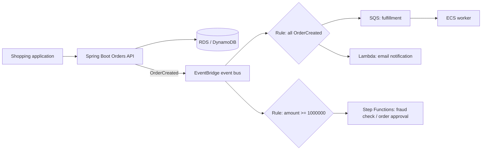
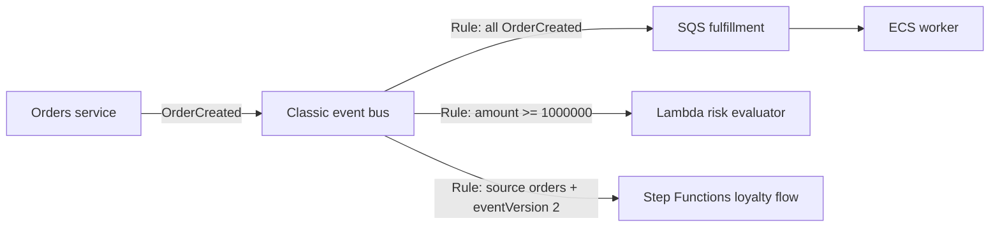
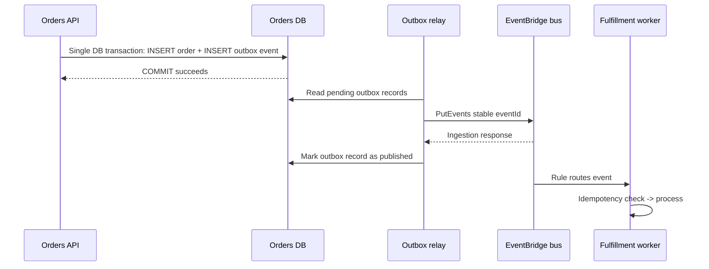
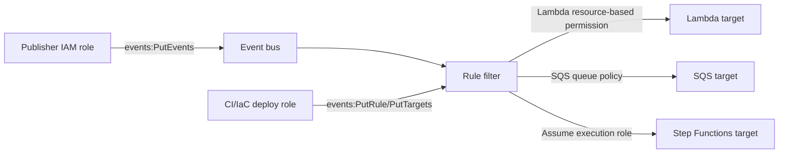
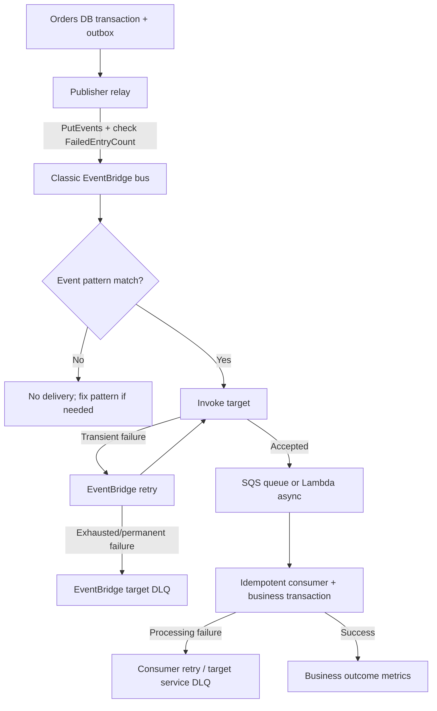
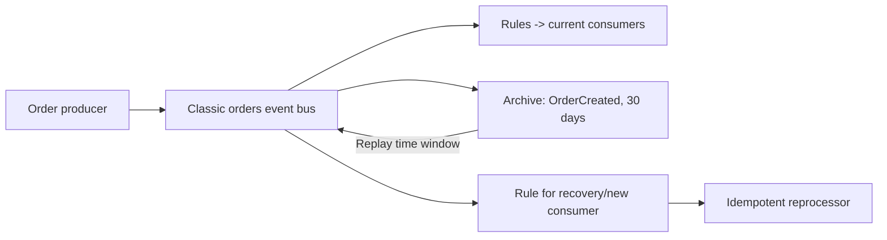
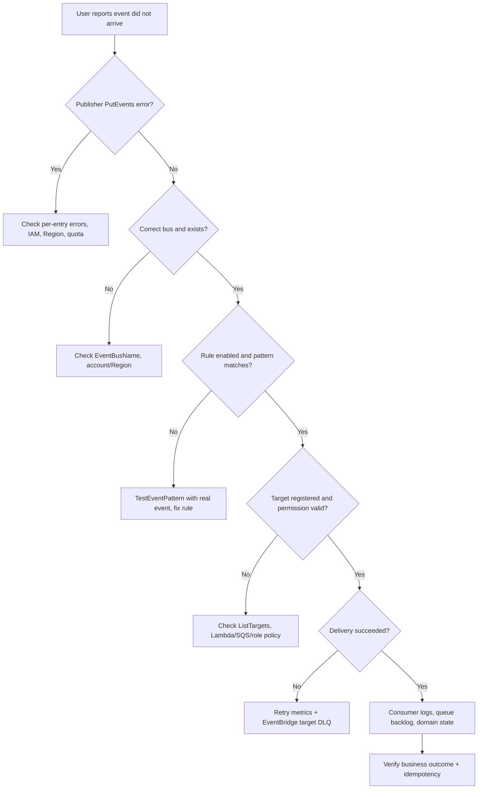

# EventBridge event bus, event pattern and rule

> **Chapter:** Events and Orchestration · **Module:** `CLOUD_PROVIDERS_AWS`

## 1. From synchronous calls to event-driven architecture

An online store builds a Java Spring Boot application to receive orders. When an order is created, the system needs to simultaneously send an email, update loyalty points, and notify the warehouse to prepare for shipping. If the `POST /orders` API calls all three services sequentially, a slow email service can cause the entire order request to time out. In addition, every time a new consumer is added, the order service code has to be modified.

**Amazon EventBridge** is an event-based integration service that lets producers **announce that an event has occurred**, an event bus receives it, and a filtering/routing mechanism decides which consumers process it. For example, an `OrderCreated` event can come from a Spring Boot service running on ECS; one rule sends it to AWS Lambda to update points, and another rule sends it to Amazon SQS for the fulfillment team.



Key points:

- **Producers** know what just happened; they **do not need to know** all consumers.
- **Event bus** receives and routes events within an AWS account/Region according to the selected model.
- **Event pattern** specifies filtering conditions on fields of the event JSON.
- **Rule** in the *default/Classic* model is attached to a bus, and when matched it invokes **target(s)**.
- **Consumers** handle business work and must design their own idempotency, security, retries, observability, and access permissions.

EventBridge is an **event router**, not a transactional database, a guaranteed FIFO queue, or a stateful workflow engine. A successful `PutEvents` call only indicates that the event was accepted by the bus according to the API response; it **does not guarantee** that an email was sent or a payment transaction completed.

In the `CLOUD_PROVIDERS_AWS` module, this knowledge connects with **IAM, VPC/Region/AZ, Lambda, SQS, ECS, DynamoDB/RDS, Step Functions, CloudWatch, recovery, and cost control**.

**Learning objectives:** After this lesson, learners will be able to:

1. Distinguish between **default event bus, Classic custom bus, partner bus**, and the **new Custom Event Bus**.
2. Read the standard event structure, define `source`, `detail-type`, `detail`, and versioned event contracts.
3. Write event patterns with exact, multiple values, numeric, prefix, suffix, anything-but, exists, and `$or`.
4. Create rules and targets via AWS Console/CLI, test matches before creating them, and avoid rule loops.
5. Push custom events using the CLI and Java AWS SDK v2, handling per-entry failures properly.
6. Design IAM identity/resource policies, cross-account routing, input transformation, and delivery permissions.
7. Distinguish between **retry, DLQ, archive/replay, idempotency/outbox**, and delivery limits.
8. Monitor metrics, troubleshoot incidents, estimate costs, and choose correctly among EventBridge/SNS/SQS/Pipes/Scheduler/Step Functions.

## 2. EventBridge has more than one event bus model

AWS documentation now distinguishes between the **traditional rule/target model** and the **new Custom Event Bus using subscribers**. This is an important point to clarify before reading AWS CLI examples.

### 2.1. Default event bus and Custom Event Bus – Classic

In the **rule-based** model:

1. An event is sent to a specific bus.
2. EventBridge evaluates the **rules** belonging to that bus; each rule has an event pattern.
3. A matching rule sends the event to one or more targets, **up to 5 targets/rule**.
4. Multiple rules can match the same event simultaneously; it is not a "first rule wins" mechanism.
5. If **no rule matches**, EventBridge does not send that event to any target.

The **default event bus** is built into every AWS account/Region and typically receives events from AWS services. A **Custom Event Bus – Classic** is created by users to separate event domains or access permissions, for example `shop-events-classic`. A **Partner event bus** can receive events from integrated SaaS partners according to the corresponding source/bus configuration.

Commands in this lesson such as `aws events create-event-bus`, `put-rule`, `put-targets`, `test-event-pattern`, and `put-events` are used to illustrate the **Classic rule-based model**.

### 2.2. New Custom Event Bus (not identical to Classic)

AWS provides a new **Custom Event Bus** (separate from **Custom Event Bus – Classic**). For new systems, AWS documentation recommends considering the Custom Event Bus first. Routing concepts change significantly:

| Aspect | Default / Custom Event Bus – Classic | New Custom Event Bus |
| --- | --- | --- |
| Consumer selection unit | **Rule** + up to 5 targets. | **Subscriber**, each subscriber has one target. |
| Who manages subscriptions | Usually the bus owner creates/edits rules. | Consumers can own their own subscribers, including from shared accounts. |
| Event filtering | `EventPattern` on a rule. | Filter on a subscriber, with data/metadata scope per API. |
| Data retention | Does not retain events by default for re-reading; use **Archive** if needed. | **Built-in retention** on the bus as configured. |
| Replay | Replay from an archive back to the source bus; specific rules can be selected. | Subscribers have a **starting position** on retained events. |
| Ordering | **No ordering guarantees** across Classic rules. | Supports **FIFO per event group on each subscriber** when configured properly. |
| Deduplication | Handled by producer/consumer; no native publish-time dedup for Classic bus. | Has publish-time deduplication by key/content when configured. |
| Publish APIs | Classic JSON-based `PutEvents`. | Next-generation API supporting `PutEvents` and `PutRawEvents` with broader formatting capabilities. |
| Delivery metrics | Primarily `AWS/Events`. | `AWS/EventsV2` and subscriber logs. |
| Default retry | **Up to 24 hours and 185 attempts** on a Classic rule target. | **5 attempts or 300 seconds** by subscriber default; adjust if needed. |

Do not copy `put-rule` commands or Classic retry configurations onto the **new Custom Event Bus** expecting to create a subscriber. Resource ARN formats, SDK/API calls, and configurations differ; refer to [What is the Custom Event Bus?](https://docs.aws.amazon.com/eventbridge/latest/userguide/eb-custom-bus-what-is.html) and [Migration from Classic](https://docs.aws.amazon.com/eventbridge/latest/userguide/eb-custom-bus-migrate.html).

**Lesson scope:** To accurately learn the concepts of **event patterns and rules**, the hands-on sections use the **default/Classic bus**, with comparisons showing how subscribers work in the new model. For a new production project, decide on the model before writing IaC.

### 2.3. How do EventBridge bus, SQS queue, and EventBridge Pipes differ?

- **EventBridge bus:** distributes events from many producers to many consumers using filter/content rules; Classic does not store messages by default for consumers to poll like a queue.
- **Amazon SQS:** a buffer queue that stores messages for workers to process later, supporting retries via visibility timeout and its own DLQ; standard SQS is typically at-least-once, while FIFO queues have their own guarantees.
- **EventBridge Pipes:** designed to connect **one source → one target**, with filter/transform/enrichment, suitable for connecting a stream/queue to a processor or destination without turning every event into a broadcast.
- **EventBridge Scheduler:** creates one-time/recurring schedules with time zones, flexible windows, and retries; prefer Scheduler for time-based jobs instead of **legacy scheduled rules**.
- **AWS Step Functions:** orchestrates **stateful workflows** with choice/retry/wait/compensation; an EventBridge rule only dispatches events and does not maintain business process state.

## 3. JSON structure of an EventBridge event

### 3.1. Standard envelope fields

After a bus receives a custom event, EventBridge provides an event envelope with familiar fields:

```json
{
  "version": "0",
  "id": "87f3d4ad-e38e-4f78-b1a5-5ae38cc712a0",
  "detail-type": "OrderCreated",
  "source": "com.example.shop.orders",
  "account": "111122223333",
  "time": "2026-11-20T03:00:00Z",
  "region": "ap-southeast-1",
  "resources": [],
  "detail": {
    "eventVersion": 1,
    "eventId": "evt-order-20261120-0001",
    "orderId": "ord-1001",
    "customerId": "cust-73",
    "status": "CREATED",
    "amount": 1250000,
    "currency": "VND"
  }
}
```

The IDs, account, order, and customer are **fictitious data**, not credentials. Distinguish:

| Field | Who provides it / what is it used for? |
| --- | --- |
| `version` | **EventBridge envelope** version, usually `"0"`. Not a business schema version by itself. |
| `id` | ID assigned by EventBridge for the ingested event. Useful for correlation, but does not replace the event ID from the domain/outbox. |
| `source` | Namespaced producer name, e.g., `com.example.shop.orders` or `aws.ec2`. |
| `detail-type` | Event type, e.g., `OrderCreated`, `PaymentCaptured`, or a name emitted by an AWS service. |
| `account` / `region` | Account/Region associated with the event per the envelope; useful for separating sources. |
| `time` | Event time, which can be specified by the publisher; clock skew/late arrival must be considered. |
| `resources` | List of related resource ARNs if provided by the producer. |
| `detail` | Business payload, must be **JSON** in Classic `PutEvents`; recommended to include `eventVersion` and `eventId`. |

**The event envelope is not the same as `PutEventsRequestEntry`:** When publishing, the client sends `Source`, `DetailType`, `Detail`, `EventBusName`, and optional fields. The bus supplies the remaining metadata. `Detail` in the API is **a string containing valid JSON**, not a direct SDK object.

### 3.2. Event vs. command

| Event | Command |
| --- | --- |
| `OrderCreated` — "an order has been created." | `ReserveInventory` — "please reserve inventory." |
| Represents **a fact that already happened**. | Requests **performing an action**. |
| Can have multiple independent consumers. | Usually has a clear target/owner and expected outcome. |
| Producer does not need to know specific recipients. | Caller may require a specific response or guarantee. |

Do not push a synchronous payment response into EventBridge and treat it as a committed transaction. If business logic requires atomicity, design appropriate database transactions, saga/compensation, or Step Functions use cases.

### 3.3. Naming and schema versioning

Conventions for the `orders` group:

- `source` = `com.example.shop.orders`: stable by bounded context; avoid changing it arbitrarily when renaming classes.
- `detail-type` = `OrderCreated`, `OrderCancelled`; consistently use PascalCase or your organization's standard.
- `detail.eventVersion` = 1, 2… so consumers know the contract version, independent of the envelope `version`.
- `detail.eventId` = a business ID that is **stable across retries** so consumers can deduplicate; do not generate a new ID for the same transaction when the publisher retries.
- `detail.occurredAt` or `time` to record when the event occurred; late/out-of-order events must be handled.
- `detail.correlationId`/`causationId` for distributed tracing and incident investigation.

**Schema evolution:** adding optional fields is generally more compatible than changing meanings/removing fields. Consumers should ignore unneeded attributes; for breaking changes, use `eventVersion`/a new `detail-type` and run both in parallel during migration windows. AWS EventBridge Schema Registry can help discover and manage schemas as supported, but it does not replace producer/consumer compatibility testing.

### 3.4. Payload security

EventBridge events can be **sent to multiple targets** and appear in logs/archives/DLQs depending on configuration. Do not put passwords, access tokens, payment card data, or sensitive PII into `detail` if consumers do not need it. Instead of pushing the entire customer object, consider passing only `customerId`/`orderId` and having consumers call an API to read data under separate IAM/authorization. Restrict read permissions on buses, logs, archives, and DLQs.

## 4. Event bus: sources, scope, and organizational design

### 4.1. Bus belongs to an account/Region

Example of a system setup:

```text
AWS account: 111122223333 (example)
Region: ap-southeast-1
Default event bus: default
Classic custom bus: shop-events-classic
```

A rule created on `shop-events-classic` only evaluates events sent **to that bus**. If a producer accidentally omits `EventBusName` in `PutEvents`, the client may send to the **default bus**; a rule on the custom bus will not match. Besides account/Region, the **event source namespace/contract** also determines whether a rule receives an event.

### 4.2. Bus types and how to choose

| Bus type | Source and routing | When to use |
| --- | --- | --- |
| **Default** | Built-in bus; primarily receives events from AWS services and custom events sent to it. | Triggering on EC2 state changes, ECS task state changes, AWS Health, and AWS integration scenarios. |
| **Classic custom** | Created by you, with rules/targets defined by you. | Learning event patterns/rules, applications already based on Classic IaC/APIs, separating environments/bounded contexts. |
| **Partner** | Receives events from supported SaaS providers via partner connections. | Processing SaaS ticket/support/e-commerce events without building polling. |
| **New Custom Event Bus** | Subscribers managed by consumers, with built-in retention/group FIFO as configured. | New development, sharing buses via AWS RAM, subscriber-based replay/consumption. |

**You do not need to create one event bus per event type.** Design buses based on domain boundaries, ownership, security, account/Region, cost, and lifecycle. For example, one bus for `commerce-prod` receives OrderCreated/OrderCancelled; multiple rules select types. However, in multi-team/cross-account enterprises, you can separate buses by domain and use policies to prevent out-of-domain apps from publishing/subscribing.

### 4.3. IAM resource policy for a bus

An event bus has a **resource-based policy** to allow appropriate AWS principals/organizations to perform `events:PutEvents`, `events:PutRule`, or `events:PutTargets` according to the supported model. Coordinate:

1. **Identity policy** on the publisher/administrator role, restricting actions and bus ARN.
2. **Resource policy** on the bus for cross-account principals and account/organization conditions.
3. **SCPs/permissions boundaries** and AWS KMS policies when the bus uses customer-managed keys.
4. **Separate target invocation permissions** (such as Lambda resource-based policies or SQS queue policies).

Allowing publishing to a bus **does not mean** permission to invoke any target or modify routing rules. Separate permissions independently for CI deployment, service publishers, application consumers, and incident responders.

### 4.4. One-way events with multiple consumers



Each target has its own failure mode. For example, a misconfigured Lambda permission prevents the risk evaluator from being invoked while SQS fulfillment still receives messages. Never judge an entire event as "succeeded" just because one consumer finished processing.

## 5. Event pattern: declarative JSON filter

An **event pattern** is JSON describing the set of conditions that must be satisfied for a **rule to match**. EventBridge compares values against event fields; it does not run arbitrary code or SQL. A rule without an appropriate filter pattern can match far more events than intended, driving up costs and causing loops.

### 5.1. Example filtering `source` and `detail-type`

```json
{
  "source": ["com.example.shop.orders"],
  "detail-type": ["OrderCreated"]
}
```

This pattern matches any event that has **both**:

- `source` exact match `com.example.shop.orders`.
- `detail-type` exact match `OrderCreated`.

Other attributes such as `detail.amount`, `region`, or `resources` that are not mentioned are **not checked**. Values across different fields have an **AND** relationship. Multiple values within the same array are **OR**:

```json
{
  "source": ["com.example.shop.orders", "com.example.shop.payments"],
  "detail-type": ["OrderCreated", "PaymentCaptured"]
}
```

The second pattern matches **four combinations** (if producers actually emit those combinations); it does not automatically constrain OrderCreated to come only from orders and PaymentCaptured only from payments. If you need "(source A and type A) **or** (source B and type B)", use `$or` or create separate rules.

### 5.2. Matching on `detail` and numeric

Select only newly created orders with an amount greater than or equal to **1,000,000 VND**:

```json
{
  "source": ["com.example.shop.orders"],
  "detail-type": ["OrderCreated"],
  "detail": {
    "status": ["CREATED"],
    "currency": ["VND"],
    "amount": [
      { "numeric": [">=", 1000000] }
    ]
  }
}
```

Important points:

- `amount` must be a **JSON number**, not a string `"1250000"`, when using the `numeric` operator.
- Sibling fields at the same level inside `detail` are **AND**: status, currency, and amount must all match.
- `numeric` can combine `">"`, `">="`, `"<"`, `"<="`, `"="` conditions in an array; for large numbers, note IEEE 754 double precision limits (exact up to approximately ±2^53).
- **Exact literal numerics** outside the `numeric` operator may compare by string representation, so `300` and `300.0` do not necessarily match identically. For value-based numeric comparisons, use `numeric` and test.
- Avoid floats for money when exact precision is required: send **integer cents/dong minor units** or a clear contract and handle business rounding in the consumer.

### 5.3. Common filtering operators

| Operator / construct | Example in field pattern | Meaning |
| --- | --- | --- |
| **Exact** | `"status": ["CREATED"]` | Exact match on case and data type. |
| **One of many values** | `"status": ["CREATED", "PAID"]` | OR across choices for the same field. |
| **`prefix`** | `"orderId": [{"prefix":"ord-"}]` | String starts with prefix. |
| **`suffix`** | `"fileName": [{"suffix":".csv"}]` | String ends with suffix. |
| **`anything-but`** | `"status": [{"anything-but":"CANCELLED"}]` | Field exists and its value differs from excluded values. |
| **`numeric`** | `"amount": [{"numeric":[">=",1000000]}]` | Numeric comparison within a range. |
| **`exists`** | `"couponCode": [{"exists":true}]` | Leaf field is present. |
| **Does not exist** | `"couponCode": [{"exists":false}]` | Leaf field is absent. |
| **`equals-ignore-case`** | `"status":[{"equals-ignore-case":"created"}]` | Case-insensitive string comparison. |
| **`wildcard`** | `"key":[{"wildcard":"orders/*/receipt.pdf"}]` | Wildcard pattern; check support and breadth. |
| **`cidr`** | `"clientIp":[{"cidr":"10.0.0.0/8"}]` | Match IPv4/IPv6 against an IP range. |
| **`null`** | `"reason":[null]` | Field has JSON `null` value. |
| **Empty string** | `"reason":[""]` | Field has empty string value, **not the same as null/missing**. |

Some operators can be nested according to AWS syntax; do not use custom JS expressions or homemade regexes in event patterns. `exists` applies to **leaf nodes** per AWS documentation semantics, not as an "any object" wildcard.

### 5.4. `$or` for coupled combinations

When two event types are tied to two different sources:

```json
{
  "$or": [
    {
      "source": ["com.example.shop.orders"],
      "detail-type": ["OrderCreated"]
    },
    {
      "source": ["com.example.shop.payments"],
      "detail-type": ["PaymentCaptured"]
    }
  ]
}
```

`$or` helps avoid unintended cross-combinations between two fields. However, an overly broad pattern can cause a rule to unintentionally receive sensitive events; if two workflows need different permissions/retention, **two separate rules** can be used for easier management and monitoring.

### 5.5. Arrays in events and matching behavior

Suppose an event contains:

```json
{
  "detail": {
    "tags": ["vip", "gift", "prepaid"]
  }
}
```

Pattern:

```json
{
  "detail": {
    "tags": ["vip", "priority"]
  }
}
```

When an event field is an **array**, EventBridge matches if there is a **non-empty intersection** between the pattern value array and the event array. The example above **matches because of `vip`**. Do not assume multiple elements in a pattern mean all of them must appear in the event: conditions on the same field are OR.

### 5.6. Four practical pitfalls

1. **Case-sensitive:** `OrderCreated` does not match `ordercreated` in an exact match; use `equals-ignore-case` if the contract truly allows it.
2. **JSON null, empty string, and missing are different:** `"reason":[null]` differs from `"reason":[""]`, and `"exists":false` only matches when the field is absent.
3. **Dots in keys:** EventBridge currently flattens nested keys with `.` during pattern compilation. A key `"state.status"` and nested `{"state":{"status":...}}` can be interpreted equivalently. This is an implementation detail **you should not rely on long-term**; avoid using dots in custom JSON field names.
4. **Duplicate JSON keys:** JSON such as `{"source":["aws.s3"],"source":["aws.sns"]}` does not mean "match both"; during compilation only the last value may be kept. Use arrays without duplicate keys and run schema/linter checks.

### 5.7. An event pattern is a filter, not authorization

An event pattern only assists with **routing**; it must not be used to authenticate a producer. For example, if a publisher has `events:PutEvents` permission and can freely set `source="com.example.shop.payments"`, it could spoof a PaymentCaptured event if the system lacks proper IAM conditions/contract validation. Restrict publishers with **IAM and bus resource policies**, and validate data sources and downstream operations affecting money or accounts.

## 6. Testing an event pattern before deploying to a rule

### 6.1. Why test?

A rule that is too narrow can **drop valid events** (for example, the producer sends `status="created"` while the rule filters `"CREATED"`). A rule that is too broad can invoke the wrong consumer, send unnecessary data, or cause an **event loop**. Therefore, before creating a rule, prepare:

- **Positive samples** that must match.
- **Negative samples** that must not match.
- Samples with missing fields, null, empty strings, arrays, wrong data types, wrong source, and wrong detail-type.
- Boundary tests for numerics (`999999`, `1000000`, `1000001`).
- Verification across multiple event schema versions and migration windows.

### 6.2. `TestEventPattern` API

Suppose you have two JSON files **created locally by the learner**:

**`order-created-pattern.json`**:

```json
{
  "source": ["com.example.shop.orders"],
  "detail-type": ["OrderCreated"],
  "detail": {
    "status": ["CREATED"],
    "amount": [{ "numeric": [">=", 1000000] }]
  }
}
```

**`order-created-event.json`**:

```json
{
  "version": "0",
  "id": "87f3d4ad-e38e-4f78-b1a5-5ae38cc712a0",
  "detail-type": "OrderCreated",
  "source": "com.example.shop.orders",
  "account": "111122223333",
  "time": "2026-11-20T03:00:00Z",
  "region": "ap-southeast-1",
  "resources": [],
  "detail": {
    "orderId": "ord-1001",
    "status": "CREATED",
    "amount": 1250000,
    "currency": "VND"
  }
}
```

Test **without emitting a real event** and **without invoking any target**:

```bash
aws events test-event-pattern \
  --region ap-southeast-1 \
  --event-pattern file://order-created-pattern.json \
  --event file://order-created-event.json
```

The expected output is `"Result": true`. Then replace `amount` with `999999` in **your own test event file**, re-run, and expect `false`. This command only evaluates the pattern; if you create a rule while the actual source sends events to a **different bus**, testing true still will not make the rule run.

### 6.3. Illustrative test matrix

| Case | `source` | `detail-type` | `detail.status` | `detail.amount` | Result |
| --- | --- | --- | --- | --- | --- |
| A | `com.example.shop.orders` | `OrderCreated` | `CREATED` | `1250000` | **Match** |
| B | `com.example.shop.orders` | `OrderCreated` | `CREATED` | `999999` | No |
| C | `com.example.shop.orders` | `OrderCancelled` | `CREATED` | `1250000` | No |
| D | `com.example.shop.payments` | `OrderCreated` | `CREATED` | `1250000` | No |
| E | `com.example.shop.orders` | `OrderCreated` | `created` | `1250000` | No (exact match is case-sensitive). |
| F | `com.example.shop.orders` | `OrderCreated` | `CREATED` | `"1250000"` | No (string, not numeric). |
| G | `com.example.shop.orders` | `OrderCreated` | *missing* | `1250000` | No |

The data above is fictitious. When applying rules to production, test against **real events produced by the publisher** and the contract, not just consumer-authored wishful samples.

## 7. Creating a Classic event bus, rule, and target with AWS CLI

The following commands are examples for **default / Custom Event Bus – Classic**. Run them in AWS CloudShell/Bash with **AWS CLI v2** and an authorized lab account. Commands like `create-event-bus`, `put-rule`, `put-targets`, `add-permission`, and `put-events` **modify resources/inject events into the system**; do not run them on production without approval. Use fictitious IDs/ARNs:

```text
AWS account: 111122223333
Region: ap-southeast-1
Bus: shop-events-classic
Rule: orders-created-notify
Lambda target: shop-order-notifier
```

Prerequisites: IAM role has the step permissions; Lambda `shop-order-notifier` already exists in the same account/Region, accepts a JSON event, and only performs effects on lab resources.

### 7.1. Verify account/Region before making changes

```bash
aws sts get-caller-identity
aws events list-event-buses --region ap-southeast-1
aws events list-rules --region ap-southeast-1 --event-bus-name default
```

If a bus/rule with the same name already exists, do not overwrite it or modify out-of-scope targets. `put-rule` has update semantics on an existing rule; re-specifying a pattern can replace live running logic.

### 7.2. Create a Classic bus for the orders domain

```bash
aws events create-event-bus \
  --region ap-southeast-1 \
  --name shop-events-classic
```

The CLI returns `EventBusArn`, for example:

```text
arn:aws:events:ap-southeast-1:111122223333:event-bus/shop-events-classic
```

A bus is a Region/account-level resource; the name `shop-events-classic` is illustrative. With the **new Custom Event Bus**, the resource ARN and bus creation API belong to the v2 model—**do not copy this Classic command verbatim**.

### 7.3. Create a rule with an event pattern

File `orders-rule-pattern.json` (created by the learner in the lab directory, **not a file from this module**):

```json
{
  "source": ["com.example.shop.orders"],
  "detail-type": ["OrderCreated"],
  "detail": {
    "status": ["CREATED"]
  }
}
```

Create the rule:

```bash
aws events put-rule \
  --region ap-southeast-1 \
  --event-bus-name shop-events-classic \
  --name orders-created-notify \
  --description "Notify when an order has been created" \
  --event-pattern file://orders-rule-pattern.json \
  --state ENABLED
```

Notes:

- A rule is attached to **only one event bus**.
- `--state ENABLED` allows the rule to evaluate events as soon as the configuration takes effect; if prior testing/approval is required, consider `DISABLED` and enable at the right time.
- `put-rule` alone does not send events to consumers; you must add **targets** with `put-targets`.
- A rule ARN on a custom Classic bus has the format `arn:aws:events:REGION:ACCOUNT:rule/BUS_NAME/RULE_NAME`, unlike a rule ARN on the default bus which has the format `rule/RULE_NAME`.

### 7.4. Grant EventBridge permission to invoke the Lambda target

For Lambda targets, use a **resource-based permission on Lambda** for the EventBridge rule:

```bash
aws lambda add-permission \
  --region ap-southeast-1 \
  --function-name shop-order-notifier \
  --statement-id AllowOrdersCreatedRule \
  --action lambda:InvokeFunction \
  --principal events.amazonaws.com \
  --source-arn arn:aws:events:ap-southeast-1:111122223333:rule/shop-events-classic/orders-created-notify
```

Adding this permission does not create a trigger if `put-targets` has not been called yet. `StatementId` must be unique within the function's policy; if it already exists, **do not delete/overwrite it automatically** in production.

Register the target:

```bash
aws events put-targets \
  --region ap-southeast-1 \
  --event-bus-name shop-events-classic \
  --rule orders-created-notify \
  --targets 'Id=notify-lambda,Arn=arn:aws:lambda:ap-southeast-1:111122223333:function:shop-order-notifier'
```

The output must have `FailedEntryCount=0`. Always inspect `put-targets` for **entry failures** even when the AWS CLI command exits successfully; on failure, check `FailedEntries`. You can add **SQS**, **Step Functions**, **SNS**, **ECS tasks**, API destinations, etc. as other targets; permissions vary per target type (resource policy or IAM execution role).

### 7.5. Inspect saved rule/target (read-only)

```bash
aws events describe-rule \
  --region ap-southeast-1 \
  --event-bus-name shop-events-classic \
  --name orders-created-notify

aws events list-targets-by-rule \
  --region ap-southeast-1 \
  --event-bus-name shop-events-classic \
  --rule orders-created-notify

aws lambda get-policy \
  --region ap-southeast-1 \
  --function-name shop-order-notifier
```

Before emitting a test event, ensure the Lambda handler **does not send emails to real people** or write production data. Never use an overly permissive service account just to inspect a rule.

### 7.6. Publish a custom event to the bus using `PutEvents`

Create `orders-events.json` in the lab directory:

```json
[
  {
    "Source": "com.example.shop.orders",
    "DetailType": "OrderCreated",
    "EventBusName": "shop-events-classic",
    "Detail": "{\"eventVersion\":1,\"eventId\":\"evt-lab-001\",\"orderId\":\"ord-lab-001\",\"status\":\"CREATED\",\"amount\":1250000,\"currency\":\"VND\"}"
  }
]
```

Note that `Detail` must be an **escaped JSON string** inside the request object. AWS CLI:

```bash
aws events put-events \
  --region ap-southeast-1 \
  --entries file://orders-events.json
```

Example response:

```json
{
  "FailedEntryCount": 0,
  "Entries": [
    {
      "EventId": "b2bca3fb-0741-45e8-bb7c-0ed719871300"
    }
  ]
}
```

This is a **fictitious ID**. After the API accepts the event, wait for delivery and monitor CloudWatch Lambda `Invocations` and logs to verify the target was actually invoked. **`FailedEntryCount=0` does not mean the target succeeded.**

### 7.7. Clean up the lab in the right order

When authorized to clean up lab resources, proceed in logical order:

1. Disable the rule so it stops receiving real events.
2. Remove rule targets.
3. Remove the Lambda resource permission that was added.
4. Delete the rule.
5. Delete the Classic bus after verifying no dependent rules/archives/policies remain.

**Do not put delete commands into an automated script** on an account with real users, because a rule may be part of an order-processing path. Cleaning up DLQs/CloudWatch logs/archives requires retention checks and separate owner approval.

## 8. Java Spring Boot publisher with AWS SDK for Java 2.x

A Spring Boot service can publish events after creating an order. With AWS SDK v2, use **`software.amazon.awssdk: EventBridgeClient`** and the `putEvents` operation. Do not hard-code AWS access keys: ECS tasks use task IAM roles, EC2 uses instance profiles, Lambda uses execution roles, and CI uses STS/role assumption.

### 8.1. Publish an event

Simple publisher service example, assuming the `software.amazon.awssdk:eventbridge` dependency and a valid SDK credential chain:

```java
import java.util.List;
import software.amazon.awssdk.regions.Region;
import software.amazon.awssdk.services.eventbridge.EventBridgeClient;
import software.amazon.awssdk.services.eventbridge.model.PutEventsRequest;
import software.amazon.awssdk.services.eventbridge.model.PutEventsRequestEntry;
import software.amazon.awssdk.services.eventbridge.model.PutEventsResponse;
import software.amazon.awssdk.services.eventbridge.model.PutEventsResultEntry;

public final class OrderEventPublisher implements AutoCloseable {
    private final EventBridgeClient client;
    private final String eventBusName;

    public OrderEventPublisher(String eventBusName) {
        this.eventBusName = eventBusName;
        this.client = EventBridgeClient.builder()
                .region(Region.AP_SOUTHEAST_1)
                .build();
    }

    public String publishOrderCreated(String jsonDetail) {
        // jsonDetail must be a valid JSON string serialized
        // by Jackson (do not concatenate strings from user input).
        PutEventsRequestEntry entry = PutEventsRequestEntry.builder()
                .eventBusName(eventBusName)
                .source("com.example.shop.orders")
                .detailType("OrderCreated")
                .detail(jsonDetail)
                .build();

        PutEventsResponse response = client.putEvents(
                PutEventsRequest.builder()
                        .entries(List.of(entry))
                        .build());

        if (response.failedEntryCount() != 0) {
            PutEventsResultEntry failure = response.entries().get(0);
            throw new IllegalStateException(
                    "EventBridge ingest failed: " + failure.errorCode());
        }
        String eventId = response.entries().get(0).eventId();
        if (eventId == null || eventId.isBlank()) {
            throw new IllegalStateException("No EventBridge event ID returned");
        }
        return eventId;
    }

    @Override
    public void close() {
        client.close();
    }
}
```

Example using Jackson to build `jsonDetail`:

```java
import com.fasterxml.jackson.databind.ObjectMapper;
import java.util.Map;

ObjectMapper mapper = new ObjectMapper();
String detail = mapper.writeValueAsString(Map.of(
        "eventVersion", 1,
        "eventId", "evt-lab-001",
        "orderId", "ord-lab-001",
        "status", "CREATED",
        "amount", 1250000,
        "currency", "VND"
));

try (OrderEventPublisher publisher =
             new OrderEventPublisher("shop-events-classic")) {
    String id = publisher.publishOrderCreated(detail);
    System.out.println("Published event id: " + id);
}
```

**Code objective:** illustrates the SDK pattern and checking `FailedEntryCount`, **not** a complete production pipeline. In practice, you need environment-driven Region/account configuration, a DI-managed client, JSON schema validation, structured logs without PII, proper retries, metrics/error budgets, and a **transactional outbox** if the source is a database.

### 8.2. `PutEvents` can partially succeed

A `PutEvents` request can contain **up to 10 entries** in the Classic API, with total entry size under 1 MiB per API limits. The response returns **`Entries` in the same order as the request**, with each entry having an `EventId` on success or `ErrorCode`/`ErrorMessage` on failure:

```json
{
  "FailedEntryCount": 1,
  "Entries": [
    {"EventId": "f0f0f0f0-1111-4111-8111-111111111111"},
    {
      "ErrorCode": "InternalFailure",
      "ErrorMessage": "Internal Service Failure"
    }
  ]
}
```

**Pitfall:** HTTP 200/an API call returning does not mean every entry was accepted. In production:

1. Maintain the list of request entries with stable domain event IDs.
2. Match `Entries[i]` against request `entries[i]`.
3. Retry only **entries with retriable errors**, using exponential backoff + jitter and an attempt limit.
4. On timeouts or ambiguous responses, the event may already have been accepted; retrying can produce **duplicate events** — consumers need idempotency.
5. Record metrics for published/failed/retried counts by bus/producer; do not log full event payloads if they contain sensitive data.

An easily overlooked case: with **Classic `PutEvents` sent to a non-existent bus**, AWS documentation warns it can return HTTP 200 **without incrementing `FailedEntryCount`** even though the event is dropped because there is no bus to match. Therefore, **verify bus ARN/Region/account and existence** during bootstrap/configuration rather than relying solely on `EventId` to declare end-to-end success. With the **new Custom Event Bus** using a different namespace/API, the publish contract also differs and the corresponding SDK/API must be used.

### 8.3. You cannot atomically "commit order + publish event" with just two calls

Suppose:

```text
1) Database COMMIT order status=CREATED succeeds
2) EventBridge PutEvents times out or fails
```

If the API returns an error and the client retries creating the order, **duplicate orders** can appear, or an order is recorded without an event for fulfillment. Conversely, if the event is published before DB commit and the transaction rolls back, consumers receive an event for a non-existent order.

**Transactional outbox pattern**:



The relay can be a background job on ECS/Lambda, CDC/Debezium, or another mechanism, but it must handle:

- A single database transaction covering both the business row and the outbox row.
- Stable eventId/retry count, status, and lease/concurrency control to prevent multiple relays from duplicating work recklessly.
- If the relay publishes and then crashes before marking "sent", it may republish ⇒ **idempotent consumers**.
- If downstream fails, EventBridge retry/DLQ and consumer retries operate independently of the producer's outbox.
- Alert when outbox backlog age grows or poison events exceed retry thresholds.

EventBridge cannot turn two separate systems into an ACID distributed transaction by itself. Outbox closes the gap before publishing, while idempotency and reconciliation handle at-least-once delivery after publishing.

### 8.4. Idempotent consumer pattern

Suppose an SQS fulfillment worker receives the same `eventId` twice due to delivery/retry. The worker should:

1. Validate the event schema, source, detail-type, version, and required fields.
2. Use `eventId` as the idempotency key, combined with a domain/consumer namespace to avoid collisions across pipelines.
3. Use a DynamoDB conditional write or a unique constraint in RDS to guarantee once-only execution of **business effects**.
4. When receiving a duplicate, return success/ack safely instead of repeating the side effect.
5. Attach the correlation ID to logs and check the order status before sending an email or reserving inventory.

Note that a business event is not an implicitly trusted **command**: consumers must verify trusted sources and never let an unverified producer send `status=PAID` to ship goods without payment.

## 9. Rule targets and input transformation

### 9.1. Each target has a contract

| Classic target type | What does EventBridge do? | Permissions to consider |
| --- | --- | --- |
| **AWS Lambda** | Invokes the function with the event JSON or transformed input. | Resource-based Lambda policy for `events.amazonaws.com` and the rule's `SourceArn`. |
| **Amazon SQS** | Sends a message to the queue for workers to process later. | **Queue resource policy** allowing EventBridge `sqs:SendMessage` scoped to the rule ARN; KMS key policy if needed. |
| **Amazon SNS** | Publishes a message to a topic for fan-out. | SNS topic policy for EventBridge. |
| **AWS Step Functions** | Starts a state machine execution to handle a workflow. | IAM role assumed by EventBridge for the action, scoped to the state machine ARN. |
| **Amazon ECS task** | Runs a task per target parameters. | IAM role + `ecs:RunTask`, `iam:PassRole` for the proper task execution/task roles, and appropriate networking/config. |
| **Another event bus** | Forwards events to a bus in the same account or cross-account/cross-Region. | Event bus resource policy and IAM role/permissions depending on the case. |
| **API destination** | Calls an external HTTPS endpoint via an EventBridge connection. | Role, connection/auth secret, throttling, retry/DLQ, and external rejections. |

**Not every target requires `RoleArn` in the same way.** Lambda/SNS/SQS typically use **resource-based policies** on the target; Step Functions/ECS/API Destinations require configuring an appropriate IAM role. For cross-account/organization setups or other target types, check [EventBridge target permissions](https://docs.aws.amazon.com/eventbridge/latest/userguide/eb-targets.html) for your exact use case.

### 9.2. Multiple targets on one rule — should you do it?

A Classic rule supports up to **5 targets**. If three consumers share the exact same event filter, using one rule with three targets simplifies the pattern; however:

- Each target has its own delivery policy/DLQ and must be monitored separately.
- Changing the rule can affect multiple teams simultaneously.
- Ownership of rule/target permissions by one owner can create coupling with other teams.
- When independent patterns and deployment lifecycles are needed, **one rule per consumer** separates ownership.

There is no concept of "target A finishes running before target B receives the event" merely because targets are listed in order. If you need sequencing, state, or compensation, use **Step Functions** or an appropriate workflow.

### 9.3. Input transformer

By default, targets receive the full event. When only a subset is needed:

- **Constant input**: sends a fixed JSON/string (without the full envelope).
- **Input path**: selects part of the event using supported JSONPath.
- **Input transformer**: extracts values via `InputPathsMap` and constructs a new payload using `InputTemplate`.

Example with OrderCreated where the target only needs orderId and amount:

```json
{
  "InputPathsMap": {
    "order": "$.detail.orderId",
    "amount": "$.detail.amount"
  },
  "InputTemplate": "{\"orderId\":<order>,\"amount\":<amount>,\"source\":\"eventbridge\"}"
}
```

When processed by EventBridge, the target can receive an equivalent JSON object:

```json
{
  "orderId": "ord-1001",
  "amount": 1250000,
  "source": "eventbridge"
}
```

**`InputTransformer` only changes the data sent to the target**, not the event ingested on the bus or access permissions. JSONPath supports a **subset**, not a full JSONPath library. If a field is missing or has an unexpected type, the payload can become invalid; test with console sandboxes/sample events. For JSON object/array variables, handle quoting carefully per AWS documentation to avoid turning an object into a malformed string. Do not use a transformer as a substitute for schema validation and business authorization.

### 9.4. Infinite event loop

Example:

```text
Rule: matches every event source=com.example.shop.orders
Target Lambda: receives it and calls PutEvents again with source=com.example.shop.orders
=> Rule matches the new event again => loop
```

Consequences: spikes in requests/target invocations, quota throttling, high costs, and even impact on other services. Prevention:

1. Rules use **specific** `source` and `detail-type`, not catch-all matching.
2. Consumers emit a **new event type** such as `OrderEnriched`, rather than unconditionally re-emitting `OrderCreated`.
3. Use `correlationId/causationId`, hop counts, or idempotency guards if the architecture requires chaining.
4. Set AWS Budgets/CloudWatch alarms for traffic spikes, DLQ/retries, and billing.
5. If reprocessing is needed, use replay or a dedicated workflow with guards—do not attempt it by re-emitting events without limits.

## 10. IAM, cross-account/cross-Region, and bus security

### 10.1. Permission layers to distinguish



The **"publisher can call PutEvents but Lambda does not run"** scenario can be caused by missing target permissions, a non-matching rule, a disabled rule, or a failing target. Never fix this by granting `lambda:InvokeFunction` to the publisher—the publisher does not invoke Lambda directly once traffic flows through EventBridge.

### 10.2. IAM policy for a publisher

Example identity policy on the Orders service's ECS task role:

```json
{
  "Version": "2012-10-17",
  "Statement": [
    {
      "Sid": "PublishOrdersEventsOnly",
      "Effect": "Allow",
      "Action": "events:PutEvents",
      "Resource": "arn:aws:events:ap-southeast-1:111122223333:event-bus/shop-events-classic",
      "Condition": {
        "StringEquals": {
          "events:source": "com.example.shop.orders"
        }
      }
    }
  ]
}
```

The IAM condition key `events:source` can be used to restrict allowed `Source` values when publishing (subject to capability/action support). With multiple domain events, you can combine `events:detail-type` conditions or separate IAM roles/buses to limit blast radius. **Do not treat `source` inside the event as standalone authentication proof** if a broad role can submit any `source`; identity + resource policies govern permissions.

In ECS, use a **task role** for the application publishing to EventBridge; in Lambda use an **execution role**; on EC2 use an instance profile; in CI use role assumption/OIDC. Never embed AWS access keys in Docker images, JARs, Git, or EventBridge event details.

### 10.3. IAM role for rule administration

A deployment role needs permissions such as `events:PutRule`, `events:PutTargets`, `events:DescribeRule`, `events:ListTargetsByRule` to manage routing, plus target-specific permissions such as `lambda:AddPermission` or `iam:PassRole` as appropriate. Do not mix these permissions with the publisher role: an application authorized to publish should not be able to alter patterns to redirect traffic to another destination.

Track administrative changes via **AWS CloudTrail**, review IaC deployments/approvals, and plan rule rollbacks. Running `put-rule` on an existing rule can replace its pattern/rule state; ensure diffs are reviewed before execution.

### 10.4. Sending events cross-account

Example:

```text
Account A (Orders producer) 111122223333
    |
    | events:PutEvents or Classic rule -> remote bus
    v
Account B (Analytics consumer) 444455556666
    EventBridge event bus -> rule -> SQS/Lambda analytics
```

For account A to send events to a **Classic bus in account B**, you typically need:

1. Account B has an event bus (e.g., `analytics-classic`) and a **resource-based policy** allowing restricted principals/accounts/organizations from A to publish events.
2. The publisher or forwarding role in A has an identity policy granting `events:PutEvents` on the bus ARN in B.
3. If a rule in A targets the remote bus, add an IAM role for EventBridge to assume when required (especially with AWS Organizations bus policies) and the correct target ARN.
4. Account B manages its own rules/targets and **target permissions**; A cannot control B's consumers without `PutRule/PutTargets`.
5. KMS encryption, Region endpoints, and Service Control Policies do not deny the operation.

Illustrative **bus resource policy in account B**:

```json
{
  "Version": "2012-10-17",
  "Statement": [
    {
      "Sid": "AllowOrdersAccountToPublish",
      "Effect": "Allow",
      "Principal": {
        "AWS": "arn:aws:iam::111122223333:root"
      },
      "Action": "events:PutEvents",
      "Resource": "arn:aws:events:ap-southeast-1:444455556666:event-bus/analytics-classic"
    }
  ]
}
```

**Warning:** `:root` in a cross-account policy Principal refers to account scope, not a single specific role in that account. In production, restrict principals/organizations, source/detail-type, and supported IAM conditions, and review identity policies in A. Never grant `events:PutRule` or `PutTargets` to an external account just because it needs to publish.

**With the new Custom Event Bus:** sharing is done via **AWS RAM**, and consumers create **subscribers** on the shared bus; steps/ARNs/APIs differ from Classic. Do not port Classic bus policies/RAM setups directly to v2 without consulting [New Custom Event Bus](https://docs.aws.amazon.com/eventbridge/latest/userguide/eb-custom-bus-what-is.html).

### 10.5. Cross-Region routing

EventBridge can forward events across Regions/accounts via supported mechanisms; this does not mean all buses stay automatically synchronized when a Region fails. Check:

- Endpoints/Regions and bus ARNs of publishers, rules, and targets.
- IAM roles, KMS key policies, and bus policies in **both Regions**.
- Cross-Region/data transfer pricing and replication/DR requirements.
- Idempotency and out-of-order delivery if both primary and secondary sources publish.
- Health checks and traffic failover points when Region A is unavailable.

**Cross-Region event forwarding does not replace full DR**: databases, compute, schemas, permissions, subscribers, and replay sources must also be ready.

### 10.6. KMS, PII, and permission boundaries

EventBridge supports encryption at rest; when using **customer-managed KMS keys** for buses/archives as supported, configure key policies for the required service/resource roles. Encryption at rest does not replace data redaction and consumer least privilege:

1. Classify PII/secrets in event fields.
2. Include minimal data in `detail` and input transformations.
3. Restrict publisher IAM actions, bus policies, and subscriber/rule rights.
4. Block unauthorized recipients using target resource policies.
5. Protect CloudWatch logs, DLQs, and archive retention.
6. Audit `PutRule`/`PutTargets`/policy updates with CloudTrail and watch for unexpected target ARNs.
7. Never let a WAF/public frontend API call `PutEvents` directly with unrestricted AWS credentials.

## 11. Delivery guarantees, retries, and dead-letter queues

### 11.1. What does EventBridge Classic guarantee?

Classic EventBridge delivers events asynchronously, **without guaranteeing exactly-once delivery or global ordering**. Consumers must tolerate events arriving **at least once**, being redelivered, arriving late, or arriving out of order. An event that does not match any rule **does not automatically go to a DLQ**; it simply has no configured target.

Distinguish three stages:

| Stage | What can fail? | Mechanism |
| --- | --- | --- |
| **Publisher → bus** | `PutEvents` entry fails, throttled, wrong bus/Region, request timeout. | Publisher retry + per-entry response check; outbox if backed by a DB. |
| **Bus → target invocation** | Non-existent target, missing permissions, target unavailable, throttling. | EventBridge target retry policy and **DLQ per target**. |
| **Target business processing** | Lambda/worker receives event but logic fails, DB errors, SQS consumer mishandles it. | **Target service** retry/DLQ mechanisms, app idempotency, and reconciliation. |

EventBridge's retry policy handles **delivery failures at the EventBridge → target boundary**, not necessarily business failures after the target **accepts** the event. For example, if EventBridge successfully pushes a message into SQS and the worker fails while processing it, you need an **SQS queue retry/DLQ**—EventBridge will not redeliver as it would when `SendMessage` fails.

### 11.2. Classic target retry policy

For **default/Classic rules**, default delivery retry settings:

- Up to **185 attempts**.
- **24 hours** maximum event age.
- Exponential backoff + jitter; stops when either limit is reached first.

Example configuration on a target:

```json
{
  "Id": "notify-lambda",
  "Arn": "arn:aws:lambda:ap-southeast-1:111122223333:function:shop-order-notifier",
  "RetryPolicy": {
    "MaximumRetryAttempts": 10,
    "MaximumEventAgeInSeconds": 3600
  }
}
```

This is a **target specification** passed to `put-targets` via CLI/API, not an event pattern. Lowering retries from the default to 10/1h can reduce backlog but increases the number of events routed to the DLQ; tune it according to target RTO/downtime and on-call response.

### 11.3. DLQ for an EventBridge rule target

Set an **SQS Standard queue** as a **DLQ** for a rule target. EventBridge sends events that cannot be delivered to the target after retries or upon non-retriable failures:

```json
{
  "Id": "notify-lambda",
  "Arn": "arn:aws:lambda:ap-southeast-1:111122223333:function:shop-order-notifier",
  "DeadLetterConfig": {
    "Arn": "arn:aws:sqs:ap-southeast-1:111122223333:orders-events-dlq"
  }
}
```

**The SQS DLQ also needs a resource policy** allowing `events.amazonaws.com` to send messages, typically scoped to the rule ARN; if the queue is encrypted with a customer-managed KMS key, key permissions are also needed. Do not just add `DeadLetterConfig` to a target and assume the DLQ is ready.

**Some errors are not retried**, such as a non-existent target ARN or permanently denied permissions: EventBridge can send the event straight to the DLQ if configured. If **no DLQ is configured**, the event can be dropped after delivery failure with no recovery copy from the target.

DLQ messages include attributes helpful for debugging, such as `RULE_ARN`, `TARGET_ARN`, `ERROR_CODE`, `ERROR_MESSAGE`, `RETRY_ATTEMPTS`, and other metadata depending on the failure type. Only authorized personnel should read the DLQ; payloads may contain PII.

### 11.4. Three types of DLQs not to confuse

| DLQ | When is it used? | Who handles it? |
| --- | --- | --- |
| **EventBridge rule target DLQ** | EventBridge **fails to deliver to the target**. | Platform/integration team. |
| **SQS source queue DLQ** | Worker reads a message and fails to complete it after maxReceiveCount. | Consumer/fulfillment owner. |
| **Lambda asynchronous failure destination/DLQ** | Lambda is invoked asynchronously, but the handler fails after retries/expiry. | Lambda application owner. |

Do not rely on a single DLQ for every failure point. Set up alerts, runbooks to investigate root cause, safe replay/redrive, **idempotency**, and proper TTL retention.

### 11.5. New Custom Event Bus has different retries

On the **new Custom Event Bus**, the default subscriber `RetryPolicy` is **5 attempts or 300 seconds**; configurable up to `MaxRetryAttempts=185` or `MaxEventAgeInSeconds=86400` per the API. If migrating from Classic where 24-hour retries are expected, you must **explicitly configure** it on the subscriber.

Subscribers have `OnFailureConfiguration` (SQS DLQ) and metrics such as `OnFailureDestinationDelivered`, `OnFailureDestinationFailed`, and `EventsDropped` in `AWS/EventsV2`. An event exceeding the retry window without a failure destination can be dropped. Documentation: [Custom bus retries/DLQ](https://docs.aws.amazon.com/eventbridge/latest/userguide/eb-custom-bus-retry.html).

### 11.6. End-to-end reliability requires multiple layers



To prove "an order was processed," you need a **business outcome** or completion state at the consumer, not just `PutEvents` responses, `MatchedEvents`, or `Invocations`.

## 12. Archive and replay: controlled event reprocessing

### 12.1. What is an archive for?

With a **Classic event bus**, events passing through the bus are not automatically stored for later querying/replay. **EventBridge Archive** lets you store events from a source bus (optionally filtered by a pattern) with a retention period in days, and then **replay** stored events back to **the same source bus**.



Benefits:

- Recover past events when a consumer failed or a read model needs to be rebuilt.
- Test new functionality with historical events in a controlled environment/replay workflow.
- Support investigation within the chosen retention window.

Limitations:

- An archive is created **for a source bus**; it does not retroactively capture events from before the archive became active.
- Each archive has its own retention and incurs charges; it is not a free unlimited backup.
- Archive/replay **does not automatically guarantee exactly-once delivery, global ordering, or side-effect compensation**.
- **Replays only go back to the source bus** in Classic semantics; you can select target rules during replay.
- Re-injecting old events into a live system can cause **duplicate emails, duplicate writes, or double payment charges** if consumers are not idempotent.

### 12.2. Archive retention and pattern

Suppose you only want to store OrderCreated for 30 days. The archive has an event pattern:

```json
{
  "source": ["com.example.shop.orders"],
  "detail-type": ["OrderCreated"]
}
```

Create the archive using AWS CLI after approval (bus name/ARN are examples):

```bash
aws events create-archive \
  --region ap-southeast-1 \
  --archive-name shop-orders-archive \
  --event-source-arn arn:aws:events:ap-southeast-1:111122223333:event-bus/shop-events-classic \
  --event-pattern file://orders-archive-pattern.json \
  --retention-days 30
```

In this command, `orders-archive-pattern.json` is a JSON file created by the learner with the pattern above. This operation **creates a resource and incurs costs**; do not run it without an owner/budget. If indefinite retention is desired, check the API retention value semantics and compliance requirements rather than defaulting to indefinite.

### 12.3. Replay can re-trigger multiple consumers

Suppose on Nov 20 the fulfillment team wants to replay events from 09:00–10:00 on Nov 19:

1. Identify the exact source archive, time range, and rules to be replayed.
2. Ensure workers use a **stable eventId** and idempotency so they do not create duplicate orders/shipments.
3. If effects on other consumers must be avoided, **select specific rules** for the replay (as supported by AWS) instead of defaulting to all rules.
4. Check IAM permissions, quotas, target capacity, and DLQ/retries.
5. Record the replay name, operator, time window, success/duplicate/error counts, and business reconciliation.

EventBridge adds a `replay-name` metadata field to replayed events. EventBridge-managed archives have a rule to **avoid re-archiving replayed events**, typically based on:

```json
{
  "replay-name": [
    { "exists": false }
  ]
}
```

To avoid unintended replay processing, you can configure **consumer-specific rules** that filter or exclude replays depending on design, but test the exact semantics. **Do not blindly add `{"replay-name":[{"exists":false}]}` to every business rule** if the workflow actually needs to process replayed events.

### 12.4. Replay does not guarantee original ordering

According to AWS, Classic replay processes events over a time range and delivers them in **one-minute buckets**, **without guaranteeing the exact order** in which events entered the archive. Archiving can take a few minutes to catch up; AWS recommends waiting about **10 minutes** before replaying events near ingestion time to ensure they are archived.

If a consumer requires strict ordering for financial debits/credits or stock reservations, use a domain-specific sequence/version, conditional updates, or an architecture with **FIFO/event-group** support on the new bus or SQS FIFO; do not rely on event timestamps or assume EventBridge Classic preserves order.

### 12.5. DLQ redrive vs. archive replay

| Mechanism | What data does it hold? | When to use? |
| --- | --- | --- |
| **Archive** | Events that passed through the bus and matched the archive pattern, regardless of target delivery success. | Rebuilding/reprocessing history, testing a new consumer, investigation. |
| **EventBridge target DLQ** | Events that **failed to deliver to a specific target** after failures/retries. | Fixing permissions/availability/transforms and redriving only the failed events. |
| **Consumer DLQ** | Messages/invocations **the consumer failed to finish processing**. | Fixing application/data bugs and retrying/reconciling per business logic. |
| **New Custom Event Bus retention** | Events retained on the bus over time; subscribers can choose a starting position. | Consumer self-bootstrapping/catching up using built-in retention. |

Do not replace a DLQ with an archive without a runbook: an archive can replay events that were already processed successfully and cause wider duplicate side effects than redriving only failures.

## 13. EventBridge observability and end-to-end tracing

### 13.1. Metrics for default/Classic event bus

For Classic, the CloudWatch namespace **`AWS/Events`** provides metrics for publishing, matched rules, and target delivery:

| Metric | Meaning | When to check |
| --- | --- | --- |
| `PutEventsApproximateCallCount` | Approximate number of `PutEvents` calls. | Producer throughput, traffic fluctuations. |
| `PutEventsFailedEntriesCount` | Number of failed publish entries. | Producer/ingestion errors; inspect per-entry responses. |
| `PutEventsApproximateThrottledCount` | Number of throttled publish calls. | Quotas/producer backoff. |
| `MatchedEvents` | Number of events matching rules by dimension. | If the publisher sends events but targets don't run, did the rule match? |
| `TriggeredRules` | Number of times a rule triggered a match. | Verifying rule activity. |
| `Invocations` | Number of times rules invoked targets per metric semantics. | Is routing from rule to targets working? |
| `InvocationAttempts` | Number of target invocation attempts. | Retry pressure and target availability. |
| `FailedInvocations` | Target invocations that **permanently failed**, excluding retries that succeeded. | Serious delivery incidents. |
| `RetryInvocationAttempts` | Target invocation attempts due to retries. | Target experiencing transient errors/backoff. |
| `InvocationsSentToDlq` | Events/records sent to the target DLQ. | Dead letters need inspection and handling. |
| `InvocationsFailedToBeSentToDlq` | Failures sending to the DLQ. | **Risk of event loss**; check SQS policy/KMS. |
| `IngestiontoInvocationStartLatency` | Latency from ingest to the first target invocation. | Slow routing/target latency. |
| `ThrottledRules` | Rule executions that were throttled. | Service quotas/traffic spikes, delayed delivery risk. |

Select the **Sum statistic**, proper period, and `RuleName`/`EventBusName` dimensions where available. Some metrics **only emit data points when activity/failure occurs**; seeing no `FailedInvocations` does not prove zero failures without checking time windows/dimensions.

**Metrics arrive in CloudWatch on a best-effort basis** and can be delayed or miss data points. Thus they are monitoring signals, not an absolute transaction ledger. Use **business IDs/outbox/consumer status** to verify which orders have completed.

### 13.2. Metrics and subscriber logs in the new Custom Event Bus

The new Custom Event Bus uses the **`AWS/EventsV2`** namespace, which differs from Classic:

| Metric | Meaning |
| --- | --- |
| `FilterEvaluated` / `FilterMatched` | How many events were evaluated and how many matched the subscriber filter. |
| `EventDeliveryAttempts` | Number of delivery attempts to the subscriber. |
| `EventsDelivered` | Number of events successfully delivered per the metric. |
| `OnFailureDestinationDelivered` | Events/records forwarded to the on-failure DLQ. |
| `OnFailureDestinationFailed` | Failures sending to the on-failure destination. |
| `EventsDropped` | Events dropped after retries when no failure destination is configured. |
| `ApproximateBacklogAge` | Approximate age of undelivered subscriber events. |
| `EventTransformationFailures` | Transformer or target input expression failures. |

**Subscriber logs** can be enabled via `LogConfiguration.Level`; log records include outcome, attempts, final state, and target information. Configuration can include event payloads (`IncludePayload`), so choose appropriate log levels and protect PII/secrets in CloudWatch Logs. Documentation: [Custom Event Bus observability](https://docs.aws.amazon.com/eventbridge/latest/userguide/eb-custom-bus-observability.html).

**Do not confuse** Classic's `AWS/Events` with Custom Bus's `AWS/EventsV2`: dimensions, metric names, default retries, and routing differ. During migration, migrate **dashboards/alarms** as well, not just event patterns.

### 13.3. Tracing an `OrderCreated` across the system

Correlation design:

```text
HTTP POST /orders             requestId=req-001
DB order row                  orderId=ord-1001
Outbox row                    eventId=evt-0001, correlationId=req-001
EventBridge PutEvents         EventId=<bus-generated-id>
Classic rule match            orders-created-notify
Lambda / SQS worker           eventId=evt-0001, orderId=ord-1001
Business result               fulfillmentStatus=QUEUED
```

Investigation steps:

1. Look up the order/outbox using `orderId` and `eventId`.
2. Read publisher logs and `PutEvents` responses; verify account/Region/bus.
3. Inspect rule pattern/tests and CloudWatch `MatchedEvents`.
4. Check target permissions, `InvocationAttempts`, retries/DLQ.
5. Check Lambda/SQS/ECS logs and processing state in the domain database.
6. If the target processed the event but the customer does not see the result, check async workflows, caches/APIs, or downstream dependencies.

**Not every EventBridge target automatically propagates distributed trace context.** Producers can place `traceparent`/`correlationId` appropriately in event details and consumers can create linked spans; avoid logging PII/credentials. Use X-Ray/OpenTelemetry, CloudWatch Logs, and business metrics to link steps.

### 13.4. Meaningful alerts for real incidents

| Alert | Suggested interpretation | Response |
| --- | --- | --- |
| `PutEventsFailedEntriesCount` > baseline. | Publisher failing ingestion. | Check IAM, Region, quotas, retry/outbox backlog. |
| `MatchedEvents` drops unexpectedly while producer still publishes. | Wrong pattern/source/contract or wrong bus. | `TestEventPattern`, compare event sample and rule state. |
| `FailedInvocations` or `InvocationsSentToDlq` > 0. | Target delivery permanently failing. | Check resource policy, target ARN, DLQ, redrive. |
| `InvocationsFailedToBeSentToDlq` > 0. | DLQ cannot receive failed events. | Urgent priority: SQS policy/KMS/quota, event loss risk. |
| `RetryInvocationAttempts`/latency rising. | Target slow or transiently failing. | Scale target, check downstream/timeouts. |
| Outbox backlog or SQS queue age rising. | Domain processing slow/stalled, even if EventBridge metrics look green. | Consumer saturation, queue workers, DB/transactions. |
| `EventsDropped` (v2) > 0. | Subscriber exhausted retries with no DLQ. | Handle event loss, add on-failure config. |

Each alarm needs an **owner, runbook, account/Region, bus/rule/target identifier, threshold, period, and action**. For low-traffic systems, missing datapoints cannot be equated with "0 errors"; choose appropriate missing-data handling and synthetic traffic.

## 14. Cost, limits, and scalability

### 14.1. Why can event-driven architectures cause unexpected costs?

Event volume scales with **producer activity** and **consumer count**, not just HTTP requests. One `OrderCreated` matching three rules, each with multiple targets, can produce many target invocations; if consumers emit additional events, the chain expands further. Accidentally creating a rule loop can escalate emission rates and costs very quickly.

| Item | Related cost or quota | How to manage |
| --- | --- | --- |
| **Classic custom events** | Published events, size billed per billing unit/API limits and Region. | Trim unnecessary event detail, consolidate overly chatty micro-events when sensible, avoid duplicates. |
| **Event delivery/targets** | Pricing rules depend on event source and target type, API Destinations/cross-account/Region. | Account for actual deliveries and downstream charges. |
| **Classic Archive** | Retained events and replay operations per pricing. | Archive only needed events, limit retention, and avoid uncontrolled replays. |
| **New Custom Event Bus** | Publish charges, deliveries to subscribers, and integrated retention. | Design accurate filters, size retention and subscriber counts. |
| **Lambda** | Invocation count, duration, concurrency/provisioned, CloudWatch Logs. | Reduce retried side effects, tune memory/runtime and fan-out. |
| **SQS/SNS/Step Functions** | Message requests, workflow transitions, or feature-specific pricing. | Reduce poison messages, optimize batching/retries, control execution volume. |
| **CloudWatch/CloudTrail** | Custom metrics/log ingestion/storage/queries and audit data events where applicable. | Reduce payload logging, retention, and metrics cardinality. |
| **Cross-Region/third-party** | Data transfer, API destination usage, vendor charges/rate limits. | Keep events close to consumers, handle retry throttling, plan quotas. |
| **KMS encryption** | KMS API requests/customer-managed keys as configured. | Use when compliance/security warrants it and measure usage. |

**Do not assume a single fixed price** such as "EventBridge is always \$X per 1 million events"; different event sources/delivery/bus models have different pricing schedules that vary by Region. Use [AWS EventBridge Pricing](https://aws.amazon.com/eventbridge/pricing/), AWS Cost Explorer, and AWS Budgets with cost allocation tags/billing dimensions.

### 14.2. `PutEvents` limits and payload size

For Classic `PutEvents`:

- Up to **10 entries** per request.
- Total entry size **less than 1 MiB (1,048,576 bytes)**; a single event can occupy nearly the entire limit.
- `Detail` is a JSON string; do not send large binaries, uploaded files, or multi-MB payloads.
- Requests/sec and rule/target quotas depend on Region/account; check AWS Service Quotas.

For the **new Custom Event Bus**, the v2 API has different formats and limits—for instance, `PutEvents` can support up to **100 entries** and `PutRawEvents` supports non-JSON formats. Do not design v2 ingestion around Classic API limits.

If you need to pass images, videos, large files, or documents, store them in **Amazon S3** and send the **S3 object key/URI** with minimal metadata. Consumers need separate IAM permissions to read the object and verify checksums/versions; do not put long-lived pre-signed URLs or secrets into event details.

### 14.3. Consumer capacity affects SLA

EventBridge can route quickly, yet:

- A Lambda target hits **reserved concurrency throttling** or a slow downstream DB.
- An SQS buffer backs up because ECS workers lack capacity.
- Step Functions execution quotas or third-party API destination rate limits are reached.
- EventBridge rules are throttled during traffic bursts or overly broad patterns.
- Cross-account bus policies/KMS cause delivery failures.

Capacity planning must account for the **fan-out multiplier**, processing time, retries, and peak traffic. For example, 1,000 OrderCreated/s with 3 consumers can generate far more than 1,000 invocation/message operations per second, rising further with retries and side effects. Never infer end-to-end SLOs solely from publish throughput.

### 14.4. AWS Budgets and guardrails against event loops

Set up:

1. Budgets/cost alerts for EventBridge, Lambda, SQS, and logs.
2. CloudWatch alarms on `PutEventsEntriesCount`/throughput, sudden `MatchedEvents` spikes, target `Invocations`, and retries.
3. Specific rule filters by `source`/`detail-type`, verified with a test matrix before enabling.
4. IAM policies preventing a consumer from re-emitting event sources/types that could cause a loop if unnecessary.
5. Consumer idempotency, hop counts/causation IDs, and canary rollouts for routing changes.
6. On-call runbooks authorized to **disable rules or pause publishers** appropriately; understand the impact on missed business events while disabled.

**Disabling a rule in Classic does not automatically store missed events for later processing.** If the system needs backfilling, you must rely on outbox/archive/source-of-truth and a proper replay procedure.

## 15. Troubleshooting: published, but target did not receive

### 15.1. General diagnostic table

| Symptom | Question to answer | Tools / first steps |
| --- | --- | --- |
| `PutEvents` returns `AccessDeniedException`. | Does the publisher role have `events:PutEvents` for the right bus ARN and conditions? | STS identity, IAM simulation/CloudTrail, bus policy. |
| `PutEvents` returns HTTP 200, but event does not appear. | What is `FailedEntryCount`? Does the bus exist in the right Region? Does the rule match? | `describe-event-bus`, `list-event-buses`, `test-event-pattern`, producer logs. |
| `MatchedEvents=0`. | Did the event reach the right bus? Does exact pattern mismatch source/detail-type/type/case? | `describe-rule`, test samples, event contract. |
| `MatchedEvents > 0` but Lambda does not run. | Does the target exist/is it registered? Does Lambda policy have the right `SourceArn`? | `list-targets-by-rule`, `lambda get-policy`, `FailedInvocations`. |
| Rule works, but SQS is empty. | Queue policy/KMS for EventBridge `SendMessage`? | SQS `get-queue-attributes`, CloudTrail, rule metrics/DLQ. |
| Cannot create a new rule. | IAM permissions, bus existence, valid pattern JSON, Service Quotas? | AWS CLI error, `test-event-pattern`, `describe-event-bus`. |
| `put-targets` has `FailedEntryCount>0`. | Target ARN, role, target params, KMS/permissions? | Inspect `FailedEntries`, fix the specific entry, and retry. |
| Permanent failure after retries. | Target unavailable/permission denied/quota? | `FailedInvocations`, `InvocationsSentToDlq`, DLQ attributes. |
| DLQ does not receive failures. | DLQ queue policy, ARN, KMS, or message size? | `InvocationsFailedToBeSentToDlq`, queue metrics/policy. |
| One event triggers multiple times. | Multiple rules/targets, at-least-once retry, duplicate producer/outbox relay? | EventId + domain eventId, rules inventory, logs. |
| Target processes slowly while EventBridge is "green". | Delivered to queue, but consumer is slow? | SQS `ApproximateAgeOfOldestMessage`, Lambda/ECS logs, domain state. |
| Rule re-enabled, but old events do not arrive. | Classic does not buffer events while a rule is disabled. | Outbox/archive/replay plan; do not expect automatic backfill. |
| Replay causes duplicate processing. | Are consumers idempotent by eventId? Were the right rules selected? | Replay details, domain duplicate detector, DLQ. |
| Metrics missing. | `AWS/Events` or `AWS/EventsV2` namespace? Right dimensions/period? | CloudWatch, bus model, subscriber log config. |
| Cross-account target does not receive events. | Destination bus resource policy, source IAM role, target ARN/Region, KMS/SCP? | Read policies in both accounts, STS identity/CloudTrail. |

### 15.2. Investigation workflow from producer to consumer



**Detailed steps:**

1. Identify **eventId, correlationId, eventVersion**, account/Region, and bus model.
2. Verify the **publisher** actually committed business data/outbox record; inspect the `PutEvents` response and `FailedEntryCount`.
3. Verify the bus exists and `EventBusName` is right; with Classic `PutEvents`, do not trust HTTP 200 alone.
4. Inspect `describe-rule`, `list-targets-by-rule`, `RuleState`, and run `test-event-pattern` with a real event (with PII redacted).
5. Check CloudWatch `MatchedEvents`, `InvocationAttempts`, `FailedInvocations`, and DLQ metrics with exact dimensions.
6. Check target **resource policy/IAM role**; never fix a 403 error by opening `*:*` to all principals.
7. If EventBridge delivered successfully, move to logs/metrics of Lambda, SQS, ECS, Step Functions, or the API destination.
8. Verify the result **against business state**, record the timeline and root cause; if redrive/replay is needed, plan to avoid duplicate side effects.

### 15.3. Case A: Pattern uses `detailType` instead of `detail-type`

The publisher sends the proper envelope `"detail-type": "OrderCreated"`, but the rule uses:

```json
{
  "source": ["com.example.shop.orders"],
  "detailType": ["OrderCreated"]
}
```

This pattern does not check the right **envelope field**, so it does not match as intended. It must use:

```json
{
  "source": ["com.example.shop.orders"],
  "detail-type": ["OrderCreated"]
}
```

The AWS SDK request object uses `detailType(...)` (camelCase in Java), whereas the **event JSON envelope** uses the key `detail-type` (hyphenated). This is a common mistake when switching between SDK types and event pattern JSON.

### 15.4. Case B: Added Lambda target without permission

`put-targets` succeeds, `MatchedEvents` > 0, yet Lambda `Invocations` stays flat and EventBridge `FailedInvocations` appears. Check:

```bash
aws events list-targets-by-rule \
  --region ap-southeast-1 \
  --event-bus-name shop-events-classic \
  --rule orders-created-notify

aws lambda get-policy \
  --region ap-southeast-1 \
  --function-name shop-order-notifier
```

If the Lambda policy lacks a statement for `events.amazonaws.com` with `SourceArn` matching the **Classic custom bus rule ARN** (`...:rule/shop-events-classic/orders-created-notify`), EventBridge cannot invoke it. Add/fix the permission following least privilege and re-verify; **never allow `Principal:"*"`** just to make the error go away.

### 15.5. Case C: Right bus, but event produces no business outcome

The EventBridge SQS target receives messages and `NumberOfMessagesSent` rises, yet orders are not shipped. This is a **consumer processing issue**, not an event pattern issue. Investigate:

- Are ECS workers running with enough replicas? What are the SQS queue depth and oldest message age?
- Message visibility timeout, retry count, consumer DLQ, and batch error handling?
- DynamoDB/RDS permissions, DB locks, transactions, idempotency?
- Is the SQS standard queue experiencing duplicate deliveries/out-of-order messages? Is there an eventVersion/schema mismatch?
- Does the business operation have a success log/trace, or does it only log "received event"?

Do not add another EventBridge rule to resend all events while the consumer is still broken; that increases duplicates and clogs the queue further.

### 15.6. Case D: Changed source but forgot to update pattern

The team refactored a Java package from `com.example.shop.orders` to `com.example.orders` and changed `source` in `PutEvents` accordingly. The rule still matches the old source, so consumers stop receiving events. Fix:

1. Manage event `source`/`detail-type` as a **public contract**, not something that changes with package names.
2. If a migration is truly required, support both sources in the rule temporarily or dual-publish with idempotency.
3. Test both old and new events and update documentation/Schema Registry as needed.
4. Monitor `MatchedEvents` and business outcomes during rollout; keep a rollback plan.

### 15.7. Case E: Replay triggers payments twice

An archive stores `PaymentCaptured`, and an operator selects **All rules** when replaying to rebuild reports. The payment rule also receives the event again and submits a second charge request. This is a **side-effect design flaw**, not an EventBridge duplication bug.

Remediation:

- Replay only through **rules dedicated to rebuilding** whenever possible.
- Give consumers an **idempotency key** based on the payment transaction ID.
- Never run replay in production without checking domain impact and approvals.
- Maintain reconciliation/refund/incident runbooks per payment handling standards.

## 16. Exercises, questions, and design scenarios

### Exercise 1 — Design a bus for orders

You have these services: Orders (Spring Boot/ECS), Fulfillment (ECS worker), Email (Lambda), FraudCheck (Step Functions), Analytics (S3/Redshift pipeline).

Design:

1. Which bus should the producer publish `OrderCreated` to (default/Classic/new Custom)? Explain based on ownership, API compatibility, and replay capabilities.
2. Minimum event fields: `source`, `detail-type`, `eventVersion`, `eventId`, `orderId`, `amount`, and correlation ID.
3. Three separate rules for fulfillment, email, and fraudcheck; which rule's condition filters `amount >= 1000000`?
4. Target IAM permissions and DLQs for each consumer.
5. Plan for handling the case where the order DB COMMITs but `PutEvents` fails.
6. Dashboards/alarms confirming orders reach a **business outcome**, not stopping at `MatchedEvents`.

**Pass criteria:** distinguishes publish/route/process, does not assume exactly-once, and includes outbox/idempotency.

### Exercise 2 — Write and test event patterns

Given four events:

| Event | source | detail-type | detail |
| --- | --- | --- | --- |
| A | `com.example.shop.orders` | `OrderCreated` | `status=CREATED, amount=1500000, currency=VND` |
| B | `com.example.shop.orders` | `OrderCreated` | `status=CANCELLED, amount=1500000, currency=VND` |
| C | `com.example.shop.orders` | `OrderCreated` | `status=CREATED, amount=950000, currency=VND` |
| D | `com.example.shop.payments` | `PaymentCaptured` | `status=PAID, amount=1500000, currency=VND` |

Write a pattern matching **only A**, then:

1. Create two JSON files `pattern.json` and `event.json` for `test-event-pattern`.
2. Explain why B, C, and D do not match.
3. Write a pattern using `$or` that matches A or D without matching all source/detail-type combinations.
4. Test `amount` as string `"1500000"` vs. JSON number `1500000`.
5. Explain the difference between missing `couponCode`, `couponCode=null`, and `couponCode=""`.
6. If the event `tags` is an array, write a pattern matching when the array contains `vip`.

### Exercise 3 — AWS CLI: from bus to Lambda target

On an **authorized AWS lab account** (or write a command plan if no account is available):

1. Verify `aws sts get-caller-identity` and Region.
2. Create Classic bus `shop-events-classic`.
3. Create rule `orders-created-notify` with a pattern selecting only OrderCreated from Orders.
4. Explain why Lambda needs `add-permission` with `events.amazonaws.com` and the exact source ARN.
5. Use `put-targets` to register Lambda; check `FailedEntryCount`.
6. Use `put-events` to publish an event with escaped JSON `Detail`; distinguish EventBridge event ID from business event ID.
7. Check `describe-rule`, `list-targets-by-rule`, CloudWatch/handler logs, and clean up the lab with approval.

**Do not run a real Lambda to send emails/write production data** during the test. If you do not have a lab account, explain the expected output and prerequisites that must already exist.

### Exercise 4 — Cross-account IAM design

Account A runs the Orders producer; account B owns the Analytics bus.

1. Diagram the IAM identity policy in A and the resource policy in B.
2. Write the statement for `events:PutEvents` targeting the bus ARN in the right account/Region.
3. If using a Classic rule to target a cross-account bus, what do the role and event bus policy need?
4. Distinguish sharing a **new Custom Event Bus via AWS RAM** from Classic.
5. Why does `source` in JSON not authenticate the producer by itself?
6. Analyze KMS key policies/SCPs/cross-Region fees and blast radius.

### Exercise 5 — Lost event and three DLQs

An OrderCreated event succeeds in `PutEvents`, the rule matches, and the SQS target receives the message. The ECS worker reads from SQS, hits an RDS timeout, and the message eventually moves to the SQS DLQ.

1. Does the EventBridge target DLQ receive this event? Why or why not?
2. Do `PutEvents FailedEntryCount` and `MatchedEvents` prove business success?
3. How do SQS visibility timeout/redrive policy and worker idempotency handle this?
4. If EventBridge cannot send to SQS due to a bad queue policy, which DLQ records it?
5. Describe metrics/alarms across publisher, bus, SQS, and worker.
6. Why is an outbox necessary when the database transaction and publish are not atomic?

### Exercise 6 — Different retries when migrating Classic → Custom

In Classic, a target currently uses **24 hours/185 attempts**. When migrating to the new Custom Event Bus, the default subscriber retry is **300 seconds/5 attempts**.

1. If a target outage lasts 10 minutes, how can the outcome differ?
2. Which `RetryPolicy` and SQS `OnFailureConfiguration` should be chosen to maintain the target RTO?
3. Why can you not copy `put-rule`/`put-targets` verbatim to create a subscriber?
4. Moving dashboards from `AWS/Events` to `AWS/EventsV2` requires changing which metrics/labels?
5. What are the trade-offs of retention/replay/new bus event-group FIFO?
6. When should you keep Classic for an existing system instead of rushing migration?

### Exercise 7 — Safe archive/replay

The reporting team wants to rebuild data for a 60-minute window from 3 days ago:

1. Did the archive capture the right event types and time window? Is 30-day retention sufficient?
2. If using Classic replay, which bus will events be sent back to, and which rules can be selected?
3. What does `replay-name` appearing in an event signify?
4. Why does replay not preserve strict ordering and why can it cause duplicate side effects?
5. Design an idempotent consumer and write-ahead checks for reporting.
6. Propose approval, monitoring, rollback/compensation, and post-replay reconciliation.

### Exercise 8 — Choosing the right service for the requirement

Create a selection table choosing among **EventBridge bus, EventBridge Pipes, EventBridge Scheduler, Amazon SQS, Amazon SNS, and Step Functions**:

- Generate a report every night at 02:00 in the local timezone.
- Send an `OrderCreated` event to five independent microservices.
- An SQS queue receives events that need filtering/enrichment and forwarding to one Lambda.
- A payment API workflow with a 15-minute wait, retries, compensation, and state control.
- Consumers require FIFO message processing by business key.
- A system needs to replay events from 7 days ago for a new subscriber.

Explain each choice based on **trigger, state, ordering, delivery/retention, IAM, cost, and operational complexity**. Do not assume everything needs EventBridge.

### Self-check questions

1. How does an event differ from a command?
2. How do the default event bus, Custom Event Bus – Classic, and the new Custom Event Bus differ?
3. What is a rule, and how do pattern/rule/target relate?
4. How many targets can a Classic rule have?
5. If an event matches two rules, does only the lower-ordered rule run?
6. How are event `source` and `detail-type` two distinct fields?
7. Why is `detail.eventVersion` not the same as the envelope `version`?
8. Does an EventBridge pattern with multiple fields use AND or OR? What about multiple values in the same field?
9. Does the numeric operator match the string `"1250000"`?
10. How do a missing field, null, and an empty string differ?
11. Why run `test-event-pattern` before enabling a rule?
12. Does CLI `PutEvents` take `Detail` as a JSON object or a string containing JSON?
13. What is the maximum number of entries and bytes in a Classic `PutEvents` request?
14. Why does HTTP 200 + `FailedEntryCount=0` not guarantee the target processed the event?
15. When can `PutEvents` return success even when the bus does not exist?
16. What kind of permission does a Lambda target need to receive events from a Classic rule?
17. Does `InputTransformer` modify the event stored on the bus?
18. Does EventBridge guarantee exactly-once and global FIFO in Classic?
19. What gap between database commit and publish does an outbox solve?
20. How does an EventBridge target DLQ differ from an SQS consumer DLQ?
21. How do default retries differ between Classic and the new Custom Event Bus?
22. How does archive/replay differ from SQS queue retention?
23. How can `replay-name` help filter events?
24. Which models use `AWS/Events` and `AWS/EventsV2`?
25. Why does an event pattern not replace IAM authorization?
26. What consequences can a rule loop cause, and what guardrails are needed?

## 17. Official AWS documentation and next steps

AWS evolves EventBridge across multiple bus models and APIs; verify **account, Region, bus type, IAM role, quotas, and pricing** before deployment. The following links help verify current syntax/semantics directly.

### Event bus, rules, patterns

- [Amazon EventBridge — What is EventBridge?](https://docs.aws.amazon.com/eventbridge/latest/userguide/eb-what-is.html)
- [EventBridge default and Custom Event Bus – Classic](https://docs.aws.amazon.com/eventbridge/latest/userguide/eb-event-bus.html)
- [EventBridge — Rules](https://docs.aws.amazon.com/eventbridge/latest/userguide/eb-rules.html)
- [EventBridge — Event pattern syntax](https://docs.aws.amazon.com/eventbridge/latest/userguide/eb-create-pattern.html)
- [EventBridge — Comparison operators](https://docs.aws.amazon.com/eventbridge/latest/userguide/eb-create-pattern-operators.html)
- [EventBridge — Matching multiple values/arrays](https://docs.aws.amazon.com/eventbridge/latest/userguide/eb-event-patterns-arrays.html)
- [EventBridge — Null values and empty strings](https://docs.aws.amazon.com/eventbridge/latest/userguide/eb-event-patterns-null-values.html)
- [EventBridge — Target types and permissions](https://docs.aws.amazon.com/eventbridge/latest/userguide/eb-targets.html)
- [EventBridge — Input transformation](https://docs.aws.amazon.com/eventbridge/latest/userguide/eb-transform-target-input.html)

### Publishing, IAM, failure handling

- [EventBridge — Sending events with PutEvents](https://docs.aws.amazon.com/eventbridge/latest/userguide/eb-putevents.html)
- [EventBridge — PutEvents API](https://docs.aws.amazon.com/eventbridge/latest/APIReference/API_PutEvents.html)
- [EventBridge — Bus resource-based policies](https://docs.aws.amazon.com/eventbridge/latest/userguide/eb-event-bus-perms.html)
- [EventBridge — Retry policy for Classic rules](https://docs.aws.amazon.com/eventbridge/latest/userguide/eb-rule-retry-policy.html)
- [EventBridge — Classic rule dead-letter queues](https://docs.aws.amazon.com/eventbridge/latest/userguide/eb-rule-dlq.html)
- [EventBridge — Archive and replay](https://docs.aws.amazon.com/eventbridge/latest/userguide/eb-archive.html)
- [EventBridge — Monitor Classic bus metrics](https://docs.aws.amazon.com/eventbridge/latest/userguide/eb-monitoring.html)
- [EventBridge — Logs for event buses](https://docs.aws.amazon.com/eventbridge/latest/userguide/eb-event-logs-execution-steps.html)

### New Custom Event Bus and related services

- [EventBridge — What is the new Custom Event Bus?](https://docs.aws.amazon.com/eventbridge/latest/userguide/eb-custom-bus-what-is.html)
- [EventBridge — Migrating from Classic to new Custom Event Bus](https://docs.aws.amazon.com/eventbridge/latest/userguide/eb-custom-bus-migrate.html)
- [EventBridge — New bus retry policy and DLQ](https://docs.aws.amazon.com/eventbridge/latest/userguide/eb-custom-bus-retry.html)
- [EventBridge — Custom Event Bus observability](https://docs.aws.amazon.com/eventbridge/latest/userguide/eb-custom-bus-observability.html)
- [EventBridge — Custom Event Bus v2 PutEvents API](https://docs.aws.amazon.com/eventbridgev2/latest/APIReference/API_PutEvents.html)
- [EventBridge — Pipes](https://docs.aws.amazon.com/eventbridge/latest/userguide/eb-pipes.html)
- [EventBridge — Scheduler](https://docs.aws.amazon.com/scheduler/latest/UserGuide/what-is-scheduler.html)
- [AWS Step Functions — Developer Guide](https://docs.aws.amazon.com/step-functions/latest/dg/welcome.html)
- [Amazon EventBridge — Pricing](https://aws.amazon.com/eventbridge/pricing/)
- [Amazon EventBridge — Quotas](https://docs.aws.amazon.com/eventbridge/latest/userguide/eb-quota.html)

**Key takeaway:** The **bus** receives events; the **pattern** describes filtering conditions; the **rule** in default/Classic determines targets; while the **new Custom Event Bus** uses **subscribers**. A reliable architecture must combine **schema contracts, IAM, outbox, idempotency, retry/DLQ, archive/replay, CloudWatch metrics, and business reconciliation**. A successfully published event does not prove that downstream business processing has completed.
