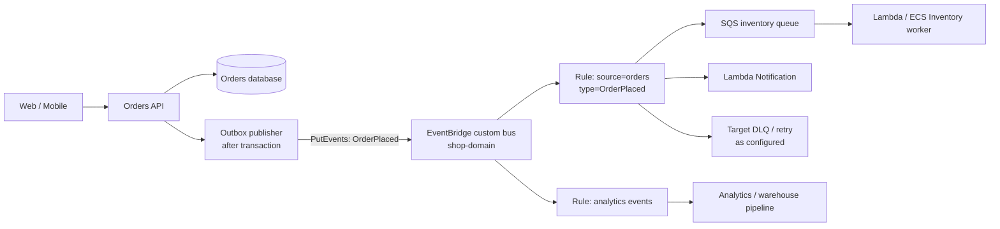
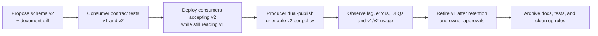
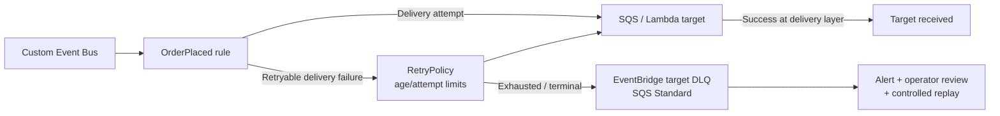
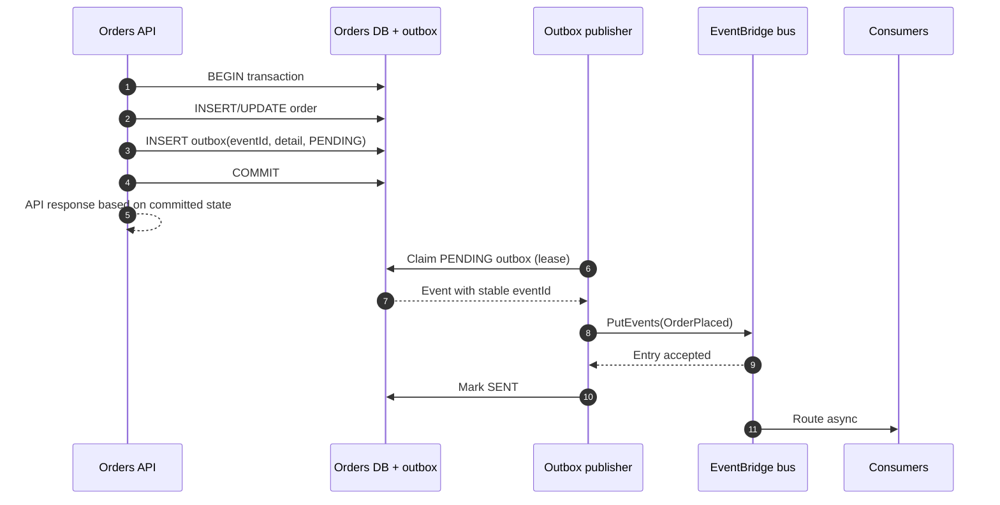
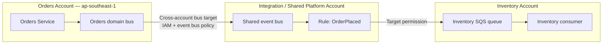
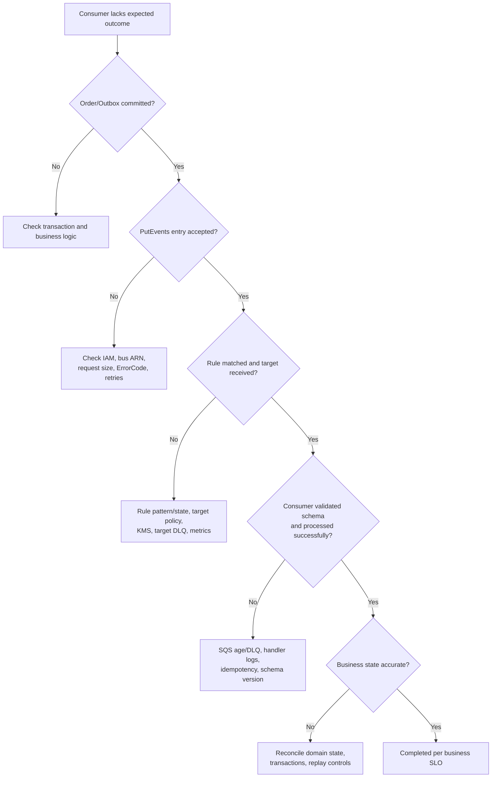

# Custom events and event data contracts on Amazon EventBridge

When a service finishes creating an order, updating inventory, or recording a payment, other components may need to know **what just happened**. One design approach is to call each API directly. Another approach is for the service to publish a **custom event** to **Amazon EventBridge**, allowing multiple consumers to independently subscribe and process events as needed. The second approach reduces direct coupling between services, but introduces a new responsibility: **events must have a clear name, meaning, structure, version, and compatibility commitment**.

This lesson belongs to the **Events and Orchestration** chapter, module **CLOUD_PROVIDERS_AWS**. Within the AWS ecosystem—from Region/AZ, IAM, VPC, EC2/ECS/Lambda, S3 storage, and databases, to integration, monitoring, and recovery—event design bridges backend systems and asynchronous flows. Learners will learn **when to emit a custom event, how to build a data contract (event contract), publish/route with EventBridge, handle schema evolution, and control failures, security, and cost**.

Running scenario: The Shop system has an **Orders Service** that emits the `OrderPlaced` event after creating an order. **Inventory**, **Notifications**, and **Analytics** all need to consume the same event, each with its own deployment schedule and requirements. A well-designed event contract allows adding consumers and evolving applications without unexpectedly breaking older parties.

## 1. Learning outcomes

After this lesson, learners will be able to:

1. Distinguish between **domain event**, **integration event**, **command**, **API request**, and **event notification**.
2. Explain the EventBridge event structure consisting of `source`, `detail-type`, and `detail`, along with envelope fields such as `id`, `time`, `region`, and `account`.
3. Design a contract with a **business event ID**, schema version, aggregate ID, tenant context, timestamp, correlation ID, and minimal payload.
4. Write a **JSON Schema** for a custom event, verify compatibility across versions, and distinguish backward/forward compatibility.
5. Send events via **PutEvents**, inspect per-entry errors, and create an EventBridge rule to route based on an event pattern.
6. Design idempotency, at-least-once delivery, retries, target DLQs, archive/replay, and a transactional outbox.
7. Manage schema registry/discovery, event security, auditing, observability, quotas, and total cost.
8. Build a suite of **contract tests** between producer/consumer and safely handle multi-team changes.

## 2. What is a custom event, and how does it differ from a command?

A **domain event** expresses something **that has already happened** in the business domain. When emitted to other systems over a bus, it becomes an **integration event** with a public contract between the producer and consumers.

| Message type | Meaning | Example | Relationship between parties |
|---|---|---|---|
| **Event** | A fact that has occurred | `OrderPlaced`, `PaymentCaptured` | Producer announces; consumers independently decide how to react |
| **Command** | Requests that an action should happen | `ReserveInventory`, `SendReceipt` | Has a relatively clear recipient/execution responsibility |
| **Synchronous API request** | Invokes functionality and waits for a response | `POST /orders` | Caller needs an immediate result |
| **Event notification** | Notifies that a change occurred, minimal data | `OrderChanged {orderId}` | Consumer may call an API to fetch current state |
| **Event-carried state transfer** | Sends state/data needed for consumer processing | `OrderPlaced` with items, currency, total | Reduces consumer callbacks to producer, but contract is larger |

**Naming principle:** prefer **past tense** with rich business semantics: `OrderPlaced`, `ShipmentDispatched`, `RefundApproved`. Avoid vague names like `DataUpdated` or imperative names like `SendEmail` disguised as events. An event is not a promise that all consumers have run successfully.

### 2.1. An event describes an immutable fact

Once an order is placed, the `OrderPlaced` event should not be mutated after publishing. If the state changes, emit a new event such as `OrderCancelled`, `OrderPaid`, or `OrderShipped`. Consumers may receive duplicates or delayed events; state transitions must be built on idempotent/ordering logic rather than assuming a single event stream represents the current state.

### 2.2. Why use custom events?

With three consumers:

- Orders Service does not have to call Inventory, Notifications, and Analytics inside the HTTP request.
- A failing consumer does not force the order-creation request to wait until that consumer recovers.
- Each team can develop its consumer independently as long as it adheres to the **event contract**.
- New rules/targets can be added without modifying producer source code, within approved governance boundaries.

However, the system must accept **eventual consistency**: when the Order API returns a response, email, inventory, and dashboards may not yet be updated. Business statuses, retries, reconciliation, and user error reporting are required.

## 3. Event-driven architecture with EventBridge

An **Amazon EventBridge event bus** receives events from AWS sources, SaaS partners, or custom applications. **Rules** evaluate event patterns and then route matching events to supported **targets** such as Lambda, SQS, Step Functions, or another event bus.



The diagram reflects separation of responsibilities, not a single transaction spanning EventBridge/SQS/database. For critical order data, a **transactional outbox** or a reliable change-stream publisher solves the risk of the database committing successfully while the producer crashes before calling `PutEvents`.

### 3.1. Four foundational components

| Component | Responsibility | Example |
|---|---|---|
| **Producer** | Emits events at the right time, adhering to contract and data consistency | Orders Service |
| **Event bus** | Receives and routes events | `shop-domain` |
| **Rule / pattern** | Selects events by envelope and detail fields | `source=["com.shop.orders"]`, `detail-type=["OrderPlaced"]` |
| **Target / consumer** | Executes tasks, validates schema and idempotency | Inventory SQS worker |

The producer **should not know** which rules route to which consumers. However, the producer still must have an owner, publishing policy, versioning, and observability so consumers can rely on the contract.

### 3.2. EventBridge is not an indefinite event store

An event bus routes events; it **does not automatically store every event forever** like a business database. EventBridge offers **archive and replay** when configured, but replay has its own scope, cost, and behavior; do not assume you can retrieve events from months ago if an archive was not created in advance.

If a consumer needs its own backlog and rate control, route events to an **SQS queue**. If ordering/re-reading with stream semantics is needed, consider **Kinesis, Kafka, DynamoDB Streams**, or another design. Choose tools based on retention, ordering, replay, and throughput—not just the word "event."

## 4. EventBridge event envelope: what data does AWS manage?

An event on EventBridge has this JSON shape:

```json
{
  "version": "0",
  "id": "d1a3b1c0-example-generated-id",
  "detail-type": "OrderPlaced",
  "source": "com.shop.orders",
  "account": "111122223333",
  "time": "2026-11-20T08:00:00Z",
  "region": "ap-southeast-1",
  "resources": [
    "arn:aws:dynamodb:ap-southeast-1:111122223333:table/Orders"
  ],
  "detail": {
    "schemaVersion": "1.0",
    "eventId": "evt-order-1001-created",
    "orderId": "ORD-1001",
    "occurredAt": "2026-11-20T07:59:59Z",
    "tenantId": "tenant-101",
    "currency": "VND",
    "totalMinorUnits": 125000
  }
}
```

This is an **illustrative event**, not real values returned by AWS. For example, the `id` field is actually generated by EventBridge, whereas `eventId` inside `detail` is the business event ID managed by the producer.

| Field | Who manages it? | Meaning and notes |
|---|---|---|
| `version` | EventBridge | Envelope version, currently typically `"0"`; **not the business schema version** |
| `id` | EventBridge | EventBridge event ID; does not replace the business event ID across publish/replay |
| `detail-type` | Chosen by producer on PutEvents | Event type name, usually the business event |
| `source` | Chosen by producer | Source namespace, e.g., `com.shop.orders` |
| `account` | AWS | Account where the event appears per the delivery model |
| `region` | AWS | Region of the event bus/event |
| `time` | Supplied by producer or populated by EventBridge API | Envelope timestamp; does not prove business commit time by itself |
| `resources` | Optional by producer | Related ARNs; be careful not to expose sensitive information |
| `detail` | Producer | **Contracted business payload** |

**Two "versions" to distinguish:** `version="0"` of the EventBridge envelope and `detail.schemaVersion="1.0"` of the business contract are two separate concepts. Do not rely on `version` to know whether the producer added or removed fields in `detail`.

### 4.1. Fields in a PutEvents entry

The producer sends a `PutEventsRequestEntry` containing:

| Input property | Requirement / meaning | Example |
|---|---|---|
| `Source` | Event source following application namespace | `com.shop.orders` |
| `DetailType` | Business event type | `OrderPlaced` |
| `Detail` | **Valid JSON string**, not a raw object passed directly in the SDK entry | `"{\"orderId\":\"ORD-1001\"}"` |
| `EventBusName` | Bus name/ARN, per config; if omitted, may go to default bus | `shop-domain` |
| `Time` | Optional event timestamp | UTC timestamp |
| `Resources` | Optional related resource ARNs | DynamoDB table ARN |
| `TraceHeader` | Propagates X-Ray trace context as supported | Tracing metadata, not authorization |

**Always set `EventBusName` explicitly** in production to avoid accidentally publishing to the default bus. Do not create custom sources starting with `aws.`; the `aws.*` namespace is reserved for events emitted by AWS services.

### 4.2. Which data belongs in the envelope vs. in `detail`?

Put information that **EventBridge rules need for general filtering** in `source`/`detail-type`; put business data in `detail`:

- `source`: stable producer application/domain name.
- `detail-type`: event name, e.g., `OrderPlaced`.
- `detail.schemaVersion`: contract schema version.
- `detail.orderId`, `tenantId`: entity context for consumer processing.
- `detail.traceId/correlationId`: non-secret observability information.
- `detail.eventId`: stable identifier for idempotency.

Do not dump an entire database table into `detail`. Data added to a contract becomes something consumers may depend on and may be persisted in archives, DLQs, and logs.

## 5. What is an event data contract (event contract)?

An **event contract** is more than a JSON sample. It is an agreement between producer and consumers covering **meaning, structure, data types, emission timing, compatibility, data policies, retry/ordering semantics, and ownership**.

A minimal contract must answer:

1. **Meaning:** At what step is `OrderPlaced` emitted? When the buyer clicks the button, or after the order creation transaction commits?
2. **Source:** Which service/team owns `source` and `detail-type`?
3. **Identity:** What are the business event ID, aggregate ID, and tenant ID? Are they stable across retries?
4. **Time:** What is `occurredAt`, and how does it differ from `publishedAt` and the envelope `time`?
5. **Schema:** Fields, types, required/optional, enums, formats, units, and nullability?
6. **Version:** Is a change backward-compatible or breaking? How are older consumers supported?
7. **Delivery:** At-least-once, duplication, ordering, retries, and retention?
8. **Security:** Which fields are PII or secrets, and is cross-account/cross-Region routing involved?
9. **Testing/monitoring:** Where is the contract tested, and who gets alerted on violations?
10. **Lifecycle:** Deprecation policy and transition window when external teams consume the event?

### 5.1. Example OrderPlaced v1 contract

| Attribute | Commitment |
|---|---|
| Contract ID | `com.shop.orders/OrderPlaced/1` |
| Producer owner | Orders Platform Team |
| Event bus | `shop-domain` in approved account/Region |
| Trigger | **After the order is persisted successfully**, not upon initial request receipt |
| `source` / `detail-type` | `com.shop.orders` / `OrderPlaced` |
| `schemaVersion` | `1.0` (string; version of detail) |
| Business event ID | Unique `eventId` for the business event, preserved across publish retries |
| Aggregate | `orderId` |
| Tenant | `tenantId` |
| Timestamp | `occurredAt` in ISO 8601 UTC |
| Money | `totalMinorUnits` as an integer in smallest currency unit and `currency` in ISO 4217 |
| Semantics | At-least-once delivery; consumers require idempotency, no global ordering assumed |
| Security | Must not contain raw payment cards, passwords, access tokens, or customer addresses |
| Deprecation | Announcement/dual-publish and transition period for breaking changes |

**Currency note:** `totalMinorUnits` is only useful when all systems agree on the currency's minor-unit rules. For example, VND typically uses dong as the smallest unit, while other currencies have different decimal places. Never emit `amount: 125.000` as a floating-point number and leave consumers to guess the unit.

### 5.2. A contract is an asynchronous API

Once consumers can deploy independently, **renaming a field in an event** carries the same risk as changing an HTTP API response. Therefore:

- Publish the schema and owner clearly.
- Review changes before deployment.
- Apply producer/consumer contract tests.
- Distinguish adding an optional field from changing the meaning of an existing field.
- Follow a deprecation and migration schedule instead of silently deleting fields.

## 6. Choosing data types and required fields

A stable event relies on small decisions that have big downstream impact:

| Field | Recommended choice | Why |
|---|---|---|
| `eventId` | Unique identifier string, stable across retries | Deduplicate independently of EventBridge envelope |
| `schemaVersion` | String `"1.0"` or integer with unified policy | Select the right version parser |
| `orderId` | Opaque string independent of DB length/format | Prevent consumers from parsing IDs |
| `occurredAt` | ISO 8601 UTC, e.g., `2026-11-20T08:00:00Z` | Avoid timezone drift |
| `tenantId` | Tenant string from a trusted source | Authorization and data partitioning |
| `currency` | ISO 4217 currency code | Interpret monetary amounts |
| `totalMinorUnits` | Integer (or string if exceeding safe numeric limits across languages) | Avoid floating-point rounding |
| `items` | Array of objects with explicit schema | Avoid positional anonymous arrays |
| `correlationId` | Tracing/business flow ID string | Link logs across services |
| `metadata` | Object with owner and schema/limits | Prevent an undefined data dumping ground |

### 6.1. Required and optional

**Required fields** must always be present per the contract, such as `eventId`, `orderId`, and `schemaVersion`. **Optional fields** may be omitted, and consumers must distinguish "absent" from "present with value `null`" if the schema specifies it.

New fields should be added as **optional** or with clear default semantics rather than forcing every existing consumer to upgrade immediately.

### 6.2. Open or closed enum?

If the contract states:

```json
{
  "orderChannel": "WEB"
}
```

A consumer should not silently crash when the producer adds `MOBILE_APP` if the contract declared the enum extensible. Two options must be decided upfront:

- **Closed enum:** fixed list of values; adding a new value can be a breaking change.
- **Open enum:** consumers must implement a branch for unknown values according to policy (store, ignore, alert, or explicit default).

The rule "adding a field/enum is always backward-compatible" is **false** if a consumer uses a strict deserializer or a mapping without defaults.

## 7. Defining the contract with JSON Schema

**JSON Schema** lets you describe data types, required fields, nested object structures, datetime formats, size limits, and valid values. A schema validates **structure**; it does not automatically guarantee that the event was emitted at the right business step or has valid tenant access.

### 7.1. JSON Schema for `OrderPlaced v1` `detail`

```json
{
  "$schema": "https://json-schema.org/draft/2020-12/schema",
  "$id": "https://schemas.example.com/orders/order-placed/v1.json",
  "title": "OrderPlaced v1",
  "description": "Order was committed successfully by Orders Service.",
  "type": "object",
  "required": [
    "schemaVersion",
    "eventId",
    "orderId",
    "tenantId",
    "occurredAt",
    "currency",
    "totalMinorUnits",
    "items"
  ],
  "properties": {
    "schemaVersion": {
      "type": "string",
      "const": "1.0"
    },
    "eventId": {
      "type": "string",
      "minLength": 1,
      "maxLength": 128
    },
    "orderId": {
      "type": "string",
      "minLength": 1,
      "maxLength": 128
    },
    "tenantId": {
      "type": "string",
      "minLength": 1,
      "maxLength": 128
    },
    "occurredAt": {
      "type": "string",
      "format": "date-time"
    },
    "currency": {
      "type": "string",
      "pattern": "^[A-Z]{3}$"
    },
    "totalMinorUnits": {
      "type": "integer",
      "minimum": 0
    },
    "items": {
      "type": "array",
      "minItems": 1,
      "maxItems": 500,
      "items": {
        "type": "object",
        "required": ["productId", "quantity", "unitPriceMinorUnits"],
        "properties": {
          "productId": {
            "type": "string",
            "minLength": 1
          },
          "quantity": {
            "type": "integer",
            "minimum": 1
          },
          "unitPriceMinorUnits": {
            "type": "integer",
            "minimum": 0
          }
        },
        "additionalProperties": true
      }
    },
    "correlationId": {
      "type": "string",
      "maxLength": 128
    },
    "promotionCode": {
      "type": "string",
      "maxLength": 64
    }
  },
  "additionalProperties": true
}
```

**Academic and implementation notes:**

- The schema above uses **JSON Schema draft 2020-12** as an example validator in producer/consumer code. **EventBridge Schemas Registry uses its own dialect/representation per feature**, so do not assume every 2020-12 keyword can be loaded directly into the registry without conversion/support testing.
- `required` lists fields that **must appear**, not the list of permitted fields.
- `additionalProperties: true` allows extra fields that tolerant consumers can ignore; that is an **intentional compatibility choice**, not permission for unmanaged schema drift.
- `format: "date-time"` may require enabling **format assertion** or a plugin depending on the validator; do not just add the keyword and assume all validators enforce it strictly.
- Schema does not verify arithmetic such as `totalMinorUnits` = sum of line items, or whether the currency matches the merchant; separate business validation is needed.
- Never include secrets or payment card fields in a schema just because it is "convenient to pass along."

### 7.2. Valid payload per schema

```json
{
  "schemaVersion": "1.0",
  "eventId": "evt-order-1001-placed",
  "orderId": "ORD-1001",
  "tenantId": "tenant-101",
  "occurredAt": "2026-11-20T08:00:00Z",
  "currency": "VND",
  "totalMinorUnits": 125000,
  "items": [
    {
      "productId": "SKU-100",
      "quantity": 2,
      "unitPriceMinorUnits": 62500
    }
  ],
  "correlationId": "req-checkout-456"
}
```

This payload is valid in **structure** and illustrative amounts, but to publish reliably, the producer must still read data from a committed transaction and preserve a stable `eventId` across retries.

### 7.3. Invalid payload that should be blocked

```json
{
  "schemaVersion": "1.0",
  "eventId": "evt-invalid",
  "orderId": "ORD-1002",
  "tenantId": "tenant-101",
  "occurredAt": "yesterday",
  "currency": "VND",
  "totalMinorUnits": "125000",
  "items": []
}
```

Errors: `totalMinorUnits` is a **string** instead of an integer; `items` is empty; `occurredAt` is not a valid ISO 8601 timestamp. With a validator that enforces format assertions, the timestamp error is caught as well.

### 7.4. Where must schemas be enforced?

| Checkpoint | Goal | Behavior when invalid |
|---|---|---|
| **Producer before publish** | Prevent non-conforming events from reaching the bus | Log error cleanly, do not publish; keep in outbox for remediation |
| **CI producer contract test** | Catch breaking changes before release | Block merge/deploy |
| **Consumer on receipt** | Protect handlers from corrupted/unsupported data | Quarantine/DLQ or discard per clear policy |
| **CI consumer contract tests** | Ensure consumers handle versions and unknown fields | Block regression |
| **Schema registry/governance** | Catalog schemas/ownership/versions and aid discoverability | Review and manage lifecycle |

**An EventBridge rule filtering by pattern does not automatically enforce JSON Schema on every event.** A rule matching `source` and `detail-type` will still forward a `detail` missing required fields; schema validation must be built into the producer, consumer, or an appropriate validation layer.

## 8. Schema evolution: backward, forward, and breaking changes

In event-driven architecture, producers and consumers rarely deploy **simultaneously**. You need to know whether an old consumer can read new events, and whether a new consumer can read older events still sitting in SQS/archives.

### 8.1. Reader-focused definitions

| Compatibility | Question to ask | Example |
|---|---|---|
| **Backward compatibility** | Can a **new consumer** read events from an **old producer**? | Consumer v2 accepts v1 events still in the queue |
| **Forward compatibility** | Can an **old consumer** read events from a **new producer**? | Consumer v1 ignores the optional field `promotionCode` |
| **Full compatibility** | Both directions are supported | Both accept v1/v2 schemas per policy |
| **Breaking change** | One side cannot read/understand data from the other | Changing `totalMinorUnits` to string, removing `orderId` |

These concepts may be framed as writer/reader in specific schema registries. **In this lesson, the ultimate criterion is actual consumer behavior**, including business logic rather than JSON validity alone.

### 8.2. Common change matrix

| Producer change | Risk to old consumers | Recommendation |
|---|---|---|
| Add new **optional** field | Low with tolerant parsers, high if strict | Contract test with old consumers |
| Add new **required** field | New consumers fail on old events; strict old consumers may also fail | Avoid or support defaults/migration |
| Remove required field | High | Create a major version or dual-publish |
| Rename field | High | Add new field, keep old one during transition |
| Change type integer → string | High | New version and mapping |
| Change field meaning keeping the same name | **Very high**, hard for JSON Schema to catch | Treat as breaking and change contract |
| Add enum value | Depends on whether consumers have fallback logic | Declare open enum upfront or version it |
| Add nested optional object | Depends on parser | Preserve old shape and test |
| Change unit from dong to cents or seconds to ms | Very high | Use a new field with explicit unit name |
| Reorder JSON fields | Usually harmless under standard JSON | Never write consumers that rely on key order |
| Add an EventBridge target | Does not change producer contract | Check downstream capacity, permissions, and DLQ |

**Distinguish structural compatibility from semantic compatibility:** two events may both pass JSON Schema yet mean different things. For instance, v1 emits `OrderPlaced` after transaction commit, while v2 emits it before payment finishes: that is a **business contract-breaking change**, even if field names and types are unchanged.

### 8.3. Example of conditionally compatible field addition

Producer v1:

```json
{
  "schemaVersion": "1.0",
  "orderId": "ORD-1001",
  "currency": "VND",
  "totalMinorUnits": 125000
}
```

Producer v1.1:

```json
{
  "schemaVersion": "1.1",
  "orderId": "ORD-1001",
  "currency": "VND",
  "totalMinorUnits": 125000,
  "promotionCode": "WELCOME10"
}
```

The example above is **abbreviated to focus on evolution**, not the full `OrderPlaced v1` payload from section 7. Old consumers depending only on the three main fields and **ignoring unknown fields** can continue running. New consumers must accept the absence of `promotionCode` in v1 events sitting in queues/archives.

### 8.4. Example of a breaking change that must not be emitted silently

```json
{
  "schemaVersion": "2.0",
  "orderId": "ORD-1001",
  "currency": "VND",
  "totalAmount": "125000.00"
}
```

Here `totalMinorUnits` has disappeared and been replaced with a string `totalAmount` whose meaning/unit is ambiguous. A v1 consumer summing totals or recording ledgers may crash—or worse, **miscalculate money**. Publish a new version and migrate consumers safely rather than changing `schemaVersion` and hoping systems figure it out.

## 9. Versioning strategies and release coordination

There are several ways to structure versions:

| Strategy | Example | Trade-off |
|---|---|---|
| Version in `detail.schemaVersion` | `OrderPlaced + 1.0` | Fewer rule changes; consumers must inspect version |
| Major version in `detail-type` | `OrderPlacedV2` | Easy to separate rules/targets; changes event type name |
| Version in `source` | `com.shop.orders.v2` | Changes namespace; more rules/configuration |
| Version in schema registry ID | Contract/catalog version | Must synchronize runtime metadata and CI |

No single rule fits every organization. A practical policy:

1. Keep `source` stable per bounded context.
2. Use meaningful event names and prefer keeping `detail-type` across compatible changes.
3. Store `schemaVersion` in `detail` and define major/minor semantics clearly.
4. For breaking changes, **dual-publish** or use a new `detail-type`/bus according to a migration plan.
5. Set a deprecation window aligned with SQS/archive retention and consumer deployment schedules.

### 9.1. Safe schema v2 rollout plan



**Specifically for dual-publishing:** prevent two versions of **the same business event** from accidentally triggering **duplicate side effects**. Consumers or rules must select a version; a consumer subscribing to both v1 and v2 must deduplicate by the agreed **business event ID**.

### 9.2. Schema version is not event sequence

`schemaVersion="2.0"` only describes **contract shape**, not the 2nd event of an order. If changes must be processed in order, the producer can include `aggregateVersion=3` or `sequence=3` that increments monotonically per aggregate. However, standard EventBridge routing does not promise global order; consumers must verify versions, buffer/compensate, or choose FIFO/streams when ordering is a strict requirement.

### 9.3. Contracts with deprecated status

A minimal contract catalog entry should look like:

```yaml
contractId: com.shop.orders/OrderPlaced/1
producer: orders-service
source: com.shop.orders
detailType: OrderPlaced
schemaVersion: "1.0"
ownerTeam: orders-platform
status: active
deprecation:
  announcedAt: null
  sunsetAt: null
delivery:
  semantics: at-least-once
  ordering: not-guaranteed
  duplicateKey: detail.eventId
security:
  classification: internal
```

This YAML is an **illustrative metadata example in the lesson**, not a lesson info file. Workers should not create extra metadata files; teams should keep this catalog in an owner-managed contract/IaC repository.

## 10. Publishing custom events with EventBridge PutEvents

First, you need a **custom event bus** and an IAM role for the producer. The **PutEvents** API allows sending multiple entries in one request (up to **10 entries per call**), and each entry can succeed or fail independently.

**Important:** HTTP 200 from `PutEvents` **does not mean every entry succeeded**. You must inspect `FailedEntryCount` and each element of `Entries`. When retrying failed entries, **keep the same business `eventId`**—never generate a new business event.

### 10.1. Create a custom event bus in sandbox

```bash
aws events create-event-bus \
  --name shop-domain \
  --region ap-southeast-1

aws events describe-event-bus \
  --name shop-domain \
  --region ap-southeast-1
```

These commands modify AWS resources; only run them in a lab account with approved permissions and budget. If the bus already exists, use `describe-event-bus` to confirm its ARN, account/Region, and policy instead of creating a duplicate.

### 10.2. Create a PutEvents CLI payload

Save the following into a **learner test file** `put-order-event.json`:

```json
{
  "Entries": [
    {
      "Source": "com.shop.orders",
      "DetailType": "OrderPlaced",
      "EventBusName": "shop-domain",
      "Detail": "{\"schemaVersion\":\"1.0\",\"eventId\":\"evt-order-1001-placed\",\"orderId\":\"ORD-1001\",\"tenantId\":\"tenant-101\",\"occurredAt\":\"2026-11-20T08:00:00Z\",\"currency\":\"VND\",\"totalMinorUnits\":125000,\"items\":[{\"productId\":\"SKU-100\",\"quantity\":2,\"unitPriceMinorUnits\":62500}],\"correlationId\":\"req-checkout-456\"}"
    }
  ]
}
```

**Explanation:** `Entries[0].Detail` is a **string containing serialized JSON**, so inner quotes must be escaped inside the request JSON. A common mistake is passing `Detail` as a direct JSON object when the SDK/API expects a string, causing a validation error.

Invoke:

```bash
aws events put-events \
  --cli-input-json file://put-order-event.json \
  --region ap-southeast-1
```

Illustrative success response:

```json
{
  "FailedEntryCount": 0,
  "Entries": [
    {
      "EventId": "11111111-2222-3333-4444-555555555555"
    }
  ]
}
```

`EventId` here is the **ingestion ID returned by EventBridge**, not the business `detail.eventId`. If the producer retries the same event after a network drop, EventBridge may accept another copy; consumers must not rely solely on the new EventId as the business deduplication key.

### 10.3. When some entries fail

The response may look like:

```json
{
  "FailedEntryCount": 1,
  "Entries": [
    {
      "EventId": "11111111-2222-3333-4444-555555555555"
    },
    {
      "ErrorCode": "InternalFailure",
      "ErrorMessage": "Example transient failure"
    }
  ]
}
```

The order of `Entries` in the response corresponds to **entry positions in the request**. The producer must retry **only the entries with retriable errors**, not blindly resend an entire partially successful batch. For invalid event/schema/permission errors, fix the root cause instead of retrying indefinitely.

### 10.4. Python boto3 producer example

```python
import json
import random
import time

import boto3

events = boto3.client("events", region_name="ap-southeast-1")


def publish_order_placed(order):
    # eventId must be the ID stored with the event/outbox,
    # DO NOT generate a new UUID on each retry.
    event = {
        "schemaVersion": "1.0",
        "eventId": order["eventId"],
        "orderId": order["orderId"],
        "tenantId": order["tenantId"],
        "occurredAt": order["occurredAt"],
        "currency": order["currency"],
        "totalMinorUnits": order["totalMinorUnits"],
        "items": order["items"],
    }
    if order.get("correlationId"):
        event["correlationId"] = order["correlationId"]
    request_entry = {
        "Source": "com.shop.orders",
        "DetailType": "OrderPlaced",
        "EventBusName": "shop-domain",
        "Detail": json.dumps(event, separators=(",", ":")),
    }

    for attempt in range(4):
        response = events.put_events(Entries=[request_entry])
        if response.get("FailedEntryCount", 0) == 0:
            return response["Entries"][0]["EventId"]

        result = response["Entries"][0]
        code = result.get("ErrorCode", "Unknown")
        if code not in {"InternalFailure", "ThrottlingException"}:
            raise RuntimeError(f"Non-retryable PutEvents entry error: {code}")

        if attempt == 3:
            raise RuntimeError(f"Event publish still failed: {code}")
        time.sleep(min(2 ** attempt, 8) + random.random() / 2)

    raise AssertionError("unreachable")
```

This code illustrates checking `FailedEntryCount` and per-entry errors; it reads `eventId` and `occurredAt` from the original record so they **stay unchanged across retries**, and includes the optional `correlationId` only when present. Production also needs: JSON Schema validation before publishing, retrying **appropriate AWS SDK/API transport errors**, redacted logs, circuit breakers, outbox state, and metrics.

### 10.5. Size and quotas

PutEvents has limits on entries per request, size per event/batch, and throughput/quotas by Region/account. AWS has expanded size limits for some APIs/features over time; **do not put large files or binary data into `detail`**. Store objects in **S3**, send only `bucket/key/version/checksum` with proper read permissions, and check current **EventBridge quotas** before estimating capacity.

## 11. Routing with EventBridge rules and event patterns

When the producer sends `OrderPlaced` to `shop-domain`, a rule can filter specifically for Shop events:

```json
{
  "source": ["com.shop.orders"],
  "detail-type": ["OrderPlaced"],
  "detail": {
    "schemaVersion": ["1.0"]
  }
}
```

**Event patterns use exact field names and data types.** `detail-type` is hyphenated, unlike `DetailType` in the PutEvents SDK. `schemaVersion` in the pattern is a property of `detail`, not the envelope `version`. EventBridge supports comparison operators such as prefix, suffix, anything-but, numeric, and exists depending on value type; do not use vague wildcards when equality suffices.

**Note on version upgrades:** this rule only accepts `schemaVersion="1.0"`. When the producer moves to `1.1`, you must **update the pattern beforehand** (for example allowing both `"1.0"` and `"1.1"`), or intentionally omit version filtering in the rule so consumers route by contract. If you forget to update it, new events may be accepted by EventBridge yet **never reach consumers**, even though the JSON is valid.

### 11.1. Create a rule

Assuming the pattern is saved in lab file `order-placed-pattern.json`:

```bash
aws events put-rule \
  --name order-placed-to-inventory \
  --event-bus-name shop-domain \
  --event-pattern file://order-placed-pattern.json \
  --state ENABLED \
  --region ap-southeast-1
```

A rule specifies **which events are selected**. To have an actual consumer, you must also **attach a target** and grant EventBridge permissions to invoke that target.

### 11.2. Route events to SQS

```bash
aws events put-targets \
  --rule order-placed-to-inventory \
  --event-bus-name shop-domain \
  --targets "Id=inventory-queue,Arn=arn:aws:sqs:ap-southeast-1:111122223333:inventory-orders" \
  --region ap-southeast-1
```

**Permission note:** EventBridge needs permission via the **SQS queue resource policy** to call `sqs:SendMessage` from the matching rule ARN. Running `put-targets` without queue permission means events will not be delivered. For KMS-encrypted queues, configure corresponding KMS permissions; when routing through cross-account buses, trust/resource policies require extra care.

### 11.3. Sample queue policy for a rule

```json
{
  "Version": "2012-10-17",
  "Statement": [
    {
      "Sid": "AllowEventBridgeRuleToSend",
      "Effect": "Allow",
      "Principal": {
        "Service": "events.amazonaws.com"
      },
      "Action": "sqs:SendMessage",
      "Resource": "arn:aws:sqs:ap-southeast-1:111122223333:inventory-orders",
      "Condition": {
        "ArnEquals": {
          "aws:SourceArn": "arn:aws:events:ap-southeast-1:111122223333:rule/shop-domain/order-placed-to-inventory"
        }
      }
    }
  ]
}
```

The policy above is only a **sample statement**; when applying it, **merge with the existing queue policy** to avoid deleting other valid permissions, and verify the exact rule ARN (`bus-name/rule-name`), SQS queue ARN, and KMS key policy. Never grant `Principal: "*"` or open the whole account just to "make it work."

### 11.4. Test an event pattern without sending a real event

In the lab, create `sample-order-placed.json` containing the **full event envelope** from section 4 and run:

```bash
aws events test-event-pattern \
  --event-pattern file://order-placed-pattern.json \
  --event file://sample-order-placed.json \
  --region ap-southeast-1
```

The command returns a boolean match when valid, catching wrong casing or field names. However, **`test-event-pattern` does not verify target permissions or whether the business handler succeeds**; add integration/end-to-end tests.

### 11.5. Can one rule serve multiple targets?

An EventBridge rule can have multiple targets within current limits, yet sharing retries/monitoring across all consumers is not always ideal. For critical systems:

- Prefer one target SQS queue per independent consumer that needs its own backlog/ownership.
- Give each target its own permissions, retry policy, and DLQ where supported.
- Never route the same event twice to a consumer with non-idempotent side effects.
- If branching on business outcomes and multi-step timeouts/compensation are needed, consider **AWS Step Functions** or workflow orchestration instead of turning EventBridge rules into a state machine.

## 12. Consumer processing: contract validation, idempotency, and business state

A well-built consumer does more than parse JSON. It must:

1. Verify the event has the expected `source`/`detail-type` and a **supported schema version**.
2. Validate required fields, types, and necessary business invariants.
3. Deduplicate using the **business `detail.eventId`** or an equivalent mechanism.
4. Execute side effects safely against retries/crashes.
5. Record outcomes, metrics, and correlation IDs without logging sensitive data.
6. Separate **transient errors** from **permanent errors** to avoid infinite retries.

### 12.1. Distinguish the event envelope from the SQS message wrapper

When EventBridge delivers an event to an SQS target without an Input Transformer, the **SQS message body** is typically the **entire EventBridge event JSON**. A Lambda SQS event source mapping receives a batch of SQS records:

```text
Lambda event
└── Records[]
    └── record
        ├── messageId              <-- SQS transport ID
        ├── receiptHandle
        ├── attributes
        └── body                   <-- JSON string of the EventBridge event
            ├── id                 <-- EventBridge event ID
            ├── source
            ├── detail-type
            └── detail
                ├── eventId        <-- business event ID for idempotency
                └── orderId
```

Do not confuse `record.messageId` with `event.id` or `event.detail.eventId`. All three IDs play **different roles**. If the same business event is republished after a transport failure, `messageId` and EventBridge `id` may change, whereas `detail.eventId` should stay the same.

### 12.2. Python handler for SQS partial batch failures

The following example shows how to read the event, block contract violations, and return failed message IDs so ESM retries only unsuccessful records:

```python
import json
import logging

logger = logging.getLogger()
logger.setLevel(logging.INFO)

SUPPORTED_VERSIONS = {"1.0", "1.1"}


def process_order_placed_once(detail):
    # Pseudocode: use a DB conditional write/inbox table to claim eventId,
    # process in the same transaction or use a downstream idempotency key.
    # This function must be implemented in the Inventory service.
    raise NotImplementedError("Implement transactional/idempotent processing")


def lambda_handler(event, context):
    failures = []
    for record in event.get("Records", []):
        message_id = record["messageId"]
        try:
            envelope = json.loads(record["body"])
            if envelope.get("source") != "com.shop.orders":
                raise ValueError("Unexpected producer")
            if envelope.get("detail-type") != "OrderPlaced":
                raise ValueError("Unexpected event type")

            detail = envelope["detail"]
            if detail["schemaVersion"] not in SUPPORTED_VERSIONS:
                raise ValueError("Unsupported schema version")
            if not detail.get("eventId") or not detail.get("orderId"):
                raise ValueError("Missing required business fields")

            # Production: validate with full JSON Schema as well.
            process_order_placed_once(detail)
            logger.info(
                "Processed eventId=%s orderId=%s",
                detail["eventId"],
                detail["orderId"],
            )
        except Exception:
            logger.exception("Failed SQS messageId=%s", message_id)
            failures.append({"itemIdentifier": message_id})

    return {"batchItemFailures": failures}
```

**This is a skeleton where `process_order_placed_once` must be implemented before running**; it intentionally performs no real side effects. Copying this code directly into Lambda will fail every valid message with `NotImplementedError`. Production requires JSON Schema validation, permanent failure classification, structured logs/redaction, an idempotency store, and downstream retry/backoff. Also enable `ReportBatchItemFailures` on the SQS event source mapping; returning the JSON response without configuring the mapping is not enough.

### 12.3. How to handle an unsupported event version?

| Case | Approach |
|---|---|
| New version announced, but consumer not yet deployed | Hold in DLQ/quarantine, alert owner, and schedule upgrade |
| Version malformed, fixable at producer | Log validation failure, stop blind retries, perform corrective publish/replay |
| Unknown optional field on compatible version | Ignore per tolerant reader contract |
| Missing required field | Reject/quarantine; do not guess missing data |
| Event from another domain misrouted | Check rule/target config, log security/contract violation |

With SQS, "quarantining" usually requires a queue/DLQ and an authorized worker/replayer; **returning success** on a poison message makes ESM delete the source message, so only do that after intentionally persisting a record or moving the payload elsewhere **successfully**.

## 13. Delivery semantics: at-least-once, not exactly-once

With EventBridge rules, targets, SQS, and Lambda, design under the assumption that **events/messages can be delivered at least once and may be duplicated**. Duplicates can happen due to lost ACK responses, producer retries, target retries, or archive replays.

### 13.1. Four IDs and how to use them

| ID | Who assigns it? | Can it change on retry/replay? | Role |
|---|---|---|---|
| `orderId` | Orders domain | Usually stays constant | Aggregate identifier |
| `detail.eventId` | Producer/outbox | **Must stay constant when retrying the same business event** | Business event deduplication |
| `event.id` | EventBridge | May differ across publishes/replays | Trace a specific EventBridge delivery |
| `SQS messageId` | SQS | May differ when a new message is created | Trace transport message |

One `orderId` can have multiple valid events: `OrderPlaced`, `OrderPaid`, `OrderCancelled`. Therefore, deduplicating solely by `orderId` can **drop subsequent events**. The key can be a unique `eventId`, or a tuple `aggregateId + eventType + aggregateVersion` if specified by the domain contract.

### 13.2. Designing an Inbox table to prevent duplicates

A consumer writing into a database can use a table such as:

```sql
CREATE TABLE processed_events (
    consumer_name VARCHAR(100) NOT NULL,
    event_id VARCHAR(128) NOT NULL,
    processed_at TIMESTAMPTZ NOT NULL DEFAULT NOW(),
    PRIMARY KEY (consumer_name, event_id)
);
```

When side effects live in the **same database transaction**, the consumer can insert into `processed_events` and update business state atomically:

```sql
BEGIN;

-- Pseudocode: only one worker can INSERT the same key given a unique PK.
INSERT INTO processed_events (consumer_name, event_id)
VALUES ('inventory-projection', :eventId);

UPDATE inventory_projection
SET reserved_units = reserved_units + :quantity
WHERE product_id = :productId;

COMMIT;
```

**Important:** application code must handle unique-key/dedup errors and transaction rollbacks. If the `processed_events` row already exists, the consumer treats it as a duplicate and **does not repeat the side effect**. If the inventory update fails, the transaction must roll back the processed-event row as well.

When side effects happen in **external systems** (sending emails, calling a payment gateway), a local DB transaction cannot make everything atomic. You need downstream idempotency keys, workflow state, outbox/inbox, or appropriate compensation mechanisms.

### 13.3. Deduplication keys and retention duration

- Retain `eventId` at least as long as duplicates/replays can occur in business terms—often longer than SQS retention.
- With DynamoDB, you can use **conditional puts** and TTL, ensuring TTL does not expire records while valid duplicates can still arrive.
- Use `IN_PROGRESS`/`COMPLETED` idempotency states when processing can be long-running or crash, with leases/recovery.
- Never save `"COMPLETED"` before the side effect is truly guaranteed, otherwise a crash drops the work.

### 13.4. No global ordering

An EventBridge event bus is not a globally ordered log sorted by `occurredAt`. A consumer may receive:

```text
Actual order in Orders DB:
  OrderPlaced (aggregateVersion=1)
  OrderPaid   (aggregateVersion=2)
  OrderShipped(aggregateVersion=3)

Delivery order at targets:
  OrderPaid   (2)
  OrderPlaced (1)
  OrderShipped(3)
```

If strict ordering is required, consider:

1. Attaching a monotonically increasing `aggregateVersion` and checking the expected version in consumers.
2. Using SQS FIFO with `MessageGroupId=orderId` for an appropriate consumer flow.
3. Using Kinesis/Kafka with partition keys, checkpoints, and retention semantics.
4. Designing a state machine that ignores stale events or buffers/retries missing versions.

**SQS FIFO only preserves order per message group under corresponding delivery/processing conditions**; it cannot restore order if the producer already enqueued messages out of order. An EventBridge → SQS FIFO pipeline must also verify that **ordering is preserved across every step**, not assume it merely because the destination is FIFO.

## 14. Retries, target DLQs, and failure classification in EventBridge

**EventBridge rule target retry** happens when **EventBridge fails to deliver the event to the target**. This differs from a Lambda consumer receiving the event and throwing an error in handler code, or an SQS worker failing while processing a message.

### 14.1. Three failure layers to separate

| Layer | Example | Where retries and failures are configured/stored |
|---|---|---|
| **Producer → EventBridge bus** | `PutEvents` throttling, entry error, network timeout | SDK retry/outbox publisher, `FailedEntryCount` |
| **EventBridge rule → target** | Missing target permission, target API throttling | EventBridge target `RetryPolicy` and target DLQ |
| **Target consumer business logic** | Lambda exception, SQS worker DB timeout | Lambda async retry/destination, SQS visibility/redrive DLQ, consumer state |

For example, if EventBridge successfully delivers an event to SQS and the Inventory worker fails later: **the EventBridge rule target has finished its job**. EventBridge **will not retry sending the event to SQS** because the worker failed; retries belong to the SQS/Lambda consumer.

### 14.2. Rule target retry policy

Targets support `RetryPolicy` with:

- `MaximumRetryAttempts`: limit on EventBridge retry attempts when delivery fails, within service limits.
- `MaximumEventAgeInSeconds`: maximum time EventBridge keeps attempting delivery.

By default, EventBridge can retry for up to **24 hours**, with **185 retry attempts** per service documentation. This is not a guarantee that events always arrive within 24 hours, as non-retriable errors or target policies can fail delivery sooner. Once attempts or age are exhausted, the event can be dropped if no DLQ is configured.

### 14.3. DLQ on a rule target

EventBridge can send undeliverable events to an **Amazon SQS standard queue** configured as the rule target DLQ. The DLQ must grant permissions to EventBridge and meet service limits (including Region/cross-account requirements per scenario).



If the target is an **SQS queue for Inventory**, there are two distinct DLQs:

1. **EventBridge target DLQ**: receives events EventBridge **could not send to the Inventory queue**.
2. **Inventory SQS queue DLQ**: receives messages **that entered the queue** but repeatedly failed in the worker and were redriven.

These two DLQs have **separate owners, metrics, and runbooks**. Never lump all failures into one queue and lose visibility into which layer failed.

### 14.4. A DLQ does not fix errors by itself

A well-configured DLQ needs:

- Clear naming/ownership, restricted read/write policies, encryption, and proper retention.
- Alarms when messages arrive and as oldest age grows.
- Preserved failure reason metadata for diagnosis per service capabilities.
- A runbook to identify IAM errors, deleted resources, event format bugs, quotas, or downstream outages.
- A replay procedure with idempotency, rate limits, and evaluation of prior side effects.

Never auto-replay an entire DLQ every minute while the root cause persists; it causes **retry storms** and extra costs.

### 14.5. EventBridge and Lambda asynchronous invocation

EventBridge invokes Lambda targets via AWS service integration, and Lambda has an **asynchronous event processing** model depending on the trigger/integration type. Thus **two retry layers** can exist: EventBridge retrying if delivery to the Lambda service fails, and Lambda retrying if the handler throws an error after accepting the event. Inspect metrics and configure the right layer rather than reading retry counts from a single screen.

## 15. Transactional outbox: never losing events after database commit

Classic problem:

```text
1. Orders API INSERTs order successfully.
2. Database COMMITs.
3. Process crashes before PutEvents.
4. Order exists, yet Inventory never receives OrderPlaced.
```

If you reverse the order and publish before committing, you may emit an event for **an order that never existed** if the transaction rolls back. **Two operations across two different systems are not automatically atomic.**

### 15.1. Outbox pattern

Within the same database transaction:

1. Write/commit the order record.
2. Write an **outbox record** containing `eventId`, `schemaVersion`, event payload, and `PENDING` status.
3. After commit, a publisher/CDC worker reads the outbox.
4. Call `PutEvents` and check `FailedEntryCount`.
5. Mark the outbox record `SENT` once AWS confirms acceptance.



### 15.2. Illustrative SQL outbox table

```sql
CREATE TABLE event_outbox (
    event_id VARCHAR(128) PRIMARY KEY,
    aggregate_id VARCHAR(128) NOT NULL,
    event_type VARCHAR(100) NOT NULL,
    schema_version VARCHAR(20) NOT NULL,
    payload_json JSONB NOT NULL,
    status VARCHAR(20) NOT NULL DEFAULT 'PENDING',
    attempts INTEGER NOT NULL DEFAULT 0,
    created_at TIMESTAMPTZ NOT NULL DEFAULT NOW(),
    published_at TIMESTAMPTZ
);
```

The SQL uses PostgreSQL `JSONB` for illustration and does not apply verbatim to DynamoDB. With DynamoDB, you can use **`TransactWriteItems`** for order and outbox items within supported limits, or **DynamoDB Streams** to detect database changes and publish with idempotency.

### 15.3. Outbox does not produce exactly-once

The publisher may:

1. Call EventBridge and **get accepted**.
2. Crash before updating the outbox to `SENT`.
3. On restart, read the `PENDING` record again and republish.

This is **at-least-once publishing**. It is far better than **losing events**, yet consumers must still be idempotent on `eventId`. Achieving an exactly-once business outcome requires transactional/inbox/downstream idempotency design—not flipping an EventBridge switch.

### 15.4. Managing publisher concurrency

- Use atomic leases/claims or row locking when multiple publishers read the outbox.
- Retry failed entries with backoff and age limits; never generate a new `eventId`.
- Distinguish permission/configuration errors from throttling/system errors.
- Track `outbox_pending_count`, `oldest_pending_age`, and `publish_error_rate`.
- On prolonged failures, keep records, alert, and allow recovery; never delete `PENDING` rows because they are "too old."
- When dual-publishing v1/v2, track publish status **per version/destination** instead of lumping them into one `SENT` flag.

## 16. Archive, replay, and recovery

An **EventBridge archive** can store events matching filter criteria from an event bus; **replay** resends archived events within supported limits. This is useful when a consumer had a bug or a projection must be rebuilt, though it does not replace database backups, outboxes, or business sources of truth.

### 16.1. When is archive/replay useful?

| Need | Why is archive/replay helpful? | Prerequisites |
|---|---|---|
| New consumer needs historical data | Re-reads events in the retained window | Archive enabled beforehand, event matches filter |
| Consumer broken for a week | Replays after fix | Retention long enough, quota/target capacity checked |
| Rebuild analytics projection | Re-emits event source | Consumer idempotent or projection safely reset |
| Incident audit | Cross-checks what was emitted | Governance, access controls, retention |
| Recovering business state | **Not necessarily sufficient** | Event log must be complete and properly ordered/semantic, or use DB snapshots |

### 16.2. Important limitations

- An archive does not exist retroactively before creation. Events older than when the archive was enabled are not stored.
- Archives have filters/retention and incur cost; they are not a complete event-sourcing store by default.
- Replay can cause **rules/targets to run again**, creating duplicate side effects if consumers are not idempotent.
- Replayed events may be processed in a different order/timing than the live stream; **do not rely on replay to restore global ordering**.
- Restrict who can trigger replays and monitor cost/volume.

### 16.3. Safe replay procedure

1. Identify the incident, affected contract versions, and exact time window to replay.
2. Confirm consumers are fixed and support idempotency.
3. Inspect DLQ/SQS/outbox state to avoid unintentionally replaying the same content twice.
4. Scope rules/targets, isolating test consumers if needed.
5. Test replay on a small slice or sandbox first.
6. Monitor request rates, downstream quotas, DLQs, event lag, and business outcomes.
7. Reconcile results against the source of truth (orders database) and create an audit record.

**A replay can be a state-mutating action**, not mere "log reading." If consumers execute side effects such as sending emails, awarding points, or deducting inventory, enforce approvals and compensation plans.

## 17. EventBridge Schemas Registry and schema discovery

**EventBridge Schemas** provides a catalog for event schemas, including inferring structures for certain events via **schema discovery**, managing registries, and generating **code bindings** in supported languages. It helps teams find contracts and generate types, yet **does not replace semantic/compatibility definitions and governance**.

### 17.1. Two approaches to schema management

| Approach | How it works | Pros / cons |
|---|---|---|
| **Code-first / contract-first** | Teams maintain schemas in a repo, review PRs, publish to registry | Clear ownership, review, tests, and versioning |
| **Schema discovery** | EventBridge observes live events to infer structure | Fast startup, but only reflects observed samples; risk of data exposure/schema drift |

If a producer sends `promotionCode` in only 1% of events, sample-based discovery may misrepresent full optional/required semantics. **Schemas inferred from data do not understand business meaning** and cannot decide version compatibility on their own.

### 17.2. Governance steps when using a registry

1. Name registries/schemas by bounded context and event type.
2. Attach owners, documentation, contract versions, and PII-redacted sample events.
3. Restrict permissions to create/update schemas and enable schema discovery.
4. Pair code bindings with CI contract tests, not just compiled types.
5. Review field descriptions, units, and nullability.
6. Track which consumers depend on which versions before breaking changes.
7. Ensure the registry supports your actual format/dialect/schema version.

### 17.3. Security of discovery

Schema discovery inspects event payloads to infer structure. If events contain sensitive data, evaluate privacy/security before enabling it, and restrict bus scope, IAM permissions, and retention. **Do not enable broad discovery on a production bus just for automatic schemas.** In production, prefer contract-reviewed payloads free of unnecessary secrets/PII.

### 17.4. Do not confuse a registry with runtime validation

If a team registers `OrderPlaced v1` in the registry and a producer calls `PutEvents` with `totalMinorUnits` as a string, **EventBridge does not reject it by default for mismatching the schema catalog**. Validation must live in the producer or an explicit validation layer. Consumers should still defend themselves against invalid events.

## 18. IAM and access control for custom event buses

Custom events are typically published by an **IAM principal** such as an ECS task role, Lambda execution role, or EC2 instance role. Publishing permissions **differ from** creating rules, modifying bus policies, and reading DLQs.

### 18.1. Least-privilege identity policy for a producer

Example IAM policy for the Orders Service role allowing publishing only to `shop-domain`:

```json
{
  "Version": "2012-10-17",
  "Statement": [
    {
      "Sid": "PutDomainEvents",
      "Effect": "Allow",
      "Action": "events:PutEvents",
      "Resource": "arn:aws:events:ap-southeast-1:111122223333:event-bus/shop-domain"
    }
  ]
}
```

Do not attach `events:*` on `Resource: "*"` if the producer only needs to emit events. Separate roles for creating buses/rules/targets, publishing, and reading SQS DLQs by responsibility.

### 18.2. Producer identity differs from the `source` field

The `source="com.shop.orders"` field in PutEvents is **self-declared by the producer**. It is **not cryptographic proof** that the event truly originated from Orders Service. An IAM principal allowed `events:PutEvents` on the bus without condition restrictions could try emitting events with another `source`/`detail-type`.

Therefore:

1. Allow only **trusted producer roles** to publish via IAM/resource-based policies.
2. Use EventBridge IAM condition keys where appropriate to constrain `source`/`detail-type` as supported by AWS.
3. Separate event buses if domains have different trust levels.
4. For sensitive events, consumers should verify business authorization/tenant context from a trusted source rather than trusting the `source` text alone.
5. Log the publishing IAM principal at the appropriate layer (CloudTrail/data events per supported configuration), correlated with the application event ID for investigations.

**An EventBridge rule pattern is not an access-control policy.** It selects events for routing; it does not replace IAM authorization of producers.

### 18.3. Least privilege across other roles

| Role | Required permissions | Should not have by default |
|---|---|---|
| Orders producer | `events:PutEvents` on target bus | `events:PutTargets`/`PutRule` across buses |
| Platform IaC deployer | Create/modify buses, rules, targets, policies with review | Full admin outside required scope |
| Rule → SQS target | Queue resource policy for `sqs:SendMessage` from exact rule | Public queue write |
| SQS Inventory consumer | `sqs:ReceiveMessage`, `DeleteMessage`, `GetQueueAttributes`, and KMS if needed | `sqs:*` across all queues |
| DLQ investigator | Read/DLQ redrive within specific scope | Unapproved bulk production redrive |
| Contract/schema curator | Manage schema registry per owner | Arbitrary changes to rules/producer IAM roles |

### 18.4. Event bus encryption and resource policies

EventBridge, SQS, archives, and targets use different encryption-at-rest and KMS mechanisms. When using a customer-managed KMS key:

- Identify which service must encrypt/decrypt at **each hop**.
- Design key policies, IAM permissions, and condition contexts accordingly.
- Test the happy path, DLQ, replay, and cross-account delivery.
- Never assume "encrypted bus" means copies in targets/logs/archives automatically share the same KMS key.

Permissions to read events/archives, edit rules, and modify event bus resource policies are also privileged: they govern **data flows** and sometimes customer data.

## 19. Cross-account, cross-Region, and multi-tenant event governance

Large AWS systems often split accounts by **dev/staging/prod** or by domain: Orders, Payments, Analytics, Shared Platform. EventBridge can route events between event buses via supported cross-account/cross-Region mechanisms, though trust boundaries, quotas, and costs must be explicitly designed.

### 19.1. Multi-account example



When routing across accounts:

- **The sender** needs permission to PutEvents/route to the destination bus per supported mechanisms.
- **The destination bus** needs a **resource-based policy** trusting approved accounts/principals or AWS Organizations.
- When an EventBridge rule target is an **event bus in another account/Region**, an **IAM role for the target** may be required per source type/cross-account rules.
- Every account's event bus has an administrative owner and auditing—never a shared bus "anyone can publish to."
- Verify Region availability, target paths, KMS permissions, and data-transfer/event fees.

### 19.2. Environment isolation

**Never let `OrderPlaced` events from dev reach production consumers.** Separate accounts/buses/IAM roles and filters clearly:

| Environment | Example bus | Who can publish | Consumer |
|---|---|---|---|
| Dev | `shop-domain-dev` | Dev sandbox roles | Dev Inventory/Notification |
| Staging | `shop-domain-staging` | CI/staging service roles | Staging consumers |
| Production | `shop-domain-prod` | Production service roles | Production consumers |

Adding an `environment:"prod"` field to the payload **does not replace account/IAM/bus isolation**; a compromised producer can spoof that value if publish permissions are overly broad.

### 19.3. Multi-tenant event security

An event containing `tenantId="tenant-101"` may be routed to a shared service. To prevent tenant data leaks:

1. Producers derive the tenant from authenticated business context, never blindly copying user input.
2. Contracts use non-sensitive internal tenant IDs; keep PII/secrets out of `detail`.
3. Consumers verify service principal/trust context and check tenant membership/authorization before updating data.
4. Storage queries, S3 objects, logs, and DLQs enforce tenant authorization or corresponding security boundaries.
5. For tenants with strict isolation requirements, consider dedicated accounts/queues/buses.

**An event pattern filtering `detail.tenantId` is not sufficient authorization** if a producer can supply any `tenantId` and the consumer skips identity/data-scope checks.

### 19.4. Cross-Region does not automatically provide consistency

When sending events across Regions:

- Latency, failure modes, quotas, and costs change.
- Events may arrive late/duplicated and without consistent ordering.
- Data residency/compliance rules may forbid sending `detail` with PII to another Region.
- Data sources and schema versions must be deployed compatibly/synchronously.
- If the source Region loses connectivity for a prolonged period, you need an **outbox buffer/retry** or DR plan; a cross-Region target alone does not guarantee no business events are lost during a Region outage.

## 20. Observability from producer to consumer

A system can show `PutEvents FailedEntryCount=0` while **consumers fail to complete business processing**. Separate **publish accepted**, **rule matched/delivered**, and **business outcome completed**.

### 20.1. Correlation and trace context

| ID | Where it originates | Purpose |
|---|---|---|
| `requestId` | HTTP/gateway | Track API request |
| `correlationId` | Start of business use case | Link an order flow across services |
| `eventId` | Producer/outbox | Deduplicate and reconcile one event |
| `orderId` | Orders domain | Identify business aggregate |
| `traceId` | Observability/tracing | Link traces/spans as supported |
| `EventBridge event.id` | EventBridge | Investigate a specific delivery |
| `SQS messageId` | SQS | Investigate transport/retries |

Propagate `correlationId` and `eventId` from producer to consumers; **do not generate a new `correlationId` on every retry**. EventBridge supports certain tracing contexts like `TraceHeader`, yet never assume distributed tracing stitches automatically across every target/broker without passing context and configuring instrumentation.

### 20.2. Example redacted structured log

```json
{
  "timestamp": "2026-11-20T08:00:05Z",
  "service": "inventory-worker",
  "environment": "production",
  "eventId": "evt-order-1001-placed",
  "correlationId": "req-checkout-456",
  "orderId": "ORD-1001",
  "schemaVersion": "1.0",
  "eventType": "OrderPlaced",
  "processingResult": "RETRYABLE_FAILURE",
  "reasonCode": "INVENTORY_DB_TIMEOUT",
  "attempt": 2,
  "durationMs": 320
}
```

Never log full `detail` payloads if they contain PII, financial data, or secrets. Standardizing shared fields across teams makes querying CloudWatch Logs, OpenTelemetry/X-Ray, and incident dashboards much easier.

### 20.3. Metrics by layer

| Layer | Suggested metrics | Failure indicated |
|---|---|---|
| **Outbox** | Pending count, oldest pending age, retry attempts | Commit succeeded, but publishing is delayed |
| **PutEvents** | Total entries, failed entries, error codes, latency | Producer failed to get events onto the bus |
| **Rule/target** | Matched events, invocations, failed invocations, target DLQ messages | Event matched, yet did not reach destination |
| **SQS** | Visible messages, age of oldest message, receive count, consumer DLQ depth | Target received it, yet consumer is slow/failing |
| **Lambda/ECS consumer** | Processing errors, duration, throttles, success by event version | Logic bug or insufficient capacity |
| **Business** | Orders placed vs. inventory reserved, mismatch count | Business state is inconsistent |
| **Schema** | Unknown schema versions, schema validation failures | Producer/consumer contract drift |
| **Cost** | Event volume, target fan-out, DLQ storage/retries, network/log usage | Risk of rising bill |

Exact AWS metric names can vary by namespace/feature; in real systems, correlate **EventBridge/SQS/Lambda CloudWatch metrics** with application-emitted custom metrics. Never rely on a single `Invocations` chart to conclude orders were fulfilled.

### 20.4. Three essential dashboards

1. **Ingress/producer:** order commits, outbox pending count, `PutEvents` success/failure rates, p95 publish latency.
2. **Routing/transport:** rules matched, target failed invocations, target DLQ, SQS backlog, and oldest message age.
3. **Business outcome:** how many `OrderPlaced` events led to `InventoryReserved`, p95/p99 completion time, and records needing reconciliation.

Each dashboard needs an owner and an SLO. For example, an SLA: 99% of committed orders must reach a terminal inventory state (reserved or rejected with reason) within five minutes—this is an **example business-defined target**, not a default AWS SLO.

### 20.5. CloudTrail vs. event processing logs

AWS CloudTrail is useful for auditing **administrative** actions such as modifying event bus policies, creating rules, changing targets, and certain API data events within supported scope/options. However, CloudTrail **does not replace** logs in the Orders publisher and Inventory consumer, and does not prove an order was fulfilled correctly. Build dedicated business audit logs keyed by `eventId` and outcome.

## 21. EventBridge costs and quotas

EventBridge charges based on event type, events published/delivered, routing, and features such as archive/replay, API destinations, cross-account/cross-Region delivery, or schema discovery under current pricing. Most systems also pay for **Lambda/SQS/Kinesis/CloudWatch/NAT/KMS/data transfer**.

### 21.1. Cost drivers to estimate

| Component | Cost driver | How to mitigate risk |
|---|---|---|
| Custom events PutEvents | Event count/size per pricing rules | Send only necessary events, avoid duplicate payloads |
| Rule targets | Fan-out across targets, per-service invocation fees | Route only to needed consumers |
| Target retries | Redeliveries on failure | Fix IAM/quota errors, prevent retry storms |
| SQS queues/DLQs | API requests, messages, storage, and retention | Batch, right-size retention, assign DLQ owners |
| Lambda/ECS consumers | Invocation count/duration/compute | Idempotency, sensible batching, autoscaling |
| Archive/replay | Storage, replay invocation volume | Archive filters/retention and replay approvals |
| Schema discovery | Usage/cost per current feature/tier | Enable only on needed buses, govern PII |
| Logs/tracing | Ingestion, retention, tracing | Structured logs, redaction, sampling |
| KMS/network | Key calls, NAT/endpoints, cross-Region transfer | Proper endpoints and placement |

### 21.2. A simple fan-out calculation

Suppose Orders Service emits **100,000** `OrderPlaced` events per day, with three separate consumers: Inventory, Notifications, and Analytics.

```text
Original events published: 100,000/day
Average fan-out:           3 targets per event
Ideal target deliveries:
    100,000 × 3 = 300,000/day

Not yet counting:
    - other events and retries
    - SQS API requests / Lambda invocations
    - archive/replay
    - data transfer / logs / KMS
```

This is a **volume estimate**, not a USD bill. Unit prices per event/target/Region depend on current pricing, so use the **AWS Pricing Calculator/Cost Explorer** and real measurements.

### 21.3. Dangerous event loops

Example:

```text
OrderPlaced -> Analytics Consumer -> publish OrderPlaced (wrong)
      ^                                         |
      +-----------------------------------------+
```

If a consumer republishes the same event type/source onto a bus where a rule still matches it, it can trigger an **infinite loop**, inflating bills and overloading downstream systems.

Prevention:

- Separate event producer owners from consumer projections; never re-emit an old business event as new.
- Name new actions with distinct events, e.g., `AnalyticsProjectionUpdated`, if emitting is genuinely needed.
- Scope rule patterns precisely by source/type and prevent self-routing loops.
- Use idempotency, rate limits, monitoring, and **AWS Budgets**/cost anomaly alerts.
- Maintain a runbook to disable rules/targets when a loop is detected, then fix IaC.

### 21.4. Quotas and bottlenecks

Check exact limits in **AWS Service Quotas** for your Region/account:

- PutEvents request/entry throughput and event size.
- Number of rules, targets, and buses per account/Region.
- Retry limits/target delivery age and downstream concurrency.
- SQS message size, retention, and Lambda event source mapping scaling.
- Quotas for cross-account/cross-Region routing and archives/replays when used.

Do not assume EventBridge accepts unlimited bursts or delivers every event to SQS instantaneously during downstream failures. Load-test with realistic event sizes and traffic profiles, measuring backlogs, DLQs, and p99 processing latency.

## 22. Example: publishing custom events with AWS SDK for Java v2

In an AWS module for Java developers, a backend can use **AWS SDK for Java v2** to construct `PutEventsRequest`. Code should only publish **events already persisted in the outbox** and never create a new ID for the same event on retry.

### 22.1. Java EventBridge producer sample

```java
package example.shop.events;

import java.time.Instant;
import java.util.List;
import java.util.Map;

import com.fasterxml.jackson.core.JsonProcessingException;
import com.fasterxml.jackson.databind.ObjectMapper;

import software.amazon.awssdk.regions.Region;
import software.amazon.awssdk.services.eventbridge.EventBridgeClient;
import software.amazon.awssdk.services.eventbridge.model.PutEventsRequest;
import software.amazon.awssdk.services.eventbridge.model.PutEventsRequestEntry;
import software.amazon.awssdk.services.eventbridge.model.PutEventsResponse;
import software.amazon.awssdk.services.eventbridge.model.PutEventsResultEntry;

public final class OrderEventPublisher {
    private static final ObjectMapper JSON = new ObjectMapper();

    private final EventBridgeClient events;
    private final String busName;

    public OrderEventPublisher(EventBridgeClient events, String busName) {
        this.events = events;
        this.busName = busName;
    }

    public String publishOrderPlaced(
            String eventId,
            String orderId,
            String tenantId,
            String occurredAt) throws JsonProcessingException {

        // eventId and occurredAt must come from the outbox record and remain unchanged on retry.
        Map<String, Object> detail = Map.of(
                "schemaVersion", "1.0",
                "eventId", eventId,
                "orderId", orderId,
                "tenantId", tenantId,
                "occurredAt", occurredAt,
                "currency", "VND",
                "totalMinorUnits", 125000,
                "items", List.of(Map.of(
                        "productId", "SKU-100",
                        "quantity", 2,
                        "unitPriceMinorUnits", 62500))
        );

        PutEventsRequestEntry entry = PutEventsRequestEntry.builder()
                .eventBusName(busName)
                .source("com.shop.orders")
                .detailType("OrderPlaced")
                .detail(JSON.writeValueAsString(detail))
                .build();

        PutEventsResponse response = events.putEvents(
                PutEventsRequest.builder().entries(entry).build());

        if (response.failedEntryCount() > 0) {
            PutEventsResultEntry failed = response.entries().get(0);
            throw new IllegalStateException(
                    "EventBridge PutEvents entry failed: "
                    + failed.errorCode());
        }
        return response.entries().get(0).eventId();
    }

    public static void main(String[] args) throws Exception {
        try (EventBridgeClient client = EventBridgeClient.builder()
                .region(Region.AP_SOUTHEAST_1)
                .build()) {

            OrderEventPublisher publisher =
                    new OrderEventPublisher(client, "shop-domain");

            String eventBridgeId = publisher.publishOrderPlaced(
                    "evt-order-1001-placed",
                    "ORD-1001",
                    "tenant-101",
                    Instant.parse("2026-11-20T08:00:00Z").toString());
            System.out.println("Accepted eventId=" + eventBridgeId);
        }
    }
}
```

**Sample limitations:** this sample demonstrates the AWS SDK and Jackson; running it requires compatible dependencies (EventBridge SDK module, Jackson), a valid AWS credentials provider chain, IAM `events:PutEvents`, an existing custom bus, and error handling. The sample uses hardcoded order values; production must read **validated payloads from the outbox**. The method throws on entry failure without retry/backoff or error classification: those belong in a stateful/leased publisher worker rather than blind retries on an HTTP request thread.

### 22.2. Using AWS credentials properly

| Where Java runs | Preferred credentials source |
|---|---|
| ECS Fargate | **ECS task role** |
| EKS Pod | **EKS Pod Identity/IRSA** per supported compute mode |
| EC2 | **EC2 instance profile role** |
| Java Lambda | **Lambda execution role** |
| Dev laptop | Authorized IAM Identity Center/STS profile |
| CI/CD | Role assumption/OIDC federation with restricted trust policy |

Never hardcode `AWS_ACCESS_KEY_ID`/secret access keys in a repository or event payload. The SDK default credentials chain resolves the runtime source, yet you must verify the actual principal and scope the bus ARN in policies.

### 22.3. When publishing multiple entries

The AWS SDK supports passing multiple `PutEventsRequestEntry` items in one request; response entries preserve **the same order**. Pseudocode example:

```text
request.entries = [e1, e2, e3]
response.entries = [successId1, ErrorCode2, successId3]

ack(e1)
retry_only(e2)  # keep original business eventId
ack(e3)
```

If the HTTP connection drops **before receiving a response**, the producer may **not know** which entries were accepted. On ambiguous acknowledgments, retry with a **stable business event ID** and rely on idempotent consumers rather than silently marking `SENT` or generating new events.

## 23. Contract testing in CI/CD

**Contract tests** catch incompatible schema/semantic changes before rollout. Tests should live in both the **producer repository** and **consumer integration suites**, rather than just validating one sample JSON object.

### 23.1. Test layers

| Layer | What to test | Example |
|---|---|---|
| Producer schema test | Complete fields, valid types/formats, no forbidden PII | `totalMinorUnits` integer |
| Producer semantic test | Event emitted only after commit with accurate business meaning | No `OrderPlaced` on checkout rollback |
| Consumer compatibility test | New consumer reads old fixtures still in queue | Optional `promotionCode` |
| Negative compatibility test | Breaking changes fail the PR | Removing `orderId` breaks the test |
| EventBridge pattern test | Rule matches the right event envelope | `test-event-pattern` |
| Target permission test | Real rule delivers to target | SQS policy + KMS in lab |
| End-to-end test | Event reaches consumer and yields expected business outcome | Inventory projection updated once |
| Retry/idempotency test | Repeated event does not duplicate side effects | Replay same `eventId` 3 times |
| Version migration test | V1/V2 coexist safely | Dual-read, controlled dual-publish |
| Security test | Role denied publishing to unauthorized bus | Least-privilege IAM/cross-account policy |

### 23.2. Versioned fixture suites

A team can maintain a contract directory structure (for example, **workers are not asked to create these files**):

```text
event-contracts/
  orders/
    OrderPlaced/
      v1.schema.json
      fixtures/
        valid-minimal-v1.json
        valid-with-optional-v1.json
        invalid-missing-order-id.json
        invalid-total-as-string.json
      CHANGELOG.md
      consumer-compatibility.md
```

Every fixture must use **synthetic data**, never real production orders or customer records. When storing both EventBridge envelopes and detail schemas, name files clearly so layers are not confused:

- `eventbridge-envelope-valid.json`: for testing rule patterns.
- `order-placed-detail-valid.json`: for testing `detail` JSON Schema.

### 23.3. Validating with `jsonschema` in Python

Example script validating a payload against the JSON Schema from section 7 using `jsonschema`:

```python
import json
from pathlib import Path

from jsonschema import Draft202012Validator, FormatChecker

schema = json.loads(
    Path("event-contracts/orders/OrderPlaced/v1.schema.json")
    .read_text(encoding="utf-8")
)
payload = json.loads(
    Path("event-contracts/orders/OrderPlaced/fixtures/"
         "valid-minimal-v1.json")
    .read_text(encoding="utf-8")
)

Draft202012Validator.check_schema(schema)
validator = Draft202012Validator(
    schema,
    format_checker=FormatChecker(),
)
errors = sorted(
    validator.iter_errors(payload),
    key=lambda error: list(map(str, error.path)),
)
if errors:
    for error in errors:
        print("Schema violation:", error.message)
    raise SystemExit(1)
print("Contract shape valid")
```

This code is **illustrative within the lesson**; executing it requires saving schema/fixture files per project layout and installing dependencies. This lesson does not run Python or create test files. **JSON Schema shape validation does not guarantee business semantics**, so add unit tests for monetary math, event timing, versioning, and tenant ownership.

### 23.4. Consumer-driven contract tests

The Inventory consumer can publish that it relies on:

- `source` = `com.shop.orders`.
- `detail-type` = `OrderPlaced`.
- `detail.schemaVersion` within supported versions.
- `detail.eventId`/`orderId`/`tenantId` always present.
- `detail.items[].quantity` as a positive integer.
- `detail.totalMinorUnits` as an integer per currency semantics.

Producer CI runs the **consumer fixture suite** before changing a schema. Specifically test:

1. Consumers ignore unknown optional fields.
2. New consumers process v1 events from DLQs/archives.
3. Consumers do not drop events when an optional field is absent.
4. Consumers have well-defined behavior for unknown `schemaVersion` or enum values.
5. Re-delivering the same `eventId` multiple times produces no duplicate side effects.

**A schema registry does not replace consumer-driven tests.** A field may match its type while breaking consumer logic due to a semantic change.

### 23.5. Integrating contracts into the pipeline

```mermaid
flowchart LR
    PR["Pull request changing event contract"] --> LINT["Schema lint + validate fixtures"]
    LINT --> DIFF["Compatibility diff<br/>required/type/meaning"]
    DIFF --> CTEST["Consumer-driven tests"]
    CTEST --> SEC["Security/PII review"]
    SEC --> APPROVE["Owner approval"]
    APPROVE --> DEPLOY["Deploy consumer-first<br/>if needed"]
    DEPLOY --> PUB["Deploy producer / publish"]
    PUB --> MON["Observe metrics, lag,<br/>schema violations, DLQ"]
```



For breaking changes, the pipeline must include a v2/dual-publish migration branch per section 9. Never switch to v2 and delete v1 in a single deploy while older events remain in queues/archives or other consumers are unready.

## 24. Layer-by-layer troubleshooting for EventBridge custom events

### 24.1. Symptom table

| Symptom | Likely cause | How to check |
|---|---|---|
| `PutEvents` returns 200, yet one entry was not accepted | Response `FailedEntryCount > 0` | Inspect `Entries[i].ErrorCode/ErrorMessage` |
| Producer reports accepted, yet target never runs | Wrong bus, pattern mismatch, disabled rule, missing target permission | `describe-event-bus`, `list-rules`, `test-event-pattern`, target metrics |
| No event from app despite committed order | Outbox publisher failed/crashed, no outbox pattern | Outbox pending age, publisher logs, PutEvents errors |
| Rule matches, yet SQS has no messages | Queue policy missing `sqs:SendMessage` or KMS blocks it | Rule ARN, queue resource policy, target failed invocations/DLQ |
| Consumer receives event, yet schema validation fails | Missing field in `detail`, wrong type, unsupported new version | Contract diff, fixture tests, DLQ |
| Consumer processes order twice | At-least-once, publisher retry, replay, missing idempotency | Compare `detail.eventId`, inbox state, side effects |
| Inventory applies payment/fulfillment out of order | No ordering guarantee across pipeline | Aggregate version, stream/FIFO strategy, concurrency |
| EventBridge target DLQ empty, yet Inventory DLQ has messages | Target delivery succeeded, consumer business logic failed | Check SQS redrive/worker logs; do not touch the rule first |
| Archive replay sends duplicate emails | Consumer lacks replay awareness/idempotency | Event ID, source eventId, side-effect log |
| Dev events corrupt production data | Improper environment separation via bus/account/IAM policy | Bus ARN, caller role, rule pattern/target |
| Event schema discovery misses optional fields | Sample events lacked the field; discovery misses semantics | Schema source-of-truth, fixtures/contracts |
| `orderId`/`tenantId` exposed in public logs | Unredacted logging, overly broad DLQ permissions | Audit log pipelines, IAM/data classification |
| Fan-out spikes bill unexpectedly | Event loop, duplicate rules, replay, or retry storms | Matched/target invocation metrics, budgets, producer IDs |

### 24.2. Flow-based debugging



### 24.3. Read-only AWS CLI inspection commands

```bash
aws events describe-event-bus \
  --name shop-domain \
  --region ap-southeast-1

aws events describe-rule \
  --name order-placed-to-inventory \
  --event-bus-name shop-domain \
  --region ap-southeast-1

aws events list-targets-by-rule \
  --rule order-placed-to-inventory \
  --event-bus-name shop-domain \
  --region ap-southeast-1

aws sqs get-queue-attributes \
  --queue-url "https://sqs.ap-southeast-1.amazonaws.com/111122223333/inventory-orders" \
  --attribute-names ApproximateNumberOfMessages \
                    ApproximateNumberOfMessagesNotVisible \
                    ApproximateNumberOfMessagesDelayed \
  --region ap-southeast-1
```

SQS `Approximate*` values are **estimates**, not exact transaction counts. Cross-check with consumer processing/outbox state and CloudWatch metrics rather than using visible message count to assert how many orders remain unfinished.

### 24.4. Common false conclusions

| Hasty conclusion | Why it is wrong | Proper check |
|---|---|---|
| "PutEvents HTTP 200 means all events succeeded" | Batch can fail per entry | `FailedEntryCount` and each entry |
| "Rule matched means processing completed" | Rule only routes; consumer can still fail | Target DLQ/SQS DLQ/business state |
| "EventBridge stores all events forever" | No unlimited archive by default | Archive filter/retention and backups |
| "Schema registry blocks bad events automatically" | Catalog is not a runtime validator by default | Producer/consumer validation |
| "SQS FIFO fixes all ordering issues" | Producer/routing may already be out of order | Aggregate version and end-to-end ordering |
| "Source field proves the sender" | `source` string is producer-declared | IAM publisher trust and domain validation |
| "Replay only re-runs reading" | Can trigger real side effects | Idempotency and replay approvals |
| "Adding an optional field is always safe" | Strict consumers may reject unknown fields | Consumer-driven compatibility tests |

## 25. Hands-on lab: from an OrderPlaced custom event to Inventory SQS

This lab helps learners **verify contracts and event paths firsthand**. Run it only in a **sandbox** account with approved IAM permissions. Resources can incur SQS/EventBridge/CloudWatch charges, so configure a Budget/cost alert and clean up afterward.

### 25.1. Lab architecture

```text
OrderPlaced JSON fixture
      │
      ▼
AWS CLI PutEvents
      │
      ▼
EventBridge custom bus: shop-domain
      │
      ▼
Rule: order-placed-to-inventory
      │
      ▼
SQS standard queue: inventory-orders
      │
      ├──> Consumer inspect / Lambda ESM worker
      │
      └──> SQS source DLQ for failed processing

EventBridge rule target delivery failures
      └──> EventBridge target DLQ (separate)
```

Optional lab components such as the worker and two DLQs must have proper permissions; **the EventBridge target DLQ and consumer SQS DLQ represent two distinct failure types**. To observe cleanly, start with the bus/rule/SQS before adding the worker.

### 25.2. Prepare and confirm the account

```bash
aws sts get-caller-identity
aws events describe-event-bus \
  --name default \
  --region ap-southeast-1
```

Verify the role/account/Region is **sandbox**, never production. Prepare:

- AWS CLI configured with an authorized profile/STS credentials.
- Permissions to manage custom buses/rules/targets in the lab environment.
- Permissions to create/read SQS queues, update queue policies, and use KMS if applicable.
- JSON Schema/fixtures from section 7.
- Permissions to view CloudWatch metrics/logs if inspecting end-to-end.

### 25.3. Create the bus and queue

```bash
aws events create-event-bus \
  --name shop-domain \
  --region ap-southeast-1

aws sqs create-queue \
  --queue-name inventory-orders \
  --region ap-southeast-1

aws sqs get-queue-url \
  --queue-name inventory-orders \
  --region ap-southeast-1
```

Save the actual queue URL/ARN from your lab account. **Replace every sample ARN** in commands/policies in this lesson with your real ARNs; never copy ID `111122223333` into another account. Use the queue resource policy from section 11.3, merged with the existing policy, to allow `order-placed-to-inventory` to send messages.

### 25.4. Create the rule and target

Create `order-placed-pattern.json` per section 11:

```json
{
  "source": ["com.shop.orders"],
  "detail-type": ["OrderPlaced"],
  "detail": {
    "schemaVersion": ["1.0"]
  }
}
```

Then:

```bash
aws events put-rule \
  --name order-placed-to-inventory \
  --event-bus-name shop-domain \
  --event-pattern file://order-placed-pattern.json \
  --state ENABLED \
  --region ap-southeast-1

aws events put-targets \
  --rule order-placed-to-inventory \
  --event-bus-name shop-domain \
  --targets "Id=inventory-queue,Arn=<YOUR_INVENTORY_SQS_ARN>" \
  --region ap-southeast-1
```

`put-targets` can return `FailedEntryCount` if attaching a target fails; always inspect the response. SQS send permissions must be granted via queue/resource policy before expecting target delivery to succeed.

### 25.5. Test the rule pattern before publishing

Create a matching envelope fixture per section 4, for example:

```json
{
  "version": "0",
  "id": "lab-envelope-1",
  "detail-type": "OrderPlaced",
  "source": "com.shop.orders",
  "account": "111122223333",
  "time": "2026-11-20T08:00:00Z",
  "region": "ap-southeast-1",
  "resources": [],
  "detail": {
    "schemaVersion": "1.0",
    "eventId": "evt-order-1001-placed",
    "orderId": "ORD-1001",
    "tenantId": "tenant-101",
    "occurredAt": "2026-11-20T08:00:00Z",
    "currency": "VND",
    "totalMinorUnits": 125000,
    "items": [
      {
        "productId": "SKU-100",
        "quantity": 2,
        "unitPriceMinorUnits": 62500
      }
    ]
  }
}
```

Save as `lab-order-envelope.json`. Test:

```bash
aws events test-event-pattern \
  --event-pattern file://order-placed-pattern.json \
  --event file://lab-order-envelope.json \
  --region ap-southeast-1
```

The expected output is `Result: true`. Change `detail-type` to `OrderCancelled` or `detail.schemaVersion` to `"2.0"` to verify the rule **does not match**. This tests filtering, not JSON Schema validation of `detail`.

### 25.6. Publish and receive the message

Save the PutEvents JSON from section 10.2 as `put-order-event.json` and run:

```bash
aws events put-events \
  --cli-input-json file://put-order-event.json \
  --region ap-southeast-1
```

Check `FailedEntryCount`, then poll SQS in a **lab environment with no other consumer running**:

```bash
aws sqs receive-message \
  --queue-url "<YOUR_INVENTORY_SQS_QUEUE_URL>" \
  --max-number-of-messages 1 \
  --wait-time-seconds 10 \
  --message-system-attribute-names All \
  --region ap-southeast-1
```

SQS `ReceiveMessage` is a read operation **that affects visibility timeout**; run it in a sandbox/dedicated queue, never carelessly against a production queue where it would compete with real workers. A message might not appear immediately due to delivery latency or because another consumer picked it up; inspect metrics/target policies.

When the message arrives, the body should reflect the envelope and `detail.eventId` per contract. Do not confuse SQS metadata with EventBridge event fields.

### 25.7. Compatibility testing

Send variants sequentially:

1. **Valid v1 per contract:** `schemaVersion` `1.0`, all required fields.
2. **v1 adding optional `promotionCode`:** the rule still matches if the pattern only filters `schemaVersion`, and tolerant consumers accept it.
3. **v1 wrong type `totalMinorUnits="125000"`:** EventBridge may still accept it as valid JSON; producer validator/consumer must reject it.
4. **v2 `schemaVersion` `2.0`:** the `schemaVersion=["1.0"]` rule will **not match**—that is version filtering, not an EventBridge failure.
5. **Duplicate:** send two messages with the same `detail.eventId`, and verify the consumer executes side effects once.

### 25.8. Testing retries and failure paths

In sandbox, test one of these scenarios:

- Temporarily block the target from receiving events via a **controlled lab policy adjustment**, then observe failed invocations and the EventBridge target DLQ (if enabled).
- Let messages enter SQS, have a Lambda worker return controlled errors, and observe the SQS source DLQ via the redrive policy.
- Deploy a new consumer version processing old events to verify backward compatibility.
- Test archive/replay on the lab bus and verify idempotency before replaying broadly.

Never deliberately alter production IAM/KMS to "test failures." Every test scenario must have a plan to restore permissions and clean up test events.

### 25.9. What should the lab report prove?

| Evidence | Meaning |
|---|---|
| Screenshot/JSON `PutEvents FailedEntryCount=0` | Event accepted by EventBridge |
| Rule pattern and `test-event-pattern` result | Route matches source/type/version |
| Redacted SQS message body | Target actually received the event |
| Schema validation pass/fail | Producer/consumer enforce the contract |
| Two deliveries with the same `eventId` | Consumer idempotency |
| v1 and v1.1 events | Consumer compatibility |
| Target DLQ/SQS DLQ for distinct failures | Layered retry and failure ownership |
| CloudWatch/outbox/business state | End-to-end success tracking |

## 26. Self-assessment exercises and suggested answers

### Exercise A — Event or command?

Classify:

| Message | Appropriate classification | Reason |
|---|---|---|
| `OrderPlaced` | Event | Order has been created |
| `SendReceipt` | Command | Request to send a receipt |
| `PaymentCaptured` | Event | Funds have been captured |
| `ReserveInventory` | Command | Request to reserve inventory |
| `OrderShipped` | Event | Order has been handed over to shipping |

A command can also be sent asynchronously, yet **it remains a request for action**, unlike a fact that already happened.

### Exercise B — Fill in the envelope and contract

A developer writes:

```json
{
  "version": "1.0",
  "detailType": "OrderPlaced",
  "orderId": "ORD-1001"
}
```

Identify the issues if trying to send a custom event via EventBridge.

**Hint:** this is neither a complete PutEvents entry nor a valid EventBridge envelope. PutEvents requires `Source`, `DetailType`, `Detail` as a JSON string, and an appropriate `EventBusName`; EventBridge adds envelope `version="0"`, `id`, `account`, `region`, etc. Put business `schemaVersion` inside `detail`, along with `eventId`/`occurredAt` and required fields.

### Exercise C — Choosing an idempotency key

The producer emits `OrderPlaced` once, loses the response, and retries. EventBridge has two different `event.id` values with the same `detail.eventId`.

**Answer:** the consumer deduplicates by `detail.eventId` (or the agreed business event identity), not solely `event.id`. Keep `orderId` as the aggregate ID, since one order can have multiple valid event types.

### Exercise D — Identifying a breaking change

From:

```json
{
  "orderId": "ORD-1001",
  "totalMinorUnits": 125000
}
```

to:

```json
{
  "orderId": "ORD-1001",
  "totalAmount": 125000.0
}
```

**Answer:** this is a breaking change because it removes an old field, changes the name/type, and makes the unit ambiguous. Add the new field via a documented contract migration with dual-read/dual-publish as needed; never silently mutate it while older consumers are still unupdated.

### Exercise E — Is adding an optional field always safe?

Producer v1.1 adds `promotionCode`, while consumer v1 uses a deserializer configured with `FAIL_ON_UNKNOWN_PROPERTIES=true`.

**Answer:** the old consumer can fail even though the new field is optional. Run consumer-driven contract tests, configure tolerant parsers, or adjust the rollout strategy. "Optional" in a schema does not guarantee every consumer ignores unknown fields automatically.

### Exercise F — PutEvents 200 but missing consumer

A publisher sends a batch of three events, gets HTTP 200 and `FailedEntryCount=1`. The developer marks all three outbox rows as `SENT`.

**Answer:** incorrect. Inspect each `Entries[i]` and mark only accepted entries. Failed entries require retry/alerting per `ErrorCode`; on timeouts without a response, preserve `eventId` and retry safely.

### Exercise G — Out-of-order events

A consumer sees `OrderPaid aggregateVersion=2` before `OrderPlaced aggregateVersion=1`. It synthesizes a fake `OrderPlaced` to fill the gap.

**Answer:** dangerous inference; never fabricate business events. The consumer should buffer/hold, retry, check expected aggregate version, or fetch authoritative state from Orders API/DB per design. If strict ordering is required, use FIFO/streams with appropriate semantics and enforce order at the producer.

### Exercise H — Which DLQ receives the failure?

EventBridge successfully delivers an event to SQS. Then the Lambda worker reads the message, fails calling Inventory DB six times, and SQS moves the message to its DLQ.

**Answer:** this is the **SQS source queue DLQ**, not the EventBridge rule target DLQ. If EventBridge failed to deliver the message to SQS due to a queue policy/KMS error, the EventBridge target DLQ (if configured) would be involved instead.

### Exercise I — Commit succeeds but event is lost

Orders API commits to the database and the process crashes before PutEvents. The initial design has no outbox.

**Answer:** use a **transactional outbox** storing the event in the same database transaction as the order, then have a publisher emit with retries; with DynamoDB, consider change streams + publishing aligned with domain semantics. Consumers still need deduplication because the publisher can resend after an ambiguous ACK.

### Exercise J — Cross-tenant data leak

Role `analytics-dev` has `events:PutEvents` on the production bus and emits a forged `OrderPlaced` with `tenantId=tenant-enterprise`. The consumer trusts `source=com.shop.orders` and writes tenant data.

**Answer:** a trust-boundary failure. Separate buses/accounts/IAM roles, restrict `events:PutEvents` and source/type using supported conditions, verify producer identity/tenant context at the domain layer, and audit/alert. Event `source` and `tenantId` are caller-supplied strings, insufficient as authorization proof.

### Exercise K — Why did replay cause duplicate emails?

An `OrderPlaced` event was processed by the email consumer on Monday, and then an archive replayed the entire bus on Wednesday. Customers received the email again.

**Answer:** replay re-triggered side effects because the consumer did not deduplicate by business `eventId` or lacked a replay policy. Maintain an idempotency store with sufficient retention, limit target rules during replay, and require approvals/reconciliation rather than relying on SQS `messageId`.

### Exercise L — Designing contract v2

New requirements: `OrderPlaced` must support multiple discount methods, explicit currency precision, and an optional `fulfillmentChannel` for certain tenants.

**Your solution should include:**

1. Current v1 schema and the list of active consumers.
2. Proposed v2/optional fields with descriptions, required/nullable flags, and units.
3. Backward/forward compatibility matrix.
4. Consumer-driven fixtures and negative tests.
5. Consumer-first rollout schedule, dual-publish, or versioned `detail-type`.
6. Idempotency/replay handling when two versions of the same business event exist.
7. Security/PII review and IAM scoping.
8. DLQ/monitoring/cost/cleanup plan.

**Grading criteria:** contract preserves clear semantics, does not fabricate data from events, does not assume exactly-once/global ordering, and includes a rollback process that loses no events.

## 27. Production checklist for custom events and data contracts

### Event contract and ownership

- [ ] Events are named after **completed business facts**, without vague names.
- [ ] Owner team, contract ID, source, detail-type, schemaVersion, and semantic docs are defined.
- [ ] Business event ID is stable across publish/retry/replay.
- [ ] Aggregate ID, tenant context, occurredAt, and correlation ID are included as needed.
- [ ] Required/optional fields, nullability, units, enums, and datetime formats are specified.
- [ ] Money uses explicit units, avoiding cross-language floating-point rounding.
- [ ] JSON Schema is valid in the dialect supported by validators/registry.
- [ ] Producers validate schemas **before publishing**; consumers validate before side effects.
- [ ] Semantic tests verify "when the event is emitted," not just JSON shape.
- [ ] Fixture data is synthetic and contains no real PII/secrets.

### Versioning and compatibility

- [ ] Backward/forward/full compatibility is defined against real consumers.
- [ ] Optional field additions are still tested against strict/tolerant consumers.
- [ ] Breaking changes have a versioning strategy and migration schedule.
- [ ] New consumers can read older events sitting in DLQs/archives within retention.
- [ ] Consumer-driven contract tests and pipeline approvals are in place.
- [ ] Dual-publishing causes no duplicate side effects; `eventId` stays consistent.
- [ ] Contract changelog and deprecation schedule have clear owners.
- [ ] Schema Registry/discovery is governed and not mistaken for a default runtime validator.

### PutEvents, routing, and IAM

- [ ] Producers have least-privilege `events:PutEvents` scoped to the exact bus ARN.
- [ ] Production buses are isolated from dev/staging, and cross-account trust is reviewed.
- [ ] `source`/`detail-type` are constrained where needed, and text `source` is not trusted as identity.
- [ ] `Detail` is a valid serialized JSON string within size quotas.
- [ ] `EventBusName` is explicitly set and the bus exists in the right account/Region.
- [ ] Producers inspect `FailedEntryCount` and each `Entries[i]`.
- [ ] Ambiguous ACKs are handled via outbox/retry/idempotency rather than silently marking `SENT`.
- [ ] Event patterns are tested with real envelopes, distinguishing `detail-type` from `DetailType`.
- [ ] Targets have proper IAM/resource policies/KMS and target DLQs as needed.
- [ ] No rule creates a feedback loop republishing consumed events.

### Delivery, retry, and recovery

- [ ] Consumers handle **at-least-once**, duplicate, and delayed delivery.
- [ ] Global ordering on EventBridge is not assumed; aggregate versions/streams/FIFO are used when needed.
- [ ] A transactional outbox or equivalent mechanism exists when business events cannot be lost.
- [ ] Consumers needing independent backlogs have dedicated SQS queues and DLQs.
- [ ] EventBridge target DLQs and SQS consumer DLQs are not confused.
- [ ] Retries have backoff/age limits; poison messages have runbooks/owners.
- [ ] Archives are enabled intentionally with filters, retention, and cost controls.
- [ ] Replays have approvals, idempotency, rate limiting, and data reconciliation.
- [ ] Reconciliation exists between source-of-truth databases and consumer projections.
- [ ] Multi-AZ/Region/DR aligns with RTO/RPO rather than expecting the bus to recover all state alone.

### Security, observability, and cost

- [ ] `detail` contains no raw secrets/payment cards/access tokens/unnecessary PII.
- [ ] Event buses/queues/DLQs/archives/logs are access-controlled and encrypted as required.
- [ ] Tenant IDs are never copied blindly from untrusted user requests.
- [ ] `correlationId`/`eventId` propagate end-to-end; logs are redacted.
- [ ] Metrics compare producer accepted vs. consumer business completed.
- [ ] Alerts cover outbox oldest pending age, EventBridge failed target invocations, DLQs, and SQS oldest age.
- [ ] Schema validation failures/unknown version metrics exist per consumer.
- [ ] CloudTrail/IaC auditing tracks bus policies/rules/targets.
- [ ] AWS Budgets and estimates cover EventBridge fan-out, retries, SQS, Lambda, logs, archives, and cross-Region traffic.
- [ ] Failure drills have tested target permission failures, producer crashes, duplicates, replays, and schema migrations.

## 28. Knowledge summary

A good **custom event** represents a **completed business fact** with a clear name and meaning. A good **event contract** lets producers and consumers deploy independently while understanding the same message, even as schemas evolve over time.

```text
Domain transaction committed
       │
       ▼
Transactional outbox / reliable publisher
       │
       ├─ Validate contract schema + version + semantics
       ├─ PutEvents to the right EventBridge bus
       └─ Check each entry accepted/error
       │
       ▼
EventBridge rule (source / detail-type / detail)
       │
       ├─ Target SQS / Lambda / Step Functions / bus
       └─ Target retry + DLQ on delivery failure
       │
       ▼
Consumer
       ├─ Verify supported contract version
       ├─ Deduplicate by business eventId
       ├─ Business authorization + idempotent side effect
       └─ Retry / SQS DLQ / business outcome / reconciliation
```

**Five key principles:**

1. **EventBridge envelope `version` differs from business `schemaVersion`.** Business data lives inside `detail` and needs its own contract.
2. **`PutEvents` accepted differs from consumer processing succeeded.** Track every entry and the full producer → rule → target → business chain.
3. **Events can arrive duplicated and without global order.** Use business `eventId`, aggregate versions/idempotency, and appropriate queues/streams when ordering matters.
4. **Schema registry does not replace contract tests.** Verify shape, version compatibility, and business semantics.
5. **Reliability requires outbox, retry/DLQ, archive/replay, and auditing at the right layers.** No single EventBridge setting can guarantee an exactly-once transaction across a database and all consumers.

In the **CLOUD_PROVIDERS_AWS** module, learners can apply these principles to connect APIs on EC2/ECS/Lambda, databases, S3, EventBridge, SQS, and Step Functions into systems that are **secure, scalable, observable, recoverable when events fail, and cost-controlled**.

### AWS documentation and reference standards

- [Amazon EventBridge — What is EventBridge?](https://docs.aws.amazon.com/eventbridge/latest/userguide/eb-what-is.html)
- [Amazon EventBridge — Event buses](https://docs.aws.amazon.com/eventbridge/latest/userguide/eb-event-bus.html)
- [Amazon EventBridge — Events and event envelopes](https://docs.aws.amazon.com/eventbridge/latest/userguide/eb-events.html)
- [Amazon EventBridge — Sending events with PutEvents](https://docs.aws.amazon.com/eventbridge/latest/userguide/eb-putevents.html)
- [Amazon EventBridge API — PutEvents](https://docs.aws.amazon.com/eventbridge/latest/APIReference/API_PutEvents.html)
- [Amazon EventBridge — Event patterns](https://docs.aws.amazon.com/eventbridge/latest/userguide/eb-event-patterns.html)
- [Amazon EventBridge — Content-based filtering](https://docs.aws.amazon.com/eventbridge/latest/userguide/eb-event-patterns-content-based-filtering.html)
- [Amazon EventBridge — Rule target retries](https://docs.aws.amazon.com/eventbridge/latest/userguide/eb-rule-retry-policy.html)
- [Amazon EventBridge — Dead-letter queues](https://docs.aws.amazon.com/eventbridge/latest/userguide/eb-rule-dlq.html)
- [Amazon EventBridge — Archive and replay](https://docs.aws.amazon.com/eventbridge/latest/userguide/eb-archives.html)
- [Amazon EventBridge — Replaying events](https://docs.aws.amazon.com/eventbridge/latest/userguide/eb-replay.html)
- [Amazon EventBridge — Schemas](https://docs.aws.amazon.com/eventbridge/latest/userguide/eb-schema.html)
- [Amazon EventBridge — Schema discovery](https://docs.aws.amazon.com/eventbridge/latest/userguide/eb-schema-discovery.html)
- [Amazon EventBridge — Permissions for event buses](https://docs.aws.amazon.com/eventbridge/latest/userguide/eb-event-bus-perms.html)
- [Amazon EventBridge — Cross-account events](https://docs.aws.amazon.com/eventbridge/latest/userguide/eb-cross-account.html)
- [Amazon EventBridge — Monitoring](https://docs.aws.amazon.com/eventbridge/latest/userguide/eb-monitoring.html)
- [Amazon EventBridge — Quotas](https://docs.aws.amazon.com/eventbridge/latest/userguide/eb-quota.html)
- [Amazon EventBridge Pricing](https://aws.amazon.com/eventbridge/pricing/)
- [Amazon SQS — Using dead-letter queues](https://docs.aws.amazon.com/AWSSimpleQueueService/latest/SQSDeveloperGuide/sqs-dead-letter-queues.html)
- [JSON Schema — Core specification](https://json-schema.org/draft/2020-12/json-schema-core)
- [AWS Well-Architected Framework](https://docs.aws.amazon.com/wellarchitected/latest/framework/welcome.html)
