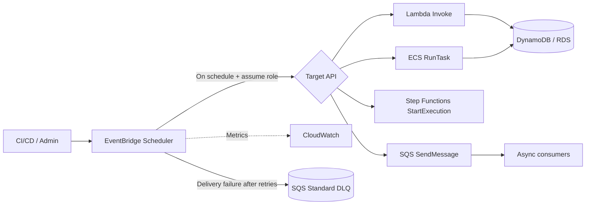
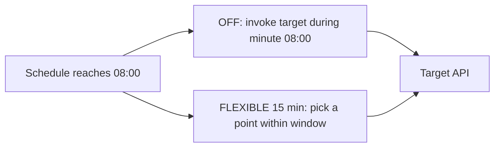
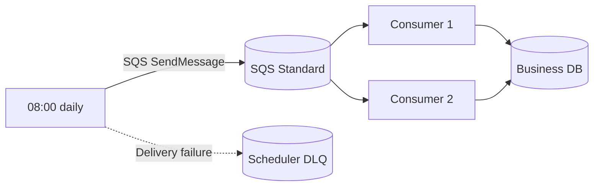
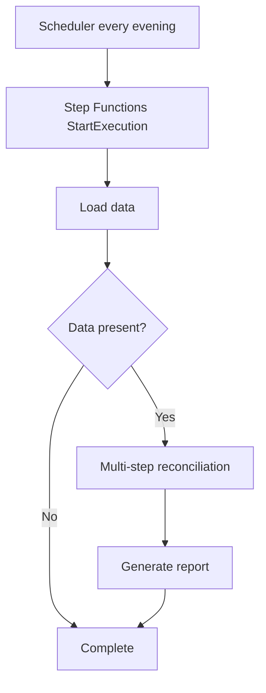
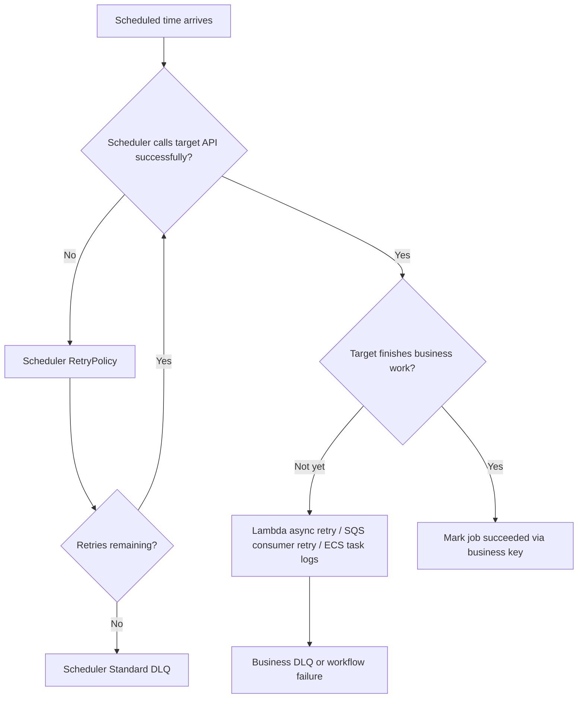
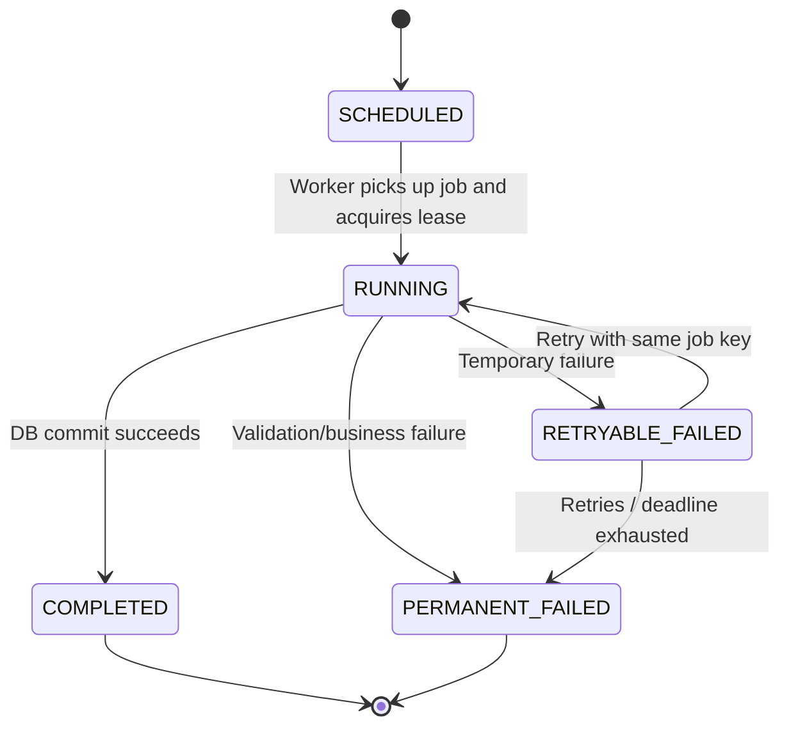
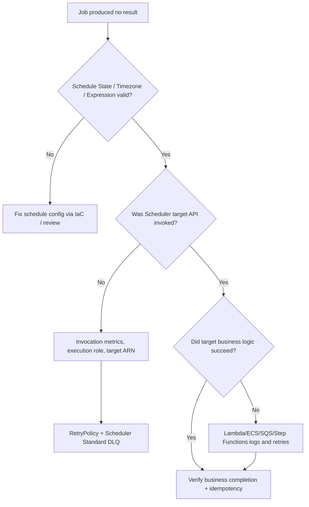

# EventBridge Scheduler and scheduled jobs

## 1. Problem: running tasks on time without managing cron servers

An e-commerce system has jobs that do not start directly from an HTTP request: aggregating revenue every day at 08:00 Vietnam time, sending a subscription renewal reminder at a specific timestamp, cleaning temporary data every 30 minutes, and triggering a month-end reconciliation process. Operations teams can configure `cron` on EC2, but when servers are replaced, OS clocks drift, deployments interrupt jobs, or the number of schedules grows into the thousands, maintaining a reliable "cron server" is no longer simple.

**Amazon EventBridge Scheduler** is a serverless service that manages **schedules to invoke AWS API targets** without running scheduling servers yourself. A schedule is defined by a **schedule expression**, **time zone**, **target**, and **IAM execution role**; optionally, you can add a **flexible time window**, **retry policy**, **dead-letter queue (DLQ)**, **schedule group**, **StartDate/EndDate**, and **action after completion**.

This lesson is part of the **Events and Orchestration** chapter in the **CLOUD_PROVIDERS_AWS** track. The track covers Region/AZ, IAM, VPC, compute, storage, databases, integration, and serverless; the goal is to choose services, deploy safely, monitor, recover, and control costs. EventBridge Scheduler ties those pieces together: it decides *when* to start, while **Lambda, ECS, SQS, Step Functions**, or an AWS service target decides *what* to do and *how* to complete it.

After this lesson, you will be able to:

- Distinguish **`rate(...)`**, **`cron(...)`**, and **`at(...)`** schedules, along with AWS's six-field cron syntax.
- Design schedules using **IANA time zones**, understand **daylight saving time (DST)**, and minute-level precision.
- Choose a **templated target** or **universal AWS SDK target**; send payloads to Lambda, SQS, Step Functions, or launch ECS tasks.
- Configure an **execution role**, retries, **SQS Standard DLQ**, and CloudWatch/CloudTrail monitoring.
- Use AWS CLI to create, read, update, disable, and delete schedules in a controlled manner.
- Design **idempotent** jobs, prevent duplicate runs, handle overload, and evaluate resilience and costs.

## 2. How does EventBridge Scheduler work?

Architecturally, Scheduler is a **timer for calling APIs**, not a code runtime. It does not execute long-running data processing loops like an ECS task, nor does it perform multi-step business logic itself like Step Functions.



### 2.1. Configuration components

| Component | Role | Example |
| --- | --- | --- |
| **Schedule name** | Schedule identifier within a group | `daily-reconcile` |
| **Schedule group** | Logical group for organization/tags/IAM | `shop-production` |
| **Schedule expression** | One-time or recurring schedule | `cron(0 8 ? * MON-FRI *)` |
| **Schedule expression timezone** | Time zone used to interpret the schedule | `Asia/Ho_Chi_Minh` |
| **Flexible time window** | Allows shifting invocation time within a bounded window | OFF or FLEXIBLE/15 minutes |
| **Target Arn/Input** | AWS API target and payload | Lambda/queue/state machine ARN |
| **Execution role** | IAM role assumed by Scheduler when invoking the target | `scheduler-shop-jobs-role` |
| **Retry policy** | Max retry attempts and max event age when target API fails | 3 retries, max 3600 seconds |
| **Dead-letter queue** | Stores failed invocation details when target cannot be reached | SQS **Standard** queue |
| **State** | ENABLED or DISABLED | Pause schedule without deleting configuration |
| **Action after completion** | NONE or DELETE | Clean up one-time schedule after completion |

The **management flow** differs from the **execution flow**: the CI/CD principal creating the schedule needs Scheduler admin permissions and scoped **`iam:PassRole`**; when the scheduled time arrives, **Scheduler assumes the execution role** and calls the target's AWS API. Never reuse broad CI/CD admin permissions as the runtime role for schedules.

### 2.2. At-least-once delivery is not exactly-once execution

EventBridge Scheduler provides **at-least-once target delivery**. A target may be invoked again if the first attempt fails or is not acknowledged as successful. For example:

1. At 08:00, Scheduler calls `sqs:SendMessage` to enqueue a job.
2. SQS accepts the message, but the network drops before Scheduler receives the acknowledgment.
3. Scheduler retries and may send another equivalent message.

If the target is Lambda, a successful invocation acceptance **does not prove the Lambda logic committed successfully**. When Lambda is invoked asynchronously, Lambda also has its own retries; SQS consumers can also reprocess messages. Therefore, every critical job needs a **business idempotency key**, state management, and failure alerts. Scheduler **does not create an exactly-once transaction** across RDS, S3, or external services.

## 3. Choosing a schedule type: `rate`, `cron`, or `at`?

EventBridge Scheduler supports **three schedule types**:

| Type | Syntax | Best suited for | Notes |
| --- | --- | --- | --- |
| **Rate-based** | `rate(15 minutes)`, `rate(1 day)` | Running at regular intervals | Does not inherently mean "08:00 local time every day" |
| **Cron-based** | `cron(0 8 ? * MON-FRI *)` | Running at specific calendar times/days | Subject to time zone and DST rules |
| **One-time** | `at(2027-01-15T09:30:00)` | A single task scheduled for one date/time | Consider deleting the schedule after completion |

**Rate/cron** are recurring schedules; **at** is a one-time schedule. A cron expression specifies calendar trigger times, not the target's retry behavior. A `rate(1 day)` measures duration, whereas `cron(...)` binds to calendar date/time fields: the two behave differently across DST transitions.

### 3.1. Rate expressions

```text
rate(5 minutes)     # Every 5 minutes
rate(1 hour)        # Roughly every hour
rate(2 days)        # Every 2 days, by interval
```

The syntax is `rate(value unit)`, where unit is **minutes, hours, or days** (singular or plural matching the value). The value must be positive. Without `StartDate`, a rate schedule starts per Scheduler rules immediately after creation/activation; **it is not guaranteed to fire at minute 00 of the hour**.

For example, a job running on a 30-minute cadence to refresh a cache does not need to fire at exactly 08:00 or 08:30 on the wall clock. `rate(30 minutes)` is simple and sufficient.

### 3.2. Six-field cron expressions

EventBridge Scheduler uses an expression format equivalent to:

```text
cron(minutes hours day-of-month month day-of-week year)
```

| Field | Example | Meaning |
| --- | --- | --- |
| Minutes | `0` or `30` | Minute of the hour |
| Hours | `8` or `22` | Hour 0–23 |
| Day-of-month | `1`, `L`, or `?` | Day of the month |
| Month | `*`, `JAN` | Month |
| Day-of-week | `MON-FRI` or `?` | Day of the week |
| Year | `*` or `2027` | Year |

Examples:

```text
cron(0 8 ? * MON-FRI *)     # 08:00, Monday–Friday
cron(30 23 * * ? *)        # 23:30 every day
cron(0 2 1 * ? *)          # 02:00 on the 1st of every month
cron(0 9 ? * MON *)        # 09:00 every Monday
```

**You cannot specify both day-of-month and day-of-week simultaneously.** When specifying day-of-week, day-of-month typically uses `?`; when specifying day-of-month, day-of-week uses `?`. Unlike 5-field Linux crontab, Scheduler requires **6 fields including year**. Wildcards such as `, - * / ? L W #` must be placed in supported fields; validate expressions via the AWS console/IaC before production.

### 3.3. One-time at a specific timestamp

```text
at(2027-01-15T09:30:00)
```

The timestamp inside `at(...)` is interpreted using `ScheduleExpressionTimezone`. With `Asia/Ho_Chi_Minh`, the example above means **09:30 on January 15, 2027 in Vietnam time**. **Do not append `Z` to the `at` string assuming UTC** when a timezone is configured; follow Scheduler's syntax and timezone field.

For a one-time schedule, `StartDate`/`EndDate` do not alter the `at(...)` time. Once invoked, a one-time schedule **can still count against schedule quotas** if not deleted. Set `ActionAfterCompletion=DELETE` when you want automatic cleanup after the final invocation, or delete manually per retention policy.

## 4. Time zones, DST, and minute precision

### 4.1. Time zones use IANA values

Scheduler supports `ScheduleExpressionTimezone` based on the **IANA Time Zone Database**, for example:

- `Asia/Ho_Chi_Minh`: Vietnam time, currently no DST.
- `America/New_York`: observes daylight saving time.
- `Europe/Berlin`: observes seasonal DST.
- `UTC`: UTC-based schedule.

If the goal is "run at 08:00 local time for staff in Vietnam," use **cron with `Asia/Ho_Chi_Minh`** rather than hardcoding 08:00 converted to UTC in application code and hoping other time zones never change.

### 4.2. Daylight saving time: hours can be skipped or repeated

In time zones with DST, one day **skips forward** an hour and another day **repeats** an hour. For cron schedules, AWS defines:

- If the scheduled hour/minute **does not exist** on the spring-forward day, the schedule **skips that run**.
- When the scheduled hour/minute **repeats** on the fall-back day, the schedule **runs once**, not twice for the same local time slot.
- With `rate(1 days)`, the cadence is a 24-hour duration, which may not align with the same local wall-clock hour after a DST shift.

For instance, "02:30 every day in New York" may not occur on the day clocks jump from 02:00 to 03:00. If business logic requires closing the books **exactly once per calendar day** regardless of DST, implement a business calendar, store `businessDate`, backfill when needed, and enforce idempotency rather than relying solely on cron expressions.

### 4.3. 60-second precision

EventBridge Scheduler has **60-second invocation precision** for calling targets. A schedule at 08:00 with flexible window OFF may call the target API anywhere between **08:00:00 and 08:00:59** in the schedule's time zone, excluding target and backend latency.

This differs from **exact second- or millisecond-level deadlines**. If an auction system must close a bidding window at exactly `08:00:00.000`, use database/business timestamps as the source of truth and treat Scheduler as a trigger/reconciliation agent rather than the clock deciding validity.

### 4.4. Why not test DST using Vietnam time?

Vietnam's time zone currently does not observe DST, so an 08:00 cron in `Asia/Ho_Chi_Minh` is convenient for internal reports. If a product serves international users, **each user has a different time zone** and you must store their IANA time zone with their preferences; you cannot create one fixed UTC cron and assume all customers receive notifications at 08:00 local time.

## 5. Flexible time window: spreading load instead of spiking at one minute

Scheduler supports configuring:

| Mode | Meaning | Related field |
| --- | --- | --- |
| **OFF** | Attempts to invoke the target within the scheduled minute | `{"Mode":"OFF"}` |
| **FLEXIBLE** | Lets Scheduler pick an invocation time within a bounded delay window | `{"Mode":"FLEXIBLE","MaximumWindowInMinutes":15}` |

`MaximumWindowInMinutes` supports up to **1440 minutes** per the API; configure it only when using `FLEXIBLE`. The window does not mean a job runs arbitrarily early before the scheduled time; Scheduler dispatches within the specified window.



**When to enable FLEXIBLE:** thousands of report-generation/reminder tasks all come due at 08:00 and can finish within a 15–30 minute window; spreading invocations avoids sudden spikes on Lambda concurrency, Step Functions state transitions, or databases.

**When to set OFF:** notifications or processing must happen close to the target timestamp with a tight invocation SLO. Even `OFF` **does not guarantee exact-second accuracy** or instant start of downstream business processing.

## 6. EventBridge Scheduler vs. EventBridge Rules and Step Functions

| Option | Primary problem solved | Key difference |
| --- | --- | --- |
| **EventBridge Scheduler** | One-time/recurring schedules, many independent schedules, time zones, retries/DLQ | Uses `rate/cron/at`, flexible windows, schedule groups |
| **EventBridge scheduled rules** | Legacy schedules tied to EventBridge rules | Fewer scheduling/timezone features; AWS recommends Scheduler for new scheduling |
| **EventBridge event bus rule** | Route events based on an event pattern | Triggered **when an event occurs**, does not replace a scheduler |
| **AWS Step Functions Wait state** | Waiting inside an active workflow, multi-step orchestration | Built for orchestration within an execution |
| **SQS delay** | Short delay on a single message | Does not replace far-future one-time schedules or calendar crons |
| **Lambda + EC2 cron** | Self-managed scheduled jobs | Must operate timers/hosts, HA, and missed-run handling |

Example: an unpaid order must be canceled after 30 minutes. You can create a **one-time schedule per `orderId`** calling SQS/Lambda, or use a Step Functions `Wait` inside an existing order-state workflow. Choose based on **schedule volume, wait duration, cost per execution, cancel/reschedule needs, and observability**. Do not run a cron scanning the entire database every minute if per-order schedules fit better, nor create millions of uncleaned schedules when quotas/costs prohibit it.

## 7. Targets: which AWS APIs does Scheduler call?

Scheduler has two **target** models:

1. **Templated target:** AWS predefines common operations allowing you to pass the resource ARN directly—such as **Lambda Invoke, SQS SendMessage, Step Functions StartExecution, ECS RunTask, SNS Publish, EventBridge PutEvents**, and other supported targets.
2. **Universal target:** invokes a supported AWS SDK API action using the special ARN `arn:aws:scheduler:::aws-sdk:service:apiAction` and an **Input** containing JSON parameters for that action.

**You cannot pass an arbitrary AWS service ARN and expect Scheduler to guess which action to call.** Templated targets cover a fixed set of actions; with universal targets, you must specify the exact service/action, valid payload, and matching IAM permissions.

### 7.1. Templated target to SQS

Scheduler calls **`sqs:SendMessage`** on the queue and passes `Input` as the message body. Ideal pattern: daily at 08:00, Scheduler sends **a job description** to the queue; multiple ECS/Lambda consumers process it as capacity allows, rather than cramming thousands of business operations into one synchronous Lambda call.



If the target is **SQS FIFO**, the templated target configuration requires `SqsParameters.MessageGroupId`; the API documentation also requires the target FIFO queue to have **content-based deduplication enabled**. Reason: Scheduler templated parameters **do not expose a separate `MessageDeduplicationId` field** like an application-issued SQS `SendMessage` call. Design stable message bodies and group IDs; do not assume Scheduler solves exactly-once business processing on its own.

**Distinguish the two DLQs:** the Scheduler DLQ holds **failed target API delivery attempts**; the consumer queue DLQ holds **messages delivered successfully that workers failed to process repeatedly**. These are two different failure layers and need two separate runbooks.

### 7.2. Lambda target

When configuring a Lambda target, the schedule's execution role needs **`lambda:InvokeFunction`** on the approved function ARN/alias. The `Input` payload must match the Lambda handler contract (JSON when using a templated Lambda target per the API contract).

```json
{
  "task": "daily-reconciliation",
  "businessDate": "2027-01-14",
  "scheduleKey": "reconcile-shop-v1",
  "source": "eventbridge-scheduler"
}
```

The payload above is only an illustration. For a recurring daily cron, **do not hardcode a fixed `businessDate`** that repeats identically every day. Have Lambda determine the business date from the configured time zone or use context attributes/producer-configured inputs. If duplicate runs would cause harm, the handler must use `businessDate + jobName` as an **idempotency key**.

**Lambda asynchronous invocation:** Scheduler considers target delivery successful once the **Lambda Invoke API accepts the call**; that does not mean the function code finished. Lambda has its own retries/on-failure destinations/DLQs for asynchronous invocations. For business observability, monitor **Lambda Errors/Throttles**, application logs, and a job status table—not just Scheduler's `TargetErrorCount`.

### 7.3. Step Functions target

Scheduler can invoke **`states:StartExecution`** on a State Machine, fitting multi-step workflows that need retries, branching, waits, and workflow-level observability:



Once `StartExecution` is accepted, **the workflow may run for hours**. Monitor Step Functions execution status, retries, timeouts, and output data. For financial tasks, prefer **idempotent workflows**; with Standard Workflows, you can construct an **execution name** and valid business key to prevent duplicate starts per supported semantics.

### 7.4. ECS task target

Scheduler provides a **templated ECS RunTask** target with `EcsParameters`:

- `TaskDefinitionArn`: task definition to run.
- `LaunchType` or `CapacityProviderStrategy` per ECS configuration.
- `NetworkConfiguration`: required when the task uses `awsvpc`, such as ECS Fargate.
- `TaskCount`, `PlatformVersion`, and other supported parameters.

With Fargate, tasks need valid **private subnets/SGs, ECR images, execution role, task role, CPU/memory**, and network connectivity to dependencies. The Scheduler role needs **`ecs:RunTask`** and scoped **`iam:PassRole`** for the relevant task roles. Never grant account-wide ECS permissions just to run one scheduled task.

**A successful `ecs:RunTask` call does not guarantee the container finished processing.** An ECS task can launch and stop due to image pull failures, database timeouts, OOM, application exceptions, or Spot interruptions. Monitor ECS task state/`stoppedReason`, CloudWatch Logs, and a dedicated business status/DLQ.

### 7.5. Universal target

A universal target allows invoking actions not provided by templated targets using an ARN of the form:

```text
arn:aws:scheduler:::aws-sdk:<service>:<apiAction>

Example:
arn:aws:scheduler:::aws-sdk:sqs:sendMessage
arn:aws:scheduler:::aws-sdk:sfn:startExecution
```

The `Input` payload must be **JSON accepted by that API action**—for instance, universal SQS `sendMessage` requires `QueueUrl`, `MessageBody`, and required parameters for FIFO/Delay if used. **Scheduler does not validate every Input field against the action at schedule creation time**; creation may succeed while every trigger fails due to missing parameters.

Universal targets maintain a **list of unsupported API actions**; never assume "every SDK call can be scheduled." Consult the `Using universal targets` docs and API schemas, and test in a sandbox with a DLQ before production.

## 8. IAM: Schedule execution role, `iam:PassRole`, and target permissions

### 8.1. Three principals often confused

| Principal | When is it used? | Required permissions |
| --- | --- | --- |
| **User/CI creating the schedule** | `CreateSchedule`, `UpdateSchedule`, `DeleteSchedule` | Scheduler API permissions, scoped `iam:PassRole` |
| **Scheduler execution role** | Assumed by Scheduler when the schedule fires | Permission to call target API, e.g., `sqs:SendMessage` or `lambda:InvokeFunction` |
| **Backend runtime role** | Lambda/ECS/Step Functions doing the actual work | Permissions to read/write databases/S3/queues |

If the target Lambda needs to read DynamoDB, **do not grant DynamoDB access to the Scheduler execution role**. Scheduler only needs Invoke; the Lambda execution role needs DynamoDB. Likewise, the ECS task role holds business permissions, while the Scheduler execution role holds `RunTask`/`PassRole`.

### 8.2. Trust policy for a Scheduler role

Example file `scheduler-trust-policy.json`:

```json
{
  "Version": "2012-10-17",
  "Statement": [
    {
      "Sid": "AllowSchedulerToAssume",
      "Effect": "Allow",
      "Principal": {
        "Service": "scheduler.amazonaws.com"
      },
      "Action": "sts:AssumeRole"
    }
  ]
}
```

This is a **minimal trust policy for explaining the principal**. In production, evaluate **confused deputy** protections using `aws:SourceAccount` and `aws:SourceArn` per AWS documentation, typically scoping to the **schedule group ARN** rather than a single schedule ARN when docs specify the group. Verify sample policies and exact Region/account ARN formats before adding conditions.

### 8.3. Permission policy for SQS target and DLQ

An example execution role restricted to sending jobs to one queue and failed invocations to the Scheduler DLQ:

```json
{
  "Version": "2012-10-17",
  "Statement": [
    {
      "Sid": "SendScheduledJob",
      "Effect": "Allow",
      "Action": "sqs:SendMessage",
      "Resource": "arn:aws:sqs:ap-southeast-1:111122223333:shop-jobs"
    },
    {
      "Sid": "SendUndeliveredEventToDLQ",
      "Effect": "Allow",
      "Action": "sqs:SendMessage",
      "Resource": "arn:aws:sqs:ap-southeast-1:111122223333:scheduler-failures"
    }
  ]
}
```

If the target/DLQ lives in another account, also check the **SQS queue resource policy** and **KMS key policy** if encrypted with SSE-KMS; an identity policy alone may be insufficient.

**Protecting `iam:PassRole`:** someone allowed to create schedules who can PassRole a broad administrative role could turn a schedule into a channel to invoke unintended AWS APIs. Restrict passable roles, Resource ARNs, appropriate `iam:PassedToService` conditions, and Scheduler management policies by group/name/tag.

## 9. CLI hands-on: creating a schedule to send jobs to SQS Standard

This hands-on exercise is designed for a **sandbox** account. Commands like `create-*`, `update-*`, and `delete-*` modify real AWS resources. Account IDs, ARNs, and queue names are illustrative—**do not run placeholder values in production**.

### 9.1. Prerequisites before creating a schedule

Before running:

1. An **SQS Standard queue** `shop-jobs` (target) exists for workers to pick up jobs.
2. An **SQS Standard DLQ** `scheduler-failures` exists, separate from the worker failure DLQ.
3. IAM execution role `scheduler-send-sqs-role` has a trust policy for `scheduler.amazonaws.com` and `sqs:SendMessage` scoped to the exact target/DLQ.
4. The IAM principal running AWS CLI has permissions to create/read schedules and `iam:PassRole` for the execution role.
5. Local time, retry policy, DLQ retention, and downstream idempotency have been decided.

```bash
# Verify identity and Region before creating schedules
aws sts get-caller-identity

# List existing groups and schedules in sandbox
aws scheduler list-schedule-groups --region ap-southeast-1
aws scheduler list-schedules --region ap-southeast-1

# Read target queue without creating a new one
aws sqs get-queue-url \
  --queue-name shop-jobs \
  --region ap-southeast-1
```

This exercise uses the **default group** to reduce setup steps; in production, create schedule groups per application/environment for access control, tagging, and observability.

### 9.2. Target JSON file

Save `sqs-schedule-target.json`:

```json
{
  "Arn": "arn:aws:sqs:ap-southeast-1:111122223333:shop-jobs",
  "RoleArn": "arn:aws:iam::111122223333:role/scheduler-send-sqs-role",
  "Input": "{\"jobType\":\"daily-reconciliation\",\"source\":\"scheduler\",\"jobVersion\":1}",
  "RetryPolicy": {
    "MaximumRetryAttempts": 3,
    "MaximumEventAgeInSeconds": 3600
  },
  "DeadLetterConfig": {
    "Arn": "arn:aws:sqs:ap-southeast-1:111122223333:scheduler-failures"
  }
}
```

This is a **templated SQS target**: `Arn` is the **queue ARN**, not the Queue URL; `Input` is a **string containing the message body**, here a JSON string. `RetryPolicy` applies to **Scheduler target delivery failures**, not downstream worker business errors after message receipt.

### 9.3. Cron at 08:00 on weekdays in Vietnam

```bash
aws scheduler create-schedule \
  --name shop-daily-reconciliation \
  --schedule-expression 'cron(0 8 ? * MON-FRI *)' \
  --schedule-expression-timezone Asia/Ho_Chi_Minh \
  --flexible-time-window '{"Mode":"OFF"}' \
  --target file://sqs-schedule-target.json \
  --state ENABLED \
  --region ap-southeast-1
```

The command schedules in **Vietnam time**, avoiding manual UTC conversion. Scheduler has **60-second precision** when calling the API. `MON-FRI` means **Monday through Friday**, which **does not automatically mean official company business days**: public holidays and closures must be handled by backend/business calendars or schedule adjustments.

**The recurring payload has `jobVersion=1` without a fixed `businessDate`**, because a multi-day schedule must derive a **per-run job idempotency key**. Workers can compute the business date from the execution timestamp and configured time zone, or receive configured context attributes. When windows/retries cross midnight, do not infer the business date solely from when the consumer receives the message.

### 9.4. Read back and verify

```bash
aws scheduler get-schedule \
  --name shop-daily-reconciliation \
  --region ap-southeast-1

aws scheduler list-schedules \
  --name-prefix shop-daily \
  --region ap-southeast-1
```

Verify `ScheduleExpression`, `ScheduleExpressionTimezone`, `FlexibleTimeWindow`, `State`, `Target.RoleArn`, `Target.Arn`, `RetryPolicy`, and DLQ ARN. After the scheduled time, inspect **CloudWatch `AWS/Scheduler`**, target SQS metrics, and application logs to confirm job execution.

### 9.5. Rate schedule every 30 minutes

Example of a schedule not tied to 08:00:

```bash
aws scheduler create-schedule \
  --name shop-refresh-cache \
  --schedule-expression 'rate(30 minutes)' \
  --flexible-time-window '{"Mode":"FLEXIBLE","MaximumWindowInMinutes":10}' \
  --target file://sqs-schedule-target.json \
  --state ENABLED \
  --region ap-southeast-1
```

With `rate(30 minutes)` and a 10-minute `FLEXIBLE` window, the job does not have to start at minute :00 or :30 on the clock. If the application needs a strict time fence, enforce it in the backend rather than relying solely on the window.

## 10. One-time schedules, auto-deletion, and preventing schedule buildup

A customer schedules delivery for 09:30 on January 15, 2027. The business wants to emit a delivery-status check signal at that time, **once only**.

```bash
aws scheduler create-schedule \
  --name order-101-followup-20270115 \
  --schedule-expression 'at(2027-01-15T09:30:00)' \
  --schedule-expression-timezone Asia/Ho_Chi_Minh \
  --flexible-time-window '{"Mode":"OFF"}' \
  --action-after-completion DELETE \
  --target file://sqs-schedule-target.json \
  --state ENABLED \
  --region ap-southeast-1
```

**Note:** the shared `sqs-schedule-target.json` example contains `jobType=daily-reconciliation`. For a real order, create an **order-specific target `Input`**, for example:

```json
{
  "jobType": "check-delivery",
  "orderId": "101",
  "scheduleKey": "order-101-followup-20270115",
  "dueAt": "2027-01-15T09:30:00+07:00"
}
```

The target configuration file passed to Scheduler must place this payload in `Input` (as a **JSON string**), rather than reusing the reconciliation job file. Including a **business ID** in the schedule name helps operations, yet consider privacy and AWS API naming restrictions; never put sensitive PII into names, tags, logs, or ARNs.

### 10.1. `ActionAfterCompletion=DELETE`

`--action-after-completion DELETE` tells Scheduler to **delete the schedule upon completing its final invocation**. For a one-time schedule, completion is measured by Scheduler's target invocation—**not** waiting for downstream asynchronous work in SQS/Lambda/Step Functions to finish.

If a one-time schedule **lacks auto-delete**, a completed schedule stays around and **can still count toward schedule quotas**. In a system creating millions of one-time reminders, forgetting cleanup can hit quotas and increase operational overhead. Enable `DELETE` or run a cleanup process, and store business history in a database/audit log instead of expecting the schedule resource to persist forever.

For **recurring** schedules, auto-delete only triggers when an **`EndDate`** defines the final invocation. A recurring schedule without `EndDate` keeps running and will not auto-delete merely because `ActionAfterCompletion=DELETE` is set.

### 10.2. Canceling or rescheduling a reminder

If the customer cancels the order before the follow-up time:

- Delete the corresponding schedule, or disable/update it per policy.
- Mark the **order state in the database** so reminders are no longer permitted.
- Have the consumer **check the latest state** before sending emails or mutating data.

**Race condition:** Scheduler may have already dispatched the call to SQS/Lambda right before you deleted or disabled the schedule. Deleting the schedule resource **does not retract** messages already in a queue or cancel an already-started ECS task. Thus a **business state/version check** in the consumer is the final safeguard.

### 10.3. Re-enabling an expired one-time schedule

AWS notes that when a **previously `DISABLED` one-time schedule** is re-enabled **after its scheduled time**, it **may invoke the target immediately**. Never use re-enabling as a "just checking" action if the target creates transactions, sends mass emails, or deletes resources.

Before enabling, run `get-schedule`, verify `at(...)`/timezone/state, and decide whether a late invocation still makes sense. If expired, create a new business-versioned schedule or cancel safely instead of blindly firing late runs.

## 11. Schedule groups, tagging, and environment isolation

**Schedule groups** organize schedules and serve as the unit for **tags, IAM scoping, and CloudWatch metrics**. Every schedule belongs to a group (if unspecified, `default`).

Example:

```text
Group shop-development
  - daily-reconcile-dev
  - report-preview

Group shop-production
  - daily-reconcile-prod
  - order-followup-101

Group infrastructure-maintenance
  - nightly-cleanup
```

A naming convention should include **application + environment + business purpose**, without sensitive personal information. A schedule group does not provide AWS account isolation by itself; for critical environments, separate **AWS accounts** or IAM boundaries so dev schedules cannot touch production targets.

### 11.1. Creating a group and placing a schedule inside it

```bash
aws scheduler create-schedule-group \
  --name shop-production \
  --region ap-southeast-1

aws scheduler create-schedule \
  --name daily-reconcile-prod \
  --group-name shop-production \
  --schedule-expression 'cron(0 8 ? * MON-FRI *)' \
  --schedule-expression-timezone Asia/Ho_Chi_Minh \
  --flexible-time-window '{"Mode":"OFF"}' \
  --target file://sqs-schedule-target.json \
  --region ap-southeast-1

aws scheduler get-schedule \
  --name daily-reconcile-prod \
  --group-name shop-production \
  --region ap-southeast-1
```

These commands assume the group does not yet exist. When managing via IaC, define group lifecycle and tag policies to prevent duplicates. Always pass the exact `--group-name` on get/update/delete calls; omitting it defaults to `default`, returning not-found even though the schedule exists in another group.

### 11.2. Managing tags and permissions by group

Tags typically apply to schedule groups; IAM permissions can constrain `schedule-group` and `schedule` resources by ARN, name patterns, and conditions as supported by the API. For example, restrict `shop-production` so only the platform team can modify production schedules. Target roles still require independent scoping, because group tags **do not prevent** an overly broad IAM role from calling unauthorized resources.

### 11.3. Idempotent schedule provisioning

The AWS `CreateSchedule` API supports **`ClientToken`** to avoid duplicate API creation calls on administrative retries; schedule names are unique within a group. However, a client token only provides **idempotency for the schedule creation API**, not a guarantee that the business job will never run twice on target delivery retries. Never confuse `ClientToken` with the consumer's business idempotency key.

## 12. Safely updating, pausing, and deleting schedules

### 12.1. Always read before updating

```bash
aws scheduler get-schedule \
  --name daily-reconcile-prod \
  --group-name shop-production \
  --region ap-southeast-1
```

**`UpdateSchedule` replaces the configuration based on input**—it is not a partial patch of only the fields you want to change. You must supply required fields like `ScheduleExpression`, `Target`, and `FlexibleTimeWindow`; omitted optional fields may revert to null/defaults per API behavior. If you only intend to change `State` and forget `ScheduleExpressionTimezone`, `Target.RetryPolicy`, or `DeadLetterConfig`, the schedule can shift time zones or lose recovery settings.

### 12.2. Example disabling via `UpdateSchedule` with full required fields

After backing up/verifying all current schedule options, for example:

```bash
aws scheduler update-schedule \
  --name daily-reconcile-prod \
  --group-name shop-production \
  --schedule-expression 'cron(0 8 ? * MON-FRI *)' \
  --schedule-expression-timezone Asia/Ho_Chi_Minh \
  --flexible-time-window '{"Mode":"OFF"}' \
  --target file://sqs-schedule-target.json \
  --state DISABLED \
  --region ap-southeast-1
```

**This is not a safe command to copy blindly for every schedule**: if the schedule has `StartDate`, `EndDate`, `ActionAfterCompletion`, `KmsKeyArn`, `Description`, or different target settings, you must **preserve** those fields during the update. In production, use IaC/providers and versioned configuration to avoid manual edits dropping retries/DLQs.

After updating:

```bash
aws scheduler get-schedule \
  --name daily-reconcile-prod \
  --group-name shop-production \
  --region ap-southeast-1
```

When updating close to the scheduled execution time, AWS notes **changes may not take effect immediately**. An invocation near the boundary may still use the old configuration. Design consumers to check business state rather than relying on disable as an "absolute kill switch for in-flight work."

### 12.3. Deleting unused schedules

```bash
# Mutating command; run only after assessing business impact
aws scheduler delete-schedule \
  --name daily-reconcile-prod \
  --group-name shop-production \
  --region ap-southeast-1
```

Deleting a schedule stops future triggers per service behavior; it **does not undo** target requests already accepted or jobs already in queues. Keep configuration history in Git/IaC and audit logs before deletion. To delete a group, properly clean up schedules inside that group first.

## 13. Retry policy: recovering target delivery failures, not business errors

A Scheduler target can return transient errors due to API throttling, target unavailability, IAM/KMS denials, or missing resources. When an invocation fails, Scheduler can **retry with exponential backoff** until the first limit is reached:

- `MaximumRetryAttempts`: maximum number of retries (API range **0–185**).
- `MaximumEventAgeInSeconds`: maximum time an event remains eligible for retries (**60–86,400 seconds**, i.e., up to 24 hours).

Once **either limit is reached**, Scheduler stops retrying and attempts to send failure details to the DLQ if configured. Never blindly choose the default "185 retries over 24 hours" for every workflow; for instance, delivering an OTP notification 24 hours late can be meaningless or harmful.

| Target failure | Recommended handling |
| --- | --- |
| Temporary API throttling | Backoff, adjust quotas/bursts/flexible windows |
| Target resource deleted/ARN changed | Fix config/ARN, inspect DLQ, backfill if appropriate |
| IAM `AccessDenied` | Fix execution role/queue policy/KMS key; never grant `*` account-wide |
| Target API accepts, then worker fails later | **Not a Scheduler delivery retry**; check Lambda/Step Functions/ECS/SQS retries |
| Event past business deadline | Tighten `MaximumEventAge`, alert/DLQ, and enforce deadline checks in consumers |

### 13.1. Retries do not replace idempotency

Suppose Scheduler invokes Lambda, the backend writes to the ledger successfully, yet the response acknowledgment is unclear. Scheduler or Lambda may retry depending on the integration. If an invoicing job lacks idempotency, it could create **two invoices** for the same business date. Use a key like `reconcile:<shopId>:<businessDate>` backed by a unique constraint/conditional write/transaction in the database.

**Never generate a business key from `now()` on each retry**, because two attempts will produce different keys. Use the scheduled slot, entity ID, business date/version, or a pre-recorded stable key.

### 13.2. Scheduler DLQ must be SQS Standard

According to EventBridge Scheduler documentation, **a Scheduler DLQ must be an SQS Standard queue**; **SQS FIFO queues are not supported as a Scheduler DLQ**. This does not forbid setting a **FIFO queue as the primary target** with valid templated SQS configuration—it only applies to the **queue receiving failed target deliveries**.

```text
Scheduler ----> Primary target: SQS Standard or SQS FIFO / Lambda / ECS...
      |
      +----> After delivery retries fail:
               SQS Standard DLQ (scheduler-failures)
```

Scheduler's DLQ stores **target API invocation** failures, not a copy of "all business jobs that failed inside workers." Configure DLQ retention, IAM queue policies, and controlled read/replay workflows. Add a CloudWatch alarm in case sending to the DLQ itself fails.

### 13.3. Creating a DLQ and configuring the target

```bash
# Create a dedicated DLQ for Scheduler: name MUST NOT end in .fifo
aws sqs create-queue \
  --queue-name scheduler-failures \
  --attributes MessageRetentionPeriod=1209600 \
  --region ap-southeast-1

# After obtaining the real URL, read the ARN for target.DeadLetterConfig.Arn
aws sqs get-queue-attributes \
  --queue-url 'SCHEDULER_DLQ_URL_HERE' \
  --attribute-names QueueArn \
  --region ap-southeast-1
```

File `sqs-schedule-target.json` in section 9 already included:

```json
{
  "RetryPolicy": {
    "MaximumRetryAttempts": 3,
    "MaximumEventAgeInSeconds": 3600
  },
  "DeadLetterConfig": {
    "Arn": "arn:aws:sqs:ap-southeast-1:111122223333:scheduler-failures"
  }
}
```

This is only a **snippet**, **not a complete Target object** (`Arn` and `RoleArn` are also needed when creating a schedule). The DLQ must exist, the role needs `sqs:SendMessage` on the DLQ, and the queue/KMS key policy must permit access across accounts/encryption boundaries if applicable.

### 13.4. Redrives must account for time validity

An event sent to the DLQ because a target was missing at 08:00 may **no longer be valid** at 15:00. Never unconditionally redrive all DLQ messages:

1. Inspect metadata: schedule ARN, target ARN, retry condition, and error code.
2. Confirm the target is fixed and credentials/KMS/queue policies are valid.
3. Check **deadline/TTL/business date** and whether the task is still allowed to run.
4. Resubmit with the **same business idempotency key**, log an audit record, and verify outcomes.
5. Delete the message from the DLQ after successful reprocessing per the runbook.

## 14. Recognizing multiple failure layers: Scheduler, Lambda, SQS, and ECS



This is why **CloudWatch metric `InvocationAttemptCount` does not equal completed business jobs**. A schedule calling SQS successfully counts as a target delivery success even if the queue backs up for 12 hours. To commit to an end-to-end SLO, monitor **queue age, consumer failures, workflow execution statuses, and business completion records**.

## 15. Observability: CloudWatch, CloudTrail, and business telemetry

Amazon EventBridge Scheduler emits metrics under the **`AWS/Scheduler`** namespace, aggregated at the account level and by **ScheduleGroup**. It does not emit per-**schedule-name** metrics by default in the way many expect; include **job key, schedule ARN, and trace/correlation ID** in target logs when analyzing specific schedules.

### 15.1. Key Scheduler metrics

| `AWS/Scheduler` metric | Interpretation | When to alert |
| --- | --- | --- |
| `InvocationAttemptCount` | Number of attempts Scheduler made to invoke targets | Sudden spikes vs. expected schedule count |
| `TargetErrorCount` | Target returned an error to the API call | Delivery, IAM, resource, or network/throttle errors |
| `TargetErrorThrottledCount` | Target API throttled the invocation | Bursts exceeding quotas/downstream limits |
| `InvocationThrottleCount` | Scheduler throttled by Scheduler service limits | Check Service Quotas and spread schedules |
| `InvocationDroppedCount` | Scheduler dropped an event after exhausting retry policy | **Critical alert**: target delivery opportunity lost |
| `InvocationsSentToDeadLetterCount` | Failed event successfully sent to Scheduler DLQ | Investigate root cause and plan replay |
| `InvocationsFailedToBeSentToDeadLetterCount` | Scheduler failed to send to the DLQ | **Critical alert**: fallback path also failed |

Metrics are generally aggregated by group/account; **`InvocationAttemptCount` includes retries** and does not equal unique business transactions. When setting alarms, pick the right statistic and period, and separate dev/prod via `ScheduleGroup` so test schedules do not mask production signals.

### 15.2. Inspecting CloudWatch via AWS CLI

Example **read-only** query—substitute real UTC timestamps and group name:

```bash
aws cloudwatch get-metric-statistics \
  --namespace AWS/Scheduler \
  --metric-name TargetErrorCount \
  --dimensions Name=ScheduleGroup,Value=shop-production \
  --start-time '2026-11-20T00:00:00Z' \
  --end-time '2026-11-20T01:00:00Z' \
  --period 300 \
  --statistics Sum \
  --region ap-southeast-1
```

For a schedule running at 08:00 Vietnam time, convert the UTC window accurately; the example queries an **illustrative time window** and does not guarantee real data in your account. CloudWatch metrics have ingestion latency and require exact dimensions. Combine CloudWatch dashboards/alarms with SNS or incident workflows.

### 15.3. CloudTrail and administrative permissions

**AWS CloudTrail** audits Scheduler control-plane APIs such as creating/updating/deleting schedules. A production incident with missing jobs may stem from someone setting a schedule to `DISABLED`, changing the time zone, or altering the role; CloudTrail shows **who called the API and when**.

CloudTrail is not a business execution ledger. It **does not** prove an ECS task completed or an invoice was recorded. For end-to-end tracking, maintain a job executions table:

```text
job_key                 business_date    status      attempt  finished_at
daily-reconcile:2027-01-14  2027-01-14    COMPLETED   1        ...
daily-reconcile:2027-01-15  2027-01-15    FAILED      2        ...
```

Operations can compare **expected schedules** against **completed jobs** by calendar, find days lacking a completion record, and trigger controlled backfills.

### 15.4. Measuring schedule delay: planned vs. actual

Never measure SLOs solely by "an invocation happened." Track at least three timestamps:

| Timestamp | Who records it? | Purpose |
| --- | --- | --- |
| **scheduled_for** | Business calendar / schedule definition | Ideal business trigger time |
| **received_at** | Lambda/SQS consumer/ECS worker | Delivery latency and queue backlog |
| **completed_at** | Business transaction/Job DB | End-to-end completion latency and true SLO |

For example, a job is due at 08:00, Scheduler enqueues at 08:00:45, queue backlog delays pickup until 08:04, and the job finishes at 08:07. If the SLO is "finish before 08:10," it passes; if the SLO is "notify before 08:02," it breaches. Neither SLO can be measured from `AWS/Scheduler` metrics alone.

## 16. Designing idempotent jobs and preventing overlap

### 16.1. Duplicate invocations are a normal scenario

If Schedule A triggers an 8-minute job every 5 minutes, **two runs can overlap**, even if Scheduler fires cleanly once per slot. With retries or asynchronous targets, the same business slot can also be processed twice.

Safeguards:

- Use a **stable job key**: job name + customer/account + business slot + version.
- Before committing, persist an **idempotency record** via unique constraint, DynamoDB conditional update, or database transaction.
- Use a **lease/lock with timeout and heartbeat** if only one active worker is allowed at a time.
- Include a **fencing token/version** on locks in case a stale worker resumes after lease expiration.
- For long-running workflows, use Step Functions, ECS tasks, or coordinated queues/workers—never treat Scheduler as a distributed lock manager.

### 16.2. A job state machine model



Once a job is `COMPLETED`, a duplicate invocation with the same key should return **already completed** without repeating side effects. If the job sends emails, processes payments, or calls external providers, use provider idempotency keys or an outbox/ledger; a local database lock cannot roll back external side effects that already happened.

### 16.3. Transactional pseudocode example

```text
run(jobName, businessDate, tenantId):
  key = jobName + ":" + businessDate + ":" + tenantId

  if jobStore[key] == COMPLETED:
      return success (do not repeat)

  acquire lease via conditional update / version
  verify deadline, business status, authorization

  BEGIN TRANSACTION
      apply retry-safe business changes
      update jobStore[key] = COMPLETED
  COMMIT

  emit required outbox events (if any)
```

This is a mental model: real implementations need transaction isolation, lease expiration, unique constraints, and recovery when a worker crashes after commit but before acknowledging Scheduler/Lambda. Never generate a fresh `Date.now()` key per retry—that is not idempotency.

## 17. Java example with AWS SDK for Java 2.x

Since this module is part of the Java and AWS learning path, beyond the CLI you can use **AWS SDK for Java 2.x** to create schedules. Declare the `software.amazon.awssdk:scheduler` dependency at your project's approved SDK version. The snippet below is **illustrative**, does not run automatically, and is intended only for a sandbox account.

```java
import software.amazon.awssdk.regions.Region;
import software.amazon.awssdk.services.scheduler.SchedulerClient;
import software.amazon.awssdk.services.scheduler.model.ActionAfterCompletion;
import software.amazon.awssdk.services.scheduler.model.CreateScheduleRequest;
import software.amazon.awssdk.services.scheduler.model.FlexibleTimeWindow;
import software.amazon.awssdk.services.scheduler.model.FlexibleTimeWindowMode;
import software.amazon.awssdk.services.scheduler.model.Target;

public class CreateFollowupSchedule {
    public static void main(String[] args) {
        String queueArn = "arn:aws:sqs:ap-southeast-1:111122223333:shop-jobs";
        String roleArn = "arn:aws:iam::111122223333:role/scheduler-send-sqs-role";

        try (SchedulerClient scheduler = SchedulerClient.builder()
                .region(Region.AP_SOUTHEAST_1)
                .build()) {

            CreateScheduleRequest request = CreateScheduleRequest.builder()
                    .name("order-101-followup-20270115")
                    .scheduleExpression("at(2027-01-15T09:30:00)")
                    .scheduleExpressionTimezone("Asia/Ho_Chi_Minh")
                    .actionAfterCompletion(ActionAfterCompletion.DELETE)
                    .flexibleTimeWindow(FlexibleTimeWindow.builder()
                            .mode(FlexibleTimeWindowMode.OFF)
                            .build())
                    .target(Target.builder()
                            .arn(queueArn)
                            .roleArn(roleArn)
                            .input("{\"jobType\":\"check-delivery\",\"orderId\":\"101\"}")
                            .build())
                    .build();

            var response = scheduler.createSchedule(request);
            System.out.println("Schedule ARN: " + response.scheduleArn());
        }
    }
}
```

**Do not use this sample to actually create a 2027 schedule in production** without real requirements and resources. The code uses a fictitious account ID/queue/role and does not provision the IAM role, DLQ, or SQS queue; it also omits API error handling, an idempotent schedule creation token, logging, and input validation. Real production code should apply dependency management, retry policies/IaC, `iam:PassRole` checks, and timezone/DST tests.

### 17.1. When to choose IaC vs. calling the API from application code?

| Case | Appropriate tool |
| --- | --- |
| Fixed system schedules (daily reports) | CloudFormation/CDK/Terraform and CI/CD |
| User-triggered one-time schedules (reminders/orders) | Application calling the Scheduler API with guardrails |
| Many schedules sharing a pattern with varying payloads | Templates/factories, groups, naming conventions, idempotency tokens |
| Schedules tied to business/regulatory calendars | Application/domain service with auditing and validation |

Managing foundational schedules with IaC enables peer review, rollbacks, and drift prevention. For millions of user-created one-time schedules, putting every schedule into manually committed IaC files is impractical; let the application manage lifecycle and business state while enforcing equivalent IAM and guardrails.

## 18. Costs, quotas, and scalability

### 18.1. Schedule count does not equal invocation count

One company might maintain **1,000,000 one-time schedules**, each invoking a target once; another system has **one schedule running every minute**, totaling roughly **43,200 invocations/month** in a 30-day month. Costs and quotas depend on:

- **Existing schedules**, including completed one-time schedules not yet cleaned up.
- **Target invocations** and retries over time.
- **Rate of Create/Update/Delete/Get/List APIs** when managing schedules at scale.
- **Concurrent burst rate** when many schedules fire in the same minute.
- **Backend costs**: Lambda duration, ECS Fargate CPU/memory, Step Functions transitions/executions, SQS requests, CloudWatch logs, KMS, and networking.

A flexible time window can **flatten peak load** at the target when exact-minute timing is unnecessary, though it does not reduce the total work to process.

### 18.2. Do not hardcode quotas/throughput across all Regions

Default EventBridge Scheduler quotas vary by Region/account, including both adjustable and fixed limits. Instead of assuming "Scheduler always allows X schedules" in production designs, verify:

1. **AWS Service Quotas** in the target Region/account.
2. Whether quota increases can be requested.
3. Rate limits of Scheduler APIs and target APIs (Lambda/ECS/SQS).
4. Residual schedule counts if one-time schedules do not auto-delete.
5. Cost Explorer/Budgets and budget alerts.

### 18.3. Cost optimization principles

| Decision | Benefit | Risk / trade-off |
| --- | --- | --- |
| `ActionAfterCompletion=DELETE` on one-time schedules | Reduces schedule clutter and avoids quota exhaustion | Old schedule resource cannot serve as business history; keep separate audit logs |
| SQS as an intermediate target | Absorbs bursts, independent consumer retries | Adds queue cost and latency |
| `FLEXIBLE` window | Spreads target API calls | Unsuitable for tight deadlines |
| Optimize cron/rate frequency | Cuts unnecessary invocations | Increases data freshness/detection lag |
| Trim log payloads and retention | Lowers cost and PII exposure | Must keep enough correlation IDs and metadata to debug |
| Separate schedules into groups | Cleaner permissions and observability | Adds naming/IaC management overhead |

**Pricing for Scheduler and related services varies by Region and over time.** Consult the EventBridge Scheduler pricing page and AWS Pricing Calculator instead of inferring total cost from a "serverless" label or default free tiers.

## 19. Troubleshooting and runbook for missed schedules

### 19.1. Common issues

| Symptom | Suspect | How to check |
| --- | --- | --- |
| No job at 08:00 | Wrong time zone, `DISABLED` state, bad cron, holiday logic, or precision/window | `get-schedule`, `ScheduleExpressionTimezone`, `State`, `FlexibleTimeWindow` |
| Job runs dozens of seconds late | Scheduler has 60-second precision | Check SLO; do not treat as a fault by default |
| Job runs 1 hour off during DST | Configured UTC or wrong time zone; cron vs. rate behavior | IANA time zone, DST transition, `rate(1 days)` |
| Completed one-time schedule still exists | `ActionAfterCompletion=DELETE` not enabled | `get-schedule` and cleanup/IaC |
| Re-enabling expired one-time schedule triggers immediately | Old `at` timestamp already passed; AWS may invoke immediately | Inspect `at`/State/impact before enabling |
| `TargetErrorCount` spikes, Lambda/SQS not called | Missing role permission, wrong target ARN, KMS/queue policy | Execution role trust/permissions, CloudTrail, DLQ metadata |
| Universal target created fine, fails every run | `Input` missing API params or unsupported operation | API action schema, Scheduler DLQ error code |
| `InvocationThrottleCount` increases | Scheduler invocation throughput quota hit | Service Quotas, flexible window, stagger schedules |
| Target API accepts, no job outcome | Lambda async failure, ECS task crash, SQS backlog | Target service metrics/logs, business job state |
| Scheduler DLQ receives messages | Retry policy exhausted / delivery failure | Read DLQ metadata, fix root cause, replay safely |
| `InvocationsFailedToBeSentToDeadLetterCount` rises | Missing DLQ, missing permission, or KMS deny | DLQ ARN, SQS policy, execution role, KMS key policy |
| Updating schedule wipes time zone or DLQ | `UpdateSchedule` replaces config, does not patch | Diff before/after config, restore from IaC |
| Job runs twice / sends duplicate email | At-least-once delivery, retries, overlap, or missing idempotency | Business key, job ledger, consumer lease/transaction |
| Schedule invokes ECS with no output | ECS `RunTask` accepted, but task `STOPPED` | ECS task `lastStatus`/`stoppedReason`, CloudWatch Logs, image/SG/IAM |

### 19.2. Layered troubleshooting flowchart



### 19.3. Read-only inspection commands

```bash
aws sts get-caller-identity

# Schedule in a specific group
aws scheduler get-schedule \
  --name daily-reconcile-prod \
  --group-name shop-production \
  --region ap-southeast-1

aws scheduler list-schedules \
  --group-name shop-production \
  --region ap-southeast-1

# Inspect target queue
aws sqs get-queue-attributes \
  --queue-url 'SHOP_JOBS_QUEUE_URL_HERE' \
  --attribute-names ApproximateNumberOfMessages ApproximateNumberOfMessagesNotVisible \
  --region ap-southeast-1

# Inspect Lambda or ECS if that is the real target
aws lambda get-function \
  --function-name daily-reconcile \
  --region ap-southeast-1

aws ecs list-tasks \
  --cluster shop-production \
  --region ap-southeast-1
```

Most of these commands are read-only, though they still require appropriate IAM permissions. **Reading a DLQ with `ReceiveMessage` is not strictly read-only** because it hides messages for the visibility timeout; coordinate with workers/on-call to avoid contention.

### 19.4. Inspecting the Scheduler DLQ without losing messages

During a real incident, if you need to fetch a message:

```bash
# Use only on an approved DLQ; ReceiveMessage
# modifies visibility of the read message.
aws sqs receive-message \
  --queue-url 'SCHEDULER_DLQ_URL_HERE' \
  --wait-time-seconds 10 \
  --max-number-of-messages 1 \
  --message-system-attribute-names All \
  --message-attribute-names All \
  --region ap-southeast-1
```

Inspect error code, target ARN, retry attempts, and exhausted retry conditions before acting. **Never call `DeleteMessage`** before capturing evidence and fixing the root cause; do not replay the entire DLQ if business deadlines have already expired.

## 20. Case study: reconciliation and renewal reminder system

Suppose a company runs two workloads:

**A. Daily reconciliation:** at 08:00 Vietnam time, the system aggregates the previous day's transactions, generates an S3 report, and notifies finance upon completion. The job can take 20 minutes.

**B. Renewal reminders:** each customer has an individual expiration time, needing a single reminder 24 hours prior, which can be canceled if they already renewed.

### 20.1. Proposed architecture

```mermaid
flowchart TB
    CRON[Scheduler cron 08:00 Asia/Ho_Chi_Minh] --> SQS[(SQS Standard: reconciliation jobs)]
    SQS --> WORKER[Lambda / ECS recon workers]
    WORKER --> JOBDB[(Job ledger + business DB)]
    WORKER --> S3[(S3 reports)]
    S3 --> SNS[SNS / Email notification]
    API[Subscription API] -->|Create/Cancel schedule| ONE[One-time Scheduler at(...) for renewal]
    ONE --> REMQ[(SQS reminders)]
    REMQ --> REMW[Reminder worker]
    REMW --> JOBDB
    CRON -. Delivery failure .-> DLQ[(Scheduler Standard DLQ)]
    ONE -. Delivery failure .-> DLQ
```

### 20.2. Reconciliation flow

1. Set `cron(0 8 ? * MON-FRI *)` with `Asia/Ho_Chi_Minh`; use a different cron if weekends are included. Holidays must be handled separately via a business calendar.
2. Scheduler sends a **job description** to SQS Standard, with dedicated retries and a Scheduler DLQ.
3. Workers pick up the job, compute `businessDate` from the **confirmed schedule slot/input**, lock `reconcile:shop:YYYY-MM-DD`, and check the ledger.
4. If the job is already running, the system skips/queues/retries per lease rules; it never generates two financial reports because of a Scheduler retry.
5. The worker writes durable outputs to the database/S3 with appropriate transactions/outbox and marks `COMPLETED`.
6. CloudWatch alarms check that a job was delivered by 08:10 and a `COMPLETED` record exists by 08:45. These two alarms measure **delivery** and **business completion** separately.

### 20.3. Renewal reminder flow

1. The API stores subscription status and due date in UTC, along with **user time zone** if business rules require local-calendar interpretation.
2. Create a one-time `at(...)` schedule with the right time zone or UTC instant, and set `ActionAfterCompletion=DELETE`.
3. Include `subscriptionId + reminderVersion + dueAt` in the target payload as a stable idempotency key.
4. If the user renews/cancels, update the DB **first**, then attempt to delete/disable the schedule. Workers always check the DB to avoid sending stale reminders.
5. If Scheduler double-delivers or the worker retries, the ledger verifies whether the reminder was already sent, preventing duplicate notifications.

### 20.4. Pre-production test plan

| Test | Expectation |
| --- | --- |
| Cron 08:00 Vietnam time | Target invoked during minute 08:00 when `OFF`; second `:00` not guaranteed |
| Temporary SQS target API error | Scheduler retries, metrics update; exhausted retries go to Scheduler DLQ |
| SQS receives job, worker fails | Error lands in SQS consumer/DLQ, not Scheduler DLQ |
| 20-minute job retried/overlapped | Business key and lease prevent duplicate commits |
| Same reminder invoked twice | Idempotency ledger deduplicates for the same `reminderVersion` |
| Customer renews before deadline | Schedule canceled or worker skips after checking latest DB state |
| One-time schedule finishes | Schedule auto-deletes when `DELETE` is set; audit remains in company system |
| Schedule updated near run time | Consumer stays safe if an old-config invocation arrives late |
| KMS key disabled / queue policy denies | Alarms detect target errors and DLQ delivery failures |
| One worker AZ fails | Queue/workers recover per HA design with backlog/age monitoring |

## 21. Production deployment checklist

1. **Choose schedule type:** `rate` for fixed intervals, `cron` for calendar schedules, `at` for one-time triggers.
2. **Define time zone/IANA and DST:** every schedule uses an explicit time zone; business calendars/holidays cannot be inferred automatically from `MON-FRI`.
3. **Define SLOs:** target invocation window, job completion deadline, RTO/RPO, and backfill rules.
4. **Set flexible time window:** `OFF` when tight timing matters; `FLEXIBLE` when load can be smoothed.
5. **Choose target:** templated target if supported; universal target only when the action is supported and `Input` is valid.
6. **Least-privilege execution role:** trust `scheduler.amazonaws.com`, scoped target API permissions, DLQ/KMS rights, and constrained `iam:PassRole` for schedule creators.
7. **Design idempotency:** job key, business date/version, transactions, and leases/fencing tokens as needed—never treat at-least-once as exactly-once.
8. **Tune retries:** max attempts and event age aligned with business deadlines; do not deliver expired jobs without validation.
9. **Enable Scheduler Standard DLQ:** verify queue policy/KMS, retention, runbook, and alarms for DLQ send failures too.
10. **Monitor two layers:** `AWS/Scheduler` invocation/dropped/target errors + Lambda/ECS/SQS/Step Functions outcomes and the job ledger.
11. **Manage lifecycle:** groups, tags, IaC, `State`, `StartDate`/`EndDate`, and one-time `ActionAfterCompletion=DELETE` or cleanup.
12. **Control costs/quotas:** schedule counts and invocation APIs, bursts, backend costs, CloudWatch logs, KMS, SQS, and VPC/networking.
13. **Test changes:** `UpdateSchedule` preserves all fields, near-run updates can still fire old config, and disable/delete does not cancel in-flight jobs.
14. **Test recovery:** target outages, IAM denials, DLQ replay, worker crashes, duplicate invocations, and Region/service incidents as supported.

## 22. Self-check questions

**Question 1.** Should you use `rate(1 day)` or `cron(0 8 * * ? *)` to run every day at 08:00 Vietnam time?

**Hint:** `cron(...)` with `ScheduleExpressionTimezone=Asia/Ho_Chi_Minh` expresses local time clearly. `rate(1 day)` measures a 24-hour interval from creation and does not pin 08:00 local time.

**Question 2.** Should `cron(0 8 * * MON-FRI *)` be used for Monday–Friday?

**Hint:** Invalid/violates the rule against specifying both day-of-month and day-of-week simultaneously. Use `cron(0 8 ? * MON-FRI *)`.

**Question 3.** Does `at(2027-01-15T09:30:00)` with `Asia/Ho_Chi_Minh` mean 09:30 UTC or 09:30 local time?

**Hint:** 09:30 **Vietnam local time** per the configured time zone, not UTC.

**Question 4.** Must an `OFF` schedule at 08:00 start Lambda at exactly `08:00:00.000`?

**Hint:** No. Scheduler has 60-second target invocation precision; Lambda/ECS/SQS also have their own latency.

**Question 5.** The SQS target receives the message successfully, yet the consumer fails afterward. Do Scheduler `RetryPolicy` and the Scheduler DLQ handle this business error?

**Hint:** No. Scheduler already succeeded in calling the target API; SQS consumer/Lambda/workflow errors require separate retry/DLQ and monitoring mechanisms.

**Question 6.** Why enable `ActionAfterCompletion=DELETE` for millions of one-time schedules?

**Hint:** Completed one-time schedules that are not deleted can still consume quotas. Never use schedule resources as long-term business history storage.

**Question 7.** Can a Scheduler DLQ be an SQS FIFO queue?

**Hint:** No. **A Scheduler DLQ must be SQS Standard**; the primary target can be FIFO if required settings are met.

**Question 8.** Why must `UpdateSchedule` be reviewed carefully even when only disabling a schedule?

**Hint:** It **replaces the configuration**; omitting existing fields can wipe out the time zone, retry/DLQ settings, and other options.

**Question 9.** A job runs for 8 minutes while the schedule fires every 5 minutes. What is the risk?

**Hint:** Two executions can overlap; use a business key/lease/fencing token or orchestrate with Step Functions/queues/workers.

**Question 10.** A universal target is created without error, yet `TargetErrorCount` increments on every run; what are possible causes?

**Hint:** Wrong action ARN/invalid `Input` schema, missing API parameters, non-existent target, or IAM/KMS denials. Scheduler may not validate full universal `Input` at creation time.

**Question 11.** Does `InvocationAttemptCount=100` prove 100 reports completed?

**Hint:** No. The metric counts delivery attempts including retries; verify backend success and the job ledger.

**Question 12.** When a customer cancels a reminder after Scheduler has already sent the message to a queue, what effect does deleting the schedule have on that message?

**Hint:** It does not retract the delivered message. The worker must check the latest subscription state and idempotency key.

## 23. Key takeaways

**EventBridge Scheduler** is a managed timer for calling AWS API targets. It supports **`rate` (intervals), `cron` (calendar schedules), and `at` (one-time)**; uses **IANA time zones**, handles DST per service rules, has **60-second invocation precision**, optional flexible time windows, retries/DLQs, groups, `ENABLED`/`DISABLED` states, and auto-deletion.

**A successful target API call does not mean the business job finished.** Scheduler provides **at-least-once delivery**, so backends need idempotency, overlap control, ledgers, and alarms. The **execution role** is the identity Scheduler uses to call targets; **Lambda/ECS/Step Functions roles** are the identities applications use for business work. **Scheduler DLQs must use SQS Standard**, while worker/Lambda workflow errors must be monitored and handled at their own layers.

Good production design answers all four questions: **when to start, which target to invoke, how to retry/recover on failure, and where to confirm the business outcome**. When all four are addressed, Scheduler can replace many self-managed cron servers while maintaining resilience, security, and reasonable cost.

### AWS reference documentation

- [EventBridge Scheduler — What is EventBridge Scheduler?](https://docs.aws.amazon.com/scheduler/latest/UserGuide/what-is-scheduler.html)
- [EventBridge Scheduler — Schedule types: rate, cron, at, time zones, and DST](https://docs.aws.amazon.com/scheduler/latest/UserGuide/schedule-types.html)
- [EventBridge Scheduler — Getting started](https://docs.aws.amazon.com/scheduler/latest/UserGuide/getting-started.html)
- [EventBridge Scheduler — Managing schedules](https://docs.aws.amazon.com/scheduler/latest/UserGuide/managing-schedule.html)
- [EventBridge Scheduler — Flexible time windows](https://docs.aws.amazon.com/scheduler/latest/UserGuide/managing-schedule-flexible-time-windows.html)
- [EventBridge Scheduler — Schedule groups](https://docs.aws.amazon.com/scheduler/latest/UserGuide/managing-schedule-group-create.html)
- [EventBridge Scheduler — Schedule state changes](https://docs.aws.amazon.com/scheduler/latest/UserGuide/managing-schedule-state.html)
- [EventBridge Scheduler — Delete schedules and auto-delete](https://docs.aws.amazon.com/scheduler/latest/UserGuide/managing-schedule-delete.html)
- [EventBridge Scheduler — Targets overview](https://docs.aws.amazon.com/scheduler/latest/UserGuide/managing-targets.html)
- [EventBridge Scheduler — Templated targets](https://docs.aws.amazon.com/scheduler/latest/UserGuide/managing-targets-templated.html)
- [EventBridge Scheduler — Universal targets](https://docs.aws.amazon.com/scheduler/latest/UserGuide/managing-targets-universal.html)
- [EventBridge Scheduler — ECS target EcsParameters](https://docs.aws.amazon.com/scheduler/latest/APIReference/API_EcsParameters.html)
- [EventBridge Scheduler — FIFO SQS target SqsParameters](https://docs.aws.amazon.com/scheduler/latest/APIReference/API_SqsParameters.html)
- [EventBridge Scheduler — Configure a schedule DLQ](https://docs.aws.amazon.com/scheduler/latest/UserGuide/configuring-schedule-dlq.html)
- [EventBridge Scheduler — CloudWatch metrics](https://docs.aws.amazon.com/scheduler/latest/UserGuide/monitoring-cloudwatch.html)
- [EventBridge Scheduler — Troubleshooting](https://docs.aws.amazon.com/scheduler/latest/UserGuide/troubleshooting.html)
- [EventBridge Scheduler — CreateSchedule API](https://docs.aws.amazon.com/scheduler/latest/APIReference/API_CreateSchedule.html)
- [AWS CLI — scheduler create-schedule](https://docs.aws.amazon.com/cli/latest/reference/scheduler/create-schedule.html)
- [AWS Lambda — Async invocation retries](https://docs.aws.amazon.com/lambda/latest/dg/invocation-async-error-handling.html)
- [EventBridge Scheduler pricing](https://aws.amazon.com/eventbridge/pricing/)
