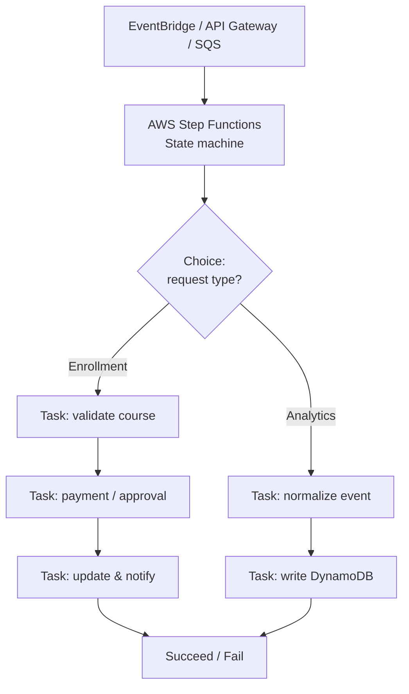
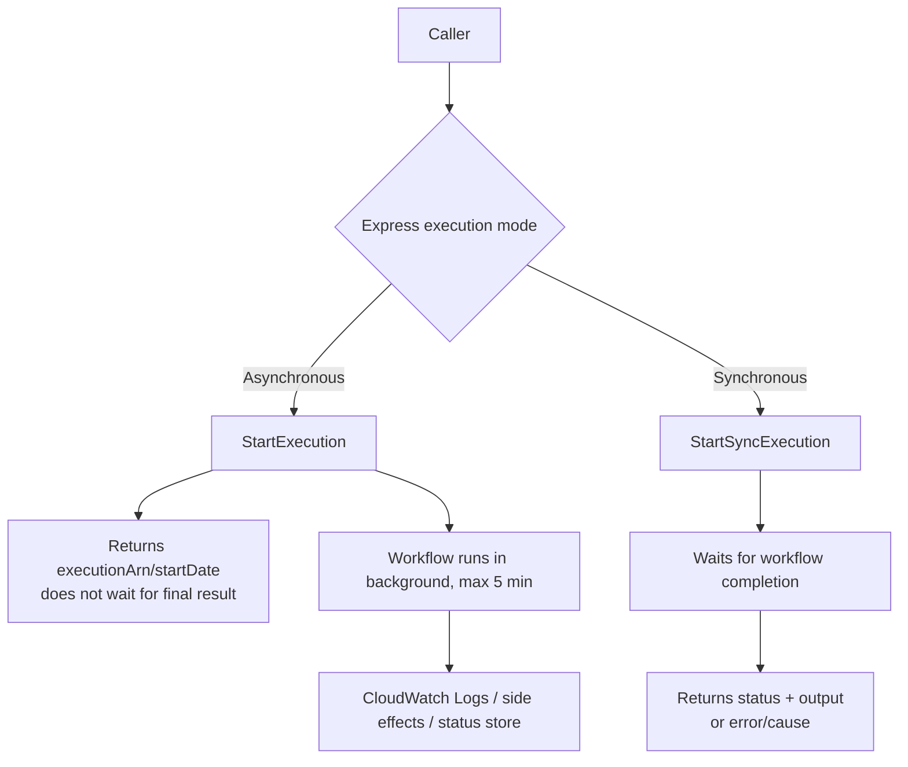
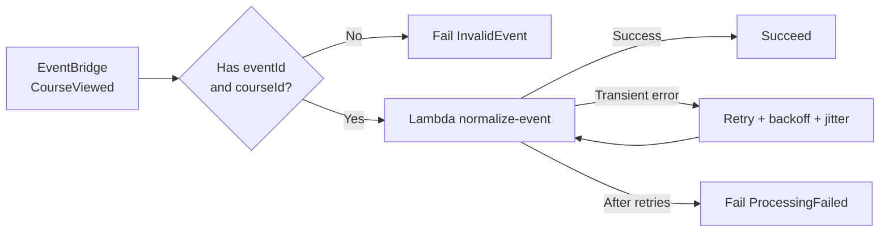
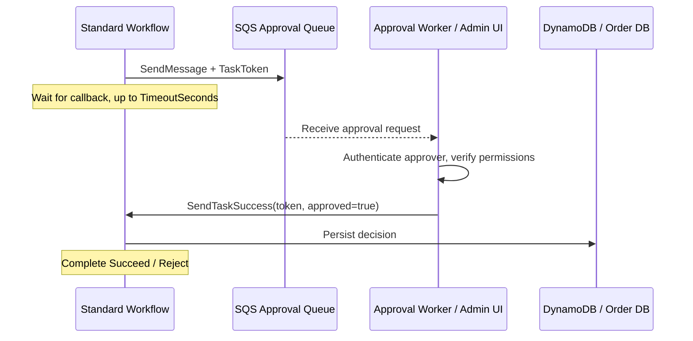
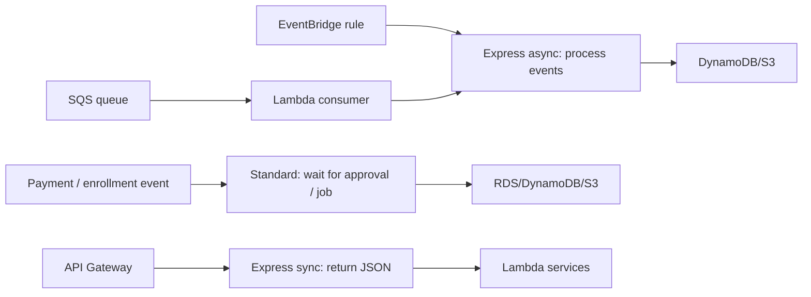
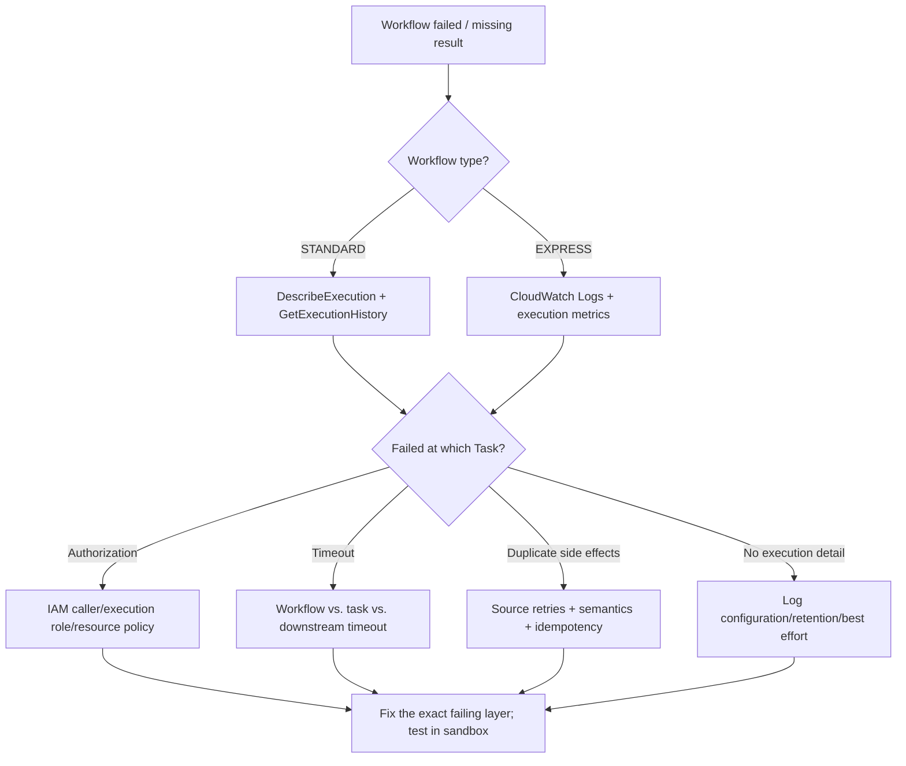

# Step Functions Standard and Express Workflows

> **Module:** CLOUD_PROVIDERS_AWS  
> **Chapter:** Events and Orchestration  
> **Lesson:** Step Functions Standard and Express Workflows  
> **Scope:** AWS Step Functions, Amazon States Language (ASL), AWS Lambda, Amazon EventBridge, Amazon SQS, Amazon ECS, and Java/Spring Boot application tasks.  
> **Context:** Choosing workflow orchestration suited to business duration, semantics, retries, monitoring, availability, and cost in the AWS ecosystem.

## 1. Problem: from imperative Java calls to observable workflows

An online learning platform has a course enrollment workflow:

1. Receive an `EnrollCourse` request from web/mobile via an API.
2. Verify the learner account and course availability.
3. Reserve a seat or record the enrollment order.
4. Request payment through a system with asynchronous confirmation.
5. Send notifications, update DynamoDB/RDS, and persist the outcome.

Another flow ingests millions of `CourseViewed`/`VideoProgressed` events from EventBridge or SQS. It only needs to normalize the event, validate data, increment a counter, and finish in a few seconds.

Both involve multiple steps, yet have **different operational requirements**:

| Flow | Primary goal |
|---|---|
| Enrollment/orders/payments | Recoverable, waits externally for hours/days, auditable, avoids duplicate side effects |
| User interaction ingestion | High throughput, low latency, many short executions, tolerates duplicate events |
| CSV/image processing | Multi-step branching, parallelism, and retries |
| Cloud resource provisioning | Waits for ECS/AWS Batch/EMR jobs to finish, with rollback/compensation |

Putting all steps into a Spring Boot controller with `Thread.sleep` and in-request retries increases timeout risk, loses state if a container is replaced, hides which step failed, and scales poorly. **AWS Step Functions** provides a state machine to orchestrate these steps, but you must choose **Standard** or **Express** upon creation.

**After this lesson, learners will be able to:**

1. Compare Standard and Express across duration, semantics, integrations, logging, and pricing.
2. Distinguish **Express asynchronous** and **Express synchronous**.
3. Write ASL JSON with `Task`, `Choice`, `Retry`, `Catch`, `Map`, and `Parallel`.
4. Choose `Request Response`, `.sync`, or `.waitForTaskToken` patterns.
5. Protect business logic with idempotency, timeouts, DLQs, and compensating actions.
6. Create, run, and observe workflows via the Console, AWS CLI, SAM, and AWS SDK for Java 2.x.
7. Design least-privilege IAM execution roles and PII-free logging.
8. Measure metrics, calculate costs, and justify workflow type selection for each scenario.

## 2. Core concepts of Step Functions

A **state machine** is an AWS resource storing a **workflow definition** written in Amazon States Language (ASL). An **execution** is a single run of a state machine with its own JSON input. A **state** is one step in the graph.



Common state types:

| State type | Meaning | Example |
|---|---|---|
| `Task` | Calls a supported AWS service/Lambda/HTTP task/worker | Invoke Lambda to check course |
| `Choice` | Branches based on data | If `approved=true`, confirm |
| `Pass` | Transforms or passes data through | Normalize a small object |
| `Wait` | Waits for a duration or timestamp | Wait 30 seconds then check |
| `Parallel` | Runs multiple independent branches | Check fraud and learner points |
| `Map` | Iterates processing over a collection | Process a list of courses |
| `Succeed` | Ends successfully | Enrollment recorded |
| `Fail` | Ends in failure with an error message | Invalid input data |

**Key point:** Step Functions **orchestrates** and passes data between tasks; business code may run in Lambda, ECS, DynamoDB, APIs, or other services. It does not mean every state runs inside a long-lived Java server managed by Step Functions.

## 3. Standard vs. Express: decision table

As of **November 20, 2026**, per AWS Step Functions documentation:

| Criterion | **Standard Workflow** | **Express Workflow** |
|---|---|---|
| Maximum execution duration | **1 year** | **5 minutes (300 seconds)** |
| Workflow semantics | **Exactly-once** per AWS model, except Retries configured by the definition/handled failures | **Async: at-least-once; Sync: at-most-once** |
| State between steps | Persisted durably | Not persisted across every state transition like Standard |
| Best suited for | Payments/orders, approvals, long batch jobs, audits | High-volume events, short microservice orchestration |
| Service integrations | Request Response, `.sync`, and `.waitForTaskToken` patterns where supported | **Request Response only**; no `.sync`/`.waitForTaskToken` |
| Distributed Map | Yes | **No** |
| Activities (worker polling) | Yes | **No** |
| Execution history | Stored in Step Functions, API/Console; up to **25,000 events** per execution | History in **CloudWatch Logs if enabled**; no native execution history like Standard |
| Post-completion history | Typically queryable for **90 days** after completion | Depends on CloudWatch Logs retention and delivery |
| Core billing | **Number of state transitions**, including retries | **Execution count + duration + memory used** |
| Throughput level | API start and state transition limits per quota/Region | Designed for high rate; still subject to API start and backend throttling/quotas |
| Can change type in place? | **No** | **No** |

**Do not interpret "exactly-once" as meaning duplicate side effects are impossible.** When a Task retries, an external call's outcome may be unknown (e.g., database committed but response was lost); even Standard requires idempotency for payment/write tasks.

### 3.1. Immutable type

You choose `STANDARD` or `EXPRESS` **when creating the state machine**. AWS does not support changing the `type` attribute afterward. To migrate from Standard to Express:

1. Create a **new state machine** of type Express.
2. Audit ASL: remove incompatible `.sync`, callbacks, Activities, and Distributed Map.
3. Review retries/idempotency, logging, IAM, and the 5-minute limit.
4. Shift event sources/callers to the new ARN via a controlled deployment.
5. Keep a rollback plan and clean up old resources once verified.

You cannot simply edit one field in CloudFormation and expect the old ARN to keep working seamlessly for callers.

### 3.2. A 5-minute limit does not mean a sync API can wait 5 minutes

Express executions run up to 300 seconds, yet **HTTP clients, API Gateway integrations, browsers, and AWS SDK read timeouts** may be shorter. For `StartSyncExecution` in the Step Functions Console, AWS notes **requests time out after 60 seconds**; to test longer synchronous executions, use the SDK or CLI within service limits and matching client timeouts.

## 4. How do exactly-once, at-least-once, and at-most-once differ?

| Semantics | Meaning for workflow execution | Real-world risk |
|---|---|---|
| **Exactly-once (Standard)** | Step Functions persists state and does not repeat the same workflow step the way async Express can, aside from configured retries | An external API may apply a side effect and lose its response; a retry may call it again |
| **At-least-once (Async Express)** | An execution may run more than once | If `chargeCard` is not idempotent, double billing can occur |
| **At-most-once (Sync Express)** | Within a single handled synchronous call, AWS does not replay the whole execution like async | A caller retrying after an ambiguous timeout can still launch a new execution |

An **idempotent operation** can receive the same request multiple times without **causing extra side effects beyond one valid outcome**. Examples:

- `PUT /orders/{orderId}/status=CONFIRMED` with version checking.
- DynamoDB conditional write on `eventId` to mark processed.
- Deterministic S3 object key per job ID, with versioning/checksum.
- Saving `paymentIdempotencyKey` with a uniqueness constraint before calling the PSP.

**Bad example:**

```text
Receive enrollment-123 -> increment seatCounter by 1
Event redelivered -> increment seatCounter by 1
=> One enrollment consumes 2 seats.
```

**Better example:**

```text
Store idempotency key enrollment-123 with a conditional write.
If key absent:
  transactionally update enrollment status + remaining seats.
If key exists:
  return current status without deducting another seat.
```

Watch atomicity: writing a `processed` marker before executing without a transaction or recovery mechanism can also **skip** work if the system crashes mid-way.

### 4.1. `StartExecution` idempotency does not replace business idempotency

In **Standard**, `StartExecution` is idempotent when the caller passes **the same execution name and input** for a **currently running** execution; AWS returns the existing execution's start result. If the execution has already closed or the input changed, AWS may return `ExecutionAlreadyExists`. Names can be reused after roughly **90 days** per AWS conditions.

In **Express**, `StartExecution` is **not idempotent**. A caller retry can start a brand-new execution.

**Never build execution names from unvalidated user input** or assume exactly-once workflow execution replaces database uniqueness constraints.

## 5. Express has two execution modes: async and sync



### 5.1. Asynchronous Express

- Uses `StartExecution`.
- Returns confirmation that the workflow started, **not the final output**.
- Suited for EventBridge/SQS, telemetry, async event enrichment, and backends that do not wait for results.
- Execution semantics are **at-least-once**, requiring idempotency in Tasks and downstream systems.
- To track results, persist state durably to DynamoDB/S3 or use CloudWatch Logs for debugging; **never build a status API relying solely on best-effort log delivery**.

### 5.2. Synchronous Express

- Uses `StartSyncExecution`; the caller waits for the outcome.
- Response includes `status` (`SUCCEEDED`, `FAILED`, `TIMED_OUT`) and corresponding `output`/`error`/`cause`.
- Execution semantics are **at-most-once** per handled call, yet clients can time out and submit a new request.
- The API may return **HTTP 200 even when the workflow failed**; always inspect the `status` field, not just the HTTP status code.
- Can integrate with API Gateway/Lambda for short microservice workflows, provided timeouts align across every layer.

### 5.3. Why not use Express for human approvals?

Human approvals can take hours or days; Express runs for at most 5 minutes and does not support the `.waitForTaskToken` callback pattern. For waiting on a manager to approve a learner, **Standard** is the natural choice.

## 6. Amazon States Language (ASL) and data flow between steps

ASL describes a state machine in **JSON**; AWS Workflow Studio helps design visually and inspect/edit the definition. ASL supports **JSONPath** and **JSONata** via the corresponding `QueryLanguage` setting. The examples below **use JSONPath** for easy inspection and reuse.

A minimal state machine:

```json
{
  "Comment": "Pass-only lab: can be Standard or Express",
  "StartAt": "ValidateFlag",
  "States": {
    "ValidateFlag": {
      "Type": "Choice",
      "Choices": [
        {
          "Variable": "$.enabled",
          "BooleanEquals": true,
          "Next": "Accepted"
        }
      ],
      "Default": "Rejected"
    },
    "Accepted": {
      "Type": "Pass",
      "Result": {
        "status": "ACCEPTED"
      },
      "End": true
    },
    "Rejected": {
      "Type": "Fail",
      "Error": "FlagNotEnabled",
      "Cause": "enabled must be true"
    }
  }
}
```

Input:

```json
{
  "enabled": true,
  "courseId": "java-101"
}
```

The success output from `Pass.Result` is `{"status":"ACCEPTED"}`. `Pass` with `Result` and no `ResultPath` **replaces the state data** by default; to keep `courseId`, configure an appropriate output/result path.

### 6.1. Key JSONPath ASL fields

| Field | Function |
|---|---|
| `StartAt` | Initial state |
| `States` | Map of states in the definition |
| `Type` | State type |
| `Next` | Next state |
| `End: true` | Terminates branch/state machine |
| `InputPath` | Selects subset of input passed into the state |
| `Parameters` | Constructs parameters passed to the service/task |
| `ResultSelector` | Selects/transforms Task output |
| `ResultPath` | Attaches result into input instead of overwriting everything |
| `OutputPath` | Selects subset of output forwarded to the next state |
| `Retry` | Which errors to retry, intervals, and max attempts |
| `Catch` | Transitions to an error-handling branch |
| `TimeoutSeconds` | Timeout for execution or Task depending on placement |
| `Comment` | Documentation for maintainability |

In JSONPath, keys ending with `.$` specify a **JSONPath expression** instead of a string literal. For example, `"Payload.$": "$"` forwards the entire state input to Lambda.

**Never mix JSONata and JSONPath syntax arbitrarily in the same state.** With JSONata, fields like `Arguments`/`Output` and expressions follow different syntax; select `QueryLanguage` explicitly and follow its documentation.

### 6.2. Data size limits

AWS limits the input/output of **a single task, state, or execution** to **256 KiB** as a UTF-8 string (per current quotas). Never stuff entire CSV files, images, or PDFs into state JSON.

Appropriate design:

```json
{
  "jobId": "job-2026-0001",
  "bucket": "course-data-example",
  "key": "input/report-0001.csv",
  "tenantId": "school-01"
}
```

Tasks read objects from S3, write results back to S3, and pass only **ARN/key/status/checksum**. This reduces payload sizes, PII in logs, and Express memory consumption.

## 7. ASL example: short event processing with Express

A `CourseViewed` event enters the workflow, is checked for `eventId`/`courseId`, and invokes a Lambda to normalize data. The handler must be **idempotent on `eventId`** because async Express may execute it more than once.



**Valid illustrative ASL JSON**, usable for either Express or Standard because it only uses request-response Lambda invocation:

```json
{
  "Comment": "Course view event processing; Lambda handler must be idempotent",
  "StartAt": "CheckInput",
  "TimeoutSeconds": 240,
  "States": {
    "CheckInput": {
      "Type": "Choice",
      "Choices": [
        {
          "And": [
            {"Variable": "$.eventId", "IsPresent": true},
            {"Variable": "$.courseId", "IsPresent": true}
          ],
          "Next": "NormalizeEvent"
        }
      ],
      "Default": "InvalidInput"
    },
    "NormalizeEvent": {
      "Type": "Task",
      "Resource": "arn:aws:states:::lambda:invoke",
      "Parameters": {
        "FunctionName": "arn:aws:lambda:ap-southeast-1:123456789012:function:normalize-course-event",
        "Payload.$": "$"
      },
      "ResultPath": "$.normalization",
      "Retry": [
        {
          "ErrorEquals": [
            "Lambda.ServiceException",
            "Lambda.AWSLambdaException",
            "Lambda.SdkClientException",
            "Lambda.TooManyRequestsException"
          ],
          "IntervalSeconds": 2,
          "BackoffRate": 2,
          "MaxAttempts": 3,
          "JitterStrategy": "FULL"
        }
      ],
      "Catch": [
        {
          "ErrorEquals": ["States.ALL"],
          "ResultPath": "$.processingError",
          "Next": "ProcessingFailed"
        }
      ],
      "Next": "Done"
    },
    "Done": {
      "Type": "Succeed"
    },
    "InvalidInput": {
      "Type": "Fail",
      "Error": "InvalidEvent",
      "Cause": "eventId or courseId missing"
    },
    "ProcessingFailed": {
      "Type": "Fail",
      "Error": "NormalizeFailed",
      "Cause": "Event could not be processed"
    }
  }
}
```

**Important notes:**

- The Lambda ARN in ASL is **fictitious**. Replace it with a real account/Region ARN before deploying.
- `TimeoutSeconds: 240` on the state machine sits below the 300-second Express cap, giving a safety margin. The invoked Lambda also has its own timeout.
- Task `Retry` **can invoke Lambda multiple times**, so idempotency is required even under Standard.
- `ResultPath: "$.normalization"` preserves the prior input and attaches Lambda's response under `normalization`. With the optimized Lambda integration, the response structure includes `Payload`.
- `JitterStrategy: "FULL"` spreads out retries; do not retry bad input or business validation failures by cranking up retry counts.
- If external systems track business outcomes, Lambda must persist a status record to durable storage; CloudWatch Logs is not a message queue.

## 8. Standard: waiting for approval using a callback Task Token

Suppose enrolling in a high-value course requires admin review within up to 24 hours. A **Standard Workflow** can use `.waitForTaskToken` to send a message to SQS and wait for an external caller to invoke `SendTaskSuccess`/`SendTaskFailure`.



Sample Standard ASL:

```json
{
  "Comment": "Human approval must use Standard Workflow",
  "StartAt": "WaitForApproval",
  "TimeoutSeconds": 172800,
  "States": {
    "WaitForApproval": {
      "Type": "Task",
      "Resource": "arn:aws:states:::sqs:sendMessage.waitForTaskToken",
      "Parameters": {
        "QueueUrl": "https://sqs.ap-southeast-1.amazonaws.com/123456789012/course-approvals",
        "MessageBody": {
          "orderId.$": "$.orderId",
          "taskToken.$": "$$.Task.Token"
        }
      },
      "TimeoutSeconds": 86400,
      "ResultPath": "$.approval",
      "Catch": [
        {
          "ErrorEquals": ["States.ALL"],
          "ResultPath": "$.approvalError",
          "Next": "ApprovalTimedOut"
        }
      ],
      "Next": "CheckDecision"
    },
    "CheckDecision": {
      "Type": "Choice",
      "Choices": [
        {
          "Variable": "$.approval.approved",
          "BooleanEquals": true,
          "Next": "Approved"
        }
      ],
      "Default": "Rejected"
    },
    "Approved": {
      "Type": "Succeed"
    },
    "Rejected": {
      "Type": "Fail",
      "Error": "ApprovalRejected"
    },
    "ApprovalTimedOut": {
      "Type": "Fail",
      "Error": "ApprovalUnavailable"
    }
  }
}
```

A worker with callback permissions can call the AWS CLI after **authenticating** the approver's decision:

```bash
# Run only in sandbox, using a token taken from a valid message.
# Never log, email, or expose task tokens to untrusted systems.
aws stepfunctions send-task-success \
  --task-token 'TASK_TOKEN_FROM_SQS' \
  --task-output '{"approved":true}' \
  --region ap-southeast-1
```

**Distinction:** `--task-output` is a Step Functions `send-task-success` parameter; AWS CLI's `--output` flag selects CLI output formatting. In labs, replace the placeholder token securely—never commit tokens into shared files.

**Task Token security:** A task token is a **bearer capability** sufficient to complete or fail a task within AWS API permissions. Never let end users call `SendTaskSuccess` directly without a backend authenticating the approver and checking role/tenant permissions.

### 8.1. Timeouts, heartbeats, and callbacks

- `TimeoutSeconds` caps how long the Task waits for a callback.
- `HeartbeatSeconds` can require a worker to check in via `SendTaskHeartbeat`, **but** do not set a 1-minute heartbeat on a 1-day human approval workflow where no worker sends heartbeats.
- A callback timeout fails the Task; an old callback token becomes invalid after timeout/retry.
- For sensitive payment steps, add transaction state checks and idempotency upon completion.

**Express does not support `.waitForTaskToken`**, even with synchronous executions.

## 9. Standard: waiting for an ECS/Batch job to finish with `.sync`

Another scenario: exporting a large report via Amazon ECS/Fargate that may take longer than 5 minutes. If the state machine must wait until the job finishes before moving on, use a `.sync` integration **on Standard**.

Illustrative **ASL snippet** (not a standalone state machine):

```json
{
  "RunReportTask": {
    "Type": "Task",
    "Resource": "arn:aws:states:::ecs:runTask.sync",
    "Parameters": {
      "Cluster": "arn:aws:ecs:ap-southeast-1:123456789012:cluster/course-jobs",
      "TaskDefinition": "course-report-task:3",
      "LaunchType": "FARGATE",
      "NetworkConfiguration": {
        "AwsvpcConfiguration": {
          "Subnets": ["subnet-01234567", "subnet-89abcdef"],
          "SecurityGroups": ["sg-0123456789abcdef0"],
          "AssignPublicIp": "DISABLED"
        }
      }
    },
    "TimeoutSeconds": 3600,
    "ResultPath": "$.reportResult",
    "Next": "PersistReport"
  }
}
```

This snippet must sit inside `States` alongside a valid `PersistReport` state. The ECS task definition, private subnet routes, IAM `ecs:RunTask`/`iam:PassRole`, and Step Functions permissions to monitor the task must actually be configured.

**Subtle difference:** `Resource: "arn:aws:states:::ecs:runTask"` in Express is **Request Response**: Step Functions advances immediately after `RunTask` API returns, **without waiting for the container to finish**. Changing `runTask.sync` to `runTask` just to "make Express work" changes business semantics—it is not an equivalent optimization.

For `.sync`, Step Functions tracks job completion via AWS APIs/EventBridge where supported. When a workflow is canceled, AWS makes a **best-effort** attempt to stop the job; it does not guarantee every downstream job stops. Inspect actual ECS task status and cleanup procedures.

## 10. Service integrations: choosing the right pattern

There are three patterns:

| Pattern | Resource syntax | Standard | Express |
|---|---|---|---|
| **Request Response** | `arn:aws:states:::lambda:invoke` or `...:ecs:runTask` | Yes | Yes |
| **Run a Job** | Resource with `.sync` suffix where supported | Yes | **No** |
| **Wait for Callback** | Resource with `.waitForTaskToken` suffix where supported | Yes | **No** |

**Note:** Not every AWS integration supports `.sync` or callbacks. Check the official service/API integration table. AWS SDK service integrations support hundreds of services with request-response; waiting on jobs requires one of the integration patterns provided by AWS.

### 10.1. Practical scenarios

| Requirement | Pattern / workflow type |
|---|---|
| Invoke Lambda for validation in a few seconds | Standard or Express, request-response |
| Write to DynamoDB and advance when `PutItem` returns | Standard or Express, request-response |
| Wait for a 25-minute ECS job then run next step | **Standard + `ecs:runTask.sync`** |
| Wait two days for human approval | **Standard + `.waitForTaskToken`** |
| Process hundreds of thousands of 1–3s events/day | **Async Express** |
| Return quick microservice orchestration result to caller | **Sync Express** if timeouts align across layers |
| Iterate millions of objects with Distributed Map | **Standard** parent orchestration with Distributed Map |
| Poll workers via Step Functions Activities | **Standard** |

## 11. `Retry`, `Catch`, and business errors

### 11.1. Retrying transient errors

Example Lambda Task with retries:

```json
{
  "Retry": [
    {
      "ErrorEquals": [
        "Lambda.ServiceException",
        "Lambda.AWSLambdaException",
        "Lambda.SdkClientException",
        "Lambda.TooManyRequestsException"
      ],
      "IntervalSeconds": 2,
      "BackoffRate": 2,
      "MaxAttempts": 3,
      "MaxDelaySeconds": 20,
      "JitterStrategy": "FULL"
    }
  ]
}
```

This is a **configuration snippet** placed inside an appropriate Task. `MaxAttempts: 3` counts **retries**, excluding the initial attempt. In production, cap retries to prevent retry storms during downstream outages, paired with monitoring and backpressure.

### 11.2. `Catch` and error classification

| Error | Handling |
|---|---|
| Service throttle / 5xx | Bounded retries with jitter |
| Invalid input/schema | Fail fast; do not retry endlessly |
| Insufficient IAM permissions | Fix policy; do not retry until permissions are fixed |
| Missing resource | Check ID/deployment; usually non-self-healing |
| Task timeout | Record state, idempotent compensation/recovery |
| Callback never arrives | Task timeout, alert, and operator intervention |
| Ambiguous payment result | Query payment transaction status before retrying |

`States.ALL` is a catch-all error name for retriers/catchers **within AWS-permitted conditions**. Never assume errors like `States.DataLimitExceeded` or certain runtime failures are caught like ordinary application errors. Base error handling on real Step Functions semantics.

### 11.3. Asynchronous means duplicates and out-of-order arrivals

EventBridge, SQS, and some event sources can redeliver/re-trigger. Async Express can execute multiple times. Therefore:

- Store `eventId`/`orderId` in DynamoDB/RDS with uniqueness constraints.
- Use DynamoDB `ConditionExpression attribute_not_exists(pk)` when writing processing markers.
- For multi-step side effects, use transactions or `PENDING → DONE/FAILED` state tracking with recovery.
- Never send duplicate payment notifications if `notificationId` was already processed.
- Account for event ordering; concurrent workflows do not inherently execute in business-event order.

**Compensation (Saga):** If `ReserveSeat` succeeds and `ChargePayment` fails, the workflow can invoke `ReleaseSeat`. Compensations must be idempotent and can fail on their own—they are not cross-service ACID rollbacks.

## 12. `Map`, `Parallel`, and Distributed Map

### 12.1. `Parallel`

`Parallel` executes independent branches concurrently and synchronizes outputs per state semantics. Example checking entitlement and fraud concurrently:

```json
{
  "Type": "Parallel",
  "Branches": [
    {
      "StartAt": "CheckEntitlement",
      "States": {
        "CheckEntitlement": {
          "Type": "Pass",
          "Result": {"allowed": true},
          "End": true
        }
      }
    },
    {
      "StartAt": "CheckFraud",
      "States": {
        "CheckFraud": {
          "Type": "Pass",
          "Result": {"risk": "low"},
          "End": true
        }
      }
    }
  ],
  "End": true
}
```

This snippet works in Standard or Express. `Parallel` does not guarantee deterministic branch completion order, nor does it turn side effects into an atomic transaction.

### 12.2. Inline `Map`

Inline `Map` processes a bounded list of items inside the execution input. With large arrays, you risk hitting the **256 KiB payload limit**, Standard's **25,000 execution history events**, excessive transitions, or high costs.

- Cap `MaxConcurrency` to match downstream capacity.
- Design per-item retries and idempotency.
- Never inline tens of thousands of records into state JSON near quota limits.
- Use S3 references/`ItemReader` when distributed scale is required.

### 12.3. Distributed Map is Standard-only

**Distributed Map** handles large datasets from S3 and child workflows with Map Runs and massive fan-out. Distributed Map **is not supported in Express state machines**, although a **Standard parent** can launch Express child executions in certain patterns.

When using Distributed Map:

- Throttle concurrency so DynamoDB/RDS are not overwhelmed.
- Keep inputs/outputs in S3 rather than stuffing every item into state JSON.
- Monitor Map Runs and redrive/retry behavior within limits.
- Account for parent Standard transitions **and child workflow executions** by type in cost estimates.
- Scope IAM permissions for nested state machines and S3.

## 13. Triggering workflows from EventBridge, SQS, and API Gateway



### 13.1. EventBridge rule → Step Functions

EventBridge can target a state machine with an execution role and IAM permissions:

- Rule filters on `source` and `detail-type`.
- Pass event input (optionally via an input transformer).
- Target state machine ARN must be exact.
- IAM role/permissions allowing EventBridge to start executions.
- Monitor EventBridge retry/DLQ strategy; **targeting alone does not guarantee end-to-end exactly-once**.

For high-volume independent events, **Async Express** is often a strong candidate. For payment flows/long callbacks, **Standard** is usually appropriate.

### 13.2. SQS

SQS is a message queue, not an orchestrator. When SQS is the source, you can:

1. Use a Lambda consumer to read batches and start state machines.
2. Use EventBridge Pipes integration (where source/target fit) to route messages to workflows.
3. Have a Standard workflow use service integrations to send/receive messages via supported patterns.

Design for:

- Visibility timeout, batch size, and partial batch responses in consumer Lambdas.
- Queue DLQs and `maxReceiveCount`.
- Idempotency keys derived from business event/message IDs; SQS message IDs may not be immutable business identities.
- Backend capacity when thousands of executions launch concurrently.

**Do not treat SQS + Express as exactly-once.** Retries can happen at both source and execution layers.

### 13.3. API Gateway

For synchronous APIs, API Gateway can call `StartSyncExecution` on Express to return results without an orchestration-only Lambda. However:

- API Gateway integration timeouts can be **shorter than 300 seconds**.
- When Step Functions returns `status: FAILED` inside an HTTP 200 AWS API response, the integration must **map status** to proper HTTP codes.
- Protect APIs with IAM/JWT/Lambda authorizers, throttling, and input validation.
- If work takes minutes, return **202 Accepted + job ID**, run Standard/asynchronous execution, and expose a status endpoint rather than holding an HTTP request open.

## 14. Java: invoking Standard and Express with AWS SDK for Java 2.x

A Java/Spring Boot backend on ECS/Lambda can invoke Step Functions using **AWS SDK for Java 2.x** with an **IAM task role/execution role** instead of hardcoded access keys.

Example dependency: `software.amazon.awssdk:sfn` alongside SDK BOM dependencies. Illustrative Java 17 code:

```java
package example.course.workflow;

import software.amazon.awssdk.regions.Region;
import software.amazon.awssdk.services.sfn.SfnClient;
import software.amazon.awssdk.services.sfn.model.StartExecutionRequest;
import software.amazon.awssdk.services.sfn.model.StartExecutionResponse;
import software.amazon.awssdk.services.sfn.model.StartSyncExecutionRequest;
import software.amazon.awssdk.services.sfn.model.StartSyncExecutionResponse;

public final class StartWorkflowExample {
    private static final Region REGION = Region.AP_SOUTHEAST_1;

    public static void main(String[] args) {
        String standardArn =
            "arn:aws:states:ap-southeast-1:123456789012:stateMachine:course-enrollment-standard";
        String expressArn =
            "arn:aws:states:ap-southeast-1:123456789012:stateMachine:course-event-express";

        try (SfnClient sfn = SfnClient.builder().region(REGION).build()) {
            // Standard: starts workflow; response does not contain final result.
            StartExecutionResponse started = sfn.startExecution(
                StartExecutionRequest.builder()
                    .stateMachineArn(standardArn)
                    .name("enrollment-2026-000001")
                    .input("{\"orderId\":\"order-001\"}")
                    .build());

            System.out.println("Standard execution ARN: "
                + started.executionArn());

            // Express Sync: waits for result via StartSyncExecution API.
            StartSyncExecutionResponse sync = sfn.startSyncExecution(
                StartSyncExecutionRequest.builder()
                    .stateMachineArn(expressArn)
                    .input("{\"enabled\":true,\"eventId\":\"event-001\"}")
                    .build());

            // Do not treat HTTP 200 as workflow success.
            if (!"SUCCEEDED".equals(sync.statusAsString())) {
                throw new IllegalStateException(
                    "Express failed, status=" + sync.statusAsString()
                    + ", error=" + sync.error());
            }

            System.out.println("Express output: " + sync.output());
        }
    }
}
```

**Prerequisites to run:** Both state machines exist as `ACTIVE` ARNs; the backend role has `states:StartExecution` for Standard and `states:StartSyncExecution` for Express; inputs match ASL; and the SDK is configured with the right Region/IAM.

**Precautions:**

- `StartExecution` does not wait for Standard completion, even though it is a synchronous Java SDK call.
- `StartSyncExecution` is **Express-only**; never call it on Standard.
- `sync.statusAsString()` must be checked; never rely solely on HTTP status.
- If a client/proxy times out before receiving the sync response, an idempotency key is required on retries.
- Never log outputs containing PII, access tokens, or payment card data in production logs.
- For multi-second sync APIs, configure appropriate SDK HTTP read timeouts and measure network latency.

### 14.1. Java Lambda handler for a Task step

Each `Task` can invoke a Java 17 Lambda:

```java
package example.course.workflow;

import com.amazonaws.services.lambda.runtime.Context;
import com.amazonaws.services.lambda.runtime.RequestHandler;
import java.util.Map;

public final class ValidateEnrollmentHandler
        implements RequestHandler<Map<String, Object>, Map<String, Object>> {

    @Override
    public Map<String, Object> handleRequest(
            Map<String, Object> event, Context context) {

        Object raw = event.get("orderId");
        String orderId = raw == null ? "" : raw.toString();

        if (orderId.isBlank()) {
            throw new IllegalArgumentException("orderId is required");
        }

        // Production: verify permissions, status, tenant,
        // and uniqueness/idempotency in database before side effects.
        return Map.of(
            "orderId", orderId,
            "valid", true,
            "checked", true);
    }
}
```

This code is only a sample validator and **does not enforce database uniqueness**. In production, enforce idempotency/checkpoints and proper audit logging.

## 15. AWS Console: creating and running two state machines

### 15.1. Standard Workflow lab

1. Log into a sandbox AWS account and verify Region.
2. Open **AWS Step Functions → State machines → Create state machine**.
3. Choose Workflow Studio or write the definition in code.
4. Select **Standard**, name it `course-enrollment-standard`.
5. Paste the simple Pass/Choice ASL from section 6 or the callback ASL from section 8 **when the SQS queue/role are ready**.
6. Choose/create an **IAM execution role** with exact Task integration permissions.
7. Configure logging/tracing per project policy; do not log sensitive inputs/outputs unnecessarily.
8. Create and run via **Start execution** with sandbox input.
9. Inspect the execution graph, Input/Output, event history, duration, and status.
10. When using callbacks, ensure a worker sends the right task token so executions are not left hanging.

### 15.2. Express Workflow lab

1. Create another state machine, select **Express**, name it `course-event-express`.
2. Use a short ASL (section 6 or 7) without callbacks or `.sync`.
3. **Enable CloudWatch Logs** for Express with an appropriate log group and retention policy.
4. Select log level `ALL` in the lab to inspect all execution events; consider `ERROR`/`FATAL` in high-volume environments if full traces are unnecessary.
5. Set `IncludeExecutionData=false` to avoid writing raw inputs/outputs into logs.
6. Create and run one valid input and one invalid input.
7. Observe results in the Console and CloudWatch Logs.
8. Test `StartSyncExecution` via CLI/SDK; check the `status` field.
9. Inspect execution count/duration/memory graphs and assess error visibility.
10. Clean up test state machines/log groups after confirming no other workflows depend on them.

**Good to know:** Express history in the Step Functions Console **depends on CloudWatch Logs**, which are delivered **best effort**. Never make business correctness depend on logs arriving completely or on time. For immutable auditing, pick Standard or persist business records durably.

## 16. AWS CLI: creating, running, and inspecting

### 16.1. Verify account and prepare definitions

Sample commands use **AWS CLI v2** in an authorized terminal (e.g., Linux/macOS):

```bash
aws sts get-caller-identity
aws stepfunctions list-state-machines --region ap-southeast-1
```

Save the sample ASL JSON into `workflow-standard.asl.json` or `workflow-express.asl.json` per local workflow, then validate:

```bash
aws stepfunctions validate-state-machine-definition \
  --definition file://workflow-standard.asl.json \
  --region ap-southeast-1
```

Validation checks syntax per AWS rules; **it does not prove the IAM role has permissions**, Lambdas exist, or logic is idempotent.

### 16.2. Create a Standard state machine

```bash
aws stepfunctions create-state-machine \
  --name course-enrollment-standard \
  --type STANDARD \
  --definition file://workflow-standard.asl.json \
  --role-arn arn:aws:iam::123456789012:role/CourseStepFunctionsRole \
  --region ap-southeast-1
```

This is a **mutating command that can incur charges when executed**. The execution role must trust `states.amazonaws.com` and match the ASL's permissions. A Pass-only state machine needs no Lambda/SQS rights; Task integrations require them.

### 16.3. Run Standard and inspect history

```bash
aws stepfunctions start-execution \
  --state-machine-arn arn:aws:states:ap-southeast-1:123456789012:stateMachine:course-enrollment-standard \
  --name enrollment-2026-000001 \
  --input '{"enabled":true,"orderId":"order-001"}' \
  --region ap-southeast-1
```

Use `executionArn` from the output:

```bash
aws stepfunctions describe-execution \
  --execution-arn arn:aws:states:ap-southeast-1:123456789012:execution:course-enrollment-standard:enrollment-2026-000001 \
  --region ap-southeast-1

aws stepfunctions get-execution-history \
  --execution-arn arn:aws:states:ap-southeast-1:123456789012:execution:course-enrollment-standard:enrollment-2026-000001 \
  --region ap-southeast-1
```

If the definition uses callbacks/Wait, status may stay `RUNNING`. Only resolve callback tokens through designed flows; never call `StopExecution` on Production workflows just to test a command.

### 16.4. Create and run Express

Once you have an Express-compatible ASL:

```bash
aws stepfunctions create-state-machine \
  --name course-event-express \
  --type EXPRESS \
  --definition file://workflow-express.asl.json \
  --role-arn arn:aws:iam::123456789012:role/CourseStepFunctionsRole \
  --region ap-southeast-1
```

**Hands-on note:** This sample CLI command only creates the state machine. To view Express execution history, **enable CloudWatch Logs** at creation time or via `update-state-machine --logging-configuration` with proper structure and logging permissions before running labs. Do not create Express without logging and wonder why the Console shows no history.

Async Express:

```bash
aws stepfunctions start-execution \
  --state-machine-arn arn:aws:states:ap-southeast-1:123456789012:stateMachine:course-event-express \
  --input '{"eventId":"event-001","courseId":"java-101"}' \
  --region ap-southeast-1
```

Sync Express:

```bash
aws stepfunctions start-sync-execution \
  --state-machine-arn arn:aws:states:ap-southeast-1:123456789012:stateMachine:course-event-express \
  --input '{"eventId":"event-002","courseId":"java-101"}' \
  --region ap-southeast-1
```

Read `status` in the JSON output. **HTTP 200 does not mean `status=SUCCEEDED`.**

### 16.5. When Express execution history is missing

Do not call Standard's `get-execution-history` expecting full Express logs. For Express:

- Enable CloudWatch logging upfront.
- Use the **Step Functions Console** to view log-backed execution details or query **CloudWatch Logs Insights**.
- Check logging level, IAM `logs:CreateLogDelivery` and related permissions, log group ARN, and resource policy quotas/retention.
- Log delivery is **best effort**, never rely on it for business-state audits.

## 17. AWS SAM/CloudFormation: declaring workflow types safely

AWS SAM resource `AWS::Serverless::StateMachine` supports `Type: STANDARD` or `Type: EXPRESS`.

**Fragment** example assuming an existing IAM role and log group:

```yaml
Transform: AWS::Serverless-2016-10-31
Resources:
  CourseStandard:
    Type: AWS::Serverless::StateMachine
    Properties:
      Name: course-standard-demo
      Type: STANDARD
      Role: arn:aws:iam::123456789012:role/CourseStepFunctionsRole
      Definition:
        StartAt: Accepted
        States:
          Accepted:
            Type: Pass
            Result:
              status: accepted
            End: true

  CourseExpress:
    Type: AWS::Serverless::StateMachine
    Properties:
      Name: course-express-demo
      Type: EXPRESS
      Role: arn:aws:iam::123456789012:role/CourseStepFunctionsRole
      Definition:
        StartAt: Accepted
        States:
          Accepted:
            Type: Pass
            Result:
              status: accepted
            End: true
      Logging:
        Level: ALL
        IncludeExecutionData: false
        Destinations:
          - CloudWatchLogsLogGroup:
              LogGroupArn: arn:aws:logs:ap-southeast-1:123456789012:log-group:/aws/vendedlogs/states/course-express:*
```

**Note:** This is a *fragment*; the IAM role and CloudWatch log group must **already exist or be declared**, and the execution role must have the logging permissions required by AWS. ARNs/names are fictitious; verify CloudFormation syntax and AWS SAM CLI support at deployment time. Do not just add `Logging` expecting AWS to create the log group, IAM permissions, and retention automatically if those resources are missing.

### 17.1. Advantages of IaC

- Keeps ASL, workflow type, IAM, logging, and tags in source control.
- Enables security reviews before deployment.
- Builds consistent dev/staging/production environments.
- Manages state machine versions and aliases for controlled rollouts.
- Simplifies rollbacks when state definitions change.

**Immutable workflow type:** Changing `Type: STANDARD → EXPRESS` requires a plan to replace resources/migrate callers rather than attempting an in-place update like Lambda memory.

## 18. IAM, logging, and sensitive data

### 18.1. Execution role: what is Step Functions allowed to do?

Each state machine needs an **execution role** trusted by `states.amazonaws.com`. The IAM role should only hold permissions actually needed by its Tasks.

Sample trust policy:

```json
{
  "Version": "2012-10-17",
  "Statement": [
    {
      "Effect": "Allow",
      "Principal": {
        "Service": "states.amazonaws.com"
      },
      "Action": "sts:AssumeRole",
      "Condition": {
        "ArnLike": {
          "aws:SourceArn": "arn:aws:states:ap-southeast-1:123456789012:stateMachine:*"
        },
        "StringEquals": {
          "aws:SourceAccount": "123456789012"
        }
      }
    }
  ]
}
```

`aws:SourceArn`/`aws:SourceAccount` conditions mitigate confused-deputy risks per AWS guidance; in real environments, narrow the resource pattern further when appropriate.

Permission policy allowing Step Functions to invoke a single Lambda:

```json
{
  "Version": "2012-10-17",
  "Statement": [
    {
      "Sid": "InvokeEventNormalizer",
      "Effect": "Allow",
      "Action": "lambda:InvokeFunction",
      "Resource": "arn:aws:lambda:ap-southeast-1:123456789012:function:normalize-course-event"
    }
  ]
}
```

If the state machine also sends to SQS, runs ECS/Batch, updates DynamoDB, or uses callbacks, add the matching actions/resources, `iam:PassRole` (if needed), KMS, and resource policies. Never grant `AdministratorAccess` just because a Task returns `AccessDenied`.

### 18.2. Caller role differs from execution role

| Role | Example | Permissions |
|---|---|---|
| **Caller** | Lambda/ECS/Java backend starting the state machine | `states:StartExecution` or `states:StartSyncExecution` on exact ARN |
| **Execution role** | State machine invoking Tasks | `lambda:InvokeFunction`, `sqs:SendMessage`, `ecs:RunTask`… |
| **Worker callback role** | Approval worker submitting task token | `states:SendTaskSuccess`/`SendTaskFailure` per supported IAM model |
| **Operator** | Engineer viewing histories/logs | Read permissions on state machines and logs, scoped by role |
| **CloudWatch Logs delivery** | Log shipping capability | `logs:*LogDelivery` and log-related permissions per AWS docs |

**Do not confuse:** granting a user `states:StartExecution` **does not grant that user direct** `lambda:InvokeFunction` access. Step Functions uses the state machine's execution role to call Task integrations.

### 18.3. Inputs/outputs may contain sensitive data

ASL inputs/outputs may contain user details, emails, access tokens, or identifiers. With `IncludeExecutionData=true`, logs can capture full inputs/outputs depending on log level.

Safeguards:

1. Never pass raw passwords, JWTs, session credentials, or payment card data in workflow input.
2. Store sensitive payloads in protected S3/databases and pass reference IDs.
3. Enable encryption/KMS aligned with AWS capabilities and policies.
4. Restrict IAM permissions to read execution history and CloudWatch logs.
5. Set retention/lifecycle rules and evaluate logging costs.
6. For callbacks, treat the task token as a **sensitive bearer token**—never log it broadly for all users.

**CloudWatch logging for Express is best effort**; if strict auditing is required, use Standard or write transaction state to a datastore built for the required durability.

## 19. Monitoring, metrics, and troubleshooting

### 19.1. Metrics to watch

| Source | Metric/signal | Meaning |
|---|---|---|
| Step Functions | `ExecutionsStarted` | Number of executions started |
| Step Functions | `ExecutionsSucceeded` | Workflows completed successfully |
| Step Functions | `ExecutionsFailed` | Failed workflows |
| Step Functions | `ExecutionsTimedOut` | Exceeded execution timeout |
| Step Functions | `ExecutionTime` | Workflow duration |
| Step Functions | `ExecutionThrottled` | Standard state transition throttling where applicable |
| Express | `ExpressExecutionMemory`, `ExpressExecutionBilledMemory` | Memory used/billed to understand duration billing |
| AWS Lambda | `Errors`, `Duration`, `Throttles` | Bottlenecks in tasks |
| SQS | `ApproximateAgeOfOldestMessage`, DLQ depth | Backlogs/retries |
| DynamoDB/RDS | Throttling, latency, transactions | Downstream limits |

Verify CloudWatch metric names and dimensions against live APIs/services. A workflow reporting `SUCCEEDED` does not prove downstream business records are valid if a Task returned bad output; emit application-level success metrics.

### 19.2. Standard history vs. Express logging

**Standard:**

- Execution details/history are stored by Step Functions and accessible via API/Console for completed executions for **90 days**.
- AWS supports **redriving** unsuccessful Standard executions within the supported window (currently up to **14 days** after completion).
- A single Standard execution is capped at **25,000 history events**; avoid unbounded loops or uncontrolled history generation.
- CloudWatch Logs can be enabled additionally, though not required just to view native history.

**Express:**

- Execution history is **not stored inside Step Functions** like Standard.
- Console/Logs Insights pull data from the configured **CloudWatch log group**.
- Log level `ALL` lets you trace every state, at the cost of ingestion/storage and potential exposure of sensitive input/output.
- If logging is `OFF` or logs expire, the Console cannot show execution details.
- CloudWatch Logs delivery is not 100% guaranteed; absence of logs ≠ zero executions.

### 19.3. Common troubleshooting table

| Symptom | Possible cause | How to check |
|---|---|---|
| `StartSyncExecution` rejected on Standard | API is Express-only | Check state machine type; use `StartExecution` for Standard |
| Standard `ExecutionAlreadyExists` | Name collides with closed execution or different input within ~90 days | Execution name, input, idempotency strategy |
| Express event processed twice | Async Express at-least-once, source retry, or Task Retry | Idempotency marker, event ID, SQS/EventBridge retries |
| Express times out right at 5 minutes | 300-second execution limit | Split workflow or move to Standard |
| Workflow stuck waiting for callback | No `SendTaskSuccess` call, wrong token, overly long timeout | SQS message, worker logs, token lifetime, IAM |
| Express fails on `ecs:runTask.sync` | Express supports Request Response only | Choose Standard or redesign with callbacks/events |
| Express executions invisible in Console | Logs not enabled, wrong level/permissions/retention | CloudWatch log group, logging config, IAM |
| `AccessDenied` on Lambda Task | Execution role missing `InvokeFunction` or resource policy | IAM execution role, Lambda ARN/alias, service permissions |
| `States.DataLimitExceeded` | Payload exceeds 256 KiB | Move large data to S3, pass keys in state |
| Stopped Standard yet ECS job keeps running | `.sync` cancellation is best effort | Inspect ECS task and cleanup policy |
| Workflows fail when downstream throttles | Missing retry/backoff or concurrency too high | Step Functions Retry, service quotas, CloudWatch metrics |
| `StartSyncExecution` HTTP 200 yet app returns error | Client did not inspect `status` field | Check `output`/`error`/`cause` and API mapping |
| Express cost spikes | Long durations, large `Parallel`/`Map` payloads, higher billed memory | `Duration`, `ExpressBilledMemory`, payload size |
| Standard exceeds budget | Too many state transitions/retries/Wait loops | ASL design, retry counts, transition metrics |
| Logs leak PII | `IncludeExecutionData` or Lambda logging raw input | Log config, redaction, IAM readers, retention |

### 19.4. Investigation flowchart



## 20. Cost optimization: transitions vs. requests/duration/memory

### 20.1. Standard Workflows bill by state transitions

Per [AWS Step Functions Pricing](https://aws.amazon.com/step-functions/pricing/), Standard is billed by the **number of state transitions**, including transitions generated by retries. AWS provides **4,000 free transitions/month** under current Free Tier terms.

**Illustrative** calculation:

```text
100,000 workflow executions/month
× 5 transitions/execution
= 500,000 transitions/month

If each execution averages 2 extra retries:
100,000 × (5 + 2)
= 700,000 transitions/month

Billable transitions (assuming Free Tier applies)
= total transitions - 4,000
```

These are usage units; check exact **per-transition pricing** for your Region and date. A workflow waiting 2 days for human approval incurs no Express-style duration fee while waiting, though integrations, logs, and other services still cost money.

### 20.2. Express bills by requests and duration/memory

Express pricing is based on:

- **Number of workflow executions started**, including console tests per terms.
- **Duration** from execution start to end/termination, **rounded up to 100 ms increments**.
- **Memory used** by the workflow; billed in **64 MB increments**. This reflects definition size, input/payload, and `Map`/`Parallel` usage—**not the Lambda Task's `MemorySize`**.
- CloudWatch Logs and other integrated services are billed separately.

**Illustrative** example assuming 100,000 executions, **4 seconds** each, **64 MB** billed memory:

```text
Workflow duration in GB-seconds
= 100,000 × 4 seconds × (64 MB / 1024 MB)
= 25,000 GB-seconds

Total Express
= 100,000 request units × Regional request unit price
  + 25,000 GB-seconds × Regional duration/memory price
  + CloudWatch Logs / Lambda / other service costs
```

If larger payloads/`Map`/`Parallel` push memory from ~64 MB past the **128 MB billed** tier, duration charges can rise noticeably even with the same execution count.

**Never multiply Express usage by Lambda's GB-second rate.** Lambda and Step Functions Express are separate services with distinct pricing.

### 20.3. When is Express cheaper than Standard?

Suppose 1 million executions/month with a multi-step short workflow. Where Standard generates many transitions, Express can cut orchestration costs for executions finishing within five minutes using idempotent actions. However, if Express runs near 5 minutes, carries heavy payloads/`Map`/`Parallel`, or writes verbose logs, Express can end up costlier.

Choose based on:

1. Semantics and **tolerance for duplicates**.
2. Duration limits and job/approval patterns.
3. Executions × transitions.
4. Express duration × billed workflow memory.
5. CloudWatch Logs and Task integrations.
6. Throughput, scaling, and quotas.
7. Engineering cost for idempotency and operations.

**Cost comes after ruling out options that violate business correctness.** Never force a one-day approval onto Express just because per-request pricing looks low.

## 21. Comprehensive hands-on exercises

### 21.1. Scenario A: processing `CourseViewed` events

**Sample input:**

```json
{
  "eventId": "event-course-0001",
  "courseId": "java-101",
  "userId": "user-sandbox-17",
  "eventType": "CourseViewed",
  "occurredAt": "2026-11-20T02:30:00Z"
}
```

Tasks:

1. Select **Async Express** and explain why `at-least-once` semantics are acceptable.
2. Build an ASL `Choice → Lambda Task → Succeed/Fail` based on section 7.
3. Persist results to DynamoDB keyed by unique `eventId` to prevent duplicates.
4. Configure `Retry` with jitter and `Catch` for recoverable errors.
5. Enable CloudWatch Logs with `IncludeExecutionData=false` when PII is present.
6. Run a valid input, an input missing `eventId`, and send the same event twice.
7. Verify DynamoDB **does not increment the counter twice**.
8. Record `ExecutionsSucceeded`/`Failed`, duration, and estimated cost.

### 21.2. Scenario B: enrollment/payment approval

Context: a learner purchases a special course requiring instructor approval within 24 hours; a subsequent step may run a 20-minute ECS Batch job.

Tasks:

1. Choose **Standard**, not Express.
2. Design `.waitForTaskToken` over SQS with an approval backend authenticating instructors.
3. After approval, use `ecs:runTask.sync` to monitor the long job.
4. Use `orderId`/`paymentId` as idempotency keys when writing RDS and calling payments.
5. On approval timeout, record status and send notifications; never leave records stuck in "pending" forever.
6. Inspect Standard execution history and demonstrate compensation when a step fails.
7. List required IAM actions for the execution role and callback role, plus Task Token protections.
8. Propose backup/audit/RPO/RTO and a version rollback plan.

### 21.3. Pass criteria matrix

| Criterion | Check |
|---|---|
| Correct workflow type | Standard for > 5 min waits/callbacks/`.sync`; Express for short, high-volume |
| Semantics | Distinguishes Standard exactly-once vs. Async Express at-least-once vs. Sync Express at-most-once |
| Idempotency | No duplicate payments/enrollments on retry |
| ASL | Valid states, `Retry`, `Catch`, timeouts, JSONPaths |
| IAM | Caller role and state machine execution role separated, least privilege |
| Observability | Standard history or Express CloudWatch Logs configured appropriately |
| Security | No secrets/PII/task tokens in logs; business authorization enforced |
| Cost | Distinguishes transitions vs. requests/duration/billed memory |
| Resilience | Bounded retries, DLQ, compensation, downstream quotas |
| Cleanup | Delete unused sandbox resources without removing shared queues/log groups |

### 21.4. Self-check questions

**1. Can Standard and Express switch types via `UpdateStateMachine`?**  
No. Workflow type is immutable after creation; you must create a new state machine and migrate callers.

**2. How long can Standard run at most?**  
Under standard quotas, **one year** per execution.

**3. How long can Express run at most?**  
**Five minutes (300 seconds)**, for both sync and async.

**4. Does Async Express guarantee exactly-once?**  
No. **At-least-once**; idempotency is mandatory.

**5. Sync Express is at-most-once, so can a caller retry still create duplicate executions?**  
Yes. Each API retry after a timeout can launch a new execution; business idempotency is still required.

**6. Can Express use `ecs:runTask.sync`?**  
No. It supports Request Response only; to wait for an ECS job to finish, use Standard.

**7. What should you use to wait 2 days for admin approval?**  
Standard with `.waitForTaskToken` callbacks or an equivalent pattern.

**8. Does Express have native `GetExecutionHistory` like Standard?**  
No. Express execution history relies on CloudWatch Logs if enabled.

**9. How many history events is one Standard execution limited to?**  
**25,000 history events** per current quotas.

**10. Can `StartSyncExecution` be called on Standard?**  
No. That API is for Synchronous Express only.

**11. Does HTTP 200 from `StartSyncExecution` guarantee the workflow succeeded?**  
No. Inspect `status`, `output`/`error`/`cause`.

**12. Can `Retry` re-run a Task even inside Standard?**  
Yes. Exactly-once orchestration does not replace idempotency of side effects.

**13. Is Express billed memory the Lambda task's memory?**  
No. It is the memory consumed by **workflow orchestration**, billed in chunks; Lambda has its own memory and billing.

**14. Should a 1 MiB JSON input be passed directly into Step Functions state?**  
No. State input/output is capped at **256 KiB**; pass an S3 key/reference.

**15. Why not treat Express CloudWatch Logs as the sole result database?**  
Log delivery is best effort with different retention/permissions; use a durable datastore when business status matters.

**16. When stopping Standard with `StopExecution`, are all ECS tasks under `.sync` guaranteed to stop?**  
No. AWS cancellation is best effort; verify task status and maintain cleanup rules.

## 22. Summary and official references

**AWS Step Functions Standard** fits orchestrations that are **long-running, need durable state/audits, callbacks, job waiting, or Distributed Map**. **AWS Step Functions Express** fits **high event volumes and short workflows up to five minutes**; choosing **async (at-least-once)** vs. **sync (at-most-once)** depends on how callers receive results and handle duplicates. Both share ASL, `Task`/`Choice`/`Retry`/`Catch`, and service integrations, yet **do not share execution semantics, logging, or billing**.

A production-ready workflow must go beyond "it runs": it needs idempotency, timeouts, least-privilege IAM, business authorization, error observability, durable state, and cost estimates matching the chosen model. For large payloads, pass **S3 references** instead of inline payloads; for payment workflows, choose the workflow type for correctness **before** optimizing cost.

### Official AWS documentation

- [AWS Step Functions — Choosing workflow type](https://docs.aws.amazon.com/step-functions/latest/dg/choosing-workflow-type.html)
- [AWS Step Functions — What is Step Functions?](https://docs.aws.amazon.com/step-functions/latest/dg/welcome.html)
- [AWS Step Functions — State machines and ASL](https://docs.aws.amazon.com/step-functions/latest/dg/concepts-statemachines.html)
- [AWS Step Functions — Workflow state types](https://docs.aws.amazon.com/step-functions/latest/dg/workflow-states.html)
- [AWS Step Functions — ASL specification](https://states-language.net/spec.html)
- [AWS Step Functions — Service integration patterns](https://docs.aws.amazon.com/step-functions/latest/dg/connect-to-resource.html)
- [AWS Step Functions — Service quotas](https://docs.aws.amazon.com/step-functions/latest/dg/service-quotas.html)
- [AWS Step Functions — Standard and Express console execution history](https://docs.aws.amazon.com/step-functions/latest/dg/concepts-view-execution-details.html)
- [AWS Step Functions — CloudWatch logging](https://docs.aws.amazon.com/step-functions/latest/dg/cw-logs.html)
- [AWS Step Functions — StartExecution API and idempotency](https://docs.aws.amazon.com/step-functions/latest/apireference/API_StartExecution.html)
- [AWS Step Functions — StartSyncExecution API response](https://docs.aws.amazon.com/step-functions/latest/apireference/API_StartSyncExecution.html)
- [AWS Step Functions — Best practices](https://docs.aws.amazon.com/step-functions/latest/dg/sfn-best-practices.html)
- [AWS Step Functions — Using callback task token](https://docs.aws.amazon.com/step-functions/latest/dg/connect-to-resource.html)
- [AWS Step Functions — IAM execution role](https://docs.aws.amazon.com/step-functions/latest/dg/procedure-create-iam-role.html)
- [AWS Step Functions — Testing state machines](https://docs.aws.amazon.com/step-functions/latest/dg/test-state.html)
- [AWS Step Functions — Step Functions Local (unsupported)](https://docs.aws.amazon.com/step-functions/latest/dg/sfn-local.html)
- [AWS SAM — StateMachine resource Type STANDARD/EXPRESS](https://docs.aws.amazon.com/serverless-application-model/latest/developerguide/sam-resource-statemachine.html)
- [AWS CLI — send-task-success](https://docs.aws.amazon.com/cli/latest/reference/stepfunctions/send-task-success.html)
- [AWS Step Functions — Pricing](https://aws.amazon.com/step-functions/pricing/)

> **Hands-on note:** Account IDs, ARNs, role names, Lambda functions, queues, object keys, execution names, and cost calculations in this lesson are **fictitious**. Only run commands that create/modify/delete resources in an authorized sandbox, protect business data and callback task tokens, use temporary IAM role credentials, and verify Region/quotas/pricing before production deployment.
