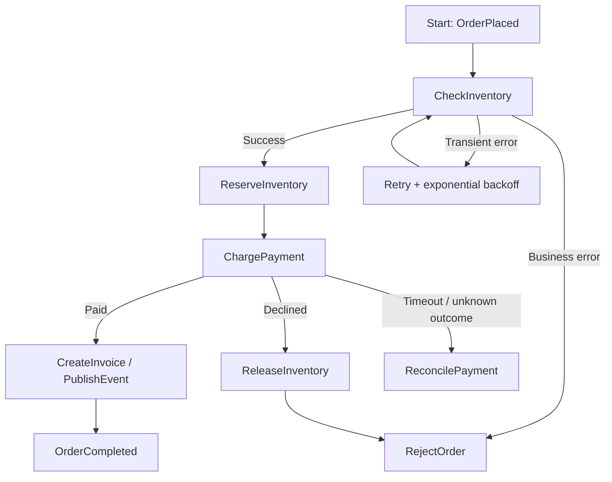
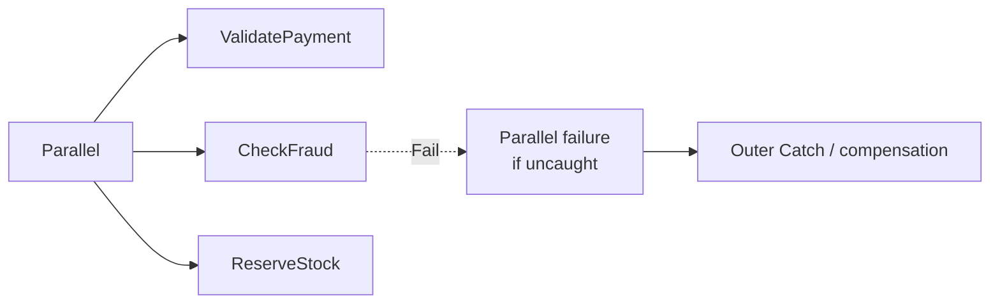
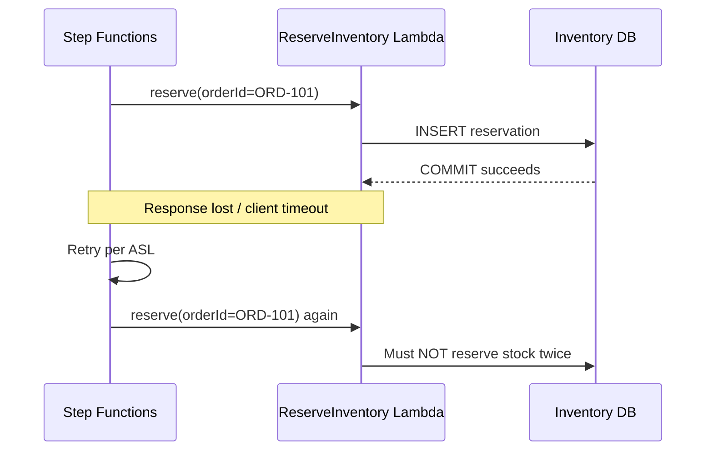
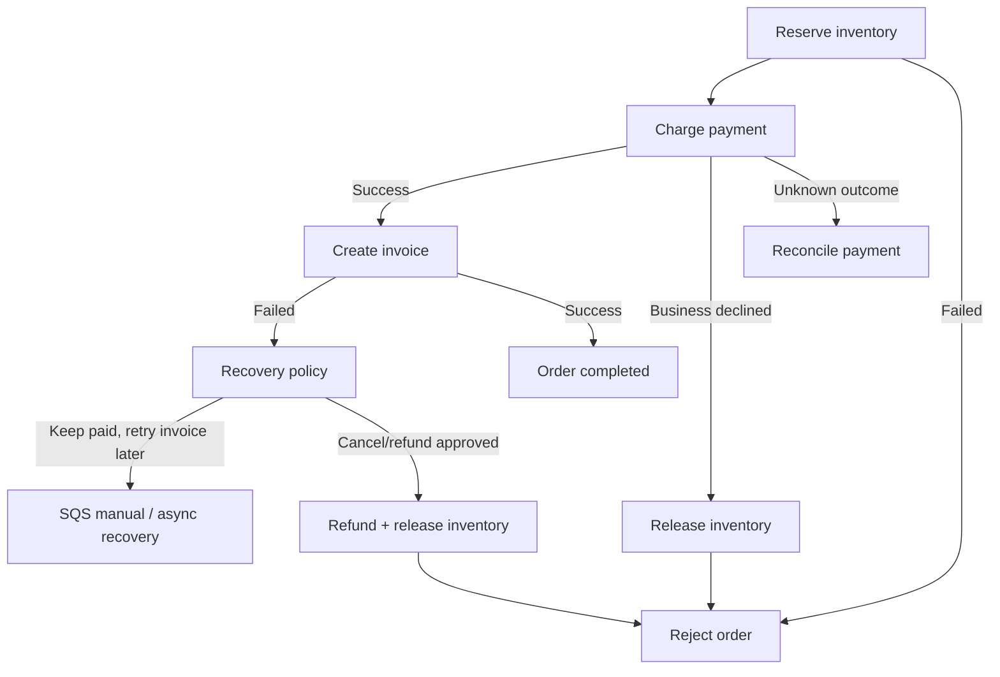
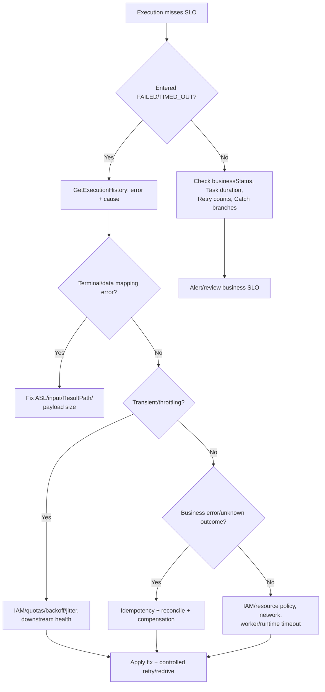
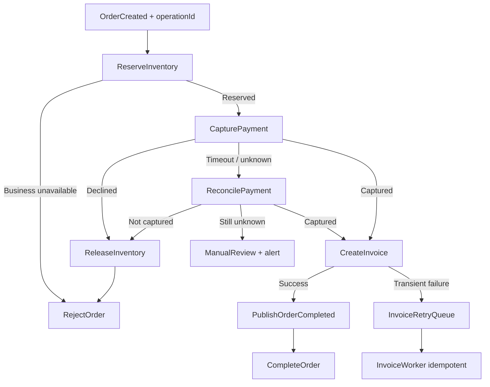

# Retry, Catch, timeouts, and workflow error handling

## Learning objectives

After this lesson, you will be able to:

1. Explain the differences between **retrying an operation**, **catching and branching error handling**, a **Task timeout**, a **heartbeat timeout**, and an **execution-wide timeout** in AWS Step Functions.
2. Read and write **Amazon States Language (ASL)** with `Retry`, `Catch`, `ErrorEquals`, `ResultPath`, `TimeoutSeconds`, `HeartbeatSeconds`, `Fail`, `Choice`, `Wait`, and `Parallel`/`Map`.
3. Classify **transient**, **throttling**, **business/permanent**, **IAM**, **input/schema**, and **timeout** errors to choose retries, fail-fast, compensation, or DLQs appropriately.
4. Design **exponential backoff + jitter**, cap retry attempts and costs, and ensure **idempotency** when a Task has side effects.
5. Identify errors that a default `States.ALL` does not catch, and distinguish **Step Functions service integration timeouts** from **Lambda/ECS/HTTP API timeouts**.
6. Build a workflow with **happy path**, **business error**, **retryable dependency error**, **timeout**, and **fallback** branches, test it with AWS CLI/`TestState`, and inspect execution history.
7. Understand **Standard vs. Express**, **redriving failed Standard executions within the 14-day window**, redrive limits, and **saga/compensation** strategies when earlier steps already committed.
8. Propose logs/metrics/alarms, least-privilege IAM, resilience, quotas, and cost optimization for AWS applications running Lambda, Java APIs, ECS, and EventBridge.

## 1. Problem: ordering through a multi-step workflow

A Java/Spring Boot system receives an order request and starts a workflow:

1. Check inventory.
2. Reserve inventory.
3. Capture payment through a payment provider.
4. Trigger invoice creation and send notifications.

Each step has a distinct failure mode:

- The inventory API returns **HTTP 503** due to brief overload: retry with backoff.
- The payment gateway returns **card declined**: this is a **business decision**, and repeating retries does nothing.
- The inventory worker times out after writing to the database: **the side effect may already have happened** even though Step Functions received no response.
- Lambda lacks `dynamodb:UpdateItem`: retries cannot fix an IAM policy; fail fast and alert operators.
- After inventory reservation and payment capture succeed, invoice creation fails: you need **compensation** or controlled asynchronous recovery, not automatic rollback of external databases.

AWS Step Functions lets you declare **sequence, branching, timeouts, retries, and error paths** as a **state machine**; Tasks can invoke Lambda, DynamoDB, ECS, SQS, SNS, HTTP APIs, or nested workflows.



The diagram separates **retry** (repeating a recoverable operation), **catch** (routing execution to another branch), and **compensation** (performing an inverse business action). A clean diagram alone does not guarantee consistency: combine **idempotency keys**, durable state, retry caps, and side-effect controls.

## 2. Step Functions and Amazon States Language

### 2.1. What is ASL?

**Amazon States Language (ASL)** describes a state machine in JSON (or equivalent structures in IaC). A small workflow:

```json
{
  "Comment": "Illustrative workflow calling no external services",
  "QueryLanguage": "JSONPath",
  "StartAt": "Validate",
  "States": {
    "Validate": {
      "Type": "Pass",
      "Result": {
        "isValid": true
      },
      "ResultPath": "$.validation",
      "Next": "Done"
    },
    "Done": {
      "Type": "Succeed"
    }
  }
}
```

- `StartAt`: initial state.
- `States`: steps and transitions.
- `Type`: state type (e.g., `Task`, `Choice`, `Wait`, `Parallel`, `Map`, `Pass`, `Succeed`, `Fail`).
- `Next` or `End: true`: next step or termination point.
- `QueryLanguage`: data-handling rules. This lesson uses **JSONPath** for `ResultPath`/`Parameters`; **JSONata** uses different data syntax.

**Do not equate Step Functions errors with Java exceptions:** ASL receives an **error name** and **cause** from the state/integration. Workers may be Java Lambda, Node.js, ECS, or an AWS SDK API.

### 2.2. Which states support `Retry`/`Catch`?

`Retry` and `Catch` apply directly to **`Task`, `Parallel`, and `Map`** per ASL. `Pass`, `Wait`, `Choice`, and `Succeed`/`Fail` are not where you attach retriers/catchers for external work.

| State type | When used | Error relevance |
| --- | --- | --- |
| `Task` | Calls Lambda/ECS/AWS SDK/HTTP/Activity. | Usually needs `Retry`/`Catch` and timeouts. |
| `Parallel` | Runs multiple branches. | An unhandled failure in one branch can fail `Parallel`. |
| `Map` | Processes many items. | Needs item/batch error handling, especially in Distributed Map. |
| `Choice` | Branches on data/results. | Missing `Default` when no rule matches can fail the execution. |
| `Wait` | Waits for a duration or timestamp. | Useful for business delays, not a replacement for `Retry`. |
| `Fail` | Ends execution in `FAILED` state with error name/cause. | Expresses intentional failure; does not "throw" back to earlier Tasks. |
| `Succeed` | Ends execution successfully. | No errors to catch. |

### 2.3. `Retry`, `Catch`, and timeouts are three different questions

| Mechanism | Question | Consequence |
| --- | --- | --- |
| **Retry** | Should **the same state** be attempted again after a specific error? | Step Functions re-runs `Task`/`Parallel`/`Map` per policy. |
| **Catch** | After an unhandled error or exhausted retries, **which state comes next**? | Transitions to fallback, compensation, notification, or `Fail`. |
| **`TimeoutSeconds`** | **How long at most** may a Task wait? | Exceeding it raises a state timeout error, though external side effects may still continue. |
| **`HeartbeatSeconds`** | Is a callback/activity worker still **reporting liveness** periodically? | Missing heartbeats raise a heartbeat timeout error. |
| **State machine `TimeoutSeconds`** | How long can the entire execution run? | When reached, execution becomes `TIMED_OUT`; not an error a single Task `Catch` can rescue. |

## 3. Classify errors before choosing an action

Never slap a `States.ALL` retrier with 100 attempts onto every step. Errors that time cannot cure only increase load, cost, and latency.

| Error category | Examples | Sensible policy |
| --- | --- | --- |
| **Transient/network** | Brief timeouts, connection resets, DNS/retryable 5xx. | Retry with **backoff + jitter**, bounded by count/duration. |
| **Throttling/temporary quotas** | `Lambda.TooManyRequestsException`, HTTP 429, DynamoDB throttling. | Retry with jitter, lower concurrency, watch quotas. |
| **Business/permanent** | `OrderRejected`, `InvalidAddress`, card declined. | **Do not retry by default**; `Catch` into a business branch. |
| **Authentication/authorization** | `AccessDenied`, `States.Permissions`, wrong IAM trust/resource policy. | Fail fast, alert, fix role/policy; do not retry forever. |
| **Schema/data mapping** | Missing JSONPath, wrong type, oversized payload. | Fix input/definition and validate; many are terminal. |
| **Dependency with uncertain side effect** | Payment request timeout, ECS job connection drop. | Reconcile by transaction ID/idempotency key before retrying. |
| **Worker crash** | ECS container exit, Lambda runtime crash. | Inspect exception and decide whether retrying is safe. |
| **Execution-wide timeout** | State machine ran past total limit. | Design SLAs, out-of-band cleanup/reconciliation, and redrive if eligible. |

**Defining "retryable" is a business decision**, not just reading an HTTP status code. For example, a payment transaction returning `503` after charging is an **unknown outcome**; retrying with a new request ID can double-charge. Use a provider idempotency key and query transaction status before proceeding.

## 4. ASL error names and matching order

AWS Step Functions matches `ErrorEquals` by **case-sensitive string comparison**. Names starting with `States.` are reserved by the system—applications must not invent custom error names with this prefix.

### 4.1. Key error names

| Error name | Meaning | Strategy |
| --- | --- | --- |
| `States.ALL` | Wildcard matching many errors; must appear **alone** in `ErrorEquals` in the last retrier/catcher. | Use as a controlled fallback; **does not catch** certain terminal errors. |
| `States.TaskFailed` | Task failure wildcard; **does not match `States.Timeout`**. | Useful for general task fallbacks, does not replace explicit timeout handling. |
| `States.Timeout` | Task exceeded `TimeoutSeconds` or missed heartbeats; can also represent execution timeout. | Bounded retry or state-level `Catch` if the operation is safe. |
| `States.HeartbeatTimeout` | Failed to send heartbeat within configured interval. | Check worker health, task token/callback logic, and hung processes. |
| `States.Permissions` | Step Functions lacks permission to execute the Task. | Fix IAM/roles/resource policies. |
| `States.Runtime` | Runtime error from invalid data handling (e.g., bad path/null). | **Cannot be retried/caught by `States.ALL`**; fix definition/input. |
| `States.DataLimitExceeded` | Input/output/result exceeded payload quota. | `States.ALL` **does not catch it**; shrink data or handle per docs. |
| `States.ExceedToleratedFailureThreshold` | Distributed Map failed items exceeded threshold. | Inspect item failures, `ResultWriter`, and tolerance. |
| `States.ItemReaderFailed` | Distributed Map could not read item source. | Check S3/IAM/input format. |
| `States.ResultWriterFailed` | Distributed Map could not write results. | Check S3 destination, permissions, and data. |
| `States.Http.Socket` | HTTP Task hit service connection timeout limit. | Optimize API or switch to async patterns. |
| `Lambda.TooManyRequestsException` | Lambda invocation throttled. | Retry with jitter; reduce concurrency/adjust quotas. |
| `Lambda.ServiceException` / `Lambda.SdkClientException` | Transient Lambda service/SDK fault. | Bounded retries; inspect health/logs. |
| `OrderRejected`, `InvalidInput` | Application-defined errors. | Catch by exact name; do not retry unless business confirms safety. |

**Note on `States.DataLimitExceeded`:** AWS documents this as a terminal error that `States.ALL` **does not catch**; newer docs mention specifying the exact error name in `ErrorEquals` in certain cases, yet recovery should never rely on resending an oversized payload. Fix the root cause with lean data, `ResultPath`/`OutputPath`, or S3 references.

**For Lambda runtime timeouts**, the observed error name may be `Sandbox.Timedout`, `Lambda.Unknown`, or the corresponding integration error depending on runtime. Never guess a fixed name without checking execution history; verify the actual error and include `States.TaskFailed`/`States.Timeout` as appropriate.

### 4.2. Why retrier/catcher order matters

Step Functions scans `Retry` objects **in order** and selects the **first retrier** matching the error name; `Catch` behaves the same way. Place `States.ALL` last as a fallback. A broad rule placed first can shadow specific rules beneath it.

```json
"Retry": [
  {
    "ErrorEquals": ["Lambda.TooManyRequestsException", "Lambda.ServiceException"],
    "IntervalSeconds": 2,
    "MaxAttempts": 3,
    "BackoffRate": 2,
    "JitterStrategy": "FULL"
  },
  {
    "ErrorEquals": ["OrderRejected"],
    "MaxAttempts": 0
  }
],
"Catch": [
  {
    "ErrorEquals": ["OrderRejected"],
    "ResultPath": "$.failure",
    "Next": "NotifyCustomer"
  },
  {
    "ErrorEquals": ["States.ALL"],
    "ResultPath": "$.failure",
    "Next": "EscalateFailure"
  }
]
```

This is a **fragment** attached to a JSONPath `Task`, not a complete state machine. `MaxAttempts: 0` explicitly disables retries for order rejections, letting `Catch` route immediately per rules. Because `States.ALL` does not cover every error, still build observability for executions failing outside catchers.

## 5. `Retry`: exponential backoff, limits, and jitter

### 5.1. Retrier structure

```json
{
  "ErrorEquals": [
    "Lambda.ServiceException",
    "Lambda.SdkClientException",
    "Lambda.TooManyRequestsException"
  ],
  "IntervalSeconds": 2,
  "MaxAttempts": 3,
  "BackoffRate": 2,
  "MaxDelaySeconds": 10,
  "JitterStrategy": "FULL"
}
```

| Field | Meaning |
| --- | --- |
| `ErrorEquals` | List of error names to retry. Required; exact match or wildcard per rules. |
| `IntervalSeconds` | Wait before the first retry; **default 1 second**. |
| `MaxAttempts` | **Number of retry attempts**, **default 3**, **excluding the initial execution**. `0` means no retries. |
| `BackoffRate` | Wait multiplier; **default 2.0**. |
| `MaxDelaySeconds` | Cap on backoff delay to prevent excessively long waits. |
| `JitterStrategy` | `FULL` randomizes delay between 0 and computed delay; `NONE` is default. |

Example with `IntervalSeconds=2`, `MaxAttempts=3`, `BackoffRate=2`, `MaxDelaySeconds=5`:

| Attempt | Action | Wait **before** this attempt if `JitterStrategy=NONE` |
| --- | --- | --- |
| 1 | Initial run | 0 seconds |
| 2 | Retry #1 | 2 seconds |
| 3 | Retry #2 | 4 seconds |
| 4 | Retry #3 | 5 seconds (capped instead of 8) |
| 5 | No retries left | Route to `Catch` or fail execution |

Total **maximum 4 Task executions** (1 initial + 3 retries) for this retrier. With `FULL` jitter enabled, each wait is randomized between 0 and its cap—do not sum a fixed 11 seconds.

### 5.2. Retry budgets

Retries need a **budget** tied to SLAs and cost:

1. **Attempts:** how many attempts at most before `Catch`?
2. **Time:** does total backoff plus per-attempt runtime exceed step `TimeoutSeconds` or execution SLA?
3. **Concurrency:** could thousands of retrying executions trigger a **retry storm** against RDS or a payment provider?
4. **Side effects:** are retries safe if an earlier step committed?
5. **Quotas/cost:** every Lambda, DynamoDB, ECS, HTTP API, or SNS call carries its own cost and quota.

**Backoff + jitter** dampens thundering herds when thousands of executions fail on a shared dependency. During prolonged dependency outages, use SQS buffering, concurrency limits, application circuit breakers, or load shedding rather than cranking `MaxAttempts` up indefinitely.

### 5.3. Error names and retries when Lambda fails

In a Lambda-invoking `Task`, there are two categories:

- **Lambda service integration errors**: throttling, service exceptions, SDK/client transport faults; usually safe to retry.
- **Function code errors**: handler throws exceptions like `InvalidOrderError`; may be permanent or transient depending on domain logic.

Example retrier for transient Lambda errors:

```json
"Retry": [
  {
    "ErrorEquals": [
      "Lambda.ServiceException",
      "Lambda.AWSLambdaException",
      "Lambda.SdkClientException",
      "Lambda.TooManyRequestsException"
    ],
    "IntervalSeconds": 2,
    "MaxAttempts": 4,
    "BackoffRate": 2,
    "MaxDelaySeconds": 20,
    "JitterStrategy": "FULL"
  }
]
```

Do not assume **every** Lambda exception is transient. Schema errors like `InvalidAddress` or `PaymentDeclined` will fail identically after 4 retries, adding only latency and extra invocations.

## 6. `Catch`: turning errors into intentional recovery branches

When a state raises an error, Step Functions **evaluates `Retry` first**. If no retrier matches or attempts are exhausted, it checks `Catch`; if no catcher matches, the error propagates out of the state and may fail the execution.

### 6.1. Catcher structure

```json
"Catch": [
  {
    "ErrorEquals": ["OrderRejected"],
    "ResultPath": "$.failure",
    "Next": "NotifyOrderRejected"
  },
  {
    "ErrorEquals": ["States.Timeout", "States.HeartbeatTimeout"],
    "ResultPath": "$.failure",
    "Next": "CheckExternalOutcome"
  },
  {
    "ErrorEquals": ["States.ALL"],
    "ResultPath": "$.failure",
    "Next": "EscalateToOperations"
  }
]
```

- `ErrorEquals`: list of error names handled by the catcher.
- `Next`: **target** state on catch; must exist in `States` within the same state machine/branch scope.
- `ResultPath`: in **JSONPath**, specifies where to place the error object in the next state's input; avoids losing `orderId`/`correlationId`.
- `States.ALL` must **stand alone** in `ErrorEquals` as the last catcher, and still cannot catch all terminal errors.

**`Catch` is not an in-process Java `try/catch`.** It is an orchestration branch **after a Task fails**. If an external call already produced side effects, `Catch` sees only the observed error and does not undo those side effects automatically.

### 6.2. Error output and `ResultPath`

Suppose the state receives input:

```json
{
  "orderId": "ORD-101",
  "amount": 125000,
  "currency": "VND"
}
```

The Task fails with error object:

```json
{
  "Error": "PaymentProviderUnavailable",
  "Cause": "HTTP 503 from payment provider"
}
```

If `Catch` specifies `"ResultPath": "$.failure"`, the fallback branch receives **both the order data and the error**:

```json
{
  "orderId": "ORD-101",
  "amount": 125000,
  "currency": "VND",
  "failure": {
    "Error": "PaymentProviderUnavailable",
    "Cause": "HTTP 503 from payment provider"
  }
}
```

| `ResultPath` | Common consequence |
| --- | --- |
| `"$.failure"` | Adds/overwrites the `failure` field in input, keeping `orderId` for downstream steps. |
| `"$"` or omitted `ResultPath` | **The error object replaces the entire input** on `Catch`, easily losing business context. |
| `null` | Discards error output and passes original input forward (loses error details). |

`ResultPath` accepts only a **reference path** pointing to one location, not a multi-node filter expression. In **JSONata** workflows, shaping inputs/outputs uses `Assign`/`Output` and JSONata expressions; never copy `ResultPath` verbatim onto a JSONata machine without adapting it.

### 6.3. Note that `Cause` is not always JSON

`Cause` may be a service description string, a stack trace, or JSON serialized as a **string**. Never assume `$.failure.Cause.message` exists.

If `Cause` is a **valid JSON string**, JSONPath ASL can use `States.StringToJson` to parse it before accessing fields, though many integrations emit non-JSON strings. To keep workflows resilient, emit standardized error codes from your application and parse `Cause` only after verifying format.

**Never dump raw `Cause` strings into SNS/emails/public logs** when exceptions could expose secrets, tokens, request payloads, or customer data.

### 6.4. `Catch` does not mean recovery succeeded

For example, after payment fails, the workflow runs `ReleaseInventory`:

- If stock release succeeds, the workflow may end with business state `ORDER_CANCELLED`.
- If stock release fails, **never** route to `Succeed` pretending everything finished cleanly.
- Provide a `Fail` or manual remediation branch, audit events, DLQ, or compensation queue for unrecoverable operations.

An execution ending in `SUCCEEDED` only means **the state machine reached `Succeed`/`End` cleanly**—it does not prove **the order shipped successfully**. Include an explicit `businessStatus` in outputs so dashboards are never misled.

## 7. Timeouts and heartbeats: detecting stalled tasks

### 7.1. Task `TimeoutSeconds`

```json
{
  "Type": "Task",
  "Resource": "arn:aws:states:::lambda:invoke",
  "Parameters": {
    "FunctionName": "arn:aws:lambda:ap-southeast-1:111122223333:function:validate-order",
    "Payload.$": "$"
  },
  "TimeoutSeconds": 15,
  "ResultPath": "$.validation",
  "Next": "NextStep"
}
```

`TimeoutSeconds=15` caps **how long Step Functions waits for the Task**—it **does not alter Lambda's internal timeout** or immediately abort an external system's transaction in every case. Service integration or backend API timeouts can also be stricter than the state limit.

Layers to align:

1. **Client/API timeout** (HTTP, SDK, ALB): may expire before the worker stops executing.
2. **Worker timeout** (Lambda function timeout, ECS job deadline, application timeout): service-dependent.
3. **Step Functions Task timeout:** fails when orchestration waits longer than `TimeoutSeconds`.
4. **Execution timeout:** caps the entire state machine; cannot be "rescued" by a Task-level `Catch`.

If Step Functions raises `States.Timeout` after a payment request, **never assume the payment failed**. Reconcile payment status by idempotency key before retrying or compensating.

### 7.2. Task heartbeat

A **heartbeat** signals "the task is still alive," especially useful for **Activity workers**, `.waitForTaskToken` callbacks, and certain long-running integrations.

Callback Task example:

```json
{
  "Type": "Task",
  "Resource": "arn:aws:states:::sqs:sendMessage.waitForTaskToken",
  "Parameters": {
    "QueueUrl": "https://sqs.ap-southeast-1.amazonaws.com/111122223333/approval-jobs",
    "MessageBody": {
      "orderId.$": "$.orderId",
      "taskToken.$": "$$.Task.Token"
    }
  },
  "HeartbeatSeconds": 30,
  "TimeoutSeconds": 3600,
  "ResultPath": "$.approval",
  "Next": "FinalizeOrder"
}
```

In **JSONPath**, `$$.Task.Token` reads the task token from the Step Functions Context object. The consumer/worker receives the message with the token, performs work, and calls:

```bash
# Syntax example; never expose real production tokens in public commands or logs
aws stepfunctions send-task-heartbeat \
  --task-token "<real-task-token>" \
  --region ap-southeast-1

aws stepfunctions send-task-success \
  --task-token "<real-task-token>" \
  --task-output '{"approved":true}' \
  --region ap-southeast-1
```

`SendTaskHeartbeat` **resets the heartbeat timer**, **not `TimeoutSeconds`**. After 3,600 seconds, the Task still times out even if the worker sent regular heartbeats. To fail intentionally, the worker calls `SendTaskFailure` with an error name and cause.

**Security:** a task token is a sensitive capability granting authority to complete or terminate a Task; never log tokens or return them in public HTTP responses. Restrict IAM `states:SendTaskSuccess`/`SendTaskFailure`/`SendTaskHeartbeat` to authorized worker roles.

### 7.3. `TimeoutSecondsPath`/`HeartbeatSecondsPath`

In **JSONPath**, a Task can read limits dynamically from input:

```json
{
  "Type": "Task",
  "Resource": "arn:aws:states:::sqs:sendMessage.waitForTaskToken",
  "Parameters": {
    "QueueUrl": "https://sqs.ap-southeast-1.amazonaws.com/111122223333/approval-jobs",
    "MessageBody": {
      "taskToken.$": "$$.Task.Token"
    }
  },
  "TimeoutSecondsPath": "$.limits.taskSeconds",
  "HeartbeatSecondsPath": "$.limits.heartbeatSeconds",
  "End": true
}
```

Sample input:

```json
{
  "limits": {
    "taskSeconds": 600,
    "heartbeatSeconds": 30
  }
}
```

- Values must be **positive integers**; heartbeat must be **less than** task timeout.
- Never specify both `TimeoutSeconds` **and** `TimeoutSecondsPath` on one Task; same for `HeartbeatSeconds`/`HeartbeatSecondsPath`.
- Missing paths or wrong types fail the workflow **at mapping time**, distinct from worker timeouts.

### 7.4. HTTP Task and integration limits

**Step Functions HTTP Tasks** have a maximum socket wait of **60 seconds**. Setting `TimeoutSeconds=120` cannot extend the 60-second HTTP Task limit. If a partner API takes longer, switch to **async request + callback/polling** (in a supported workflow type) or an SQS/Step Functions task-token pattern.

For `.sync` integrations like ECS/Batch/Glue:

- Step Functions waits for job completion and can time out or stop the execution.
- When aborted or when a sibling `Parallel`/`Map` branch fails, Step Functions attempts to **cancel the job on a best-effort basis**—cancellation is not guaranteed (due to IAM permissions, API latency, or service errors).
- Monitor **job state outside Step Functions** and reconcile before launching a new job or compensation.

## 8. Standard and Express: choosing workflow types by duration and semantics

| Feature | Standard Workflow | Express Workflow |
| --- | --- | --- |
| Maximum duration | **1 year**. | **5 minutes**. |
| Execution semantics | **Exactly-once execution scheduling** at workflow level per conditions, excluding `Retry`/redrive and external side effects. | **Asynchronous Express: at-least-once; Synchronous Express: at-most-once**. |
| Callback `.waitForTaskToken` | **Yes** on supported integrations. | **No**. |
| Run a Job `.sync` | **Yes** on supported integrations. | **No**. |
| Activity tasks | **Yes**. | **No**. |
| Execution history | Execution history via Step Functions API, retained per policy. | Relies largely on CloudWatch Logs when logging is enabled. |
| Redrive execution | **Yes** when eligible within the 14-day window. | **No** general execution redrive; Distributed Map child workflows have separate rules. |
| Typical billing | By **state transitions**. | By **execution count, duration, and memory**. |
| Best fit | Orders, payment sagas, approvals, long batch jobs, audits. | Very high-volume event processing, short idempotent tasks. |

**You cannot switch Standard ↔ Express by editing an existing state machine attribute.** Migrating requires creating a new state machine and re-verifying integrations, duration/SLAs, semantics, and billing.

### Does "exactly-once" in Standard mean business exactly-once?

No. AWS describes Standard's workflow execution model as **exactly-once**, yet:

- A Task with `Retry` can be invoked multiple times intentionally.
- An integration/network timeout can occur **after an external service already committed**.
- You may **redrive** a failed execution, re-running incomplete steps.
- An EventBridge/SQS event can cause a producer to start **multiple executions** without upstream deduplication.

Therefore, **payment capture, order creation, and inventory reservation** still require idempotency keys, inbox/outbox tables, or conditional writes—never rely solely on the "Standard exactly-once" label.

### Why is Express unsuitable for multi-hour approvals?

Express is capped at **5 minutes** and does not support `.waitForTaskToken`. A workflow waiting 2 days for invoice approval requires **Standard**, or breaking it into event-driven state transitions in another service with appropriate persistence/TTL.

## 9. Errors inside `Parallel` and `Map`: more than a single Task

### 9.1. `Parallel`



In `Parallel`, an **unhandled branch failure** fails the entire `Parallel` state, and AWS may attempt to cancel remaining branches per integration. Yet cancellation is **best effort** for already-started external jobs.

Two patterns:

1. **Catch inside each branch** to return a structured business outcome (e.g., `{"status":"REJECTED"}`), allowing sibling branches to finish when appropriate.
2. **Catch on the outer `Parallel`** to route into compensation/alerting whenever any critical branch fails.

**Never place strictly sequential steps inside `Parallel`**, such as "ReserveInventory then ChargePayment": running concurrently risks charging payment before knowing stock is out, complicating compensation.

### 9.2. Inline `Map`

Inline `Map` runs a sub-workflow for each item in a collection. An uncaught failure in one iteration can fail the entire `Map`. Retrying at the `Map` level can **re-run multiple items**, including items whose side effects already succeeded depending on the situation.

If items are independent and partial failures are acceptable, **Catch inside `ItemProcessor`** and return per-item error outputs instead of failing everything. For large batches, consider **Distributed Map**, which supports **tolerated failure count/percentage** and `ResultWriter`.

### 9.3. Distributed Map

Common failures:

- `States.ExceedToleratedFailureThreshold`: failed item count/percentage exceeded `ToleratedFailureCount`/`ToleratedFailurePercentage`.
- `States.ItemReaderFailed`: failure reading S3/item list source.
- `States.ResultWriterFailed`: failure writing output items to the destination.

When handling failures, enforce **item-level idempotency**, inspect failure reports/Map Run history, and understand that **redriving a Map Run** behaves differently between Standard and Express child workflows. **Never blindly "retry whole Map"** if it generates invoices or emails for already-completed items.

## 10. Idempotency: the foundation for retrying without duplicate side effects

### 10.1. What can a single retry do?

Inventory worker scenario:



By the time Step Functions sees a timeout, the database may already have committed. Thus **never rely solely on `Retry`/`Catch`**; make business operations **idempotent**.

### 10.2. Idempotency keys

Example:

```json
{
  "orderId": "ORD-101",
  "operationId": "reserve-inventory-ORD-101-v1",
  "sku": "SKU-900",
  "quantity": 2
}
```

In the backend:

1. Check whether `operationId` already succeeded, is in progress, or does not exist.
2. Create the reservation using a **unique key/conditional write** in DynamoDB or a unique constraint in RDS.
3. If already succeeded, return the **stored result** on repeat calls.
4. If in progress/unknown, use processing state and retry/reconcile rather than duplicating effects.
5. Retain idempotency records longer than the combined retry window, redrive window, and upstream event replay duration.

Pseudo-SQL example:

```sql
-- Idea: unique operation_id protects against duplicate work.
CREATE TABLE inventory_reservations (
    operation_id VARCHAR(120) PRIMARY KEY,
    order_id     VARCHAR(80) NOT NULL,
    sku          VARCHAR(80) NOT NULL,
    quantity     INT NOT NULL,
    status       VARCHAR(30) NOT NULL
);
```

Race conditions must be resolved **atomically in the same transaction**, not via check-then-insert. In DynamoDB, use `ConditionExpression` or `TransactWriteItems`; in RDS, use unique constraints and proper transaction isolation.

### 10.3. Avoid uncontrolled multi-layer retries

A single request might be retried by:

- The AWS SDK HTTP client inside a Lambda/Java worker.
- Custom retry logic in Java application code.
- Step Functions `Retry`.
- SQS/EventBridge/Lambda async invocation triggering the workflow.

If each layer retries 3 times, external API calls can multiply by the **product of layers**, not just 3. Assign **one clear retry owner** per failure type, enforce overall deadlines, and separate external call attempts from state execution attempts in metrics.

### 10.4. Never use execution ARN as the sole business ID when sources can re-trigger

`ExecutionArn` is great for tracing and auditing, yet EventBridge/SQS/producers can re-emit the same business event and launch a **new execution**. Use `orderId`/`paymentTransactionId`/`operationId` as the durable deduplication key and link execution ARNs to it.

## 11. Compensation / Saga: failing after an earlier step committed

A **Saga** is a sequence of local transactions paired with **compensating actions** when business-level reversal is needed. Step Functions orchestrates sagas, but it does not automatically roll back RDS, S3, DynamoDB, ECS, or payment providers when a workflow fails.

### 11.1. Example: reserve → charge → finalize



**Compensation is not a database transaction rollback:**

- `ReserveInventory` has compensation `ReleaseInventory`.
- `ChargePayment` may have compensation `RefundPayment`, yet refunds take time, incur fees, or settle asynchronously.
- `SendEmail` cannot "unsend" a delivered email, so design corrective/deduplicated notifications.
- `ShipPackage` may require reverse logistics rather than an API undo.

### 11.2. Recording committed steps

To compensate safely, persist:

```json
{
  "orderId": "ORD-101",
  "reservationId": "res-8811",
  "paymentTransactionId": "pay-5222",
  "businessStatus": "PAYMENT_CAPTURED_INVOICE_PENDING"
}
```

Each step needs a **durable status** and operation ID so that on `Catch`/failure/redrive you know:

1. Which steps **definitely committed**.
2. Which steps are **unknown** and need reconciliation.
3. Which compensations already ran or need retrying.
4. Never undo steps that never executed.

### 11.3. When compensation itself fails

`ReleaseInventory` or `RefundPayment` can also hit transient faults. Give compensations their own **bounded `Retry`/`Catch`**, backoff, and monitoring. If unrecoverable:

- Route the incident to a dedicated SQS DLQ/operational queue.
- Emit an EventBridge/SNS alarm or create a support ticket.
- Mark the order `REQUIRES_MANUAL_REVIEW` and never mark it completed.
- Attach `executionArn`, `orderId`, and `correlationId` for responder lookup.

Never delete execution history/payloads before resolving business records. A compensating action **must be idempotent** because it too can be retried or redriven.

### 11.4. Error-handling steps can fail too

`Catch` routing to `NotifyOps` does not guarantee `NotifyOps` succeeds. If SNS topic permissions are broken, the error branch fails as well. For critical alerts, configure an independent **CloudWatch/EventBridge Execution Status Change rule** outside the workflow rather than relying solely on an in-workflow notification Task.

## 12. Redrive: controlled resumption of failed Standard executions

AWS Step Functions supports **redriving a Standard Workflow execution** in **`FAILED`**, **`ABORTED`**, or **`TIMED_OUT`** state when eligible. The redrive window is **14 days from when the execution ended**, not from when you noticed the error.

### 12.1. Difference from `StartExecution`

| Action | Meaning | Risk |
| --- | --- | --- |
| New `StartExecution` | Starts a **brand-new execution** with new input/name. | Can re-run the **entire workflow**, repeating business side effects. |
| `RedriveExecution` | Resumes a **failed execution** at incomplete steps using the original execution ARN/input/definition. | Failed steps re-run, yet previously committed side effects may not be visible to Step Functions. |
| Redriving a `Map`/`Parallel` | Depending on Map type, primarily re-runs **failed/aborted iterations/branches**; exceptions apply for payload-limit errors. | Must verify already-committed items/branches. |

**Redrive does not re-run previously succeeded steps by default.** Step Functions preserves outputs/history of completed steps and resumes at the failed step per redrive rules. When redriving a `Task`, `Parallel`, or `Inline Map` with a retrier, **used retry counts reset to 0** for the resumed step.

### 12.2. Key redrive eligibility rules

- Workflow type must be **Standard**; regular Express executions **do not** support `RedriveExecution`.
- Execution is not `SUCCEEDED` and is within **14 days** of completion.
- Original execution started after feature launch (**November 15, 2023**).
- Total open time has not exceeded the **1-year** quota, and history has **fewer than 24,999 events** before redrive.
- Requires proper IAM permissions and still-working service integrations.
- Redrive uses the **original state machine definition/version/alias**; if you edited the definition to fix a bug, **redrive will not pick up the new definition**. To run updated workflow logic, start a new execution or update the referenced dependency version where appropriate.

### 12.3. A safe redrive runbook

Before invoking:

1. Read `DescribeExecution`/`GetExecutionHistory` to identify the failed state, prior attempts, and stored inputs/outputs.
2. Confirm **IAM/dependency configs are fixed** or the transient outage has cleared.
3. Check **business idempotency state**: did payment/reservation have an unknown outcome? Reconcile first if needed.
4. Assess the new retry budget and side effects when failed steps re-execute.
5. Obtain change approval/record for sensitive transactions.

**Illustrative commands only**; never target a production execution ARN without authorization:

```bash
aws stepfunctions describe-execution \
  --execution-arn \
    arn:aws:states:ap-southeast-1:111122223333:execution:order-workflow:ORD-101 \
  --region ap-southeast-1

aws stepfunctions get-execution-history \
  --execution-arn \
    arn:aws:states:ap-southeast-1:111122223333:execution:order-workflow:ORD-101 \
  --region ap-southeast-1

# Replace ARN with a verified, authorized execution for redrive.
aws stepfunctions redrive-execution \
  --execution-arn \
    arn:aws:states:ap-southeast-1:111122223333:execution:order-workflow:ORD-101 \
  --region ap-southeast-1
```

Monitor the **new execution state and business outcome** after redriving; an API success response does not mean the workflow finished every task.

### 12.4. Easily overlooked redrive boundaries

- Redriving an execution that failed with `States.DataLimitExceeded` in `Parallel`/`Map` can **re-run previously succeeded branches/items** per AWS docs; do not assume redrive always skips succeeded parts.
- With **Distributed Map**, redrive affects the Map Run/child executions, and Express child workflows restart under their own rules.
- A `Succeeded` execution cannot be redriven.
- If the original definition pointed to an **unqualified Lambda ARN**, `$LATEST` code may have changed outside the workflow; reference **Lambda versions/aliases** for strict audit/rollback.
- Redrive resets task and execution timeout counters per AWS rules, but it never "erases" database writes or emails already sent externally.

## 13. CloudFormation hands-on: workflow with `Retry`, `Catch`, and timeout

This lab creates a **Step Functions Standard state machine** and a **simulated Lambda** to demonstrate four paths:

| Input `mode` | What does Lambda do? | Expected outcome |
| --- | --- | --- |
| `success` | Returns immediately. | State `Completed`, execution `SUCCEEDED`. |
| `business` | Throws `BusinessRuleError`. | `Catch` goes to `Rejected`, execution `SUCCEEDED` with `businessStatus=REJECTED`. |
| `transient` | Always throws `TransientDependencyError`. | Initial run + **2 retries**, then `Catch` goes to `TechnicalFailure`, execution `FAILED`. |
| `slow` | Sleeps 6 seconds before returning. | Task `TimeoutSeconds=3`, `Catch` goes to `NeedsReconciliation`; execution `SUCCEEDED` needing inspection. |

**Important:** in this lab, `businessStatus=REJECTED` and `REQUIRES_RECONCILIATION` are intentionally handled business outcomes, even though Step Functions' technical execution status is `SUCCEEDED`. Monitoring must inspect **both execution status and `businessStatus`**, not just green execution badges.

### 13.1. Self-contained CloudFormation template

Save as `retry-catch-lab.yml` in **your own lab directory**. Created resources may incur charges. **Never run this template in production.**

```yaml
AWSTemplateFormatVersion: '2010-09-09'
Description: Step Functions Retry Catch and timeout lesson lab

Resources:
  DemoLambdaRole:
    Type: AWS::IAM::Role
    Properties:
      AssumeRolePolicyDocument:
        Version: '2012-10-17'
        Statement:
          - Effect: Allow
            Principal:
              Service: lambda.amazonaws.com
            Action: sts:AssumeRole
      ManagedPolicyArns:
        - arn:aws:iam::aws:policy/service-role/AWSLambdaBasicExecutionRole

  DemoWorker:
    Type: AWS::Lambda::Function
    Properties:
      Runtime: nodejs22.x
      Handler: index.handler
      Role: !GetAtt DemoLambdaRole.Arn
      Timeout: 10
      MemorySize: 128
      Code:
        ZipFile: |
          exports.handler = async (event) => {
            const mode = event.mode ?? "success";
            if (mode === "business") {
              const err = new Error("Business rule rejected order");
              err.name = "BusinessRuleError";
              throw err;
            }
            if (mode === "transient") {
              const err = new Error("Dependency temporarily unavailable");
              err.name = "TransientDependencyError";
              throw err;
            }
            if (mode === "slow") {
              await new Promise((resolve) => setTimeout(resolve, 6000));
            }
            return { accepted: true, orderId: event.orderId };
          };

  WorkflowRole:
    Type: AWS::IAM::Role
    Properties:
      AssumeRolePolicyDocument:
        Version: '2012-10-17'
        Statement:
          - Effect: Allow
            Principal:
              Service: states.amazonaws.com
            Action: sts:AssumeRole
      Policies:
        - PolicyName: InvokeOnlyDemoWorker
          PolicyDocument:
            Version: '2012-10-17'
            Statement:
              - Effect: Allow
                Action: lambda:InvokeFunction
                Resource: !GetAtt DemoWorker.Arn

  DemoWorkflow:
    Type: AWS::StepFunctions::StateMachine
    Properties:
      StateMachineType: STANDARD
      RoleArn: !GetAtt WorkflowRole.Arn
      Definition:
        Comment: Workflow lesson, JSONPath, not payment production logic
        QueryLanguage: JSONPath
        StartAt: ProcessOrder
        TimeoutSeconds: 90
        States:
          ProcessOrder:
            Type: Task
            Resource: arn:aws:states:::lambda:invoke
            Parameters:
              FunctionName: !GetAtt DemoWorker.Arn
              Payload.$: "$"
            ResultSelector:
              result.$: "$.Payload"
            ResultPath: "$.worker"
            TimeoutSeconds: 3
            Retry:
              - ErrorEquals:
                  - TransientDependencyError
                  - Lambda.ServiceException
                  - Lambda.SdkClientException
                  - Lambda.TooManyRequestsException
                IntervalSeconds: 1
                MaxAttempts: 2
                BackoffRate: 2
                MaxDelaySeconds: 4
                JitterStrategy: FULL
            Catch:
              - ErrorEquals:
                  - BusinessRuleError
                ResultPath: "$.failure"
                Next: Rejected
              - ErrorEquals:
                  - States.Timeout
                ResultPath: "$.failure"
                Next: NeedsReconciliation
              - ErrorEquals:
                  - States.ALL
                ResultPath: "$.failure"
                Next: TechnicalFailure
            Next: Completed

          Completed:
            Type: Pass
            Parameters:
              businessStatus: COMPLETED
              orderId.$: "$.orderId"
              workerOutput.$: "$.worker.result"
            End: true

          Rejected:
            Type: Pass
            Parameters:
              businessStatus: REJECTED
              orderId.$: "$.orderId"
              errorName.$: "$.failure.Error"
            End: true

          NeedsReconciliation:
            Type: Pass
            Parameters:
              businessStatus: REQUIRES_RECONCILIATION
              orderId.$: "$.orderId"
              errorName.$: "$.failure.Error"
            End: true

          TechnicalFailure:
            Type: Fail
            Error: UnrecoverableTechnicalFailure
            Cause: Retry budget exhausted or unhandled task failure

Outputs:
  StateMachineArn:
    Value: !Ref DemoWorkflow
  FunctionArn:
    Value: !GetAtt DemoWorker.Arn
```

### 13.2. Lab architecture explanation

1. **DemoWorker** only simulates failures; it does not touch RDS, payments, or S3, so lab retries produce no real business side effects.
2. **DemoLambdaRole** attaches `AWSLambdaBasicExecutionRole` to write CloudWatch Logs; the template grants no S3/DynamoDB access.
3. **WorkflowRole** allows only `lambda:InvokeFunction` on the lab function ARN—no `AdministratorAccess`.
4. `ProcessOrder` uses the optimized integration `arn:aws:states:::lambda:invoke`. `Payload.$: "$"` passes the full JSON input to the function.
5. `ResultSelector` extracts `$.Payload` from Lambda's response; `ResultPath` stores it under `$.worker`, keeping `orderId` for `Completed`.
6. `Retry` retries only `TransientDependencyError` and specific Lambda service/throttling errors.
7. `Catch` checks business errors first, then `States.Timeout`, then `States.ALL`.
8. `TechnicalFailure` is a `Fail` state so the execution truly fails; `Rejected`/`NeedsReconciliation` are `Pass` states ending cleanly at the orchestration level with a non-`COMPLETED` `businessStatus`.
9. `TimeoutSeconds=3` is the **Step Functions Task** timeout, while Lambda has `Timeout=10`; when `slow` keeps running after Step Functions already caught the timeout, that demonstrates an **unknown outcome**.
10. The template omits alarms, EventBridge failure notifications, X-Ray, and Secrets Manager, so it is solely for lab demonstration.

### 13.3. Deploy to a lab account

Before creating resources:

```bash
aws sts get-caller-identity
aws configure get region
```

Pick a sandbox account (using `ap-southeast-1` as an example) and confirm the deploying IAM role has CloudFormation, Lambda, Step Functions, and `iam:PassRole` permissions. Then:

```bash
aws cloudformation deploy \
  --template-file retry-catch-lab.yml \
  --stack-name retry-catch-lab \
  --capabilities CAPABILITY_IAM \
  --region ap-southeast-1

aws cloudformation describe-stacks \
  --stack-name retry-catch-lab \
  --region ap-southeast-1 \
  --query 'Stacks[0].Outputs' \
  --output table
```

**Never use illustrative ARNs/IDs** from the lesson; read `StateMachineArn` and `FunctionArn` returned by CloudFormation. If a newly created role has not yet propagated across STS/IAM, inspect trust policies and retry appropriately—never grant broad permissions to mask errors.

### 13.4. Run each test case

Bash example (PowerShell requires adapting variable and quoting syntax):

```bash
REGION="ap-southeast-1"
STATE_MACHINE_ARN="$(aws cloudformation describe-stacks \
  --stack-name retry-catch-lab --region "$REGION" \
  --query "Stacks[0].Outputs[?OutputKey=='StateMachineArn'].OutputValue | [0]" \
  --output text)"

aws stepfunctions start-execution \
  --state-machine-arn "$STATE_MACHINE_ARN" \
  --name "success-$(date +%s)-$RANDOM" \
  --input '{"orderId":"ORD-101","mode":"success"}' \
  --region "$REGION"

aws stepfunctions start-execution \
  --state-machine-arn "$STATE_MACHINE_ARN" \
  --name "business-$(date +%s)-$RANDOM" \
  --input '{"orderId":"ORD-102","mode":"business"}' \
  --region "$REGION"

aws stepfunctions start-execution \
  --state-machine-arn "$STATE_MACHINE_ARN" \
  --name "transient-$(date +%s)-$RANDOM" \
  --input '{"orderId":"ORD-103","mode":"transient"}' \
  --region "$REGION"

aws stepfunctions start-execution \
  --state-machine-arn "$STATE_MACHINE_ARN" \
  --name "slow-$(date +%s)-$RANDOM" \
  --input '{"orderId":"ORD-104","mode":"slow"}' \
  --region "$REGION"
```

`StartExecution` returns the **execution ARN** and start timestamp; it does not mean the workflow finished. Save the real execution ARNs from each run.

**Points to observe:** `business` is not retried because `BusinessRuleError` is absent from the retrier; `transient` executes up to **3 Lambda invocations** (initial + 2 retries); `slow` times out at the 3-second Task limit and routes to reconciliation.

### 13.5. Inspect executions

```bash
aws stepfunctions describe-execution \
  --execution-arn "<real-execution-arn>" \
  --region ap-southeast-1 \
  --query '{Status:status,Start:startDate,Stop:stopDate,Input:input,Output:output,Error:error,Cause:cause}'

aws stepfunctions get-execution-history \
  --execution-arn "<real-execution-arn>" \
  --region ap-southeast-1 \
  --query 'events[].{Type:type,When:timestamp,Id:id,Previous:previousEventId}' \
  --output table
```

In AWS Console → Step Functions → State Machines → `DemoWorkflow` → Execution details, view the graph/timeline and **Retries & redrives** to see `TaskFailed`/`TaskTimedOut`/`TaskScheduled`/`TaskSucceeded`. For `business`/`slow`, inspect **output `businessStatus`**; for `transient`, inspect `error` and `cause` on the `FAILED` execution.

### 13.6. Redrive a failed lab execution

On the `FAILED` `transient` execution, `redrive-execution` can re-run the Task. Because Lambda intentionally **always fails** in that mode, redrive **does not fix the fault** and consumes the retry budget again:

```bash
aws stepfunctions redrive-execution \
  --execution-arn "<failed-transient-execution-arn>" \
  --region ap-southeast-1
```

To demonstrate recovery, **update the mock logic/fix the dependency** separately and verify which definition and function version the original execution targets. Never redrive repeatedly "hoping the error goes away" when a failure is deterministic.

### 13.7. Clean up lab resources

Run only if this stack **belongs strictly to this lab** with no active executions or data to preserve:

```bash
aws cloudformation delete-stack \
  --stack-name retry-catch-lab \
  --region ap-southeast-1
```

Verify the stack is deleted and check whether the Lambda log group remains. CloudWatch log groups created dynamically by Lambda are not always removed with the stack; if cleaning up, verify it is the lab log group and never delete production logs. **Never delete IAM roles or state machines shared by other applications.**

## 14. Testing workflows and data handling before production

### 14.1. Validate definitions before deployment

AWS Step Functions provides **`ValidateStateMachineDefinition`** to check ASL syntax/warnings **without creating a state machine**:

```bash
# For an extracted/standalone ASL JSON file (not the CFN YAML from section 13)
aws stepfunctions validate-state-machine-definition \
  --definition file://order-workflow.asl.json \
  --type STANDARD \
  --region ap-southeast-1
```

It returns `result=OK` or `FAIL`, along with any diagnostics. Diagnostic codes may evolve over time; CI should gate primarily on **`result`** rather than brittle warning text/order. **A valid definition does not prove IAM roles, networking, or external apps work.**

**File distinction:** `retry-catch-lab.yml` in section 13 is a **CloudFormation template**, not something passed directly to `--definition`; ASL is the object under `DemoWorkflow.Properties.Definition`. You can retrieve JSON ASL via `aws stepfunctions describe-state-machine --query definition --output text` after creation or maintain standalone ASL files in IaC.

### 14.2. `TestState`

The **`TestState` API** lets you test a single state (without creating a state machine) and inspect request, response, inputs/outputs, and certain errors; useful for verifying `InputPath`, `Parameters`, `ResultSelector`, `ResultPath`, and service integrations.

```bash
# A complete "Pass" state passed directly to TestState.
aws stepfunctions test-state \
  --definition '{"Type":"Pass","Result":{"ok":true},"End":true}' \
  --input '{"orderId":"ORD-101"}' \
  --region ap-southeast-1
```

For Tasks invoking AWS services, `TestState` **can make real API calls and produce side effects** depending on stage/input and IAM role; never run payment, S3 delete, or production DB write Tasks just for testing. Use restricted roles, staging/mock resources, and safe test data.

**Do not treat Step Functions Local as equivalent to cloud features:** current AWS documentation marks Step Functions Local as **unsupported**, and it does not match optimized integrations, cross-account flows, or Distributed Map. Prefer `TestState`, lab/staging state machines, and integration tests.

### 14.3. Minimum test matrix

| Case | Input/response | Expectation |
| --- | --- | --- |
| Happy path | Lambda succeeds. | `Completed`, right output, zero retries. |
| Single transient fault | Mock fails once then succeeds. | One retry with jitter, no duplicate business operation. |
| Prolonged throttling | Repeated Lambda/DynamoDB `TooManyRequests`. | Retry budget exhausted → `Catch`/fail, alarms, and rate limiting. |
| Business error | `OrderRejected`/`PaymentDeclined`. | Zero retries; transitions to rejection/release branch. |
| Task timeout | Worker exceeds `TimeoutSeconds`. | `States.Timeout` raised; reconcile outcome rather than assuming no side effect occurred. |
| Heartbeat timeout | Callback worker stops sending heartbeats. | Task fails/token expires; bounded retry/alert. |
| IAM error | Missing `lambda:InvokeFunction` or KMS. | Fail and alert; no infinite retries. |
| Bad data path | `ResultPath`/`Parameters` missing path. | Execution reports data-mapping error; inspect input shape. |
| Parallel branch failure | One branch fails before others finish. | Catch/compensation runs and external task cancellation is verified. |
| Redrive | Failed Standard execution within 14 days. | Re-runs failed state, preserves prior successes, idempotency holds. |
| Duplicate event | Producer emits same business event twice. | Only one business transaction via inbox/idempotency. |

### 14.4. Testing a Java producer calling `StartExecution`

A Java/Spring Boot service can invoke Step Functions via **AWS SDK for Java 2.x**. This snippet passes `orderId` and an idempotency key without hand-rolling HTTP SigV4:

```java
import java.util.UUID;
import software.amazon.awssdk.regions.Region;
import software.amazon.awssdk.services.sfn.SfnClient;
import software.amazon.awssdk.services.sfn.model.StartExecutionRequest;
import software.amazon.awssdk.services.sfn.model.StartExecutionResponse;

public final class OrderWorkflowStarter {
    public static void main(String[] args) {
        String stateMachineArn = System.getenv("ORDER_WORKFLOW_ARN");
        if (stateMachineArn == null || stateMachineArn.isBlank()) {
            throw new IllegalArgumentException("ORDER_WORKFLOW_ARN is required");
        }

        String orderId = "ORD-101"; // Obtained from a validated request in real applications.
        String executionName = orderId + "-" + UUID.randomUUID();
        String input = """
                {
                  "orderId": "ORD-101",
                  "operationId": "charge-payment-ORD-101-v1",
                  "mode": "success"
                }
                """;

        try (SfnClient client = SfnClient.builder()
                .region(Region.AP_SOUTHEAST_1)
                .build()) {
            StartExecutionResponse response = client.startExecution(
                    StartExecutionRequest.builder()
                            .stateMachineArn(stateMachineArn)
                            .name(executionName)
                            .input(input)
                            .build());
            System.out.println("Execution ARN: " + response.executionArn());
        }
    }
}
```

**Distinguish execution name from business idempotency:** a UUID in `executionName` prevents name collisions yet **does not prevent** two executions for the same `orderId`. Standard `StartExecution` provides **name + input** idempotency while running and under naming rules; never rely on it as long-term payment deduplication. Production needs reservation/transaction idempotency in DB/provider, deterministic business event keys, and execution-correlation monitoring.

The SDK loads AWS credentials via the **default provider chain** from the workload role; never hardcode access keys. The Java API's role only needs `states:StartExecution` on the authorized state machine—it does not need to assume the **Step Functions workflow execution role**.

## 15. Observability: spotting retry storms, timeouts, and business failures

### 15.1. Step Functions CloudWatch metrics

The `AWS/States` namespace provides useful metrics depending on workflow type:

| Metric | What to monitor |
| --- | --- |
| `ExecutionsStarted` | Launch rate, spikes after event replays or upstream faults. |
| `ExecutionsSucceeded` | Executions ending cleanly in ASL terms. |
| `ExecutionsFailed` | Workflows failed due to unhandled errors or `Fail` states. |
| `ExecutionsTimedOut` | Workflows exceeding timeout; inspect SLAs and hung tasks. |
| `ExecutionsAborted` | Executions stopped/canceled manually or by related errors. |
| `ExecutionTime` | Completion duration; track P95/P99 per business flow. |
| `ExecutionThrottled` | Throttled state transitions in Standard per quotas. |
| `OpenExecutionCount` | Open Standard executions, useful for long-running workflows. |

A **`Catch` that handles an error and transitions to `Succeed`** increments `ExecutionsSucceeded`, even when `businessStatus=REJECTED` or `REQUIRES_RECONCILIATION`. Always emit **custom business metrics/events** alongside Step Functions metrics:

```text
orders_workflow_completed_total
orders_workflow_rejected_total
orders_payment_unknown_total
orders_compensation_failed_total
orders_reconcile_pending_total
workflow_retries_by_error_total
```

These are **suggested application metric names**, not AWS built-in CloudWatch metrics. Emit them from Lambdas/workers, EMF, or CloudWatch custom metrics per policy and budget.

### 15.2. Execution history and logs

**Standard** stores execution history queryable via `GetExecutionHistory` within AWS retention (typically **90 days after completion**), covering state entered/exited, Task scheduled/succeeded/failed/timed-out, retries, and redrives.

**Express** relies on **CloudWatch Logs** for per-execution details when logging is enabled. Log level, retention, encryption, CloudWatch Logs permissions, and logging inputs/outputs are your choices. Without logging enabled, investigating a completed Express execution is much harder than Standard.

For sensitive data:

- Never log `taskToken`, passwords, API keys, or full payment payloads.
- Set `IncludeExecutionData=false` in CloudWatch Logs when privacy demands it, or redact before emitting events.
- Record `orderId`, `correlationId`, `executionArn`, `stateName`, `errorCode`, and duration to stitch traces.
- Enforce least-privilege IAM for log readers and set retention so PII is not kept indefinitely.

### 15.3. EventBridge alerts on execution status

Step Functions can emit **execution status change events** to Amazon EventBridge for Standard workflows. Illustrative pattern:

```json
{
  "source": ["aws.states"],
  "detail-type": ["Step Functions Execution Status Change"],
  "detail": {
    "status": ["FAILED", "TIMED_OUT", "ABORTED"]
  }
}
```

Target an authorized SNS/SQS/Lambda/incident endpoint with proper IAM/resource policies and an **EventBridge target DLQ** if needed. Filter on `stateMachineArn` in the pattern so every workflow in the account does not flood one alert channel.

**EventBridge status changes do not replace business alarms** for executions that end `SUCCEEDED` with `businessStatus=REJECTED/REQUIRES_RECONCILIATION`. Emit dedicated **business events** or explicit custom metrics for those branches.

### 15.4. Early warning signs to investigate

- Retry attempts climbing during dependency 5xx/throttling; Lambda invocations exceeding business requests.
- Timeout events rising while downstream APIs still process long jobs.
- Execution durations nearing SLAs, with callback workflows stalling without `SendTaskHeartbeat`.
- Failed tasks rising while `SUCCEEDED` stays flat because `Catch` fallbacks always end cleanly.
- Repeated redrives without underlying remediation.
- Distributed Map tolerated failures climbing, `ResultWriter` errors, or payload/history nearing quotas.

**Never wait until a state machine turns `FAILED`** to detect trouble: an overly permissive `Retry`/`Catch` loop that finishes technically cleanly can mask waves of broken business transactions.

## 16. IAM, quotas, availability, and cost

### 16.1. Distinct IAM roles

| Principal / role | Required permissions | Should NOT be granted |
| --- | --- | --- |
| **Workflow execution role** | `lambda:InvokeFunction`, `ecs:RunTask`, `dynamodb:UpdateItem`, `sqs:SendMessage`, etc., scoped to exact Task resources. | `AdministratorAccess` or `*:*`. |
| **Lambda/ECS Task role** | Permissions needed by **worker code**, such as reading S3, writing DynamoDB, Secrets Manager/KMS. | `states:StartExecution` on all workflows unless needed. |
| **Java API / event producer role** | `states:StartExecution` on the workflow; EventBridge publish rights if used. | Rights to edit workflows or assume the execution role. |
| **Callback worker role** | `states:SendTaskSuccess`, `states:SendTaskFailure`, `states:SendTaskHeartbeat` scoped to workflow/tokens. | Start/Stop/Update on all state machines. |
| **Deployment CI role** | `states:CreateStateMachine`, `states:UpdateStateMachine`, scoped `iam:PassRole`, Lambda/CloudFormation rights. | `iam:PassRole` on arbitrary IAM roles. |

With optimized integrations, the Step Functions execution role may also need permissions to **describe/cancel** external jobs (e.g., `ecs:StopTask`, `batch:DescribeJobs`, `states:StopExecution`) plus EventBridge rule permissions for `.sync`. Follow each integration's exact docs rather than guessing and over-scoping.

### 16.2. Data size and execution history quotas

Key limits:

- Step Functions input/output and Task request/response payloads per service quotas: **256 KiB** is the standard threshold for execution/state data.
- **Standard execution history** holds at most **25,000 events** per execution; loops, retries, and long inline Maps hit this quickly.
- **Standard** max duration **1 year**; **Express** max duration **5 minutes**.
- HTTP Task socket timeout is typically capped at **60 seconds**, regardless of larger Task timeouts.
- **State transition rate**, **API action rate**, and **Standard open execution** quotas can throttle traffic; check Service Quotas per Region and date.

**Handling large payloads:** store documents/results in S3, pass `s3://bucket/key` or object ARN + version ID with proper IAM permissions, and avoid passing multi-MB PDFs/CSVs/JSON through state data. Use `ResultSelector`/`ResultPath`/`OutputPath` to prune unneeded response fields.

### 16.3. Costs of `Retry`, `Wait`, and logging

| Component | Primary cost |
| --- | --- |
| Standard workflow | By **state transitions**; retries/redrives add transitions. |
| Express workflow | By **executions, duration, and memory** used. |
| Lambda/ECS/Batch/HTTP calls | Every attempt can incur integration/worker charges. |
| CloudWatch Logs/X-Ray | Ingestion, retention, traces, metrics, and alarms. |
| SNS/SQS/EventBridge for alerts/recovery | Publish/delivery/API calls, DLQs, KMS, network endpoints. |
| S3/DB/Secrets Manager | Storage, reads/writes, KMS API calls, and resources touched by Tasks. |

`MaxAttempts=5` does not only increase Step Functions costs: it can invoke Lambda/HTTP APIs **6 times**, insert duplicate DB rows if non-idempotent, send multiple SMS/emails, and multiply downstream charges.

To control costs:

1. Retry **only recoverable errors**.
2. Cap `MaxAttempts`/`MaxDelaySeconds` to SLA; use jitter.
3. Add SQS buffers and concurrency caps when downstream services are rate-limited.
4. Measure `ExecutionTime`/Task duration and service budgets before/after changes.
5. Turn off verbose debug logging and set sensible retention after investigation windows.

### 16.4. Resilience / HA planning

AWS Step Functions is a managed service within a single **Region**. Multi-AZ/cross-Region resilience requires planning:

- Run Task Lambdas/ECS/DBs with multi-AZ redundancy, retries, and failover.
- For a DR Region, deploy **equivalent state machines/IAM/integrations** via IaC.
- Replicate/restore RDS/DynamoDB/S3/secrets/KMS and event sources per RPO/RTO.
- Use `orderId`/`operationId` to prevent duplicates if EventBridge/API Gateway reroutes events and launches executions in another Region.
- Never treat Step Functions history as a backup for external transactional data.

## 17. Troubleshooting: from error name to root cause

| Symptom | Common cause | Check and resolution |
| --- | --- | --- |
| Execution `FAILED` at first Task | Execution role lacks IAM permission, wrong ARN, missing Lambda. | `DescribeExecution`/history, `States.Permissions`, `lambda:InvokeFunction`, resource policy. |
| Repeated `TaskFailed` | Lambda code throws exceptions or service integration error. | Separate app errors from Lambda service errors in `Cause`/logs. |
| `Retry` skipped even though Task failed | Error name mismatch, earlier retrier matched with `MaxAttempts=0`, or terminal error. | Check `ErrorEquals`, retrier order, execution history, `States.Runtime`/`DataLimitExceeded`. |
| `Catch States.ALL` did not catch execution failure | `States.Runtime`/`States.DataLimitExceeded` or state-machine-wide timeout. | Fix JSONPath/size, trim data, check workflow timeout instead of adding wildcards. |
| `ResultPath` wiped out `orderId` | Default `Catch` replaces entire input with error object. | Set `"ResultPath": "$.failure"`, test input/output. |
| `States.Timeout` even though Lambda wrote DB | Step Functions timed out before response; worker side effect committed. | Reconcile DB/external transaction by idempotency key; never retry blindly. |
| `States.HeartbeatTimeout` | Activity/callback worker missed `SendTaskHeartbeat` or token expired. | Worker logs, heartbeat interval/permissions, network, task token lifetime. |
| HTTP Task fails after ~60s | HTTP Task socket timeout limit. | Switch to async API/callback/polling; raising `TimeoutSeconds` does not extend socket limit. |
| Lambda `TooManyRequestsException` | Reserved/account concurrency or traffic spikes. | Jitter/backoff, concurrency budgets, quotas, throttle producer rate. |
| AWS SDK DynamoDB Task throttled | Partition/hot key/RCU-WCU or IAM limits. | CloudWatch DynamoDB metrics, SDK retries, rate limits, idempotency. |
| `Parallel`/`Map` fails even though some branches succeeded | One branch/iteration failed and propagated to parent. | Catch inside branch or at parent; beware side effects on redrive/rerun. |
| `States.ExceedToleratedFailureThreshold` | Distributed Map exceeded failed item limit. | Tolerated failure settings, Map Run failures, item-level logs/schema. |
| Redrive does not run updated definition | Redrive uses **original definition/version**. | Check execution association; start a new execution for new logic. |
| Redrive disallowed | Express workflow, older than 14 days, history limit, invalid state. | `DescribeExecution.redriveStatus`/`redriveStatusReason`, workflow type, history. |
| Saga `SUCCEEDED` yet order failed | Catch/fallback returned failed `businessStatus` ending in `Pass`/`End`. | Monitor custom business metrics/status, not just `ExecutionsSucceeded`. |
| Workflow runs forever | Missing Task/execution timeout, unresponsive callback, `Choice` loop. | Add deadlines, heartbeats, alerts; inspect event history and quotas. |
| Unexpected errors after migrating JSONPath to JSONata | Different mapping syntax, incompatible `ResultPath`. | Review `QueryLanguage` and convert to `Assign`/`Output` per JSONata docs. |

### 17.1. Investigation flow



### 17.2. Three questions to answer before redriving

1. **Did the task already produce side effects?** Verify via transaction IDs, audit logs, and DB/external providers—not just Task status.
2. **Has the root cause been fixed?** If an IAM policy is still missing or the API still returns deterministic 400s, redriving just repeats the failure.
3. **Will redrive run the logic you expect?** Check the **original** definition/version/alias, failed state, and refreshed retry counts.

**Never "fix" faults by setting `MaxAttempts` sky-high**, granting `AdministratorAccess`, or removing timeouts without business reconciliation. Those hide defects, drive up costs, and keep broken tasks hanging.

## 18. Design scenario: order fulfillment with compensation

### 18.1. Context

An enterprise runs:

- **Java Order API** receiving up to **8,000 requests/minute** during flash sales.
- **Inventory Lambda** reserving stock in DynamoDB.
- **Payment integration** calling an HTTPS partner that can return 429/503, time out, or decline cards.
- **Invoice worker** on ECS Fargate, occasionally taking 3 minutes.
- **EventBridge/SNS/SQS** publishing success/failure events downstream.
- Requirements: never double-charge or double-reserve, SLO of most orders finishing within 2 minutes while accommodating slow invoicing, full auditability, and fault recovery.

### 18.2. Choosing the workflow type

Consider **Standard** for the main order workflow because:

- It includes long Tasks (ECS invoicing) needing `.sync` or callbacks.
- It requires multi-step compensation and execution history/redrive.
- Payments need strict reconciliation and auditing, beyond 5-minute event processing.

Short fan-out steps can use **Express child workflows** or separate event-bus consumers if idempotent; do not force every task in the system onto Standard.

### 18.3. Detailed error design

| State | Timeout / retry / catch | Action on failure |
| --- | --- | --- |
| `ReserveInventory` | Short timeout, retry throttling/transient; idempotent `operationId`. | If retries exhausted, reject/alert; never record "reserved" when unknown. |
| `CapturePayment` | Timeout aligned with provider SLA; retry **only when provider supports idempotency key**. | Declined → release stock; unknown → reconcile before refund/retry. |
| `CreateInvoice` | ECS `.sync` with task timeout, IAM monitoring; or hand off via SQS jobs. | If it fails after payment, mark `INVOICE_PENDING` and retry safely instead of auto-refunding everything. |
| `PublishOrderCompleted` | Retry transient EventBridge/SNS errors; outbox where appropriate. | On publish failure, avoid marking "downstream notified." |
| `ReleaseInventory` | Idempotent compensation, bounded retries, alert if unrecoverable. | Route to manual review queue with `orderId`/`reservationId`. |

### 18.4. Proposed processing flow



### 18.5. Key architectural decisions

1. **Never retry `PaymentDeclined`** as a network error.
2. **Never retry `CapturePayment` with a new `operationId`** before confirming the previous attempt's state.
3. **Never catch everything with `States.ALL` and jump to `Succeed`** without `businessStatus` and proper monitoring.
4. **Never force invoice failure to refund payment** if business allows delayed invoicing; use a durable SQS queue, DLQ, and reconciliation workflow.
5. **Never run strictly ordered side effects in `Parallel`**.
6. **Never make redrive the sole recovery mechanism**: 14 days caps Standard failed executions, so outbox/manual replay may be needed beyond that.

### 18.6. Test scenarios

- Simulate peak DynamoDB throttling: jittered retries increase without breaching concurrency budgets.
- Payment returns 503 **after charging**: business reconciliation confirms a single transaction.
- ECS worker runs longer than Task timeout: verify whether the external job stays alive or is canceled.
- Callback worker stops sending heartbeats: Task fails properly and expired tokens are rejected.
- One `Parallel` branch succeeds while another fails: compensation and redrive do not repeat side effects.
- Inject oversized payload/bad JSONPath: verify `States.ALL` is not expected to rescue terminal faults.
- Update the definition and redrive a failed Standard execution: verify it runs the original definition.
- Force `Catch` to `REQUIRES_MANUAL_REVIEW` ending `SUCCEEDED`: confirm business alarms still fire.

## 19. Common misconceptions

**Misconception 1: "`MaxAttempts=3` means the Task runs at most 3 times."**

No. That is **3 extra retries**, so 1 initial attempt + up to 3 retries = **4 runs**.

**Misconception 2: "`States.ALL` catches any error."**

No. Errors like `States.Runtime` and `States.DataLimitExceeded` are not caught by this wildcard; fix the data/definition/size instead of relying on catch-all.

**Misconception 3: "`States.TaskFailed` includes `States.Timeout`."**

No. `States.TaskFailed` matches Task failures **excluding timeouts**; add an explicit timeout rule if needed.

**Misconception 4: "`Catch` runs before `Retry`."**

No. Step Functions evaluates retriers first; only when an error is not retried or the retry budget is spent does `Catch` execute.

**Misconception 5: "Omitting `ResultPath` in `Catch` keeps the order input intact."**

No. In JSONPath, the default is `"$"`, so the error output replaces the entire input and drops `orderId`.

**Misconception 6: "A Task timeout automatically rolls back or stops the external API request."**

Not guaranteed. The backend may already have committed or still be running; reconcile and enforce idempotency.

**Misconception 7: "Continuous heartbeats keep a Task from ever timing out."**

No. `SendTaskHeartbeat` resets the **heartbeat clock**, not the `TimeoutSeconds` limit.

**Misconception 8: "An Express workflow can wait 2 days for human approval."**

No. Express is capped at **5 minutes** and does not support Standard's `.waitForTaskToken` callbacks.

**Misconception 9: "Standard's exactly-once guarantees no double charges."**

No. Retries, redrives, external timeouts, and duplicate upstream events can still duplicate side effects without business idempotency.

**Misconception 10: "Adding `Retry` makes every workflow self-healing."**

No. IAM, schema, and permanent business errors need root-cause fixes, compensation, and alerts—not waiting.

**Misconception 11: "A `Parallel` failure guarantees all ECS jobs in other branches are canceled."**

No. Canceling external jobs is **best effort**, depending on integration/IAM/network; monitor actual jobs.

**Misconception 12: "Redrive uses the latest definition."**

No. Redrive uses the **original definition/version** to resume the failed execution; to run updated workflow logic, start a new execution deliberately.

**Misconception 13: "Any failed execution can be redriven no matter how old it is."**

No. Failed/aborted/timed-out Standard executions are eligible only within **14 days**, alongside other quotas/limits.

**Misconception 14: "Once `Catch` goes to `Pass`/`End`, the order succeeded."**

No. Execution `SUCCEEDED` reflects orchestration only; use `businessStatus` and custom metrics to distinguish rejected, reconciliation, and completed outcomes.

**Misconception 15: "An EventBridge DLQ and Step Functions `Catch` are the same thing."**

No. An EventBridge target DLQ stores **events that failed delivery to the target**, whereas `Catch` handles **errors inside a started workflow**; monitor both.

**Misconception 16: "Setting `Retry` to 100 eliminates data loss risk."**

No. It causes retry storms, drives up cost and latency, and multiplies duplicate side effects. Data safety requires outbox/inbox/idempotency and recovery queues.

## 20. Self-check questions

**Question 1.** When a Task has `MaxAttempts=2`, how many times at most can the Task run?

**Answer:** **3 times** (initial attempt + 2 retries) if the same retrier keeps matching the error.

**Question 2.** Why use `JitterStrategy=FULL` when a dependency returns HTTP 429 to thousands of executions?

**Answer:** Jitter spreads out retry timestamps, preventing synchronized retry spikes across executions, especially with exponential backoff.

**Question 3.** What does `Catch` with `ResultPath="$.failure"` accomplish?

**Answer:** It preserves business inputs like `orderId` and attaches the error object under `failure` so fallback/compensation branches can use both.

**Question 4.** Can `States.ALL` handle `States.Runtime`?

**Answer:** **No.** You must fix mapping/definition/input bugs; wildcards cannot recover from this runtime error.

**Question 5.** Does `States.Timeout` after calling a payment API prove the payment failed?

**Answer:** **No.** Query the provider/database by idempotency key/transaction ID to determine the actual state.

**Question 6.** How do heartbeats and Task timeouts differ?

**Answer:** Heartbeats verify worker liveness (`SendTaskHeartbeat` resets the heartbeat timer); `TimeoutSeconds` still caps total Task duration.

**Question 7.** When should you pick Standard over Express?

**Answer:** When workflows exceed 5 minutes, need audit history, `.waitForTaskToken` callbacks, `.sync` jobs, or Standard redrive recovery.

**Question 8.** A `Parallel` state has two branches: branch A sent an email, and branch B failed. What risk does redriving carry?

**Answer:** Depending on failure/redrive behavior, some branches may re-run; enforce **idempotency** and verify external side effects rather than assuming cancellation succeeded.

**Question 9.** Why must `SendTaskHeartbeat` never log the task token?

**Answer:** The token is a bearer credential authorizing task completion/failure; leaking it allows unauthorized workflow manipulation.

**Question 10.** Can `StartExecution` with a new execution name run two identical orders?

**Answer:** Yes—it can launch multiple executions for the same business event; prevent duplicates with unique business keys, outbox/inbox, and provider idempotency.

**Question 11.** What is the time limit for redriving a Standard execution, and does it use a new definition?

**Answer:** **14 days from when the execution ended** if eligible; it does **not** use a new definition—it uses the original one.

**Question 12.** What metrics should be added if executions show `SUCCEEDED` while payments remain `REQUIRES_RECONCILIATION`?

**Answer:** Business metrics/events like `orders_payment_unknown_total` and `reconcile_pending_total` with alarms, alongside Step Functions `ExecutionsFailed`.

**Question 13.** When is compensation needed instead of retries?

**Answer:** When an earlier step committed and a later step prevents completion; run business inverse actions like releasing inventory or refunding, with their own bounded retries.

**Question 14.** A workflow with a 700 KiB JSON payload fails with data errors. What is the right fix?

**Answer:** Offload large payloads to S3, pass object references/IDs, and trim state data via `ResultPath`/`OutputPath`—never rely on `Catch States.ALL`.

**Question 15.** Do `TestState` and `ValidateStateMachineDefinition` completely replace staging integration tests?

**Answer:** No. Validation/`TestState` test syntax and isolated states; you still must test IAM permissions, live AWS integrations, network errors, idempotency, costs, and end-to-end business behavior.

## Official AWS documentation

- [AWS Step Functions — Error names, Retry, Catch](https://docs.aws.amazon.com/step-functions/latest/dg/concepts-error-handling.html)
- [AWS Step Functions — Task state, TimeoutSeconds, and HeartbeatSeconds](https://docs.aws.amazon.com/step-functions/latest/dg/state-task.html)
- [AWS Step Functions — Handling error conditions tutorial](https://docs.aws.amazon.com/step-functions/latest/dg/tutorial-handling-error-conditions.html)
- [AWS Step Functions — ResultPath and Catch](https://docs.aws.amazon.com/step-functions/latest/dg/input-output-resultpath.html)
- [AWS Step Functions — Amazon States Language structure](https://docs.aws.amazon.com/step-functions/latest/dg/statemachine-structure.html)
- [AWS Step Functions — Choosing Standard or Express](https://docs.aws.amazon.com/step-functions/latest/dg/choosing-workflow-type.html)
- [AWS Step Functions — Redriving executions](https://docs.aws.amazon.com/step-functions/latest/dg/redrive-executions.html)
- [AWS Step Functions — Redriving Map Runs](https://docs.aws.amazon.com/step-functions/latest/dg/redrive-map-run.html)
- [AWS Step Functions — Service integration patterns](https://docs.aws.amazon.com/step-functions/latest/dg/connect-to-resource.html)
- [AWS Step Functions — Lambda integration](https://docs.aws.amazon.com/step-functions/latest/dg/connect-lambda.html)
- [AWS Step Functions — Step Functions service quotas](https://docs.aws.amazon.com/step-functions/latest/dg/service-quotas.html)
- [AWS Step Functions — Best practices](https://docs.aws.amazon.com/step-functions/latest/dg/sfn-best-practices.html)
- [AWS Step Functions — Testing and debugging](https://docs.aws.amazon.com/step-functions/latest/dg/test-and-debug.html)
- [AWS Step Functions — TestState API](https://docs.aws.amazon.com/step-functions/latest/apireference/API_TestState.html)
- [AWS Step Functions — ValidateStateMachineDefinition API](https://docs.aws.amazon.com/step-functions/latest/apireference/API_ValidateStateMachineDefinition.html)
- [AWS Step Functions — SendTaskHeartbeat](https://docs.aws.amazon.com/step-functions/latest/apireference/API_SendTaskHeartbeat.html)
- [AWS Step Functions — RedriveExecution API](https://docs.aws.amazon.com/step-functions/latest/apireference/API_RedriveExecution.html)
- [AWS Step Functions — Troubleshooting](https://docs.aws.amazon.com/step-functions/latest/dg/troubleshooting.html)
- [AWS Step Functions — CloudFormation StateMachine](https://docs.aws.amazon.com/AWSCloudFormation/latest/TemplateReference/aws-resource-stepfunctions-statemachine.html)
- [AWS Step Functions — EventBridge execution status changes](https://docs.aws.amazon.com/step-functions/latest/dg/eventbridge-integration.html)
- [AWS Step Functions Pricing](https://aws.amazon.com/step-functions/pricing/)

**Key takeaway:** Use **`Retry`** when errors are recoverable and operations are safe to re-run; use **`Catch`** to route into business fallbacks, compensation, or alerts; use **`TimeoutSeconds`/`HeartbeatSeconds`** to detect stalled steps. Bound retries with **backoff + jitter + budgets**, never treat a timeout as proof an external action did not commit, and build **idempotency/reconciliation** for every side-effecting step. For Standard workflows, **14-day** redrive is a helpful operational tool, not a substitute for Saga design, auditing, monitoring, DR, and cost control.
