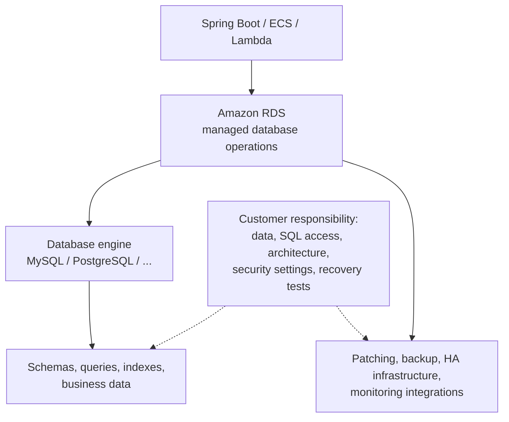
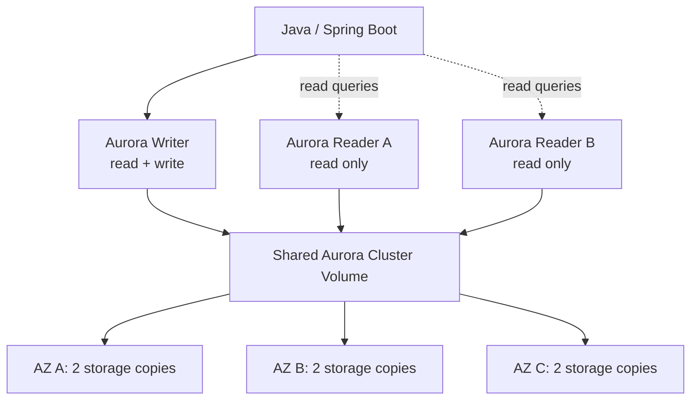
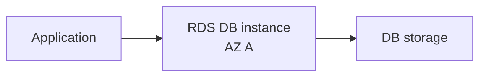
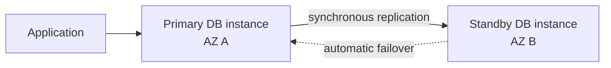
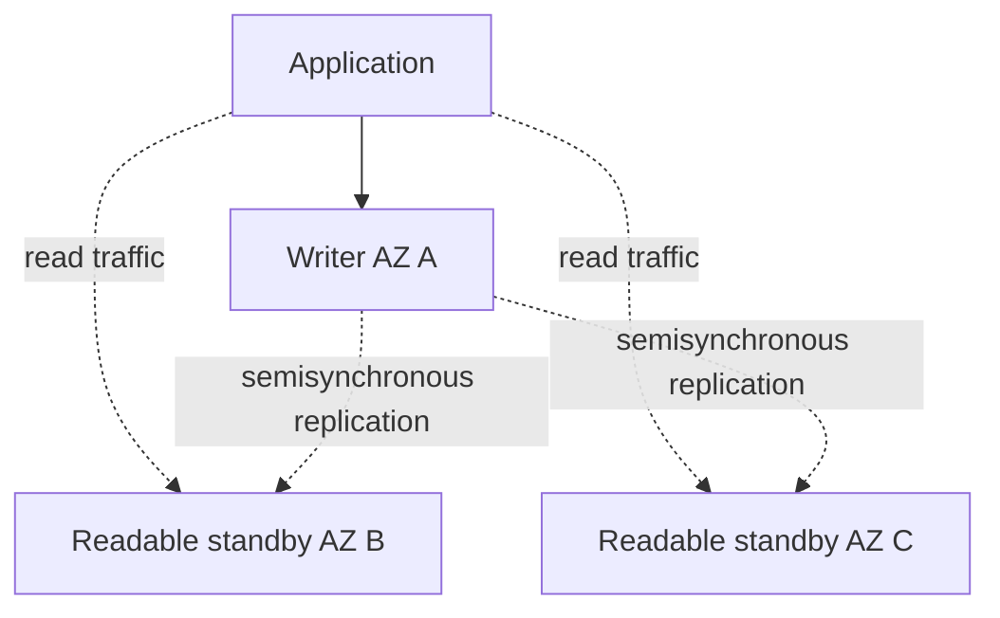
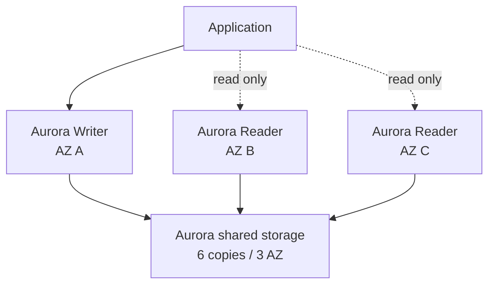
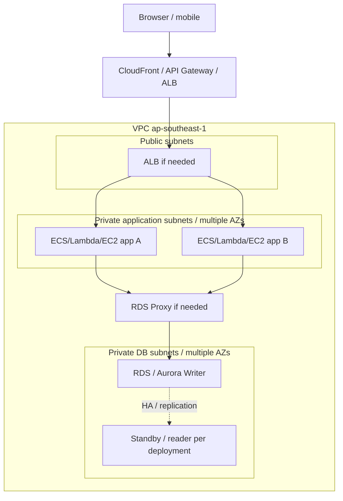
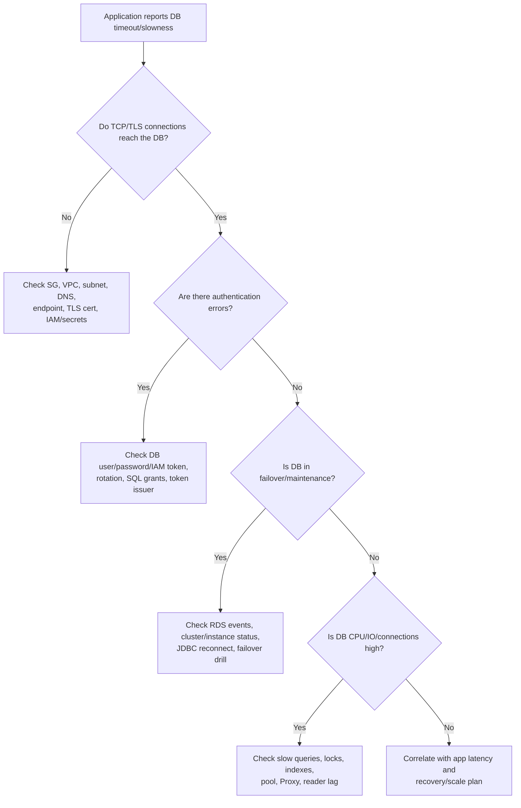
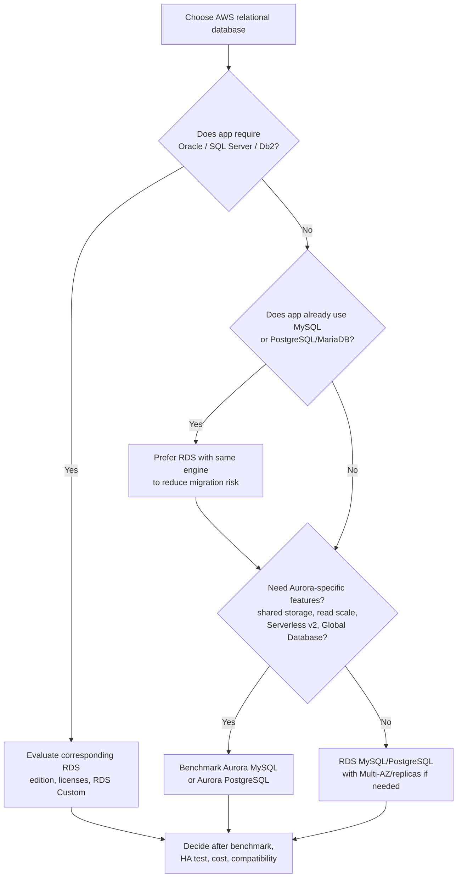

# Choosing an RDS Engine and Amazon Aurora on AWS

> **Chapter:** RDS and Aurora Databases  
> **Module:** CLOUD_PROVIDERS_AWS  
> **Objective:** choose the right database engine and deployment model in Amazon Relational Database Service (RDS), distinguish Amazon Aurora from RDS running traditional engines, understand SQL compatibility, performance, High Availability (HA), read scaling, backups, security, cost, and data migration workflows.
>
> **Scope:** Amazon RDS for MySQL, PostgreSQL, MariaDB, Oracle, Microsoft SQL Server, IBM Db2, and Amazon Aurora MySQL-Compatible/Aurora PostgreSQL-Compatible. Engine versions, features, quotas, and instance classes vary by Region and over time; always verify via the AWS Console, CLI, and documentation for the version being deployed.

## 1. Why is choosing a database engine an architectural decision?

An e-commerce company is deploying a Java/Spring Boot service on AWS. The teams put forward four proposals:

- Team A chooses **Amazon RDS for PostgreSQL** because the new application uses standard SQL, JSONB, and suitable extensions.
- Team B chooses **Amazon RDS for MySQL** because legacy code and data already use MySQL, and the operations staff/costs are familiar with it.
- Team C wants **Amazon Aurora PostgreSQL-Compatible** to separate read traffic, use multiple Aurora Replicas, and leverage multi-AZ distributed storage.
- Team D wants **Amazon RDS for SQL Server** because the reporting system already uses T-SQL, stored procedures, and Microsoft tooling.

You cannot simply ask “which database is the fastest?”; instead, you must ask:

1. **What SQL dialect, driver, extension, or vendor features does the application depend on?**
2. **What are the actual write/read ratio and access patterns?**
3. **If an Availability Zone fails, what are the required RTO and RPO?**
4. **Do you need multiple readers, dynamic compute scaling, or a Global Database?**
5. **Which engine does the team understand, and how much migration risk is acceptable?**
6. **What is the total cost after adding compute, storage, I/O, backup, licensing, and network?**

**Core principle:** *RDS* is a managed database service supporting multiple engines; *Aurora* is an **AWS-developed database engine family**, compatible with MySQL/PostgreSQL at published levels, with its own storage and recovery architecture. Aurora **is not a toggle you can turn on for every RDS engine**.

### 1.1. A workload example used throughout

Assume the `shop-api` application requires:

| Requirement | Reference value |
|---|---|
| Backend language | Java 21, Spring Boot, JDBC/Hibernate |
| Data | Orders, order items, payments, inventory |
| RPS | 150 RPS normal hours, 1,000 RPS during campaigns |
| Read/write | 80% reads, 20% writes |
| Initial data | 250 GiB, growing 20 GiB/month |
| Application downtime | Production requires HA within the Region |
| RPO | Near 0 on a single-AZ failure; backup policy for logical errors |
| RTO | Must be measured via failover drills, not just marketing numbers |
| Security | Private network, TLS, KMS, secrets rotation, auditing |
| Budget | Budget cap in place; avoid overprovisioning |

These are only **hypothetical figures** for illustration, not a benchmark or performance guarantee for any engine.

## 2. What does Amazon RDS manage and not manage?

Amazon RDS helps reduce the operational burden for many tasks:

- Creating and managing DB instances/cluster resources.
- Provisioning compute and storage.
- Automated backups per configuration, point-in-time recovery within the retention window.
- Monitoring health, CloudWatch metrics, and RDS events.
- Setting up Multi-AZ and automatic failover for supported models.
- Updating engine/OS versions according to the selected maintenance window and policy.
- Integrating with VPC, security groups, AWS KMS, IAM, and Secrets Manager.

However, RDS **does not do the following for you**:

- Designing schemas, indexes, query plans, and transaction boundaries.
- Managing SQL role permissions and data ownership/tenant isolation.
- Handling database migrations and application backward compatibility.
- Designing connection pooling, retries, and circuit breakers.
- Choosing backup retention and **testing restores** regularly.
- Monitoring slow queries, locks, deadlocks, and storage growth.
- Selecting instance classes, storage configuration, version lifecycle, quotas, and cost control.
- Ensuring data is not deleted by bad SQL statements or compromised credentials.



**Distinction:** RDS is a managed service, not an “invincible database” or a sign that “a DBA is no longer needed.” Development and operations teams still own data correctness and application-level recovery.

## 3. Six traditional RDS engines and two Aurora editions

### 3.1. Overview

| Option | Compatibility level / characteristics | Common use cases | Things to check carefully |
|---|---|---|---|
| **RDS for MySQL** | MySQL SQL dialect, InnoDB, MySQL drivers/tools | Web apps, transactional systems, migrating existing MySQL | Version, character set/collation, features, replica lag |
| **RDS for PostgreSQL** | PostgreSQL SQL/JSONB, extensions from supported list | New services, complex relational data, GIS/extensions | Extension availability, upgrade compatibility |
| **RDS for MariaDB** | MariaDB, MySQL origins but evolved independently | Workloads already running MariaDB | Do not treat MariaDB and MySQL as completely identical |
| **RDS for Oracle** | Oracle Database engine and supported editions | Enterprise apps depending on PL/SQL/Oracle features | Licensing, edition, options, charset, migration complexity |
| **RDS for SQL Server** | Microsoft SQL Server, T-SQL, and SQL Server ecosystem | .NET/Windows reporting, T-SQL/SQL Server workloads | License, edition, feature availability, HA limits |
| **RDS for Db2** | IBM Db2 engine | Enterprise Db2 apps/data | Edition/licensing, DB instance types, dependencies |
| **Aurora MySQL-Compatible** | AWS-developed engine compatible with MySQL | MySQL workloads needing cluster storage, HA, read scale | Compatibility by Aurora version, storage/I/O cost |
| **Aurora PostgreSQL-Compatible** | AWS-developed engine compatible with PostgreSQL | PostgreSQL workloads needing Aurora capabilities | Extensions/features, engine version mapping, costs |

The RDS Console usually separates **engine type** (RDS MySQL/PostgreSQL/... or Amazon Aurora) and **edition/engine version**. The label “PostgreSQL-compatible” does not mean running **bit-for-bit upstream PostgreSQL**.

### 3.2. Each engine still has versions

For example:

- RDS PostgreSQL versions follow upstream branches supported by AWS.
- Aurora PostgreSQL-Compatible versions correspond to a supported PostgreSQL branch, but Aurora patching/lifecycle is independent.
- Aurora MySQL-Compatible and RDS MySQL have corresponding version branches, but **version numbers and patch cadences are not one-to-one**.
- SQL Server/Oracle/Db2 have editions and licensing models that affect both features and costs.

**Do not create a DB with `--engine-version latest` by guessing.** Use the CLI to check which actual versions are available and permitted in your Region/account.

## 4. When to choose RDS for MySQL?

### 4.1. Advantages

RDS for MySQL is a pragmatic choice when:

- The current application already runs MySQL, with existing schemas, stored routines, SQL dialect, and operational knowledge.
- The backend team uses JDBC MySQL Connector/J and the Hibernate MySQL dialect.
- The workload is standard OLTP read/write and does not yet need Aurora-specific features.
- Cost and HA requirements can be met with a **Single-AZ/Multi-AZ DB instance** or **Multi-AZ DB cluster** depending on Region/version.
- You want to migrate from on-prem/EC2 MySQL to RDS with minimal changes.

### 4.2. Risks to review

- MySQL version/parameter defaults differ between the existing environment and RDS.
- Character sets, collations, case sensitivity, and time zones.
- SQL modes, transaction isolation, and replication configuration.
- Differences in **SUPER/FILE or system administrative privileges**, because RDS does not grant full host/database superuser access like a self-managed machine.
- Read volume may require **read replicas**; replicas can experience lag.
- Many connections from Lambda/ECS can overload DB memory/CPU.

**Do not use Aurora just because the name sounds “premium”** if the benefits do not outweigh the cost and migration risk.

## 5. When to choose RDS for PostgreSQL?

RDS for PostgreSQL is typically well suited for:

- New APIs/services needing PostgreSQL SQL features, JSONB, window functions, materialized views, and transactional consistency.
- GIS workloads using PostGIS **if the version/extension is supported**.
- Data/backend teams familiar with `EXPLAIN ANALYZE`, `pg_stat_statements`, and PostgreSQL tuning.
- Staying close to the PostgreSQL ecosystem, importing/exporting logically via `pg_dump`/`pg_restore`.
- Applications requiring specific extensions on the AWS supported list for RDS PostgreSQL.

### 5.1. RDS PostgreSQL is not a PostgreSQL machine with root access

The `rds_superuser` role differs from the `postgres` superuser account on a self-managed host. You cannot arbitrarily:

- SSH into the database host.
- Install any arbitrary OS package or native PostgreSQL extension.
- Edit configuration files outside parameter groups.
- Access the filesystem beyond what RDS functionality permits.

**If a required extension/OS package is not supported by RDS**, evaluate alternatives such as RDS Custom when the engine supports it, self-managed EC2, or a design change; **do not assume Aurora will solve it**.

### 5.2. When is PostgreSQL better than MySQL?

There is no absolute answer. Choose PostgreSQL when PostgreSQL features or query patterns provide real value; choose MySQL when compatibility with existing workloads or team expertise is a major advantage. Benchmarking on actual schemas, queries, instances, and storage matters more than a blanket claim that “PostgreSQL is faster than MySQL.”

## 6. When to choose RDS for MariaDB?

MariaDB shares historical roots with MySQL but has evolved independently. RDS for MariaDB is suitable if:

- The current application **already uses MariaDB**.
- The SQL dialect, storage engines, and MariaDB-specific behaviors are constraints.
- The operations team already has a backup/metrics/driver ecosystem for MariaDB.
- You want to reduce EC2 database management overhead without changing engines.

**Do not equate MariaDB with Aurora MySQL-Compatible.** A MariaDB application may rely on features/SQL behaviors different from MySQL; moving to Aurora MySQL requires a real migration assessment.

RDS Multi-AZ **DB cluster** with two readable standbys does not support MariaDB per current AWS documentation; with MariaDB, you can use Multi-AZ **DB instance** and read replicas where features/Regions allow.

## 7. RDS for Oracle, SQL Server, and Db2: prioritizing enterprise compatibility

### 7.1. Oracle

Choose RDS for Oracle when:

- The system depends on **PL/SQL, Oracle data types, packages**, Oracle clients/tooling, or enterprise features supported by RDS.
- Rewriting to PostgreSQL/MySQL is not yet worthwhile or feasible.
- The organization has clear **Oracle license/option** governance.

You need to evaluate:

- Oracle edition/version and supported features in RDS.
- **License Included (LI)** or **Bring Your Own License (BYOL)** depending on existing agreements/editions.
- Oracle features requiring OS access/privileged operations may not be available in standard RDS.
- Compatibility of drivers, schemas, sequences, triggers, partitioning, jobs, and backups.

**Do not claim “Aurora PostgreSQL is Oracle-compatible.”** Migrating from Oracle to Aurora PostgreSQL typically requires converting schemas, PL/SQL, and SQL logic, along with data migration and testing.

### 7.2. Microsoft SQL Server

RDS for SQL Server is often chosen when:

- Applications use T-SQL, Microsoft SQL Server drivers, and Microsoft components.
- You want to reduce Windows/SQL Server administration while keeping the API/SQL dialect.
- SQL Server licensing and edition features are input requirements.

You need to evaluate **SQL Server edition**, SQL Server Agent/jobs, SSIS/SSRS/SSAS integrations per support matrix, **Windows authentication/Active Directory**, and HA mechanisms.

SQL Server Multi-AZ DB instances use database mirroring or Always On Availability Groups depending on version/edition; **do not assume it uses the same physical replication mechanism as PostgreSQL/MySQL**.

**RDS Multi-AZ DB cluster** (writer + two readable standbys model) **does not support SQL Server**.

### 7.3. IBM Db2

RDS for Db2 serves enterprise workloads already running Db2 that want to offload infrastructure operations to managed RDS while maintaining engine compatibility.

Points to check:

- Organization's edition, DB version, and licensing arrangements.
- Instance class/Region support.
- Backup/restore and source migration.
- Whether the workload requires OS/system-level administration beyond the RDS managed boundary.

**Do not choose Db2 for a new microservice just because AWS supports it.** Without an engine dependency, PostgreSQL/MySQL generally offer easier hiring and a broader application ecosystem; evaluate based on organizational reality.

### 7.4. What is RDS Custom?

**Amazon RDS Custom** provides deeper host/database customization for certain Oracle/SQL Server workloads that require OS and database environment access not allowed in standard RDS.

In return:

- The customer takes on additional operational responsibility, patching, custom engine versions, and maintaining the support perimeter.
- It is not a generic “enable SSH mode” for every RDS engine.
- Check supported engines, licensing, instance types, and Regions.
- Do not choose RDS Custom if standard managed RDS meets your needs, because it increases operational complexity.

## 8. What is Amazon Aurora and how does it differ from standard RDS?

### 8.1. Aurora is still a relational database

Amazon Aurora includes:

- **Aurora MySQL-Compatible Edition**.
- **Aurora PostgreSQL-Compatible Edition**.

It supports compatible SQL clients/drivers within published feature/engine version boundaries. However, Aurora uses an AWS-developed architecture in which **compute instances are decoupled from distributed cluster storage**.

### 8.2. Distributed Aurora storage

Aurora designs **a shared cluster volume** in which data is protected across **six storage copies across three Availability Zones** in an AWS Region.



**Several implications:**

- The writer and readers share a logical storage volume; there is no need to maintain **another full copy of the data** for each reader as in traditional replication architectures.
- Aurora storage provides AZ fault tolerance at the storage layer even if the compute deployment does not yet have readers in multiple AZs.
- **Storage durability ≠ compute high availability.** A cluster with only a writer and no reader in another AZ still needs a mechanism to replace/create compute when the writer fails; adding a reader in another AZ improves failover.
- Aurora can add multiple **Aurora Replicas** (up to 15 per documentation for standard clusters, depending on engine/mode/quotas) for read scaling and failover candidates.
- Aurora is optimized for combining HA, read scaling, and storage auto-growth, but **does not promise that every query is always faster than RDS MySQL/PostgreSQL**.

### 8.3. Aurora does not run Oracle, SQL Server, MariaDB, or Db2

If the app depends on T-SQL/PL/SQL/MariaDB-specific behavior:

- There is no “Aurora for SQL Server/Oracle/MariaDB/Db2” menu alongside the MySQL/PostgreSQL editions.
- Technologies like **Babelfish for Aurora PostgreSQL** support **a subset of T-SQL protocol/semantics** to aid migration; it is not a full SQL Server engine and requires compatibility testing.
- Cross-engine migration requires schema conversion, code changes, and data validation.

### 8.4. Aurora DSQL is not a mode of a regular Aurora cluster

AWS also offers **Amazon Aurora DSQL** (a distributed/serverless SQL service with its own architecture and trade-offs). Do not confuse it with traditional **Aurora MySQL/PostgreSQL DB clusters** just because both carry the “Aurora” label. This article focuses on MySQL/PostgreSQL-compatible **Amazon Aurora DB clusters**; evaluating Aurora DSQL is a separate architectural decision.

## 9. The three most commonly confused HA models

### 9.1. RDS Single-AZ DB instance



- A single primary DB instance in one AZ.
- No standby instance for automatic Multi-AZ failover to another AZ.
- Higher downtime risk if the AZ or instance becomes unavailable.
- Has configured automated backups, but **backups are not HA**.
- Suitable for dev/test or workloads that can tolerate recovery time.

### 9.2. RDS Multi-AZ DB instance (single standby)



- Has a primary and a standby in **different AZs**.
- Synchronous replication per engine/implementation.
- The standby **does not serve read traffic**.
- When the primary fails, RDS automatically promotes/fails over and the associated endpoint is updated to the new primary.
- The app must **reconnect and retry** properly during failover.
- This is a common HA model for many RDS engines.

**Common mistake:** treating a Multi-AZ DB instance standby as a free read replica. It does not serve normal read queries.

### 9.3. RDS Multi-AZ DB cluster



This is a **different** RDS option from Multi-AZ DB instance:

- One **writer**, two **readable standbys** across **three AZs**.
- Supports **RDS for MySQL** and **RDS for PostgreSQL** in supported Regions/versions.
- Provides read scaling and failover capability.
- AWS describes the replication as **semisynchronous**, potentially offering lower write latency than a Multi-AZ DB instance under appropriate conditions.
- **Not Aurora**, even though it is also called a DB cluster and has writer/reader endpoints.
- Does not support MariaDB, Oracle, SQL Server, or Db2 per current AWS documentation.

### 9.4. Aurora DB cluster



- One writer, multiple readers (if configured).
- **Shared distributed cluster storage**, differing from the storage/compute replication mechanism of an RDS Multi-AZ DB cluster.
- Aurora readers are used for both reads and failover.
- Includes **Aurora Serverless v2**, Global Database, Aurora cluster endpoints, and distinct storage modes depending on engine/version.
- If there is only a writer, storage is still 3-AZ, but **compute failover is not the same as a configuration with a standby reader ready**.

### 9.5. HA comparison summary table

| Attribute | RDS Single-AZ instance | RDS Multi-AZ instance | RDS Multi-AZ DB cluster | Aurora DB cluster |
|---|---|---|---|---|
| Main engines | Six RDS engines | By engine/version | **MySQL/PostgreSQL** | **Aurora MySQL/PostgreSQL** |
| Compute | 1 instance | 1 primary + 1 standby | 1 writer + 2 readers | 1 writer + 0..n readers |
| AZ footprint | One AZ compute | Two AZ compute | Three AZ compute | 3-AZ storage; compute depends on instances |
| Reads on standby? | None | **No** | **Yes** | **Yes, if reader exists** |
| Failover | Instance recovery/replacement | Automatic failover | Automatic failover | Automatic failover |
| Storage | Per RDS instance | Replicated storage per engine mechanism | Dedicated cluster architecture | Shared Aurora storage, 6 copies/3 AZ |
| Read scaling | Can add read replicas per engine | Separate read replicas | 2 readable standbys | Aurora Replicas/reader endpoint |
| Cost | Typically lower | Adds standby compute | Three DB instances + storage | Writer/readers + Aurora storage/I/O |
| Goal | Dev/test | OLTP HA | HA + read scale MySQL/Postgres | HA + shared storage/read scale |

**Important:** do not assume “Multi-AZ = absolute data safety.” Accidental row deletions, bad schema migrations, and compromised credentials still propagate to standbys/replicas. Logical recovery requires backups/PITR and tested restore procedures.

## 10. Read replicas differ from Multi-AZ standbys and backups

### 10.1. Read replicas to offload reads

A read replica is a **read-only** copy used to:

- Offload SELECT/reporting queries from the primary.
- Add read capacity in the same Region or another Region where supported by engine/features.
- Provide a migration/DR option in some architectures.

However:

- Replication is typically **asynchronous**, resulting in **replica lag**.
- “Read-your-writes” is not immediately guaranteed if you write to the writer and then immediately SELECT from a reader.
- A replica does not automatically replace all Multi-AZ failover capabilities.
- Promoting a replica to a standalone writer requires coordinating application/endpoints and data.

### 10.2. Consistency example

A user just updated their shipping address on the writer. If the confirmation page immediately queries a reader that is lagging by 2 seconds, the user may see the old address.

**Use-case-based solutions:**

- Query immediately after a write from the **writer endpoint**.
- Use session consistency/routing logic at the application tier where appropriate.
- Accept eventual consistency for dashboards/reporting.
- Monitor replica lag and set SLOs.
- Do not route all SELECTs to readers without classifying critical reads.

### 10.3. Backups are neither replicas nor standbys

| Mechanism | What is it for? | When to use? |
|---|---|---|
| **Multi-AZ standby** | HA on compute/AZ failure | Failover |
| **Read replica** | Read scaling, certain DR/migration scenarios | Query offloading |
| **Automated backup + PITR** | Recovering data prior to a logical incident | Bad DELETE/schema, data corruption within backup capabilities |
| **Manual snapshot** | Intentional recovery point | Before upgrade/migration |
| **Cross-Region backup/replication** | Region-level DR | Region outage per RTO/RPO |

**You cannot increase read capacity by “adding automated backups.”** And having a Multi-AZ standby does not eliminate the need for backups.

## 11. Endpoints: where does the application connect?

### 11.1. RDS DB instance endpoint

A standard RDS DB instance has a hostname like:

```text
shop-postgres.abcdefghijk.ap-southeast-1.rds.amazonaws.com:5432
```

The application uses this endpoint instead of hard-coding the DB's EC2/private IP. When an RDS Multi-AZ DB instance fails over, DNS points to the new DB via AWS mechanisms.

**Configure DNS/reconnect behavior properly** in JVM/JDBC/clients; caching an old IP for too long can prolong downtime after failover.

### 11.2. Aurora writer endpoint

Example:

```text
shop-aurora.cluster-abcdefghijk.ap-southeast-1.rds.amazonaws.com:5432
```

- **Cluster/writer endpoint** points to the current writer.
- Used for **INSERT/UPDATE/DELETE/DDL** and reads requiring immediate read-after-write consistency.
- During failover, the endpoint updates to the new writer; the JDBC pool still needs to handle failed connections/retries.
- Do not hard-code an **instance endpoint** for write traffic if you want automatic writer routing on failover.

### 11.3. Aurora reader endpoint

Example:

```text
shop-aurora.cluster-ro-abcdefghijk.ap-southeast-1.rds.amazonaws.com:5432
```

- Serves read connections across available readers.
- **Balances connections**, **not individual SQL queries** over an already open connection.
- A long-lived JDBC pool may stick to a subset of readers; configure pool/reconnect behavior accordingly.
- **If a cluster has only a writer and no Aurora Replicas**, the reader endpoint may route connections to the writer; some writes could even execute because the actual target is the writer. Therefore, **a reader endpoint does not replace DB read-only IAM/SQL grants**.
- Reader traffic can experience replication lag; the app must distinguish critical vs. eventual reads.

### 11.4. Aurora custom endpoints and RDS Proxy

- **Custom endpoints** target a chosen group of DB instances, useful for separating reporting readers from application readers.
- **RDS Proxy** manages/pools database connections, helping Lambda or ECS avoid connection storms and improving failover behavior under supported conditions.
- RDS Proxy offers **read-only endpoints** for Aurora clusters with readers, but it does not grant unlimited compute capacity; you are still bounded by DB max connections, CPU, and locks.
- RDS Proxy incurs charges and requires proper VPC/IAM/secrets/TLS configuration.

**RDS Proxy does not replace SQL or index tuning.** If a query runs a 10-second full table scan, a proxy will not turn it into 10 ms.

## 12. Aurora Serverless v2: scaling compute by ACUs

### 12.1. Serverless v2 does not mean “no capacity planning”

Aurora Serverless v2 uses the `db.serverless` DB instance class and adjusts compute within an **ACU capacity range**:

- **Aurora Capacity Unit (ACU)** is a unit of compute/memory/network; per AWS, roughly **2 GiB memory + corresponding CPU/network** per ACU.
- The cluster declares **MinCapacity** and **MaxCapacity**; individual serverless writers/readers can scale within the range depending on features/configuration.
- You can mix **provisioned** and **serverless v2** DB instances in certain Aurora clusters/hybrid architectures.
- Pricing is based on capacity consumed over time, plus storage/I/O/backups/network per plan.

Example:

```text
Aurora PostgreSQL cluster
  writer: db.serverless
  reader A: db.serverless
  MinCapacity: 1 ACU
  MaxCapacity: 16 ACU
```

`MaxCapacity=16` is the **compute capacity ceiling per serverless DB instance as configured**, not “16 requests/second” or “16 connections.”

### 12.2. Conditional auto-pause to 0 ACU

**Currently supported engine versions** allow setting `MinCapacity=0` so Aurora Serverless v2 can **automatically pause when there are no connections** and resume on incoming requests.

Important conditions:

1. The engine version must support **0 ACU**; some older versions only support a minimum of 0.5 ACU.
2. The DB instance must actually be `db.serverless`, not a provisioned instance.
3. No feature or setting is enabled that disables auto-pause or keeps connections holding the DB active.
4. Hybrid clusters with provisioned readers/writers and failover tiers may prevent writers/readers from pausing as expected.
5. The application must tolerate **resume latency**, which AWS notes is typically around **15 seconds** (possibly longer after very long pauses).
6. **Compute instance capacity is not billed while truly paused**, but **storage/backups and other resources are still billed**.
7. A DB reporting `Available` **does not mean it is already warm** if it is currently paused.

**Do not choose min 0 ACU for a checkout API with a very low latency SLO** unless you have benchmarked resume behavior, connection timeouts, and traffic patterns. It can make sense for dev/test or infrequently used internal apps.

### 12.3. Min/Max ranges vary by engine version

Per current AWS documentation, Aurora Serverless v2 has different upper ranges depending on **engine/version/platform**; updated docs may allow up to **256 ACU for Aurora MySQL** and **384 ACU for Aurora PostgreSQL** on supported versions. **Do not assume every cluster can use those limits.**

Use `describe-db-engine-versions`, the Console, and the **Aurora Serverless capacity** documentation to verify version and Region capabilities before planning.

## 13. Storage and I/O: traditional RDS vs. Aurora

### 13.1. RDS DB instances

RDS DB instances typically use storage types such as (depending on supported engine/version/instance):

- **gp3 / gp2 SSD**: general purpose, suitable for many OLTP workloads.
- **io1 / io2 provisioned IOPS**: IOPS/latency-sensitive workloads, with provisioned performance limits.
- **Magnetic storage** is a legacy option in some cases, generally unsuitable for new designs.

You need to account for:

- Allocated GiB.
- Provisioned IOPS and throughput.
- Storage autoscaling/max allocated storage (if supported).
- Transaction log growth, maintenance, vacuuming, temporary files.
- Snapshot/backup storage.
- Burst/IOPS limits, I/O queues, and read/write workload.

**Do not conclude “RDS storage cannot auto-grow” for all configurations**: RDS supports storage autoscaling when enabled and supported by the engine/storage; what differs from Aurora is the architecture, billing units, and shared storage model.

### 13.2. Aurora shared auto-growing storage

Aurora cluster storage grows as data increases without requiring you to pre-provision an EBS volume size per DB instance in the traditional model. Storage is distributed across three AZs and readers access the same logical volume.

Aurora has **two storage pricing configurations**:

| Configuration | Billing | Typically suited for |
|---|---|---|
| **Aurora Standard** | DB instance/ACU + storage + **read/write I/O operations** | Low-to-moderate I/O workloads |
| **Aurora I/O-Optimized** | DB instance/ACU + storage, **no separate charges for read/write I/O requests** | Workloads where I/O is a significant share of the bill |

AWS suggests **I/O-Optimized can be cost-effective when I/O charges approach or exceed ~25% of total Aurora database spend** under Aurora Standard, because I/O-Optimized instance and storage unit rates are higher.

**Do not treat 25% as an absolute law:** compare using real Cost Explorer data, Region pricing, instances/ACUs, storage, replicas, and I/O history. Switching storage types has conditions and frequency limits per AWS documentation.

### 13.3. Do not mistake storage I/O pricing for a throughput SLA

A workload with low I/O but poor SQL can still be slow. A read-heavy workload whose data fits in the buffer pool may generate fewer physical I/Os than expected. Before choosing a storage mode:

- Measure IOPS/latency and buffer cache hit ratio.
- Analyze query plans, indexes, hot partitions, and connection counts.
- Compare peak vs. average, not just total GiB.
- Account for read replicas and workload distribution.
- Include costs for RDS Proxy, backups, Global Database, and network.

## 14. Availability, RPO, RTO, and backups: choosing by failure scenario

### 14.1. Do not just ask “is Multi-AZ enabled?”

| Incident | Risk | Primary mitigation |
|---|---|---|
| Single DB instance failure | Connection reset/downtime | Multi-AZ failover, reader failover candidates, pool reconnect |
| Availability Zone failure | Reduced compute/availability | Multi-AZ architecture, subnets/readers distributed across AZs |
| AWS Region failure | Entire Region unreachable | Cross-Region DR/Global Database/backups per engine |
| Admin runs accidental `DELETE` | Replication propagates bad data to replicas | Automated backups, PITR, restore drills |
| Malware/credential leak | Data modification/deletion | Least privilege, backups, auditing, incident response |
| Engine upgrade failure | App/query compatibility issues | Preproduction validation, snapshot/rollback strategy |
| Severe query slowdown | SLA degradation even while DB is “available” | Query tuning, indexes, read/write capacity, monitoring |

### 14.2. RPO and RTO

- **RPO** (*Recovery Point Objective*): maximum acceptable data loss, measured in time.
- **RTO** (*Recovery Time Objective*): maximum acceptable time for the service to return to operation after an incident.

**Example:** an organization requires RPO under 5 minutes and RTO under 30 minutes if an entire Region goes down. A Multi-AZ cluster within a **single Region** does not meet that requirement; a cross-Region strategy and regular drills are required.

### 14.3. Automated backups and PITR

RDS/Aurora provide **automated backups/PITR** depending on supported engine/deployment/configuration. When using them:

- Set **retention** long enough to detect logical errors (RDS instances may support 0–35 days; Aurora clusters typically require a service-defined minimum retention—verify for your specific version).
- Take **manual snapshots** before major changes.
- Restoring typically creates a **new DB instance/cluster**; it does not automatically “undo” the current production state in place.
- Plan DNS/connection secrets, DB users, security groups, parameter groups, and app cutover for the restored DB.
- **Run restore drills** in an isolated environment and measure actual RTO/RPO.
- Verify that backups retain sufficient transaction logs and retention to recover to the desired point in time.

**Warning:** Multi-AZ does not preserve a “pre-DELETE state” on the standby; the standby replicates valid delete operations as well. **Backups/PITR** are the recovery layer for logical errors.

### 14.4. Aurora Global Database and Cross-Region DR

Aurora **Global Database** supports a multi-Region topology where a primary Region handles writes and secondary Regions serve reads/DR for supported features/versions.

- Cross-Region replication is generally **asynchronous**, so you must measure and monitor lag and RPO.
- When failing over or switching over to another Region, plan endpoints, secrets, routing, and application reconnects.
- Global Database can incur costs for replicated data as well as secondary compute/storage/network.
- **You do not turn a single-Region Aurora cluster into a multi-Region setup merely by adding a reader in another AZ.**

Traditional RDS engines have **cross-Region read replica or backup copy** options depending on engine/version, though not all engines share the same features or RTO/RPO.

## 15. Database security in a VPC

### 15.1. RDS/Aurora belong inside a VPC, not exposed publicly by default

A typical production deployment:



**Principles:**

- Create a **DB subnet group** spanning appropriate subnets across multiple Availability Zones, depending on the deployment engine.
- Keep DBs **non-public** for standard production; clients connect via the app tier inside the VPC or private connectivity.
- The **DB security group** should only allow inbound traffic from the application security group on the DB port (MySQL 3306, PostgreSQL 5432, SQL Server 1433, etc., depending on engine and settings).
- Never open `0.0.0.0/0` to the DB port to “fix a timeout error.”
- If Lambda runs inside a VPC, configure private subnets/SGs and appropriate AWS service endpoints or NAT for Secrets Manager, logs, and dependencies.
- Check DNS resolution, NACLs, route tables, and cross-AZ reachability.
- Use TLS for database connections; verify certificate trust bundles and certificate rotation.

### 15.2. IAM responsibilities vs. database users

| Layer | Purpose | Examples |
|---|---|---|
| **IAM control plane** | Who can create/modify/delete RDS/Aurora, backups, snapshots | `rds:CreateDBInstance`, `rds:ModifyDBCluster` |
| **DB authentication** | Who can connect and run SQL queries | DB user/password, IAM DB auth, AD/Kerberos where supported |
| **SQL privileges** | What a user can SELECT/INSERT/ALTER | `GRANT SELECT ON ...` |
| **Network security** | Which clients can reach the TCP port | SG, VPC, TLS |
| **KMS** | Storage/secrets encryption permissions | KMS key policies |
| **Application authorization** | Which orders an end user can read | Tenant/resource ownership in the backend |

**Do not confuse `rds:DescribeDBInstances` with `SELECT` privileges in PostgreSQL.** Granting an app IAM role RDS management permissions does not automatically allow SQL queries; conversely, leaked DB admin credentials can cause a data incident even if the client's IAM role has minimal permissions.

### 15.3. IAM database authentication

Some RDS/Aurora engines support **IAM DB authentication**: the client generates an authentication token signed with AWS credentials, and the DB server validates it through the service model.

Points to check:

- Whether the engine and version support IAM DB auth (MySQL, PostgreSQL, and MariaDB/Aurora under supported conditions).
- IAM policy `rds-db:connect` targeting the exact DB user resource ID, not just the RDS ARN.
- Client SDK/driver, token generation, TLS, and time synchronization.
- Tokens are **short-lived** (typically 15 minutes to initiate a connection), not “permanent passwords.”
- Token expiration **does not automatically drop already authenticated connections**.
- For massive connection bursts, combine with RDS Proxy or pooling mechanisms where appropriate.
- Do not use IAM DB auth as a substitute for SQL GRANTs or row-level security.

For Oracle/SQL Server/Db2, authentication capabilities have engine-specific characteristics; do not assume all engines use `rds-db:connect` in the same way.

### 15.4. Secrets Manager and rotation

RDS/Aurora can integrate with **AWS Secrets Manager** to manage master credentials in supported configurations. An application can:

1. Receive the secret ARN via configuration.
2. Use an IAM runtime role with `secretsmanager:GetSecretValue` and KMS decrypt permissions if needed.
3. Create JDBC connections using the retrieved credentials.
4. Cache the secret safely according to TTL/rotation logic.
5. Refresh connections when the secret rotates; do not assume all active pools automatically swap passwords.

If not using IAM DB auth, you can configure automatic secrets rotation per supported frameworks, but you must test **during rotation**, not just static login.

### 15.5. Encryption and backups

- **Encryption at rest:** enable RDS/Aurora storage encryption/KMS at DB creation time as required; snapshots/backups use the corresponding encryption mechanism.
- **You cannot always enable encryption in place** on an unencrypted DB; it may require snapshot copy/restore or migration.
- **Encryption in transit:** configure TLS connections and certificate validation in JVM/JDBC; do not just set `sslmode=require` and skip server verification if policy requires hostname verification.
- **Snapshot sharing/copy:** verify KMS key permissions and cross-account/cross-Region rules.
- **Database auditing:** use appropriate engine audit/logging features, CloudWatch Logs exports, and IAM least privilege.

**Defense in depth:** even if a DB is encrypted with KMS, an application using a compromised `SUPERUSER` DB account can still read or delete data; KMS does not replace SQL permissions.

## 16. Capacity planning: compute, I/O, connections, and query design

### 16.1. Relationship between workload and database resources

DB latency is affected by:

- CPU during query parsing, joins, sorts, and functions.
- Memory/buffer cache and shared buffers.
- Storage IOPS, throughput, and latency.
- Lock contention, transaction duration, and deadlocks.
- Number of concurrent connections and connection pool size.
- Network round trips between app and DB.
- Replica lag, vacuuming/maintenance, and log flushing.
- Query plan statistics and indexes.

**Do not automatically add an Aurora reader when the bottleneck is writer writes/locks.** Readers help read-heavy traffic when the app routes properly; they do not turn the writer into a distributed multi-writer database in a standard Aurora cluster.

### 16.2. Connection storm example from ECS

Assume:

- An ECS service has 30 tasks.
- Each task runs a HikariCP pool with `maximumPoolSize=20`.
- Each task can open its full pool of connections under load.

Theoretical connections:

\[
30 \times 20 = 600\ \text{connections}
\]

If an autoscaling step scales tasks from 30 to 60:

\[
60 \times 20 = 1.200\ \text{connections}
\]

Even when the RDS instance has spare CPU, too many connections can exhaust RAM and trigger errors.

**Solution:** measure actual active/idle connections, cap pool sizes, use RDS Proxy where appropriate, add caching, separate reads/writes, and optimize SQL. Never set `maximumPoolSize=500` per task “to make it faster.”

### 16.3. Lambda with a relational database

AWS Lambda can scale concurrency rapidly within a Region. If each invocation opens its own connection to RDS, connection counts can grow with concurrency, plus warm execution environments hold idle connections open.

Consider:

- **RDS Proxy** for supported engines/versions.
- Configuring **Lambda reserved concurrency** to protect DB connections.
- Reusing connections properly without keeping transactions open for long periods.
- Batching queries and caching appropriately.
- Aurora Data API for supported use cases, but **do not treat the Data API like a standard JDBC socket**.
- Evaluating IAM DB auth/Secrets Manager and VPC endpoints where appropriate.

### 16.4. Query plans before scaling

In PostgreSQL, for example:

```sql
-- Create sample structure in a lab environment; do not run directly in production.
CREATE TABLE orders (
  id BIGINT PRIMARY KEY,
  tenant_id BIGINT NOT NULL,
  created_at TIMESTAMPTZ NOT NULL,
  status VARCHAR(30) NOT NULL,
  total_amount NUMERIC(12,2) NOT NULL
);

CREATE INDEX idx_orders_tenant_created
ON orders (tenant_id, created_at DESC);

-- View estimated plan only (does not execute the query):
EXPLAIN
SELECT id, created_at, status, total_amount
FROM orders
WHERE tenant_id = 42
ORDER BY created_at DESC
LIMIT 20;
```

Key takeaways:

- `WHERE tenant_id = ?` enforces tenant isolation at the data access layer, but **is not enough** unless the application verifies the tenant ID from a trusted identity.
- Indexes support frequent query patterns; blindly adding indexes is counterproductive because writes and storage overhead increase.
- `EXPLAIN ANALYZE` actually executes the query, incurs cost, and can cause locks/load; use only under controlled conditions.
- `TIMESTAMPTZ` syntax is PostgreSQL-specific. Across MySQL/SQL Server/Oracle, schemas and SQL differ—**migrations must account for SQL dialect**.

### 16.5. Read scaling only works if the app separates traffic

Route queries such as:

- Product catalog/search/filter reads that tolerate eventual consistency.
- Dashboards/reporting that do not require immediate read-your-writes.

to the reader endpoint or read replicas. However:

- Checking order status right after a write may need to hit the writer.
- Heavy reporting queries can impact other read replicas.
- If each JDBC pool opens too few connections or stays pinned to one reader, the reader endpoint will not load-balance queries on its own.
- Aurora readers still share the storage subsystem; very heavy I/O read traffic can increase total I/O cost under Aurora Standard.

## 17. Layered monitoring and troubleshooting

### 17.1. Core CloudWatch metrics

| Metric | Interpretation | Signal |
|---|---|---|
| **`CPUUtilization`** | DB instance CPU | Sustained high → query/index or compute bottleneck |
| **`DatabaseConnections`** | Current connections | Grows with ECS/Lambda concurrency, possible pool leak |
| **`FreeableMemory`** | Reclaimable memory | Sustained low → memory pressure |
| **`FreeStorageSpace`** | Remaining RDS instance storage per engine | Running out of disk → write/maintenance failures |
| **`ReadIOPS/WriteIOPS`** | Storage I/O operations | Understand I/O demand/billing |
| **`ReadLatency/WriteLatency`** | Storage I/O latency | Increasing → storage bottleneck or load |
| **`DiskQueueDepth`** | Queued storage I/O | Increasing → I/O saturation |
| **`ReplicaLag` / `AuroraReplicaLag`** | Replica lag per engine | Risk of stale reads |
| **`Deadlocks`** | Deadlocks occurring | Review transaction ordering/locks |
| **`ServerlessDatabaseCapacity`** | Current Aurora Serverless ACUs | Observe scaling/auto-pause |
| **`ACUUtilization`** | Utilization of ACU range | Hitting MaxCapacity → latency |

**Metric names/dimensions vary by engine and deployment.** For example, Aurora storage metrics differ from reading `FreeStorageSpace` on an EBS-backed RDS DB instance; do not expect every metric to exist on every deployment.

### 17.2. Database Insights, Performance Insights, Enhanced Monitoring

AWS provides observability tools:

- **CloudWatch Database Insights**, depending on mode/tier/feature availability.
- **Performance Insights** history and feature-lifecycle transitions; check current AWS policies before long-term design decisions.
- **Enhanced Monitoring** for OS-level metrics per configuration.
- Engine-specific logs: slow query log, PostgreSQL logs, audit logs, error logs.
- CloudTrail for **RDS control-plane API actions**, which does not replace database query auditing.

When you see high CPU, do not immediately conclude “scale up the instance class.” A single SELECT missing an index can create the load; inspect top SQL, query plans, wait events, lock duration, and the application.

### 17.3. A simple diagnostic runbook



### 17.4. Symptoms by failure mode

| Symptom | Possible cause | Action |
|---|---|---|
| Cannot connect from ECS | Wrong SG source, private DB, route/DNS | Check app SG → DB SG and VPC |
| Authentication failed | Stale secret, expired IAM token, missing SQL user grants | Test rotation/token/database grants |
| Read query sees stale data | Replica lag, SELECT sent to reader | Route critical reads to writer; measure lag |
| Aurora reader endpoint load uneven | Connection balancing, long-lived pools | Check session distribution and pool settings |
| App still points to old instance after failover | Hard-coded IP/instance endpoint, stale DNS | Use writer endpoint and reconnect |
| Serverless v2 does not pause | MinCapacity >0, open connections, incompatible feature | Check capacity settings and auto-pause logs |
| Serverless v2 first request is slow | Auto-resume from 0 ACU | Increase timeout, set min ACU >0 if SLO is strict |
| High DB CPU with low traffic | Bad query plan/locks, background maintenance | Check top SQL, wait events, and indexes |
| Storage full despite autoscaling | Max allocated storage reached, quota, rapid growth | Scale storage, clean up data/logs safely |
| “Have Multi-AZ” but no read replica visible | Multi-AZ DB instance standby is not readable | Create a read replica or choose a supported cluster mode |
| Accidental delete propagated to standby | Valid replication | Restore PITR/snapshot to a new DB |
| Engine upgrade breaks app | SQL dialect/driver/extension changes | Test in staging, prepare rollback/migration |
| Aurora cost higher than estimated | I/O Standard, many readers, Serverless floor | Check Cost Explorer, evaluate I/O-Optimized |
| Queries time out after scale-out | Too many pool connections, DB pressure | Use RDS Proxy, cap pool/concurrency |
| Migration CDC still has lag | Slow target writes, DMS task/error, network | Monitor DMS latency and target capacity |

## 18. Cost: calculate total ownership, not just “DB instance price”

### 18.1. Cost components

| Component | Traditional RDS engines | Aurora |
|---|---|---|
| **Compute** | DB instance-hours, Multi-AZ/replicas | Provisioned DB instances or Serverless v2 ACU usage |
| **Storage** | Provisioned/auto-scaled GB, storage class | Shared cluster GB-month, auto-growing |
| **I/O** | gp3/io1/io2 IOPS/throughput per pricing | Standard per I/O requests or I/O-Optimized with no separate I/O charge |
| **HA/replicas** | Standby/read replica DB resources | Writer/readers compute |
| **Backups/snapshots** | Free allowances and overages, retention, copy | Similar per Aurora policies/pricing |
| **Licenses** | Oracle, SQL Server, Db2 per edition/model | No Oracle/SQL Server/Db2 engine licenses |
| **Network** | Cross-AZ/Region data transfer, endpoint traffic | Global Database/cross-Region replication and network |
| **Operations** | CloudWatch, Secrets/KMS, proxy, logs | Similar, plus Aurora-specific features |
| **Commitment** | On-Demand/Reserved DB Instances where supported | Provisioned/Serverless pricing and reserved discounts per mode |

**A cluster with read replicas is not free just because storage is “shared.”** Reader compute, monitoring, and network costs can add up significantly.

### 18.2. I/O cost ratio example

Suppose an Aurora Standard cluster in the same Region has an illustrative baseline bill:

```text
DB compute            550 USD
Storage               200 USD
Read/write I/O        250 USD
----------------------------
Total               1,000 USD
I/O share                25%
```

With an I/O share near 25%, compare Aurora I/O-Optimized, since AWS notes that configuration can be cheaper when I/O is a large share of spend. **Do not assume the I/O-Optimized bill will be 750 USD**: compute and storage unit prices are **higher** on I/O-Optimized, so you must recalculate.

All amounts are **hypothetical**, not actual AWS prices.

### 18.3. Is Serverless v2 automatically cheaper than every provisioned instance?

No. If Serverless v2 runs continuously at high ACUs, its cost can differ significantly from a properly sized provisioned instance. If a cluster has multiple readers and a high min ACU, the **capacity floor** still bills even during low traffic.

Auto-pause at 0 ACU can cut compute charges while paused, but:

- You must use a compatible engine/version.
- The application must not hold connections open if you want it to pause.
- Warm-up/resume latency impacts SLOs.
- Storage, backups, and dependent services still incur charges.
- Certain active readers/failover priorities/features can prevent pausing.

**Choose based on your actual hourly/daily load curve**, not just the word “Serverless.”

### 18.4. License costs can drive the decision

When evaluating SQL Server/Oracle/Db2, ask:

1. Is the license model LI or BYOL/other?
2. Are specific editions/features tied to licensing?
3. Can you use SQL Server Express/Standard instead of Enterprise, or does that change required functionality?
4. Are existing licenses contractually permitted for AWS deployment?
5. What is the cost of **rewriting/migrating/testing/supporting** a move to PostgreSQL/Aurora?

**Do not compare only first-month runtime prices.** Migrating off Oracle may save long-term licensing costs while incurring substantial PL/SQL conversion and business testing effort.

## 19. Decision framework: start from constraints

### 19.1. Decision tree



**An engine constraint does not mean you must keep it forever.** You can plan a long-term strategic migration, while separating the **low-risk short-term solution** from the **long-term target architecture**.

### 19.2. Selection matrix

| Question | Standard RDS often has the advantage | Aurora has the advantage |
|---|---|---|
| Need native Oracle/SQL Server/Db2/MariaDB? | **Yes** | No corresponding Aurora edition |
| Team already uses MySQL/PostgreSQL with moderate load? | Can be simpler/more economical | Still a candidate; needs comparison |
| Need many readers sharing cluster storage? | RDS Multi-AZ cluster/read replicas per engine | **Aurora Replicas/reader endpoint** |
| Need flexible ACU-based DB compute scaling? | DB instance scaling works differently | **Aurora Serverless v2** |
| Need multi-Region Global Database? | Cross-Region replicas/backups per engine | **Aurora Global Database** |
| Queries need vendor-specific extensions? | Check RDS engine support | Check Aurora-specific support separately |
| Highly sensitive to Oracle/SQL Server licensing? | Licenses must be factored in | Can switch engines, though migration is major |
| Very high I/O under Aurora Standard? | Compare gp3/io2/IOPS pricing | **I/O-Optimized** may help |
| Just need a small DB for dev/test? | Single-AZ RDS is often enough | Serverless auto-pause can also fit |

### 19.3. Weighted scoring only assists; it does not override constraints

For example, a team scores:

- SQL/data compatibility (30% weight).
- HA/DR (20%).
- Benchmark performance (20%).
- 3-year cost (20%).
- Operational skills (10%).

```text
Option A: RDS PostgreSQL
  Compatibility 5/5
  HA/DR         4/5
  Benchmark     4/5
  TCO           4/5
  Skills        5/5

Option B: Aurora PostgreSQL
  Compatibility 4/5 (must test extensions)
  HA/DR         5/5
  Benchmark     4/5
  TCO           3/5 (assuming sample workload)
  Skills        4/5
```

**Do not treat illustrative scores as an AWS benchmark.** If the application requires an extension unsupported by Aurora, a technical constraint can eliminate Aurora even if its total score is high.

## 20. Choosing a solution by scenario

### 20.1. Scenario A — Medium website, stable MySQL database

- On-prem MySQL 8.x, ~100 GiB.
- Team already has dump/restore workflows and MySQL monitoring.
- Needs single-Region HA and reasonable cost.

**Initial evaluation suggestion:** RDS for MySQL + **Multi-AZ DB instance**, adding a read replica only if truly needed. This can be a minimal-change migration. Measure bottlenecks later and consider Aurora MySQL if warranted.

### 20.2. Scenario B — Spring Boot PostgreSQL, read-heavy, HA required

- PostgreSQL, high SELECT ratio.
- Traffic spikes during campaigns.
- Needs 2–5 read replicas and relatively fast failover.

**Comparison suggestion:** RDS PostgreSQL **Multi-AZ DB cluster**, RDS PostgreSQL + read replicas, and **Aurora PostgreSQL**. Aurora has advantages in shared storage/reader topology; RDS cluster provides two readable standbys; benchmark cost/storage/I/O and extension compatibility.

### 20.3. Scenario C — Long-standing SQL Server enterprise

- T-SQL/stored procedures, SSIS/SSRS integrations, existing licensing.
- No team capacity to migrate logic to PostgreSQL.

**Initial suggestion:** RDS for SQL Server; verify editions/features, HA, licensing, and RDS Custom if OS access is genuinely required. Do not choose Aurora PostgreSQL assuming T-SQL will run completely out of the box.

### 20.4. Scenario D — Low-traffic dev/test with idle periods

- 5–10 connections per day.
- Tolerates connection resume delay.
- Wants to save compute when idle.

**Evaluation suggestion:** A small RDS instance with an appropriate start/stop schedule or Aurora Serverless v2 with **min 0 ACU auto-pause** on a supported engine/version. Calculate total storage/cost and measure resume times; do not claim Serverless is always cheaper.

### 20.5. Scenario E — Multi-Region serving workload

- Reads in Asia and Europe.
- Needs cross-Region DR and traffic recovery.

**Suggestion:** Aurora Global Database if choosing Aurora, or a cross-Region replica/backup strategy for the chosen RDS engine. **Do not confuse global reads with unrestricted global writes**; account for the primary writer and consistency/lag constraints.

## 21. Migration planning before choosing Aurora

### 21.1. Homogeneous vs. heterogeneous migration

| Type | Example | Level of change |
|---|---|---|
| **Homogeneous** | MySQL → RDS MySQL | Usually minimal code/schema migration; still verify version |
| **Homogeneous/compatible** | RDS MySQL → Aurora MySQL | Must verify Aurora compatibility/version |
| **Homogeneous/compatible** | RDS PostgreSQL → Aurora PostgreSQL | Check supported extensions, feature gaps, versions |
| **Heterogeneous** | Oracle → Aurora PostgreSQL | Schema/SQL/stored procedure rewrite, data type conversion |
| **Heterogeneous** | SQL Server → Aurora PostgreSQL | SQL dialect conversion; Babelfish helps only partially where suitable |
| **Heterogeneous** | Db2 → PostgreSQL | Major schema/query/transaction impact |

### 21.2. Proper migration steps

1. **Discovery:** inventory DB versions, schemas, extensions, triggers, jobs, procedures, row counts, data volumes, and client drivers.
2. **Compatibility assessment:** list SQL dialect differences, collations, data types, encodings, and privilege models.
3. **Target design:** RDS engine/Aurora edition, version, Multi-AZ/replicas, storage/instance, VPC/KMS.
4. **Data migration method:** snapshot restore, native dumps/replication, **AWS DMS** with CDC where supported, schema conversion for heterogeneous engines.
5. **Data validation:** row counts, checksums, referential integrity, CDC lag, indexes.
6. **Performance benchmark:** realistic queries/data size, read/write ratio, peak traffic, locks, cost.
7. **Cutover plan:** read-only window/dual-write constraints, replication catch-up, DNS/app config switch.
8. **Rollback plan:** keep the old DB and schema compatibility as a fallback if cutover fails.
9. **Post-cutover:** compare data, check errors/latency, monitor, and decommission the old DB after the retention policy expires.

### 21.3. Common tools

- **Native MySQL tooling**: `mysqldump`/`mysql`, corresponding replication/backups.
- **PostgreSQL tooling**: `pg_dump`, `pg_restore`, `pg_basebackup`/native replication where appropriate.
- **AWS Database Migration Service (DMS)**: full-load/CDC/continuous replication for supported source/target combinations.
- **AWS Schema Conversion Tool (SCT)** or AWS DMS schema conversion tools: assists heterogeneous schema/code assessment and conversion.
- **RDS snapshots**: certain workflows migrate an RDS MySQL/PostgreSQL snapshot to compatible Aurora if the version/feature is supported.
- **Aurora read replica** from RDS PostgreSQL in some supported models/versions to reduce downtime.

**Do not assume every RDS snapshot restores directly into Aurora.** Verify the supported source engine/version and migration path in AWS documentation at deployment time.

### 21.4. Schema evolution: avoiding irreversible rollbacks

During the few minutes of cutover, two app versions may coexist. If you change an `orders.status` enum/column incompatibly:

- The old app may fail to read data created by the new app.
- “Pointing the endpoint back to the old DB” can lose transactions written to the target after cutover.
- You need **expand/contract migrations**, a dual-read/compatibility plan, and a defined point to stop writes.

**Database migration is not just running `pg_restore` and changing an environment variable.**

## 22. AWS CLI for reading engine, database, and version state

> The commands in this section are **read-only**. They require AWS CLI v2, a role permitted `rds:Describe*`, and the right Region. Output may contain internal metadata/endpoints/tags; do not publish it publicly. Names like `shop-*` are examples and do not exist by default.

### 22.1. List engine versions

```bash
# Available RDS PostgreSQL versions in the Region
aws rds describe-db-engine-versions \
  --region ap-southeast-1 \
  --engine postgres \
  --query 'DBEngineVersions[].[EngineVersion,DBParameterGroupFamily,Status]' \
  --output table

# Aurora PostgreSQL versions in the Region
aws rds describe-db-engine-versions \
  --region ap-southeast-1 \
  --engine aurora-postgresql \
  --query 'DBEngineVersions[].[EngineVersion,DBParameterGroupFamily,Status]' \
  --output table
```

Common engine identifiers:

| Engine | CLI `--engine` |
|---|---|
| RDS MySQL | `mysql` |
| RDS PostgreSQL | `postgres` |
| RDS MariaDB | `mariadb` |
| RDS Oracle | `oracle-ee` or `oracle-se2` per edition |
| RDS SQL Server | `sqlserver-ee`, `sqlserver-se`, `sqlserver-ex`, `sqlserver-web` per edition |
| RDS Db2 | `db2-ae` or `db2-se` per edition |
| Aurora MySQL | `aurora-mysql` |
| Aurora PostgreSQL | `aurora-postgresql` |

**Do not use Aurora engine identifiers for an RDS Multi-AZ DB cluster on PostgreSQL**: an RDS PostgreSQL cluster uses `postgres`, whereas Aurora PostgreSQL uses `aurora-postgresql`.

### 22.2. List DB instances

```bash
aws rds describe-db-instances \
  --region ap-southeast-1 \
  --query 'DBInstances[].[DBInstanceIdentifier,Engine,EngineVersion,DBInstanceClass,MultiAZ,DBInstanceStatus,DBClusterIdentifier]' \
  --output table
```

- `Engine` identifies the DB engine.
- `MultiAZ` is a field to check by deployment type, but **is not sufficient** to distinguish all cluster types.
- `DBClusterIdentifier` indicates whether the DB instance belongs to a DB cluster.
- A `DBInstanceStatus` of `available` does not prove app queries are healthy or SQL permissions are correct.

### 22.3. List DB clusters

```bash
aws rds describe-db-clusters \
  --region ap-southeast-1 \
  --query 'DBClusters[].[DBClusterIdentifier,Engine,EngineVersion,Status,MultiAZ,Endpoint,ReaderEndpoint]' \
  --output table
```

`describe-db-clusters` can list both **Aurora** and **RDS Multi-AZ DB clusters**. Read `Engine` and metadata/version—do not assume every cluster is Aurora.

### 22.4. Inspect Aurora writer/readers

```bash
aws rds describe-db-clusters \
  --region ap-southeast-1 \
  --db-cluster-identifier shop-aurora-prod \
  --query 'DBClusters[0].{Engine:Engine,Endpoint:Endpoint,ReaderEndpoint:ReaderEndpoint,Members:DBClusterMembers[*].{Id:DBInstanceIdentifier,Writer:IsClusterWriter,PromotionTier:PromotionTier}}' \
  --output json
```

Used to:

- Confirm the actual current **writer**.
- View reader instances/priority.
- Identify the two endpoints the application needs to configure.
- Inspect the cluster after failover.

### 22.5. Inspect Aurora custom endpoints

```bash
aws rds describe-db-cluster-endpoints \
  --region ap-southeast-1 \
  --db-cluster-identifier shop-aurora-prod \
  --query 'DBClusterEndpoints[].[DBClusterEndpointIdentifier,Endpoint,EndpointType,Status]' \
  --output table
```

Results may include writer/reader/custom endpoints depending on the cluster. Do not connect to a custom endpoint assuming it is always read-only without checking `EndpointType` and membership/failover behavior.

### 22.6. Inspect backups/snapshots

```bash
aws rds describe-db-snapshots \
  --region ap-southeast-1 \
  --db-instance-identifier shop-postgres-prod \
  --query 'DBSnapshots[].[DBSnapshotIdentifier,SnapshotType,Status,SnapshotCreateTime]' \
  --output table

aws rds describe-db-cluster-snapshots \
  --region ap-southeast-1 \
  --db-cluster-identifier shop-aurora-prod \
  --query 'DBClusterSnapshots[].[DBClusterSnapshotIdentifier,SnapshotType,Status,SnapshotCreateTime]' \
  --output table
```

**Important:** a snapshot list does not verify that you can meet your RPO/RTO. You must run restore drills in an isolated account/environment following approved procedures.

### 22.7. Check engine upgradability

```bash
aws rds describe-db-engine-versions \
  --region ap-southeast-1 \
  --engine aurora-postgresql \
  --engine-version 16.4 \
  --query 'DBEngineVersions[0].ValidUpgradeTarget[].[EngineVersion,IsMajorVersionUpgrade]' \
  --output table
```

**Version 16.4 is only an example**; it may not be a currently supported Aurora version in the Region. Replace `--engine-version` with a real value from `describe-db-engine-versions`.

### 22.8. Inspect Aurora Serverless v2 settings

```bash
aws rds describe-db-clusters \
  --region ap-southeast-1 \
  --db-cluster-identifier shop-aurora-prod \
  --query 'DBClusters[0].{Serverless:ServerlessV2ScalingConfiguration,StorageType:StorageType,Engine:Engine}' \
  --output json
```

- `MinCapacity`/`MaxCapacity` if the cluster has a Serverless v2 scaling configuration.
- `StorageType` such as `aurora`/`aurora-iopt1` depending on representation.
- Check whether **DB instances** are `db.serverless` or provisioned instances.
- Min=0 only enables auto-pause when engine/version/hybrid/other conditions are met.

### 22.9. RDS events

```bash
aws rds describe-events \
  --region ap-southeast-1 \
  --source-type db-instance \
  --duration 60 \
  --query 'Events[].[Date,SourceIdentifier,Message]' \
  --output table
```

This command queries events over a recent window (in minutes) to investigate failover/maintenance. For DB cluster events, use `--source-type db-cluster`. Having no events does not prove queries/transactions are healthy.

## 23. Illustrative configuration using Infrastructure as Code

> **This section illustrates structure only** and may create billable resources. Do not deploy into a real AWS account without reviewing IAM, KMS, backups, deletion protection, networking, credential ownership, and the AWS CloudFormation reference.

### 23.1. RDS PostgreSQL instance (abbreviated sample)

```yaml
Resources:
  ShopPostgres:
    Type: AWS::RDS::DBInstance
    DeletionPolicy: Snapshot
    UpdateReplacePolicy: Snapshot
    Properties:
      DBInstanceIdentifier: shop-postgres-prod
      Engine: postgres
      DBInstanceClass: db.m7g.large
      AllocatedStorage: '100'
      StorageType: gp3
      MultiAZ: true
      StorageEncrypted: true
      PubliclyAccessible: false
      DBSubnetGroupName: !Ref PrivateDbSubnetGroup
      VPCSecurityGroups:
        - !Ref DatabaseSecurityGroup
      BackupRetentionPeriod: 14
      DeletionProtection: true
      ManageMasterUserPassword: true
```

Explanation:

- `MultiAZ: true` on a DB instance corresponds to the standard Multi-AZ DB instance model; **it does not automatically create an RDS Multi-AZ DB cluster with 2 readable standbys**.
- `ManageMasterUserPassword` uses a supported integration; never hard-code master passwords in Git.
- `DeletionPolicy/UpdateReplacePolicy` reduces the risk of data loss when a stack is deleted/replaced, but **does not replace a database backup plan**.
- `PrivateDbSubnetGroup` and `DatabaseSecurityGroup` **are not yet defined**; the configuration above cannot be deployed as-is.
- Verify DBInstanceClass/version/networking/KMS support in the Region and against account policies.

### 23.2. Aurora PostgreSQL cluster (abbreviated sample)

```yaml
Resources:
  ShopAuroraCluster:
    Type: AWS::RDS::DBCluster
    DeletionPolicy: Snapshot
    UpdateReplacePolicy: Snapshot
    Properties:
      DBClusterIdentifier: shop-aurora-prod
      Engine: aurora-postgresql
      StorageEncrypted: true
      BackupRetentionPeriod: 14
      DeletionProtection: true
      ManageMasterUserPassword: true
      DBSubnetGroupName: !Ref PrivateDbSubnetGroup
      VpcSecurityGroupIds:
        - !Ref DatabaseSecurityGroup

  ShopAuroraWriter:
    Type: AWS::RDS::DBInstance
    Properties:
      DBClusterIdentifier: !Ref ShopAuroraCluster
      DBInstanceClass: db.r7g.large
      Engine: aurora-postgresql

  ShopAuroraReader:
    Type: AWS::RDS::DBInstance
    Properties:
      DBClusterIdentifier: !Ref ShopAuroraCluster
      DBInstanceClass: db.r7g.large
      Engine: aurora-postgresql
```

This is a partial architectural illustration:

- The cluster has writer/reader instances and shared Aurora storage.
- DB instances are placed in AZs/subnets per AWS selection; production needs verification that writer and reader are in **different AZs**.
- Add engine version, parameter groups, tags, monitoring/alarms, and backup/KMS settings per approved IaC standards.
- The DB subnet group and SG are not defined here, so **this is not a complete stack**.
- For Serverless v2, add `ServerlessV2ScalingConfiguration` on the cluster and `db.serverless` on the instances per supported CloudFormation schemas/versions.

### 23.3. What IaC does not do for you

IaC does not automatically solve:

- SQL schema migrations during rolling deployments.
- Per-tenant/per-order read authorization.
- DR plans for Region outages.
- Failover retries in JDBC.
- Data restore validation and PITR drills.
- Application/DB costs under 10x traffic.
- DB index strategy and transactional consistency.

## 24. Case exercises and answers

### Exercise 1 — Six RDS engines

A colleague says: “RDS only has MySQL, PostgreSQL, and Aurora.” Is this statement correct?

**Answer:** Incorrect. RDS also supports **MariaDB, Oracle, SQL Server, and Db2** depending on engines/versions/Regions. Aurora is a separate family compatible with MySQL/PostgreSQL.

### Exercise 2 — Aurora for Oracle?

An application relies heavily on Oracle PL/SQL; the team wants to create “Aurora Oracle-compatible” because Aurora has 6 storage copies.

**Answer:** There is no Aurora Oracle-compatible edition. You need RDS for Oracle, or a migration to Aurora PostgreSQL/MySQL with schema/code conversion and testing.

### Exercise 3 — MariaDB and Aurora MySQL

A system runs MariaDB with MariaDB-specific features; the team believes a MariaDB backup can be restored directly to Aurora MySQL without testing.

**Answer:** Incorrect. MariaDB and MySQL are not fully compatible; Aurora MySQL requires a migration assessment covering schema, SQL, drivers, and source/version.

### Exercise 4 — Is a Multi-AZ standby readable?

An RDS MySQL Multi-AZ DB instance has its standby in AZ B. The team wants to send reporting SELECTs to the standby.

**Answer:** **No.** A Multi-AZ DB instance standby does not serve read traffic. Choose a read replica, an RDS Multi-AZ DB cluster (if suitable), or Aurora readers.

### Exercise 5 — RDS Multi-AZ DB cluster engine

A DBA wants to create an RDS Multi-AZ DB cluster (writer + 2 readable standbys) for Oracle.

**Answer:** Oracle is not supported per the current RDS Multi-AZ DB cluster list. Only MySQL and PostgreSQL are supported, and Regions/versions must be checked.

### Exercise 6 — Aurora storage HA

An Aurora cluster has a writer in AZ A and no reader instances. How is storage placed?

**Answer:** Shared Aurora storage still protects data across 6 copies/3 AZs by architecture, but **compute failover** will not have a pre-warmed Aurora reader to promote. Add a reader in another AZ if RTO is tight.

### Exercise 7 — What does the reader endpoint actually balance?

An application opens 1 JDBC connection to the Aurora reader endpoint and runs 500 SQL queries. Are those 500 queries automatically distributed evenly across three replicas?

**Answer:** No. The reader endpoint primarily performs **connection balancing**, not per-query distribution over a single connection. Use an appropriate pool/reconnect strategy.

### Exercise 8 — Read-after-write

A user creates an order and sees “not found” when the confirmation page loads from a reader.

**Answer:** Likely caused by **replica lag**. Critical read-after-write queries should go to the writer or use a measured consistency strategy.

### Exercise 9 — RDS Multi-AZ vs. backups

An admin accidentally runs `DELETE FROM orders`, and the standby also loses the data. Did Multi-AZ fail?

**Answer:** No. Replication faithfully replicated a valid change; you need PITR/snapshot restore to a new DB and a recovery procedure.

### Exercise 10 — Calculating DB connections

ECS has 40 tasks, each with a HikariCP pool max of 15. What is the maximum connection count under this model?

**Answer:** \(40\times15=600\) connections, excluding other jobs. When scaling tasks, factor in DB memory, pooling, and RDS Proxy.

### Exercise 11 — Aurora Serverless v2 auto-pause

A Serverless v2 cluster has min 0 ACU on a supported engine version, but HikariCP in the app keeps 10 idle connections open. Will the DB auto-pause?

**Answer:** Usually no, because active user connections keep the DB from being idle per auto-pause rules. Review connection lifecycles, logs, and configuration.

### Exercise 12 — Auto-resume latency

A dev database auto-pauses at 0 ACU; the first request after 8 hours idle takes 15 seconds to connect.

**Answer:** This can be expected **Aurora Serverless auto-resume latency**; AWS recommends clients tolerate this delay. If the SLO requires faster response, set min ACU >0 or use always-on compute.

### Exercise 13 — Aurora Standard vs. I/O-Optimized

An Aurora Standard bill has 30% from read/write I/O. What should you do?

**Answer:** Compare **Aurora I/O-Optimized**, as AWS suggests it is often worth evaluating around the ≥25% I/O spend threshold. However, compute and storage unit prices are higher, so calculate the full bill.

### Exercise 14 — SQL Server licensing

A legacy .NET app uses T-SQL, stored procedures, and SQL Server Agent; the team decides to migrate just by comparing the lower price of an RDS PostgreSQL instance.

**Answer:** Insufficient. You must check SQL Server edition/licensing, dependencies, and the cost of converting T-SQL/agent jobs, testing, and rollback; TCO includes migration effort.

### Exercise 15 — RDS PostgreSQL extensions

An application needs a native PostgreSQL extension not on the RDS supported list. Will choosing Aurora PostgreSQL definitely solve this?

**Answer:** No. Aurora has its **own list of supported extensions**. Check compatibility; if missing, consider replacing the extension/engine or a self-managed mode if truly necessary.

### Exercise 16 — VPC private DB

An EC2 instance in a private subnet times out connecting to RDS PostgreSQL. A developer suggests opening the database security group to `0.0.0.0/0:5432`.

**Answer:** Do not do that. Check the app SG source, VPC/subnets, DNS, routes/NACLs, TLS, and endpoint. Only allow traffic from the required app SG.

### Exercise 17 — IAM access is not SQL SELECT

A Lambda role has `rds:DescribeDBInstances` but cannot read the `orders` table.

**Answer:** That is an **RDS control-plane** permission; SQL auth/GRANTs and network connectivity are separate layers. Use a DB user or IAM DB auth where supported by the engine with least privilege.

### Exercise 18 — Cross-Region DR

Production Aurora only has readers across 3 AZs in Singapore, but the company requires surviving a full Region outage.

**Answer:** Same-Region readers are not enough. You need Aurora Global Database or cross-Region backups/DR aligned with RTO/RPO, with tested traffic/endpoint cutover.

### Exercise 19 — Choosing Aurora for moderate traffic

A small MySQL web app needs no readers and has a tight budget. An engineer claims Aurora is always cheaper and faster than RDS MySQL.

**Answer:** Incorrect. Decide via benchmarks and TCO. RDS MySQL may be sufficient, simpler, and more economical for the use case; Aurora shines when its specific features are needed.

### Exercise 20 — Choosing from criteria

A new PostgreSQL app needs 80% read traffic, around 4 readers, HA, and no special extensions, but lacks I/O or peak metrics.

**Answer:** Aurora PostgreSQL is a strong candidate, but compare against RDS PostgreSQL Multi-AZ DB cluster/read replicas; benchmark the real workload and estimate in Cost Explorer before deciding.

### Exercise 21 — Engine upgrades and schemas

RDS PostgreSQL needs a major upgrade. The team thinks simply bumping `EngineVersion` in IaC requires no testing.

**Answer:** Incorrect. Major upgrades can change optimizer behavior, extensions, SQL/driver compatibility, and maintenance window/downtime; test in staging with snapshots, replication compatibility checks, and a rollback plan.

### Exercise 22 — Aurora Global Database consistency

An app writes data in Region A, and a user in Region B immediately reads from the secondary. Will they definitely see the new write instantly?

**Answer:** No. Cross-Region replication is typically **asynchronous** and has lag. Critical read-after-write flows should target the writer/primary or use an appropriate consistency workflow.

### Exercise 23 — JDBC and DNS failover

An application hard-codes the Aurora writer's IP to reduce DNS lookups. After failover, the app does not recover automatically.

**Answer:** Use the cluster/writer endpoint, allow DNS refresh, and configure connection pool reconnect; a static IP is not an HA mechanism.

### Exercise 24 — Backup retention and RTO

A team has 14-day automated backups, has never tested a restore, and commits to a 5-minute RTO after data corruption.

**Answer:** Unfounded. Backup retention does not prove recovery time. Run restore drills accounting for data size, SQL validation, app reconfiguration, and cutover procedures.

### Exercise 25 — Aurora DSQL

A document states “Aurora DSQL is the same DB cluster—just enable Serverless v2.”

**Answer:** Incorrect. Aurora DSQL is a different service/architecture, not a configuration flag on an Aurora MySQL/PostgreSQL DB cluster.

## 25. Pre-production decision checklist

1. **Inventory:** which SQL dialect, extensions, stored procedures, drivers/ORM, and versions does the app use?
2. **Engine shortlist:** MySQL/PostgreSQL/MariaDB/Oracle/SQL Server/Db2 or Aurora MySQL/PostgreSQL?
3. **Compatibility proof:** test schemas, queries, collations, indexes, privileges, stored code, and extensions.
4. **Region support:** are the engine version, instance class, Aurora Serverless range, and backup/Global features available?
5. **Workload:** read/write ratio, p95/p99 latency, concurrency, data growth, peaks, and maintenance.
6. **HA topology:** Single-AZ, RDS Multi-AZ DB instance, RDS Multi-AZ DB cluster, or Aurora?
7. **Read strategy:** read replicas/readers, replica lag, and read-after-write.
8. **Availability:** measure failover RTO and replicated data RPO; run failure drills.
9. **Disaster recovery:** do you need cross-Region replication/backups/Global Database and tested cutover?
10. **Backups:** retention, PITR, snapshots, encryption, and restore validation.
11. **VPC:** private subnets/DB subnet group, SG allowing only the app tier, TLS/cert verification.
12. **Auth:** DB roles/GRANTs, Secrets Manager, IAM DB auth/AD if supported by engine, KMS.
13. **Compute/storage:** instance class, gp3/io2, Aurora Standard/I/O-Optimized, ACU floor/ceiling.
14. **Connections:** HikariCP/task scaling, Lambda concurrency, RDS Proxy where appropriate.
15. **SQL:** slow queries, `EXPLAIN`, indexes, lock contention, transaction size.
16. **Monitoring:** CPU, DatabaseConnections, I/O latency/IOPS, replica lag, storage, ACUs.
17. **Upgrade policy:** minor/major engine updates, feature deprecations, maintenance windows.
18. **Migration:** inventory, AWS DMS/native tools, schema conversion, CDC lag, cutover/rollback.
19. **Licenses:** Oracle/SQL Server/Db2 editions, LI/BYOL, and vendor support.
20. **Cost:** compute, storage/I/O, replicas, backups, Global Database, proxy, logs, data transfer.
21. **Operational skills:** does the team have sufficient DBA/SQL/vendor knowledge for the chosen engine?
22. **Data protection:** deletion protection, snapshots on deletion, IAM auditing, and protection against logical errors.
23. **Documentation:** decision record stating why the choice was made and why alternatives were ruled out.
24. **Production rehearsal:** test AZ failure, failover, restore, query spikes, connection storms, and account quotas.

**Conclusion:** **choose the engine based on application and data constraints first**, then choose the **deployment topology** based on HA/read scale/DR and the **capacity/storage mode** based on workload/cost. **RDS for MySQL/PostgreSQL/MariaDB/Oracle/SQL Server/Db2** keeps a familiar engine with managed operations. **Aurora MySQL/PostgreSQL** brings shared distributed storage, reader scaling, and Serverless/Global options, but is neither a 100% drop-in replacement nor cheaper in every case. A sound decision must be validated with **compatibility tests, failover/restore drills, benchmarks, and TCO**.

## Official AWS references

- [What is Amazon RDS? — AWS User Guide](https://docs.aws.amazon.com/AmazonRDS/latest/UserGuide/)
- [Amazon RDS DB instances and supported engines](https://docs.aws.amazon.com/AmazonRDS/latest/UserGuide/Overview.DBInstance.html)
- [Supported DB engines for DB instance classes](https://docs.aws.amazon.com/AmazonRDS/latest/UserGuide/Concepts.DBInstanceClass.Support.html)
- [Creating an Amazon RDS DB instance](https://docs.aws.amazon.com/AmazonRDS/latest/UserGuide/USER_CreateDBInstance.html)
- [RDS Multi-AZ DB instance deployments](https://docs.aws.amazon.com/AmazonRDS/latest/UserGuide/Concepts.MultiAZSingleStandby.html)
- [RDS Multi-AZ DB cluster deployments](https://docs.aws.amazon.com/AmazonRDS/latest/UserGuide/multi-az-db-clusters-concepts.html)
- [Supported DB engines for Multi-AZ DB clusters](https://docs.aws.amazon.com/AmazonRDS/latest/UserGuide/Concepts.RDS_Fea_Regions_DB-eng.Feature.MultiAZDBClusters.html)
- [Amazon RDS Custom](https://docs.aws.amazon.com/AmazonRDS/latest/UserGuide/rds-custom.html)
- [Amazon RDS read replicas](https://docs.aws.amazon.com/AmazonRDS/latest/UserGuide/USER_ReadRepl.html)
- [Backing up and restoring Amazon RDS](https://docs.aws.amazon.com/AmazonRDS/latest/UserGuide/CHAP_CommonTasks.BackupRestore.html)
- [Managing an Amazon Aurora DB cluster](https://docs.aws.amazon.com/AmazonRDS/latest/AuroraUserGuide/Aurora.Managing.html)
- [High availability for Amazon Aurora](https://docs.aws.amazon.com/AmazonRDS/latest/AuroraUserGuide/Concepts.AuroraHighAvailability.html)
- [Amazon Aurora shared storage](https://docs.aws.amazon.com/AmazonRDS/latest/AuroraUserGuide/Aurora.Overview.StorageReliability.html)
- [Aurora cluster endpoints](https://docs.aws.amazon.com/AmazonRDS/latest/AuroraUserGuide/Aurora.Overview.Endpoints.html)
- [Aurora reader endpoints](https://docs.aws.amazon.com/AmazonRDS/latest/AuroraUserGuide/Aurora.Endpoints.Reader.html)
- [Aurora Serverless v2 requirements](https://docs.aws.amazon.com/AmazonRDS/latest/AuroraUserGuide/aurora-serverless-v2.requirements.html)
- [Aurora Serverless v2 automatic pause/resume](https://docs.aws.amazon.com/AmazonRDS/latest/AuroraUserGuide/aurora-serverless-v2-auto-pause.html)
- [RDS Proxy for Amazon Aurora](https://docs.aws.amazon.com/AmazonRDS/latest/AuroraUserGuide/rds-proxy.html)
- [Migrating data to Amazon Aurora](https://docs.aws.amazon.com/AmazonRDS/latest/AuroraUserGuide/Aurora.Migrate.html)
- [Amazon RDS pricing](https://aws.amazon.com/rds/pricing/)
- [Amazon Aurora pricing](https://aws.amazon.com/rds/aurora/pricing/)
