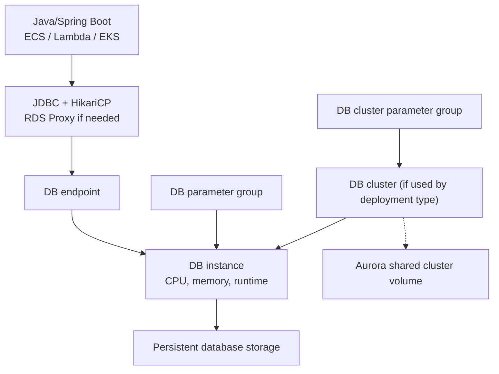
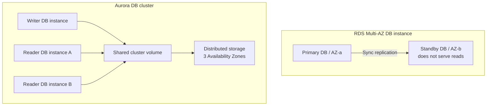
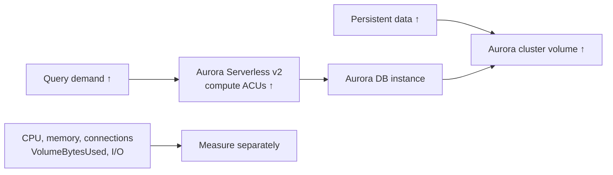
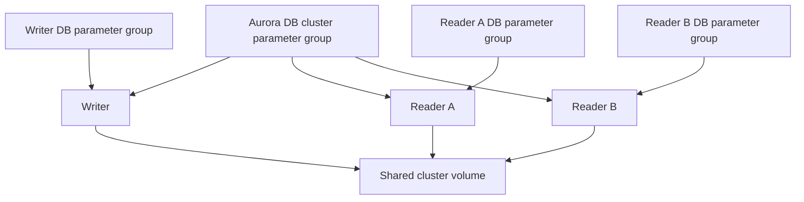
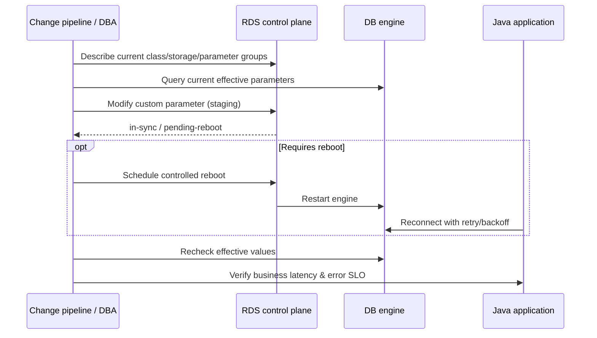

# DB Instances, Storage, and Parameter Groups in Amazon RDS and Aurora

> **Chapter:** RDS and Aurora Databases  
> **Module:** `CLOUD_PROVIDERS_AWS`  
> **Context Objective:** Explore how to configure managed databases on AWS, from compute, memory, storage, and engine parameters to security, scaling, monitoring, recovery, and cost. Examples use PostgreSQL/MySQL for Java/Spring Boot applications; all resource names, metrics, ARNs, and endpoints are **hypothetical**.

## Learning Objectives

After this lesson, learners will be able to:

1. Distinguish **RDS DB instance**, **DB instance class**, **RDS Multi-AZ DB instance**, **RDS Multi-AZ DB cluster**, and **Aurora DB cluster**.
2. Choose an instance class based on CPU, RAM, network/storage bandwidth, and query/connection profiles; understand engine, version, and Region limits.
3. Compare **gp2**, **gp3**, **Provisioned IOPS io1/io2 Block Express**, and legacy magnetic storage; distinguish **GiB**, **IOPS**, **throughput**, and **latency**.
4. Explain how **RDS storage autoscaling** works, including trigger thresholds, limits, and cost risks.
5. Describe the **Aurora distributed shared cluster volume**, auto-growth, Aurora Standard vs. I/O-Optimized, and the difference between compute scaling and storage scaling.
6. Distinguish **DB parameter group** and **DB cluster parameter group**, especially in Aurora; identify default/custom groups, parameter families, dynamic/static parameters, `ApplyMethod`, and `pending-reboot`.
7. Use AWS CLI/SQL to inspect storage, parameter groups, pending modifications, runtime values, and database instance status.
8. Create/modify custom parameter groups in a lab environment safely, with controlled downtime, IAM/KMS, backups, monitoring, and rollback.
9. Connect DB-layer decisions to JDBC connection pools, RDS Proxy, reader/writer topology, and Java applications.
10. Diagnose `storage-full`, high latency, memory pressure, and parameter configurations that have not yet taken effect.

## 1. Three layers in an AWS-managed database

An Amazon RDS database has three core design layers:

- **Compute:** one or more DB instances running the SQL engine with CPU, memory, network, and storage bandwidth.
- **Persistent data:** table/index/WAL/redo/transaction log files, stored according to the RDS or Aurora model.
- **Engine configuration:** the parameter set governing connection counts, memory, query optimizer, logging, timeouts, time zones, and extensions.

Additionally, there are **topology** (Single-AZ/Multi-AZ/replicas), **network** (VPC/subnet/security groups), and **identity** (SQL users, IAM/KMS, Secrets Manager).



There is no single setting called “database size”:

- Adding CPU/RAM does not increase data storage capacity.
- Increasing storage GiB does not fix a locked SQL query or a missing index.
- Increasing max connections does not automatically add RAM.
- Editing a parameter group does not always change engine values immediately.
- Adding an Aurora reader does not create a separate full storage copy for that reader.

## 2. What is a DB instance?

A **DB instance** is a compute/database resource managed by Amazon RDS, such as a PostgreSQL server. You choose the **engine**, **engine version**, **DB instance class**, **storage**, networking, and HA/backup options.

| RDS Attribute | Role | Illustrative value |
|---|---|---|
| `DBInstanceIdentifier` | AWS resource ID of the DB instance | `orders-postgres-prod` |
| `Engine`/`EngineVersion` | DBMS type/version | `postgres` / `16.x` |
| `DBInstanceClass` | CPU/RAM/network class | `db.m7g.large` |
| `AllocatedStorage` | Provisioned capacity for applicable RDS instances | `200 GiB` |
| `StorageType` | gp3/io1/io2/... | `gp3` |
| `Iops`/`StorageThroughput` | Provisioned performance where supported | By engine/storage |
| `DBParameterGroups` | Instance engine configuration | `orders-pg16-prod` |
| `DBSubnetGroup` | Private subnets available to the DB | `orders-private-db-subnets` |
| `VpcSecurityGroups` | Network access rules | SG allowing only the app |
| `Endpoint` | DNS name + port used by the app | `...rds.amazonaws.com:5432` |
| `StorageEncrypted`/`KmsKeyId` | Encryption at rest | Appropriate KMS key |
| `MultiAZ` | HA topology for RDS instance deployment | `true` |
| `BackupRetentionPeriod` | Automated backup retention | Per RPO/policy |

A **DB instance identifier** is neither the SQL database name nor the JDBC username. For example:

```text
RDS identifier: orders-postgres-prod
SQL database:   ordersdb
SQL user:       orders_app
Endpoint:       orders-postgres-prod.example.ap-southeast-1.rds.amazonaws.com
Port:           5432
```

You cannot SSH into the DB host and manage EBS volumes like a regular EC2 instance; RDS provides supported APIs and engine controls.

### 2.1 RDS, Aurora, and RDS Multi-AZ DB cluster are not the same

| Model | Data/compute model | Does reader serve reads? | Parameter configuration |
|---|---|---|---|
| **RDS Single-AZ DB instance** | One database instance, one AZ | No standby | DB parameter group |
| **RDS Multi-AZ DB instance** | Primary + **one synchronous standby** in another AZ | **No** — standby is for failover only | DB parameter group |
| **RDS Multi-AZ DB cluster** | Writer + **two readable readers** across three AZs, semisynchronous replication | **Yes** | DB cluster parameter group |
| **Aurora DB cluster** | Writer and optional readers using **shared distributed cluster storage** | **Yes** | DB cluster parameter group **and** DB parameter groups |

An RDS Multi-AZ DB cluster (for supported MySQL/PostgreSQL engines/versions) **is not Aurora**. It uses a different replication model than Aurora shared storage.

### 2.2 HA does not replace database backups

A Multi-AZ deployment protects against many infrastructure/AZ failures, but if you mistakenly run `DELETE FROM orders`, the change can be replicated. You still need automated backups, point-in-time recovery (PITR), snapshots, and restore drills.

## 3. Choosing a DB instance class

Instance classes follow the format:

```text
db.<family><generation>.<size>

db.m7g.large
db.r7g.xlarge
db.t4g.medium
```

Common families:

- **General-purpose `db.m*`:** balanced CPU/RAM/network for most workloads.
- **Memory-optimized `db.r*`, `db.x*`, `db.z*`:** high RAM for database caches and memory-intensive queries.
- **Burstable `db.t*`:** small/intermittent workloads; monitor CPU credits.
- **Compute-optimized `db.c*`:** CPU-intensive, subject to engine/version support.
- **Optimized Reads / instance classes with NVMe local storage:** can improve temporary data I/O; **local temporary storage is not the persistent DB data volume**.
- **Aurora Serverless v2 `db.serverless`:** compute scales by ACUs within a min/max range; not a fixed instance class with a static vCPU count.

Supported class lists **vary by engine, engine version, and Region**. Do not assume every class exists in every Account/Region.

### 3.1 Proper sizing workflow

1. Measure the workload: SQL queries/sec, read/write ratio, p95/p99, concurrency, row sizes.
2. Check `CPUUtilization`, `FreeableMemory`, `DatabaseConnections`, `ReadLatency`/`WriteLatency`, and waits.
3. Inspect `EXPLAIN ANALYZE`/slow queries and index effectiveness.
4. Distinguish compute-bound, memory-bound, I/O-bound, lock contention, and network bottlenecks.
5. Benchmark a few **orderable** instance classes with near-production data.
6. Include Multi-AZ/reader, IOPS/throughput, backup, and connection costs.

| Symptom | Likely cause | Do not rush to |
|---|---|---|
| Sustained high CPU, efficient queries | Insufficient compute | Increase storage GiB |
| Low FreeableMemory, swap/churn | Insufficient RAM or excessive connection/query memory | Increase `max_connections` |
| High I/O latency, large IOPS/queue depth | Storage saturation or poor query I/O patterns | Pick an instance based solely on vCPU |
| `DatabaseConnections` climbs with ECS/Lambda replicas | Pool explosion | Open unlimited connections |
| CPU credits depleted on T class | Burstable CPU throttling | Only increase provisioned IOPS |
| High p99 with low CPU/IO | Locks, query plans, upstream/app contention | Scale DB class endlessly |

### 3.2 Connection pool sizing

Suppose 20 ECS tasks each have HikariCP `maximumPoolSize=10`:

```text
Potential connections = 20 × 10 = 200
Additional capacity: reporting + migrations + admin + monitoring
```

An application's max connections is not its queries/second. Oversized pools increase context switching, memory pressure, and transaction lock contention. Optimize queries and connection hold times before raising `max_connections`.

## 4. RDS storage types and metrics to distinguish

For RDS DB instances supporting RDS-managed EBS-backed storage, operators choose the storage type, allocated size, and performance options within engine/instance class limits.

| Storage type | Characteristics | When to evaluate |
|---|---|---|
| **General Purpose SSD gp2** | IOPS tied to size and burst behavior | Legacy workloads; compare with gp3 when optimizing |
| **General Purpose SSD gp3** | Baseline performance, independent provisioned IOPS/throughput within supported ranges | Usually the first candidate for many DB workloads |
| **Provisioned IOPS io1** | Provisioned I/O capacity, IOPS/GiB ratios | IO-intensive workloads requiring steady levels |
| **io2 Block Express** | Provisioned IOPS with service-defined durability/latency traits | Heavy, latency-sensitive databases meeting support requirements |
| **Magnetic (legacy)** | Older storage generation | Do not choose for new deployments; no storage autoscaling |

**Do not apply EC2 EBS gp3 performance tables to RDS gp3.** RDS has its own minimum allocated storage, baseline IOPS/throughput, and provisioned ranges by database engine, size, and striped volume architecture.

### 4.1 GiB vs. IOPS vs. throughput vs. latency

- **GiB:** data capacity.
- **IOPS:** I/O operations per second.
- **MiB/s:** MiB read/written per second.
- **Latency:** time an operation waits.
- **DiskQueueDepth:** number of queued I/O operations.

Reference formula:

```text
Throughput ≈ IOPS × average I/O size

Example:
8,000 IOPS × 16 KiB / 1,024 KiB/MiB ≈ 125 MiB/s
```

This is an idealized calculation only and does not reflect caching, engine batching, instance EBS bandwidth, or real queueing latency.

### 4.2 gp3: why it often avoids storage overprovisioning

Many gp2 configurations required allocating more storage than data needed just to get higher IOPS. With gp3, you can configure IOPS/throughput independently within allowed ranges, balancing performance and cost.

However, **gp3 does not mean unlimited IOPS at any size**. Always check:

- Min/max GiB for the engine.
- Provisioned IOPS and throughput ranges.
- IOPS-to-storage/throughput ratios.
- DB instance EBS bandwidth limits.
- Separate costs for provisioned performance, if applicable.

### 4.3 When is io1/io2 worth the cost?

When workloads have sustained, high IOPS demand and strict latency requirements that gp3 cannot meet. Decide based on benchmarks and engine wait analysis. If the bottleneck is a missing index or lock contention, switching to io2 may cost more without changing p99.

### 4.4 Changing storage performance does not mean changing size

With supported RDS gp3 configurations, you can change `Iops`/`StorageThroughput` within limits **without necessarily increasing `AllocatedStorage`**. However, some combinations require a minimum storage size; the API may reject out-of-range values.

After a storage modification, RDS may enter the **`storage-optimization`** state. The database typically remains operational, though latency may rise temporarily; limits on consecutive storage modifications also apply.

## 5. RDS storage autoscaling

RDS storage autoscaling for supported DB instances **automatically increases allocated storage** when space runs low. It **does not automatically shrink** when data is deleted.

### 5.1 Trigger conditions

Per current AWS docs, RDS considers increasing storage when:

1. `FreeStorageSpace` is **≤10%** of allocated storage.
2. This condition persists for at least **5 minutes**.
3. Storage optimization from the previous modification has completed.
4. Maximum storage modifications within 24 hours (**four** under current rules) have not been exceeded.

The increment is the largest of:

- **10 GiB**.
- **10% of allocated storage**.
- The predicted growth sufficient for the next **7 hours** based on the usage rate over the past hour.

### 5.2 Arithmetic example

```text
AllocatedStorage    = 200 GiB
FreeStorageSpace    = 18 GiB  (9%)
MaxAllocatedStorage = 600 GiB

If <=10% persists for 5 minutes and is not blocked:
base increment = max(10 GiB, 10% × 200 GiB)
               = max(10, 20) = 20 GiB
Actual increment may be larger due to the forecast algorithm.
```

**Do not promise the system will increase by exactly 20 GiB.** Forecasting, optimization cooldowns, maximum storage thresholds, and engine constraints all affect it.

### 5.3 Why can `storage-full` still happen?

- Batch imports/transaction logs grow faster than storage scaling.
- Storage was recently modified and optimization is not finished yet.
- The maximum storage threshold or daily modification limit was reached.
- A predicted increment exceeds the maximum threshold.
- The engine/class has a lower maximum orderable storage than desired.
- The workload generates huge temporary files or abnormal logs.

Enabling autoscaling **does not replace CloudWatch alarms on `FreeStorageSpace` and storage growth rate**.

### 5.4 Storage does not auto-shrink after deleting data

If RDS has 400 GiB allocated, deleting 150 GiB of tables still leaves you paying for 400 GiB allocated. `ModifyDBInstance` does not allow reducing `AllocatedStorage` directly. Reducing cost requires:

- Moving to a new DB with smaller allocated storage via data migration/cutover.
- Certain RDS Blue/Green workflows that support storage changes per engine/version.
- Cleaning up data/logs/index bloat to slow future growth.

**Do not delete production data hoping autoscaling will immediately lower the bill.**

### 5.5 Some current limits

- `MaxAllocatedStorage` must be valid, at least higher than current allocated storage per service rules; AWS generally recommends leaving headroom.
- Autoscaling does **not** work with magnetic storage.
- Some legacy classes/versions have restrictions.
- Enabling autoscaling does not require a reboot, though sizing/DB class and workload remain the DBA's responsibility.
- For certain RDS for Oracle/SQL Server setups supporting additional storage volumes, autoscaling is evaluated **per volume**; do not apply a single-volume formula to every enterprise configuration.

## 6. How do Multi-AZ and data topology affect storage and parameters?

### 6.1 RDS Multi-AZ DB instance deployment

Has a **primary** and a **synchronous standby** in another AZ. The standby is a failover target and does **not** serve read-only queries. Applications connect to the DB instance endpoint and must handle DNS/reconnection on failover.

### 6.2 RDS Multi-AZ DB cluster deployment

For supported MySQL/PostgreSQL versions, has **a writer + two reader DB instances across three AZs** with semisynchronous replication. Readers can serve read traffic.

Class/storage changes for a Multi-AZ DB cluster are managed at the **cluster level**. You cannot arbitrarily run `ModifyDBInstance` on an individual member as with a standalone Aurora reader.

Parameter customization for an RDS Multi-AZ DB cluster primarily uses the **DB cluster parameter group**; instance DB parameter groups remain at defaults per this architecture.

### 6.3 Aurora DB cluster

Aurora uses a **distributed shared cluster volume** for the writer and readers. Readers do not need to duplicate a separate full data volume to read the same cluster data.



### 6.4 Multi-AZ vs. read replicas

Multi-AZ is primarily for **HA/failover**. Read replicas serve **read scaling** and can have replication lag. The Aurora reader endpoint routes **connections** to readers; it does not inspect SQL to automatically send write queries to the writer.

An application using the reader endpoint must recognize that data can lag behind the writer. Do not use the reader endpoint for transactions needing strict read-after-write consistency without an appropriate strategy.

## 7. Aurora storage: shared cluster volume

Aurora stores persistent tables, indexes, and metadata in a **cluster volume** distributed across multiple AZs. AWS describes six copies of segments across three Availability Zones, with automated storage healing mechanisms.

### 7.1 Characteristics that differ from RDS DB instance storage

- Aurora **auto-grows** cluster storage as persistent data grows.
- There is no model where “each Aurora reader needs an independent 200 GiB storage copy.”
- Aurora DB instances have their own compute/RAM, while sharing access to the shared volume.
- Temporary files/sorts may use **local ephemeral storage** on the instance; check engine/version/class.
- Maximum cluster volume limits depend on engine version; current AWS docs list **up to 256 TiB** for supported versions—do **not** assume this for every cluster.
- Certain versions/features support automatic storage reclamation when data is deleted, but do not assume `DELETE` immediately shrinks your storage bill.

### 7.2 Aurora Standard vs. Aurora I/O-Optimized

| Mode | Pricing structure | Typically considered when |
|---|---|---|
| **Aurora Standard** | Instance + consumed storage + read/write I/O request charges | Moderate I/O workloads |
| **Aurora I/O-Optimized** | Instance + storage at different rates, **no separate I/O request charges** | I/O-intensive workloads needing predictable I/O spend |

AWS provides a guideline threshold: I/O-Optimized can be more economical when I/O charges make up **around 25% or more** of total Aurora spend under Standard. This is a **quantitative benchmarking guideline**, not a guaranteed outcome for every Account/Region.

When switching storage configurations:

- Rules/cadence limits apply when switching between Standard and I/O-Optimized; check AWS docs each time.
- Some non-NVMe-based instances can switch with zero downtime, whereas NVMe-based instances may require a restart.
- Do not switch based on a few minutes of IOPS spikes; use a representative billing window.

### 7.3 Aurora Serverless v2: compute is not storage

Aurora Serverless v2 scales compute capacity by **ACU**, while the shared cluster volume has its own auto-growth. A cluster can scale up ACUs due to heavy queries without `VolumeBytesUsed` changing significantly.



**Do not design Aurora Serverless v2 like an RDS DB instance using `AllocatedStorage/MaxAllocatedStorage` autoscaling.**

## 8. Parameter groups: database engine configuration

A **DB parameter group** is a collection of settings for the SQL engine: connections, memory buffers, logging, optimizer, timeouts, and AWS-permitted engine features.

Metadata for each parameter can include:

- `ParameterName`.
- `ParameterValue`.
- `ApplyType` (static/dynamic).
- `ApplyMethod` (immediate/pending-reboot).
- `IsModifiable`.
- `AllowedValues`.
- `Source` (engine/system/user).
- `MinimumEngineVersion` via API where supported.

### 8.1 Default vs. custom

The **default group** is created by AWS for an engine family; you **cannot edit it directly**. When tuning is needed:

1. Identify the engine/version and parameter group family.
2. Create a **custom parameter group**.
3. Modify parameters where `IsModifiable=true`.
4. Associate the group with the instance/cluster at the right scope.
5. Determine whether a reboot is required.
6. Verify effective SQL values and performance.

Do not share a single custom group across instances with differing requirements if future edits would unintentionally affect multiple DBs.

### 8.2 Parameter family

Common examples:

```text
postgres16             # RDS PostgreSQL 16
mysql8.0               # RDS MySQL 8.0
aurora-postgresql16    # Aurora PostgreSQL 16
aurora-mysql8.0        # Aurora MySQL 8.0
```

Do not copy `postgres16` to use for Aurora PostgreSQL and expect it to work. Verify the AWS-supported family with `describe-db-engine-versions` for your actual Region/engine.

### 8.3 A parameter group can be shared

When you modify `orders-pg16-prod`, **every DB instance attached to that group** can be affected. Therefore:

- Name groups by environment and engine major version.
- Store parameter values in Git/IaC.
- List all DB instances using the group before every edit.
- Do not edit a production group to test a query on staging.
- Maintain a baseline group, backups, and a rollback procedure.

## 9. Static, dynamic, immediate, and pending reboot

| Term | Meaning |
|---|---|
| **Dynamic parameter** | Can be applied while running with `ApplyMethod=immediate` if supported by the engine |
| **Static parameter** | Requires restarting/rebooting the instance/cluster members per scope |
| `ApplyMethod=immediate` | Applies eligible parameters immediately after group update |
| `ApplyMethod=pending-reboot` | Defers taking effect until reboot |
| `ParameterApplyStatus=in-sync` | RDS reports the instance group is synchronized |
| `ParameterApplyStatus=pending-reboot` | Settings have not yet been picked up by the engine; reboot required |

**Do not guess whether a parameter is static or dynamic by its name.** Metadata differs across engines/versions; always inspect actual `ApplyType` and `IsModifiable`.

### 9.1 Rebooting does not happen automatically just because status is pending-reboot

When you change a static parameter, the DB may show `pending-reboot`. Per AWS, **static parameter group changes do not automatically reboot during the maintenance window** solely because of this status; an intentional reboot must be scheduled.

A reboot can drop database connections, roll back in-flight transactions, and affect latency. Ensure JDBC reconnect, retry/idempotency, and a maintenance window are in place.

### 9.2 Associating a new group differs from modifying an already-associated group

- **Modifying a dynamic parameter in an attached custom group:** can apply right away with `immediate`.
- **Associating a new custom parameter group:** AWS may apply **both customized static and dynamic values** only after an instance reboot.

Many teams see a successful API association call while SQL `SHOW` still returns the old value because **they have not rebooted yet**.

### 9.3 Dynamic pending-reboot and engine differences

Some dynamic parameters can be deferred with `pending-reboot` via the CLI, but **RDS for SQL Server** has cases where this apply method is not supported. Do not reuse a single tuning script blindly across all engines.

### 9.4 Examples of parameters you may encounter

| Engine | Parameter | Purpose / risk |
|---|---|---|
| PostgreSQL | `max_connections` | Allowing more connections can consume large amounts of RAM |
| PostgreSQL | `shared_buffers` | Buffer cache; mis-sizing starves OS/query memory |
| PostgreSQL | `work_mem` | Memory **per sort/hash operation**, not total DB RAM |
| PostgreSQL | `log_min_duration_statement` | Slow query logs; can increase log bills/expose PII |
| PostgreSQL | `idle_in_transaction_session_timeout` | Terminates idle transactions; can affect app behavior |
| PostgreSQL | `autovacuum*` | Controls bloat/maintenance; requires testing |
| MySQL | `max_connections` | Connection limit/memory |
| MySQL | `innodb_buffer_pool_size` | Buffer pool sizing |
| MySQL | `slow_query_log` and `long_query_time` | Slow query diagnostics |
| MySQL | `wait_timeout` | Connection lifetime |
| MySQL | `character_set_server` | Default charset; does not convert existing data automatically |

These are **examples of meaning** only, not a claim that every parameter is modifiable or shares the same scope across RDS/Aurora.

## 10. Aurora: two tiers of parameter groups

Aurora uses:

1. **DB cluster parameter group**: cluster-wide settings, especially those that must stay consistent with shared storage; also holds defaults for certain instance-level params.
2. **DB parameter group**: settings applied per Aurora DB instance, such as certain buffer/memory/logging settings that can differ between writer and readers.



### 10.1 Parameter precedence

Per AWS Aurora docs, an **explicit instance-level override** in the DB parameter group can **override the corresponding value in the DB cluster parameter group** when a parameter supports both scopes. An override set to a value equal to the default may still count as an explicit override.

Therefore, if you edit the cluster group and one reader does not change:

1. Inspect `describe-db-cluster-parameters`.
2. Inspect `describe-db-parameters` on the reader.
3. Check `Source`, `ParameterValue`, and `ApplyMethod`.
4. Check `DBClusterParameterGroupStatus`/`ParameterApplyStatus`.
5. Cross-check the effective value via SQL.
6. Reset the instance override on that parameter if appropriate and approved.

### 10.2 Static cluster parameter changes

In Aurora, a static cluster parameter change may require rebooting **each relevant DB instance**, not just the writer. If some readers have not rebooted, the cluster may run with unexpected effective values. Check member statuses and schedule safe failovers/reboots.

### 10.3 RDS Multi-AZ DB cluster is an important exception

An RDS Multi-AZ DB cluster (non-Aurora) has a DB cluster parameter group for shared settings; DB instance groups remain at defaults per service architecture. **Do not apply Aurora's per-reader instance group customization model to an RDS Multi-AZ DB cluster.**

## 11. AWS CLI: inspecting DB instances and storage (read-only)

> The DB/Region names and IDs below are illustrative only. Use an authorized profile/account. The `describe/get/list` commands in the next two sections **do not modify infrastructure**.

### 11.1 Verify account

```bash
aws sts get-caller-identity
aws rds describe-db-instances \
  --region ap-southeast-1 \
  --query 'DBInstances[].{DB:DBInstanceIdentifier,Engine:Engine,Class:DBInstanceClass,Status:DBInstanceStatus}' \
  --output table
```

### 11.2 Inspect instance, storage, groups, and pending changes

```bash
aws rds describe-db-instances \
  --db-instance-identifier orders-postgres-prod \
  --region ap-southeast-1 \
  --query 'DBInstances[].{DB:DBInstanceIdentifier,Engine:Engine,Version:EngineVersion,Class:DBInstanceClass,Storage:StorageType,AllocatedGiB:AllocatedStorage,MaxGiB:MaxAllocatedStorage,IOPS:Iops,Throughput:StorageThroughput,Encrypted:StorageEncrypted,MultiAZ:MultiAZ,Groups:DBParameterGroups,Pending:PendingModifiedValues}' \
  --output json
```

Where `AllocatedStorage`/`Iops` are not meaningful on an Aurora compute member, check **cluster/storage metrics** instead of inferring shared volume size from instance fields.

### 11.3 Inspect DB clusters

```bash
aws rds describe-db-clusters \
  --region ap-southeast-1 \
  --query 'DBClusters[].{Cluster:DBClusterIdentifier,Engine:Engine,Status:Status,Writer:Endpoint,Reader:ReaderEndpoint,ClusterParam:DBClusterParameterGroup,Members:DBClusterMembers}' \
  --output json
```

Results may be Aurora or RDS Multi-AZ DB clusters. Read engine/topology to distinguish them; **not every `DBCluster` is Aurora**.

### 11.4 Engine versions / orderable instance classes

```bash
aws rds describe-db-engine-versions \
  --engine postgres \
  --region ap-southeast-1 \
  --query 'DBEngineVersions[].{Version:EngineVersion,Family:DBParameterGroupFamily}' \
  --output table

aws rds describe-orderable-db-instance-options \
  --engine postgres \
  --region ap-southeast-1 \
  --query 'OrderableDBInstanceOptions[].{Class:DBInstanceClass,Storage:StorageType,MultiAZ:MultiAZCapable,AutoScale:SupportsStorageAutoscaling}' \
  --output table
```

The table can be long; filter by engine-version and class in real environments. If a class/engine is not orderable in a Region, create/modify API calls will fail even if the class name appears in an older guide.

## 12. AWS CLI: reading parameter groups (read-only)

### 12.1 List groups and families

```bash
aws rds describe-db-parameter-groups \
  --region ap-southeast-1 \
  --query 'DBParameterGroups[].{Name:DBParameterGroupName,Family:DBParameterGroupFamily}' \
  --output table

aws rds describe-db-cluster-parameter-groups \
  --region ap-southeast-1 \
  --query 'DBClusterParameterGroups[].{Name:DBClusterParameterGroupName,Family:DBParameterGroupFamily}' \
  --output table
```

### 12.2 Inspect modifiable parameters of a group

```bash
aws rds describe-db-parameters \
  --db-parameter-group-name orders-pg16-prod \
  --region ap-southeast-1 \
  --output json

# View user-modified params only:
aws rds describe-db-parameters \
  --db-parameter-group-name orders-pg16-prod \
  --source user \
  --region ap-southeast-1 \
  --output json
```

Check `ParameterName`, `ApplyType`, `ApplyMethod`, `IsModifiable`, `AllowedValues`, `Source`, and family before editing.

### 12.3 Inspect Aurora cluster parameters

```bash
aws rds describe-db-cluster-parameters \
  --db-cluster-parameter-group-name orders-aurora-pg16-cluster \
  --region ap-southeast-1 \
  --output json

aws rds describe-db-parameters \
  --db-parameter-group-name orders-aurora-pg16-instance \
  --region ap-southeast-1 \
  --output json
```

### 12.4 Check groups attached to the DB

```bash
aws rds describe-db-instances \
  --db-instance-identifier orders-postgres-prod \
  --region ap-southeast-1 \
  --query 'DBInstances[].DBParameterGroups' \
  --output json

aws rds describe-db-clusters \
  --db-cluster-identifier orders-aurora-prod \
  --region ap-southeast-1 \
  --query 'DBClusters[].{Group:DBClusterParameterGroup,Members:DBClusterMembers}' \
  --output json
```

If status is `pending-reboot`, some customized parameters have not taken effect yet. Do **not** assume a successful IaC deployment means the SQL engine is already using the new values.

## 13. SQL: verifying effective values

To reconcile the AWS control-plane configuration with the **running engine**, connect to the database via an authorized path and run read-only SQL.

### 13.1 PostgreSQL

```sql
SELECT name, setting, unit, context, source, pending_restart
FROM pg_settings
WHERE name IN (
  'max_connections',
  'shared_buffers',
  'work_mem',
  'log_min_duration_statement',
  'idle_in_transaction_session_timeout'
)
ORDER BY name;
```

`setting` and `unit` must be read together; `pending_restart` may indicate the engine has not restarted yet; `source` shows the engine-level configuration source.

Check connections:

```sql
SELECT state, count(*) AS sessions
FROM pg_stat_activity
GROUP BY state
ORDER BY sessions DESC;
```

For active locks/query latency, combine PostgreSQL views with Performance Insights/Database Insights. Avoid printing SQL literals containing PII into public logs.

### 13.2 MySQL/Aurora MySQL

```sql
SHOW GLOBAL VARIABLES LIKE 'max_connections';
SHOW GLOBAL VARIABLES LIKE 'innodb_buffer_pool_size';
SHOW GLOBAL VARIABLES LIKE 'slow_query_log';
SHOW GLOBAL STATUS LIKE 'Threads_connected';
SHOW GLOBAL STATUS LIKE 'Threads_running';
```

`Threads_connected` reflects open connections, while `Threads_running` is the number of non-sleeping/running threads per MySQL semantics; do not use them interchangeably.

### 13.3 Session values can differ from global

A parameter that supports `SET` at session scope can override the global value:

```sql
-- PostgreSQL: changes current session only
SET statement_timeout = '10s';
SHOW statement_timeout;
RESET statement_timeout;
```

Do not conclude an RDS parameter group is wrong based on a single connection that has a session override from JDBC init SQL or a debug tool.

## 14. Modifying parameter groups in a sandbox environment

> **Warning:** The commands in this section **create/modify/reboot** database configurations. Run them only after review, on a valid staging instance, with backups/PITR, approval, and a maintenance window. This lesson presents the commands without executing them.

### 14.1 Create a custom RDS PostgreSQL parameter group

```bash
aws rds create-db-parameter-group \
  --db-parameter-group-name orders-pg16-staging \
  --db-parameter-group-family postgres16 \
  --description 'PostgreSQL 16 parameter group for staging' \
  --region ap-southeast-1
```

This command only **creates the group**; it is not yet attached to an instance.

### 14.2 Modify a dynamic parameter (after verification)

```bash
aws rds modify-db-parameter-group \
  --db-parameter-group-name orders-pg16-staging \
  --parameters 'ParameterName=log_min_duration_statement,ParameterValue=1000,ApplyMethod=immediate' \
  --region ap-southeast-1
```

The value `1000` ms is an example for observing slow SQL on staging, **not a universal best practice**. Before running, verify `IsModifiable=true` and `ApplyType=dynamic` on the actual engine version; SQL logging can expose PII and increase log costs.

### 14.3 Associate a custom group with an RDS instance

```bash
aws rds modify-db-instance \
  --db-instance-identifier orders-postgres-staging \
  --db-parameter-group-name orders-pg16-staging \
  --no-apply-immediately \
  --region ap-southeast-1
```

After association, both customized dynamic and static settings in the **new group** may wait for a reboot. Check `DBParameterGroups[].ParameterApplyStatus` and effective SQL values.

### 14.4 Reboot (incurs downtime)

```bash
aws rds reboot-db-instance \
  --db-instance-identifier orders-postgres-staging \
  --region ap-southeast-1
```

A reboot can drop connections and roll back in-flight transactions. Before running, ensure application reconnect/retry logic and dependent services are ready.

### 14.5 Aurora custom cluster group

```bash
aws rds create-db-cluster-parameter-group \
  --db-cluster-parameter-group-name orders-aurora-pg16-staging \
  --db-parameter-group-family aurora-postgresql16 \
  --description 'Aurora PostgreSQL 16 cluster parameters for staging' \
  --region ap-southeast-1

aws rds modify-db-cluster \
  --db-cluster-identifier orders-aurora-staging \
  --db-cluster-parameter-group-name orders-aurora-pg16-staging \
  --no-apply-immediately \
  --region ap-southeast-1
```

Do not copy the group name `orders-pg16-staging` (RDS `postgres16`) to Aurora `aurora-postgresql16`. Check static changes and reboot status on each member.

### 14.6 Modify storage — distinct from parameter groups

```bash
aws rds modify-db-instance \
  --db-instance-identifier orders-postgres-staging \
  --storage-type gp3 \
  --allocated-storage 250 \
  --no-apply-immediately \
  --region ap-southeast-1
```

This command is an **illustrative example** only. Verify that current allocated storage does not exceed 250 GiB, along with storage type/engine/class constraints, pending changes, and cost. Increasing allocated storage is not easy to roll back downward; do not blindly apply 250 GiB to production.

### 14.7 `Apply immediately` does not mean zero downtime

Running `ModifyDBInstance --apply-immediately` can put **other pending changes** into effect as well. It does not guarantee every change avoids a restart. Always inspect `PendingModifiedValues` before authorizing apply-immediately.

## 15. CloudFormation/IaC: managing groups and storage in Git

IaC enables change review and reduces drift. The snippets below are **fragments**, not complete stacks.

### 15.1 RDS PostgreSQL DB instance and custom group

```yaml
Resources:
  OrdersDbParameters:
    Type: AWS::RDS::DBParameterGroup
    Properties:
      Family: postgres16
      Description: Parameter group for orders staging
      Parameters:
        log_min_duration_statement: "1000"

  OrdersDb:
    Type: AWS::RDS::DBInstance
    DeletionPolicy: Snapshot
    UpdateReplacePolicy: Snapshot
    Properties:
      DBInstanceIdentifier: orders-postgres-staging
      Engine: postgres
      DBInstanceClass: db.m7g.large
      AllocatedStorage: "200"
      MaxAllocatedStorage: 600
      StorageType: gp3
      StorageEncrypted: true
      MultiAZ: true
      DBSubnetGroupName: orders-private-db-subnets
      VPCSecurityGroups:
        - sg-0123456789abcdef0
      DBParameterGroupName: !Ref OrdersDbParameters
      MasterUsername: orders_admin
      ManageMasterUserPassword: true
      BackupRetentionPeriod: 7
      DeletionProtection: true
```

This is not a standalone deployable template: the DB subnet group and SG are assumed to already exist; engine/class/Region compatibility and Secrets Manager permissions also require verification. `ManageMasterUserPassword` lets AWS manage the master secret where supported by the engine, instead of hardcoding passwords.

### 15.2 Aurora cluster and instance-level group

```yaml
Resources:
  AuroraClusterParameters:
    Type: AWS::RDS::DBClusterParameterGroup
    Properties:
      Family: aurora-postgresql16
      Description: Aurora PostgreSQL cluster defaults
      Parameters: {}

  AuroraInstanceParameters:
    Type: AWS::RDS::DBParameterGroup
    Properties:
      Family: aurora-postgresql16
      Description: Aurora PostgreSQL instance settings
      Parameters: {}

  OrdersAurora:
    Type: AWS::RDS::DBCluster
    Properties:
      DBClusterIdentifier: orders-aurora-staging
      Engine: aurora-postgresql
      DBClusterParameterGroupName: !Ref AuroraClusterParameters
      StorageEncrypted: true
      DBSubnetGroupName: orders-private-db-subnets
      VpcSecurityGroupIds:
        - sg-0123456789abcdef0
      MasterUsername: orders_admin
      ManageMasterUserPassword: true

  AuroraWriter:
    Type: AWS::RDS::DBInstance
    Properties:
      DBInstanceIdentifier: orders-aurora-staging-writer
      Engine: aurora-postgresql
      DBClusterIdentifier: !Ref OrdersAurora
      DBInstanceClass: db.r7g.large
      DBParameterGroupName: !Ref AuroraInstanceParameters
```

This fragment illustrates **two group scopes** and cluster/instance resources. Add engine/version, backup retention, encryption keys, deletion protection, reader topology, monitoring, and regional compatibility checks before real use.

### 15.3 Why a successful IaC deployment is not enough

- The engine may have `pending-reboot`.
- Storage may be in `storage-optimization`.
- DB endpoints may require reconnection during failover/reboot.
- Data migrations/DDL are not rolled back by a CloudFormation config rollback.
- Cluster group changes may be masked by instance-level overrides.
- A class/engine version may be unsupported in a Region even if valid in YAML.

After deployment, always **verify actual DB configuration and application business behavior**.

## 16. Java/Spring Boot: DB tuning must align with the connection pool

Spring Boot example with HikariCP:

```yaml
spring:
  datasource:
    url: "jdbc:postgresql://orders-postgres-staging.example.rds.amazonaws.com:5432/ordersdb?sslmode=require"
    username: "DB_USERNAME_FROM_SECURE_CONFIG"
    password: "DB_PASSWORD_FROM_SECRET_PROVIDER"
    hikari:
      maximum-pool-size: 10
      minimum-idle: 2
      connection-timeout: 3000
      idle-timeout: 600000
      max-lifetime: 1800000
```

**Warning:** The username/password strings above are placeholders only; in production retrieve them from **Secrets Manager**/secure secret injection, never committing real passwords into config. `sslmode=require` enables TLS, but if full certificate/hostname verification is required, configure `verify-full`, a CA trust store, and a compliant JDBC driver.

### 16.1 Pool math during autoscaling

```text
20 ECS tasks × 10 connections = 200 potential app connections
+ admin + migrations + batch jobs + metrics
= total DB connection demand greater than 200
```

If HPA/ECS autoscaling doubles the task count, DB connection demand can also double. Never raise `max_connections` to levels that cause memory pressure without controlling application pools.

### 16.2 Can RDS Proxy help?

**RDS Proxy** can pool/multiplex backend connections and assist with reconnect/failover, useful for high-concurrency Lambda or many short-lived microservice connections. However, not all SQL sessions/transactions multiplex cleanly; session pinning, long transactions, and engine limitations must be tested.

### 16.3 Read/write endpoint routing

- On an RDS Multi-AZ DB instance: the standby is **not** used for reads.
- On Aurora: use the writer/cluster endpoint for writes, and the reader endpoint for eligible reads.
- Do not assume a reader is immediately current right after a writer commit if the application needs read-after-write consistency.
- Avoid caching static DNS/IPs that prevent the app from reconnecting after failover.

### 16.4 Never hardcode database credentials

- Use AWS Secrets Manager or IAM database authentication if supported by the engine/architecture.
- Scope `secretsmanager:GetSecretValue` to only the required secret.
- Monitor rotation and update/refresh connection pools promptly.
- Never log JDBC URLs containing passwords.
- DB SQL permissions must still be managed via `GRANT`/roles inside the DB engine.

## 17. Observing compute, storage, and parameter changes

### 17.1 Representative CloudWatch metrics

| Metric | Meaning | Used for |
|---|---|---|
| `CPUUtilization` | Engine/host CPU usage | Compute sizing, hot queries |
| `FreeableMemory` | Available RAM (including reclaimable cache per service definition) | RAM pressure |
| `DatabaseConnections` | Number of DB connections | Pool capacity |
| `CPUCreditBalance` | Remaining credits on burstable classes | Burstable CPU health |
| `FreeStorageSpace` | Storage headroom on RDS instance | Storage autoscaling/low-space alarms |
| `ReadIOPS` / `WriteIOPS` | I/O ops/second | Workload and provisioned IOPS |
| `ReadThroughput` / `WriteThroughput` | Storage I/O data transfer | Throughput/bandwidth |
| `ReadLatency` / `WriteLatency` | I/O latency | I/O saturation |
| `DiskQueueDepth` | Outstanding disk operations | Bottlenecks/troubleshooting |
| `BurstBalance` | Burst credits on supported storage types | gp2/legacy |
| `VolumeBytesUsed` | Aurora cluster data storage usage | Aurora storage spend |
| `AuroraReplicaLag` | Replica lag | Read staleness/health |

Not every metric exists for every engine/storage version. CloudWatch is one part; combine **Database Insights/Performance Insights**, Enhanced Monitoring, SQL views, and RDS events for the full picture.

### 17.2 SQL/engine metrics vs. RDS control plane

- `describe-db-instances` shows what RDS **intends** to configure and whether changes are pending.
- `pg_settings` / `SHOW GLOBAL VARIABLES` show what the engine **is actually using**.
- `CloudWatch metrics` show **performance behavior**.
- `RDS events/CloudTrail` record relevant operations/maintenance/config changes.
- Application p95/p99 latency and errors show how end users are impacted.

Do not declare tuning successful just because an API call succeeded; measure before/after and inspect effective SQL values.

### 17.3 Enhanced Monitoring / Database Insights

- **Enhanced Monitoring** adds OS-level metrics at configurable granularity.
- **Database Insights/Performance Insights** show DB load, waits, and top SQL where supported by engine/Region/plan.
- **Slow query logs** can increase log ingestion/costs and contain sensitive SQL literals; apply retention, filtering, and access controls.

## 18. Security, VPC, IAM, and backups

### 18.1 Network

Recommendations for Java backend applications:

- Place the DB in a private DB subnet group with appropriate AZs.
- Set `PubliclyAccessible=false` when public access is not required.
- Configure the security group to allow inbound only from the app SG on port 5432/3306, never `0.0.0.0/0`.
- Verify DNS resolution, routes/NACLs/SGs, and TLS.
- Do not place RDS directly behind an Internet-facing ALB (ALB is HTTP/HTTPS, not a SQL proxy).
- For Lambda connections inside a VPC, verify subnets/SGs/DB endpoints and required AWS API paths.

### 18.2 IAM and SQL permissions are distinct

| Scope | Example permissions |
|---|---|
| AWS control plane read | `rds:DescribeDBInstances`, `rds:DescribeDBParameters` |
| AWS control plane modify | `rds:ModifyDBInstance`, `rds:ModifyDBParameterGroup`, `rds:RebootDBInstance` |
| Secret/KMS | `secretsmanager:GetSecretValue`, `kms:Decrypt` when needed |
| Database engine | SQL users, `GRANT SELECT/INSERT`, schemas, roles |
| Backup/restore | RDS APIs + IAM KMS key policy, SQL/data validation |

IAM permission to describe a DB instance **does not grant** access to query SQL tables. Likewise, a SQL admin does not automatically have permission to call AWS APIs.

### 18.3 Backups and recovery

- Enable automated backups/PITR aligned with RPO/retention.
- Take manual snapshots before risky changes.
- Practice restore drills in an isolated environment.
- Multi-AZ does not protect against accidental data deletion.
- Engine/version changes require dedicated data migration, rollback, and cutover plans.
- Static parameter changes require keeping a baseline group/values and a reboot runbook.

### 18.4 Parameter groups are not a secret store

Do not store database passwords, API tokens, or private keys in parameter groups. They are **engine configuration** and may be readable by many DB operators. Use Secrets Manager, KMS, and least-privilege controls for sensitive data.

## 19. Real-world scenario: orders PostgreSQL under growing load

Initial system:

```text
RDS PostgreSQL 16
DB instance class = db.m7g.large (example)
Storage = gp3 / AllocatedStorage 200 GiB
MaxAllocatedStorage = 600 GiB
Multi-AZ DB instance = enabled
DB parameter group = orders-pg16-prod
Application = 10 ECS tasks × Hikari pool size 10
```

As traffic rises, the DBA observes:

```text
CPUUtilization = 35%
DatabaseConnections = 100 → 230
FreeableMemory decreasing
ReadLatency low, WriteLatency low
API p99 increasing
```

**Not the first fix:** increasing gp3 allocated storage or moving to io2. The symptoms point to connection/memory/query transaction pressure.

### 19.1 Action plan

1. Inspect Hikari pool saturation, slow transactions, and `pg_stat_activity`.
2. Check ECS replica count, app pool sizes, and idle/in-transaction sessions.
3. Profile top SQL and locks.
4. Reduce pool sizes or add a pooling proxy if appropriate.
5. Change instance class/RAM/`max_connections` only after benchmarking.
6. Set alarms on `FreeableMemory`/`DatabaseConnections` and test failover/reconnect.

### 19.2 When data grows very rapidly

A bulk data import drops `FreeStorageSpace` to 8% in 10 minutes, but `storage-optimization` from a previous expansion has not finished.

- Autoscaling may **not be able to trigger immediately**.
- Check RDS events, `MaxAllocatedStorage`, and storage operation status.
- Throttle or pause imports if needed.
- Identify the source of storage growth (data/WAL/temp/indexes/bloat).
- Plan headroom and bulk import capacity rather than endlessly raising max storage.

### 19.3 When considering Aurora

Aurora PostgreSQL offers shared storage, writer/readers, and cluster/instance parameter groups. Before migrating:

- Verify engine/version/extension compatibility.
- Test data movement (DMS/dump-restore/CDC depending on case).
- Benchmark query throughput, replica lag, and Standard vs. I/O-Optimized cost.
- Test reader/writer routing, connection pools, and failover behavior.
- Note that RDS group family `postgres16` **differs** from Aurora `aurora-postgresql16`.
- Do not treat a DB migration as a simple parameter group change.



## 20. Troubleshooting common issues

| Symptom | Possible cause | What to check |
|---|---|---|
| High DB CPU | Query/plan/compute bound | Top SQL, EXPLAIN, class |
| Low `FreeableMemory` | Too many connections, buffers, `work_mem` | SQL sessions, Enhanced Monitoring |
| `storage-full` with autoscaling enabled | Max threshold, optimization, growth burst | `FreeStorageSpace`, events, `MaxAllocatedStorage` |
| Cannot shrink allocated storage | RDS does not support direct scale-down | New DB/Blue-Green/migration |
| `storage-optimization` after gp3 change | Storage engine optimizing | `StorageOperationStatus`, latency |
| IOPS increased but p99 unchanged | CPU/locks/network bottleneck | DB waits, SQL plan, bandwidth |
| Dynamic parameter did not change | New group not rebooted/instance override/session override | Apply status, SQL `SHOW` |
| Static parameter shows `pending-reboot` | Not yet rebooted | Change window and reboot |
| Aurora reader ignores cluster value | Instance-level parameter override | `Source`/value in both groups |
| Parameter modify API rejected | Wrong family, not modifiable, wrong `ApplyMethod` | Describe parameter metadata |
| Multi-AZ standby not serving reads | It is an RDS Multi-AZ DB instance | Topology type |
| DB fails to start after tuning | Memory/preload/invalid static config | Engine logs, baseline config |
| Java connection errors after failover | Pool holding stale sockets/DNS | RDS events, JDBC reconnect |
| RDS console OK but SQL AccessDenied | SQL user/grants/Secrets/network | SQL auth, SG, TLS |
| High Aurora costs | Instances/ACUs/I/O/storage/network | Cost Explorer, `VolumeBytesUsed` |

### 20.1 Investigation order

1. Identify **Account, Region, Engine, version, deployment type**.
2. For an RDS instance, read class, storage type, allocated GiB, IOPS/throughput, and pending changes.
3. For Aurora, read cluster storage mode, writer/readers, and shared volume metrics.
4. Check parameter group family, static/dynamic metadata, and status.
5. Cross-check effective SQL values.
6. Inspect CloudWatch metrics, DB waits, and app pools.
7. Separate query issues from storage/compute bottlenecks.
8. Make changes only after staging tests + a rollback plan.
9. After changes, measure p95/p99, errors, business correctness, and billing.

## 21. Self-check exercises

**Exercise 1.** A DB has 95% CPU, 140 GiB `FreeStorageSpace` remaining, and low `ReadLatency`. Do you increase allocated storage immediately? Why?

**Exercise 2.** Distinguish `db.m7g.large` and `gp3 200 GiB`. Does increasing one increase the other?

**Exercise 3.** Why does gp3 help avoid overprovisioning storage just to get IOPS in many workloads? When is io2 worth evaluating?

**Exercise 4.** RDS has `AllocatedStorage=500 GiB`, `FreeStorageSpace=40 GiB` sustained for 10 minutes, `MaxAllocatedStorage=1500 GiB`. Based on the threshold, can autoscaling start? What blockers could still apply?

**Exercise 5.** RDS grew from 200 to 700 GiB, then a lot of data was deleted with `DELETE`. Can you lower `AllocatedStorage` back to 200 with a single modify command? What plan is needed?

**Exercise 6.** An Aurora cluster has a writer and 3 readers with 2 TiB of data. Is storage billed as four separate 2 TiB copies like 4 standalone RDS instances?

**Exercise 7.** An Aurora Standard cluster has I/O charges accounting for 32% of its cost. Which storage mode should you evaluate? Is a lower total bill guaranteed?

**Exercise 8.** An RDS Multi-AZ DB instance has one standby. Can you send all read traffic to the standby? How does a Multi-AZ DB cluster differ?

**Exercise 9.** Why can't you attach the `postgres16` parameter group family to Aurora PostgreSQL 16?

**Exercise 10.** You modify a static parameter and the group reports `pending-reboot`. Will it automatically reboot during the maintenance window?

**Exercise 11.** Why might associating a new group require a reboot even if only a dynamic parameter was changed inside it?

**Exercise 12.** An Aurora cluster group sets parameter X=10, but one reader uses X=20. If the instance group has an explicit override, what do you check?

**Exercise 13.** 40 ECS tasks, each with a pool of 15 connections. What is the number of potential connections, and why shouldn't you simply raise `max_connections` to match it?

**Exercise 14.** PostgreSQL `work_mem` is increased to 128 MiB per sort/hash operation. What is the risk when many complex queries run concurrently?

**Exercise 15.** Are `pg_settings.pending_restart=true` and RDS `ParameterApplyStatus=pending-reboot` the same API? What do they indicate?

**Exercise 16.** When Aurora Serverless v2 scales up compute ACUs, does that mean cluster volume size increases too?

**Exercise 17.** An IAM role has `rds:DescribeDBInstances`, but Java cannot `SELECT` from a SQL table. What is missing?

**Exercise 18.** Changing gp3 IOPS puts RDS into `storage-optimization`, and latency rises temporarily. Does this always mean the operation failed?

**Exercise 19.** If an accidental `DELETE` replicates across AZs, does Multi-AZ/Aurora storage replication restore the old data automatically? What is needed?

**Exercise 20.** A bad static parameter causes the DB restart to fail. What should be prepared before and after the change?

<details>
<summary>Answer hints</summary>

1. No; CPU bottleneck or query problem. Measure SQL/CPU/locks before sizing.
2. `db.m7g.large` is the compute class; `gp3 200GiB` is storage. They are configured independently.
3. gp3 decouples IOPS/throughput where supported; io2 is for I/O-heavy workloads where benchmarks require it.
4. 40/500 = 8%, which is ≤10% for long enough; still subject to optimization state, modification count, forecasting, and limits.
5. Cannot shrink directly; requires migration/new DB/appropriate Blue-Green workflow and controlled cutover.
6. No; Aurora uses a shared cluster volume across the writer and readers.
7. Compare I/O-Optimized using Region instance/storage/I/O prices and workload data; not guaranteed.
8. No; an RDS Multi-AZ DB instance standby does not serve reads. A Multi-AZ DB cluster has readable readers.
9. Parameter group families differ by engine; verify via `describe-db-engine-versions`.
10. Does not reboot automatically due to `pending-reboot`; a reboot must be scheduled.
11. Associating a new group may apply customized values only after a reboot.
12. Inspect the instance parameter group `Source`/value, reset the override if needed, check effective SQL values, and check reboot status.
13. 600; plus admin/jobs and memory overhead. Optimize pools / use RDS Proxy.
14. Memory can multiply across concurrent queries × operations, causing OOM.
15. No; PostgreSQL system view vs. RDS control-plane status, though both indicate a restart may be needed.
16. No; compute ACUs and persistent cluster storage growth are separate layers.
17. SQL user/GRANT, database auth, Secrets/VPC/TLS; IAM RDS APIs are not SQL permissions.
18. No; storage modifications can have an optimization phase. Monitor metrics/status.
19. No; use backups/PITR/snapshots, data validation, and a recovery plan.
20. Staging test, backup, baseline group, change window; roll back config/reboot and verify SQL/app health.

</details>

## 22. Production checklist

- [ ] Distinguished RDS DB instance, RDS Multi-AZ DB cluster, and Aurora DB cluster.
- [ ] Selected DB instance class from benchmarks, not just vCPU or price.
- [ ] Separated compute, persistent storage, and engine configuration as distinct observability layers.
- [ ] Selected gp3/io2 based on I/O workload; verified engine/version/Region limits.
- [ ] Configured `AllocatedStorage` and `MaxAllocatedStorage` based on growth + budget; understood it does not auto-shrink.
- [ ] Configured alarms for `FreeStorageSpace` and storage growth, rather than relying solely on autoscaling.
- [ ] If using Aurora, understood shared cluster volume, Standard/I/O-Optimized, ACU compute, and version limits.
- [ ] Created custom parameter groups with the right family; left default groups untouched.
- [ ] Distinguished instance group vs. cluster group; checked overrides for Aurora.
- [ ] Verified `ApplyType`, `IsModifiable`, `AllowedValues`, and `ApplyMethod`.
- [ ] Planned reboots for `pending-reboot` and parameter group association changes.
- [ ] Identified all DB instances sharing a parameter group before modifying it.
- [ ] Checked `PendingModifiedValues` before applying changes immediately.
- [ ] Verified effective SQL values and performance metrics after changes.
- [ ] Sized connection pools based on autoscaling replicas with headroom.
- [ ] Aligned HA/read topology and reader/writer routing with consistency requirements.
- [ ] Configured private networking, IAM/KMS, Secrets Manager, and JDBC TLS properly.
- [ ] Enabled automated backups/PITR/snapshots and conducted restore drills.
- [ ] Set alarms for CPU, memory, DB connections, I/O latency/queue depth, and replica lag.
- [ ] Versioned IaC configs with diff/approval, baseline, and rollback runbook.
- [ ] Accounted for DB compute, HA, provisioned storage/IOPS/throughput, Aurora storage/I/O, backups, and data transfer costs.

## Official AWS documentation

- [Amazon RDS — RDS overview](https://docs.aws.amazon.com/AmazonRDS/latest/UserGuide/Welcome.html)
- [Amazon RDS — DB instance classes](https://docs.aws.amazon.com/AmazonRDS/latest/UserGuide/Concepts.DBInstanceClass.Types.html)
- [Amazon RDS — DB instance storage](https://docs.aws.amazon.com/AmazonRDS/latest/UserGuide/CHAP_Storage.html)
- [Amazon RDS — gp3 storage configuration](https://docs.aws.amazon.com/AmazonRDS/latest/UserGuide/USER_PIOPS.gp3.html)
- [Amazon RDS — Storage autoscaling](https://docs.aws.amazon.com/AmazonRDS/latest/UserGuide/USER_PIOPS.Autoscaling.html)
- [Amazon RDS — Parameter groups overview](https://docs.aws.amazon.com/AmazonRDS/latest/UserGuide/parameter-groups-overview.html)
- [Amazon RDS — Creating parameter groups](https://docs.aws.amazon.com/AmazonRDS/latest/UserGuide/USER_WorkingWithParamGroups.Creating.html)
- [Amazon RDS — Associating parameter groups](https://docs.aws.amazon.com/AmazonRDS/latest/UserGuide/USER_WorkingWithParamGroups.Associating.html)
- [Amazon RDS — Modifying parameter groups](https://docs.aws.amazon.com/AmazonRDS/latest/UserGuide/USER_WorkingWithParamGroups.Modifying.html)
- [Amazon RDS — Multi-AZ DB instance deployments](https://docs.aws.amazon.com/AmazonRDS/latest/UserGuide/Concepts.MultiAZSingleStandby.html)
- [Amazon RDS — Multi-AZ DB cluster deployments](https://docs.aws.amazon.com/AmazonRDS/latest/UserGuide/multi-az-db-clusters-concepts.html)
- [Amazon Aurora — Storage architecture](https://docs.aws.amazon.com/AmazonRDS/latest/AuroraUserGuide/Aurora.Overview.StorageReliability.html)
- [Amazon Aurora — Parameter groups](https://docs.aws.amazon.com/AmazonRDS/latest/AuroraUserGuide/USER_WorkingWithParamGroups.html)
- [Amazon Aurora — Cluster and instance parameter groups](https://docs.aws.amazon.com/AmazonRDS/latest/AuroraUserGuide/parameter-groups-overview.html)
- [Amazon RDS — Monitoring and metrics](https://docs.aws.amazon.com/AmazonRDS/latest/UserGuide/MonitoringOverview.html)
- [Amazon RDS — Troubleshooting](https://docs.aws.amazon.com/AmazonRDS/latest/UserGuide/CHAP_Troubleshooting.html)
- [AWS CLI — Amazon RDS](https://docs.aws.amazon.com/cli/latest/reference/rds/index.html)
- [Amazon RDS pricing](https://aws.amazon.com/rds/pricing/)
- [Amazon Aurora pricing](https://aws.amazon.com/rds/aurora/pricing/)

**Key takeaways:** **DB instance class** determines CPU/RAM/bandwidth; **RDS storage** determines GiB/IOPS/throughput and only auto-**expands** when autoscaling is enabled; **Aurora** uses shared cluster storage that grows automatically with data. **Parameter groups** manage engine settings across boundaries of **instance vs. cluster**, **dynamic vs. static**, and **associated group vs. effective runtime**. A secure, effective database combines measurable tuning, availability topology, backups/PITR, VPC/IAM/KMS, JDBC pooling, observability, and verified rollback.
