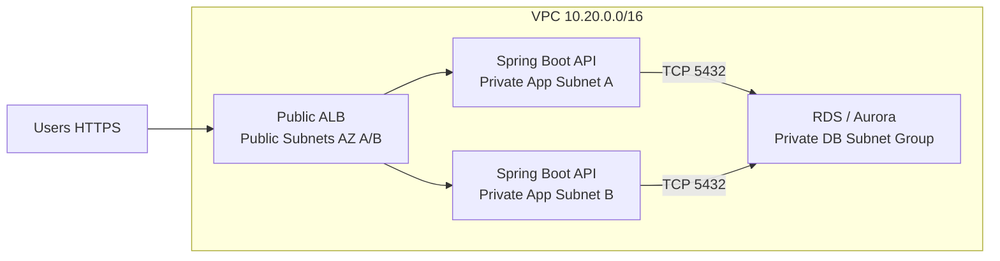
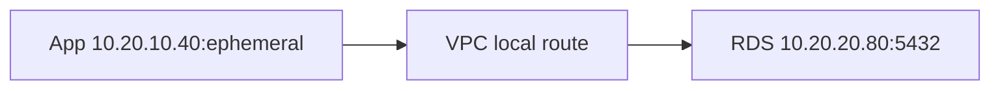
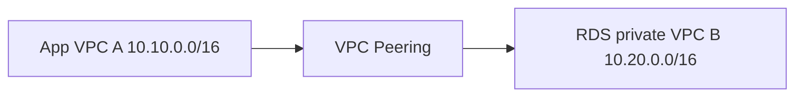
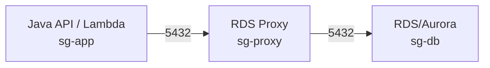

# DB Subnet Groups, Security Groups, and Private Connectivity

When a Java application running in AWS cannot connect to Amazon RDS or Amazon Aurora, the root cause is usually not in the JDBC driver, but in one of the layers: **VPC, DB subnet group, route table, Security Group (SG), Network ACL (NACL), DNS, TLS, or database authentication**. Conversely, opening the database port to the entire Internet to “fix” a timeout creates a severe security risk.

This lesson goes from concepts to practice: **placing RDS/Aurora in private subnets, allowing only required applications to reach the right DB port, verifying the private network path, and securing SQL connections**. This material belongs to the **RDS and Aurora Databases** chapter of the **CLOUD_PROVIDERS_AWS** module, connecting Regions/AZs, IAM, VPC, EC2/ECS/EKS/Lambda, databases, monitoring, recovery, and cost optimization.

> **Foundational rule:** The **DB subnet group** determines the set of subnets RDS/Aurora can deploy into; the **Security Group** determines which TCP sources are allowed; **routes/DNS/NACLs** ensure packets reach the right destination; **database authentication and TLS** protect logins and data. No single layer replaces the others.

## 1. Learning objectives

After this lesson, you will be able to:

1. Define a DB subnet group, subnet, Availability Zone, and how RDS/Aurora use a set of subnets.
2. Explain the typical requirement of **at least two subnets in two AZs**; distinguish this requirement from having Multi-AZ enabled.
3. Design public/private application/database subnets and choose `PubliclyAccessible=false` for production.
4. Use **Security Group references** so Java workloads connect to PostgreSQL/MySQL DBs without opening public ports.
5. Distinguish **stateful SGs** from **stateless NACLs**, especially TCP return ports.
6. Distinguish private traffic via VPC `local` route, cross-VPC peering/TGW, VPN/Direct Connect, and RDS API PrivateLink.
7. Choose the right RDS instance endpoint or Aurora writer/reader endpoint, and explain DNS behavior during failover.
8. Configure EC2, ECS, Lambda, EKS, and App Runner to connect to a private DB using the right workload SG.
9. Integrate JDBC TLS, Secrets Manager, IAM DB authentication, or RDS Proxy as required.
10. Run read-only checks across AWS CLI/Console, DNS, TCP, and SQL.
11. Diagnose `Connection timed out`, `password authentication failed`, TLS errors, and connection pool exhaustion.
12. Propose an architecture with resilience, monitoring, IAM controls, and cost awareness.

## 2. Reference architecture: public application, private database



Example:

| Layer | Network | Access restriction |
| --- | --- | --- |
| ALB | Public subnets AZ A/B | HTTPS from the Internet and WAF if needed |
| Java API | Private application subnets AZ A/B | HTTP traffic from the ALB SG |
| RDS PostgreSQL | Private DB subnets AZ A/B | TCP **5432 from the Java app SG** |
| Administration | Authorized VPN/SSM/admin session | Never expose the database directly to the Internet |
| Secrets | AWS Secrets Manager via IAM role | Only the app role can read the relevant secret |

**A multi-AZ RDS subnet group does not automatically create a standby database.** Enabling **RDS Multi-AZ** or Aurora replicas is a separate HA decision; networking only provides the subnets/AZs the service can use.

## 3. What is a DB subnet group?

A **DB subnet group** is a collection of **subnets within the same VPC** that Amazon RDS/Aurora can use when placing network interfaces and DB resources. For most RDS DB instance/Aurora deployments, the group needs **at least one subnet in each of at least two Availability Zones**; service exceptions exist, such as Local Zones.

Example:

```text
VPC: vpc-0example, CIDR 10.20.0.0/16
DB subnet group: orders-db-subnets
  subnet-db-a: 10.20.20.0/24, ap-southeast-1a
  subnet-db-b: 10.20.21.0/24, ap-southeast-1b
  subnet-db-c: 10.20.22.0/24, ap-southeast-1c (optional)
```

| Resource | Meaning |
| --- | --- |
| **VPC** | Region-level network space |
| **Subnet** | An IP range in one AZ, attached to a route table/NACL |
| **DB subnet group** | List of subnet choices for the database |
| **DB instance** | RDS-managed compute/database instance |
| **Aurora DB cluster** | Group of DB instances + storage/roles per the Aurora model |
| **Security Group** | Stateful firewall for network interfaces |
| **DB endpoint** | DNS hostname/port used by clients to connect |

Creating a DB subnet group **does not create new subnets, create a DB instance, or open any firewall rules**.

### 3.1. Why must you choose at least two AZs?

If the primary DB must be replaced or deployed Multi-AZ, RDS needs a subnet and IP addresses in the appropriate AZ. A group with multiple subnets all in one AZ **does not satisfy** the general multi-AZ requirement. At the same time, **two subnets does not mean two database instances**: a Single-AZ RDS instance can still use a multi-AZ DB subnet group.

### 3.2. Subnet IP capacity

RDS/Aurora need IPs for ENIs and creation, recovery, failover, and maintenance operations. Check:

- `AvailableIpAddressCount` on each DB subnet.
- Spare IP capacity when the cluster adds readers, a proxy, or needs compute replacement.
- Subnets are not too small and not exhausted by other workloads.
- The engine/instance type is available in the chosen AZs.
- If using IPv4+IPv6 dual-stack, each subnet in the group must have an IPv6 CIDR per service requirements.

AWS reserves several IPv4 addresses in every subnet; **a `/28` does not have 16 freely usable IPs**. Never size solely by mathematical address count.

### 3.3. Do not mix public and private subnets arbitrarily

AWS distinguishes public and private subnets by their route/network setup. For a **DB instance/cluster configured to be publicly accessible**, subnets in the DB subnet group must meet public accessibility requirements consistently; mixing public and private can leave a writer after failover in a subnet unreachable from outside.

For this lesson's security goal, choose **all-private DB subnets** and **Public accessibility = No**.

## 4. Public subnets, private subnets, and PubliclyAccessible

### 4.1. Public subnet

In an IPv4 VPC, a subnet is commonly called **public** when its route table has a default route `0.0.0.0/0 → Internet Gateway`. An EC2/RDS resource also needs a public address and permissive rules to accept traffic directly from the Internet.

### 4.2. Private subnet

A **private subnet** has no direct public IPv4 path through an IGW for resources inside it. It still has:

- A `local` route to the VPC CIDR.
- A route via NAT Gateway for outbound Internet if needed.
- Peering/TGW/VPN routes to other private networks if designed.
- VPC endpoints to reach certain AWS APIs over a private path.

**Common misconception:** an app in a private subnet **does not need a NAT to connect to a private RDS instance in the same VPC**. The Java app → RDS flow uses the VPC `local` route.

### 4.3. What does PubliclyAccessible mean?

The RDS `PubliclyAccessible` setting determines whether the DB instance gets public-facing addressing/endpoint resolution per configuration. Recommendation:

```text
DB subnet group: private subnets AZ A/B
RDS PubliclyAccessible: false
DB SG inbound: only app SG on DB port
Route from app to DB: VPC local
```

Setting `PubliclyAccessible=false` **does not block private IP connections**. EC2/ECS/Lambda in the VPC, or systems with VPN/private routing, can still connect if SGs/NACLs and DB auth allow it.

**Do not set `PubliclyAccessible=true` and open `0.0.0.0/0` just because your laptop cannot reach the DB.** For a private DB, a laptop without a private route being blocked is the intended security behavior.

## 5. Route tables and local routing

A route table determines where packets go to reach a destination CIDR. Within the same VPC:

```text
App private subnet: 10.20.10.0/24
DB private subnet:  10.20.20.0/24
VPC CIDR:           10.20.0.0/16

Route:
  Destination 10.20.0.0/16  ->  local
```



You do not need an Internet Gateway, NAT Gateway, VPN, or VPC Peering merely to traverse two subnets of the **same VPC**.

**A valid route does not guarantee connectivity:** you must still check SGs, NACLs, VPC DNS, the database listener, TLS, and credentials.

### 5.1. Main route table and explicit associations

If a subnet has no explicit route table association, it may use the VPC's **main route table**. Do not conclude “the subnet has no route” simply because a query for explicit associations returns nothing.

### 5.2. A NAT Gateway is not a SQL proxy

NAT lets private resources initiate outbound IPv4 Internet connections. NAT is not a database protocol proxy, does not authorize DB users, and does not replace SGs. A Java API needing to read Secrets Manager from a private subnet may need a VPC endpoint or NAT for **outbound AWS API calls**, while JDBC app → DB still travels via the **local route**.

## 6. Security Groups: letting the right source reach the right port

A **Security Group (SG)** is a **stateful** firewall attached to an ENI/resource. RDS/Aurora SG inbound rules must allow only the workloads that need to connect.

### 6.1. Two separate SGs

```text
sg-orders-app: attached to Java workloads
sg-orders-db:  attached to PostgreSQL RDS/Aurora

sg-orders-db INBOUND:
  TCP 5432   Source = sg-orders-app

sg-orders-app OUTBOUND:
  TCP 5432   Destination = sg-orders-db

No database inbound from 0.0.0.0/0
```

An SG reference permits **all ENIs attached to the app SG** within AWS-supported boundaries, even when EC2/ECS tasks change IPs during Auto Scaling. You do not need to manually maintain a list of private IPs for each app instance.

### 6.2. Why separate app and DB SGs?

- Easy to audit which applications can reach the database.
- When the app scales replicas or changes IPs, the reference stays valid.
- The DB SG does not accidentally open ports to every resource in the same VPC.
- Separate SGs can be applied to migration jobs or RDS Proxy.
- Changing DB rules does not affect the app's inbound HTTP rules.

**Do not reference the ALB's SG** in the DB SG just because the ALB sits in front of the Java API. SQL TCP connections are initiated by the **application**, not the ALB.

### 6.3. Appropriate rule table

| DB ingress rule | Assessment |
| --- | --- |
| TCP `5432` from `0.0.0.0/0` | **Avoid**, far too broad |
| TCP `5432` from entire VPC `10.20.0.0/16` | Narrower than the Internet, but still allows many unnecessary sources |
| TCP `5432` from `sg-orders-app` | **Preferred** where SG references are supported |
| TCP `3306` from app SG when DB is PostgreSQL 5432 | **Wrong port** |
| TCP `5432` from developer laptop public IP | Only as an approved exception; prefer VPN/SSM |

SGs only have **allow rules**, not traditional deny rules. Attaching multiple SGs to the same DB results in the **union of permissions**, not the intersection. One SG allowing the entire VPC can defeat the “app SG only” restriction of another SG.

### 6.4. Ports by DB engine

| Engine | Typical default port |
| --- | --- |
| RDS PostgreSQL / Aurora PostgreSQL | **5432 TCP** |
| RDS MySQL / Aurora MySQL | **3306 TCP** |
| RDS MariaDB | **3306 TCP** |
| RDS SQL Server | **1433 TCP** |
| RDS Oracle | **1521 TCP** |
| RDS Db2 | **50000 TCP** per configuration |

Ports can differ from defaults; always check `Endpoint.Port` in the RDS Console/API.

## 7. Security Groups vs. NACLs

| Criterion | Security Group | Network ACL |
| --- | --- | --- |
| Attached to | ENI/resource | Subnet |
| Stateful | **Yes** | **No** |
| Rule types | Allow | Ordered Allow/Deny |
| SG reference | Yes, subject to conditions | No |
| Return traffic | Automatically allowed for established connections | Requires explicit outbound/inbound allow |
| Typical role | Workload-specific access control | Guardrails at subnet boundaries |

Consider a connection:

```text
Java API 10.20.10.45:50123  ->  RDS 10.20.20.80:5432
Java API 10.20.10.45:50123  <-  RDS 10.20.20.80:5432
```

**Stateful** SGs only need app outbound to port 5432 and DB inbound from the app SG. **Stateless** NACLs on both subnets must also allow **return traffic to the ephemeral client port** within designed ranges/methods.

A custom NACL blocking ephemeral ports can cause `Connection timed out` even when app and DB SGs are right. Do not open all ports indiscriminately to fix errors; verify the workload OS ephemeral port ranges and specific CIDRs.

## 8. DNS and endpoints: never hard-code static IPs

RDS/Aurora provide a **DNS endpoint**. During failover or recovery, network IPs can change, so applications must use the hostname.

```text
RDS PostgreSQL instance endpoint:
orders-db.abcdefghijk.ap-southeast-1.rds.amazonaws.com:5432

Aurora writer endpoint:
orders-cluster.cluster-abcdefghijk.ap-southeast-1.rds.amazonaws.com:5432

Aurora reader endpoint:
orders-cluster.cluster-ro-abcdefghijk.ap-southeast-1.rds.amazonaws.com:5432
```

These are **examples**, not real usable names.

### 8.1. RDS DB instance endpoint

An RDS DB instance has a hostname/port endpoint. When a Multi-AZ instance fails over, the endpoint lets clients locate the new primary via DNS. **Existing TCP connections can still drop**; the application must retry and reconnect.

### 8.2. Aurora writer and reader endpoints

| Endpoint | Function |
| --- | --- |
| **Cluster / writer** | Routes to the primary writer; used for writes and reads requiring the writer |
| **Reader** | Distributes **new connections** across Aurora Replicas when present; mainly for SELECTs |
| **Instance** | Targets a fixed DB instance; does not follow the writer role automatically |
| **Custom** | Targets a custom-configured group of DB instances |
| **RDS Proxy endpoint** | Connects to the proxy and pools DB connections |

**The reader endpoint balances connections, not individual SQL queries.** If an Aurora cluster has only a writer and no read replicas, the reader endpoint **can route to the writer**, so this endpoint cannot be treated as proof that the database is always read-only.

### 8.3. DNS updates after failover

- Never store IPs in config files or `/etc/hosts`.
- JVM DNS cache/OS resolvers must not cache old IPs forever.
- Connection pools must evict stale connections.
- Retries should use timeouts and exponential backoff with jitter.
- For writes, handle idempotency because when a connection drops, the client does not always know whether the transaction committed.
- Monitor read replica lag if the app reads from readers.

## 9. Connecting EC2 and RDS in the same VPC

Assume EC2 `sg-orders-app` and RDS `sg-orders-db` are in the same VPC.

1. RDS is `available`, with the correct endpoint and port.
2. App and DB subnets are in the same VPC; the `local` route is available.
3. DB SG allows inbound TCP `5432` from the app SG.
4. App SG allows outbound TCP `5432` to the DB SG (or covered by egress rules).
5. NACLs do not block forward or return traffic.
6. VPC DNS resolves the endpoint properly.
7. Client TLS trusts the appropriate CA/certificate.
8. DB user/password or IAM DB auth is valid.
9. DB SQL privileges are sufficient for the workload.
10. Connection pool fits DB capacity.

### 9.1. Console automatic EC2/RDS connection

The RDS Console offers a **Connect to an EC2 compute resource** feature when EC2 and RDS are in the same VPC under supported conditions. It can automatically create or reuse:

- `rds-ec2-*` SG with inbound from the EC2 SG.
- `ec2-rds-*` SG with outbound to the DB SG.
- A private DB subnet group per database creation options.
- `Public accessibility = No`.

**Review SGs, networking, and IAM after Console auto-setup.** Not every VPC/EC2/DB fits the automated criteria; if Terraform/CloudFormation manages your SGs, managing SGs in IaC is often easier to audit.

## 10. Connecting from Lambda, ECS, EKS, and App Runner

| Source | Key things to remember |
| --- | --- |
| **EC2** | SG attached to the EC2 ENI; instance role fetches Secrets/IAM auth |
| **ECS Fargate** | Task ENI in private VPC subnets; task SG is the DB source |
| **ECS EC2** | Effective SG depends on task networking mode (e.g., `awsvpc`) |
| **Lambda** | Must configure **VPC subnets + SG** to reach private RDS over TCP directly |
| **EKS** | Source SG depends on VPC CNI/node SG or Security Groups for Pods |
| **App Runner** | **Outbound VPC connector** to private RDS; connector SG allowed by DB |
| **On-premises** | VPN/Direct Connect + routes/firewall/DNS |

### 10.1. Lambda with private RDS

By default, a Lambda function has no direct TCP path into your VPC's private DB subnets. You must configure a Lambda **VPC attachment** with private subnets and a security group. The Lambda execution role also needs permissions to manage network interfaces per the service mechanism.

**You do not need a NAT just for a VPC-attached Lambda to call a private RDS in the same VPC.** However, if Lambda needs to call public AWS services or the Internet from a private subnet, it may need NAT or VPC endpoints.

Sudden Lambda concurrency spikes can open a huge number of DB connections; **RDS Proxy** can help control connection pressure.

### 10.2. EKS and ECS source SGs

In ECS Fargate/`awsvpc` mode, the DB SG should reference the **task SG**. In EKS, the DB SG source can be the Pod ENI's SG if using **Security Groups for Pods**, or the SG of the ENI/nodes actually emitting traffic per the VPC CNI. **Do not blindly reference the EKS control plane SG in DB rules.**

### 10.3. App Runner VPC connector

App Runner requires an **outbound VPC connector** to reach private RDS, with the connector's SG allowed by the DB SG. A VPC connector **does not change whether the App Runner service's inbound endpoint is public or private**. If the app still needs public Internet access after enabling VPC egress, configure NAT or endpoints.

## 11. Cross-VPC and hybrid connectivity

### 11.1. VPC Peering



Requirements:

- Non-overlapping CIDRs and an active peering connection.
- Route table **on the app side** has a destination to VPC B via peering.
- Route table **on the DB side** has a return route to VPC A.
- SGs/NACLs allow the source IP or SG reference within **AWS-supported scope**.
- DNS resolution/peering DNS options enabled if the app resolves endpoints across VPCs.

Peering is **non-transitive**: A ↔ B and B ↔ C does not imply A ↔ C.

### 11.2. Transit Gateway

With multiple VPCs, Transit Gateway enables centralized routing management. You need bidirectional **TGW attachments, TGW route tables, VPC subnet routes, SGs/NACLs, and DNS**. SG references across TGW have specific support/configuration constraints; if unavailable, consider restricted CIDRs.

### 11.3. VPN and Direct Connect

On-premises systems can access **private** RDS over Site-to-Site VPN or Direct Connect with:

- Bidirectional private routing.
- Appropriate DNS forwarding / Route 53 Resolver.
- On-prem firewall rules allowing outbound DB port and return traffic.
- DB SG source CIDRs/SGs aligned with the architecture.
- TLS, DB users, and auditing.

Do not change `PubliclyAccessible=true` just because a laptop or office does not yet have private networking configured.

### 11.4. A VPC endpoint for the RDS API is **not** a SQL endpoint

The `com.amazonaws.REGION.rds` interface VPC endpoint is used to call **RDS control-plane APIs** like `DescribeDBInstances` without Internet/NAT. It **does not** route a `jdbc:postgresql://...:5432` connection to the database.

| Requirement | Correct connectivity method |
| --- | --- |
| `aws rds describe-db-instances` from a private subnet | RDS API interface endpoint or appropriate egress |
| Java JDBC in the same VPC | VPC local route + SG/NACL + DB endpoint |
| Java JDBC from another VPC | Peering/TGW/VPN and routes/DNS/SG |
| SQL from a laptop | Controlled VPN/SSM tunnel/bastion |
| SQL over HTTP API | Only via **RDS Data API** on supported engines/Regions; not generic JDBC/PrivateLink |

## 12. Authentication and TLS differ from network access

A successful TCP connection proves basic network reachability; it does not prove the user can log in or has the right SQL permissions.

| Layer | What it decides | Example |
| --- | --- | --- |
| SG/NACL/route | Who can reach host:port? | `sg-orders-app` → DB:5432 |
| TLS | Is the client talking to the trusted server with encryption? | RDS CA, `verify-full` |
| DB authentication | Can the user log in? | Password, IAM DB auth |
| SQL authorization | Which tables can the user read/write? | PostgreSQL GRANT/RLS |

### 12.1. Secrets Manager

- Create a **dedicated database user** for the application; do not use the master user for every service.
- Store the password in **Secrets Manager** or an equivalent secrets management system.
- Grant the workload IAM role `secretsmanager:GetSecretValue` only for the required secret (and `kms:Decrypt` if required by the key policy).
- Never embed passwords in container images, Git, public ConfigMaps, or logs.
- Plan rotation and credential refresh in the connection pool.

**Successfully fetching a secret does not mean DB TCP will open**: the network path must still be valid.

### 12.2. IAM database authentication

RDS/Aurora on certain engines/versions (notably MySQL/PostgreSQL, and MariaDB per service support) can use **IAM DB authentication**:

1. Enable IAM DB auth on the DB resource.
2. Configure the DB user and role/policy inside the database (PostgreSQL `rds_iam`).
3. Grant the workload IAM role `rds-db:connect` on the exact **DB user** resource ARN.
4. Generate a SigV4 auth token matching **host/port/user**, using it in place of a password when opening the connection.
5. Connect over TLS, verifying the trusted CA/hostname.

An IAM DB auth token is valid for **15 minutes to initiate a connection**. It does not disconnect an already open SQL session just because the 15-minute connection token has expired.

**Do not confuse `rds-db:connect` with `rds:DescribeDBInstances`**: one grants database login, the other grants AWS control-plane access. IAM DB auth does not automatically grant SQL `SELECT` or network reachability.

### 12.3. TLS and the RDS CA

RDS/Aurora support TLS for DB connections. **Encryption at rest with KMS does not replace TLS in transit.**

When using the PostgreSQL Java driver:

- Verify the hostname and certificate chain using the RDS CA bundle.
- Use the AWS-provided DNS endpoint, not a static IP or custom alias that mismatches the certificate.
- Track and update the CA bundle during RDS certificate rotations.
- `sslmode=verify-full` verifies both the CA and server hostname. Using only `sslmode=require` does not provide the same level of hostname validation across drivers.
- Never disable SSL verification to hide DNS/certificate errors.

## 13. Spring Boot JDBC example for private PostgreSQL

Assume the app runs in a private app subnet, and the DB endpoint `orders-db...rds.amazonaws.com` and SGs are configured. For Spring Boot 3 / JDBC PostgreSQL:

```yaml
spring:
  datasource:
    url: "jdbc:postgresql://${DB_HOST}:5432/${DB_NAME:orders}?sslmode=verify-full&sslrootcert=/etc/ssl/certs/rds-global-bundle.pem"
    username: "${DB_USER}"
    password: "${DB_PASSWORD}"
    hikari:
      maximum-pool-size: 8
      minimum-idle: 1
      connection-timeout: 10000
      validation-timeout: 3000
      max-lifetime: 1800000
```

**This is a template with placeholders**, containing no real account or DB endpoint. In production:

- Inject `DB_HOST/DB_USER/DB_PASSWORD` via secret injection / Secrets Manager and IAM.
- Install the RDS CA bundle at the configured path.
- Ensure the RDS DNS hostname and TLS hostname match.
- Size `maximum-pool-size` based on **replicas × connections/replica** and DB capacity.
- Monitor `DatabaseConnections`, DB CPU, wait events/locks, and app pool wait time.
- Configure pool lifetime, DNS refresh, and retries for failover; do not swallow connection errors.

For example, 20 Java API replicas, each with max pool 8, can create **160 SQL connections** before counting jobs, migrations, and admin tools. Raising max pool size does not automatically make the DB faster.

### 13.1. Java JDBC connection test (illustrative only)

```java
package example.database;

import java.sql.Connection;
import java.sql.DriverManager;
import java.sql.ResultSet;
import java.sql.Statement;

public final class PostgresConnectionCheck {
    public static void main(String[] args) throws Exception {
        String host = required("DB_HOST");
        String db = System.getenv().getOrDefault("DB_NAME", "orders");
        String user = required("DB_USER");
        String pass = required("DB_PASSWORD");

        String url = "jdbc:postgresql://" + host + ":5432/" + db
            + "?sslmode=verify-full"
            + "&sslrootcert=/etc/ssl/certs/rds-global-bundle.pem";

        try (Connection conn = DriverManager.getConnection(url, user, pass);
             Statement statement = conn.createStatement();
             ResultSet rows = statement.executeQuery("SELECT current_database()")) {
            if (rows.next()) {
                System.out.println("Database connected");
            }
        }
    }

    private static String required(String key) {
        String value = System.getenv(key);
        if (value == null || value.isBlank()) {
            throw new IllegalArgumentException("Missing " + key);
        }
        return value;
    }
}
```

Requires the PostgreSQL JDBC driver on the classpath. Do not treat this snippet as a complete program without dependencies, networking, the CA bundle, and credentials. **Never print passwords or connection strings containing secrets in logs.**

## 14. RDS Proxy: reducing connection bursts

### 14.1. Model



SG rules can be designed as:

```text
sg-proxy INBOUND:  TCP 5432 from sg-app
sg-proxy OUTBOUND: TCP 5432 to sg-db
sg-db INBOUND:     TCP 5432 from sg-proxy
sg-app OUTBOUND:   TCP 5432 to sg-proxy
```

RDS Proxy can **pool/reuse DB connections**, help applications recover faster during failover, and reduce connection storms caused by Lambda/Java autoscaling. However, it does not cure all slow SQL or DB saturation.

### 14.2. Proxy authentication

A common design: clients authenticate via IAM or DB credentials depending on mode, while the proxy uses **Secrets Manager** to authenticate to the DB. On supported engines/modes, **end-to-end IAM authentication** lets the proxy also connect to the DB using IAM without needing a secret containing a DB password.

Even with a proxy, you must still verify:

- VPC/subnets and **app → proxy → DB SG rules**.
- IAM/Secrets Manager policies and TLS.
- SQL database roles/privileges.
- **Session pinning**, which can limit connection reuse.
- Proxy capacity costs and the possibility that the DB can still be overloaded.

## 15. Testing DNS, TCP, and SQL from the right source

Run tests **from the actual source compute** or an authorized admin session inside the private network, not just from a laptop outside the VPC.

### 15.1. DNS lookup

```bash
nslookup orders-db.abcdefghijk.ap-southeast-1.rds.amazonaws.com
```

The target must be the official hostname provided by the RDS Console/`DescribeDBInstances`. Never hard-code an IP from a DNS response.

### 15.2. TCP probe

Linux:

```bash
nc -vz -w 5 orders-db.abcdefghijk.ap-southeast-1.rds.amazonaws.com 5432
```

Windows PowerShell:

```powershell
Test-NetConnection -ComputerName orders-db.abcdefghijk.ap-southeast-1.rds.amazonaws.com -Port 5432
```

**A successful TCP probe does not prove username/password, TLS, or SQL permissions are right.**

### 15.3. PostgreSQL TLS/auth probe

```bash
psql "host=orders-db.abcdefghijk.ap-southeast-1.rds.amazonaws.com port=5432 dbname=orders user=orders_app sslmode=verify-full sslrootcert=/etc/ssl/certs/rds-global-bundle.pem" \
  -c "SELECT current_database(), current_user;"
```

Run only with a least-privilege DB user; avoid putting passwords on the command line or in shell history. This is a **read-only query** and requires `psql`, private network access, and the CA bundle.

## 16. AWS CLI: inspecting resources without incurring cost

Use AWS CLI v2, IAM Identity Center/assumed role, and the right Region. The following commands are read-only:

### 16.1. Identity, subnets, and SGs

```bash
aws sts get-caller-identity --profile training

aws ec2 describe-subnets \
  --filters Name=vpc-id,Values=vpc-0example \
  --query "Subnets[].{Id:SubnetId,AZ:AvailabilityZone,CIDR:CidrBlock,FreeIPs:AvailableIpAddressCount}" \
  --region ap-southeast-1 --profile training

aws ec2 describe-security-groups \
  --group-ids sg-0appexample sg-0dbexample \
  --region ap-southeast-1 --profile training
```

### 16.2. RDS subnet groups, databases, and clusters

```bash
aws rds describe-db-subnet-groups \
  --db-subnet-group-name orders-db-subnets \
  --region ap-southeast-1 --profile training

aws rds describe-db-instances \
  --db-instance-identifier orders-db \
  --region ap-southeast-1 --profile training

aws rds describe-db-clusters \
  --db-cluster-identifier orders-cluster \
  --region ap-southeast-1 --profile training

aws rds describe-db-proxies \
  --region ap-southeast-1 --profile training
```

`describe-db-clusters` applies to **Aurora or supported DB cluster types**, not every Single-AZ DB instance. The IDs are placeholders.

### 16.3. Route tables and DNS

```bash
aws ec2 describe-vpcs \
  --vpc-ids vpc-0example \
  --region ap-southeast-1 --profile training

aws ec2 describe-vpc-attribute \
  --vpc-id vpc-0example \
  --attribute enableDnsSupport \
  --region ap-southeast-1 --profile training

aws ec2 describe-route-tables \
  --filters Name=vpc-id,Values=vpc-0example \
  --region ap-southeast-1 --profile training
```

Remember to inspect the **main route table** if a subnet has no explicit route table association.

### 16.4. Fields to review

| Field | What to check |
| --- | --- |
| `DBSubnetGroup.VpcId` | Which VPC the DB is in |
| `Subnets[].SubnetIdentifier` | Which subnets the DB subnet group contains |
| `SubnetAvailabilityZone.Name` | How subnets are distributed across AZs |
| `VpcSecurityGroups[].VpcSecurityGroupId` | Which SGs are actually attached to the DB |
| `PubliclyAccessible` | Whether the DB instance has a public IP/endpoint per configuration |
| `Endpoint.Address / Endpoint.Port` | JDBC host/port |
| `DBClusterMembers` | Which member is writer and which are readers in a DB cluster |
| `Endpoint / ReaderEndpoint` | Aurora cluster endpoints |
| `IAMDatabaseAuthenticationEnabled` | Whether IAM DB auth is enabled |
| `StorageEncrypted` | Whether storage encryption is enabled |
| `AvailableIpAddressCount` | Whether subnets have spare IPs for recovery/failover |

## 17. AWS CLI: illustrative creation commands (sandbox, mutating)

> **Cost and permissions:** The commands below modify AWS resources. Run only when granted sandbox access/approval, in the right account/Region/owner, with a cleanup plan. Never create or modify production resources just to complete a lesson.

### 17.1. Create a DB subnet group

Assume two private subnets already exist in the same VPC across two AZs:

```bash
aws rds create-db-subnet-group \
  --db-subnet-group-name orders-db-subnets \
  --db-subnet-group-description "Orders private RDS subnets" \
  --subnet-ids subnet-0aaaaexample subnet-0bbbbexample \
  --region ap-southeast-1 --profile training
```

This command **only creates the DB subnet group**; it does not create a database instance. Verify AZs/subnets/private routes and IP availability before running.

### 17.2. Create the DB Security Group

```bash
aws ec2 create-security-group \
  --group-name orders-db-sg-training \
  --description "DB inbound only from Java application SG" \
  --vpc-id vpc-0example \
  --region ap-southeast-1 --profile training
```

Take the returned `GroupId`, then allow the app SG as the source:

```bash
aws ec2 authorize-security-group-ingress \
  --group-id sg-0dbexample \
  --protocol tcp \
  --port 5432 \
  --source-group sg-0appexample \
  --region ap-southeast-1 --profile training
```

If the app SG restricts egress, add outbound TCP 5432 to the DB SG. Do not assume a new SG already has exact production rules; verify again after every change.

### 17.3. When creating the database

In the RDS Console/IaC, select:

```text
Engine: PostgreSQL / Aurora PostgreSQL
VPC: vpc-0example
DB subnet group: orders-db-subnets
Security Group: sg-0dbexample
Public accessibility: No
Port: 5432
Multi-AZ / reader replicas: choose per HA and budget
Encryption: per KMS/security policy
Authentication: Secrets Manager or appropriate IAM DB auth
Backups / deletion protection: per environment
Maintenance / monitoring: per operational procedures
```

**Do not push an automated `create-db-instance` command into production without verifying** instance class, storage/IOPS, engine version, backups, limits, IAM, and cost.

## 18. AWS Console: private-by-default setup workflow

1. Open the VPC Console, select the VPC, and verify **two or three private DB subnets** in different AZs.
2. Check the `local` route, default routes, NACLs, and available IPv4/IPv6 addresses.
3. Open the RDS Console → **Subnet groups**, create `orders-db-subnets` from those private DB subnets.
4. Create separate SGs for the Java app and the DB.
5. Configure **DB inbound TCP 5432 from the app SG**; app outbound to the DB.
6. Choose **Create database** with the DB subnet group, SG, and **Public access = No**.
7. Enable Multi-AZ/Aurora architecture based on availability requirements, not subnet count.
8. Configure encryption, credentials, backup retention, and IAM/monitoring.
9. Once the database is `Available`, note the **DNS endpoint + port**.
10. Test DNS, TCP, and SQL from the app compute/SSM session; verify TLS.
11. Enable CloudWatch alerts/RDS Events and verify IAM least privilege.
12. Document resource IDs, architecture, owner, cost, and rollback/cleanup steps.

If the RDS Console offers **Connect to an EC2 compute resource**, AWS can auto-configure an `rds-ec2-*`/`ec2-rds-*` SG pair in the same VPC. Review the rules and `ec2:*` permissions involved; if IaC manages SGs, avoid creating duplicate SGs that complicate auditing.

## 19. Common errors and how to classify them

| Symptom | Common error layer | What to check |
| --- | --- | --- |
| `UnknownHostException` | DNS/VPC resolver/hostname | Endpoint, VPC DNS, private DNS |
| `Connection timed out` | SG/route/NACL/network | VPC/subnets/source SG/port/bidirectional routes |
| `Connection refused` | Wrong port or DB service not ready | DB status, endpoint/port |
| DB `available` yet JDBC times out | Network differs from DB engine health | SG/NACL/routes from source compute |
| `password authentication failed` | Database user/password | Secrets Manager, rotation, DB permissions |
| `no pg_hba.conf entry` | PostgreSQL auth/policy/TLS mode | Engine config, SSL, account |
| `PKIX path building failed` | Java missing trusted CA | RDS CA bundle/truststore |
| `certificate hostname mismatch` | Using IP/custom DNS alias | AWS DNS endpoint |
| SQL `permission denied` | DB GRANT/roles | DB user privileges, schema permissions |
| `Too many connections` | Pool/scaling pressure | `DatabaseConnections`, Hikari, proxy |
| Errors after failover | Stale connections/DNS/IP | Pool refresh, TTL, retries |
| Lambda has IAM role but times out | Lambda not in VPC / wrong SG | Lambda VPC config, DB SG |
| Cross-VPC timeout | Missing return route, unsupported SG reference | Peering/TGW/VPN, DNS/NACL |
| CLI `DescribeDBInstances` works, JDBC times out | Control-plane path differs from SQL data-plane | RDS API endpoint vs. DB TCP |
| IAM DB auth rejected | 15-min token expired, wrong host/user/permission | `rds-db:connect`, token, TLS |
| RDS Proxy connects but SQL is slow | DB saturated or session pinning | Proxy metrics, DB waits |

### 19.1. Troubleshooting order

1. Confirm **AWS account, Region, DB ARN/ID**.
2. Check **database status, DNS endpoint, port**.
3. Check **VPC, DB subnet group, AZs, IP capacity**.
4. Check **app VPC/private network route** to the DB.
5. Check **DB SG inbound from source SG** and app SG outbound.
6. Check **NACLs in both directions**, especially ephemeral return ports.
7. Check **DNS from the actual source compute**.
8. Test TCP, then TLS certificate verification.
9. Check DB auth and SQL privileges.
10. Check pools/connections/DB waits/failover.
11. Review alerts/cost and create an owned issue.

**Do not simultaneously enable DB public access, allow-all SGs, and disable TLS**: doing so both destroys root-cause visibility and creates a security exposure.

## 20. Monitoring and security auditing

| Tool | Information to look for |
| --- | --- |
| **RDS CloudWatch metrics** | `DatabaseConnections`, CPU, `FreeableMemory`, disk/IO latency |
| **RDS Events** | Failover, maintenance, reboot, instance/cluster state |
| **DB engine logs** | Auth errors, slow queries, locks per configuration |
| **Enhanced Monitoring / Database Insights** | OS/DB performance per feature/tier |
| **VPC Flow Logs** | ACCEPT/REJECT for ENIs/subnets |
| **VPC Reachability Analyzer** | Network path reachability across supported resources |
| **CloudTrail** | Who created/modified SGs, subnet groups, DB public accessibility |
| **Secrets Manager** | Secret usage, rotation, access policies |
| **Application logs** | JDBC exceptions, pool exhaustion, retry/failover events |
| **Cost Explorer/Budgets** | RDS/Aurora, Proxy, storage/IO, NAT/endpoints/logs |

`ACCEPT` in VPC Flow Logs does not prove SQL login succeeded; `REJECT` can help pinpoint NACLs/SGs, provided you verify where flow logs are captured and traffic direction.

### 20.1. Recommended alerts

- DB SG opens inbound 3306/5432 to `0.0.0.0/0` or `::/0` outside approved workflows.
- `PubliclyAccessible` changes to true without approval.
- Subnet available IPs drop sharply.
- `DatabaseConnections` approaches limits or spikes suddenly.
- RDS failover/maintenance accompanied by prolonged app connection failures.
- DB CPU/latency spikes or storage/IO pressure.
- Secret rotation errors or IAM DB auth failures.
- Abnormal spikes in RDS/Proxy/NAT/log costs.

Use IAM least privilege, IaC, and AWS Config/Security Hub per organization policy to detect **security drift**.

## 21. Multi-AZ, backups, and disaster recovery

### 21.1. Important distinctions

| Mechanism | Purpose |
| --- | --- |
| **DB subnet group ≥2 AZs** | Gives the DB subnet/network placement options |
| **RDS Multi-AZ** | In-Region HA/failover depending on mode |
| **Aurora Replicas** | Read scaling and failover candidates per topology |
| **DB backup/PITR/snapshot** | Recovering deleted/corrupted/bad data |
| **Cross-Region replica/global DB** | DR during a Region outage per feature |
| **RDS Proxy** | Pooling and application connection recovery |

**Multi-AZ does not replace backups.** A committed accidental SQL delete can be propagated to standbys/replicas. You need backups, PITR, restore testing, RPO/RTO, and data retention rules.

### 21.2. When the writer fails over

- The DNS endpoint updates to the new writer, but old TCP sockets drop.
- JVM DNS caching or pool reuse may keep pointing to the old IP.
- The application must retry with backoff and open new connections.
- For write transactions, handle the case where **the commit succeeded but the response was lost**.
- Connection timeouts and SQL transaction timeouts must align with SLOs.
- Monitoring must cover **Java API readiness** and the backend DB, not just `available` status.

## 22. Cost and capacity planning

| Component | Cost items |
| --- | --- |
| RDS/Aurora DB compute | Instance-hours / Serverless capacity per mode |
| DB storage/IOPS/IO | Storage, I/O, backups/snapshots |
| Multi-AZ/read replicas | Additional compute/storage/transfer per type |
| RDS Proxy | Proxy capacity/service pricing |
| NAT Gateway | Needed for outbound Internet; **not required for same-VPC SQL** |
| VPC interface endpoints | Endpoint-hours and data processing for AWS APIs |
| TGW/VPN/Direct Connect | Attachments, data transfer, and connectivity |
| CloudWatch/VPC Flow Logs | Log/metric ingestion and retention |
| Secrets Manager/KMS | Secret storage/API calls and encryption key usage |

**DB subnet groups and Security Groups themselves are not major cost drivers like DB instances**, but choosing a private multi-AZ architecture involves compute, transfer, proxy, and network charges.

### 22.1. Calculating connection capacity

Assume 12 replicas, each Java replica with `Hikari maximumPoolSize=15`:

\[
N_{\text{connections}} \lesssim 12 \times 15 = 180
\]

Plus cron jobs, migrations, and monitoring. If the DB cannot handle this level, shrink pools/optimize transactions, evaluate RDS Proxy, or adjust the DB class before simply increasing `max_connections`.

### 22.2. The NAT/endpoint question

If an application only needs private RDS in the same VPC, **it does not need a NAT for SQL traffic**. However, when the service also calls Secrets Manager, STS, ECR, CloudWatch, or third-party APIs, design NAT/VPC endpoints and budget separately for each dependency.

## 23. Lab exercise: Orders API private RDS

### 23.1. Mock data

```text
VPC: vpc-0example, 10.20.0.0/16

Public Subnets: AZ A 10.20.0.0/24; AZ B 10.20.1.0/24
Private App:    AZ A 10.20.10.0/24; AZ B 10.20.11.0/24
Private DB:     AZ A 10.20.20.0/24; AZ B 10.20.21.0/24

ALB SG: sg-alb
App SG: sg-orders-app
DB SG:  sg-orders-db
DB Engine: PostgreSQL / Port 5432
PubliclyAccessible: false
```

### 23.2. Task A — DB subnet group

1. Which subnets do you choose for `orders-db-subnets`?
2. Why not select subnets only in AZ A?
3. If you choose two subnets but the DB deployment is still Single-AZ, does the database have a standby yet?
4. How do you verify spare IP capacity?
5. When expanding Aurora into AZ C, what needs to be reviewed?

**Guidance:** two private DB subnets in two AZs; AZ/instance capacity, routes/NACLs, IP availability; enable Multi-AZ separately as required.

### 23.3. Task B — Security Group

Complete the following:

```text
ALB SG:
  inbound HTTPS 443 from users/approved sources
App SG:
  inbound app port from sg-alb
  outbound TCP 5432 to sg-orders-db
DB SG:
  inbound TCP 5432 from sg-orders-app
```

Explain why the DB does not need inbound from the ALB SG or `0.0.0.0/0`, and why a NACL can still block traffic even when SGs are correct.

### 23.4. Task C — Cross-VPC timeout error

The app is in VPC A, DB is in VPC B, DB SG inbound source is the app SG, AWS CLI `DescribeDBInstances` succeeds, yet JDBC times out.

Check:

- Are bidirectional routes across peering/TGW/VPN configured?
- Is SG referencing supported over that type of inter-VPC connection?
- Does the DNS endpoint resolve properly from the app VPC?
- Are DB SG, app SG, NACLs, and port correct?
- Why does an RDS control-plane API succeeding **not prove** the SQL data-plane works?

### 23.5. Task D — Aurora endpoints

A cluster has a writer in AZ A and readers in AZs B/C. The Java service has `writePool` and `readPool`:

- Choose the appropriate endpoint for each pool.
- Explain why the reader endpoint balances connections rather than individual queries.
- When AZ A fails over, how do the writer endpoint and pool behave?
- If there are no read replicas, where can the reader endpoint route?
- If replica lag occurs, how might a dashboard show stale data?

### 23.6. Task E — RDS Proxy + IAM

30 Java replicas × 20 connections = **600 theoretical connections**.

1. When does the proxy help reduce DB connection pressure?
2. How do you design SGs for app → proxy → DB?
3. Distinguish Secrets Manager permissions from `rds-db:connect`.
4. Why doesn't a 15-minute IAM token automatically disconnect a session after 15 minutes?
5. What metrics show the proxy is not improving performance due to pinning or DB saturation?

### 23.7. Task F — Read-only inventory

Perform only if you have an AWS sandbox. Use commands from Section 16; do not create new DBs. Record:

```text
Account / Region: ...
RDS/Aurora ID (redacted): ...
Engine and port: ...
DBSubnetGroup / VPC: ...
Subnets / AZs / available IPs: ...
Private route tables / NACL: ...
PubliclyAccessible: ...
DB SG / allowed source SGs / ports: ...
Application compute / SG: ...
Aurora writer/reader endpoint or RDS instance endpoint: ...
DNS/TCP test from app environment: ...
TLS CA verification: ...
Authentication / SQL privileges: ...
RDS Proxy: ...
Multi-AZ, backups, RPO/RTO: ...
Metrics/alerts: ...
Cost estimate and owner: ...
```

**Completion criteria:** learners distinguish DB subnet groups/SGs/public accessibility, design proper private routing, select the right endpoint/SG source/port, and diagnose each layer without exposing the database to the Internet.

## 24. Self-check questions

1. Does a DB subnet group automatically create subnets or Security Groups?
2. Why does a group typically require subnets in at least two AZs?
3. Do two AZs in a group mean Multi-AZ is enabled?
4. Why are free IPs in private DB subnets important during failover/maintenance?
5. What defines a public subnet in an IPv4 VPC?
6. Does `PubliclyAccessible=false` block a Java API in the same VPC from connecting?
7. Why doesn't an EC2 instance in a private app subnet need a NAT to reach a DB in the same VPC?
8. Which source should the DB inbound SG use: the app SG or the ALB SG?
9. Is an SG stateful or stateless? What about a NACL?
10. Why does a custom NACL blocking ephemeral return ports cause timeouts?
11. Do SGs support explicit deny rules like NACLs?
12. Within the same VPC, which route is typically used between two subnets?
13. Why shouldn't you hard-code a database IP into a JDBC URL?
14. How do the Aurora writer endpoint and reader endpoint differ in function?
15. Does the reader endpoint load-balance connections or SQL statements?
16. Can the reader endpoint point to the writer when a cluster has no replicas?
17. Is VPC Peering routing transitive?
18. Does cross-VPC connectivity require return routes?
19. Is the `com.amazonaws.REGION.rds` VPC endpoint used for AWS APIs or JDBC TCP?
20. What must Lambda configure to connect to a private RDS instance?
21. Why is the EKS node SG not always the Pod's source SG?
22. Does an App Runner VPC connector control inbound or outbound traffic?
23. Does a successful TCP connection mean SQL login succeeded?
24. Why doesn't an IAM DB authentication token expiring after 15 minutes close an active session?
25. How does `rds-db:connect` differ from `rds:DescribeDBInstances`?
26. Why does TLS need certificate/hostname verification rather than just encrypted traffic?
27. With 10 replicas × 15 pool connections, how many DB connections can exist?
28. Does RDS Proxy replace database permissions or SGs?
29. Can Multi-AZ replace backups/PITR?
30. On a JDBC timeout, in what order do you check VPC/SG/NACL/DNS/TCP/TLS/auth?

## 25. Official AWS documentation

1. [Amazon RDS — Working with DB instances in a VPC](https://docs.aws.amazon.com/AmazonRDS/latest/UserGuide/USER_VPC.WorkingWithRDSInstanceinaVPC.html).
2. [Amazon RDS — Scenarios for accessing a DB instance](https://docs.aws.amazon.com/AmazonRDS/latest/UserGuide/USER_VPC.Scenarios.html).
3. [Amazon RDS — Creating a DB instance](https://docs.aws.amazon.com/AmazonRDS/latest/UserGuide/USER_CreateDBInstance.html).
4. [Amazon RDS — DB subnet group API requirements](https://docs.aws.amazon.com/AmazonRDS/latest/APIReference/API_CreateDBSubnetGroup.html).
5. [Amazon RDS — Automatically connecting EC2 and RDS](https://docs.aws.amazon.com/AmazonRDS/latest/UserGuide/ec2-rds-connect.html).
6. [Amazon RDS — Security Groups](https://docs.aws.amazon.com/AmazonRDS/latest/gettingstartedguide/security-groups.html).
7. [Amazon RDS — VPC interface endpoints for RDS API](https://docs.aws.amazon.com/AmazonRDS/latest/UserGuide/vpc-interface-endpoints.html).
8. [Amazon Aurora — DB cluster VPC configuration](https://docs.aws.amazon.com/AmazonRDS/latest/AuroraUserGuide/USER_VPC.WorkingWithRDSInstanceinaVPC.html).
9. [Amazon Aurora — Endpoint overview](https://docs.aws.amazon.com/AmazonRDS/latest/AuroraUserGuide/Aurora.Overview.Endpoints.html).
10. [Amazon Aurora — Writer endpoint](https://docs.aws.amazon.com/AmazonRDS/latest/AuroraUserGuide/Aurora.Endpoints.Cluster.html).
11. [Amazon Aurora — Reader endpoint](https://docs.aws.amazon.com/AmazonRDS/latest/AuroraUserGuide/Aurora.Endpoints.Reader.html).
12. [Amazon RDS — Database authentication](https://docs.aws.amazon.com/AmazonRDS/latest/UserGuide/database-authentication.html).
13. [Amazon RDS — IAM database authentication](https://docs.aws.amazon.com/AmazonRDS/latest/UserGuide/UsingWithRDS.IAMDBAuth.html).
14. [Amazon RDS — IAM DB auth token connection](https://docs.aws.amazon.com/AmazonRDS/latest/UserGuide/UsingWithRDS.IAMDBAuth.Connecting.html).
15. [Amazon RDS — RDS Proxy](https://docs.aws.amazon.com/AmazonRDS/latest/UserGuide/rds-proxy.howitworks.html).
16. [Amazon RDS — RDS Proxy IAM authentication](https://docs.aws.amazon.com/AmazonRDS/latest/UserGuide/rds-proxy-iam-setup.html).
17. [Amazon RDS — Troubleshooting connections](https://docs.aws.amazon.com/AmazonRDS/latest/UserGuide/CHAP_Troubleshooting.html).
18. [Amazon VPC — Security Groups](https://docs.aws.amazon.com/vpc/latest/userguide/vpc-security-groups.html).
19. [Amazon VPC — Route Tables](https://docs.aws.amazon.com/vpc/latest/userguide/VPC_Route_Tables.html).
20. [AWS CLI RDS reference](https://docs.aws.amazon.com/cli/latest/reference/rds/).
21. [AWS CLI EC2 reference](https://docs.aws.amazon.com/cli/latest/reference/ec2/).
22. [Amazon RDS pricing](https://aws.amazon.com/rds/pricing/).
23. [Amazon Aurora pricing](https://aws.amazon.com/rds/aurora/pricing/).

> **Takeaway:** The **DB subnet group** defines which subnets/AZs RDS/Aurora can use; the **Security Group** allows the right app source on the right DB port; **routes/NACLs/DNS** get packets to the destination; **TLS and database authentication** protect SQL sessions. For production, prioritize **multi-AZ private DB subnets, `PubliclyAccessible=false`, workload-scoped SGs, DB DNS endpoints, CA-verified TLS, least-privilege secrets/roles, and clear backup/monitoring/DR**.
