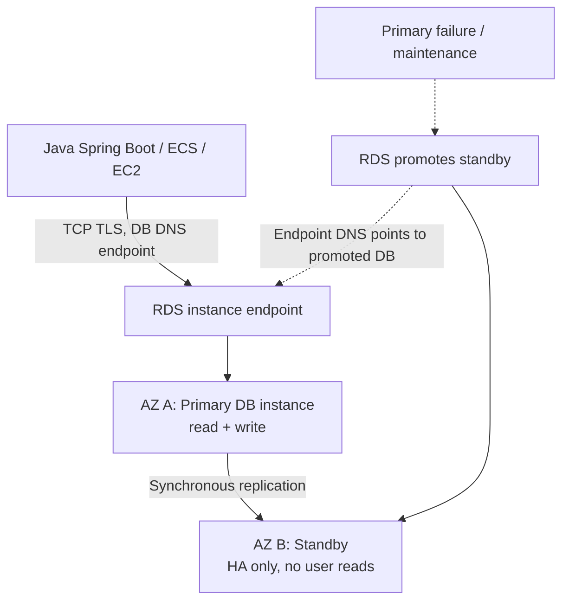
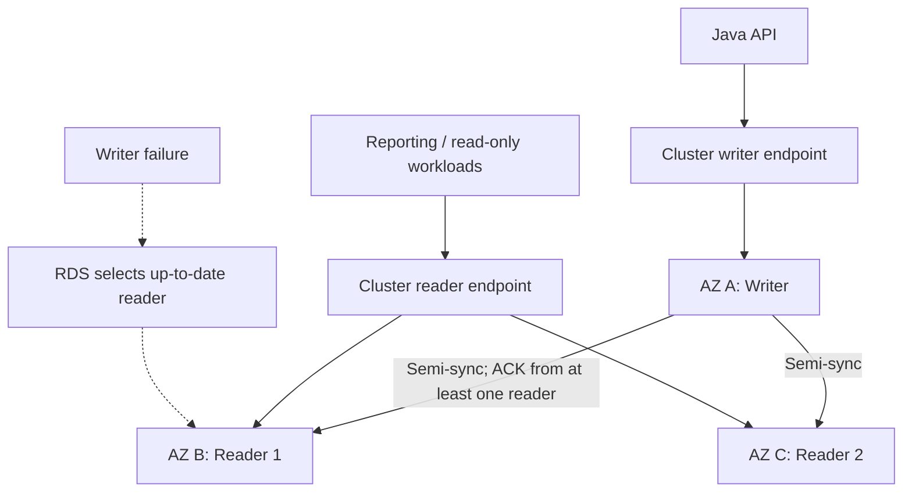
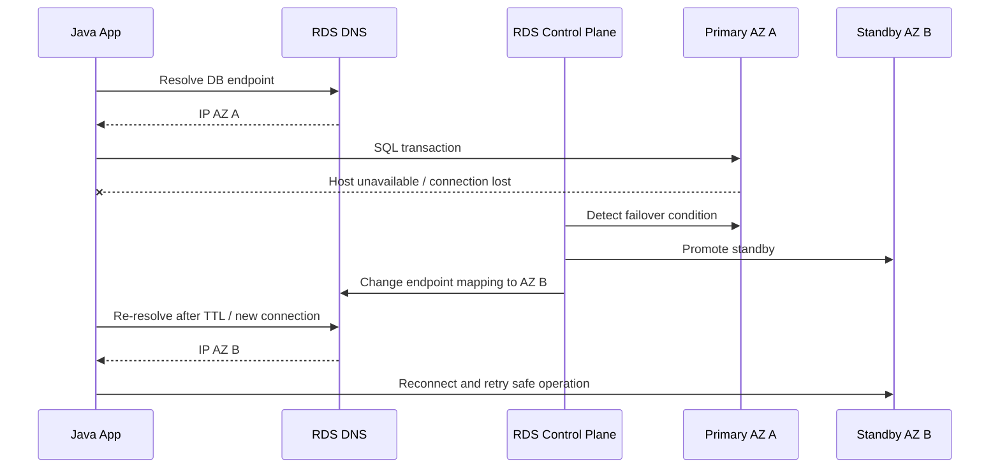
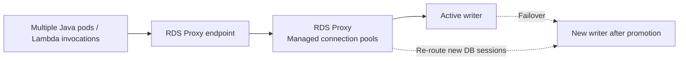
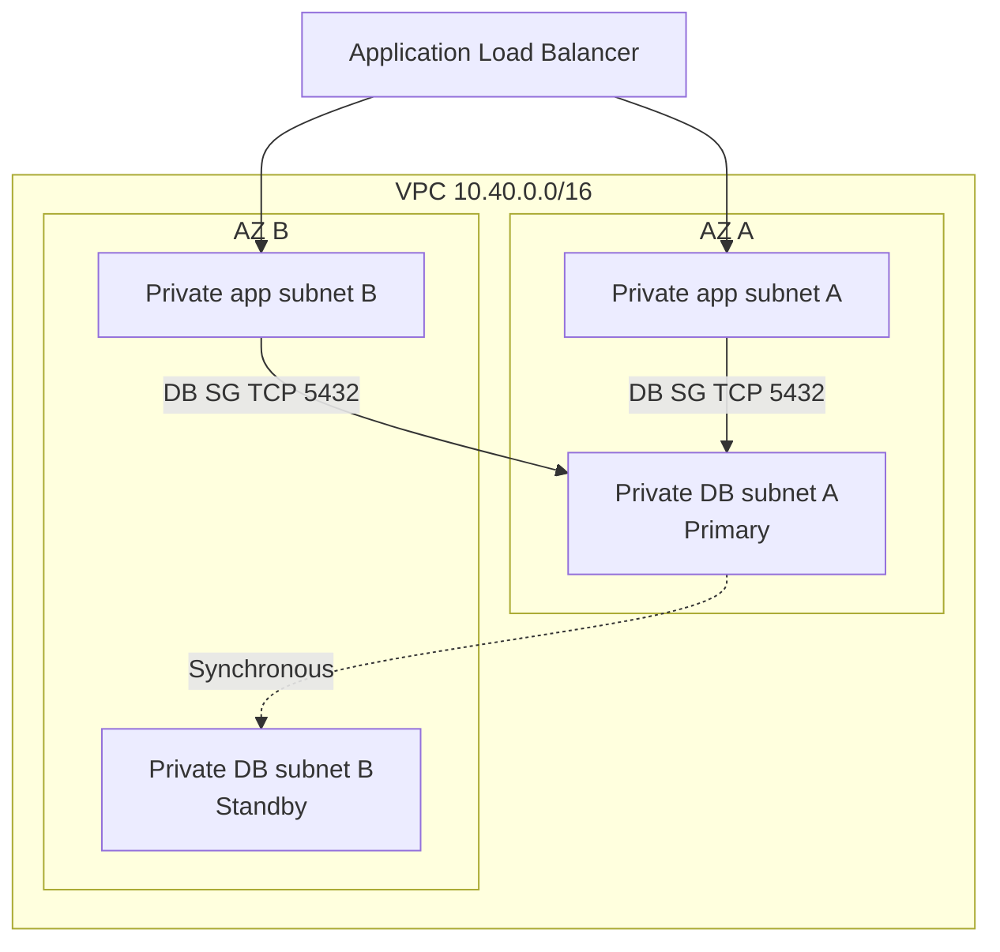
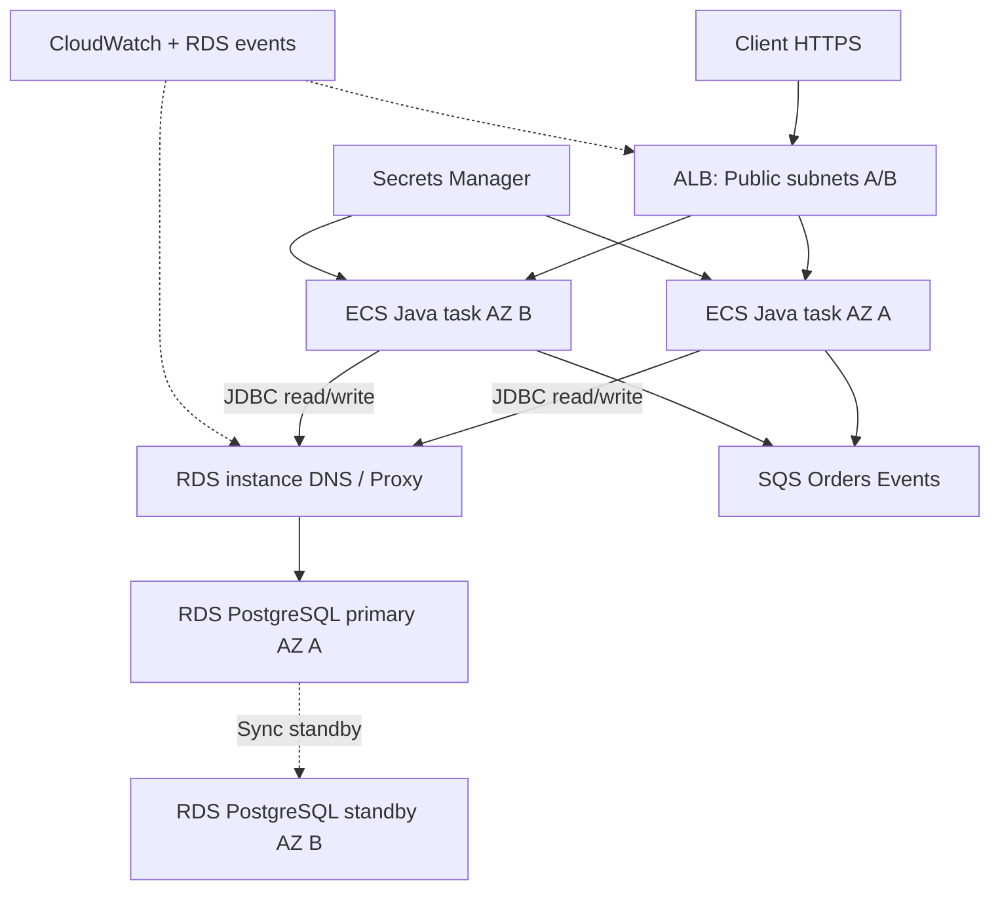

# RDS Multi-AZ and Failover Mechanisms

An e-commerce system runs **Java Spring Boot** on Amazon ECS/EC2 with a PostgreSQL database in **Amazon RDS**. During peak hours, the primary database server encounters a failure. The application starts logging connection errors, some `COMMIT` transactions time out, and everyone wants to know: is the data still safe, where will the application connect next, when will it recover, and do we need to change the connection string or restore a snapshot?

To answer accurately, the operations team must distinguish three configurations that are often loosely lumped together as “Multi-AZ”:

- **RDS Multi-AZ DB instance deployment:** one primary and one **synchronous standby** in a different AZ. The standby serves **failover only**, **not** read traffic.
- **RDS Multi-AZ DB cluster deployment:** one writer and **two readable readers** across three AZs with **semisynchronous** replication; has writer/reader endpoints and its own promotion mechanism.
- **Amazon Aurora DB cluster:** its own engine/storage architecture, distributing data across multiple AZs with a writer and optional Aurora Replicas; **not** the same resource type as an RDS Multi-AZ DB cluster.

All three increase **high availability (HA)**, but none automatically delivers zero downtime, exactly-once transaction processing, point-in-time recovery (PITR), or **cross-Region disaster recovery**.

This lesson belongs to the **RDS and Aurora Databases** chapter of the **CLOUD_PROVIDERS_AWS** module. Building on Regions/AZs, IAM, VPC, compute, storage, databases, monitoring, recovery, and cost, learners will choose an RDS model that can be operated safely for Java production workloads.

> **Scope:** focuses on Amazon RDS Multi-AZ **DB instances** and **DB clusters**, including Aurora for accurate comparison. Failover timings are **typical ranges per AWS documentation**, not hard SLAs; engine/version/instance class/Region support and DNS/networking behavior can vary. Verify actual documentation and configuration before applying.

## 1. Learning objectives

After this lesson, you will be able to:

1. Distinguish **Single-AZ**, **Multi-AZ DB instance**, **Multi-AZ DB cluster**, **Aurora**, and **read replicas**.
2. Describe synchronous standby replication in a Multi-AZ DB instance and semisynchronous replication in a Multi-AZ DB cluster.
3. Identify **planned/unplanned failover**, triggering events, and the promotion/recovery sequence.
4. Explain the roles of the **RDS endpoint, DNS, AZs, DB subnet group, SGs, and connection pooling** during failover.
5. Estimate reasonable **RTO/RPO** ranges, understand unknown-outcome transaction errors, and recognize the risk of retries causing double writes.
6. Design Spring Boot/JDBC/HikariCP with DNS TTL, timeouts, reconnects, and **idempotent** retries.
7. Choose RDS Proxy when pooling/failover resilience is needed; distinguish a proxy from a **read replica** and backups.
8. Monitor RDS events, CloudWatch, replication lag, SQL errors, logs, and end-to-end SLOs.
9. Practice AWS CLI/CloudFormation and **approved failover drills** without causing unintended production outages.
10. Plan HA, backups/PITR/DR, IAM/KMS, and costs.

## 2. Availability Zones, HA, RTO, RPO: concepts before architecture

An **AWS Region** consists of multiple **Availability Zones (AZs)** that are physically isolated in infrastructure per AWS design and connected over low-latency networking. Multi-AZ places database components across different AZs to reduce dependence on **a single AZ**.

| Term | Meaning | Key question to ask |
|---|---|---|
| **High availability (HA)** | Maintaining/restoring service when a server or AZ fails | If the writer fails, what takes over? |
| **Failover** | Switching the primary/writer role to another resource | Can the application reconnect? |
| **RTO** | Acceptable downtime duration before business service is restored | Can we tolerate 60 seconds or only 10 seconds? |
| **RPO** | Maximum acceptable data loss measured in time during an incident | Can we afford to lose an acknowledged transaction? |
| **Replication** | Copying changes to another node/volume | Synchronous, semisynchronous, or asynchronous? |
| **Read replica** | Read-serving copy, usually with replication lag | Does it automatically take over as writer on failure? |
| **Backup / PITR** | Restoring data to a prior point in time | Who restores if someone runs a bad `DELETE`? |
| **Disaster recovery (DR)** | Recovering when a Region or major system fails | If Region A is lost, is Region B ready? |

### 2.1. There is no “zero downtime” from Multi-AZ alone

During failover, the following can still happen:

- Existing SQL connections are dropped; requests fail or time out.
- Uncommitted transactions are rolled back when the primary disappears.
- A `COMMIT` succeeds in the database, but the response to the client is lost, causing an **unknown outcome**.
- Endpoint DNS updates to the new writer address, but the JVM/driver/OS/pool may still hold stale connections or old IPs.
- Reconnecting applications open too many connections simultaneously, overloading the new DB.

Therefore, **database HA and application resilience** complement each other; neither replaces the other.

## 3. Comparing RDS/Aurora models

| Characteristic | **RDS Single-AZ instance** | **RDS Multi-AZ DB instance** | **RDS Multi-AZ DB cluster** | **Aurora DB cluster** |
|---|---|---|---|---|
| Structure | One DB instance | Primary + **1 standby** in another AZ | **1 writer + 2 readers** across **3 AZs** | Multi-AZ Aurora cluster volume; writer + 0 or more Aurora Replicas |
| Replication | No default HA standby | **Synchronous** to standby | **Semisynchronous**, ACK from at least one reader before commit | Distributed/replicated storage per Aurora architecture |
| Reads from secondary | No | **No** | **Yes**, via reader endpoints | **Yes**, if Aurora Replicas exist |
| Automatic failover | No standby for automatic promotion | Yes | Yes | Yes; promotes a replica if present, otherwise may have to create a new writer |
| Scope | One AZ | Two AZs (primary + standby) | Three AZs | Storage spans multiple AZs; compute replica count per config |
| Application endpoint | DB instance endpoint | **Same DB instance endpoint**, DNS switches IP | **Writer cluster endpoint** and **reader endpoint** | **Writer/reader cluster endpoints**, instance endpoints |
| Engines | Many RDS engines | By engine support | **RDS MySQL/PostgreSQL** where supported | **Aurora MySQL/PostgreSQL** |
| Read scaling | Not built-in | Standby cannot be used for reads | Two readers can serve reads | Aurora Replicas serve reads |
| Best suited for | Dev/test or workloads tolerating downtime | Production HA without built-in readers | Production HA + read scaling on supported engines | Needing Aurora-specific architecture/capabilities |

**Core point:** “Multi-AZ = a reader can be used for reporting” is **false** for an **RDS Multi-AZ DB instance**. To offload read queries, use an **RDS read replica**, a **Multi-AZ DB cluster**, or **Aurora readers** as needed. See [Multi-AZ DB instance](https://docs.aws.amazon.com/AmazonRDS/latest/UserGuide/Concepts.MultiAZSingleStandby.html) and [Multi-AZ DB cluster](https://docs.aws.amazon.com/AmazonRDS/latest/UserGuide/multi-az-db-clusters-concepts.html).

### 3.1. Commonly cited failover timings

| Model | Typical duration per AWS | Do not infer |
|---|---|---|
| **RDS Multi-AZ DB instance** | **60–120 seconds** | Always recovers within 120 seconds |
| **RDS Multi-AZ DB cluster** | Typically **under 35 seconds** | No SQL request will ever fail |
| **Aurora with at least one eligible replica** | Typically **under 60 seconds**, often under 30 seconds | Every Aurora cluster, even without replicas, is under 30 seconds |

These benchmarks cover database-side operations and **do not guarantee application RTO**. The app may take additional time due to DNS caching, pools, transaction retries, or downstream recovery. Measure reality with chaos drills. See AWS docs on [DB instance failover](https://docs.aws.amazon.com/AmazonRDS/latest/UserGuide/Concepts.MultiAZ.Failover.html), [DB cluster failover](https://docs.aws.amazon.com/AmazonRDS/latest/UserGuide/multi-az-db-clusters-concepts-failover.html), and [Aurora HA](https://docs.aws.amazon.com/AmazonRDS/latest/AuroraUserGuide/Concepts.AuroraHighAvailability.html).

## 4. RDS Multi-AZ DB instance: primary and one standby

In a **Multi-AZ DB instance deployment**, Amazon RDS provisions and manages a **synchronous standby** in another AZ. The primary accepts reads and writes from the application; the standby is not open to handle application queries.



### 4.1. Why does the standby not serve reads?

The standby in a **Multi-AZ DB instance** is an **HA** component, not a read-scaling node. AWS uses different replication/failover technologies depending on the database engine, but the shared contract is that the standby stays ready to take over as primary.

**Do not try to find a hidden hostname/IP for the standby or connect directly** to squeeze out read performance. It is not provisioned for application queries under this configuration.

### 4.2. What does synchronous replication mean?

In engine-supported deployments, the primary synchronously replicates changes to the standby using AWS mechanisms to protect against host/AZ failures. Because of this synchronous step, **write commit latency** may be higher than Single-AZ.

This **does not mean** the application has zero RPO for every imaginable failure: for example, in-flight operations, client timeouts with unknown commit state, full-Region outages, accidental deletions, or logical errors are not solved by replication alone.

### 4.3. Benefits of Multi-AZ DB instance

- Automatic failover to the standby across many infrastructure failure modes.
- Reduced disruption during certain maintenance and backup operations depending on engine.
- Applications do not have to change endpoints after failover if **using the standard RDS hostname**.
- Simpler than self-managing PostgreSQL streaming replicas + fencing/leader election.

### 4.4. Limitations

- Standby is **not readable**.
- Failover still involves a window of dropped connections.
- Does not replace PITR, backups, cross-Region DR, or business idempotency.
- Synchronous replication and secondary infrastructure incur cost/latency.
- Exact mechanics differ across MySQL, MariaDB, PostgreSQL, Oracle, and SQL Server; do not assume identical internal replication across all engines.

Source: [Multi-AZ DB instance deployments](https://docs.aws.amazon.com/AmazonRDS/latest/UserGuide/Concepts.MultiAZSingleStandby.html).

## 5. RDS Multi-AZ DB cluster: writer + two readers

A **Multi-AZ DB cluster** is a distinct Amazon RDS deployment type for **supported MySQL/PostgreSQL versions**. It consists of **three DB instances across three AZs in the same Region**:

- **One writer** accepting writes and reads.
- **Two readers** capable of serving read queries.
- RDS can promote a reader when the writer becomes unavailable.



### 5.1. Semisynchronous replication is easily misunderstood

For an **RDS Multi-AZ DB cluster**, AWS describes **semisynchronous** replication: a change from the writer requires **acknowledgment of receipt from at least one reader** before committing; it **does not require both readers to have fully applied and committed** the change at the same instant. See [AWS: Multi-AZ DB cluster architecture](https://docs.aws.amazon.com/AmazonRDS/latest/UserGuide/multi-az-db-clusters-concepts.html).

Consequently:

- **Reader lag can still exist.**
- A query immediately after a write via the reader endpoint may see **stale** data.
- On failover, RDS selects the most suitable/up-to-date reader and reconciles unapplied transactions per the service mechanism.
- Do not inaccurately describe a Multi-AZ DB cluster as “both replicas are synchronously fully committed before every write.”

### 5.2. HA and read scaling coexist

Advantages over a single-standby DB instance deployment:

- Provides **two readable readers** to serve read workloads.
- Writer/reader endpoints simplify read/write separation in applications.
- Failover time is **typically under 35 seconds** per AWS documentation, depending on database/replication state.

However, actual read capacity depends on instance size, indexes, query plans, replication lag, throughput/quotas, and write ratio. Do not treat the two readers as copies that are **always 100% synchronized for every query**.

### 5.3. Two types of “read replica” are not the same

In a Multi-AZ DB cluster:

- **Built-in reader DB instances** are the two cluster members and **can be automatically promoted** on failover.
- **RDS DB instance read replicas created outside the cluster** are separate resources that typically replicate **asynchronously** for read scaling/DR; they are **not automatic failover targets** of the Multi-AZ DB cluster mechanism.

Sources: [Multi-AZ DB cluster deployments](https://docs.aws.amazon.com/AmazonRDS/latest/UserGuide/multi-az-db-clusters-concepts.html), [Reader vs DB instance read replicas](https://docs.aws.amazon.com/AmazonRDS/latest/UserGuide/multi-az-db-clusters-create-instance-read-replica.html).

## 6. Is Aurora the same as an RDS Multi-AZ DB cluster?

**No.** Amazon Aurora has its own engine and storage architecture:

- The **Aurora DB cluster volume** is replicated across multiple AZs in the same Region, decoupled from compute nodes by design.
- A cluster has a **writer** and can have **Aurora Replicas**.
- When the writer fails, RDS/Aurora can promote an Aurora Replica; if no suitable replica exists, it must create/rebuild a writer, which usually takes longer.
- The **Aurora cluster endpoint** routes to the current writer; the **reader endpoint** serves read workloads when readers exist.
- Aurora supports **promotion tiers** (promotion priority) for Aurora Replicas depending on engine/supported conditions.

Do not assume “multi-AZ Aurora storage” automatically gives you a pre-warmed compute reader if you have not created an Aurora Replica.

### 6.1. Aurora vs. RDS Multi-AZ DB cluster: how to choose

| Question | RDS Multi-AZ DB cluster | Aurora |
|---|---|---|
| Need managed PostgreSQL/MySQL on the RDS engine? | Yes, if version/Region/class supported | Aurora-compatible PostgreSQL/MySQL, different implementation |
| Need two built-in readers in the cluster type? | Yes | Add Aurora Replicas as designed |
| Replication mechanism? | Semisynchronous among three DB instances | Aurora distributed storage and compute replicas |
| How does failover work? | RDS promotes a reader member | Aurora promotes a reader or creates a new writer |
| Can every extension/engine feature carry over unchanged? | No; check RDS engine/version | No; check Aurora compatibility/features |

Source: [Aurora high availability](https://docs.aws.amazon.com/AmazonRDS/latest/AuroraUserGuide/Concepts.AuroraHighAvailability.html).

## 7. What events trigger failover?

Not every SQL error leads to promotion. Failover typically relates to **primary/writer health or operational actions**:

| Scenario | Can it trigger failover? | Operations team action |
|---|---|---|
| Primary host fails / becomes unhealthy | Yes | Monitor RDS events and application error rates |
| Network connectivity to primary is lost | Yes | Check reachability, CloudWatch, route/security changes |
| Underlying storage or host fails | Yes | RDS handles automatically; monitor events and recovery |
| Certain maintenance / OS patch activities | Yes, depending on engine/update | Schedule maintenance windows and monitor |
| `Reboot with failover` is requested | Yes | Only execute during approved chaos drills |
| Writer busy / unresponsive | Possibly | Inspect CPU, memory, locks, connection limits |
| App sends invalid SQL syntax | Normally no | Fix query/client; do not trigger failover |
| Isolated long query or deadlock | Not by default | Inspect DB locks/SQL plans |
| SG blocks app → DB | RDS failover will not fix it | Fix SG/routes, verify networking |
| Wrong IAM/Secrets Manager credentials | No | Fix auth/secret rotation |

### 7.1. Managed-service failover differs from manual crash handling

When RDS detects that the primary is unhealthy, it orchestrates promotion and fencing per its architecture. **Do not build custom failover with a private DNS record** or a script that “just swaps IPs” without understanding split-brain, transaction consistency, and database leader election.

### 7.2. Planned vs. unplanned

- **Planned:** maintenance or drills using `reboot with failover` / manual cluster failover. You can pick low-traffic windows, prepare metrics, and ready a rollback plan.
- **Unplanned:** host/AZ/network/storage failures. The app must tolerate these **without waiting for human intervention**.
- After either planned or unplanned events, read/write workloads may continue seeing errors during reconnection, transaction retries, and DNS refresh.

Source: [RDS DB instance failover reasons](https://docs.aws.amazon.com/AmazonRDS/latest/UserGuide/Concepts.MultiAZ.Failover.html).

## 8. Typical failover sequence

### 8.1. Multi-AZ DB instance



Steps can overlap and vary by engine. **Do not interpret the diagram as a fixed AWS protocol or exact second count.**

### 8.2. Multi-AZ DB cluster

```text
AZ A Writer fails
    ↓
RDS detects, evaluates readers and replication state
    ↓
Promotes a reader (AZ B or AZ C)
    ↓
Writer endpoint points to the new writer
    ↓
App opens new connections; interrupted transactions handled per retry policy
    ↓
RDS restores topology / reader capacity per service behavior
```

The **RDS cluster reader endpoint** may temporarily route some read connections to the writer during topology transitions; therefore, enforce **read-only** semantics properly in the app rather than assuming the reader endpoint will only ever hit a reader in every microsecond. See [AWS: Connection management](https://docs.aws.amazon.com/AmazonRDS/latest/UserGuide/multi-az-db-clusters-concepts-connection-management.html).

### 8.3. What is preserved, and what is lost?

- **Application DNS hostname:** stays the same at the standard endpoint layer.
- **Underlying IP:** may change.
- **Existing TCP/JDBC connections:** may be severed; the pool must replace connections.
- **In-flight uncommitted transactions:** may roll back or lose connection.
- **Transactions with an explicit COMMIT ACK:** evaluate based on the replication/durability contract; do not infer from a client timeout that they did not commit.
- **Application in-memory sessions, cursors, temp tables, session variables:** may be lost or need reinitialization.
- **Business idempotency:** the application must maintain it in the database or durable store.

## 9. Endpoints and DNS: where should the application connect?

### 9.1. With a Multi-AZ DB instance

The application uses the RDS-provided **DB instance endpoint**, for example:

```text
orders-db.xxxxxxxxxxxx.ap-southeast-1.rds.amazonaws.com:5432
```

During failover, RDS updates the endpoint's DNS mapping to point to the new primary. Never hard-code a private IP in `application.yml` or `/etc/hosts`.

**Do not use a read replica endpoint** as a failover substitute for the primary: read replicas typically replicate asynchronously and do not automatically assume the writer role when the primary fails unless promoted via a separate workflow.

### 9.2. With a Multi-AZ DB cluster

| Endpoint | Points to | Used for |
|---|---|---|
| **Cluster writer endpoint** | Current writer | `INSERT/UPDATE/DELETE`, DDL, read-after-write needing consistency |
| **Cluster reader endpoint** | Reader instances per RDS distribution | Reporting/queries tolerating replica lag |
| **Instance endpoint** | A specific member DB instance | Diagnostics, monitoring; **not** as a fixed HA connection string |

**Do not point write traffic to the current writer's instance endpoint**, because after failover that instance may become a reader or unavailable; clients must use the writer endpoint to follow the role transition.

### 9.3. DNS caching and long-lived connections

Just because RDS failover has finished **does not mean** clients recover immediately. DNS propagation/caching can delay resolving the new IP, especially when the JVM caches DNS for too long.

AWS recommends for Java a **DNS TTL of no more than 60 seconds** when endpoints can change during failover; in practice, 30–60 seconds is common and should be tested against your runtime/OS. See [AWS: Setting JVM DNS TTL](https://docs.aws.amazon.com/AmazonRDS/latest/UserGuide/Concepts.MultiAZ.Failover.html).

## 10. JVM and DNS TTL: a subtle bug in Java production

### 10.1. The problem

The JVM caches hostname → IP mappings. If the cache keeps the old primary IP for the lifetime of the process, the application keeps trying to connect to an IP that is no longer the writer even after RDS DNS updates properly.

Relevant property: `networkaddress.cache.ttl` (a Java security property), not to be confused with JDBC pool lifetime or Cloud DNS TTL.

### 10.2. Check the current value

```java
import java.security.Security;

public final class DnsCacheSettings {
    public static void main(String[] args) {
        String ttl = Security.getProperty("networkaddress.cache.ttl");
        System.out.println("Configured JVM DNS TTL=" + ttl);
    }
}
```

`null` does not necessarily mean “infinite cache”: the JVM default depends on runtime, version, and security settings. Measure and inspect your actual configuration.

### 10.3. Set TTL before connecting

```java
import java.security.Security;

public final class OrdersApplication {
    public static void main(String[] args) {
        // Must run before hostname is first resolved.
        Security.setProperty("networkaddress.cache.ttl", "30");
        org.springframework.boot.SpringApplication.run(
            OrdersApplication.class, args
        );
    }
}
```

Equivalently, it can be configured in **`$JAVA_HOME/conf/security/java.security`** on modern JDKs:

```properties
networkaddress.cache.ttl=30
```

**Notes:**

- Depending on container image, Java runtime, SDK driver, and security settings, the file location or security property behavior can vary.
- **Do not assume `-Dnetworkaddress.cache.ttl=30` works as a Java system property** without verifying: it is a **security property**, and not all startup mechanisms treat it like a standard system property.
- A short DNS TTL refreshes the IP, **but does not automatically retry failed SQL transactions**.
- Other caches may exist in the OS, application driver, or sidecars/proxies; verify the entire connection path.

## 11. JDBC connection pools and HikariCP must be designed for fault tolerance

Java applications commonly use **HikariCP** (Spring Boot's default in many starters). The pool reuses JDBC connections; when the writer fails over, old connections may become invalid.

### 11.1. Reference Spring Boot / PostgreSQL configuration

```yaml
spring:
  datasource:
    url: jdbc:postgresql://orders-db.xxxxxxxxxxxx.ap-southeast-1.rds.amazonaws.com:5432/orders?sslmode=verify-full
    username: app_user
    # Supply password securely from Secrets Manager / runtime secret;
    # never commit plaintext passwords in config files.
    hikari:
      maximum-pool-size: 15
      minimum-idle: 2
      connection-timeout: 5000
      validation-timeout: 3000
      idle-timeout: 300000
      max-lifetime: 1500000
      keepalive-time: 120000
```

These are **illustrative values**, not universal AWS-recommended defaults for every RDS/Java workload. You must:

- Align the hostname with the **active endpoint**, never hard-coding an IP.
- With `sslmode=verify-full`, configure the proper RDS CA/trust store; never disable TLS validation just to bypass errors.
- Measure DB connection limits and `DatabaseConnections` across pods/tasks × pool size.
- Ensure `connection-timeout` is short enough that requests do not hang indefinitely while still matching real p95 latency.
- Test `max-lifetime`/`keepalive-time` against network/proxy/idle timeouts to prevent mass simultaneous connection drops.
- When the pool errors during failover, verify it can create new connections afterward; you should not need to restart the entire service if the driver and pool recover properly.

### 11.2. Do not confuse max-lifetime with DNS TTL

| Setting | Effect |
|---|---|
| JVM `networkaddress.cache.ttl` | Cache duration for **hostname → IP** |
| Hikari `maxLifetime` | Maximum age of a JDBC connection in the pool |
| Hikari `connectionTimeout` | Wait time to borrow a connection from the pool |
| PostgreSQL JDBC `connectTimeout` | TCP connection attempt timeout per driver |
| SQL statement timeout | Execution time limit for a query |
| Observed RDS `FailoverDuration` | Time for RDS to switch roles; does not guarantee request RTO |

Verify exact property names and units for your actual JDBC driver and Hikari version before deploying to production.

### 11.3. Connection pool “auto-reconnect” does not make a failed request succeed

If a transaction fails mid-flight, the pool usually **cannot** safely replay the entire transaction transparently, especially when external side effects exist. The app must implement retries at the **business service boundary**, using a **fresh transaction** and idempotency on each attempt.

## 12. Failover-safe transaction retries and unknown commits

Suppose:

```text
T0: Java sends BEGIN
T1: UPDATE inventory SET available = available - 1
T2: Sends COMMIT
T3: Primary crashes, TCP connection resets before app receives ACK
T4: App does not know whether COMMIT was persisted
```

**Never blindly retry the same UPDATE** — if the earlier COMMIT succeeded, inventory would be decremented **twice**.

### 12.1. Separate two classes of errors

| Error | Handling |
|---|---|
| Connection refused/reset before transaction begins | Safe to retry once DB is available, with request-level idempotency |
| Connection lost mid-transaction / during COMMIT | **Unknown outcome**; check business operation ID before retrying |
| PostgreSQL `40001` serialization failure | Retry the **entire transaction** from the start per concurrency rules |
| PostgreSQL deadlock `40P01` | Retry the **entire transaction** with backoff |
| PostgreSQL `23505` unique violation | Likely a duplicate/idempotency conflict; compare payload/state |
| Connection pool timeout / too many connections | Backpressure, circuit breaker, and throttle retry storms |
| SQL syntax / permission failure | Do not cure with infinite retries; fix code/IAM/roles |

Some `SQLException`s have SQLSTATE class `08` (connection exceptions), but **error code alone is not enough** to conclude that an operation can be safely replayed.

### 12.2. Transactional idempotency in SQL

PostgreSQL example:

```sql
CREATE TABLE inventory (
    sku VARCHAR(80) PRIMARY KEY,
    available INTEGER NOT NULL CHECK (available >= 0)
);

CREATE TABLE processed_operations (
    operation_id UUID PRIMARY KEY,
    order_id VARCHAR(80) NOT NULL,
    result VARCHAR(20) NOT NULL,
    processed_at TIMESTAMPTZ NOT NULL DEFAULT now()
);
```

Inside **a single database transaction**:

```sql
BEGIN;

-- 1. Claim exactly one business operation.
INSERT INTO processed_operations(operation_id, order_id, result)
VALUES (:operation_id, :order_id, 'IN_PROGRESS')
ON CONFLICT (operation_id) DO NOTHING
RETURNING operation_id;

-- APPLICATION BRANCH:
-- If INSERT returns no row, read the existing result and
-- DO NOT decrement inventory again. Compare payload/business identity.

-- 2. Execute only for the invocation that successfully claimed the operation:
UPDATE inventory
SET available = available - :quantity
WHERE sku = :sku AND available >= :quantity
RETURNING available;

-- APPLICATION BRANCH:
-- If UPDATE returns no row, ROLLBACK (do not leave an
-- IN_PROGRESS marker), or commit an explicitly modeled
-- business rejection depending on business rules.

-- 3. Record the result in the SAME transaction.
UPDATE processed_operations
SET result = 'RESERVED', processed_at = now()
WHERE operation_id = :operation_id;

COMMIT;
```

**This is application-driven conditional SQL pseudocode**, not a blind sequential script. With proper SQL transaction semantics:

- If the first COMMIT succeeded but the app lost the ACK, a retry with the same `operation_id` sees the marker/result and does not decrement inventory again.
- If the transaction rolled back, neither the claim nor the update exists, so the retry can proceed.
- If the key matches but the payload differs, return a **conflict** rather than swallowing the error.
- If a side effect involves an **external payment API**, you cannot put that API inside the PostgreSQL transaction; you need a downstream idempotency key, outbox/saga, and reconciliation.

### 12.3. Spring Retry / resilience pattern

A Spring production pattern:

```text
HTTP / SQS event
    ↓
Read business operation ID (stable)
    ↓
Retry wrapper (bounded attempts + exponential backoff + jitter)
    ↓
NEW database transaction per attempt
    ↓
Check prior business result / conditional effect
    ↓
Commit durable result and return
```

**Do not place retries inside an already-failed transaction**, because the transaction/session may no longer be valid. With Spring `@Transactional`/AOP, understand proxy boundaries so each attempt genuinely starts a new transaction and avoids self-invocation bypassing interceptors.

**Avoid retrying every SQL operation unconditionally.** Retries must have **bounded attempts**, an overall timeout, a circuit breaker, and error classification. If a primary takes 90 seconds to fail over, retrying 100 requests/sec × every app pod can trigger a connection storm.

## 13. Does RDS Proxy help with failover?

**Amazon RDS Proxy** is a managed database connection proxy service that can:

- Pool/multiplex connections to reduce DB connection management overhead.
- Keep the proxy endpoint relatively stable and help applications **absorb less impact** during writer transitions.
- Reduce concurrent connection handshakes, useful for Lambda or rapidly scaling microservices.
- Integrate auth/Secrets Manager/TLS for supported engines and configurations.



### 13.1. The proxy does not automatically save an in-flight SQL transaction

RDS Proxy can reduce **connection disruption** and speed up connectivity recovery, but **it does not guarantee an in-progress transaction commits automatically**. Pinned connections/session state, temporary tables, or long-running transactions can reduce multiplexing effectiveness.

If business logic has side effects, the app still needs idempotency and safe retries. RDS Proxy also has pricing, limits, and engine compatibility constraints that must be budgeted separately. See [AWS: RDS Proxy concepts](https://docs.aws.amazon.com/AmazonRDS/latest/UserGuide/rds-proxy.howitworks.html).

### 13.2. When should you use it?

| Workload | Why consider RDS Proxy? |
|---|---|
| AWS Lambda with many short invocations | Avoids every invocation opening its own DB connection |
| Aggressive ECS/EKS autoscaling | Connection pooling, dampens bursts hitting the writer |
| Java services disrupted during failover | Proxy path helps simplify complex reconnect tuning |
| Apps already pooling efficiently with few clients | Benefit may be small relative to added cost |
| Long sessions / temporary tables | Watch for connection pinning, which limits pooling gains |

Source: [RDS Proxy concepts](https://docs.aws.amazon.com/AmazonRDS/latest/UserGuide/rds-proxy.howitworks.html).

## 14. DB subnet groups, VPC, IPs, and security groups

To deploy RDS in a VPC, you need a **DB subnet group** containing suitable subnets:

- Typically subnets in **at least two AZs**; a **Multi-AZ DB cluster** requires subnets in **three AZs** per cluster topology.
- Choose **private DB subnets**; never enable public access in production just for convenience.
- Keep **free IP addresses** in every subnet for DB ENIs, failover, maintenance, and scaling.
- The DB SG should normally allow access only from the **application SG or proxy SG** on the database port (e.g., PostgreSQL TCP 5432).
- When failing over to another AZ, routes/NACLs/SGs must allow the app to connect to the **new address** anywhere across the DB subnet group.
- VPC DNS hostnames/resolution must work, and custom DNS resolvers/forwarders must not cache incorrectly.

### 14.1. Two-AZ topology example



After failover, both app subnets A and B need a path to DB_B. **Never lock an SG rule to the current primary's private IP**, as the IP can change on failover.

### 14.2. Common network errors

| Symptom | What to check |
|---|---|
| One app AZ cannot connect after failover | Routes/NACLs/SGs for the new IP, cross-AZ networking |
| DNS returns old IP inside the JVM | `networkaddress.cache.ttl`, JVM/process/container DNS |
| DB endpoints resolve to private IP from an Internet laptop | Need approved VPN/bastion/SSM path; do not make DB public |
| RDS Proxy has an endpoint but app times out | Proxy SG, target SG, auth/Secrets Manager, subnet IPs |
| Reader endpoints fail after cluster failover | New topology, reader lag/endpoint DNS, pool refresh |
| No outbound Internet from private subnet | Unrelated directly to local-VPC DB; AWS APIs need NAT/endpoints per workflow |

Source: [RDS DB instances in VPC](https://docs.aws.amazon.com/AmazonRDS/latest/UserGuide/USER_VPC.WorkingWithRDSInstanceinaVPC.html).

## 15. Reader endpoints, replica lag, and consistency

In a **Multi-AZ DB cluster**, reader instances serve queries but can exhibit **replica lag** behind the writer, because semisynchronous replication does not require both readers to have applied every commit yet.

### 15.1. A read-after-write failure example

```text
Client POST /orders
    → Writer INSERT order 123 → COMMIT
Client GET /orders/123 immediately
    → Reader endpoint → Reader has not applied change yet
    → Response "not found"
```

This can happen **without any failover occurring**.

### 15.2. Choosing the read path

- **Writes and consistent read-after-write**: use the writer endpoint or an appropriate consistency mechanism.
- **Reporting/analytics/dashboards tolerating lag**: use the reader endpoint.
- **Traditional RDS read replicas**: expect asynchronous lag; do not treat them as an automatic Multi-AZ DB instance standby.
- For queries highly sensitive to ordering/transaction visibility, use appropriate transactions, locking, and DB semantics.

**Do not route to the reader endpoint just to lower writer CPU** when business requirements demand every request read freshly committed data immediately.

### 15.3. Monitoring lag

Track replication lag and relevant metrics **specific to your engine and cluster type**; do not assume all DB engines emit metrics with identical names or measurement semantics. Observe query latency, read throughput, and application stale-read rates together.

## 16. Backups, PITR, and DR are separate layers from HA

### 16.1. Multi-AZ does not recover from accidental `DELETE`

If an app executes:

```sql
DELETE FROM orders WHERE created_at < now() - interval '1 day';
```

and the query deletes the wrong rows, replication can **propagate the deletion** to standbys/readers. Failing over will not restore the pre-delete state.

You need **RDS automated backups**, **PITR**, manual snapshots/AWS Backup, and backup testing per workload.

### 16.2. Characteristics of PITR

For supported RDS DB instances with backup retention enabled, **point-in-time restore creates a new DB instance** at a chosen timestamp within the retention window. It **does not modify the source database in place**. You must then verify the restored DB, data, IAM/SG/secrets, and perform a controlled application cutover.

RDS DB clusters and Aurora have distinct restore procedures; never copy a DB instance PITR command to an Aurora cluster without checking API/engine rules.

Source: [RDS point-in-time restore](https://docs.aws.amazon.com/AmazonRDS/latest/UserGuide/USER_PIT.html).

### 16.3. Single-Region Multi-AZ vs. cross-Region DR

- **AZ-level failure:** Multi-AZ helps switch to a standby/reader within the same Region.
- **Regional outage:** Multi-AZ in one Region cannot serve from another Region; you must design cross-Region replication/backups/Global Database where supported by the engine, along with VPC/DNS/IAM/credentials in the DR Region.
- **Logical corruption/ransomware/operator error:** snapshots/PITR/isolated backups and restore drills are the critical protection layer.
- **Application outage:** a healthy DB does not mean Java services/ALB/SQS/workflows are healthy.

### 16.4. RTO/RPO by business scenario

| Scenario | Is Multi-AZ enough? | Additional requirement |
|---|---|---|
| Single primary host failure | Typical HA use case | Retry/reconnect/metrics |
| Single DB AZ failure | Core Multi-AZ target | Multi-AZ app, proper SG/routing |
| Accidental deletion of 1,000 orders | **No** | PITR/snapshots, restore verification |
| Leaked credentials and unauthorized writes | **No** | IAM, rotation, auditing, backup isolation |
| Entire Region unavailable | **No** | Cross-Region DR/replication |
| DB commit result times out | **Not solved automatically at app** | Idempotency/reconciliation |

## 17. Monitoring failover and health

Do not rely solely on ping or the RDS Console. Observe **RDS events + CloudWatch + application metrics + business outcomes**.

### 17.1. Failover events

RDS events may include the `failover` category:

- `RDS-EVENT-0013`: Multi-AZ instance failover started.
- `RDS-EVENT-0015`: failover to standby completed; **DNS propagation may take additional time**.
- `RDS-EVENT-0049`: Multi-AZ instance failover completed.
- `RDS-EVENT-0071`: DB cluster failover completed.
- `RDS-EVENT-0073`: DB cluster cross-AZ failover started.

Event IDs/messages can vary by resource/engine type, so alert on AWS-supported categories/filters rather than relying on a single ID. See [AWS: RDS event categories and messages](https://docs.aws.amazon.com/AmazonRDS/latest/UserGuide/USER_Events.Messages.html).

### 17.2. Metrics to measure

| Group | Metrics / signals | Helps answer |
|---|---|---|
| RDS CPU/memory | `CPUUtilization`, `FreeableMemory` | Was the writer overloaded before the incident? |
| DB connections | `DatabaseConnections`, max connections, connection churn | Did the app cause a connection storm on failover? |
| I/O | `ReadLatency`, `WriteLatency`, IOPS/throughput | Storage bottleneck or SQL workload? |
| Storage | `FreeStorageSpace` where applicable | Did near-full storage degrade the DB? |
| Replication | Reader lag / cluster replication metrics per engine | Is a reader fresh enough to serve reads/promote? |
| RDS Events | Failover started/completed, maintenance, failures | When did RDS switch roles? |
| App | JDBC connection errors, SQLSTATE, Hikari pool active/pending | How long did client recovery take? |
| API/business | HTTP 5xx, p95/p99, order success/unknown outcomes | How were users impacted? |
| RDS Proxy | Connections, target health, proxy connection errors/pinning | Did the proxy dampen connection pressure? |
| Logs/audit | DB engine logs, CloudTrail management events | Find root cause / config changes |

RDS also offers **Enhanced Monitoring** and **Database Insights/Performance Insights** depending on resource type, version, and feature tier. Avoid enabling every long-retention metric by default without reviewing costs and permissions.

### 17.3. Alerts and ownership

- Route RDS failover/availability events to SNS/email/on-call.
- Alert on RDS CPU/connection saturation, free storage, and replica lag per workload thresholds.
- Alert on spikes in app `SQLTransientConnectionException`/SQLSTATE class 08.
- Alert on abnormal Hikari pending/timeout counts.
- Alert on rising business transaction failures/unknown commits.
- Alert on backup window/PITR/restore test failures.
- Alert when RDS/Proxy/CloudWatch spend exceeds budget.

**Do not mark a drill successful just because RDS logged “failover complete.”** Measure **end-to-end**: from the first failed request until steady business request recovery.

## 18. AWS CLI: inspecting configuration and events (read-only)

Identifiers in examples are hypothetical; run only with authorized AWS accounts/Regions/profiles. These commands do not create or delete resources.

### 18.1. Identify caller and Multi-AZ DB instance

```bash
aws sts get-caller-identity --profile learning

aws rds describe-db-instances \
  --db-instance-identifier orders-db-prod \
  --region ap-southeast-1 \
  --profile learning \
  --query 'DBInstances[0].{Id:DBInstanceIdentifier,Status:DBInstanceStatus,MultiAZ:MultiAZ,AZ:AvailabilityZone,SecondaryAZ:SecondaryAvailabilityZone,Endpoint:Endpoint.Address,Engine:Engine,BackupRetention:BackupRetentionPeriod}' \
  --output json
```

If `MultiAZ=true` on a traditional DB instance deployment, there is an AWS-managed standby. **Do not rely on the `MultiAZ` field alone** to confuse it with a Multi-AZ DB cluster or Aurora; verify resource type and topology.

### 18.2. Inspect Multi-AZ DB cluster and members

```bash
aws rds describe-db-clusters \
  --db-cluster-identifier orders-cluster-prod \
  --region ap-southeast-1 \
  --profile learning \
  --query 'DBClusters[0].{Id:DBClusterIdentifier,Status:Status,Engine:Engine,WriterEndpoint:Endpoint,ReaderEndpoint:ReaderEndpoint,Members:DBClusterMembers}' \
  --output json
```

`DBClusterMembers[].IsClusterWriter` identifies the **current** writer member. The application uses the writer endpoint hostname rather than pinning to a specific member.

### 18.3. Inspect RDS Events before/after failover

```bash
# Multi-AZ DB instance events
aws rds describe-events \
  --source-type db-instance \
  --source-identifier orders-db-prod \
  --duration 120 \
  --region ap-southeast-1 \
  --profile learning

# Multi-AZ DB cluster events
aws rds describe-events \
  --source-type db-cluster \
  --source-identifier orders-cluster-prod \
  --duration 120 \
  --region ap-southeast-1 \
  --profile learning
```

`--duration 120` is the query lookback window in **minutes**, not the failover duration. Check UTC/local time zones and correlate with CloudWatch and app logs.

### 18.4. Inspect DB subnet group

```bash
aws rds describe-db-subnet-groups \
  --db-subnet-group-name orders-db-subnets \
  --region ap-southeast-1 \
  --profile learning \
  --query 'DBSubnetGroups[0].{Name:DBSubnetGroupName,VPC:VpcId,Status:SubnetGroupStatus,Subnets:Subnets[].{Id:SubnetIdentifier,AZ:SubnetAvailabilityZone.Name,Status:SubnetStatus}}'
```

Verify there are two/three AZs and sufficient free IPs via EC2 subnet metadata (if permitted). Do not attempt to connect to the database from a laptop outside the VPC just because `describe` APIs work: the **AWS RDS management API** and the **DB TCP data path** are two completely different paths.

## 19. Manual failover drills: mutating operations

The commands below **can cause disruption** and change the database writer. Shown only for runbook preparation; **never run on production** without approval, a maintenance window, and a recovery plan.

### 19.1. Multi-AZ DB instance: reboot with failover

```bash
# ILLUSTRATIVE ONLY: AWS CLI write operation, can disrupt SQL traffic.
aws rds reboot-db-instance \
  --db-instance-identifier orders-db-prod \
  --force-failover \
  --region ap-southeast-1
```

`--force-failover` is required when testing promotion to the standby; a normal reboot does not always have the same effect. Verify engine/DB status/permission prerequisites first.

### 19.2. Multi-AZ DB cluster: failover cluster

```bash
# ILLUSTRATIVE ONLY: promotes a reader via the RDS mechanism.
aws rds failover-db-cluster \
  --db-cluster-identifier orders-cluster-prod \
  --region ap-southeast-1
```

Do not apply `reboot-db-instance --force-failover` to a cluster expecting it to swap the writer via the same mechanism. The manual failover API for a cluster is `FailoverDBCluster`.

### 19.3. Plan for a failover drill

1. Notify internal stakeholders and owners; get timing and risk sign-off.
2. Confirm automated backups, PITR, instance/cluster health, and access permissions are working.
3. Capture baseline `AZ`, `Endpoint`, `DBClusterMembers`, connections, SQL error rates, and SLOs.
4. Send **idempotent synthetic transactions**, recording start/commit/result timestamps.
5. Run failover in **staging** first; production only with explicit approval.
6. Observe failover events, writer AZ shift, DNS re-resolution, and app pool recovery.
7. Reconcile idempotency keys/transactions to verify zero lost or duplicated business effects.
8. Record **actual RTO**, 5xx/timeouts, restore path, and any configs that required changes.
9. Do not trigger repeated failovers back-to-back before the deployment stabilizes; RDS may enforce limits or cooldowns.
10. Update runbooks and alert thresholds based on measured results.

## 20. CloudFormation: illustrative Multi-AZ PostgreSQL DB instance

The following IaC template is solely for learning how to declare **`MultiAZ: true`** with two private DB subnets. Deploying it creates real resources and incurs charges; do not run without approval.

```yaml
AWSTemplateFormatVersion: '2010-09-09'
Description: Example private Multi-AZ RDS PostgreSQL DB instance

Parameters:
  VpcId:
    Type: AWS::EC2::VPC::Id
  DbSubnetA:
    Type: AWS::EC2::Subnet::Id
  DbSubnetB:
    Type: AWS::EC2::Subnet::Id
  AppSecurityGroupId:
    Type: AWS::EC2::SecurityGroup::Id

Resources:
  DatabaseSecurityGroup:
    Type: AWS::EC2::SecurityGroup
    Properties:
      GroupDescription: Allow PostgreSQL only from application SG
      VpcId: !Ref VpcId
      SecurityGroupIngress:
        - IpProtocol: tcp
          FromPort: 5432
          ToPort: 5432
          SourceSecurityGroupId: !Ref AppSecurityGroupId

  DatabaseSubnetGroup:
    Type: AWS::RDS::DBSubnetGroup
    Properties:
      DBSubnetGroupDescription: Private DB subnets across two AZs
      SubnetIds:
        - !Ref DbSubnetA
        - !Ref DbSubnetB

  Database:
    Type: AWS::RDS::DBInstance
    DeletionPolicy: Snapshot
    UpdateReplacePolicy: Snapshot
    Properties:
      DBInstanceIdentifier: orders-multi-az-example
      Engine: postgres
      DBInstanceClass: db.m6g.large
      AllocatedStorage: 30
      StorageType: gp3
      MultiAZ: true
      DBName: orders
      MasterUsername: dbadmin
      ManageMasterUserPassword: true
      DBSubnetGroupName: !Ref DatabaseSubnetGroup
      VPCSecurityGroups:
        - !Ref DatabaseSecurityGroup
      PubliclyAccessible: false
      StorageEncrypted: true
      BackupRetentionPeriod: 7
      DeletionProtection: true

Outputs:
  DatabaseEndpoint:
    Value: !GetAtt Database.Endpoint.Address
```

**Important conditions:**

- The two subnets must be in **two different AZs**, have sufficient IPs, and be private per actual route/network configuration.
- `db.m6g.large` and gp3 must be supported for the PostgreSQL engine/Region/version and current limits; another class may be chosen in a learning environment.
- `ManageMasterUserPassword: true` lets RDS manage the master password via Secrets Manager; production apps should use a **dedicated least-privilege database user**, not the master account.
- `DeletionProtection: true` prevents accidental deletion but will block stack cleanup until disabled via an approved process. `DeletionPolicy: Snapshot` does not replace the organization's backup policy.
- `MultiAZ: true` creates **one non-readable standby**, **not** a three-node Multi-AZ DB cluster.
- A fixed DB identifier can conflict on redeployment; production needs proper naming, tags, and stack policies.
- Never open inbound `0.0.0.0/0` on port 5432 and never hardcode a master password.

### 20.1. Creating a Multi-AZ DB cluster is completely different

A Multi-AZ DB cluster uses the **`AWS::RDS::DBCluster`/`CreateDBCluster` resource/API with appropriate engine/type/instance settings**, not merely changing `MultiAZ: true` on `AWS::RDS::DBInstance`.

For RDS MySQL/PostgreSQL clusters, AWS enforces requirements around **EngineMode, DBClusterInstanceClass, storage, IOPS, 3-AZ subnets, versions, and constraints**; consult current CloudFormation/Region documentation rather than copying an instance template and expecting a cluster.

## 21. Cost and performance control

### 21.1. Billing components

| Item | Potential charges |
|---|---|
| **Multi-AZ DB instance** | Compute for primary + standby per pricing model, storage/IOPS, backups, and other attributes |
| **Multi-AZ DB cluster** | Writer + **2 readers**, storage/IOPS, backups, and data transfer per pricing/Region |
| **Aurora** | Instance/serverless compute, distributed storage, I/O per pricing config, backups |
| **RDS Proxy** | Proxy capacity/usage per current engine/pricing model |
| **CloudWatch/Database Insights** | Logs, metrics, advanced monitoring/retention |
| **VPC networking** | Network transfer/NAT/interface endpoints depending on access path |
| **Data restore/DR** | Snapshot retention, cross-Region copies, DR resources |

**Do not conclude** that a Multi-AZ DB cluster is always cheaper or faster than Aurora, or that a Multi-AZ instance is “literally double Single-AZ across every line item.” Cost and performance depend on engine/version/class/storage, I/O, read/write ratio, Region, and time.

### 21.2. Trade-off examples

A Java system that is mostly **writes** with low read traffic:

- A **Multi-AZ DB instance** can satisfy HA without paying for two readable readers.
- If the SLO demands fast failover and the workload also has substantial reads, a **Multi-AZ DB cluster** is worth evaluating.
- If you want Aurora's storage/replication/features, evaluate **Aurora** and the number of Aurora Replicas needed for your RTO.

An 80%-read reporting system:

- A Multi-AZ DB instance standby does not serve reporting; you need a separate read replica or cluster.
- A Multi-AZ DB cluster gives you 2 readers, though you must verify **lag**, queries, and indexes.
- Compare Aurora readers, caching, and warehouse/reporting offloading based on needs.

### 21.3. Benchmarks must include failover

Do not measure steady-state TPS alone. Measure:

- P95/P99 latency before and after promotion.
- Number of failed transactions during the failover window.
- Pool/JVM/DNS recovery duration.
- Rate of retried transactions and count of unknown outcomes.
- Replica lag when reading from readers.
- Total cost of RDS + Proxy + DB storage/IOPS/logs.

## 22. Reference architecture: two-AZ Java orders API

**Context:** an orders API running on ECS Fargate across two AZs, internet-facing ALB, private RDS PostgreSQL, SQS for background tasks, and Secrets Manager for credentials.



### 22.1. Concrete design

| Component | Choice | Why |
|---|---|---|
| App tasks | ECS services spread across 2 AZs | Reduces single-AZ application failure risk |
| DB subnet group | Private DB subnets in AZ A/B | Standby in a different AZ, DB not public |
| RDS | Multi-AZ DB instance, PostgreSQL | HA for writer, no read scaling needed |
| DB SG | TCP 5432 only from ECS SG or Proxy SG | Least privilege |
| Credentials | Secrets Manager + least-privilege app user | Avoids hardcoding / limits blast radius |
| Connections | JDBC + HikariCP + DNS TTL ≤60 s | Improves re-resolution and reconnect reliability |
| Writes | Unique business operation ID, transactional idempotency | Prevents double writes on unknown COMMIT outcomes |
| Async | SQS + DLQ for email/inventory | Avoids holding HTTP requests for slow tasks |
| Observability | RDS events/CloudWatch, JVM/Hikari, business metrics | Measures end-to-end RTO |
| DR | Backup/PITR and restore drills | Protects against data loss beyond AZ failures |

### 22.2. Failover test scenario

1. `POST /orders` is called with a stable `Idempotency-Key`.
2. Primary in AZ A is intentionally failed over in staging.
3. App sees transient connection failures and retries with backoff.
4. RDS DNS updates to the promoted standby in AZ B.
5. JVM/pool opens new connections; the app looks up the result of the `operationId` whose commit was uncertain.
6. The API returns the already-committed state or executes the transaction **once** if not yet committed.
7. Reconcile DB rows, SQS events, and order statuses; ensure HTTP retries are not counted as multiple orders.
8. Measure application recovery time against the **SLO**, not just RDS event completion.

## 23. Real-world failover runbook

### 23.1. When an incident starts

1. Identify whether the database is a **Multi-AZ DB instance** or a **Multi-AZ DB cluster/Aurora**.
2. Check `describe-events` or the RDS Console to confirm whether it is **failover or an app network/auth issue**.
3. Check CloudWatch RDS CPU/connections/storage, app SQL errors, pool metrics, and HTTP 5xx.
4. Verify endpoint DNS, VPC SGs/routes, credentials, correct Region, and DB status.
5. Curb **retry storms**: enforce bounded attempts/circuit breakers and reduce concurrency if needed.
6. Flag business operations with **unknown commit outcomes** for reconciliation instead of replaying blindly.
7. Let RDS complete promotion; do not repeatedly reboot/promote mid-recovery.
8. Once the writer is available, verify read/write with a limited test account; observe app auto-reconnection.
9. Reconcile orders/payments/inventory; audit for any duplicate or missing outcomes.
10. Assess actual RTO/RPO, recover downstream systems, and record the incident timeline.

### 23.2. After failover

- Verify the DB has a healthy standby/readers in appropriate AZs.
- Verify backup jobs/PITR continue updating.
- Gradually restore app concurrency if it was throttled down.
- Confirm security groups/routes were not modified without authorization.
- If reader lag is high, shift critical reads off the reader endpoint.
- Document root cause, comparing RDS-side downtime vs. JVM/driver/pool downtime.
- Open follow-up tickets and schedule a game day to re-measure after fixes.

### 23.3. What NOT to do

- Do not delete the database or restore a snapshot **before** confirming whether this is a normal failover.
- Do not manually point the application to the **standby's IP**.
- Do not open SG `0.0.0.0/0` just to work around timeouts.
- Do not retry raw non-idempotent SQL or re-call payment APIs when the outcome is unknown.
- Do not restart all applications/containers simultaneously and trigger a connection storm.
- Do not treat an async read replica as an automatic Multi-AZ standby.

## 24. Common errors and how to diagnose them

| Symptom | Possible cause | Verification path |
|---|---|---|
| RDS Console says failover complete, yet Java still fails | JVM DNS TTL/cache, stale Hikari connections | TTL, resolver, pool metrics, driver logs |
| `DatabaseConnectionException` for 1–2 minutes | Writer/endpoint switchover | RDS failover events, DB availability, and app retries |
| Writes return “read-only transaction” | App pinned instance endpoint/reader or stale pool role | Use writer endpoint, refresh pool |
| Read-after-write misses record | Reader lag | Query via writer endpoint / consistency policy |
| One app AZ cannot connect after failover | SG/NACL/route only allowed old primary AZ | Check DB subnets, IPs, SG source rules |
| Multi-AZ instance standby is not readable | By design | Use a read replica or Multi-AZ DB cluster |
| Read replica remains slow/lagging | Async replication, heavy writes, replica resources | Lag metrics, query tuning |
| `too many connections` continues after failover | App instances/pools reconnect all at once | Sum pools, use RDS Proxy, cap connections |
| An order is created twice | Unknown COMMIT outcome + non-idempotent retry | Operation ID, unique constraint, reconciliation |
| Data lost after accidental `DELETE` | Replication propagated the delete | PITR/restore, not failover |
| Cannot create Multi-AZ cluster | Missing AZs, unsupported engine/version/class/storage | Cluster prerequisites/Region docs |
| Failover did not finish in 35 seconds | Data activity, lag/recovery, network, client | RDS events, lag, SQL errors, actual measurement |
| `AccessDenied` on describe RDS | IAM management API permissions | Role, policy, SCP, Region |
| App times out on TCP 5432 while AWS CLI describe works | DB data plane differs from RDS API | VPC routes/SG/DNS/TLS |
| RDS Proxy did not reduce transaction errors | Proxy does not replay mid-flight SQL | Idempotency, whole-transaction retries |

### 24.1. Investigation order to avoid wrong fixes

1. **Resource type:** RDS DB instance or Multi-AZ DB cluster/Aurora?
2. **Endpoint:** instance, writer, reader, or proxy?
3. **RDS events:** was there an actual failover, and when did it finish?
4. **DNS path:** what is the JVM/container/OS resolving the hostname to?
5. **Network:** SGs, NACLs, subnets, VPN/peering if remote?
6. **DB credentials/TLS:** auth, CA, expired secret?
7. **App pool and transactions:** stale connections, SQLSTATE, unknown commits?
8. **Business data:** duplicate or unprocessed operations?
9. **SLO/DR:** do you need a snapshot restore or just reconnection?

## 25. Scenario exercises

### Exercise A — Which Multi-AZ type to choose?

A PostgreSQL app needs writer HA with negligible read-only load and a tight budget.

**Guidance:** start by evaluating **RDS Multi-AZ DB instance**; the standby does not serve reads, but provides failover. Compare cost and required RTO against a cluster or Aurora.

### Exercise B — Using a standby for analytics?

The BI team wants to query the standby of a Multi-AZ DB instance to offload the primary.

**Answer:** **not possible** in this model. Use a separate read replica, Multi-AZ DB cluster readers, or Aurora readers where supported; monitor replica lag.

### Exercise C — Does semisynchronous mean every reader matches the writer immediately?

An RDS Multi-AZ DB cluster has a writer + 2 readers. A transaction commits when one reader ACKs, while the other reader has not yet finished applying it.

**Answer:** that matches semisynchronous semantics; **do not** promise immediate read-after-write from any arbitrary reader. Critical reads should use the writer or a consistency-aware design.

### Exercise D — DNS updated, yet Java still connects to the old IP

After failover, AWS CLI resolves the endpoint to AZ B, but the Java app continues failing for 10 minutes.

**Guidance:** check JVM `networkaddress.cache.ttl`, stale Hikari connections, and DNS resolvers/sidecars; AWS recommends JVM TTL ≤60 seconds. Test refresh behavior in staging.

### Exercise E — Could the commit have succeeded?

`UPDATE inventory SET available = available - 1`; the app receives a socket reset right after sending COMMIT.

**Answer:** it is uncertain whether the transaction committed. Use an `operationId` and durable result state to **reconcile** before retrying; never blindly re-run the raw UPDATE.

### Exercise F — Using an RDS read replica for failover?

A Single-AZ production RDS instance has a read replica in another AZ. The team assumes that if the primary fails, the read replica automatically becomes primary under the same endpoint.

**Answer:** that is **not** the Multi-AZ DB instance automatic failover mechanism. Read replicas are built for reads/replication; standalone promotion has its own workflow, endpoint, and lag. Choose a Multi-AZ deployment for writer HA.

### Exercise G — CloudFormation property

`AWS::RDS::DBInstance` has `MultiAZ: true`. A developer expects one writer + two readers.

**Answer:** this property creates a **Multi-AZ DB instance deployment with one standby**, not a Multi-AZ DB cluster. Configuring a cluster requires dedicated resources/APIs/options.

### Exercise H — Can Multi-AZ undo an accidental delete?

A developer runs a migration `DROP TABLE orders` and plans to force a failover to get the table back.

**Answer:** replication propagates destructive DDL as well. You need **PITR/snapshot/restore** and a data reconciliation plan, not failover.

### Exercise I — Choosing RTO/RPO

The business demands “RTO = 10 seconds with zero failed requests, RPO = 0 across all incidents including full Region loss.”

**Guidance:** Multi-AZ alone cannot promise this; analyze the service contract, app retry/async semantics, cross-Region DR, and run game days. RTO/RPO must be tied to specific failure scopes and verifiable business SLOs.

### Exercise J — ECS tasks double after an incident

When the new DB writer becomes available, 100 tasks each create a Hikari pool of 30 connections; DB max connections is lower than the 3,000 total.

**Guidance:** reduce/tune pools, apply connection backoff, stagger ramp-up, consider RDS Proxy, and size DB capacity reasonably. Never treat DB failover completion as a green light for 3,000 simultaneous connections.

### Exercise K — Read-after-write via reader endpoint

A mobile app POSTs an order, and an immediate GET via the reader endpoint returns 404.

**Guidance:** read back via the writer endpoint for consistency-sensitive flows, or implement read-your-writes / replication-lag-aware logic; do not assume the write failed.

### Exercise L — Staging drill

Write a measurement checklist: failover event start/completed, writer AZ, JDBC error start/end, HTTP 5xx, app reconnect, unknown commits, duplicate orders, backups, cost. Only run manual failover commands with **approval and rollback** ready.

### Review questions

1. How many standbys does a Multi-AZ DB instance have?
2. Does a Multi-AZ DB instance standby serve SELECT queries?
3. How many AZs and reader instances does a Multi-AZ DB cluster have?
4. Is RDS Multi-AZ DB cluster replication fully synchronous or semisynchronous?
5. Must all readers finish applying a change before a Multi-AZ DB cluster commits?
6. Is an Aurora cluster the same resource type as an RDS Multi-AZ DB cluster?
7. Does an Aurora cluster without an Aurora Replica fail over the writer as fast as one with a reader?
8. How long does a Multi-AZ DB instance failover typically take per AWS?
9. How long does a Multi-AZ DB cluster failover typically take per AWS?
10. Does failover preserve existing TCP/JDBC connections?
11. Why shouldn't you hardcode an RDS private IP?
12. Which Java property controls DNS hostname caching?
13. What is the maximum JVM DNS TTL recommended by AWS?
14. Does Hikari `maxLifetime` replace DNS TTL?
15. Can you retry an unknown-outcome COMMIT with a raw UPDATE?
16. Why is RDS Proxy helpful yet insufficient for exactly-once transactions?
17. Does an async read replica automatically replace a Multi-AZ DB instance writer?
18. Does Multi-AZ roll back an accidental DELETE?
19. How do RPO and RTO differ?
20. Where should RDS failover events be monitored?
21. Which sources should the DB SG allow on TCP 5432?
22. Does RDS Multi-AZ in Region A automatically provide DR in Region B?
23. Is the cluster reader endpoint suitable for strict read-after-write consistency?
24. When the application spans AZs, what condition must the database network path satisfy?
25. What is the CLI command to trigger a manual failover on a DB cluster?

**Quick answers:** (1) one; (2) no; (3) three AZs, two readers; (4) semisynchronous; (5) no; (6) no; (7) not necessarily, having a replica is usually faster; (8) 60–120 seconds typically; (9) typically under 35 seconds; (10) no; (11) IP can change; (12) `networkaddress.cache.ttl`; (13) 60 seconds; (14) no; (15) no, requires idempotency/reconciliation; (16) the proxy helps with connection pooling/reconnect, not safely replaying mid-flight SQL transactions; (17) no; (18) no; (19) recovery time vs. maximum acceptable data loss; (20) RDS events/CloudWatch/SNS; (21) authorized application/proxy security groups; (22) no; (23) not by default; (24) routes/SGs/NACLs/DNS to the DB subnet in the new AZ; (25) `aws rds failover-db-cluster`.

## 26. Pre-production checklist

- [ ] Identified the exact resource type: Single-AZ, Multi-AZ DB instance, Multi-AZ DB cluster, or Aurora.
- [ ] Defined read/write workload, engine/Region support, and RTO/RPO SLOs by failure scope.
- [ ] DB subnet group covers sufficient AZs/subnets, with spare IPs in each subnet for failover/scaling.
- [ ] Database is private, SG opens the port only to the app/proxy, never public arbitrarily.
- [ ] App uses the proper **RDS DB endpoint or cluster writer endpoint**, never pinning an instance IP.
- [ ] Multi-AZ DB instance standby is not used for read traffic.
- [ ] Multi-AZ DB cluster readers are used for reads only where consistency/lag permits.
- [ ] JVM DNS cache TTL verified, targeting ≤60 seconds per AWS guidance.
- [ ] JDBC/Hikari pool has sensible timeouts/lifetimes and recovers from stale connections after failover.
- [ ] App retries use bounds/backoff/jitter without triggering a connection storm.
- [ ] Business `operationId` and idempotency implemented, especially for unknown COMMIT outcomes.
- [ ] External payment/inventory APIs have idempotency keys/reconciliation outside the DB transaction.
- [ ] Evaluated RDS Proxy where connection pooling or short-lived connections are needed.
- [ ] Monitoring RDS events, failover timelines, DB connections, CPU/memory, and reader lag.
- [ ] Dashboards track application 5xx/SQLSTATE/pool timeouts and measure end-to-end RTO.
- [ ] Automated backups, PITR, snapshots, and restore drills verified.
- [ ] Cross-Region DR strategy in place if required by the business; single-Region Multi-AZ is not enough.
- [ ] Credentials via Secrets Manager/IAM per engine support, TLS, and KMS least privilege.
- [ ] Maintenance windows, owners/on-call, and restricted permissions for planned failovers established.
- [ ] Conducted failover drills in staging and verified data/transaction integrity afterward.
- [ ] Budgeted for RDS primary+standby or writer+readers, Proxy, storage/IOPS, logs, and DR.
- [ ] Runbook in place to triage network/auth/query issues vs. database host/failover incidents.

## 27. Summary

**RDS Multi-AZ** provides **high availability**, but encompasses **distinct models** whose names cannot be used interchangeably:

- **Multi-AZ DB instance:** primary + **one synchronous standby** (non-readable); failover typically takes **60–120 seconds** per AWS.
- **Multi-AZ DB cluster:** writer + **two readable readers across three AZs**, **semisynchronous** replication, and failover typically **under 35 seconds** under AWS conditions.
- **Aurora:** DB cluster with distributed storage and Aurora Replica promotion; architecture and limits differ from an RDS Multi-AZ DB cluster.
- **Read replica:** typically for read scaling with asynchronous replication, not the default automatic failover target of a Multi-AZ DB instance.

During failover, **standard hostnames remain valid**, while underlying IPs and JDBC connections may change or break. Java needs **appropriate DNS TTLs, self-healing pools, bounded retries, and idempotency** to handle unknown commit outcomes.

Finally, **Multi-AZ is not backups, PITR, or cross-Region DR**. A resilient RDS architecture combines private DB subnets, IAM/VPC least privilege, monitoring, backups, RDS Proxy where appropriate, controlled fault injection, business transaction reconciliation, and cost planning.

### Official AWS documentation

1. [Configuring and managing a Multi-AZ deployment for Amazon RDS](https://docs.aws.amazon.com/AmazonRDS/latest/UserGuide/Concepts.MultiAZ.html)
2. [Multi-AZ DB instance deployments](https://docs.aws.amazon.com/AmazonRDS/latest/UserGuide/Concepts.MultiAZSingleStandby.html)
3. [Failing over a Multi-AZ DB instance](https://docs.aws.amazon.com/AmazonRDS/latest/UserGuide/Concepts.MultiAZ.Failover.html)
4. [Multi-AZ DB cluster deployments](https://docs.aws.amazon.com/AmazonRDS/latest/UserGuide/multi-az-db-clusters-concepts.html)
5. [Failing over a Multi-AZ DB cluster](https://docs.aws.amazon.com/AmazonRDS/latest/UserGuide/multi-az-db-clusters-concepts-failover.html)
6. [Connecting to a Multi-AZ DB cluster](https://docs.aws.amazon.com/AmazonRDS/latest/UserGuide/multi-az-db-clusters-concepts-connection-management.html)
7. [Creating a Multi-AZ DB cluster](https://docs.aws.amazon.com/AmazonRDS/latest/UserGuide/create-multi-az-db-cluster.html)
8. [Read replicas and failover roles](https://docs.aws.amazon.com/AmazonRDS/latest/UserGuide/USER_ReadRepl.html)
9. [RDS DB instance in a VPC / DB subnet groups](https://docs.aws.amazon.com/AmazonRDS/latest/UserGuide/USER_VPC.WorkingWithRDSInstanceinaVPC.html)
10. [RDS event categories and messages](https://docs.aws.amazon.com/AmazonRDS/latest/UserGuide/USER_Events.Messages.html)
11. [RDS Proxy concepts and failover](https://docs.aws.amazon.com/AmazonRDS/latest/UserGuide/rds-proxy.howitworks.html)
12. [RDS point-in-time restore](https://docs.aws.amazon.com/AmazonRDS/latest/UserGuide/USER_PIT.html)
13. [Aurora high availability](https://docs.aws.amazon.com/AmazonRDS/latest/AuroraUserGuide/Concepts.AuroraHighAvailability.html)
14. [AWS RDS pricing](https://aws.amazon.com/rds/pricing/)
15. [Amazon Aurora pricing](https://aws.amazon.com/rds/aurora/pricing/)
16. [RDS Proxy pricing](https://aws.amazon.com/rds/proxy/pricing/)
17. [Amazon RDS monitoring](https://docs.aws.amazon.com/AmazonRDS/latest/UserGuide/CHAP_Monitoring.html)
18. [AWS CloudFormation RDS DBInstance resource](https://docs.aws.amazon.com/AWSCloudFormation/latest/TemplateReference/aws-resource-rds-dbinstance.html)
19. [AWS Well-Architected Reliability Pillar](https://docs.aws.amazon.com/wellarchitected/latest/reliability-pillar/welcome.html)
