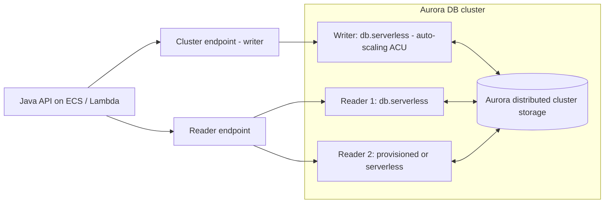
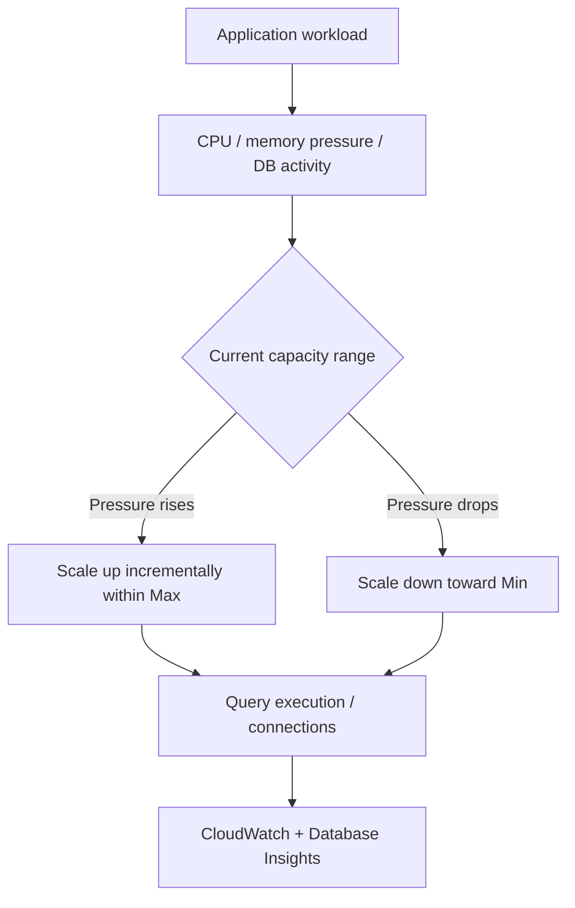
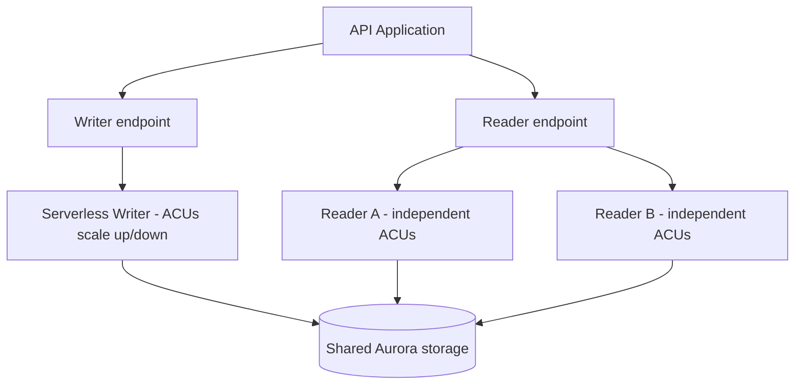
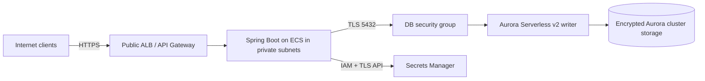
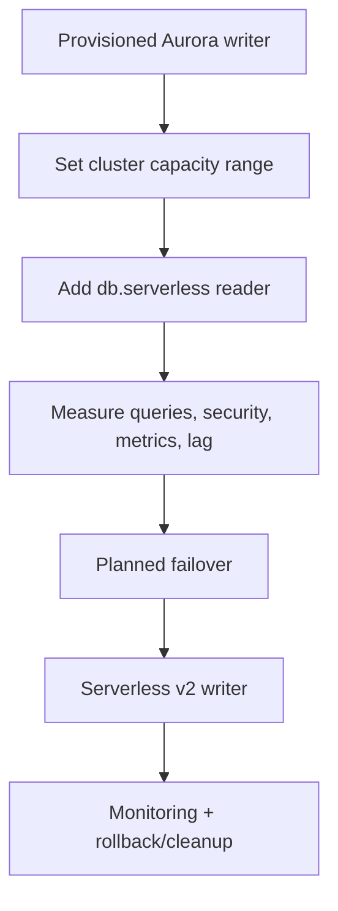
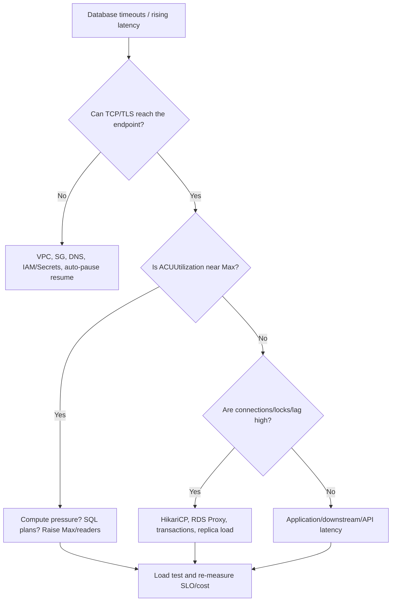

# Aurora Serverless v2 and Capacity Selection

## 1. Context: an auto-scaling database still requires design

An e-commerce website runs Java Spring Boot on Amazon ECS. During the day, order query traffic spikes sharply; at night, only a few reconciliation jobs run. The development team is choosing a relational database with transactions, SQL, resilience, and elastic capacity. A large provisioned DB instance running 24/7 can waste money off-peak, whereas choosing too small a database causes timeouts as soon as a promotion begins.

**Amazon Aurora Serverless v2** provides **automatically scaling compute capacity** for Aurora DB instances, measured in **Aurora Capacity Units (ACUs)**. You declare a **minimum–maximum capacity** range, and Aurora scales capacity up and down within that range based on demand. However, the engine still runs a MySQL/PostgreSQL-compatible database; you still have to manage SQL schemas, indexes, transactions, connection pools, networking, IAM, backups, latency, and budgets.

This lesson belongs to the **RDS and Aurora Databases** chapter of the **CLOUD_PROVIDERS_AWS** track: exploring Regions/AZs, IAM, VPC, compute, storage, databases, integration, and serverless; honing skills in service selection, secure deployment, monitoring, recovery, and cost control. The focus of this lesson is **Aurora Serverless v2 and how to choose capacity**, not merely clicking through database creation in the console.

After this lesson, you will be able to:

- Explain **Aurora clusters**, **writer/reader**, shared storage, and **ACUs**.
- Choose a well-justified `MinCapacity–MaxCapacity` range based on load, latency SLOs, and budget.
- Distinguish **auto scaling**, **auto-pause to 0 ACU**, **provisioned instances**, and **read scaling**.
- Understand the impact of **failover promotion tiers 0–1 / 2–15**, RDS Proxy, Data API, connection pools, and parameter groups.
- Read CloudWatch `ServerlessDatabaseCapacity`, `ACUUtilization`, and related metrics to make capacity decisions.
- Create, inspect, and modify capacity with the AWS CLI; evaluate changes with Java applications.
- Design networking/security, HA, backups, costs, and migration plans from provisioned to Serverless v2.

## 2. Where does Aurora Serverless v2 fit in the RDS ecosystem?

**Amazon RDS** is a managed platform for multiple relational database engines. **Amazon Aurora** is AWS's MySQL- and PostgreSQL-compatible database family featuring an architecture with **compute decoupled from distributed storage**. **Aurora Serverless v2** is a **capacity option for Aurora DB instances**, not a new database engine and not a NoSQL database.



### 2.1. Cluster, DB instance, and storage are three distinct layers

| Component | Role | Impact when choosing Serverless v2 |
| --- | --- | --- |
| **DB cluster** | Group of instances sharing Aurora cluster storage, metadata, endpoints | Configure **`ServerlessV2ScalingConfiguration`** at the cluster level |
| **Writer DB instance** | Handles write operations and reads per connection privileges | Can be `db.serverless` or provisioned where topology supports it |
| **Reader DB instance** | Handles read queries; can be promoted during failover | Has its own capacity; tied to **promotion tier** |
| **Cluster storage** | Stores data replicated/coordinated by Aurora across the Region | Does not vanish or drop to \$0 when compute auto-pauses |
| **Cluster/reader endpoints** | DNS routing to writer or readers | Apps must handle reconnect/failover and read-after-write consistency |

**Aurora Serverless v2 can coexist in the same cluster with provisioned Aurora instances** when engine/config supports it. You do not need to create a separate database product just to add a Serverless v2 reader. Conversely, if a cluster lacks `ServerlessV2ScalingConfiguration`, the AWS CLI will reject creating a `db.serverless` instance class until a capacity range is set.

### 2.2. Serverless v2 is not like Aurora Serverless v1

| Aspect | Aurora Serverless v1 | Aurora Serverless v2 |
| --- | --- | --- |
| Scaling architecture | Legacy model with differences in instance/scaling management | Uses `db.serverless` DB instances inside an Aurora cluster |
| Feature compatibility | Many constraints compared to provisioned | Compatible with far more Aurora/provisioned features, though still verify engine/version |
| Writer/reader | Limited legacy model | Supports Serverless v2 writer, readers, and mixed topologies where supported |
| Availability | Subject to legacy mode/version rules | Aurora-style failover/reader promotion with promotion tiers |
| New selection | Do not use v1 concepts to infer v2 behavior | Prioritize evaluating **v2** and current AWS-supported engine versions |

Do not use **Serverless v1** guides or tutorials to configure v2: concepts like **scaling pause behavior, instance classes, and API fields** can differ significantly.

## 3. ACU: the practical unit of capacity

An **ACU (Aurora Capacity Unit)** is a combination of memory, CPU, and networking capacity. Per AWS, **1 ACU corresponds to roughly 2 GiB of memory** plus proportional CPU/network capacity. An ACU **is not equal to a fixed vCPU**, and you should not extrapolate QPS from ACUs as a simple linear multiplier.

Approximate memory examples:

| Current capacity | Approximate memory | Notes |
| ---: | ---: | --- |
| 0 ACU | Compute instance is **auto-paused**, if supported | Does not serve queries until resumed |
| 0.5 ACU | ~1 GiB | Small; typically suited only for light workloads |
| 2 ACU | ~4 GiB | A testing or baseline level depending on app |
| 8 ACU | ~16 GiB | Moderate load; measure query latency/connections |
| 32 ACU | ~64 GiB | Higher capacity; do not infer QPS solely from memory |
| 128 ACU | ~256 GiB | Verify engine/platform, network, and related limits |

In operation, **each writer/reader has its own current ACU**, scaling up and down in fine increments within the configured range. The cluster has **one shared min/max range for its Serverless v2 instances**, but **the entire cluster does not share a single current ACU pool**. For example:

```text
Cluster range: MinCapacity=2, MaxCapacity=32

Writer:   current 16 ACU
Reader A: current 16 ACU (promotion tier 1, preserves failover readiness)
Reader B: current  4 ACU (promotion tier 10, light read workload)

Combined current capacity of 3 instances ≈ 36 ACU.
The cluster is NOT using just 16 ACU.
```

### 3.1. Supported capacity ranges in 2026

AWS updated its documentation in **October 2026**: with sufficiently new engine/platform versions, **Aurora PostgreSQL can reach 384 ACU**, while **Aurora MySQL can reach 256 ACU**. Some older versions cap at **128 ACU** or **256 ACU**. **0 ACU** applies only on engine/version combinations supporting auto-pause; versions without 0 ACU support have a minimum of **0.5 ACU**.

For valid non-negative values, AWS supports **0.5 ACU** increments (such as 8, 8.5, 9). **Do not assume 384 by default for every Aurora PostgreSQL cluster**; actual limits depend on **engine version, platform version, and Region**. Verify against compatibility docs and AWS APIs in your real account before writing configurations.

### 3.2. Auto-adjusting capacity is not an infinite quota

Both min and max matter:

- **MinCapacity** sets the floor for each active instance (or enables auto-pause when set to 0 where supported).
- **MaxCapacity** sets the compute ceiling each Serverless v2 instance can scale up to.
- **Current ACU** is adjusted by Aurora based on load within this range; you cannot raise it directly via SQL.

If CPU-heavy queries persistently demand more than `MaxCapacity`, Aurora **cannot scale past the ceiling**. You must then raise max (if supported and justified), optimize queries/indexes/schemas, offload read workloads to readers, or redesign the architecture.

## 4. When and how fast does Aurora scale?

Aurora monitors **CPU usage, memory pressure, and workload signals** to scale capacity up and down automatically. Scaling speed is influenced by current ACU, the min/max range, engine/platform, and load pattern. There is no guarantee that “it jumps from 0.5 to 128 ACU in a few milliseconds.”



### 4.1. Minimum affects ramp-up speed

AWS notes that **scale-up speed depends on current capacity**. From an instance running at 16 ACU, Aurora can scale in larger steps than when starting from 0.5 ACU. Consequently, workloads with sudden sharp spikes may require a **higher MinCapacity** to shorten ramp-up time, even if nighttime CPU is low.

For example, a payment API with a tight p99 SLO sits at 0.5 ACU at 7:55 AM and hits a flash sale right at 8:00 AM. `MaxCapacity=64` is necessary but **insufficient** if connection setup and scale-up cannot keep pace with the spike. Consider a 4–8 ACU floor, controlled warmup, or load testing/capacity planning; decide from telemetry rather than setting a huge max and hoping it fixes itself.

### 4.2. Maximum is both a limit and a tuning signal

If CloudWatch `ACUUtilization` approaches **100%**, the instance is nearing its configured **`MaxCapacity`**. This does not mean CPU itself is at 100%; it is the **ratio of current ACU / maximum ACU**, so also inspect CPU, connections, memory, and query latency.

For read-heavy workloads hitting the ceiling only on a reader while the writer still has headroom, **adding Aurora readers or tuning read queries** can be better than raising max for the whole cluster. For write-heavy workloads, adding read replicas alone does not turn one writer into multiple concurrent writers.

### 4.3. Compute autoscaling differs from schema/plan fixes

Autoscaling **does not create indexes, fix N+1 queries, eliminate deadlocks, or optimize long transactions**. If a query runs a full-table scan, it may consume extra CPU/ACUs and produce a **higher bill** while still missing the latency SLO. Always inspect **slow queries/EXPLAIN, database load waits, lock contention, and index health** whenever capacity climbs unexpectedly.

## 5. Choosing MinCapacity: baseline performance, memory, and cold starts

Optimal `MinCapacity` must provide enough memory/cache and scale-up velocity for **off-peak hours**, without overpaying for compute during idle periods.

| Workload | MinCapacity to evaluate | Why |
| --- | --- | --- |
| Sandbox/dev used only a few hours/day | **0 ACU** if auto-pause is compatible | Zero compute cost while paused; tolerates resume delay |
| Low-traffic internal dashboard needing snappy UI | 0.5–2 ACU or higher per measurement | Avoids pauses if users cannot tolerate cold starts |
| 24/7 API with strict p99 | 2–8 ACU or measured baseline | Memory/cache/connection overhead and spikes |
| Revenue-critical system with large bursts | Choose floor from load tests, possibly >8 | Ramping from too low a floor can be slow |
| Independent reporting reader | Lower min than writer if tier 2–15 and SLO allows | Scales independently for its queries |

**Numbers in this table are starting points for evaluation only**, not AWS defaults or blanket production recommendations. An app holding 1,000 sleeping connections still carries a significant memory footprint even with near-zero CPU.

### 5.1. Memory footprint does not vanish when CPU is low

An Aurora PostgreSQL instance runs background processes, shared buffers, per-connection state, maintenance workers, and extensions. If `MinCapacity` is too low, the database can hit **out-of-memory/connection pressure** or be forced to scale up just to cover background activity. Monitor memory and query waits rather than CPU alone.

### 5.2. Impact of add-on features

AWS recommends a **higher minimum** for certain features/workloads; performance guidance cites examples like **Performance Insights: 2 ACU** and **Aurora Global Database primary Region: 8 ACU** in specific contexts. These are **version/mode-dependent guidelines**, not necessarily hard API minimums across all combinations.

Features such as **Aurora Global Database, log exports, pgAudit, monitoring, and replication activity** can keep instances active or increase resource footprints. Review the compatibility documentation for your **engine/version/feature set** and measure the lowest stable floor.

## 6. Choosing MaxCapacity: headroom instead of false savings

**MaxCapacity** is the upper ceiling each Aurora Serverless v2 instance can scale to. In pay-per-actual-ACU-usage billing models, **setting a high max does not automatically bill you as if running at max**. However, max also governs **certain database configuration parameters**, affecting memory commitments, connection limits, and operational behavior.

Suppose load testing shows:

```text
Baseline: 3–4 ACU
Normal peak-hour traffic: 10–14 ACU
Projected flash sale: 22–24 ACU
Target load SLO: p95 < 200 ms

Candidate to test:
  MinCapacity = 4 ACU
  MaxCapacity = 32 ACU

Evaluation method:
  check p95/p99, ACUUtilization, database waits,
  connections, rollback/failover, and ACU-hour cost.
```

**`Max=32` does not guarantee the DB serves every query** if query locks, writes, storage I/O, connection storms, or downstream latency are the real bottlenecks. If load tests are still too slow, isolate the bottleneck rather than blindly bumping max to 64.

### 6.1. Headroom is not necessarily wasted spend

An instance using 12 ACU within a 4–32 range still has **20 ACU of headroom** to scale; you pay for actual usage rather than continuously paying for 32 ACU under the Serverless v2 compute model. However, storage, I/O, backups, networking, and other components carry separate charges. You can raise max for large spikes **without raising min simultaneously**, provided you evaluate engine/version and parameter effects.

### 6.2. When changing max, check `max_connections`

AWS calculates Aurora Serverless v2's default **`max_connections`** from the memory associated with **`MaxCapacity`**, not current ACU. When you change max, this parameter can change, yet it is a **static parameter**, meaning **a DB instance reboot is required** for the new default to take effect.

Specifically for **Aurora PostgreSQL** when **`MinCapacity = 0` or `0.5 ACU`**, default `max_connections` is capped at **2,000** per Aurora Serverless v2 rules, even if max ACU is relatively high. Do not assume “higher max always gives unlimited DB connections.”

**Warning:** changing the capacity range may take effect immediately, yet **some parameter group changes enter `pending-reboot` state**. Production reboots cause disruption and must be scheduled, with Multi-AZ failover and app connection recovery verified.

### 6.3. Static/dynamic parameters affected by scaling

| Parameter / group | Behavior to understand |
| --- | --- |
| `max_connections` | Default depends on `MaxCapacity`; raising max may require a reboot |
| `shared_buffers` (Aurora PostgreSQL) | Adjusted dynamically by Aurora with scaling; cannot force a fixed custom value as on provisioned |
| `innodb_buffer_pool_size` (Aurora MySQL) | Managed by Aurora based on compute capacity |
| `autovacuum_*`, `maintenance_work_mem`, `effective_cache_size` | Some Aurora PostgreSQL defaults derive from max ACU; consult performance guide |
| Custom parameter groups | Dynamic params can apply immediately; static params require reboot per engine |

Do not copy memory settings from a large provisioned RDS instance to force fixed values on Aurora Serverless v2; auto-tuned parameters may **ignore custom overrides** or behave unexpectedly.

## 7. Auto-pause to 0 ACU: when is it worth using?

On **supported engines/versions**, setting **`MinCapacity=0`** enables **automatic pause and resume** for Aurora Serverless v2 DB instances when there is no connection activity meeting AWS conditions. While an instance is paused, **its compute ACU charge is 0**; **Aurora storage, backups, and non-compute items continue to incur charges**.

### 7.1. Configuration and limits

| Attribute | Condition |
| --- | --- |
| `MinCapacity=0` | Only engine versions supporting auto-pause |
| `SecondsUntilAutoPause` | **300–86,400 seconds** (5 minutes to 24 hours) |
| Default idle threshold | **300 seconds** when unspecified |
| Resume | Aurora automatically resumes on an incoming connection/query |
| Resume latency | AWS cites **around 15 seconds** typically, possibly longer |
| Paused over 24 hours | May enter deeper sleep, taking **30 seconds or more** to resume |

These are typical timings, **not an SLA or fixed time guarantee**. For an app requiring API pages to respond under 500 ms, a paused database will not meet latency expectations on the first request without warmup, timeout, and retry handling.

### 7.2. Minimum engine versions supporting auto-pause

Per AWS documentation, example ranges to check:

- **Aurora MySQL:** version **3.08.0 or higher** in supported Regions.
- **Aurora PostgreSQL:** supported branches include milestones like **13.15, 14.12, 15.7, 16.3** and higher; check the official support table for newer branches as well.

Do not assume “every numerically higher engine version” in a branch shares identical features. Always check the **Aurora Serverless v2 supported engine versions/Regions** table, as support also depends on **platform version** and current maintenance levels.

### 7.3. Open connections can prevent auto-pause

A database only pauses when **no user-initiated connections** are open for the configured duration, along with system conditions. For example:

- Java HikariCP keeping **idle connections** open prevents the DB from staying idle long enough.
- A health check job running `SELECT 1` every minute blocks auto-pause.
- **RDS Proxy** maintains open connections to cluster DB instances, so Aurora Serverless v2 instances **do not auto-pause** when using a proxy.
- **Aurora Global Database** has constraints: the primary Region writer does not auto-pause, and instances in secondary clusters do not auto-pause per current docs.
- Background features such as log exports, replication, and maintenance can keep the database active even under light user load.

Thus, **`MinCapacity=0` does not guarantee reaching 0 ACU in practice or saving money**. Monitor paused metrics, connections, and real activity.

### 7.4. Auto-pause and multiple readers

In a cluster with multiple Serverless v2 instances:

- **The writer and promotion tier 0/1 readers** scale tightly together and typically pause/resume together when the whole group qualifies.
- **Tier 2–15 readers** can scale and auto-pause independently when idle.
- Some read operations on a reader can **wake the writer**, so assuming “only the reader got a request” does not guarantee the writer stays paused.
- If a cluster mixes **provisioned instances** and Serverless v2 readers, understand which readers can actually pause; topology governs actual savings.

### 7.5. Writing applications that tolerate resume latency

When connecting to a paused database, the first connection attempt waits for resume. In Spring Boot/HikariCP:

1. Set **sensible JDBC `connectionTimeout`/`socketTimeout`**, accounting for 15–30+ seconds of resume time if auto-pause is enabled.
2. Retry **only transient connection errors** with exponential backoff + jitter; never infinitely retry authentication errors.
3. Do not auto-scale ECS/Lambda just because DB connection timeouts spike during resume.
4. Bound concurrency and pool sizes to avoid a **thundering herd** the instant the DB wakes up.
5. Maintain clean API response contracts: understandable timeouts, circuit breakers/backpressure, and synthetic warmup where appropriate.

**Design recommendation:** dev/test, low-traffic internal dashboards, or apps with long idle windows benefit from `Min=0`. For production transactional APIs with strict availability/latency, evaluate **`Min>0`** or an appropriate HA topology rather than pausing every DB by default.

## 8. Writer, reader endpoints, and read scaling

An Aurora cluster typically has **one writer instance** for data mutations, alongside **Aurora readers** serving read-only queries and acting as failover targets. Aurora storage is managed at the cluster layer rather than functioning like traditional RDS read replicas that copy full storage independently.

| Endpoint | Typically points to | When to use |
| --- | --- | --- |
| **Cluster endpoint (writer)** | Current writer | Write transactions, read-after-write needing writer consistency |
| **Reader endpoint** | Distributes connections across available readers | Read scaling, reporting, read queries tolerating replica lag |
| **Instance endpoint** | A specific instance | Diagnostics, pinned workloads, administration |
| **Custom endpoint** | Designated subset of instances | Routing specialized read workloads per topology |

**The reader endpoint does not balance individual SQL queries across all read replicas.** DNS/connections are normally distributed at connection establishment time; a **connection pool holding many connections** can skew traffic unless sized and refreshed properly. Readers can exhibit replica lag, so never route strict read-after-write queries through the reader endpoint without application-level consistency handling.

### 8.1. Vertical and horizontal scaling differ



- **Vertical/elastic scaling:** increases ACUs on an existing writer or reader when load on that instance rises.
- **Horizontal read scaling:** adds reader instances, distributing connections/read queries via the reader endpoint or custom endpoints.
- **Write scaling:** with a single standard writer, optimize writes/transactions/application-level sharding or choose an appropriate architecture; adding more readers **does not increase the number of writers**.

Within each Aurora DB cluster, AWS supports multiple read replicas (typically up to **15 reader instances** per Aurora architecture). Actual limits depend on engine, Region, features, and quotas.

## 9. Promotion tiers 0/1 and 2–15: capacity tied to HA

**Promotion tier** (or **failover priority**) is an attribute from **0 to 15** guiding which reader Aurora selects to promote to writer on failover. In **Aurora Serverless v2**, the tier also governs **how the reader scales**:

| Serverless reader tier | Capacity behavior | Common purpose |
| --- | --- | --- |
| **0 or 1** | Reader maintains minimum capacity **at least equal to the writer's current capacity** or equivalent to a provisioned writer | HA, ready to absorb writer load upon failover |
| **2 to 15** | Reader **scales independently** based on its own workload, down to the cluster minimum | Elastic read scaling, reporting, saving cost at low load |

This is a key difference from **provisioned readers**, where promotion tier primarily sets **failover order** without dynamically matching instance size to the writer.

### 9.1. Illustration: 3 instances, two different goals

```text
Cluster Min=2 Max=32 ACU

Writer            current 20 ACU
HA Reader tier 1  current >= 20 ACU (tracks writer)
Report Reader tier 10 current 3 ACU (scales independently)

If the writer fails:
  Tier 1 reader already has capacity ready to take over.

If a heavy report runs:
  Tier 10 reader scales up for its workload,
  without forcing the writer to scale up with it.
```

**Trade-off:** tier 0/1 improves HA readiness, but raises cost whenever the writer runs at high ACUs: a 32 ACU writer keeps its HA reader scaled to 32 ACU even if the reader serves very few queries. A tier 10 reader saves money, yet **is not pre-scaled to match the writer** if promoted.

### 9.2. Failover and Multi-AZ

Aurora distributes data across multiple Availability Zones within a Region. For **compute HA**, deploy **a writer + at least one reader in another AZ** with an appropriate promotion tier. Aurora can automatically fail over when the writer or an AZ fails; applications connecting via the cluster endpoint must **re-resolve DNS and reconnect/retry**.

A **writer-only** cluster has Aurora storage durability, **not equivalent to Multi-AZ compute failover with a warm standby**. When the writer/AZ fails, provisioning replacement compute takes longer and faces capacity risk in that AZ.

### 9.3. HA requires paying for standby capacity

When budgeting Aurora Serverless v2, do not compare the cost of **a single 2–16 ACU writer** against a production system with **writer + HA reader** while omitting the reader from the quote. A topology with a tier 0/1 standby runs ACUs tracking the writer, significantly impacting total compute ACU-hours.

**Do not treat tier 0/1 as a “free hot standby.”** Set per-instance alerts and simulate failover in a controlled environment to verify application recovery time and post-failover capacity.

## 10. Connecting from Java/ECS/Lambda: pool sizing, RDS Proxy, and Data API

An autoscaling database does not eliminate **connection limits**. Java Spring Boot uses JDBC connection pools (like HikariCP), while Lambda can spin up many concurrent execution environments. An application scale-out can cause a **connection storm** while the DB is still at a low `MinCapacity`, even if individual queries are light.

### 10.1. Quick connection budget formula

Assume:

```text
20 ECS tasks
Each task has HikariCP maximumPoolSize = 20

Theoretical upper bound of application connections:
20 × 20 = 400

Plus:
  monitoring, migrations, admin sessions, readers,
  other apps, and internal required connections.
```

If ECS autoscales from 20 to 100 tasks, those same pool settings yield **2,000 potential connections**. This is not a QPS load test—it is **connection amplification risk**. Size pools from empirical measurements and a DB connection budget rather than letting every app instance hold a 100-connection pool just because you plan to raise Aurora `MaxCapacity`.

### 10.2. Java HikariCP example (illustrative)

```java
import com.zaxxer.hikari.HikariConfig;
import com.zaxxer.hikari.HikariDataSource;

public final class DatabasePoolExample {
    public static HikariDataSource createPool(
            String jdbcUrl, String username, String password) {

        HikariConfig config = new HikariConfig();
        config.setJdbcUrl(jdbcUrl);
        config.setUsername(username);
        config.setPassword(password);

        config.setMaximumPoolSize(10);  // Measure under real load
        config.setMinimumIdle(2);       // Unsuitable if you want DB auto-pause
        config.setConnectionTimeout(30_000); // Test against DB resume time
        config.setMaxLifetime(1_800_000);

        return new HikariDataSource(config);
    }
}
```

**Do not copy verbatim into production**: fetch username/password securely from Secrets Manager or IAM authentication per design, enable/verify TLS, and ensure error handling never leaks credentials. With Aurora PostgreSQL auto-pause, **`minimumIdle > 0`** or health checks keep connections open and block pausing. If you want **`MinCapacity=0`**, design connection lifecycles around idle windows and accept cold starts.

### 10.3. When to use Amazon RDS Proxy?

**Amazon RDS Proxy** provides connection pooling/multiplexing, helping Lambda/ECS apps with many short-lived connections reach RDS/Aurora without flooding the DB with connection storms. It also aids connection routing during failover where supported by engine/topology.

Pros:

- Reduces connection management overhead and spikes from many clients.
- Can improve connection recovery during writer failover.
- Manages DB access using IAM/secrets per design.

Limits/trade-offs:

- **RDS Proxy carries separate fees** and requires matching networking/IAM/Secrets/KMS setup.
- Long transactions, session state, prepared statements, or pinning behaviors reduce multiplexing efficiency.
- **RDS Proxy maintains open connections to Aurora instances**, so **clusters using RDS Proxy do not actually auto-pause** per AWS. Never budget `Min=0` with a proxy assuming the DB sleeps 12 hours/day.

**Selection rule:** 24/7 production APIs facing connection bursts benefit from RDS Proxy and `MinCapacity > 0`. Rarely accessed dev environments wanting **true auto-pause** should **skip RDS Proxy**, tighten client connection pools, and configure wake-up timeouts/retries.

### 10.4. RDS Data API is an alternative connection model

On engines/versions and Regions supporting the **Amazon RDS Data API**, apps execute SQL over an **HTTPS API** instead of holding many long-lived TCP connections. This can fit Lambda or infrequent administrative tooling.

- Data API has a different API model, IAM pattern, and transaction handling than direct JDBC; **it is not automatically suitable for all high-throughput/complex OLTP apps**.
- A Data API request to a paused Aurora Serverless v2 DB **triggers writer resume**.
- Frequent Data API calls prevent the DB from getting enough idle time to pause. Do not treat Data API as a guarantee of continuous 0 ACU.
- Review payload limits, engine/version/Region support, IAM/Secrets Manager/KMS, and transaction semantics before choosing.

### 10.5. Inspect connections and SQL locks before raising ACUs

Aurora PostgreSQL:

```sql
-- View current instance connection limit
SHOW max_connections;

-- View connections by state
SELECT state, COUNT(*) AS connection_count
FROM pg_stat_activity
GROUP BY state
ORDER BY connection_count DESC;

-- View long-running active queries (requires appropriate privileges)
SELECT pid, now() - query_start AS duration, wait_event_type, wait_event
FROM pg_stat_activity
WHERE state = 'active' AND query_start IS NOT NULL
ORDER BY duration DESC
LIMIT 10;
```

These are **metadata read queries** when properly authorized; avoid exposing query text containing PII/secrets in public logs. For Aurora MySQL, use `SHOW GLOBAL STATUS LIKE 'Threads_connected';`, `SHOW VARIABLES LIKE 'max_connections';`, and Performance Schema/slow query logs per permissions/config.

## 11. Preflight: engine version, Region, VPC, and permissions before creation

Before creating Aurora Serverless v2, verify:

1. **Region** supports the engine version and `db.serverless` instance class.
2. **Aurora PostgreSQL** or **Aurora MySQL** matches application requirements, extensions, migration plans, and SQL semantics.
3. **DB subnet group** has private subnets across at least two eligible AZs; SG allows the DB port only from the application SG.
4. **KMS encryption**, backup retention, deletion protection, and Secrets Manager align with policy.
5. Min/max capacity is valid for the **engine/platform version**, including whether auto-pause is supported.
6. **Cluster endpoint, reader endpoint**, availability topology, and desired read scaling.
7. Budget for **ACU-hours, reader instances, storage/I/O/backups, and proxy/network charges**.

### 11.1. AWS CLI read-only preflight

```bash
# Confirm the right AWS account
aws sts get-caller-identity

# List engine versions with orderable db.serverless instances
aws rds describe-orderable-db-instance-options \
  --engine aurora-postgresql \
  --db-instance-class db.serverless \
  --region ap-southeast-1 \
  --query 'OrderableDBInstanceOptions[*].[EngineVersion,DBInstanceClass]' \
  --output table

# Verify pre-created platform subnet group
aws rds describe-db-subnet-groups \
  --db-subnet-group-name shop-db-private-subnets \
  --region ap-southeast-1

# List existing DB clusters before picking a new name
aws rds describe-db-clusters \
  --region ap-southeast-1 \
  --query 'DBClusters[*].[DBClusterIdentifier,Engine,EngineVersion,Status]' \
  --output table
```

`db.serverless` appearing in orderable versions only confirms **basic class support**; it does not prove every version supports **`MinCapacity=0`** or `MaxCapacity=384`. Cross-check the **Supported Regions and Aurora DB engines for Aurora Serverless v2** table and current platform version details.

## 12. AWS CLI: creating an Aurora PostgreSQL Serverless v2 cluster

Commands that create/modify/delete databases **incur AWS charges and alter real resources**. Use only in an approved sandbox or environment; replace all names, ARNs, subnets, security groups, and engine versions with your account's values. Never run on production without reviewing IAM, backups, networking, recovery, and cleanup plans.

### 12.1. Create the DB cluster with a capacity range

Assume subnet group `shop-db-private-subnets`, DB SG `sg-0123456789abcdef0`, and a compatible engine version already exist. Illustrative command:

```bash
aws rds create-db-cluster \
  --db-cluster-identifier shop-aurora-v2-demo \
  --engine aurora-postgresql \
  --engine-version 'ENGINE_VERSION_SUPPORTED_IN_REGION' \
  --db-subnet-group-name shop-db-private-subnets \
  --vpc-security-group-ids sg-0123456789abcdef0 \
  --database-name shopdb \
  --master-username shopadmin \
  --manage-master-user-password \
  --storage-encrypted \
  --serverless-v2-scaling-configuration MinCapacity=1,MaxCapacity=16 \
  --region ap-southeast-1
```

**This command only creates cluster metadata/storage**; it does not automatically create a writer DB instance under the AWS CLI Serverless v2 workflow. The example uses an AWS-managed Secrets Manager master password to avoid placing database passwords on the command line or in shell history. Secret management and IAM permissions still require approval.

### 12.2. Create the `db.serverless` writer

```bash
aws rds create-db-instance \
  --db-cluster-identifier shop-aurora-v2-demo \
  --db-instance-identifier shop-aurora-v2-writer \
  --db-instance-class db.serverless \
  --engine aurora-postgresql \
  --no-publicly-accessible \
  --region ap-southeast-1

aws rds wait db-instance-available \
  --db-instance-identifier shop-aurora-v2-writer \
  --region ap-southeast-1
```

**DB cluster and DB instance are two separate resources**: do not check only the `create-db-cluster` response and assume compute/writer is ready. Once the instance is up, run `describe-db-clusters` and `describe-db-instances` to fetch endpoints and verify SG, subnets, status, and capacity.

### 12.3. Read back cluster, scaling config, and endpoints

```bash
aws rds describe-db-clusters \
  --db-cluster-identifier shop-aurora-v2-demo \
  --region ap-southeast-1 \
  --query 'DBClusters[0].{Engine:Engine,Version:EngineVersion,Status:Status,Scaling:ServerlessV2ScalingConfiguration,WriterEndpoint:Endpoint,ReaderEndpoint:ReaderEndpoint,Members:DBClusterMembers}' \
  --output json

aws rds describe-db-instances \
  --db-instance-identifier shop-aurora-v2-writer \
  --region ap-southeast-1 \
  --query 'DBInstances[0].{Identifier:DBInstanceIdentifier,Class:DBInstanceClass,Status:DBInstanceStatus,AZ:AvailabilityZone,PubliclyAccessible:PubliclyAccessible,Endpoint:Endpoint.Address}' \
  --output json
```

Test connections only from a host/container with a valid route to the private DB subnet and an authorized SG. Never flip `--publicly-accessible` to true for a “quick connection test”; use VPN/bastion/SSM Session Manager/VPC networking or run the app inside a private subnet.

### 12.4. Add a Serverless v2 reader as an HA standby

Once the cluster is active, consider adding a reader in another AZ with tier 0 or 1 for failover readiness:

```bash
aws rds create-db-instance \
  --db-cluster-identifier shop-aurora-v2-demo \
  --db-instance-identifier shop-aurora-v2-reader-ha \
  --db-instance-class db.serverless \
  --engine aurora-postgresql \
  --promotion-tier 1 \
  --no-publicly-accessible \
  --region ap-southeast-1
```

Verify the **actual AZ placement** of reader and writer rather than assuming AWS picked a different AZ; specify `--availability-zone` when deploying if needed and valid. A tier 1 reader scales alongside the writer and **can increase ACU-hour costs significantly** even when serving few read queries.

### 12.5. Modify the capacity range

If load tests show `Min=1` causes slow responses during traffic spikes:

```bash
# Modifies a real resource: run only after review
aws rds modify-db-cluster \
  --db-cluster-identifier shop-aurora-v2-demo \
  --serverless-v2-scaling-configuration MinCapacity=4,MaxCapacity=32 \
  --apply-immediately \
  --region ap-southeast-1
```

Per AWS documentation, **capacity range modifications take effect immediately** regardless of whether you choose apply-immediately or wait for a maintenance window; however, some **static parameter defaults** (notably `max_connections`) still require rebooting each DB instance to take effect. Before rebooting production, check `pending-reboot`, prepare failover/connection handling, and schedule a change window.

Read back:

```bash
aws rds describe-db-clusters \
  --db-cluster-identifier shop-aurora-v2-demo \
  --region ap-southeast-1 \
  --query 'DBClusters[0].ServerlessV2ScalingConfiguration'

aws rds describe-db-clusters \
  --db-cluster-identifier shop-aurora-v2-demo \
  --region ap-southeast-1 \
  --query 'DBClusters[0].DBClusterMembers[*].[DBInstanceIdentifier,IsClusterWriter,PromotionTier,DBClusterParameterGroupStatus]' \
  --output table
```

**Do not change Min/Max at the same time as a heavy schema migration or engine version upgrade** unnecessarily, as isolating the cause of any latency/availability shift becomes much harder. Save baseline metrics and keep a rollback plan.

## 13. Enabling auto-pause and checking actual state

Example applies only if the **engine version** of cluster `shop-aurora-v2-demo` supports auto-pause and no configuration prevents pausing:

```bash
# Modifies a real resource: suited to dev/test, review before running
aws rds modify-db-cluster \
  --db-cluster-identifier shop-aurora-v2-demo \
  --serverless-v2-scaling-configuration MinCapacity=0,MaxCapacity=16,SecondsUntilAutoPause=900 \
  --apply-immediately \
  --region ap-southeast-1
```

`SecondsUntilAutoPause=900` sets **15 minutes of idle time**. AWS accepts a minimum of 0 only on supported engine versions; with RDS Proxy or Aurora Global Database in incompatible topologies, **do not assume it will pause**. Verify actual behavior and resume latency when clients reconnect.

### 13.1. Check metrics, not just DBInstanceStatus

When a Serverless v2 instance is **auto-paused**, AWS may still report `DBInstanceStatus=available`. Do not treat `available` status as proof that the instance is consuming ACU compute. Instead:

- `ServerlessDatabaseCapacity=0` shows the instance is at 0 capacity.
- `ACUUtilization=0` and `CPUUtilization=0` are emitted during pause per the supported model.
- Aurora emits DB events when auto-pause/resume starts and finishes.
- Other metrics may have **no datapoints**, and database logs may not generate entries while paused.

**Observe at least a few idle/resume cycles** in a test environment: a single JDBC session or admin terminal holding an open connection can prevent pausing even with zero queries running.

### 13.2. Auto-pause is not manually stopping a cluster

| Mechanism | Trigger | Effect | Best suited for |
| --- | --- | --- | --- |
| **Aurora Serverless v2 auto-pause** | `Min=0` + idle timeout + feature compatibility | Instance scales to 0 ACU; next connection triggers resume | Dev/test, intermittent workloads |
| **Stop/start DB cluster** | Manual/automated API per AWS conditions | Cluster stops and must be started; different latency/behavior | Shift-based environments or sandboxes |
| **Scale down to `Min>0`** | Aurora autoscaling | Compute stays active and bills ACUs | Production needing consistent response |
| **Delete cluster** | Destructive resource operation | Removes compute/cluster; data depends on snapshots/backups | Approved cleanup only |

Never replace auto-pause with cluster deletion to save money. Production databases require backups, retention, restore tests, and safeguards against accidental deletion.

## 14. CloudWatch metrics: reading ACUs accurately

AWS publishes Aurora Serverless v2 metrics in **`AWS/RDS`** per DB instance or cluster depending on the metric. To make capacity decisions, view **ACUs, CPU/memory, connections, latency, and query waits together**.

| Metric | Meaning | How to use |
| --- | --- | --- |
| **`ServerlessDatabaseCapacity`** | Current compute capacity in ACUs | Track real ACU patterns vs. min/max |
| **`ACUUtilization`** | **Current ACU / MaxConfiguredACU × 100%** | Approaching max ceiling when near 100% |
| **`CPUUtilization`** | CPU used relative to CPU capacity at **configured Max ACU** | Do not read like CPU% of a fixed provisioned size |
| **`FreeableMemory`** | Memory headroom modeled against max Serverless capacity | Do not mechanically read as “free memory at current ACU” |
| **`DatabaseConnections`** | Number of DB connections | Detect connection storms and pool leaks |
| **`ConnectionAttempts`** | Connection attempt count | Investigate connection spikes during resume |
| **`ReadLatency` / `WriteLatency`** | Storage-layer I/O latency | Spot I/O bottlenecks; pair with query latency |
| **`ReadIOPS` / `WriteIOPS`** | I/O intensity | Monitor storage load and Aurora Standard I/O costs |
| **`VolumeBytesUsed`** | Recorded cluster storage usage | Forecast GB-month storage and growth |
| **`ServerlessV2Usage`** | ACU consumption used for billing | Track compute; drops to 0 while paused |
| **`ReplicaLag`** and engine replication metrics | Read replica lag | Assess consistency, read load, and HA |
| **`Deadlocks`** or Performance Insights waits | Lock contention and problematic queries | Find root causes that extra ACUs won't fix |

### 14.1. Be careful with cluster-level metrics

Per AWS documentation, **`ServerlessDatabaseCapacity` at the DB instance level is that instance's current ACU**, whereas **cluster-level values may represent the average across Serverless instances**, **not the billable sum of ACUs**. To calculate total capacity consumption, inspect **each writer and reader individually** and sum over time; never multiply the cluster average by unit price without accounting for instance count.

### 14.2. AWS CLI example for reading CloudWatch capacity

```bash
# Illustrative UTC time window; replace with your actual load-test window
aws cloudwatch get-metric-statistics \
  --namespace AWS/RDS \
  --metric-name ServerlessDatabaseCapacity \
  --dimensions Name=DBInstanceIdentifier,Value=shop-aurora-v2-writer \
  --start-time '2026-11-20T00:00:00Z' \
  --end-time '2026-11-20T03:00:00Z' \
  --period 300 \
  --statistics Minimum Average Maximum \
  --region ap-southeast-1 \
  --output json

aws cloudwatch get-metric-statistics \
  --namespace AWS/RDS \
  --metric-name ACUUtilization \
  --dimensions Name=DBInstanceIdentifier,Value=shop-aurora-v2-writer \
  --start-time '2026-11-20T00:00:00Z' \
  --end-time '2026-11-20T03:00:00Z' \
  --period 300 \
  --statistics Average Maximum \
  --region ap-southeast-1 \
  --output json
```

These commands are **read-only**, though the historical timestamps are **examples** and do not guarantee datapoints exist in your account. Specify the right `DBInstanceIdentifier`, UTC time zone, CloudWatch statistic, and period. For production apps, build dashboards tracking **cluster → writer/reader → service API → business SLOs**.

### 14.3. Three signs you should raise MaxCapacity

1. `ACUUtilization` stays near 100% during genuine peak loads.
2. Query/business latency rises, and memory/CPU pressure or DB load waits confirm **compute shortage**, not just unindexed slow SQL.
3. Backend concurrency/connection caps are already controlled, with no cache stampedes or pointless retry loops.

Conversely, if **`ACUUtilization` is only 25%** yet queries take 2 seconds, raising max likely won't help: inspect **database locks, missing indexes, transaction duration, network, reader lag, and CPU/database waits**.

### 14.4. When should you raise MinCapacity?

- Coming out of off-peak hours, scaling up cannot keep up with a known spike.
- At very low current ACUs, memory pressure or connection churn slows the app down.
- Added features require a larger baseline resource footprint.
- Tier 0/1 HA readers must stay ready for failover and p95/p99 response times must remain steady.

`Min` is a **real baseline cost**, so raise it only based on load tests/observability; bumping `Min` from 2 to 8 ACU can sharply raise baseline spend for both the writer and a tier 1 reader.

## 15. Aurora Standard, I/O-Optimized, and the cost model

Aurora offers two storage pricing configurations:

- **Aurora Standard:** pay for compute + database storage + I/O requests per rate card.
- **Aurora I/O-Optimized:** pay compute/storage at that configuration's rates, with **no separate per-request read/write I/O charges** under the Aurora I/O-Optimized model.

This choice is **independent of whether DB instances are provisioned or Serverless v2**, though it shifts total cost and break-even points. Aurora I/O-Optimized is often worth evaluating when I/O charges make up a large share of a Standard bill; it is not automatically cheaper for low-I/O workloads.

### 15.1. Compute charges by ACU-time

Per AWS pricing, **Aurora Serverless v2 bills compute based on actual ACUs consumed per second**, commonly expressed as **ACU-hours** for estimation.

```text
Compute ACU-hours ≈ ∑ (current ACU of each DB instance × hours)

Compute cost ≈ ACU-hours × ACU-hour unit price by:
               Region + engine + storage configuration

Total bill also adds:
  storage GB-month, I/O (if Standard),
  backups/snapshots, data transfer, logs/monitoring,
  RDS Proxy, KMS, networking, and related services.
```

### 15.2. Hypothetical example with a writer and two readers

Suppose each day's workload is:

| DB instance | 18 hours low load | 6 hours high load | ACU-hours/day |
| --- | ---: | ---: | ---: |
| Writer | 2 ACU | 10 ACU | `18×2 + 6×10 = 96` |
| HA reader tier 1 | 2 ACU | 10 ACU | `96` |
| Read-only reader tier 10 | 2 ACU | 2 ACU | `24×2 = 48` |
| **Total** | | | **240 ACU-hours/day** |

Over a hypothetical 30-day month: **7,200 ACU-hours**. Using a **purely hypothetical rate** of `0.10 USD/ACU-hour`, compute alone across the three instances is **720 USD/month**—excluding storage, I/O, backups, Proxy, or networking. **`0.10 USD` is strictly an arithmetic placeholder, not the AWS Singapore price or 2026 list pricing.**

Remember that a **tier 1 HA reader scales alongside the writer**, so assuming “96 writer ACU-hours/day means 96 for the whole cluster” is wrong. With provisioned readers, backups, or Global DB, calculate costs using their respective pricing rules.

### 15.3. Dev auto-pause example

Suppose a dev DB runs roughly **4 hours/day at 2 ACU** and is truly **paused at 0 ACU for 20 hours/day**:

```text
Dev compute = 4h × 2 ACU + 20h × 0 ACU
            = 8 ACU-hours/day

Compared to an always-on DB at 1 ACU:
            = 24h × 1 ACU
            = 24 ACU-hours/day
```

This comparison illustrates **compute only**. In reality, the DB may stay active longer due to open sessions, backups/maintenance, health checks, or RDS Proxy; pausing also does not eliminate storage charges. Measure **`ServerlessV2Usage` and `ServerlessDatabaseCapacity`** rather than assuming the DB sleeps a full 20 hours.

### 15.4. Serverless v2 is not automatically cheaper than provisioned

| Workload | Favors Serverless v2 | Consider provisioned |
| --- | --- | --- |
| Wide day/night swings | Scales down ACUs off-peak | Large instance billed all day |
| Erratic traffic, sharp bursts | Elastic capacity within min/max | Fixed capacity may require heavy headroom |
| Steady high 24/7 load | Helpful if elasticity/HA flexibility needed | **Provisioned/Reserved Instances** may yield lower TCO |
| Dev/test idle for long spans | Auto-pause to 0 if compatible | Stop/start or small class also worth comparing |
| HA with reader matching writer | Auto-balances capacity as load shifts | Pay for separate fixed standby instance |
| Slow queries due to missing index/locks | More ACUs may not fix it | Tune SQL under either model |

**Do not choose just for the “Serverless” label.** Map your hourly load profile, peaks/p95/p99, HA constraints, connections, storage/I/O, and **total cost**, then benchmark both candidates.

## 16. Monitoring queries, database health, and performance tuning

Aurora Serverless v2 scales ACUs up under heavy load even when the load stems from **inefficient queries**. A system with N+1 SQL or multi-minute lock-holding transactions can “scale up smoothly” and still time out.

### 16.1. Signals to correlate

| What you observe | What to check |
| --- | --- |
| Current ACUs climb steadily while QPS is flat | Slow SQL, full scans, lock waits, memory/cache misses, background jobs |
| ACUs near max with high real CPU/network | Raise max or add readers; tune queries/indexes |
| Connection count climbs with ECS/Lambda concurrency | Connection pools, RDS Proxy, backpressure |
| High reader lag | Write bursts, reader capacity, replication activity, topology |
| Storage I/O surges | Query patterns, indexes, transaction logs, Standard vs. I/O-Optimized |
| Deadlocks / long transactions | Transaction isolation, lock ordering, retry logic |
| High API p99 while DB queries look normal | App/runtime/network, DNS, connection setup, external APIs |
| ACUs won't drop when idle | Open sessions, feature/resource overhead, replication, min set too high |

### 16.2. Database Insights / Performance Insights

AWS offers **Performance Insights / CloudWatch Database Insights** depending on engine and support tier, exposing **database load, top SQL, wait events**, and detailed counters. For Aurora Serverless v2, metrics like `os.general.serverlessDatabaseCapacity` can expose current ACUs. Features, retention, and pricing vary by configuration/Region; verify current support before enabling.

Examples:

- High `CPUUtilization` with top SQL doing full-table scans → add/fix indexes and filters.
- `wait_event_type=Lock` → investigate long transactions rather than just adding ACUs.
- High `ConnectionAttempts` after resume → throttle application pools/concurrency.
- Tier 10 reader hit by heavy reporting queries → scale the reader, use a custom endpoint, or offload reporting.

### 16.3. Contextual alerts

Several meaningful alarms:

1. `ACUUtilization > 85%` over multiple evaluation periods **and** rising p95 latency/DB load.
2. `DatabaseConnections` nearing the validated connection budget.
3. Prolonged Aurora replication lag, DB instance failover, or `pending-reboot`.
4. Auto-pause failing to trigger in dev after hours of idle time.
5. Daily billed ACU-hours rising abnormally compared to traffic/business metrics.

The 85% threshold is only a **starting point for calibration**, not a universal AWS rule. A brief batch job hitting 100% ACU while still finishing inside its SLO may be fine; a payment API hitting 70% yet timing out on locks is already an incident.

## 17. Security: VPC, SGs, TLS, IAM, KMS, and secrets

Aurora Serverless v2 **is not a database service with a public HTTP URL**. DB instances reside in a VPC with **private subnets** and **security groups** controlling inbound/outbound traffic. ECS tasks, EC2 services, or Lambda functions need both a **network path** and valid database authentication.

### 17.1. Recommended network architecture



| Control | Recommendation |
| --- | --- |
| **DB subnet group** | Select private subnets across multiple supported AZs |
| **Public accessibility** | Disable unless strictly required; never open DB publicly for debugging |
| **Inbound SG** | Allow only the application SG or approved CIDRs on the exact DB port |
| **TLS** | Verify the database certificate; configure Java JDBC SSL properly |
| **Secrets** | AWS Secrets Manager / rotating credentials, or IAM DB authentication where supported |
| **IAM roles** | ECS task role / Lambda execution role granted only required secret/KMS access |
| **Encryption at rest** | KMS key for Aurora storage, governed key policies, and recovery procedures |
| **Audit/Logs** | Database logs/CloudWatch/CloudTrail per security retention; never log passwords/PII |

**Aurora PostgreSQL** defaults to port **5432**; **Aurora MySQL** typically uses **3306**, though you should verify the actual cluster port. An SG allowing TCP 5432 **does not grant PostgreSQL `SELECT`/`INSERT` privileges**: database users still need database grants. Conversely, IAM permitting `rds:DescribeDBClusters` does not let an IAM principal log into SQL.

### 17.2. Secrets Manager and IAM DB authentication

The cluster creation example uses `--manage-master-user-password` so AWS manages the master secret via Secrets Manager where supported. For applications:

1. Create a **least-privilege application DB user**; never use the master user for everyday requests.
2. Store credentials in a secret store or use **IAM database authentication** where supported by engine/version/workload.
3. Grant ECS/Lambda permission to read only the required secret and KMS key—never `secretsmanager:*` account-wide.
4. Rotate credentials on schedule; connection pools must reconnect/refresh when secrets change.

IAM DB authentication does not replace network SGs or TLS, and its token lifetime/connection traits must be tested if the app opens connections frequently. A `Min=0` database can still be kept awake by background sessions.

### 17.3. Restricting database administrative permissions

Deployment/CI policies should scope RDS permissions to **specific cluster/instance resources**, restricting `iam:PassRole` and KMS key management. `ModifyDBCluster` changing min/max **impacts the whole cluster**; `DeleteDBCluster` can destroy data. For production, enforce IaC change reviews, deletion protection, snapshots/backups, and clear operational ownership.

## 18. High availability, backups, RPO/RTO, and disaster recovery

### 18.1. Aurora storage durability vs. compute HA

Aurora cluster storage is designed to distribute data across multiple Availability Zones within a Region. This delivers storage durability/availability, yet **if there is only a single writer compute instance**, the app may still wait for a new DB instance when the writer fails.

A topology with **writer + HA reader in another AZ, promotion tier 0/1** is typically better suited to critical transactional workloads. Failover swaps the writer for the promoted reader; apps must handle **connection resets, DNS caching, and safe retries**.

### 18.2. Backups and point-in-time recovery

Aurora supports automated backups and point-in-time recovery subject to service rules. A solid plan specifies:

- **Backup retention period** and archival obligations (e.g., 7/14/35 days per policy/engine).
- **Snapshots before major upgrades or schema migrations**; export/copy snapshots when required.
- **Point-in-time recovery (PITR):** practice restoring to a new cluster rather than merely trusting an “automated backups enabled” flag.
- **KMS encryption:** restoring to another Region/account may require copying key grants and configuring new secrets/SGs/subnets.
- **Measured RPO/RTO** from restore drills rather than extrapolating from AZ failover timings.

**Auto-pausing at 0 ACU does not delete data** and does not alter backup policies. **Deleting a cluster** is different: verify final snapshots, retained backups, and deletion protection per policy.

### 18.3. Multi-AZ does not replace Multi-Region DR

An Aurora reader in AZ B handles writer/AZ failures within **the same Region**, but if an entire Region suffers a major outage, you need a different strategy:

- **Aurora Global Database** if engine/version/Region and replication requirements fit.
- Cross-Region backup/snapshot copies and restoration in a DR Region.
- Recreating/maintaining app compute, VPC, IAM, Secrets Manager, KMS, DNS, observability, and connection routing.

Aurora Global Database also affects **auto-pause**: primary writers and secondary clusters have conditions that prevent instances from pausing. Do not put Global Database in a “Min=0 sleeping 20 hours/day” system and budget as if it pauses.

### 18.4. RDS Proxy and failover

RDS Proxy helps many apps handle failover connections smoothly, but it does not make an in-flight transaction during a failover commit automatically exactly once. Consumers/APIs must handle:

1. Transient connect / connection reset errors.
2. Retries keyed by idempotency keys, never duplicating payments or orders.
3. Reconnecting to the active cluster/Proxy endpoint.
4. Post-failover validation of write vs. read-only role.
5. The possibility that an HA reader promoted to writer still faces a large traffic spike.

**Never run failover tests on production without a change window and business approval.** In a sandbox, you can invoke RDS failover APIs where supported by the cluster, recording failover duration and app-side behavior.

## 19. Switching Provisioned ↔ Serverless v2 in the same Aurora cluster

A flexible Aurora capability is **mixing provisioned and Serverless v2 DB instances** in the same cluster where supported. This allows phased migrations instead of requiring a full database export/import.

### 19.1. Conceptual workflow from a provisioned writer

1. **Verify engine version/Region/platform** supports Serverless v2; upgrade the engine beforehand on a separate schedule if needed.
2. Set **`ServerlessV2ScalingConfiguration`** on the cluster, e.g., `Min=4 Max=32`.
3. Add a **`db.serverless` Serverless v2 reader** and verify reader endpoints, TLS, app queries, and metrics.
4. Configure **promotion tiers** so the desired DB instance is prioritized for failover.
5. Run a **planned failover** in a maintenance window to promote the Serverless reader to writer; test APIs/reconnects/transactions.
6. Monitor writer ACUs, latency, locks, DB connections, costs, and failover readiness.
7. Remove or replace the old provisioned instance only after verifying the new topology with backups and rollback ready.



**Never delete the existing writer before the Serverless reader is healthy and the failover path is tested.** If your workload still benefits from a provisioned reader for HA or cost optimization, the cluster can keep a mixed topology as needed.

### 19.2. Moving back to provisioned if load stabilizes

If Aurora Serverless v2 runs at 16–24 ACU nearly 24/7 for months, evaluate an equivalent provisioned instance class with Reserved Instances or other pricing options. One path is adding a **provisioned reader**, validating capacity, running a planned failover, and replacing the Serverless writer on schedule.

**Do not equate 1 ACU = 1 vCPU or 1 ACU = a fixed DB instance class**; benchmark your real SQL workload, memory/cache, connection limits, storage I/O, throughput, and costs. Provisioned classes and Serverless capacity have distinct pricing and scaling characteristics.

### 19.3. Changing parameter groups and max may require a reboot

During migration, changing engine/instance class/max ACUs can put parameter group status into `pending-reboot`. Certain defaults like `max_connections` reflect the new Max ACU **only after a reboot**. Check engine docs, backups, and downtime windows; do not assume changing capacity ranges is 100% zero-downtime in every respect.

## 20. Choosing provisioned vs. Serverless v2: decision matrix

| Requirement | Aurora Serverless v2 | Aurora provisioned | Notes |
| --- | --- | --- | --- |
| Variable and unpredictable load | **Evaluate first** | Risk of overprovisioning for peaks | Serverless scales within min/max |
| High, steady 24/7 load | Works if elasticity is desired | **Compare costs closely**, including RIs | Do not assume Serverless is cheaper |
| Long-idle dev/test | `Min=0` auto-pause if compatible | Stop/start or small class | Serverless has resume latency and feature caveats |
| Write-heavy OLTP with strict p99 | High enough min and max headroom | Stable instance, manual scaling | SQL/lock/connection bottlenecks matter |
| Read-heavy, high query volume | Add Serverless readers, tier 2–15 | Provisioned readers | Evaluate replica lag / read consistency |
| Fast Multi-AZ failover | Tier 0/1 reader tracking writer | Matching provisioned reader | Account for full standby cost |
| RDS Proxy with many connections | Supported where compatible | Supported | Proxy prevents effective auto-pause |
| Specific engine/extension features | Check support matrix | May have broader support by version | Do not assume 100% parity for v2 |
| Full-Region DR | Global DB/snapshots per support | Global DB/snapshots per support | Feature incompatibility with auto-pause |

### 20.1. Practical decision workflow

1. **Classify the workload:** OLTP/analytical, write/read ratio, steady vs. bursty, p95/p99 SLOs, RTO/RPO.
2. **Gather telemetry:** CPU, database load, memory, active connections, top SQL, read/write IOPS, active hours.
3. **Select two candidate configurations:** Serverless Min/Max + reader topology vs. provisioned instance classes + reader topology.
4. **Load test** at off-peak, peak, and during failover; measure app latency, error rates, throughput, backlog, and ACU/instance-hours.
5. **Calculate full cost:** compute + storage/I/O + backups + data transfer + observability + proxy.
6. **Choose and enforce guardrails:** max ACU, alerts, budgets, parameter group reviews, and rollback paths.
7. **Re-evaluate periodically** as traffic evolves; optimization is not a one-time decision.

## 21. Real-world scenarios: picking capacity by load behavior

### 21.1. Case A — Dev database used a few hours a day

A development team has a compatible Aurora PostgreSQL DB used only during work hours. The system sees ~3–5 hours of activity daily and zero real connections otherwise. First-request response under 1 second is not required.

**Evaluation approach:**

- Confirm the Aurora PostgreSQL engine/version supports **`MinCapacity=0`**.
- Pick `min 0`, `max 4` or `8 ACU` **after load testing**; set `SecondsUntilAutoPause` per team workflow.
- Do not attach RDS Proxy if auto-pause is the primary goal, as proxy keeps connections open.
- Close database clients/connection pools when done; avoid continuous health-check queries hitting the DB.
- Monitor `ServerlessDatabaseCapacity=0` during off-hours.
- Test JDBC timeouts/retries during wake-up; accept resume delay.
- Include snapshots/backups, KMS, and storage costs in the budget.

**Avoid:** setting `min 0` on a 24/7 payment transactional database and expecting p99 200 ms responses continuously.

### 21.2. Case B — 24/7 Spring Boot API with nightly flash sales

An app has moderate baseline traffic, then jumps 5–10× for several minutes at 20:00. Orders are stored in Aurora and transaction timeouts must be avoided.

**Evaluation approach:**

1. Load testing identifies ~4 ACU baseline and 24–32 ACU at peak.
2. Start with **Min=4, Max=32 or 64** if supported by platform/engine, leaving headroom.
3. Keep auto-pause disabled; bound JDBC pools and evaluate RDS Proxy if connection storms occur.
4. Deploy a tier 0/1 HA reader in another AZ, budgeting for reader capacity **scaling with the writer**.
5. Route eligible read-only traffic to the reader endpoint and monitor replica lag.
6. Set alarms on `ACUUtilization`, `DatabaseConnections`, latency, deadlocks, and API error rates.
7. Test sudden spikes **starting from min**, not just benchmarking once the DB is already at 32 ACU.

**Expected outcome:** the DB has sufficient memory/CPU during bursts, avoids connection floods from ECS tasks, and does not run up bills from missing indexes.

### 21.3. Case C — End-of-month analytics reporting

The OLTP writer runs a normal load; a heavy month-end report scans millions of rows for 20 minutes. Running it directly on the writer slows down order placement.

**Evaluation approach:**

- Add a **tier 2–15 Serverless v2 reader** dedicated to reporting, accessed via a custom endpoint or instance endpoint per topology.
- The reader scales up during the report and scales down when idle; if auto-pause is desired, confirm engine/version/feature compatibility.
- Do not use a tier 0/1 reader for reporting expecting it to scale independently of the writer; tiers 0/1 prioritize HA.
- Factor in replica lag, read consistency, storage I/O, query plans, and report deadlines.
- For massive analytical scans, consider **S3/Athena/Redshift** rather than pushing all BI onto Aurora OLTP.

### 21.4. Case D — App with many short-lived Lambda invocations

A Lambda-based API accepts orders and calls the database. When concurrency jumps from 10 to several hundred, each invocation opens a JDBC connection, outpacing Aurora scaling up from 2 ACU and hitting `max_connections`.

**Evaluation approach:**

- Cap Lambda concurrency within DB capacity, adding backpressure.
- Reuse connections across Lambda execution environments appropriately rather than opening a fresh connection per request unnecessarily.
- Evaluate **RDS Proxy** for pooling and HA; when using Proxy, **do not budget for 0 ACU auto-pause**.
- Use SQS buffering / async processing where business rules allow.
- Test idempotent writes and connection retries after failover.

## 22. Troubleshooting: separating capacity issues from application issues

| Symptom | Possible cause | How to resolve |
| --- | --- | --- |
| Cannot create `db.serverless` | Unsupported engine version/Region or cluster missing scaling config | Check `describe-orderable-db-instance-options`, engine/version, `ServerlessV2ScalingConfiguration` |
| `MinCapacity=0` rejected | Engine version does not support auto-pause | Check supported versions; upgrade or use min 0.5 |
| DB does not pause despite `min 0` | HikariCP holding connections, RDS Proxy, replication/Global DB, or feature activity | Inspect `DatabaseConnections`, `ConnectionAttempts`, auto-pause logs/events, topology |
| DB pauses, yet app times out on first request | Resume takes ~15–30+ s; client timeout too short | Adjust timeout/retry, add warmup, or set `min>0` |
| `ACUUtilization` stays near 100% | Hitting `MaxCapacity`; high compute/memory workload | Inspect queries/waits; raise max or scale reads where appropriate |
| Low CPU yet slow responses | Lock waits, I/O, network, slow queries, connection setup | Inspect query plans, DB load, Performance Insights, app traces |
| Added read replica yet write throughput unchanged | Still a single standard writer | Tune writes/transactions; readers serve reads/HA |
| Tier 1 reader burns ACUs despite few reads | Reader tracks writer capacity for failover | Accept HA cost or move to tier 2–15 if reporting-only |
| `max_connections` unchanged after raising max | Static parameter awaiting reboot | Check `pending-reboot`; schedule reboot in maintenance window |
| App cannot connect via VPC | Wrong SG/subnets/DNS/routes/TLS/credentials | Check VPC reachability, DB endpoint, TLS, and DB user |
| RDS Proxy increases cost and min 0 doesn't pause | Proxy keeps DB connections open | Pair Proxy with `min>0` per SLA, or drop Proxy if auto-pause is priority |
| High cluster bill despite near-zero CPU | High min ACU, HA reader capacity, connections, storage/I/O | Check `ServerlessV2Usage` per instance, reader tiers, cost allocation |
| Reader lag climbs when writer is busy | Undersized reader capacity, heavy replication/workload | Raise min/reader count; investigate replication lag and queries |
| DB failed over, yet API returns 500 for minutes | Stale JDBC connections/DNS, missing retries | Use RDS Proxy if suitable, low DNS TTL/reconnect, idempotent retries |
| Crash/OOM at low min | Feature/background memory overhead or too many connections | Raise min, tune pool/parameters, monitor memory |
| ACUs rise while QPS stays flat | N+1 SQL, missing indexes, long transactions, vacuum/maintenance | Inspect top SQL/waits, `EXPLAIN`, locks, and app regressions |

### 22.1. Quick triage diagram



### 22.2. Read-only command kit for on-call

```bash
# Verify account and affected DB cluster
aws sts get-caller-identity

aws rds describe-db-clusters \
  --db-cluster-identifier shop-aurora-v2-demo \
  --region ap-southeast-1 \
  --query 'DBClusters[0].{Status:Status,Engine:Engine,Version:EngineVersion,Scaling:ServerlessV2ScalingConfiguration,Members:DBClusterMembers}' \
  --output json

# Verify instance class and status/parameter groups
aws rds describe-db-instances \
  --db-instance-identifier shop-aurora-v2-writer \
  --region ap-southeast-1 \
  --query 'DBInstances[0].{Class:DBInstanceClass,Status:DBInstanceStatus,ParameterGroups:DBParameterGroups,VpcSecurityGroups:VpcSecurityGroups}' \
  --output json

# Fetch recent Aurora events (adjust duration/real identifier)
aws rds describe-events \
  --source-type db-instance \
  --source-identifier shop-aurora-v2-writer \
  --duration 120 \
  --region ap-southeast-1 \
  --output json
```

**Never run `reboot-db-instance`, `failover-db-cluster`, `modify-db-cluster`, or open DB SGs in production as a first debugging step.** Those commands mutate resources, risk outages, or incur costs. Read metrics and logs to find the root cause first.

## 23. Production checklist: capacity, security, and operations

1. **Engine/version/Region:** verify Serverless v2 availability, actual 0/256/384 ACU limits, and feature compatibility.
2. **Capacity range:** base on low/peak load, current ACUs, query latency, and headroom; never guess Min/Max.
3. **Auto-pause:** use only with genuine idle windows and resume-tolerant clients; check RDS Proxy/Global Database/feature compatibility.
4. **Topology:** writer + cross-AZ reader for HA where needed; failover priority tier 0/1 vs. 2–15 by role.
5. **Reader endpoint:** split reads when needed; verify read consistency, replica lag, DNS, and pooling.
6. **Database connections:** budget HikariCP/Lambda concurrency, add RDS Proxy where warranted; prevent connection storms from crashing the DB.
7. **Parameter groups:** remember `max_connections` depends on max ACU and static settings may require a reboot.
8. **Network:** multi-AZ private DB subnet group, least-privilege DB SG, TLS, and route/DNS checks from ECS/Lambda.
9. **Credentials:** least-privilege app DB user, Secrets Manager/IAM DB auth where supported, KMS key policies.
10. **Backup/DR:** automated backups, snapshots/PITR, restore drills, deletion protection, Multi-AZ and Multi-Region strategy.
11. **Monitoring:** `ServerlessDatabaseCapacity`, `ACUUtilization`, `CPUUtilization`, connections, latency, I/O, reader lag, and DB wait events.
12. **Cost:** sum ACU-hours across **all writers/readers**, Standard/I/O-Optimized, storage/I/O/backups, Proxy, and logs.
13. **Load testing:** test off-peak/peak, sudden spikes from min, auto-pause resume, failover, and app recovery.
14. **Change management:** IaC, rollback plans, checking `pending-reboot`, and change windows when modifying max/engine/parameter groups.

## 24. Self-check questions

**Q1.** Is 1 ACU of Aurora Serverless v2 equal to exactly one vCPU?

**Hint:** No. 1 ACU combines roughly 2 GiB of memory with proportional CPU and networking; there is no fixed vCPU mapping across all workloads.

**Q2.** A cluster has `Min=2 Max=32`, writer at 16 ACU, tier 1 reader at 16 ACU, and tier 10 reader at 4 ACU. Is total compute billed as just 16 ACU?

**Hint:** No. Each DB instance consumes and is billed for its own capacity; total current capacity in this example is **36 ACU**.

**Q3.** Why can't you assume Aurora PostgreSQL Serverless v2 always has a max of 384 ACU?

**Hint:** 384 ACU applies to sufficiently recent engine/platform versions; other versions cap at 128 or 256. Always verify Region/version support.

**Q4.** With `Min=0` enabled, why might a database never auto-pause?

**Hint:** Client connections, RDS Proxy, Global Database topology, replication/background activity, or incompatible features can prevent pausing.

**Q5.** Is it abnormal for an auto-paused instance to still show `DBInstanceStatus=available`?

**Hint:** Not necessarily. Check `ServerlessDatabaseCapacity=0`, `ACUUtilization=0`, and events to confirm.

**Q6.** If `MaxCapacity` increases from 16 to 64, does `max_connections` increase immediately?

**Hint:** Not necessarily. Default `max_connections` depends on max ACU, but it is a static parameter; an instance reboot may be required to apply it.

**Q7.** Why use a tier 0/1 reader when failover readiness is required?

**Hint:** Tier 0/1 Serverless readers maintain capacity matching the writer so they can absorb load on failover, at corresponding ACU compute cost.

**Q8.** Must a tier 10 reader keep its current ACU equal to the writer's?

**Hint:** No. Tiers 2–15 scale independently by their own workload within the cluster range.

**Q9.** Are `ACUUtilization=100%` and `CPUUtilization=100%` the same metric?

**Hint:** No. `ACUUtilization` is current ACU / max ACU; `CPUUtilization` reflects CPU used relative to the CPU capacity at configured max ACU per Aurora Serverless metric semantics.

**Q10.** An API is slow due to deadlocks; will raising `MaxCapacity` fix it?

**Hint:** Unlikely; fix transaction/lock ordering, retries, and SQL schemas/indexes first. Adding compute rarely resolves deadlocks.

**Q11.** If production uses RDS Proxy, should you budget for the DB pausing 20 hours/day via `Min=0`?

**Hint:** No. The proxy maintains open connections and prevents instances from auto-pausing per AWS. Budget from real usage metrics.

**Q12.** The writer in AZ A dies in a cluster with only one writer and zero readers. Is failover guaranteed as fast as a cluster with a reader in AZ B?

**Hint:** No. Storage durability is not a pre-warmed compute standby; deploy a cross-AZ reader if a low RTO is required.

**Q13.** Should a reporting-heavy database run reports on the writer just because the writer auto-scales ACUs?

**Hint:** Consider a tier 2–15 reader / custom endpoint, read scaling, and query optimization to protect OLTP traffic.

**Q14.** Is Serverless v2 always cheaper than provisioned if the database runs steadily around 16 ACU?

**Hint:** No. For steady high loads, compare against provisioned instances and pricing/RI options, including all readers, storage, I/O, Proxy, and networking.

## 25. Key takeaways

**Aurora Serverless v2** delivers compute autoscaling for Aurora cluster DB instances with **`MinCapacity–MaxCapacity`** measured in **ACUs**, each representing roughly **2 GiB of RAM** plus proportional CPU/networking. Capacity is **per DB instance**, while cluster storage, endpoints, and HA topology remain separate layers. On supported 2026 versions, Aurora MySQL can reach **256 ACU** and Aurora PostgreSQL can reach **384 ACU**; older versions have lower ceilings.

**`MinCapacity`** governs baseline memory, scale-up velocity, and baseline cost; **`MaxCapacity`** caps autoscaling and influences parameters like `max_connections`. **`Min=0`** enables auto-pause only when engine/version/features are compatible; resume incurs latency and RDS Proxy's open connections prevent practical auto-pausing. **Tier 0/1 readers** track writer capacity for HA, while **tiers 2–15** scale independently for read workloads. Always sum ACU-hours across **all writers and readers** plus storage/I/O/backup/network to estimate cost.

The best capacity choice must be backed by **CloudWatch metrics, database load/top SQL, load tests, p95/p99 latency, failover drills, and real cost analysis**. Autoscaling does not replace transaction design, indexing, connection management, backups, IAM, VPCs, or idempotent applications. When comparing Aurora Serverless v2 with provisioned, choose based on SLOs, baseline/burst load profiles, and total cost—not just the “serverless” name.

### Official AWS references

- [Amazon Aurora — How Aurora Serverless v2 works](https://docs.aws.amazon.com/AmazonRDS/latest/AuroraUserGuide/aurora-serverless-v2.how-it-works.html)
- [Amazon Aurora — Aurora Serverless v2 capacity ranges and supported versions](https://docs.aws.amazon.com/AmazonRDS/latest/AuroraUserGuide/aurora-serverless-v2.requirements.html)
- [Amazon Aurora — Supported Regions and DB engine versions](https://docs.aws.amazon.com/AmazonRDS/latest/AuroraUserGuide/Concepts.Aurora_Fea_Regions_DB-eng.Feature.ServerlessV2.html)
- [Amazon Aurora — Creating an Aurora Serverless v2 DB cluster](https://docs.aws.amazon.com/AmazonRDS/latest/AuroraUserGuide/aurora-serverless-v2.create.html)
- [Amazon Aurora — Performance and scaling, ACU and database parameters](https://docs.aws.amazon.com/AmazonRDS/latest/AuroraUserGuide/aurora-serverless-v2.setting-capacity.html)
- [Amazon Aurora — Managing Aurora Serverless DB clusters](https://docs.aws.amazon.com/AmazonRDS/latest/AuroraUserGuide/aurora-serverless-v2-administration.html)
- [Amazon Aurora — Scaling to zero ACUs and auto-pause](https://docs.aws.amazon.com/AmazonRDS/latest/AuroraUserGuide/aurora-serverless-v2-auto-pause.html)
- [Amazon RDS API — ServerlessV2ScalingConfiguration](https://docs.aws.amazon.com/AmazonRDS/latest/APIReference/API_ServerlessV2ScalingConfiguration.html)
- [Amazon Aurora — High availability and failover](https://docs.aws.amazon.com/AmazonRDS/latest/AuroraUserGuide/Concepts.AuroraHighAvailability.html)
- [Amazon Aurora — Aurora cluster endpoints](https://docs.aws.amazon.com/AmazonRDS/latest/AuroraUserGuide/Aurora.Overview.Endpoints.html)
- [Amazon RDS — RDS Proxy for Aurora](https://docs.aws.amazon.com/AmazonRDS/latest/AuroraUserGuide/rds-proxy.html)
- [Amazon RDS — RDS Proxy best practices](https://docs.aws.amazon.com/AmazonRDS/latest/AuroraUserGuide/rds-proxy-best-practices.html)
- [Amazon RDS — Using RDS Data API](https://docs.aws.amazon.com/AmazonRDS/latest/AuroraUserGuide/data-api.html)
- [Amazon Aurora — Monitoring DB clusters with CloudWatch](https://docs.aws.amazon.com/AmazonRDS/latest/AuroraUserGuide/monitoring-cloudwatch.html)
- [Amazon Aurora — Monitoring metrics reference](https://docs.aws.amazon.com/AmazonRDS/latest/AuroraUserGuide/Aurora.AuroraMonitoring.Metrics.html)
- [Amazon Aurora — Automated backups and recovery](https://docs.aws.amazon.com/AmazonRDS/latest/AuroraUserGuide/Aurora.Managing.Backups.html)
- [Amazon Aurora — Aurora Global Database](https://docs.aws.amazon.com/AmazonRDS/latest/AuroraUserGuide/aurora-global-database.html)
- [Amazon Aurora — Security](https://docs.aws.amazon.com/AmazonRDS/latest/AuroraUserGuide/UsingWithRDS.html)
- [Amazon Aurora pricing](https://aws.amazon.com/rds/aurora/pricing/)
