# Connection Pooling and Amazon RDS Proxy

> **Module:** CLOUD_PROVIDERS_AWS  
> **Chapter:** RDS and Aurora Databases  
> **Lesson:** Connection Pooling and Amazon RDS Proxy  
> **Context:** Amazon RDS, Amazon Aurora, AWS Lambda, ECS/Fargate, EC2, Java/Spring Boot, JDBC, and Amazon CloudWatch.  
> **Objective:** Reduce connection creation overhead, prevent database overload during scaling, improve failover recovery, and design secure database access.

## 1. Why are database connections an expensive resource?

Suppose an online learning platform has:

- A `course-api` application written in Java/Spring Boot running on **ECS Fargate**, autoscaling from 5 to 40 tasks.
- An **AWS Lambda** function processing payment events, capable of scaling concurrently to hundreds of invocations.
- An **Amazon Aurora PostgreSQL** database storing students, courses, and enrollments.
- Reporting tasks reading much larger datasets than the standard API.

Every time Java opens a new PostgreSQL connection, the driver and database must establish networking, authenticate, negotiate TLS, and initialize a session. Once created, the database also dedicates CPU and memory to maintaining that session's state.

If each Fargate task has a HikariCP pool of 20 connections, scaling up to 40 tasks yields:

```text
40 ECS tasks × 20 connections/task
= 800 application connections to the database
```

That does not even count Lambda, workers, migration jobs, or administrators. When the database hits `max_connections` or memory/CPU pressure spikes, the API can fail even while ECS has plenty of CPU left.

**Connection pooling** solves part of this by reusing open connections. **Amazon RDS Proxy** adds an AWS-managed proxy layer between clients and the database with **pooling and multiplexing**, allowing many client sessions to share a smaller set of backend connections whenever transactions permit.

### After this lesson, you will be able to

1. Distinguish connection, session, transaction, pooling, multiplexing, and **session pinning**.
2. Explain why **HikariCP** and **RDS Proxy** complement each other rather than being mutually exclusive.
3. Budget connections across ECS/Lambda/Aurora using traffic and transaction-duration metrics.
4. Set up RDS Proxy for supported RDS/Aurora targets and configure target groups and endpoints.
5. Choose between **Secrets Manager authentication** and **IAM authentication**, including **end-to-end IAM** where supported by the engine.
6. Connect Spring Boot JDBC/HikariCP or Lambda to the proxy with TLS and least-privilege IAM.
7. Identify SQL statements causing **pinning**, especially PostgreSQL `SET`, prepared statements, and temporary tables.
8. Handle failover, timeouts, retries, idempotency, and read replica endpoints properly.
9. Monitor CloudWatch metrics, analyze borrow latency, and optimize costs.
10. Complete the lab and self-check questions with real-world scenarios.

## 2. Connection, session, and transaction are three distinct concepts

| Concept | Explanation | Example |
|---|---|---|
| **Client connection** | TCP/TLS connection between the app and RDS Proxy or directly to the DB. | JDBC socket from `course-api` |
| **Database connection** | Backend connection between RDS Proxy and the RDS/Aurora instance. | PostgreSQL backend session |
| **Session state** | State bound to a connection session: SQL variables, temporary tables, prepared statements. | `SET search_path TO tenant_a` |
| **Transaction** | Group of SQL statements ending with `COMMIT` or `ROLLBACK`. | Updating enrollment and decrementing seat count |
| **Pool** | Collection of pre-opened or reusable connections. | HikariCP pool of 8 connections |
| **Multiplexing** | Reusing the same database connection across multiple client connections **at different transaction times**. | Client A finishes its transaction; Client B borrows the connection |
| **Pinning** | Proxy binds a dedicated database connection to one client session when reuse is unsafe. | Client creates a session-scoped temp table |

In JDBC, calling `Connection.close()` with HikariCP normally **returns the connection to the pool** rather than actually closing the socket. This is efficient, yet still holds open connections to the database unless an intermediate proxy is used.

### 2.1. Design without pooling

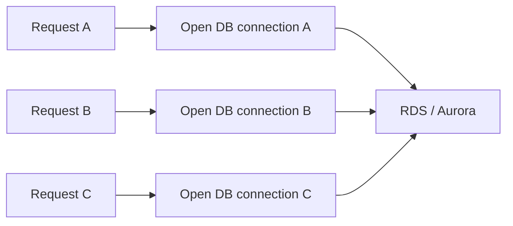

Each request opens and closes its own connection, paying TLS/auth/session overhead and driving up latency during traffic bursts. This is rarely suitable for repetitive HTTP API traffic.

### 2.2. Using HikariCP inside each application instance

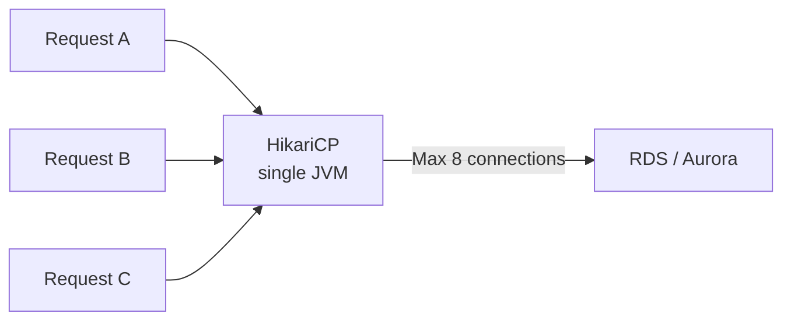

HikariCP helps by capping connections **within a single Java process** and returning connections to the pool when finished. Yet with 50 JVM instances, each pooling 8 connections, the theoretical ceiling is still **400 app-to-database connections**.

### 2.3. Adding Amazon RDS Proxy

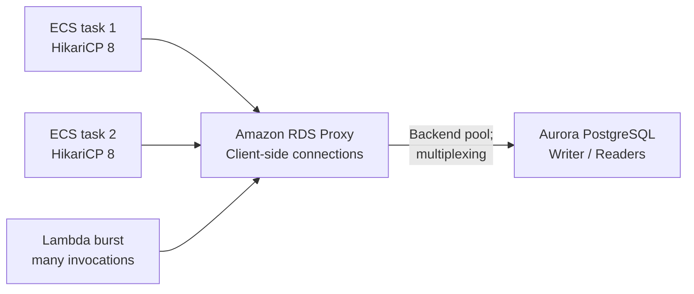

RDS Proxy is not a compute engine executing SQL logic in place of the database. It **understands database protocols** to coordinate and reuse backend connections safely, reducing session overhead on the database.

**Do not claim:** 1,000 client connections always require only 10 database connections. The ratio depends on transaction duration, session state, user names, workload concurrency, and pinning. If every client holds long transactions or gets pinned, backend database connections can still be high.

## 3. Pooling and multiplexing: benefits and conditions

**Connection pooling** keeps database connections open to avoid repeated setup costs.

**Connection multiplexing** returns a database connection to the pool **after a transaction completes**, allowing another client to borrow it for the next transaction.

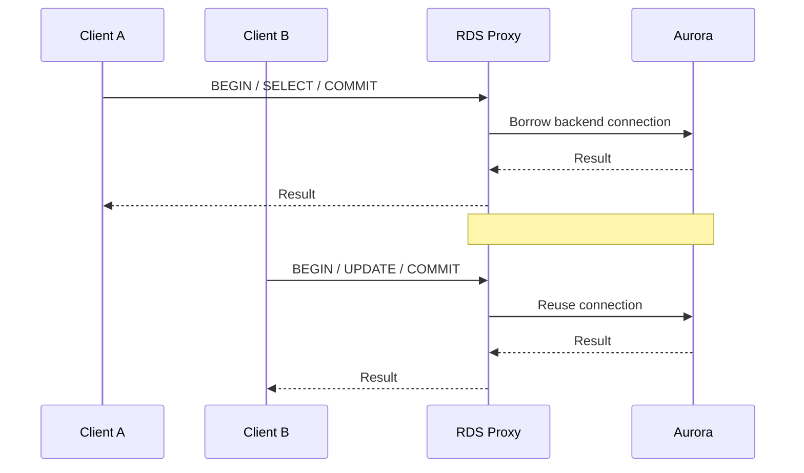

### 3.1. What limits multiplexing efficiency?

- **Long transactions:** the connection stays held until commit or rollback.
- **Session pinning:** a client stays bound to a backend connection because it uses session-scoped state.
- **Multiple database users:** the proxy typically cannot reuse a connection opened as `db_user_A` for `db_user_B`; backend pools fragment per user.
- **Max backend connections:** bounded by `max_connections` and `MaxConnectionsPercent`.
- **Heavy queries:** a 30-second SQL query still consumes database resources; the proxy does not speed up SQL on its own.
- **Lock contention:** borrowing a new connection does not unblock transactions waiting on locks.

**Principle:** The proxy reduces **connection management** overhead; it is not a tool for fixing slow queries or replacing indexes, query tuning, or database CPU/RAM.

### 3.2. Comparing HikariCP and RDS Proxy

| Criterion | **HikariCP** | **Amazon RDS Proxy** |
|---|---|---|
| Where does it run? | Inside the Java/Spring Boot process | AWS service between clients and RDS/Aurora |
| Scope of reuse? | Within the same JVM | Across many application instances |
| Automatically tracks new writer on failover? | Depends on JDBC/network/reconnect | Proxy tracks database targets and routes to the active writer |
| Multiplexes many client sessions onto DB connections? | No; each physical Hikari connection is one client socket | Yes, after transactions when not pinned |
| Suitable for Lambda? | Possible, but managed per execution environment | Especially helpful during Lambda connection bursts |
| IAM/TLS | Per JDBC/app configuration | Proxy supports TLS, IAM auth/Secrets Manager, and VPC |
| Cost | Library; you pay for app compute and DB connections | **Separate RDS Proxy charges apply** |
| Replaces the database? | No | No |

**Practical recommendation:** For Java on ECS, continue using a **small, tuned HikariCP pool** to reuse sockets to the **proxy endpoint**. Never set a pool of hundreds of connections per JVM just because the proxy multiplexes. For Lambda, configure pools per execution environment and avoid creating a brand-new connection/pool on every invocation when safe reuse applies.

## 4. Estimating the connection budget

An initial calculation:

```text
Total potential client connections
≈ ECS tasks × max pool per task
 + Lambda environments × connections/environment
 + worker processes × their pools
 + admin/migration/batch connections
```

**Illustrative** example, not a benchmark:

| Component | Count | Connections/pool | Client connection ceiling |
|---|---:|---:|---:|
| ECS API | 30 tasks | 8 | 240 |
| ECS worker | 10 tasks | 4 | 40 |
| Lambda | 150 concurrent environments | 1 | 150 |
| Batch/admin | 5 | 2 | 10 |
| **Maximum total** | | | **440** |

Without a proxy, the database might have to serve nearly 440 sessions if all run concurrently. With a proxy, **440 client connections do not equate to 440 backend connections**, though you must measure pinning and real transaction concurrency to quantify the reduction.

### 4.1. Size by transaction duration, not just request rate

By Little's Law intuition, concurrent active work is approximately:

```text
Active concurrency ≈ throughput × latency

Example:
200 transactions/sec × 0.040 sec/transaction
≈ 8 concurrent active transactions
```

**Warning:** This is only a steady-state estimate and ignores bursts, long transactions, locks, session pinning, replication, connection setup, and reserve capacity. Never take `8` and configure a proxy for literally 8 backend connections with zero headroom.

### 4.2. Queueing behavior when pools are full

- **HikariCP:** Threads calling `DataSource.getConnection()` wait up to `connectionTimeout`; exceeding it throws an exception.
- **RDS Proxy:** When no backend connection is free, requests wait up to `ConnectionBorrowTimeout`; exceeding it returns an error.
- **Database:** Exceeding `max_connections` rejects connections directly or exhausts resources.
- **API Gateway/clients:** Have their own deadlines and may time out before Hikari or the proxy.

Coordinate all timeouts within an **overall response budget** instead of raising every timeout to minutes, which causes hanging requests, growing queues, and slow recovery.

## 5. How does RDS Proxy work?

Amazon RDS Proxy is a **fully managed, highly available** service deployed by AWS across multiple Availability Zones. The proxy exposes dedicated endpoints inside your VPC and manages backend connections to an eligible RDS DB instance or database cluster.

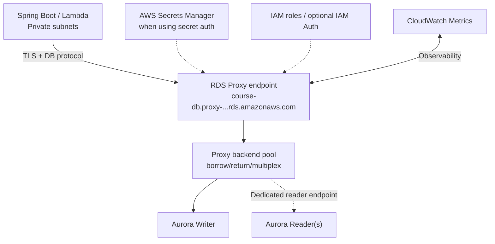

**Two connection legs:**

1. **Client connection:** Application → RDS Proxy endpoint.
2. **Database connection:** RDS Proxy → RDS/Aurora target.

RDS Proxy supports multiple proxy endpoints to segregate traffic by app/VPC and create a **read-only endpoint** for clusters with eligible readers. The **default endpoint** is typically read/write targeting the writer.

### 5.1. Prerequisites and limits to verify

- RDS Proxy supports specific engines/versions/Regions for **RDS MySQL, PostgreSQL, MariaDB, SQL Server, and Aurora MySQL/PostgreSQL**. Do not assume compatibility with every edition or version.
- **Aurora Serverless v2** works with RDS Proxy per current rules; **Aurora Serverless v1** is not supported.
- The proxy must reside in the **same VPC as the target database**. You can create **additional cross-VPC proxy endpoints** where supported, though this does not turn the proxy into a public Internet endpoint.
- Subnets/SGs must allow proxy → database and applications → proxy.
- The proxy target must be registered in the `default` target group.
- RDS Proxy does not replace security groups, DB authentication, IAM, or network routing.
- Check AWS Service Quotas, especially max proxies, endpoints, secrets/users, and supported engines/versions.

### 5.2. Never use RDS Proxy as a public database gateway

RDS Proxy endpoints are **private**. Even if an RDS instance can be configured as public in certain environments, the proxy is not designed for arbitrary machines on the Internet to connect directly.

An out-of-VPC client needing to test must use VPN, Direct Connect, an authorized test host inside the VPC, or an approved network path. **Never open the DB security group to `0.0.0.0/0` to fix a connection error.**

## 6. Proxy pooling configuration

| Setting | Purpose | Notes |
|---|---|---|
| `MaxConnectionsPercent` | Percentage cap of DB connections the proxy may use relative to the target's `max_connections` | **Default 100** in current configuration docs; leave headroom. |
| `MaxIdleConnectionsPercent` | Percentage of idle backend connections the proxy retains | Cannot exceed `MaxConnectionsPercent`; default varies by engine (50% of `MaxConnectionsPercent` for most engines). |
| `ConnectionBorrowTimeout` | Max wait time to borrow a backend connection | Default **120 seconds**; tune to match request deadlines. |
| `IdleClientTimeout` | Closes idle client connections after configured duration | Default **1,800 seconds**; distinct from backend pool idle timeout. |
| `InitQuery` | SQL statements run when the proxy creates a **new backend connection** | Can prevent clients from issuing pinning session-state commands. |
| `SessionPinningFilters` | Adjusts pinning behavior on supported engines | Do not apply blindly; prove session-state safety first. |

### 6.1. MaxConnectionsPercent does not equal active connection count

Suppose a database has:

```text
max_connections = 1000
MaxConnectionsPercent = 80

Theoretical percentage cap ≈ 800 DB connections.
```

The proxy **does not pre-open all 800 connections**. It scales backend connections up and down with demand. AWS reserves a slice of connections for **monitoring, failover, and internal operations**, so the actual `MaxDatabaseConnectionsAllowed` metric may be **below 800**.

AWS recommends leaving around **30% headroom** between measured peak usage and allowed capacity so the proxy can handle internal connections and spikes. This is a **measurement-based optimization guideline**, not a rigid multiplier for every workload.

### 6.2. ConnectionBorrowTimeout

This parameter limits how long the proxy waits for a free backend connection, or for an eligible target to become available during failover.

If an API has a 10-second total deadline while the proxy uses `ConnectionBorrowTimeout=120` seconds, a query could wait far longer than the user tolerates (unless cut off sooner by driver/connection timeouts).

A sandbox API candidate setting: `ConnectionBorrowTimeout=5` seconds, then measure `DatabaseConnectionsBorrowLatency` and error rates. Do not copy `5` blindly to every system; background jobs have different wait tolerances.

### 6.3. IdleClientTimeout and Java pools

RDS Proxy enforces a **24-hour maximum client connection lifetime** that is not configurable. HikariCP should set `maxLifetime` **shorter** than this limit and align with the proxy's idle timeout.

- HikariCP keepalive/validation pings may prevent a client connection from appearing idle to the proxy.
- If HikariCP retains an idle connection that the proxy already closed, the next request can error and require reconnect.
- Avoid creating huge pools with constant keepalives, which increases network chatter and hurts multiplexing when pinning occurs.

Pick settings using load-test telemetry, pool lifecycle logs, and CloudWatch metrics—not defaults alone.

## 7. Session pinning: the primary constraint on multiplexing

The proxy may **pin a client session to a specific database connection** whenever session state cannot safely be shared with another client. When pinned:

```text
Client A <------------------> DB connection #1
Client B <------------------> DB connection #2
Client C <------------------> DB connection #3
```

Connection #1 cannot be borrowed by B or C until A ends its session or meets proxy release rules. If most sessions pin, multiplexing collapses and the proxy approaches 1:1 connections.

### 7.1. Common causes

| SQL / driver action | Pinning likelihood | Notes |
|---|---|---|
| Long uncommitted transaction | Backend connection unavailable to others during transaction | Do not confuse borrowed with session pinned; tracked separately. |
| PostgreSQL `SET search_path TO ...` | **Can pin** | PostgreSQL `SET`/session state reduces multiplexing. |
| PostgreSQL `PREPARE` / `EXECUTE` / `DEALLOCATE` / `DISCARD ALL` | **Can pin** | Watch JDBC server-side prepared statement thresholds. |
| PostgreSQL `SET LOCAL` inside explicit transaction | **Exception that may avoid pinning** | Transaction-scoped only; test with your driver and logic. |
| Temporary tables, session cursors | **Can pin** | Session state cannot be moved arbitrarily across backends. |
| MySQL/MariaDB user/system variable `SET` | **Can pin**, with tracked exceptions | Check engine-specific rules; filter only if genuinely safe. |
| MySQL/MariaDB `GET_LOCK`, `LOCK TABLES` | **Can pin** | Holds connection/lock state. |
| MySQL/MariaDB prepared statements | **Can pin** | Driver configuration matters. |
| SQL statement longer than **16 KB** | **Can pin** per AWS rules | Limit applies to statement text length, not result-set size. |
| SQL Server MARS/temp tables/DTC | **Can pin** | Depends on engine, protocol, and statement. |

**Do not claim:** every `SELECT` or JDBC `PreparedStatement` always pins PostgreSQL/MySQL. Behavior depends on protocol, server-side preparation, driver version, and engine. **Measuring `DatabaseConnectionsCurrentlySessionPinned`** in reality is mandatory when tuning.

### 7.2. PostgreSQL example prone to pinning

```sql
-- Mutates session state:
SET search_path TO tenant_school_01;

SELECT course_id, title
FROM courses
WHERE tenant_id = 'school_01';
```

In multi-tenant apps that change `search_path` or session variables per connection, pinning rises; additionally, failing to reset session state risks cross-tenant state leakage.

**Preferred design:** Query with explicit tenant predicates, prepared parameters, and DB row-level security where designed and verified—never rely on uncontrolled session state.

### 7.3. PostgreSQL SET LOCAL

Inside an explicit transaction:

```sql
BEGIN;
SET LOCAL statement_timeout = '5s';
SELECT count(*) FROM courses WHERE tenant_id = 'school_01';
COMMIT;
```

AWS notes `SET LOCAL` inside a transaction as a pattern that can avoid pinning in PostgreSQL, though `set_config(name, value, true)` may behave differently. Do not let this example replace full session-state and pool testing.

### 7.4. PostgreSQL JDBC connection startup settings

AWS recommends for PostgreSQL JDBC through RDS Proxy:

- Set `assumeMinServerVersion` high enough (at least `9.0`) so the driver avoids running `SET extra_float_digits` on connection open.
- Set `ApplicationName` in JDBC connection parameters so the driver sends it in startup packets rather than running a separate `SET application_name`.
- If the app uses server-side prepared statements, inspect `prepareThreshold` and pinning rates; disabling server-side preparation reduces pinning at the cost of re-parsing/planning trade-offs.

**Illustrative** JDBC URL sample:

```text
jdbc:postgresql://course-db.proxy-example.ap-southeast-1.rds.amazonaws.com:5432/coursedb?sslmode=require&assumeMinServerVersion=9.0&ApplicationName=course-api
```

**TLS security:** `sslmode=require` enforces encryption but **does not equal** full server identity verification. In production, prefer certificate/hostname verification where supported by the driver and environment; RDS Proxy uses ACM-managed certificates, not necessarily the same CA bundle as an RDS DB instance.

### 7.5. InitQuery and session pinning filters

If **all** clients require the same session variable, consider setting `InitQuery` (executed when the proxy opens a backend connection) and **removing those `SET` statements from client code**. Never put passwords or secrets in `InitQuery`, as anyone with proxy view permissions can read the config.

For **MySQL/MariaDB**, AWS provides the `EXCLUDE_VARIABLE_SETS` filter to skip pinning for certain `SET` operations. **Never use filters to ignore critical tenant, time zone, or collation state** if subsequent SQL depends on those values. PostgreSQL does not offer the exact same filter option; per AWS docs, it applies to supported engine families.

## 8. Failover: real benefits and limits

With Aurora or eligible HA RDS deployments, failover changes the writer/primary instance. When clients connect directly to the database endpoint, they must wait for DNS, reconnect, and redo TLS/session setup.

RDS Proxy maintains a dedicated endpoint, tracks the new writer, and helps **reduce connection disruption**:

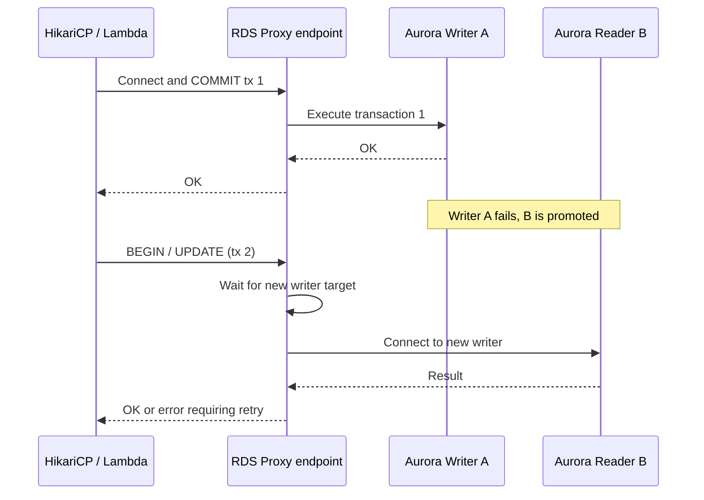

**What RDS Proxy helps with:**

- Less dependent on database endpoint DNS propagation.
- Many idle client connections can remain intact.
- Proxy tracks the new writer and waits for target readiness within configured limits.
- Reduces the flood of database handshakes right after failover.

**What RDS Proxy does NOT guarantee:**

- In-flight transactions **do not automatically commit safely**.
- Active SQL statements may be aborted or throw connection exceptions.
- Applications must still reconnect and retry when appropriate.
- Adding a proxy does not turn a **single-AZ DB with no standby** into multi-AZ HA.
- It does not automatically restore business consistency after payments or writes with unknown outcomes.

### 8.1. Idempotency when transaction state is unknown

Example `CreateEnrollment(orderId)`:

1. The transaction may have committed in RDS.
2. The client lost the response during failover.
3. Retrying with a fresh `INSERT` lacking uniqueness/idempotency can create duplicates.

Design:

```sql
-- PostgreSQL example: order_id is the unique business key.
CREATE TABLE enrollment (
    order_id text PRIMARY KEY,
    student_id text NOT NULL,
    course_id text NOT NULL,
    status text NOT NULL
);

INSERT INTO enrollment(order_id, student_id, course_id, status)
VALUES ('order-001', 'student-17', 'java-101', 'PENDING')
ON CONFLICT (order_id) DO NOTHING;
```

This illustrates only **one piece**. In production, verify the existing row, payment state, and ownership rather than blindly returning success after `DO NOTHING`.

## 9. Writer and reader proxy endpoints on Aurora

A **default proxy endpoint** typically serves **read/write** and sends queries to the cluster's **writer**.

For Aurora with one or more reader instances, you can create a **read-only proxy endpoint** to route read queries across reader capacity. RDS Multi-AZ DB clusters also support reader endpoints per current features; a **single DB instance does not automatically get a read-only proxy endpoint for read scaling**.

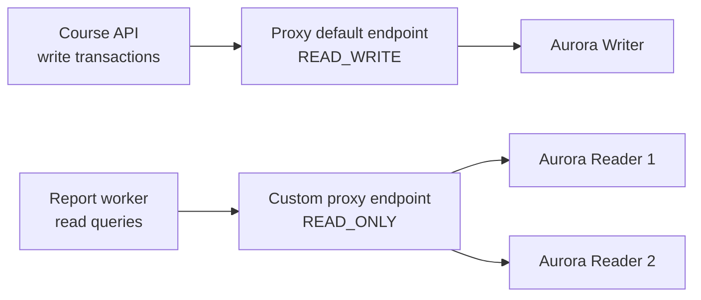

### 9.1. Key points to remember

- The default endpoint **does not automatically load-balance reads** to readers; it routes to the writer.
- A reader endpoint must be created explicitly with matching network and security settings.
- Each additional proxy endpoint may provision a **PrivateLink interface endpoint** with separate charges.
- Never send write transactions to a read-only endpoint.
- Read replicas exhibit **replication lag**: right after writing via the writer, immediately reading on a reader may not see the data.
- Both read/write and read-only paths require evaluating transaction consistency, not just picking endpoints by Java method names.

### 9.2. Reading data right after writing

If an enrollment workflow writes to the writer and immediately checks the result (**read-your-writes**), read through the **writer endpoint** or use an appropriate consistency mechanism. Do not route to the reader endpoint ignoring replication lag.

## 10. Choosing Secrets Manager vs. IAM authentication

AWS RDS Proxy supports multiple authentication models. Based on current AWS documentation (2026), clearly distinguish **Secrets Manager backend auth** from **end-to-end IAM**.

### 10.1. Secrets Manager as backend authentication

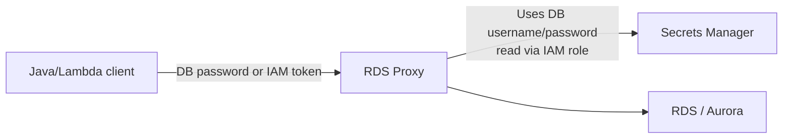

The proxy uses an **IAM role** to read a secret holding the database username/password. Clients can connect to the proxy using database credentials or **client-side IAM authentication**, depending on `AuthConfig`.

**Two variants:**

1. Client **password** → proxy verifies password, proxy uses secret to connect to DB.
2. Client **IAM token** → proxy verifies IAM, proxy uses secret to connect to DB.

This is **not** end-to-end IAM if the proxy still uses a DB password on the backend.

### 10.2. End-to-end IAM authentication

In supported configurations (notably **MySQL/PostgreSQL/MariaDB** per current AWS docs), RDS Proxy can use **IAM auth on both the client side and between the proxy and database**.

- Set `DefaultAuthScheme=IAM_AUTH`.
- The target database must have IAM database authentication enabled.
- RDS Proxy's IAM role must have `rds-db:connect` for the matching database user/resource ID.
- No DB password secret needs to be registered in the proxy for **end-to-end IAM**.
- Clients still need IAM permissions, TLS, and a token generated for the exact host/port/username.

**Do not apply blindly:** SQL Server and some engine versions do not necessarily support end-to-end IAM; verify Region/engine support.

### 10.3. Selection table

| Question | Secrets Manager backend auth | End-to-end IAM |
|---|---|---|
| Does backend DB use a password? | Yes | No; uses IAM DB auth |
| Need a Secrets Manager secret for the DB user? | Yes | No, for this connection auth mode |
| Can clients use IAM? | Yes, if `IAMAuth=REQUIRED` is configured appropriately | Yes, central to the design |
| Does proxy role need `secretsmanager:GetSecretValue`? | Yes | No, for this auth mode |
| Does proxy role need `rds-db:connect` to DB target? | Not under standard password auth | Yes |
| Best suited when | DB user/password already in use; want simple rotation | Want to remove DB passwords from supported auth paths |
| Still required | IAM least privilege, TLS, SGs, secret rotation | IAM least privilege, TLS, SGs, DB IAM config |

**Terminology warning:** the **Lambda/ECS task execution role** is distinct from the **RDS Proxy service role**. A role able to call Secrets Manager is not automatically accepted by the database without database grants or `rds-db:connect` per the chosen model.

## 11. IAM role and Secrets Manager for the proxy

If choosing **Secrets Manager-backed auth**, prepare:

1. A secret containing username/password **matching an already-created database user**.
2. An IAM role assumable by the `rds.amazonaws.com` service.
3. `secretsmanager:GetSecretValue` permission scoped to the exact secret ARN.
4. `kms:Decrypt` permission for a KMS customer-managed key if used, with appropriate conditions.
5. SG rules allowing proxy → RDS target.

### 11.1. Secret data structure example

Illustrative JSON secret value:

```json
{
  "username": "course_app",
  "password": "REPLACE_WITH_A_STRONG_SECRET"
}
```

**Never place real passwords in Markdown, Git, tickets, CLI commands, or IaC templates.** Create secrets via approved mechanisms (Console or Secrets Manager rotation pipelines) and never print plaintext secrets.

### 11.2. Proxy role trust policy

```json
{
  "Version": "2012-10-17",
  "Statement": [
    {
      "Effect": "Allow",
      "Principal": {
        "Service": "rds.amazonaws.com"
      },
      "Action": "sts:AssumeRole"
    }
  ]
}
```

### 11.3. Secrets Manager read policy

```json
{
  "Version": "2012-10-17",
  "Statement": [
    {
      "Sid": "ReadCourseDbSecret",
      "Effect": "Allow",
      "Action": "secretsmanager:GetSecretValue",
      "Resource": "arn:aws:secretsmanager:ap-southeast-1:123456789012:secret:course/db/app-EXAMPLE"
    }
  ]
}
```

If the secret uses a **customer-managed KMS key**, add `kms:Decrypt` scoped to the key ARN/policy/conditions. This IAM role is **strictly** for RDS Proxy to read the secret, not for granting broad IAM privileges to the application.

### 11.4. Caller IAM permission when using IAM auth

Client IAM auth requires the action:

```text
rds-db:connect
```

**The resource ARN must be the exact proxy DB user resource ID**, not the proxy endpoint hostname or display RDS DB identifier.

Example ARN pattern for a client connecting through the proxy:

```json
{
  "Version": "2012-10-17",
  "Statement": [
    {
      "Effect": "Allow",
      "Action": "rds-db:connect",
      "Resource": "arn:aws:rds-db:ap-southeast-1:123456789012:dbuser:prx-EXAMPLEID/course_app"
    }
  ]
}
```

For **end-to-end IAM**, the **proxy service role** needs a different `rds-db:connect` ARN targeting the **DB instance resource ID or cluster resource ID** of the target database user. Never copy the client's `prx-...` ARN to the proxy role without checking the resource ID.

## 12. TLS, VPC, and security groups

RDS Proxy operates inside a VPC. Example:

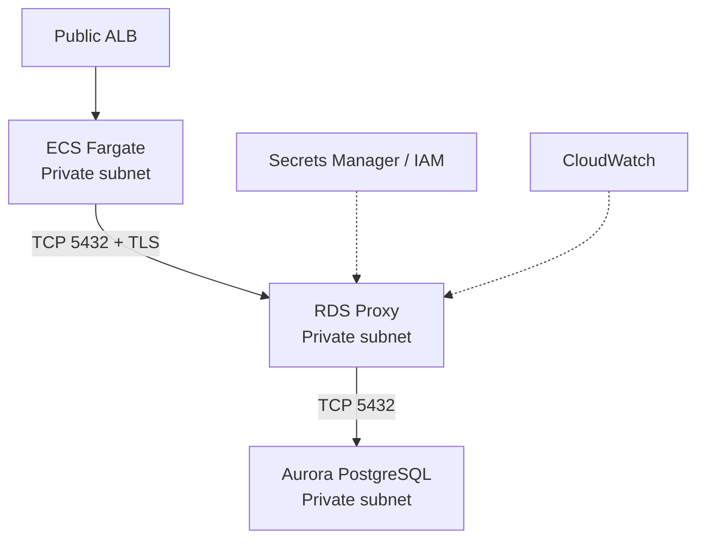

### 12.1. Least-privilege SGs

| SG | Inbound | Outbound |
|---|---|---|
| `sg-course-api` | From ALB to HTTP app port (e.g., 8080) | TCP 5432 to `sg-rds-proxy` per egress policy |
| `sg-rds-proxy` | TCP 5432 from `sg-course-api`/Lambda SG | TCP 5432 to `sg-database` |
| `sg-database` | TCP 5432 **only from `sg-rds-proxy`** and approved admin sources | Per organization network policy |

This is a conceptual model. AWS security groups are **stateful** while NACLs are **stateless**; routes, subnets, and VPC DNS must still permit traffic. If the database receives direct migration or replication traffic, account for those paths separately.

### 12.2. TLS and server identity

- When creating the proxy, set `RequireTLS=true` to **enforce TLS for client connections**.
- RDS Proxy uses certificates managed by AWS Certificate Manager; clients must use TLS-capable drivers and verify certificates/hostnames wherever supported.
- Verify PostgreSQL JDBC/MySQL driver settings, trust stores, hostnames, and TLS versions; do not disable verification to work around test errors.
- The proxy also manages connections to the database; comply with the RDS target's SSL/security mode per AWS rules.
- Monitor **CloudWatch metric `ClientConnectionsNoTLS`** to detect unencrypted client connections if the config allows them.

**Do not confuse:** Opening port 5432 in an SG does not mean TLS is enabled; `RequireTLS` and the JDBC URL/driver must match.

## 13. AWS Console: creating an RDS Proxy and registering targets

**Lab prerequisites** (sandbox):

- A compatible Aurora PostgreSQL cluster or RDS PostgreSQL instance with database user `course_app`.
- A VPC with **at least two private subnets in appropriate AZs** and networking capacity for the proxy.
- Separate SGs for application, proxy, and database as shown above.
- Secrets Manager secret for `course_app`.
- IAM service role for the proxy to read the secret.
- IAM permissions to create an RDS proxy, register targets, and manage SGs/roles per process.
- Region `ap-southeast-1` is only an example; check engine version support.

### 13.1. Create the proxy in the Console

1. Open **Amazon RDS Console → Proxies → Create proxy**.
2. Name it `course-db-proxy`.
3. Select the compatible engine family (e.g., **PostgreSQL**).
4. Select **Secrets Manager credentials** or **IAM authentication** per your architectural decision.
5. If using Secrets Manager, choose the secret and the IAM role permitted to read it.
6. Select the **same VPC as the DB target**, private subnets across required AZs, and SG `sg-rds-proxy`.
7. Enable **Require TLS**.
8. Select the target database/cluster in the same VPC.
9. Review logging/debug options; never leave debug logs containing sensitive queries/metadata on indefinitely.
10. Create, then wait until the proxy and target transition to healthy/available.
11. Note the real **default proxy endpoint** and update application configuration.
12. From a host or test task inside the same VPC, test TLS, login, and `SELECT 1`.

**If choosing end-to-end IAM:** the target must have IAM DB authentication enabled, the proxy role must have `rds-db:connect` on the DB's resource ID, and callers need IAM permission on the proxy resource ID; skip the secret/password steps from the previous model.

### 13.2. When no target is ready yet

A proxy may finish creating while its target group has no registered DB or shows `UNAVAILABLE`. Never cut over production Java traffic to the proxy until targets are healthy and test connections pass.

## 14. AWS CLI: creating a proxy with Secrets Manager

**Commands shown are for POSIX/bash shells.** Replace account IDs, ARNs, subnet/SG IDs, secret names, and cluster names with real values you own; creating resources incurs cost.

### 14.1. Inspect metadata before creating

```bash
aws sts get-caller-identity

aws rds describe-db-clusters \
  --db-cluster-identifier course-aurora \
  --region ap-southeast-1

aws secretsmanager describe-secret \
  --secret-id arn:aws:secretsmanager:ap-southeast-1:123456789012:secret:course/db/app-EXAMPLE \
  --region ap-southeast-1
```

Never call `get-secret-value` and paste output into logs for a “quick check.” Verify the **secret ARN and permissions** without exposing passwords.

### 14.2. Create the RDS Proxy

Example configuring **password auth on both client and backend**. The proxy auth scheme is `SECRETS`, with `IAMAuth=DISABLED` for clients in this sample.

```bash
aws rds create-db-proxy \
  --db-proxy-name course-db-proxy \
  --engine-family POSTGRESQL \
  --role-arn arn:aws:iam::123456789012:role/course-rds-proxy-role \
  --vpc-subnet-ids subnet-11111111 subnet-22222222 \
  --vpc-security-group-ids sg-0123456789abcdef0 \
  --require-tls \
  --auth '[{"AuthScheme":"SECRETS","SecretArn":"arn:aws:secretsmanager:ap-southeast-1:123456789012:secret:course/db/app-EXAMPLE","IAMAuth":"DISABLED"}]' \
  --region ap-southeast-1
```

Then register the Aurora cluster:

```bash
aws rds register-db-proxy-targets \
  --db-proxy-name course-db-proxy \
  --target-group-name default \
  --db-cluster-identifiers course-aurora \
  --region ap-southeast-1
```

If targeting a **single RDS DB instance**, replace `--db-cluster-identifiers` with `--db-instance-identifiers instance-identifier`; do not pass both arbitrarily.

### 14.3. Inspect proxy, targets, and endpoint

```bash
aws rds describe-db-proxies \
  --db-proxy-name course-db-proxy \
  --region ap-southeast-1 \
  --query 'DBProxies[].{Name:DBProxyName,Status:Status,Endpoint:Endpoint,RequireTLS:RequireTLS}'

aws rds describe-db-proxy-target-groups \
  --db-proxy-name course-db-proxy \
  --region ap-southeast-1

aws rds describe-db-proxy-targets \
  --db-proxy-name course-db-proxy \
  --target-group-name default \
  --region ap-southeast-1
```

Wait until the proxy target reports `AVAILABLE` (or eligible ready state) before testing. Read commands require IAM permissions but do not modify resources.

### 14.4. Tune the pool

```bash
aws rds modify-db-proxy-target-group \
  --db-proxy-name course-db-proxy \
  --target-group-name default \
  --connection-pool-config '{"MaxConnectionsPercent":70,"MaxIdleConnectionsPercent":35,"ConnectionBorrowTimeout":10}' \
  --region ap-southeast-1
```

The values `70/35/10` are **lab examples** only. Setting `MaxConnectionsPercent` too low raises `BorrowLatency` and timeouts; setting it too high can starve admin or other app connections.

### 14.5. Tune idle client timeout

```bash
aws rds modify-db-proxy \
  --db-proxy-name course-db-proxy \
  --idle-client-timeout 1800 \
  --require-tls \
  --region ap-southeast-1
```

**Caution:** Modifying target or proxy settings in production affects every application sharing that proxy. Maintain a changelog, test first, and prepare a rollback.

## 15. End-to-end IAM authentication: dedicated configuration sample

For supported engines:

1. Enable IAM DB authentication on the Aurora/RDS target, create the corresponding database user, and grant least-privilege database roles.
2. The **proxy's** IAM role needs `rds-db:connect` to the **database user resource ARN**.
3. The client **IAM workload role** needs `rds-db:connect` to the **proxy user resource ARN**.
4. Set `DefaultAuthScheme=IAM_AUTH` on the proxy.
5. Clients generate IAM DB auth tokens via the AWS SDK and connect with TLS.

Basic CLI sample **without secret auth**:

```bash
aws rds create-db-proxy \
  --db-proxy-name course-db-proxy-iam \
  --engine-family POSTGRESQL \
  --default-auth-scheme IAM_AUTH \
  --role-arn arn:aws:iam::123456789012:role/course-rds-proxy-iam-role \
  --vpc-subnet-ids subnet-11111111 subnet-22222222 \
  --vpc-security-group-ids sg-0123456789abcdef0 \
  --require-tls \
  --region ap-southeast-1
```

**This is not a complete standalone setup:** DB IAM auth, database user grants, role policies, target registration, and SDK token generation must all be configured. If an engine/version does not support end-to-end IAM, use Secrets Manager mode.

### 15.1. IAM tokens have a 15-minute lifetime

An IAM DB authentication token is **valid for 15 minutes to establish a new connection**. Already-authenticated connections can stay active past the initial token's expiration within connection lifetime limits, but **every new connection needs a fresh, unexpired token**.

Never generate one token at JVM startup and store it statically in HikariCP for hours. When the pool opens a new physical connection 20 minutes later, the old token will fail.

**Design:** Generate a fresh token **each time a new physical connection is opened** via an appropriate datasource/driver integration, and ensure the workload's AWS IAM credentials refresh before expiration as well.

## 16. Spring Boot + HikariCP: configuring with a proxy endpoint

Spring Boot typically uses **HikariCP** with Spring JDBC/JPA starters. With RDS Proxy, the **JDBC URL must point to the proxy endpoint**, not the underlying cluster or instance endpoint.

### 16.1. `application.yml` for password auth

```yaml
spring:
  datasource:
    url: jdbc:postgresql://course-db.proxy-example.ap-southeast-1.rds.amazonaws.com:5432/coursedb?sslmode=require&assumeMinServerVersion=9.0&ApplicationName=course-api
    username: course_app
    password: ${DB_PASSWORD}
    hikari:
      pool-name: course-api-pool
      maximum-pool-size: 8
      minimum-idle: 1
      connection-timeout: 3000
      validation-timeout: 1000
      idle-timeout: 600000
      max-lifetime: 1200000
      keepalive-time: 120000
```

Parameter breakdown (HikariCP defaults are in **milliseconds**):

| Setting | Sample value | Role |
|---|---|---|
| `maximum-pool-size` | 8 | Connection cap inside a single JVM, not cluster-wide |
| `minimum-idle` | 1 | Keeps at least one idle connection, avoiding holding too many |
| `connection-timeout` | 3000 ms | Thread waits at most 3 seconds to borrow a connection from Hikari |
| `validation-timeout` | 1000 ms | Bounds connection validation time |
| `idle-timeout` | 600000 ms | Shrinks idle connections above `minimum-idle` |
| `max-lifetime` | 1200000 ms | Cycles physical connections roughly every 20 minutes; well under proxy's 24-hour cap |
| `keepalive-time` | 120000 ms | Pings idle connections to prevent staleness; adds overhead |

**These values are starting points for testing**, not fixed advice for every service. In Hikari, `minimumIdle` defaults to `maximumPoolSize` if left unset, which keeps more connections open than intended. Tune based on active threads, transaction durations, and `DatabaseConnections` metrics.

**Check production TLS:** `sslmode=require` encrypts traffic without always verifying server identity. Verify CA/trust stores, hostname validation, and `verify-full` per supported driver and proxy certificates.

### 16.2. Do not hold connections too long in business code

In Spring Boot:

```java
package example.course.repository;

import org.springframework.jdbc.core.JdbcTemplate;
import org.springframework.stereotype.Repository;

@Repository
public class CourseRepository {
    private final JdbcTemplate jdbc;

    public CourseRepository(JdbcTemplate jdbc) {
        this.jdbc = jdbc;
    }

    public int countCoursesForTenant(String tenantId) {
        return jdbc.queryForObject(
            "SELECT COUNT(*) FROM courses WHERE tenant_id = ?",
            Integer.class,
            tenantId);
    }
}
```

`JdbcTemplate` borrows and returns JDBC connections per Spring transaction management; without an enclosing transaction, short DB calls quickly return connections to the pool.

**Avoid:** starting `@Transactional`, calling an external payment HTTP API that takes 10 seconds, and then committing; that transaction holds the DB connection for the entire HTTP wait. Move external I/O outside DB transaction boundaries or use Saga/outbox patterns so database locks and connections are never held unnecessarily.

### 16.3. Example transaction handling with idempotency

```java
import org.springframework.jdbc.core.JdbcTemplate;
import org.springframework.stereotype.Service;
import org.springframework.transaction.annotation.Transactional;

@Service
public class EnrollmentService {
    private final JdbcTemplate jdbc;

    public EnrollmentService(JdbcTemplate jdbc) {
        this.jdbc = jdbc;
    }

    @Transactional
    public void recordEnrollment(
            String orderId, String studentId, String courseId) {

        jdbc.update("""
            INSERT INTO enrollment(order_id, student_id, course_id, status)
            VALUES (?, ?, ?, 'PENDING')
            ON CONFLICT (order_id) DO NOTHING
            """, orderId, studentId, courseId);

        // Production: inspect existing row and tenant validity,
        // and allow only valid state transitions.
        // Never call payment provider HTTP inside this DB transaction.
    }
}
```

This shows **short transactions and parameterized SQL**, without full ownership/business validation. If a request reuses `orderId` with mismatched student/course data, detect and reject the conflict rather than silently accepting it.

### 16.4. Password rotation with HikariCP

The proxy can pull backend passwords from Secrets Manager, while **client-to-proxy passwords** must also match your chosen auth mode:

- With **client password auth**, apps need securely supplied credentials and a strategy to refresh them on rotation.
- With **client IAM auth**, apps generate fresh auth tokens; never freeze an old token as a static pool password.
- Never assume rotating a backend Secrets Manager secret automatically updates **all app environment variables** in real time.
- Monitor auth failures after rotation, drain stale connections, and recycle pools as needed.

## 17. Java SDK 2.x: generating an IAM authentication token on connection open

AWS SDK for Java 2.x provides `RdsUtilities.generateAuthenticationToken`. This is a **single-connection opening example**, not a complete production HikariCP setup.

```java
package example.course.database;

import java.sql.Connection;
import java.sql.DriverManager;
import java.util.Properties;

import software.amazon.awssdk.auth.credentials.DefaultCredentialsProvider;
import software.amazon.awssdk.regions.Region;
import software.amazon.awssdk.services.rds.RdsClient;
import software.amazon.awssdk.services.rds.model.GenerateAuthenticationTokenRequest;

public final class IamProxyJdbcExample {
    public static void main(String[] args) throws Exception {
        String host = "course-db.proxy-example.ap-southeast-1.rds.amazonaws.com";
        int port = 5432;
        String dbName = "coursedb";
        String dbUser = "course_app";

        try (RdsClient rds = RdsClient.builder()
                .region(Region.AP_SOUTHEAST_1)
                .build()) {

            String token = rds.utilities().generateAuthenticationToken(
                GenerateAuthenticationTokenRequest.builder()
                    .hostname(host)
                    .port(port)
                    .username(dbUser)
                    .credentialsProvider(
                        DefaultCredentialsProvider.create())
                    .build());

            Properties props = new Properties();
            props.setProperty("user", dbUser);
            props.setProperty("password", token);
            props.setProperty("sslmode", "require");

            String jdbcUrl = "jdbc:postgresql://" + host + ":" + port
                    + "/" + dbName;

            try (Connection connection =
                     DriverManager.getConnection(jdbcUrl, props)) {
                try (var stmt = connection.prepareStatement("SELECT 1");
                     var rs = stmt.executeQuery()) {
                    if (rs.next()) {
                        System.out.println("DB reachable: " + rs.getInt(1));
                    }
                }
            }
        }
    }
}
```

**Prerequisites:**

- Project uses Java 17, `software.amazon.awssdk:rds`, and the PostgreSQL JDBC driver.
- Endpoint, user, Region, IAM permissions, and database grants are accurate.
- Proxy is configured to accept IAM authentication and the target auth mode supports it.
- Network path to the proxy and TLS trust/certificate config are in place.
- Never log or persist tokens in insecure locations.

**Generating valid IAM tokens:** Tokens are scoped to the connection's **exact host, port, and username**. Never sign a token with an arbitrary CNAME if AWS expects the official endpoint hostname. Tokens authenticate **new connections** and do not replace pool connection lifecycle management.

**For production HikariCP**, integrate a mechanism that supplies a **fresh token before every physical connection** (such as a tested credential provider, AWS JDBC Driver plugin, or custom DataSource factory)—never fetch one token and pin it into `spring.datasource.password` for hours.

## 18. AWS Lambda: preventing connection storms

A Lambda function spins up many execution environments as concurrency grows. If each invocation opens 1–2 database connections, bursts easily overwhelm the database.

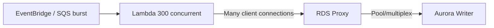

### 18.1. Principles for Lambda

1. Initialize the JDBC client/pool **outside the handler** and reuse across warm execution environments where appropriate.
2. Never assume all invocations share the **same** environment or pool.
3. In Java Lambda, avoid setting HikariCP `maximumPoolSize=10` inside each environment if an invocation runs sequentially and never needs 10 connections.
4. Set concurrency limits and appropriate SQS batch/window settings to throttle DB pressure.
5. Open transactions right when SQL is needed and commit/roll back immediately afterward.
6. Set the Lambda timeout reasonably higher than JDBC connection/query timeouts without making it excessive.
7. Implement idempotent retries because SQS/EventBridge/Lambda can re-deliver or retry executions.
8. Monitor `ClientConnections`, `DatabaseConnections`, `DatabaseConnectionsBorrowLatency`, and pinned sessions.

### 18.2. A budget model

Assume:

```text
Lambda reserved concurrency = 200
Connections per warm environment = 1
=> at most ~200 client connections from Lambda
```

Without RDS Proxy, 200 direct sessions can consume substantial DB memory during bursts. With a proxy, short non-pinned transactions share a backend pool far more efficiently.

**Do not assume** 200 sessions automatically shrink to exactly 20 DB connections: measure actual SQL concurrency, duration, pinning, and per-user pool fragmentation.

## 19. Monitoring RDS Proxy with CloudWatch

Key RDS Proxy metrics live in the `AWS/RDS` namespace with dimension sets such as `ProxyName`, `EndpointName`, `TargetGroup`, and `TargetRole` per AWS documentation.

| Metric | Meaning | How to use |
|---|---|---|
| `ClientConnections` | Open client connections to the proxy | Spot app pool surges |
| `DatabaseConnections` | Backend DB connections held by the proxy | Compare against client connections |
| `MaxDatabaseConnectionsAllowed` | Connection cap for proxy workload (after reservations) | Track saturation and headroom |
| `DatabaseConnectionsBorrowLatency` | Wait time to borrow a backend connection, **microseconds** | Detect pool capacity shortages |
| `DatabaseConnectionsCurrentlyBorrowed` | Backend connections currently borrowed | Indicates active transactions/queries |
| `DatabaseConnectionsCurrentlyInTransaction` | Backend connections currently inside transactions | Spot long-running transactions |
| `DatabaseConnectionsCurrentlySessionPinned` | Backend connections pinned to client sessions | Measure multiplexing efficiency |
| `ClientConnectionsSetupFailedAuth` | Failed client setup/auth/TLS attempts | Diagnose IAM/secret/TLS issues |
| `ClientConnectionsNoTLS` | Unencrypted client connections | Enforce TLS policies |
| `DatabaseConnectionRequests` | Requests to open backend connections | Track connection churn |
| `AvailabilityPercentage` | Availability of target group/role | Monitor failover/availability |

**Do not compare only `ClientConnections` and `DatabaseConnections` to judge efficiency.** Inspect role/target dimensions, pinned/borrowed counts, transaction duration, error rates, and SQL throughput. A newly started system showing 10 client and 10 database sessions is not necessarily misconfigured.

### 19.1. Warning signals

- `DatabaseConnectionsBorrowLatency` climbs noticeably during peak hours.
- `DatabaseConnections` approaches `MaxDatabaseConnectionsAllowed`.
- `DatabaseConnectionsCurrentlySessionPinned` is high or jumps after a deployment.
- `ClientConnectionsSetupFailedAuth` spikes after secret rotation or IAM edits.
- `ClientConnectionsNoTLS > 0` in environments requiring encryption.
- Database `CPUUtilization` and `DatabaseConnections` climb together.
- RDS Performance Insights/Database Insights show lock waits or slow queries.

AWS emits metrics periodically (many at 1-minute resolution); choose the right statistics and dimensions when defining alarms, and track changes rather than treating every metric as a raw request count.

### 19.2. Reading CloudWatch metrics via AWS CLI

Example:

```bash
aws cloudwatch list-metrics \
  --namespace AWS/RDS \
  --metric-name DatabaseConnectionsBorrowLatency \
  --region ap-southeast-1
```

Once you verify the proxy's dimension set, fetch datapoints:

```bash
aws cloudwatch get-metric-statistics \
  --namespace AWS/RDS \
  --metric-name DatabaseConnectionsBorrowLatency \
  --dimensions Name=ProxyName,Value=course-db-proxy \
  --statistics Average Maximum \
  --period 60 \
  --start-time 2026-11-20T01:00:00Z \
  --end-time 2026-11-20T02:00:00Z \
  --region ap-southeast-1
```

Timestamps here are **illustrative only**; substitute your actual investigation window. The metric unit is microseconds, not milliseconds. Label units clearly on dashboards:

```text
1,000 microseconds = 1 millisecond
100,000 microseconds = 100 milliseconds
```

### 19.3. Proxy debug logging

RDS Proxy offers **enhanced/debug logging** to help troubleshoot connection/session errors. Never leave it enabled long-term if logs may capture SQL, database usernames, or sensitive details; manage CloudWatch retention/IAM access and disable it once troubleshooting finishes.

## 20. Troubleshooting: from DNS to session pinning

| Symptom | Possible cause | How to check |
|---|---|---|
| Java `Connection refused` | Wrong endpoint/port, proxy not yet available | Describe proxy, check DB protocol port, DNS |
| Java connect timeout | SG, subnet/route, NACL, VPN, or unhealthy target | App→proxy→DB path, SG inbound/outbound |
| `Access denied for user` / auth failed | Wrong secret, missing DB user/grants, expired IAM token | `AuthConfig`, Secrets Manager, DB users, IAM policy |
| IAM auth fails after 15 minutes of uptime | App caches a **static token** while Hikari opens a new physical connection | Generate a fresh token for every new connection |
| Target `UNAVAILABLE` | Not registered, DB down, VPC/SG or auth mismatch | `describe-db-proxy-targets`, RDS events |
| `Too many connections` despite proxy | `MaxConnectionsPercent` mis-sized, clients bypassing proxy, pinning | Client/DB/pinned metrics, `max_connections` |
| Borrow latency rises | Backend pool exhausted, long transactions, failover | `BorrowLatency`, `CurrentlyBorrowed`, `InTransaction` |
| High `ClientConnections` and high `DBConnections` | Pinned sessions, multiple DB users, oversized pool | `CurrentlySessionPinned`, JDBC startup queries |
| Sudden pinning jump after deploy | PostgreSQL `SET`/prepared statements/JDBC changes | SQL traces, driver settings, AWS pinning guidance |
| Failover aborts transaction | In-flight transaction severed | Idempotent reconnect/retry; check state before redoing |
| Replica read misses newly written row | Replication lag | Read from writer for read-after-write or use consistency strategy |
| Reader endpoint fails | Cluster has no readers; endpoint target role mismatch | Aurora reader availability, proxy endpoint target role |
| TLS certificate error | JDBC TLS verification/trust store/endpoint mismatch | Verify hostname, cert chain, TLS mode |
| S3/Secrets Manager API timeout | Missing VPC NAT/endpoints/routing | Endpoints, routes, SGs; do not confuse with SQL port |
| Proxy cost does not drop when idle | RDS Proxy bills based on DB capacity | Pricing, provisioned vCPU / Serverless ACUs |
| Adding proxy endpoints increases bill | Additional PrivateLink interface endpoints created | Endpoint inventory + PrivateLink billing |

### 20.1. Layered debugging workflow

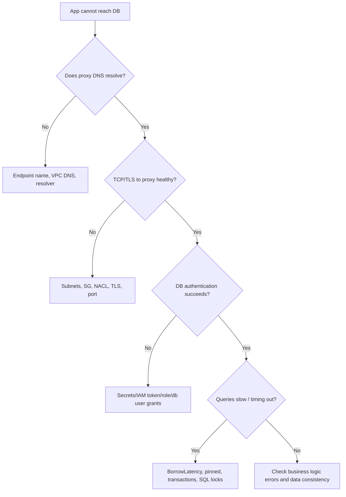

**Never** “fix” an IAM policy by granting `AdministratorAccess` to solve a SG-caused `TCP timeout`. Networking, authentication, pooling, and SQL semantics each belong to separate layers.

## 21. RDS Proxy costs and when you do not need it

Per [AWS RDS Proxy pricing](https://aws.amazon.com/rds/proxy/pricing/), RDS Proxy charges are based on the **capacity of the target database**:

- For supported RDS/Aurora **provisioned instances**, RDS Proxy bills per **vCPU-hour** of the instance.
- For supported **Aurora Serverless**, it bills per **ACU-hour** consumed by the DB.
- Partial usage is billed per second, with a **10-minute minimum charge** after billable state changes per current pricing rules.
- The **default proxy endpoint** has no separate endpoint fee; **additional proxy endpoints** may incur AWS PrivateLink charges.
- The database, Secrets Manager, CloudWatch Logs/metrics, NAT/data transfer, and related services carry separate charges.

### 21.1. Usage calculation example (without assigning USD rates)

Suppose a provisioned DB has **4 vCPUs** and RDS Proxy runs continuously for **720 hours/month**:

```text
Proxy capacity usage ≈ 4 vCPU × 720 hours
                     = 2,880 vCPU-hours

Proxy cost ≈ 2,880 × vCPU-hour unit price (Region/engine)
```

These numbers are **illustrative usage units**, not USD prices. Never take one Region's rate and apply it to `ap-southeast-1` or another database class without checking the Pricing Calculator.

### 21.2. Total cost comparison

| Item | Without proxy | With RDS Proxy |
|---|---|---|
| RDS Proxy fees | No | Yes |
| Database fees | Yes | Yes |
| Connection setup load on DB | Can be high during bursts | Reduced |
| DB resources for sessions | Tied to app pools, `max_connections` | Reduced when multiplexing is effective |
| Failover/reconnect effort | Handled more by the app | Proxy aids writer routing, though app still retries |
| Secrets/IAM/TLS | Still required | Still required, with extra auth layers |
| Additional VPC endpoints | Per architecture | Can rise if extra proxy endpoints are added |
| Observability | DB metrics | Additional proxy metrics |

RDS Proxy does not lower the bill for every system. For a **single small JVM** with few connections where HikariCP already suffices and normal failover suffices, proxy costs may outweigh benefits. For **Lambda burst traffic**, many ECS replicas, and fast failover needs, the benefits often merit serious evaluation.

### 21.3. When to consider alternatives?

- **RDS Proxy:** AWS-managed pooling, reduces session overhead across many clients, supports failover/IAM.
- **Plain HikariCP:** one or a few JVMs, steady connections, no proxy tier needed.
- **Self-managed PgBouncer:** PostgreSQL workloads needing specialized pooling with a team capable of operating HA/patching; verify transaction pooling/prepared statements and failover.
- **Aurora reader endpoints:** distribute read queries; **do not replace** proxy pooling/multiplexing.
- **Aurora Data API:** appropriate when an HTTP API fits better than persistent client sockets, with a distinct model and limits; verify engine/version and SDK support.
- **Cache/SQS/batching:** if the root problem is heavy SQL load or spikes, reduce query volume or smooth traffic rather than just changing how connections open.

## 22. Capstone lab: Spring Boot + Aurora PostgreSQL + RDS Proxy

**Scenario:** A Course API runs on ECS Fargate backed by Aurora PostgreSQL with a writer and reader, while reporting reads through a read-only endpoint. Goal: keep DB connection usage bounded, reduce autoscaling errors, and evaluate RDS Proxy against direct HikariCP.

### 22.1. Step-by-step exercises

1. Diagram App/SG → Proxy/SG → Aurora/SG in the same VPC across at least two eligible AZs.
2. Document the DB connection ceiling from `max_connections` minus connections reserved for admin/other apps.
3. Create DB user `course_app` with only required privileges (never admin).
4. Choose **Secrets Manager backend auth** or **end-to-end IAM**, documenting rationale and engine compatibility.
5. Create the proxy, register the cluster target, and enable `RequireTLS`.
6. Verify the target is `AVAILABLE` and retrieve the endpoint via AWS CLI.
7. Point Spring Boot `spring.datasource.url` to the proxy with an initial Hikari pool size of 8.
8. Run a sandbox load test collecting `ClientConnections`/`DatabaseConnections`/`BorrowLatency`/`Pinned`.
9. Scale 5 → 20 ECS tasks (if authorized and budgeted); compare against the connection budget.
10. Run a query with `SET` session state in the sandbox, measure the pinning increase, then remove unnecessary `SET`s.
11. If the cluster has a reader, create a **read-only proxy endpoint**, run a reporting workload, and observe replication lag.
12. Test failover via an approved procedure, verifying how idle connections and active transactions behave differently.
13. Test expired IAM tokens (without breaking production) and verify fresh token generation per physical connection.
14. Estimate costs by vCPU-hours or ACU-hours, PrivateLink, and logging.
15. Configure CloudWatch alarms, document rollback/cleanup, and compare against direct JDBC.

### 22.2. Measurement recording table

| Test run | ECS tasks | Hikari max/task | `ClientConnections` | `DatabaseConnections` | Pinned | `BorrowLatency` p95 | DB CPU | Result |
|---|---:|---:|---:|---:|---:|---:|---:|---|
| Direct Hikari baseline | 5 | 8 | No proxy | Measured | N/A | N/A | Measured | Pass/Fail |
| RDS Proxy low load | 5 | 8 | Measured | Measured | Measured | Measured | Measured | Pass/Fail |
| RDS Proxy burst | 20 | 8 | Measured | Measured | Measured | Measured | Measured | Pass/Fail |
| Intentional session `SET` | 20 | 8 | Measured | Measured | Measured | Measured | Measured | Pass/Fail |
| After removing extra `SET` | 20 | 8 | Measured | Measured | Measured | Measured | Measured | Pass/Fail |

**Never fabricate benchmark numbers.** Pull metrics from CloudWatch with accurate dimensions alongside matching application logs.

### 22.3. Acceptance checklist

- Application connects to the **proxy endpoint** without accidentally bypassing it.
- Proxy targets are available and SGs allow traffic in the right direction.
- TLS is required and enforced by the client.
- IAM roles/secrets are accurate, with no leaked passwords or tokens.
- Hikari pool is bounded with timeouts matching API SLOs.
- Transactions stay short, with no external HTTP calls inside a long DB transaction.
- Pinning is observed and explained.
- Failover is not assumed to complete every in-flight transaction.
- Reader endpoint is read-only and backed by a consistency strategy.
- Proxy + endpoint + database/log costs are accounted for.

## 23. Self-check questions

**1. Do HikariCP and RDS Proxy completely replace each other?**  
No. HikariCP manages connections **inside a JVM**, whereas RDS Proxy manages backend connections **across many client applications**.

**2. Why can 20 ECS tasks × HikariCP pool 10 still overload RDS?**  
Because direct connections can reach **200 database connections**, not counting other clients.

**3. Can multiplexing reuse a connection mid-way through an uncommitted transaction?**  
No. The proxy must hold the backend connection for that transaction and its session state until safe to release.

**4. What is session pinning?**  
The proxy locks a dedicated backend connection to a client session because the session holds state that cannot be safely shared; this reduces multiplexing.

**5. Can PostgreSQL `SET search_path` trigger pinning?**  
Yes. AWS lists PostgreSQL `SET` session state as a common cause of pinning.

**6. Does raising `MaxConnectionsPercent` from 50 to 100 always lower latency?**  
No. It may allow more borrows, but can consume nearly the entire DB connection budget, straining the DB and starving other clients.

**7. Which metric shows the number of currently pinned backend connections?**  
`DatabaseConnectionsCurrentlySessionPinned`.

**8. Is `DatabaseConnectionsBorrowLatency` measured in milliseconds or microseconds?**  
**Microseconds** per CloudWatch RDS Proxy metrics.

**9. Does RDS Proxy turn a single-AZ database without a standby into multi-AZ HA?**  
No. It improves connection management and failover when the DB topology supports HA, without replacing replication or standbys.

**10. An app is mid-transaction when Aurora fails over. Does the proxy guarantee COMMIT completes?**  
No. In-flight transactions may be severed; the application must check state and retry idempotently.

**11. Does Aurora's default proxy endpoint automatically split reads to readers?**  
No. The default read/write endpoint targets the writer; create a dedicated read-only endpoint when the cluster has eligible readers.

**12. Is RDS Proxy forced to use a Secrets Manager password in every 2026 setup?**  
No. AWS supports end-to-end IAM authentication on eligible engines with `DefaultAuthScheme=IAM_AUTH`.

**13. How long is an IAM token valid for opening a DB connection?**  
**15 minutes to authenticate a new connection**; generate a fresh token before opening new physical connections after the previous token expires.

**14. Should IAM user access keys be hardcoded in Spring Boot `application.yml`?**  
No. Use an ECS task role, EC2 instance profile, or Lambda execution role with the AWS SDK default credentials chain.

**15. Why can adding a new proxy endpoint raise costs?**  
Additional endpoints may provision billable PrivateLink interface endpoints in addition to RDS Proxy charges.

**16. Will RDS Proxy automatically speed up a SQL query that is slow due to a missing index?**  
No. You must tune SQL/indexes, DB capacity, and query plans.

**17. Should a backend using HikariCP raise its pool from 10 to 500 when adding RDS Proxy?**  
Not automatically. Huge pools inflate client connections and degrade efficiency under session pinning; measure real demand.

**18. When using IAM client auth with a proxy, which resource must the `rds-db:connect` policy target?**  
The appropriate **proxy resource ID DB user** resource, not just a DNS name; distinguish this from the DB instance/cluster resource ID used by the proxy role in end-to-end IAM.

## 24. Summary and references

**Connection pooling** in HikariCP reduces connection open/close overhead inside each Java application. **Amazon RDS Proxy** adds an AWS-managed connection tier that reuses and multiplexes backend connections across multiple workloads—especially valuable when ECS/Lambda scale rapidly or when reducing failover disruption.

However, **RDS Proxy does not fix slow SQL, does not guarantee zero downtime for in-flight transactions, and loses effectiveness if most sessions pin**. A sound design sizes the connection budget, keeps transactions short, enforces TLS and IAM least privilege, configures Secrets Manager or end-to-end IAM appropriately, monitors CloudWatch metrics, and budgets separately for proxy and PrivateLink costs.

### Official AWS documentation

- [Amazon RDS — RDS Proxy overview](https://docs.aws.amazon.com/AmazonRDS/latest/UserGuide/rds-proxy.html)
- [Amazon RDS — Concepts and terminology (pooling, multiplexing, pinning)](https://docs.aws.amazon.com/AmazonRDS/latest/UserGuide/rds-proxy.howitworks.html)
- [Amazon RDS — RDS Proxy connection considerations](https://docs.aws.amazon.com/AmazonRDS/latest/UserGuide/rds-proxy-connections.html)
- [Amazon RDS — RDS Proxy configuration guidelines](https://docs.aws.amazon.com/AmazonRDS/latest/UserGuide/rds-proxy-best-practices.configuration.html)
- [Amazon RDS — Workload considerations and application pools](https://docs.aws.amazon.com/AmazonRDS/latest/UserGuide/rds-proxy-best-practices.workload-considerations.html)
- [Amazon RDS — Avoiding session pinning](https://docs.aws.amazon.com/AmazonRDS/latest/UserGuide/rds-proxy-pinning.html)
- [Amazon RDS — Creating an RDS Proxy](https://docs.aws.amazon.com/AmazonRDS/latest/UserGuide/rds-proxy-creating.html)
- [Amazon RDS — Connecting through a proxy](https://docs.aws.amazon.com/AmazonRDS/latest/UserGuide/rds-proxy-connecting.html)
- [Amazon RDS — IAM authentication for RDS Proxy](https://docs.aws.amazon.com/AmazonRDS/latest/UserGuide/rds-proxy-iam-setup.html)
- [Amazon RDS — Monitoring RDS Proxy metrics with CloudWatch](https://docs.aws.amazon.com/AmazonRDS/latest/UserGuide/rds-proxy.monitoring.html)
- [Amazon RDS — RDS Proxy endpoints](https://docs.aws.amazon.com/AmazonRDS/latest/UserGuide/rds-proxy-endpoints.html)
- [Amazon Aurora — RDS Proxy endpoints and readers](https://docs.aws.amazon.com/AmazonRDS/latest/AuroraUserGuide/rds-proxy-endpoints.html)
- [Amazon Aurora — RDS Proxy and failover](https://docs.aws.amazon.com/AmazonRDS/latest/AuroraUserGuide/rds-proxy.howitworks.html)
- [Amazon RDS — IAM authentication token and connection](https://docs.aws.amazon.com/AmazonRDS/latest/UserGuide/UsingWithRDS.IAMDBAuth.Connecting.html)
- [Amazon RDS Proxy — Pricing](https://aws.amazon.com/rds/proxy/pricing/)
- [AWS Prescriptive Guidance — RDS Proxy best practices](https://docs.aws.amazon.com/prescriptive-guidance/latest/amazon-rds-proxy/best-practices.html)

> **Practice note:** All endpoints, ARNs, VPC subnet/SG IDs, users, passwords, and performance/cost numbers are examples only. Never run create/modify/delete commands on a production database without approval. Verify Region, engine/version, IAM permissions, VPC connectivity, pricing, and rollback plans before using RDS Proxy with real data.
