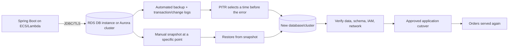
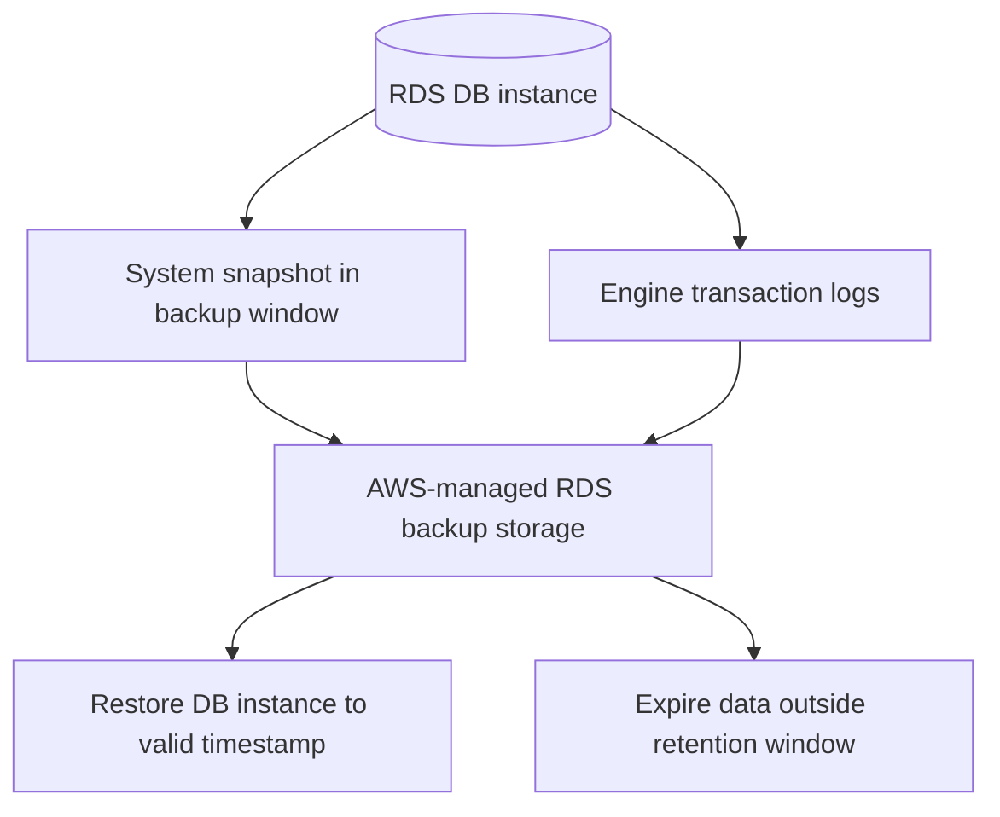
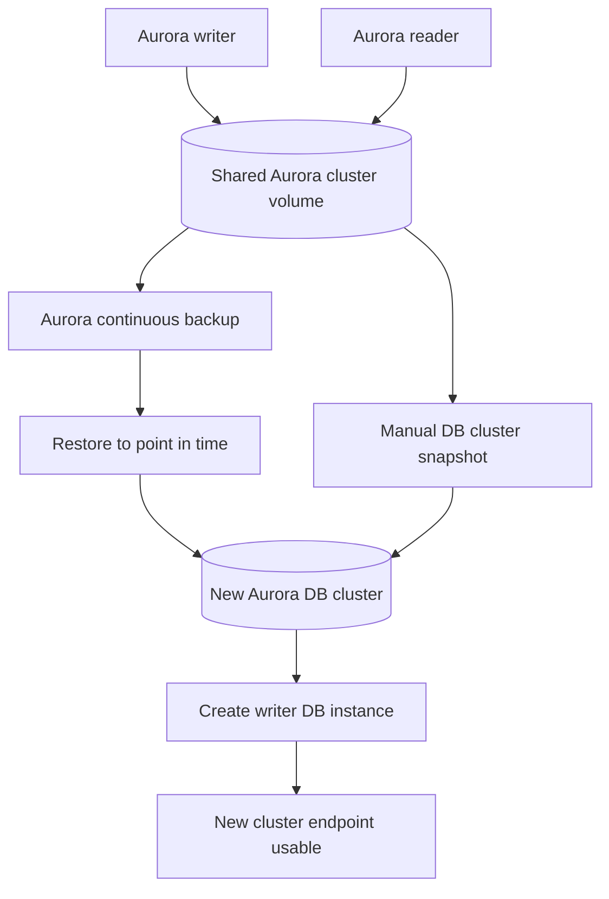
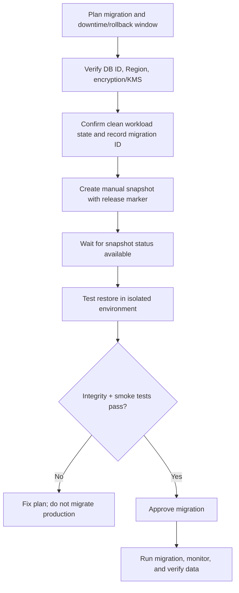
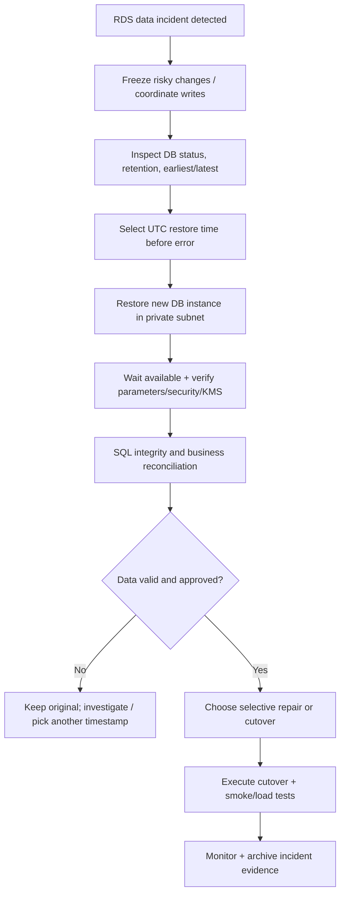
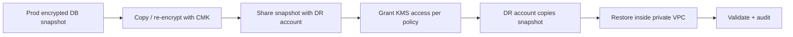
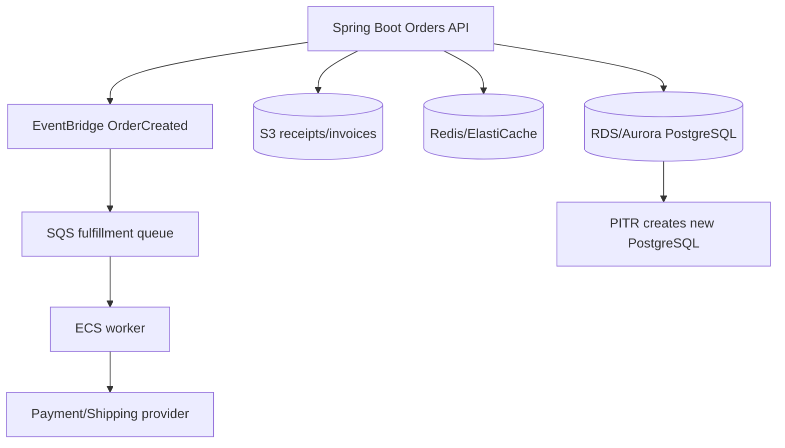

# Automated Backups, Snapshots, and Point-in-Time Recovery

> **Chapter:** RDS and Aurora Databases · **Module:** `CLOUD_PROVIDERS_AWS`

## 1. The problem: accidental data deletion in production

An ordering system uses **Spring Boot** on ECS and **Amazon RDS for PostgreSQL** to store orders. At 09:15, a faulty migration runs an erroneous update, wiping payment statuses across thousands of orders. The server and database remain `available`, Multi-AZ is healthy, yet **business data is corrupted**.

The operations team must immediately answer:

1. When was the data still intact? Should we choose **09:14:59** as the recovery point or another timestamp based on logs?
2. **Up to what timestamp** is the data backed up? Is that exact timestamp selectable in the system?
3. After recovery, where will the new database be created? How does the application switch connections?
4. Will valid orders placed between 09:15 and incident handling be lost if we cut over completely to the restored copy?
5. How do we verify integrity, downtime, RPO/RTO, and cost?

**Amazon RDS automated backups**, **manual snapshots**, and **point-in-time recovery (PITR)** address different needs. **Amazon Aurora** also supports PITR, though its storage architecture and **cluster-level** restore workflow differ from an RDS DB instance.



**Key takeaway:** RDS/Aurora backups do not automatically roll back data inside a running database when someone runs an accidental delete. **PITR and snapshot restores create new resources**; the app owner must decide which data to preserve, test thoroughly, and then cut over. **Multi-AZ is not a backup**, because accidental deletions are replicated to the standby.

Within the `CLOUD_PROVIDERS_AWS` module, this lesson connects **IAM, VPC/private subnets, Regions/AZs, ECS/Lambda Java, S3, AWS Backup, CloudWatch, security, resilience, and cost governance**.

**Learning objectives:**

- Distinguish automated backups, manual snapshots, final snapshots, retained automated backups, PITR, Aurora clones, and Backtrack.
- Choose backup retention and explain **earliest/latest restorable time**; calculate RPO/RTO against real targets.
- Inspect configurations via AWS CLI and restore an **RDS DB instance** or **Aurora DB cluster** to a target point in time.
- Understand why restoring Aurora via CLI requires **creating a writer DB instance** and why the restored endpoint changes.
- Design cross-Region/cross-account backup/copy workflows and protect snapshots with AWS KMS/IAM.
- Build an evidence-backed runbook with business validation, cutover/rollback, monitoring, and periodic restore drills.

## 2. Storage objects to distinguish

### 2.1. RDS DB instance, Multi-AZ, and Aurora DB cluster

| Deployment | Backup/PITR management unit | Characteristics |
| --- | --- | --- |
| **RDS Single-AZ DB instance** | DB instance. | Automated backups combine system snapshots and transaction logs; PITR creates a new DB instance. |
| **RDS Multi-AZ DB instance** | DB instance including HA standby. | Fails over to standby on infrastructure failure; PITR still creates a **new instance** and is required for logical errors. |
| **RDS Multi-AZ DB cluster** | DB cluster with writer and reader/standby instances per config. | Backup retention **1–35 days**, uses cluster restore APIs; do not confuse with Multi-AZ DB instance. |
| **Aurora MySQL/PostgreSQL DB cluster** | **Cluster volume**, not individual writer/reader instances. | Continuous incremental backups; PITR creates a **new cluster**, and CLI restore requires creating a writer DB instance next. |

**Aurora ≠ RDS Multi-AZ DB instance.** Aurora decouples compute from multi-AZ replicated cluster storage, supporting writer/reader instances and cluster endpoints. An RDS Multi-AZ DB instance uses a separate standby model. These differences matter during restores, monitoring, costing, and cutovers.

### 2.2. Four types of “recovery artifacts”

| Type | Created by | Recovery point | How long does it persist? |
| --- | --- | --- | --- |
| **Automated backup** | RDS/Aurora per retention. | Supports PITR within the protected window. | Expires per retention, subject to source state and policies. |
| **Manual DB/cluster snapshot** | User, automation, or approved workflow. | **Exact snapshot point** (not arbitrary later timestamps). | Does not expire with automated backup retention; stays until deleted, incurring charges. |
| **Final snapshot** | Optional when deleting a DB/cluster. | Captured near deletion time. | Independent snapshot; must be managed/deleted intentionally. |
| **Retained automated backup** | Choosing to keep automated backups when deleting a supported **RDS DB instance**. | Supports PITR within the remaining valid window. | Expires per retention; does not persist indefinitely like a manual snapshot. |

A snapshot is only a **consistent image of database/storage data at capture time**; it does not guarantee business transactions completed identically in SQS, S3, or external payment providers.

### 2.3. RPO and RTO

**Recovery Point Objective (RPO):** maximum acceptable data loss, measured in time or business transactions. **Recovery Time Objective (RTO):** maximum acceptable duration to restore service after an incident occurs.

```text
09:00  09:05  09:10  09:14:59  09:15         09:30       10:00
 |------|------|------|-------| DELETE error |-----------| Service restored
         automated backups + logs             detected    cutover

Recovery point: 09:14:59 UTC (if inside restorable window)
Actual RPO: gap between recovery point and latest valid data needed
Actual RTO: detection + decision + restore + validation + cutover time
```

The example above does not guarantee **zero** RPO: even though PITR restores close to the error, the restored database can still miss valid transactions committed right after the chosen timestamp. Additionally, **`LatestRestorableTime`** normally trails wall-clock time by a few minutes depending on engine/state; always read the real value via the API.

**Backup retention** defines how far back you can go; **backup frequency/log delivery** governs the latest restorable point; **restore/cutover time** drives RTO. Never conclude “7-day retention” means “guaranteed RPO 0 and RTO 5 minutes.”

### 2.4. Protecting data from infrastructure vs. logical failures

| Incident | Multi-AZ / failover | Read replica | Backup / PITR |
| --- | --- | --- | --- |
| AZ hosting writer fails | Provides HA per architecture. | May have a reader, though promotion/cutover is needed. | Fallback recovery if HA is insufficient. |
| Accidental table/row deletion | Does not undo — error is replicated. | Error propagates to replicas. | Restore prior to error timestamp and reconcile. |
| Faulty schema migration deployment | Does not roll back schema. | Replicas receive the same change. | Pre-migration snapshot + PITR. |
| Region outage | Same-Region Multi-AZ cannot save it. | Cross-Region replica subject to architecture, lag, and permissions. | Cross-Region backups/snapshot copies, DR plan. |
| Attacker deletes backups | Does not isolate backups. | Does not isolate backups. | Cross-account backups, IAM/SCPs, Vault Lock where supported. |

## 3. Automated backups in Amazon RDS

### 3.1. How it works

For an **RDS DB instance** (e.g., PostgreSQL/MySQL), automated backups use **system snapshots and database transaction logs** to recover data to any point within the retention window. RDS takes a daily automated backup during the **preferred backup window** and uploads transaction logs for PITR to backup storage; for DB instances, AWS documents transaction log uploads roughly **every 5 minutes**.



RDS backup data is stored on AWS-managed storage infrastructure (documented as Amazon S3). **This is not a user-accessible S3 bucket where you run `aws s3 ls` to download PostgreSQL WAL or MySQL binlog files.** Use the RDS Console/API/CLI or AWS Backup restore workflows.

### 3.2. Retention: differences between Console and CLI

For common RDS DB instances:

- **0–35 days**; `0` means **automated backups are disabled**. Never use `0` in production requiring PITR.
- When creating via **AWS CLI/API** and omitting `BackupRetentionPeriod`, the documented default is **1 day**.
- When creating via the **RDS Console** with defaults, retention is typically **7 days**.
- When **restoring** from a snapshot/instance without specifying retention, the new DB may **inherit the source's retention** per restore rules, differing from new-DB defaults.
- **RDS Multi-AZ DB clusters** have retention of **1–35 days**; `0` is not allowed.

**Do not assume:** every Terraform/CloudFormation stack defaults to “7 days” like the Console. Declare retention explicitly in IaC and verify after deployment. Specific engines/modes have their own constraints.

Changing `BackupRetentionPeriod` from `0` to a positive number or vice versa on an RDS DB instance **causes an outage** per AWS documentation, requiring maintenance/change review. Changing from one positive number to another behaves differently; verify engine/instance specifics.

### 3.3. Backup windows and I/O impact

The **preferred backup window** is when RDS initiates the backup, not a guarantee it finishes within that window. It must not overlap the **maintenance window**.

- Single-AZ RDS may experience a **brief I/O suspension** when starting a backup; monitor application latency.
- On many engines (MariaDB/MySQL/Oracle/PostgreSQL) in an RDS Multi-AZ DB instance, backups are typically taken from the **standby**, reducing impact on the primary; **SQL Server/Db2** have different behaviors and may briefly suspend I/O.
- Backup windows are specified in **UTC**; check the Vietnam **UTC+7** offset when choosing “off-peak hours.”
- Avoid scheduling backups right on top of heavy batch jobs, migrations, or load tests whenever possible.

**Stopped DB instance:** RDS does not create new automated backups while an instance is `stopped`; stopped days do not advance retention like normal active days. Never rely on “stopping to save money” while expecting fresh RPOs.

### 3.4. Valid PITR window

For an RDS DB instance:

```text
Earliest restorable time                         LatestRestorableTime
        |------------------------------------------------|
        ^                                                 ^
  cannot select outside                           usually lags "now"
  this range for normal PITR                      by a few minutes
```

To choose a restore timestamp:

1. Pinpoint the **exact time the error occurred** via CloudTrail, RDS PostgreSQL logs, application audits, and deployment timelines (never guess).
2. Pick a timestamp **before the bad event**; read actual **Earliest/Latest Restorable Time**.
3. Pass UTC timestamps to the CLI/API—never convert time zones mentally.
4. If data after the restore point must be preserved, plan audited **data reconciliation**.

RDS retaining transaction logs does not mean you can run a **point-in-time SQL query** directly on the live DB. PITR must provision a new recovery resource and wait until it accepts connections.

### 3.5. Deleting a DB instance and retained automated backups

When deleting a supported DB instance, AWS lets you choose:

- **Final snapshot:** a final manual snapshot that does not expire automatically with retention.
- **Retain automated backups:** keeps system snapshots + transaction logs for the remaining retention period, allowing PITR within that window.

**Retained automated backups apply to supported RDS DB instances, not RDS Multi-AZ DB clusters via the exact same mechanism.** These retained backups **eventually expire**, because once the instance is deleted no new logs or snapshots are taken.

If you decline retaining automated backups upon deletion, RDS deletes them (except separately managed copies/replications), making PITR from that source impossible. **Manual/final snapshots** are not automatically deleted with the DB instance.

## 4. Amazon Aurora: continuous cluster-level backups

### 4.1. Aurora's architecture differs from DB instance backups

Amazon Aurora stores data on a **cluster volume** shared across DB instances in the cluster. **Aurora automated backups are continuous and incremental** at the volume level:

- Retention from **1 to 35 days**.
- **Automated backups cannot be disabled** on Aurora using retention `0`.
- Aurora's **default retention** is typically **1 day**, regardless of how the cluster is created.
- Backups can restore to any valid timestamp; AWS notes **`LatestRestorableTime` is typically within ~5 minutes of current time** on an active cluster.
- Manual **DB cluster snapshots** can be retained beyond automated retention and do not auto-expire.



**Aurora backups still require restore practice.** “Continuous backup” does not prove IAM/KMS, subnet groups, security groups, cluster instance creation, and app connectivity have been tested.

### 4.2. Backup retention and cluster-wide properties

Aurora manages `BackupRetentionPeriod` at the **DB cluster**, not per writer or reader. Therefore:

- Check `aws rds describe-db-clusters`, not just `describe-db-instances`.
- Set retention per business/data-classification requirements (minimum 1 day).
- Set a backup window if desired, but do not mistake it for “the only time Aurora takes snapshots for PITR.”
- Manual cluster snapshots have their own lifecycle, created via `create-db-cluster-snapshot` and restored via `restore-db-cluster-from-snapshot`.

**Aurora Serverless v2** is still an Aurora DB cluster with compute autoscaling; backup/PITR operate on cluster storage. However, restoring and selecting DB instance class/scaling config for Serverless v2 differs from provisioned instances—verify engine/version and scaling configuration on the restored cluster.

### 4.3. Restoring Aurora creates a new cluster, never overwrites the old one

When restoring from an Aurora automated backup or manual cluster snapshot:

1. RDS creates a **new DB cluster** with a new identifier and endpoint.
2. Restoring via **AWS CLI/API** typically creates **cluster storage**, **without creating a writer DB instance**.
3. You must call `create-db-instance` with `--db-cluster-identifier` to add a writer (and readers per HA/capacity plan).
4. Only after both cluster and instance are `available` with proper networking/roles/parameters can the app connect to the endpoint.

The **RDS Console** can create the writer instance automatically during restore, so Console and CLI workflows are not identical. Never see cluster status `available` without a writer and assume PITR is ready for traffic.

### 4.4. Aurora Backtrack is not PITR

A distinct feature is **Aurora MySQL Backtrack** on supported versions/Regions. Backtrack can **rewind the existing cluster** to a point before an error much faster than many restore workflows, yet it **interrupts connections**, has a bounded backtrack window, and does not replace backups.

| Feature | Aurora PITR | Aurora Backtrack |
| --- | --- | --- |
| Goal | Creates a **new cluster** from backup at a chosen timestamp. | Rewinds the **existing cluster** to a prior state. |
| Data source | Continuous backups. | Backtrack change records when enabled. |
| Downtime/cutover | Requires building cluster/writer, testing, and switching endpoints. | Drops/disrupts app connections during rewind; no new cluster created. |
| Support | Aurora MySQL and PostgreSQL per versions. | **Aurora MySQL** in supported versions/Regions; not available for Aurora PostgreSQL. |
| Data impact | Produces a separate copy to inspect and cut over to. | Rewinds in place on the source, discarding changes after the rewind point. |
| Replaces backups? | No. | **No**. |

If the team needs forensics or wants to extract data before cutover, PITR creating a new cluster is usually safer to inspect than running Backtrack directly on production. With Backtrack, pay special attention to interactions with binary logging, replication, and upgrades.

## 5. Manual snapshots: intentional checkpoints and long-term retention

### 5.1. When should you take a manual snapshot?

A **manual snapshot** is appropriate when the operations team intentionally wants a preserved checkpoint, such as:

- **Before a schema migration** involving destructive changes like dropping columns, changing column types, or major DB engine upgrades.
- **Before a major release**, ETL change, or bulk update campaign.
- **At the end of a fiscal period** when policy mandates retaining audit snapshots.
- **Cloning data for staging/DR** after masking/anonymization and access controls.
- **Ensuring a recovery copy survives** after deleting a DB instance/cluster beyond automated backup retention.

A snapshot does not replace a **logical export** (like `pg_dump`) when you only need a single schema/table, nor does it provide an API to restore **a single deleted row**. Fundamentally, restoring a snapshot creates a **new DB instance/cluster holding data as of the snapshot time**; extracting specific rows requires querying the restored DB and migrating safely.

### 5.2. Manual snapshot properties

| Property | RDS DB snapshot | Aurora DB cluster snapshot |
| --- | --- | --- |
| Scope | Whole DB instance/storage, not a single schema/table. | Whole cluster volume; all databases in the cluster are captured together. |
| CLI create | `create-db-snapshot`. | `create-db-cluster-snapshot`. |
| CLI inspect | `describe-db-snapshots`. | `describe-db-cluster-snapshots`. |
| CLI restore | `restore-db-instance-from-db-snapshot`. | `restore-db-cluster-from-snapshot` then **create writer DB instance**. |
| Retention | Does not expire with automated backup retention. | Same; requires deliberate deletion. |
| Copy/share? | Subject to engine/Region/permissions/KMS restrictions. | Subject to Aurora cluster snapshot rules and restrictions. |

**Snapshots are managed via AWS APIs**, even though underlying blocks live on AWS-managed S3 infrastructure. **There is no user-accessible S3 bucket to browse block-level snapshots.** **Exporting snapshot data to S3** (where supported) writes data in formats like Parquet for analytics, yet **those exported files cannot be restored directly via RDS**.

**PostgreSQL note:** data in `UNLOGGED` tables may not be recovered from RDS snapshots/PITR, because PostgreSQL does not write those changes to WAL like normal tables. Never store critical business data that cannot be lost in unlogged tables; verify behavior in restore drills.

### 5.3. Pre-migration snapshot — runbook



Receiving “snapshot request accepted” is **not enough**. Snapshots can remain `creating` for a long time or fail; wait for `available`, record the identifier/ARN/KMS key/size/timestamp, and ensure a test restore has been validated beforehand. Systems under continuous writes need a clear **consistency point** across external services (S3, SQS, payment APIs, Redis cache), not just a DB snapshot.

### 5.4. Snapshots vs. scheduled backups

A manual snapshot captures a specific point, e.g., 08:50 before a schema migration. If an error occurs at 11:00 and you need 10:59, **an 08:50 snapshot alone cannot** return data to 10:59; you need automated backups/PITR or another log/archive strategy. Conversely, if an incident involves malicious encryption and automated backups risk deletion in the same account, a **snapshot copy in a DR account protected by IAM/KMS** improves recoverability.

Manual snapshots can be deleted accidentally or by an attacker with IAM permissions; “does not auto-expire” **does not mean immutable**. AWS Backup Vault Lock, cross-account copies, and deletion protection/SCPs are separate protective layers that must be configured explicitly.

## 6. Choosing snapshot, PITR, Multi-AZ, or logical restore

### 6.1. Decision table

| Requirement | Preferred option | Why / limitations |
| --- | --- | --- |
| Host/AZ fails, data is still valid. | **Multi-AZ automatic failover** or Aurora reader failover. | Optimizes availability; cannot roll back logical errors. |
| Table accidentally deleted at 09:15; need 09:14:59. | **PITR** from valid automated backup. | Creates a new DB/cluster at that exact time; reconcile later writes. |
| Want a checkpoint before a major migration. | **Manual snapshot** (alongside continuous PITR). | Explicit rollback anchor retained outside automated window if needed. |
| Need 90-day / multi-year retention. | **Manual snapshots / AWS Backup policy** or compliant archival exports. | Standard automated backup retention caps at 35 days. |
| Need to recover just a few rows. | Restore into an **isolated DB**, then selectively query/insert. | PITR/snapshots cannot “undo 1 row” in place on the source DB. |
| Need geographically independent backups. | **Cross-Region snapshot copy / automated backup replication** per service. | Multi-AZ stays in one Region; does not replace Regional DR. |
| Protect backups if prod account is compromised. | **Cross-account AWS Backup + Vault Lock** or equivalent backup isolation. | Separation of duties and immutability policies; test restores. |
| Fast rewind on same Aurora MySQL cluster. | **Aurora Backtrack** if version/Region supports it and downtime/rewind is acceptable. | Does not replace backups; disrupts the live cluster. |
| Clone Aurora to test migrations/analytics. | **Aurora fast clone (copy-on-write)** where supported, or snapshot restore. | A clone is not a long-term backup or DR isolation layer. |
| Need specific tables/schemas or logical migration. | Verified **logical backup/export**. | Distinct from block/volume snapshots and PITR. |

### 6.2. A concrete timestamp example

Suppose data was intact until 09:14:50, an accidental delete committed at 09:15:00, and the issue was detected at 09:20:00. RDS reports:

```text
EarliestRestorableTime: 2026-11-13T00:00:00Z
LatestRestorableTime:   2026-11-20T02:18:00Z
Current time:          2026-11-20T02:20:00Z (09:20 ICT)
Fault commit:          2026-11-20T02:15:00Z (09:15 ICT)
Candidate restore:     2026-11-20T02:14:50Z (09:14:50 ICT)
```

Because the candidate falls inside earliest/latest, PITR can be **requested** for this timestamp. However, if `LatestRestorableTime=02:13:00Z`, then `02:14:50Z` is **not yet available**; you must either wait for newer logs or pick an earlier timestamp with higher RPO.

In Vietnam, **ICT = UTC+7**; the example converts 09:14:50 ICT to 02:14:50Z. Never mix up UTC app timestamps, database session time zones, and operator local time. Always pass ISO-8601 timestamps ending in `Z` to the CLI and verify values returned by AWS.

### 6.3. PITR does not mean zero data loss

When restoring to 09:14:50:

- Transactions prior to that point can be recovered if the snapshot/log chain is intact.
- Valid transactions after that point (09:14:51–09:20) are **absent** from the restored database, even though they were legitimate.
- Events in SQS, SNS, EventBridge, and external payment gateways may still reflect newer actions.
- API writes after incident detection must be **stopped, buffered, or logged** during the cutover window to avoid losing even more data.

Therefore, the safest path is sometimes restoring a **secondary DB to extract the deleted data** and applying targeted repairs on the current DB, rather than replacing the entire database and discarding valid subsequent writes. Decide based on blast radius and reconciliation confidence.

## 7. AWS CLI: inspecting backups before any restore command

Example commands use **AWS CLI v2** in Bash/CloudShell. Regions, DB identifiers, and ARNs are **hypothetical**; never run mutating commands on production without approval. The `describe`/`list` commands in this section are **read-only**.

### 7.1. Verify account and Region

```bash
aws sts get-caller-identity
aws configure get region

# With multiple accounts/profiles, pass --profile and --region explicitly.
aws rds describe-db-instances \
  --region ap-southeast-1 \
  --query 'DBInstances[].{ID:DBInstanceIdentifier,Engine:Engine,Status:DBInstanceStatus,MultiAZ:MultiAZ,Retention:BackupRetentionPeriod}' \
  --output table
```

Example resource names:

```text
RDS PostgreSQL instance: orders-pg-prod
Aurora PostgreSQL cluster: orders-aurora-prod
Region: ap-southeast-1
```

If a DB does not appear, you may be in the wrong account, wrong Region, missing `rds:DescribeDBInstances`, or the DB is actually an **Aurora cluster** and you queried the wrong API.

### 7.2. RDS instance: backup retention and latest restorable time

```bash
aws rds describe-db-instances \
  --region ap-southeast-1 \
  --db-instance-identifier orders-pg-prod \
  --query 'DBInstances[0].{ID:DBInstanceIdentifier,Engine:Engine,Status:DBInstanceStatus,Retention:BackupRetentionPeriod,Latest:LatestRestorableTime,BackupWindow:PreferredBackupWindow,MultiAZ:MultiAZ,Encrypted:StorageEncrypted,KMS:KmsKeyId,DeletionProtection:DeletionProtection,SubnetGroup:DBSubnetGroup.DBSubnetGroupName}' \
  --output json
```

`LatestRestorableTime` may be missing/null if no eligible automated backups exist yet or the DB is in a special state. Do not assume the DB is empty; check **backup status, retention, backup window, and DB events**.

To inspect earliest/latest restorable times in the UI, go to **RDS Console → Automated backups → Current Region**; the `DescribeDBInstanceAutomatedBackups` API returns `RestoreWindow` for listed automated backups. Example:

```bash
aws rds describe-db-instance-automated-backups \
  --region ap-southeast-1 \
  --db-instance-identifier orders-pg-prod \
  --query 'DBInstanceAutomatedBackups[].{ID:DBInstanceIdentifier,Status:Status,Window:RestoreWindow,Retention:BackupRetentionPeriod}' \
  --output json
```

### 7.3. Aurora cluster: earliest/latest

```bash
aws rds describe-db-clusters \
  --region ap-southeast-1 \
  --db-cluster-identifier orders-aurora-prod \
  --query 'DBClusters[0].{ID:DBClusterIdentifier,Engine:Engine,Status:Status,Retention:BackupRetentionPeriod,Earliest:EarliestRestorableTime,Latest:LatestRestorableTime,Encrypted:StorageEncrypted,KMS:KmsKeyId,Endpoint:Endpoint,ReaderEndpoint:ReaderEndpoint}' \
  --output json
```

If `LatestRestorableTime` lags further behind than usual, inspect cluster health/events/backup processes, CloudWatch metrics, and service limits rather than requesting an unavailable timestamp.

### 7.4. List manual snapshots and status

```bash
# RDS DB instance snapshots
aws rds describe-db-snapshots \
  --region ap-southeast-1 \
  --db-instance-identifier orders-pg-prod \
  --snapshot-type manual \
  --query 'DBSnapshots[].{ID:DBSnapshotIdentifier,Created:SnapshotCreateTime,Status:Status,Encrypted:Encrypted,SizeGiB:AllocatedStorage}' \
  --output table

# Aurora DB cluster snapshots
aws rds describe-db-cluster-snapshots \
  --region ap-southeast-1 \
  --db-cluster-identifier orders-aurora-prod \
  --snapshot-type manual \
  --query 'DBClusterSnapshots[].{ID:DBClusterSnapshotIdentifier,Created:SnapshotCreateTime,Status:Status,Encrypted:StorageEncrypted}' \
  --output table
```

Snapshot status `available` is necessary for restore, yet **does not prove** you have KMS permissions, subnet IP capacity, engine compatibility, or that a restored database starts cleanly. Backup testing must include actual restores and validation.

## 8. RDS PostgreSQL practice: snapshots and PITR

### 8.1. Runbook diagram



**Restore operations create a new DB and incur DB instance/storage/backup charges**, and risk data alteration or exposure if configured on the wrong network. The commands below are strictly for **authorized AWS labs or approved DR runbooks**. Learners without AWS access can draft scripts/docs and review expected outputs without executing them.

### 8.2. Create a manual snapshot before migration (mutating)

```bash
aws rds create-db-snapshot \
  --region ap-southeast-1 \
  --db-instance-identifier orders-pg-prod \
  --db-snapshot-identifier orders-pg-before-migration-20261120

aws rds wait db-snapshot-available \
  --region ap-southeast-1 \
  --db-snapshot-identifier orders-pg-before-migration-20261120

aws rds describe-db-snapshots \
  --region ap-southeast-1 \
  --db-snapshot-identifier orders-pg-before-migration-20261120 \
  --query 'DBSnapshots[0].{Status:Status,Created:SnapshotCreateTime,Arn:DBSnapshotArn,Kms:KmsKeyId}' \
  --output json
```

**Constraints:** the source must be in a supported state (normally `available`), and the snapshot name must be unique. Waiters have polling limits and can time out if a snapshot takes longer than default; check status with `describe-db-snapshots` before retrying creation. Do not delete the snapshot until the migration is verified.

### 8.3. Restore from a manual snapshot (fixed snapshot point)

```bash
aws rds restore-db-instance-from-db-snapshot \
  --region ap-southeast-1 \
  --db-instance-identifier orders-pg-snapshot-lab \
  --db-snapshot-identifier orders-pg-before-migration-20261120 \
  --db-instance-class db.t4g.medium \
  --db-subnet-group-name orders-private-subnets \
  --vpc-security-group-ids sg-0123456789abcdef0 \
  --no-publicly-accessible \
  --backup-retention-period 7

aws rds wait db-instance-available \
  --region ap-southeast-1 \
  --db-instance-identifier orders-pg-snapshot-lab
```

`db.t4g.medium`, subnet group, and SG are **placeholders**; pick an engine-compatible instance class and an existing private subnet group in your lab. When restoring an encrypted snapshot, KMS key policies and account permissions must allow it. A snapshot restore cannot roll forward to arbitrary timestamps after the snapshot was taken.

### 8.4. PITR to a specific timestamp

Suppose the error occurred at **2026-11-20 02:15:00 UTC**, and you choose **02:14:50Z** after verifying RDS `RestoreWindow` allows it. Create a **new target DB identifier**:

```bash
aws rds restore-db-instance-to-point-in-time \
  --region ap-southeast-1 \
  --source-db-instance-identifier orders-pg-prod \
  --target-db-instance-identifier orders-pg-pitr-lab \
  --restore-time '2026-11-20T02:14:50Z' \
  --db-instance-class db.t4g.medium \
  --db-subnet-group-name orders-private-subnets \
  --vpc-security-group-ids sg-0123456789abcdef0 \
  --no-publicly-accessible \
  --backup-retention-period 7

aws rds wait db-instance-available \
  --region ap-southeast-1 \
  --db-instance-identifier orders-pg-pitr-lab
```

Never pass **`--restore-time` and `--use-latest-restorable-time` together**. To restore to the latest RDS-supported timestamp, use:

```bash
# Standalone example: do not combine with --restore-time.
aws rds restore-db-instance-to-point-in-time \
  --region ap-southeast-1 \
  --source-db-instance-identifier orders-pg-prod \
  --target-db-instance-identifier orders-pg-latest-lab \
  --use-latest-restorable-time \
  --db-subnet-group-name orders-private-subnets \
  --vpc-security-group-ids sg-0123456789abcdef0 \
  --no-publicly-accessible
```

Each restore command creates a **new DB instance**, leaving `orders-pg-prod` untouched. Use `--use-latest-restorable-time` only when maximizing data closest to the present; to roll back **before an accidental table drop**, specify a timestamp **before the error occurred**, never latest.

### 8.5. Inspect the restored instance and network permissions

```bash
aws rds describe-db-instances \
  --region ap-southeast-1 \
  --db-instance-identifier orders-pg-pitr-lab \
  --query 'DBInstances[0].{ID:DBInstanceIdentifier,Status:DBInstanceStatus,Endpoint:Endpoint.Address,Port:Endpoint.Port,Engine:Engine,Version:EngineVersion,Subnets:DBSubnetGroup.DBSubnetGroupName,SGs:VpcSecurityGroups,ParamGroups:DBParameterGroups,Encrypted:StorageEncrypted,Kms:KmsKeyId}' \
  --output json
```

**Critically important:** an RDS PITR instance often uses the **default DB parameter group, option group, and DB security group/subnet group** unless specified otherwise (per engine/API), and typically restores as Single-AZ by default. Never assume the restored DB automatically inherits the source's VPC SGs, Multi-AZ setting, DNS alias, CA certificate, IAM DB authentication, monitoring settings, or backup alarms.

Even after status reaches `available`, RDS may **lazy-load data pages** from backup storage in the background; initial queries touching uncached pages can be slow. Before sending production traffic, test latency/throughput and consider warming critical queries per engine/version guidance.

### 8.6. Run SQL checks before cutting over traffic

Connect from an **authorized bastion/SSM Session Manager/VPC workload**, never exposing the DB to the Internet. PostgreSQL client example:

```bash
export PGHOST='orders-pg-pitr-lab.example.rds.amazonaws.com'
export PGPORT=5432
export PGDATABASE='orders'
export PGUSER='readonly_recovery'
export PGSSLMODE='verify-full'
export PGSSLROOTCERT='/path/to/rds-ca-bundle.pem'

# Certificates, endpoint, and credentials must be real and valid.
psql -c "SELECT current_database(), current_timestamp;"
psql -c "SELECT count(*) FROM orders WHERE status = 'PAID';"
```

Never put passwords in shell history; use AWS Secrets Manager or IAM DB auth depending on engine and connection behavior. `PGHOST` above is a **placeholder**; no real DNS endpoint is created by this document.

Essential checks:

- Migration schema version, constraints/indexes, and business row counts/checksums.
- Are the accidentally deleted records back? Are any records present that **should not** return?
- Foreign key consistency, order/payment event reconciliation, outbox, and idempotency records.
- JDBC connection tests, Spring Boot health checks, transaction isolation, and permissions.
- Query performance, disk/temp space, connection pools, and network latency from actual ECS/Lambda subnets.
- PII/sensitive data in the restored DB must be protected at production standards.

### 8.7. Cutover after approval

Choose one of two approaches:

**A. Selective recovery:** Keep the current production DB, read the missing rows/schema from the restored DB in an isolated environment, and re-import only the **reconciled** records. This minimizes losing valid post-incident transactions, though it requires careful SQL migration/transaction design and conflict checking.

**B. Full cutover:** Put writes into maintenance or a safe buffer; verify backups/readiness; update endpoints/connection secrets/app config to the restored DB, restart/recycle JDBC pools or redeploy; run smoke tests; monitor; keep the old DB **read-only/inaccessible** per retention/incident policy.

A new RDS DB identifier does not make the old endpoint automatically point to the new DB. If using Route 53 CNAMEs, a DB proxy, or Secrets Manager to abstract endpoints, account for TTL, DNS caching, connection pools, and rollback capability.

**Never run `delete-db-instance` or alter production security groups until the restored DB is fully verified.** Keep the original data/backups for forensics and avoid compounding risk mid-incident.

## 9. Aurora PostgreSQL/MySQL: PITR and snapshots via CLI

### 9.1. Cluster preflight

Verify the Aurora cluster, writer/readers, backup window/retention, and restore window:

```bash
aws rds describe-db-clusters \
  --region ap-southeast-1 \
  --db-cluster-identifier orders-aurora-prod \
  --query 'DBClusters[0].{ID:DBClusterIdentifier,Status:Status,Engine:Engine,EngineVersion:EngineVersion,Retention:BackupRetentionPeriod,Earliest:EarliestRestorableTime,Latest:LatestRestorableTime,Members:DBClusterMembers,Endpoint:Endpoint,Reader:ReaderEndpoint}' \
  --output json
```

If the source is Aurora MySQL, adjust the engine accordingly. Never pick a timestamp outside earliest/latest or try to snapshot an **individual reader**, because Aurora backups operate at the **cluster volume** level.

### 9.2. Create a manual **cluster snapshot**

```bash
aws rds create-db-cluster-snapshot \
  --region ap-southeast-1 \
  --db-cluster-identifier orders-aurora-prod \
  --db-cluster-snapshot-identifier orders-aurora-before-migration-20261120

aws rds wait db-cluster-snapshot-available \
  --region ap-southeast-1 \
  --db-cluster-snapshot-identifier orders-aurora-before-migration-20261120

aws rds describe-db-cluster-snapshots \
  --region ap-southeast-1 \
  --db-cluster-snapshot-identifier orders-aurora-before-migration-20261120 \
  --query 'DBClusterSnapshots[0].{Status:Status,Created:SnapshotCreateTime,Kms:KmsKeyId,Arn:DBClusterSnapshotArn}' \
  --output json
```

Distinguish clearly:

- RDS instance: `create-db-snapshot`, `--db-instance-identifier`.
- Aurora: `create-db-cluster-snapshot`, `--db-cluster-identifier`.

### 9.3. Aurora PITR creates a **new cluster**

Suppose the error occurred at 02:15:00 UTC and the target recovery time is 02:14:50Z:

```bash
aws rds restore-db-cluster-to-point-in-time \
  --region ap-southeast-1 \
  --source-db-cluster-identifier orders-aurora-prod \
  --db-cluster-identifier orders-aurora-pitr-lab \
  --restore-to-time '2026-11-20T02:14:50Z' \
  --db-subnet-group-name orders-private-subnets \
  --vpc-security-group-ids sg-0123456789abcdef0

aws rds wait db-cluster-available \
  --region ap-southeast-1 \
  --db-cluster-identifier orders-aurora-pitr-lab
```

Or pass `--use-latest-restorable-time` **instead of `--restore-to-time`** if you genuinely want the latest point; **do not** use it when trying to avoid an error that already happened.

**Not finished yet:** Aurora CLI restore creates cluster storage only—you **need a writer DB instance**:

```bash
aws rds create-db-instance \
  --region ap-southeast-1 \
  --db-instance-identifier orders-aurora-pitr-writer-lab \
  --db-cluster-identifier orders-aurora-pitr-lab \
  --engine aurora-postgresql \
  --db-instance-class db.r6g.large

aws rds wait db-instance-available \
  --region ap-southeast-1 \
  --db-instance-identifier orders-aurora-pitr-writer-lab

aws rds describe-db-clusters \
  --region ap-southeast-1 \
  --db-cluster-identifier orders-aurora-pitr-lab \
  --query 'DBClusters[0].{Status:Status,Endpoint:Endpoint,ReaderEndpoint:ReaderEndpoint,Members:DBClusterMembers,Retention:BackupRetentionPeriod}' \
  --output json
```

`db.r6g.large` is just an example for supported provisioned Aurora engines/Regions; for Aurora Serverless v2, specify a compatible engine, **`db.serverless` instance class**, and cluster scaling configuration. Do not treat a cluster as ready for traffic while its writer instance is still `creating`.

### 9.4. Restore from an Aurora manual cluster snapshot

Another option is restoring to an exact **snapshot timestamp**:

```bash
aws rds restore-db-cluster-from-snapshot \
  --region ap-southeast-1 \
  --db-cluster-identifier orders-aurora-snapshot-lab \
  --snapshot-identifier orders-aurora-before-migration-20261120 \
  --engine aurora-postgresql \
  --db-subnet-group-name orders-private-subnets \
  --vpc-security-group-ids sg-0123456789abcdef0

aws rds wait db-cluster-available \
  --region ap-southeast-1 \
  --db-cluster-identifier orders-aurora-snapshot-lab

# CLI/API restore from snapshot also requires creating a writer DB instance.
aws rds create-db-instance \
  --region ap-southeast-1 \
  --db-instance-identifier orders-aurora-snapshot-writer-lab \
  --db-cluster-identifier orders-aurora-snapshot-lab \
  --engine aurora-postgresql \
  --db-instance-class db.r6g.large
```

Then run `wait db-instance-available`, and verify DB cluster/instance endpoints, security groups, parameter groups, and restored data as in Section 8.6.

**You cannot restore an Aurora snapshot in place over an existing cluster.** Restore always creates a new cluster identifier; the RDS Console may create the writer for you, whereas the AWS CLI/API requires the separate `create-db-instance` step.

### 9.5. Restoring the application tier and endpoints

Aurora has a **writer cluster endpoint**, a **reader endpoint**, and (if used) custom endpoints. During restore:

1. Read the new cluster's actual endpoints; never reuse the source cluster's hostname.
2. Create writer/reader instances sufficient for availability and performance needs.
3. Review cluster parameter groups and DB parameter groups, KMS, IAM DB authentication, secret credentials, RDS Proxy targets, and SGs/subnets.
4. Test connections from the right ECS/Lambda security group over TLS; never enable `PubliclyAccessible` just to test.
5. Verify writer/reader routing, replica lag (if applicable), connection pooling, database grants, and application transaction behavior.
6. Follow the cutover runbook as in Section 8.7; never switch DNS/secrets before business validation passes.

### 9.6. RDS Multi-AZ DB cluster (not Aurora)

An **RDS Multi-AZ DB cluster** runs three DB instances in a specialized deployment, using **cluster-level backup/restore** operations. If working with this type, consult the **RDS Multi-AZ DB cluster restoring guide** and check exact CLI parameters; do not blindly use Single-/Multi-AZ **DB instance** `restore-db-instance-to-point-in-time`. Engine compatibility, snapshot copy/retained backup constraints, and post-restore topology differ from Aurora.

## 10. Retained backups, snapshot copies, and Aurora clones

### 10.1. Aurora retained automated backups when deleting a cluster

Aurora supports **retaining automated backups upon DB cluster deletion** for supported versions and configurations. Within the remaining retention window, you can PITR from retained backups; afterward, retained automated backups **expire** and do not persist like manual snapshots.

Differences compared to RDS Multi-AZ DB clusters:

- **Aurora** supports retained automated backups at the cluster level per Aurora documentation.
- **RDS DB instances** support retained automated backups per RDS documentation, with their own constraints.
- **RDS Multi-AZ DB clusters** do not offer the exact same retain-automated-backups option as DB instances per RDS docs.

Retained Aurora automated backups **do not retain full parameter/option group metadata** to restore all settings automatically; verify engine version, subnets/SGs, parameter groups, monitoring, writer/reader topology, and KMS. **Always create a final/manual snapshot before deleting an important cluster**, since retained backups eventually expire.

A notable DR point: **Aurora does not support cross-Region automated backup replication** via the same API as RDS DB instances; to keep Aurora backups in another Region, **copy cluster snapshots** (manual or copied automated snapshots saved as manual snapshots) or use a compatible DR/AWS Backup workflow.

### 10.2. Snapshot copy vs. log replication

**Copying a DB snapshot** creates a point-in-time copy. Cross-Region copies incur latency depending on size, throughput, Region, and queueing. A snapshot copy **does not automatically include** continuous transaction logs for PITR to arbitrary later times.

**RDS cross-Region automated backup replication** (for supported RDS DB instances/engines/Regions) replicates **automated snapshots together with transaction logs** to enable PITR in the destination Region. However, the destination's restorable window may lag the source and depends on KMS and backup replication settings. Never put near-zero RPO in a DR plan without measuring replicated `LatestRestorableTime`.

| Approach | Scope | Is PITR available in destination Region? |
| --- | --- | --- |
| RDS DB snapshot copy | One snapshot | **No** continuous log chain from a single copy. |
| RDS DB instance automated backup replication | Snapshots **and transaction logs** where supported | **Supports PITR** within the replicated automated backup restorable window. |
| Aurora DB cluster snapshot copy | One cluster snapshot; copy becomes a manual snapshot | **No** continuous PITR like the source from this copy alone. |
| AWS Backup copy of a continuous recovery point | Copy typically converts to a **snapshot/periodic** backup | **Do not assume PITR** on the copied recovery point. |
| Aurora Global Database | Cross-Region data replication architecture per feature | Separate HA/DR topology; **does not replace backups/PITR** for logical deletions. |

### 10.3. Copying an RDS manual snapshot via CLI

Example **same-Region copy** with a new name (mutating operation; incurs storage charges):

```bash
aws rds copy-db-snapshot \
  --region ap-southeast-1 \
  --source-db-snapshot-identifier orders-pg-before-migration-20261120 \
  --target-db-snapshot-identifier orders-pg-before-migration-copy-20261120
```

**Cross-Region copy** must call the RDS API in the **destination Region** referencing the source snapshot ARN in the source Region (plus flags like `--source-region`/`--pre-signed-url` or KMS as required). Format example—**do not run verbatim**:

```bash
aws rds copy-db-snapshot \
  --region ap-northeast-1 \
  --source-region ap-southeast-1 \
  --source-db-snapshot-identifier arn:aws:rds:ap-southeast-1:111122223333:snapshot:orders-pg-before-migration-20261120 \
  --target-db-snapshot-identifier orders-pg-dr-copy-20261120 \
  --kms-key-id arn:aws:kms:ap-northeast-1:111122223333:key/11111111-2222-3333-4444-555555555555
```

KMS ARN and account ID are **placeholders**. For encrypted snapshots, the destination requires a valid key and permissions/grants; consult CLI and AWS docs beforehand. Cross-Region copies can take hours. **Never delete the source snapshot just because AWS accepted the copy request**; wait until the destination snapshot is `available` and test restoring in the destination Region.

For Aurora, use `copy-db-cluster-snapshot` producing a **cluster snapshot**, not the RDS instance `copy-db-snapshot`. Engine/Region limits apply when sharing or copying across accounts.

### 10.4. Aurora fast cloning is not an immutable backup copy

Aurora supports **copy-on-write (COW) cloning** in supported setups to spin up a new database cluster quickly, sharing initial data pages and copying only changed pages thereafter. The CLI uses `restore-db-cluster-to-point-in-time` with `--restore-type copy-on-write` and `--use-latest-restorable-time` where supported by version/Region.

```bash
# Illustrative Aurora clone, not PITR to an arbitrary timestamp:
aws rds restore-db-cluster-to-point-in-time \
  --region ap-southeast-1 \
  --source-db-cluster-identifier orders-aurora-prod \
  --db-cluster-identifier orders-aurora-clone-lab \
  --restore-type copy-on-write \
  --use-latest-restorable-time
```

A clone still needs a **writer DB instance** when created via CLI/API and must be protected with KMS/networking. Clones save time and storage during testing, but **do not replace manual snapshots or isolated cross-account backups**, because they rely on Aurora's storage/cloning mechanism and are not independent long-term recovery points under backup policy.

### 10.5. Do not confuse snapshot export to S3 with snapshot copy

**Exporting a snapshot to S3** (for supported engines) typically writes data in **Parquet** format for queries/analytics, using dedicated IAM/KMS/roles and incurring export charges. It **does not create an RDS backup that can be restored directly** via `restore-db-instance-from-db-snapshot`. Using an S3 export to recover data requires a separate import pipeline, DB schema migrations, and fidelity checks.

## 11. AWS Backup: centralized policies, PITR, and restore testing

### 11.1. Role of AWS Backup

**AWS Backup** is a centralized service for:

- Creating **backup plans** with schedules, retention/lifecycle rules, and resource/tag assignments.
- Storing **recovery points** in backup vaults per supported sources/features.
- Enabling **continuous backup/PITR** for RDS/Aurora where compatible and configured.
- Copying recovery points cross-account/cross-Region where supported by resource type.
- Using **Backup Audit Manager**, policies, and **restore testing plans** to verify recoverability.
- Protecting backups from unauthorized deletion with **Vault Lock** and isolation layers, subject to source/feature limits.

**Never equate having an AWS Backup plan with having tested restores.** A `COMPLETED` backup job and a `COMPLETED` restore job are two different things; successful app recovery still requires data and network validation.

### 11.2. Continuous backup vs. periodic snapshots in AWS Backup

When a backup plan enables PITR on a supported engine/Region, AWS Backup maintains a **continuous recovery point** within retention limits. If you create a cross-account or cross-Region **copy** from a continuous backup, AWS Backup creates a **snapshot backup at the destination**, without replicating transaction logs. Therefore:

> **PITR at the source does not automatically mean PITR on the copy.**

A team wanting both PITR in the primary Region and 90-day DR in another Region may need **two layers**: continuous recovery points in primary for recent logical errors, plus periodic snapshots copied/locked into the DR account/Region for Regional/account resilience. If you need **cross-Region PITR**, evaluate RDS automated backup replication per engine/Region rather than assuming an AWS Backup snapshot copy provides it.

When AWS Backup first enables PITR on an RDS DB instance whose retention is currently `0`, the change may be scheduled in the **maintenance window** to avoid unexpected outages; AWS Backup maintains snapshot coverage during the transition. Verify that a **continuous** recovery point actually exists instead of assuming creating the plan made PITR active.

### 11.3. Backup vaults and Vault Lock

**Vault Lock** offers two governance modes:

| Mode | Behavior | Notes |
| --- | --- | --- |
| **Governance mode** | Restricts edits/deletions, though sufficiently privileged IAM users can remove the lock. | Fits operational controls allowing approved exceptions. |
| **Compliance mode** | After a **grace period of at least 72 hours**, lock settings become immutable/undeletable per service rules while recovery points exist. | Virtually irreversible; overly long retention can generate multi-year costs. |

Vault Lock does not automatically give backups **infinite retention**: recovery points follow their own lifecycle retention. Choose compliant min/max retention, test in a lab, and obtain security/compliance sign-off. Avoid configuring `Always`/indefinite retention inside a compliance-locked vault unless strictly mandatory, as it cannot easily be shortened after the grace period.

### 11.4. Logically air-gapped vaults

AWS Backup provides **logically air-gapped vaults** with stronger isolation and compliance-mode Vault Lock, supporting sharing via AWS RAM where available for DR/isolation. Certain features, Regions, and resource types have limits; never treat “air-gapped” as proof that data is inaccessible along every path or needs no testing. Specifically:

- Backup copies must be **created and completed** inside the protected vault.
- Restore operators need matching IAM/KMS/RAM and recovery roles.
- Verify RTO, cross-account restoration, and audit requirements.
- Monitor storage, copy, and long-term retention charges.

### 11.5. Restore testing plan

AWS Backup supports **Restore Testing** to periodically test restores of **RDS/Aurora** and other services. A solid test should:

1. Select resources/recovery points randomly or per required coverage.
2. Restore into an **isolated VPC/account** with security groups blocking production app access.
3. Wait for RDS/Aurora recovery and writer readiness, then run SQL/application validation.
4. Record **actual RTO**, source recovery point age, restore status, and any connection/parameter/KMS issues.
5. Evaluate **PITR accuracy** using timestamps and test data when required.
6. Report **PASS/FAIL** and refine runbooks/IaC; optionally auto-clean up test DBs after the validation window per configuration.

AWS Backup Restore Testing can automatically provision and clean up test resources per service mechanics, **but it does not replace validation scripts**: the service does not know whether an order, financial report, or schema migration is logically valid. Pair backup/restore testing with application integrity checks.

### 11.6. AWS Backup, native RDS backups, and IaC ownership

Avoid two systems fighting over retention/PITR without a clear owner:

- Terraform/CloudFormation setting RDS `backup_retention_period`.
- An AWS Backup plan configuring a continuous backup lifecycle.
- Cross-Region backup replication with separate destination retention.
- Vault lifecycle/Compliance Lock restricting changes.

Declare a **single source of truth** in IaC, document who governs retention, and check for drift and policy conflicts. If AWS Backup changes PITR from `0` to a positive value, a maintenance window may be required; deployments cannot assume every change takes effect immediately.

## 12. Backup security and restore permissions

### 12.1. IAM least privilege

Separate IAM roles:

| Role | Needed permissions | Permissions to withhold by default |
| --- | --- | --- |
| **Application ECS/Lambda role** | DB access per auth design; Secrets Manager where needed. | `rds:DeleteDBInstance`, `rds:DeleteDBSnapshot`, editing backup retention. |
| **Read-only DB operator** | `rds:DescribeDBInstances`, `DescribeDBClusters`, `DescribeDBSnapshots`, CloudWatch metrics/events. | Account-wide DB/backup creation or deletion. |
| **Backup automation role** | `rds:CreateDBSnapshot`, `CreateDBClusterSnapshot`, scoped AWS Backup permissions. | Deleting recovery points or altering Vault Lock outside workflow. |
| **Restore operator** | `rds:RestoreDBInstanceToPointInTime`, `RestoreDBClusterToPointInTime`, `CreateDBInstance` for DR, network/KMS. | Bypassing production deletion protection or broad IAM edits. |
| **Security/compliance** | Read audits, apply policies/Vault Lock via approval, monitor backup deletions. | Running SQL queries on unneeded business data. |
| **Break-glass role** | Emergency recovery per MFA/audited runbook. | Routine day-to-day usage. |

**RDS SQL permissions and AWS IAM API permissions are separate.** A role with `rds:RestoreDBInstanceToPointInTime` does not automatically gain `SELECT` on the `orders` table in the restored DB; separate DB credentials or IAM DB authentication are required. Conversely, a PostgreSQL user able to drop tables can cause data loss without holding any IAM permissions to delete snapshots.

### 12.2. Snapshot encryption and AWS KMS

For an **encrypted-at-rest** RDS DB instance/cluster, automated backups, manual snapshots, and logs fall under RDS-managed encryption. The AWS KMS key used for the database affects backup and restore workflows:

- The default AWS managed key `aws/rds` lives in the account/Region and provides baseline protection, yet **snapshots encrypted with the default key cannot be shared cross-account directly**.
- To share an encrypted snapshot with another account, use a **customer managed KMS key** with matching key policies/grants for source/destination—typically **copying the snapshot to re-encrypt** before sharing/copying to the DR account.
- Cross-Region copies need a **valid KMS key in the destination Region**.
- Never delete or disable a KMS key while backups/restores are still needed; intact ciphertext you cannot decrypt is **useless**.
- Scope `kms:CreateGrant`, `kms:Decrypt`, and `kms:GenerateDataKey` per service constraints and least privilege.

**Backup encryption does not replace access control:** anyone permitted to read/restore a snapshot with sufficient KMS permissions can launch a new database containing PII. Govern IAM, KMS, network SGs, and app credentials together.

### 12.3. Cross-account snapshot sharing is not public sharing

Share manual snapshots only with **explicit AWS account IDs** and require security approval. Never mark an unencrypted manual snapshot public just for lab convenience. AWS blocks public sharing of encrypted snapshots and imposes restrictions on TDE/engines. An approved workflow typically looks like:



Sharing a snapshot **does not copy data into the other account** until the recipient makes a copy; if source KMS key access is revoked, restores can fail. For stronger isolation, evaluate AWS Backup cross-account copies or air-gapped vaults where supported.

### 12.4. Network controls during restore

A database restored with careless defaults can:

- Land in the **default VPC/subnet** instead of controlled private subnets.
- Use the **default security group**, either blocking ECS tasks or exposing ports too broadly.
- Receive a different **`PubliclyAccessible`** setting than the source depending on options chosen.
- Lack VPC endpoints/NAT for Secrets Manager/KMS/CloudWatch agents used by apps.
- Omit RDS Proxy registration, DB parameter groups, or IAM database authentication.

**Rule:** Restore into a **private DB subnet group**, open PostgreSQL `5432` or MySQL `3306` only from **authorized workload security groups**, enable TLS, and verify encryption, Secrets Manager, and logs. Never open `0.0.0.0/0` inbound just to quick-test a database containing customer data.

### 12.5. Deletion protection and preserving evidence

`DeletionProtection=true` helps block accidental RDS DB/cluster deletion, yet **it does not stop a user with SQL permissions from dropping tables**, nor does it prevent snapshot deletions or approved IaC edits. You need:

1. IAM/SCPs restricting `DeleteDBSnapshot`, `DeleteDBClusterSnapshot`, `DeleteRecoveryPoint`, and retention reductions.
2. CloudTrail monitoring RDS/AWS Backup/KMS management API changes.
3. Backup Vault Lock or cross-account isolation to defend against ransomware or compromised admins.
4. Final/manual snapshots prior to destructive migrations and deletions.
5. Preserving incident timelines, source/restored DB records, and forensic checksums per retention/legal hold policies.

## 13. DR runbook: quantifying RPO, RTO, and safe traffic cutover

### 13.1. Breaking down four time phases

A recovery workflow consists of:

\[
\text{Actual RTO} =
\text{Detect} + \text{Decide} + \text{Restore} +
\text{Validate} + \text{Cutover}
\]

And:

\[
\text{Actual RPO} = t_{\text{latest committed valid data}} -
t_{\text{recovery point}}
\]

Example:

| Step | Illustrative time |
| --- | --- |
| Detect data error and halt writes | 8 minutes |
| Select PITR point / authorize restore | 12 minutes |
| Provision DB instance/cluster and preload | 35 minutes |
| Data validation and business reconciliation | 25 minutes |
| DNS/config cutover, smoke checks, monitoring | 10 minutes |
| **Total empirical RTO** | **90 minutes** |

These numbers are **simulated**, not an AWS SLA. Large databases, engine upgrades, KMS/Region capacity, or staging validation can extend restore time. A 30-minute RTO target cannot be claimed merely because backups have 7-day retention; it requires restore drills on realistic data and a streamlined runbook.

### 13.2. Choosing recovery strategy by failure mode

**Logical error, database still online:**

- If only a subset of rows was deleted/corrupted, consider **PITR to an isolated DB → compare → selective recovery**.
- If the whole schema was broken and data rollback is complex, consider **full cutover** to the restored DB, while reconciling valid writes committed after the recovery point.
- If the bug is still active in the app, **stop the offending deployment/job first** before cutting over so the new DB is not corrupted too.

**AZ or host failure:**

- Multi-AZ failover / Aurora writer failover is normally the first line of defense when data consistency is intact.
- If failover cannot recover service, trigger backup restore as the fallback.
- Inspect RDS events, health, storage, and dependencies (KMS, VPC, Secrets Manager).

**Full Region or account outage:**

- Are cross-Region backups/snapshots or Aurora Global Database / DR deployments ready?
- Does the DR account already have IAM/KMS/network/IaC/CI approvals?
- Use DNS/app config to shift traffic, checking stale data and replication RPO.
- Recovering the source Region afterward requires a **failback plan** and handling divergent writes.

### 13.3. Data incident response checklist

1. **Incident commander** assigns severity, timeline, and decision authority.
2. **Stop ongoing damage:** lock down broken write paths, pause migrations/jobs, enter maintenance/read-only mode as needed; preserve logs.
3. **Preserve evidence:** take a snapshot of the current state before repairs (if safe) for forensics/reconciliation, and capture IDs and CloudTrail logs.
4. **Pinpoint bad transaction timestamp** from logs/DB audits/traces, converting to UTC.
5. **Inspect earliest/latest**; choose and peer-review the exact restore target timestamp.
6. **Provision new DB/cluster** inside an isolated VPC with proper KMS/subnets/SGs/parameters.
7. **Validate data:** schemas, row counts, checksums, payment states, outbox, permissions, and app read/write tests.
8. **Choose selective repair vs. full cutover** with risk acceptance and business owner sign-off.
9. **Execute cutover** via tested mechanisms; handle long-lived JDBC connections, caches, and read replicas.
10. **Monitor** transaction outcomes/CloudWatch, data divergence, and duplicate messages.
11. **Write postmortem**, updating runbooks, regression tests, and retention/DR settings.

### 13.4. Traffic redirection points in a Java application

For Spring Boot:

```text
API Gateway / ALB
       |
ECS Service / Lambda container
       |
Spring DataSource + HikariCP connection pool
       |
JDBC URL in environment / Secrets Manager / RDS Proxy
       |
RDS / Aurora endpoint
```

When switching endpoints:

- **Do not just update a DNS record** and assume all connection pools switch immediately. Existing TCP connections remain open, the JVM caches DNS, and app instances may require rolling restarts/drains.
- If using **Secrets Manager**, update the secret/URI under approval; verify TLS CAs, credentials, and rotation policies. A restored DB may contain credentials/settings as of the snapshot time, out of sync with subsequent secret rotations.
- **RDS Proxy** can help manage connections/target mappings in supported cases, though you must review proxy target groups, TLS/IAM auth, and `AVAILABLE` status. The proxy cannot “fix” corrupted data.
- Keep the old source **read-only** temporarily for reconciliation/rollback if useful; never let two DBs accept writes concurrently without a conflict-resolution design.
- For EventBridge/SQS events, handle duplicates/out-of-order delivery and align **outbox records** with the PITR point; prevent re-sending duplicate payments or notifications.

### 13.5. Testing backups against real RPO/RTO

A restore drill program should measure and log:

| Metric | How to measure | Pass criteria |
| --- | --- | --- |
| **Recovery point age** | Source/latest restorable time vs. test time. | Within target RPO. |
| **Backup freshness** | Automated backup/recovery point timestamps + alerts. | Matches policy cadence. |
| **Restore duration** | From restore request until DB/cluster and writer are ready. | Under restore time budget. |
| **Application cutover duration** | From approval until healthy traffic on the new endpoint. | Meets overall RTO. |
| **Data integrity** | SQL/business checksums/foreign keys/reconciliation. | Evidenced PASS. |
| **Security** | KMS/SGs/private subnets/IAM/credentials/CloudTrail. | No unintended privilege expansion. |
| **Cost/cleanup** | Test DB hours/storage/logging/backups and approved cleanup. | Within budget and compliance. |

Mark a backup strategy **READY** only after a real restore drill passes **data validation and application smoke tests**; a snapshot showing `available` is not proof of business recoverability.

## 14. Observing backups, restores, and detecting loss of PITR

### 14.1. RDS/Aurora: daily configuration checks

| Item | Signal | Risk if wrong |
| --- | --- | --- |
| **DB instance/cluster status** | `available`, `modifying`, `storage-full`, `incompatible-*`, and RDS events. | Stops new backups or blocks restores. |
| **BackupRetentionPeriod** | Non-zero days for RDS needing PITR; 1–35 for Aurora/clusters. | Missing desired recovery window. |
| **Earliest/LatestRestorableTime** | Actual earliest/latest timestamps available for restore. | Worse RPO than expected, missing logs, or failing backups. |
| **Snapshots `available`** | Completed manual/final/copy snapshots. | Unusable until available; job submission alone does not prove success. |
| **Cross-Region replicated backups** | Recovery point / restore window in destination Region. | DR RPO may lag even while primary looks healthy. |
| **KMS key access/state** | Key enabled, grants and policies intact for restore role/DR account. | Backup exists on disk yet cannot be decrypted. |
| **Restore drills** | Restore duration, SQL validation, connectivity, business tests. | RTO remains purely theoretical. |

**Never rely solely on `CPUUtilization` or `FreeStorageSpace` to conclude backups are healthy.** A database can run normally while retention is set to `0`, a KMS key is pending disablement, or manual snapshots have not been copied to the DR Region.

### 14.2. CloudWatch metrics for Aurora backups

Aurora emits useful metrics in the `AWS/RDS` namespace:

| Metric | Meaning | Important notes |
| --- | --- | --- |
| `BackupRetentionPeriodStorageUsed` | Bytes used to maintain continuous backups within retention. | Depends on volume size and change rate, not just current DB size. |
| `SnapshotStorageUsed` | Manual snapshot storage beyond the automated retention window per Aurora rules. | Emitted as daily datapoints; aggregated differently from real-time metrics. |
| `TotalBackupStorageBilled` | Billable backup storage exceeding the free allowance per Aurora rules. | Combines automated backup and snapshot usage. |
| `VolumeBytesUsed` | Current volume storage size, influencing Aurora's backup allowance. | Not identical to total billable backup usage. |
| `VolumeReadIOPs`/`VolumeWriteIOPs` | Volume I/O activity. | Helps explain change-rate spikes and certain storage charges. |

**Crucial metric semantics:** `BackupRetentionPeriodStorageUsed` and `TotalBackupStorageBilled` are not “backup success” metrics. They help manage cost; PITR readiness requires inspecting earliest/latest restorable time and running restore drills.

AWS recommends taking the sum of `SnapshotStorageUsed`/`TotalBackupStorageBilled` across daily datapoints per official guidance rather than taking a single `Average` and multiplying blindly by days.

### 14.3. AWS Backup CloudWatch metrics

The **`AWS/Backup`** namespace tracks counts such as:

| Metric | Implication |
| --- | --- |
| `NumberOfBackupJobsCreated` / `NumberOfBackupJobsCompleted` | Jobs initiated/finished in the selected window. |
| `NumberOfBackupJobsFailed` | Failed backup jobs; investigate source, maintenance, permissions, or quotas. |
| `NumberOfBackupJobsExpired` | Jobs that failed to start within their start window. |
| `NumberOfCopyJobsCompleted` / `NumberOfCopyJobsFailed` | Whether cross-account/cross-Region copies succeeded. |
| `NumberOfRestoreJobsCompleted` / `NumberOfRestoreJobsFailed` | Outcomes of restore tests or on-demand restores. |
| `NumberOfRecoveryPointsCompleted` | Completed recovery points per metric. |
| `NumberOfRecoveryPointsExpired` | Recovery points past retention that failed deletion and may still incur charges. |

AWS Backup metrics/dashboards are scoped per **account/Region** with dimensions like vault or resource type. A “backup job completed” event means the service finished backing up, **not that order rows are valid or the app can reconnect**. Pair with custom restore-validation signals.

### 14.4. RDS events and CloudTrail

**RDS event subscriptions** (via SNS) and **EventBridge events** notify on DB availability, backup, and maintenance events for supported sources. **CloudTrail** records management APIs such as:

- `ModifyDBInstance` / `ModifyDBCluster` changing retention, subnets, or KMS settings.
- `CreateDBSnapshot` / `CreateDBClusterSnapshot`, `CopyDBSnapshot` / `CopyDBClusterSnapshot`.
- `RestoreDBInstanceToPointInTime` / `RestoreDBClusterToPointInTime` and restores from snapshots.
- `DeleteDBInstance` / `DeleteDBCluster`, `DeleteDBSnapshot` / `DeleteDBClusterSnapshot`.
- AWS Backup `StartBackupJob`, `StartRestoreJob`, `DeleteRecoveryPoint`, or vault policy edits.
- KMS `DisableKey` or key policy/grant changes.

Alert immediately if a production database's backup retention drops to `0`, a final snapshot is skipped, a recovery point is deleted, or a KMS key is scheduled for deletion/disablement. **CloudTrail does not log SQL commands** run inside PostgreSQL; you need DB/application audit logs to identify a specific `DELETE FROM orders`.

### 14.5. Application-level dashboard

The `orders-api` dashboard should cover:

1. **Business SLIs:** order success rate, payment reconciliation, order table row deltas.
2. **RDS health:** CPU/memory/storage/IOPS/connections, DB errors, Multi-AZ/Aurora reader lag.
3. **Backup health:** retention, latest/earliest restorable time lag, manual snapshot age, cross-Region copy status.
4. **Recovery:** last restore drill, observed RTO, data validation PASS/FAIL, DR account readiness.
5. **Security:** KMS key state, IAM role changes, backup deletion attempts, public accessibility.
6. **FinOps:** backup storage/copy costs, retained snapshots after DB deletion, restore-test DB instance hours.

To measure latest-restorable lag, compare timestamps:

\[
\text{PITR lag} = t_{\text{now UTC}} - t_{\text{LatestRestorableTime}}
\]

Do not set a brittle alarm demanding “PITR lag must equal 0 seconds,” because normal log uploads have inherent delay. Set thresholds based on engine baselines and RPO targets, using synthetic restores or authorized automation metrics.

### 14.6. Telemetry and sensitive data

RDS/Aurora logs and backup metadata can contain database names, usernames, query text, table names, and PII. Never paste SQL logs or dumps into public tickets. Configure log retention, encryption, IAM CloudWatch Logs access, and payload redaction. When testing restores with production snapshots, **test data is still production data**—enforce private networking, TTL cleanup, masking before any dev use, and data-handling policies.

## 15. Costs of backups, snapshots, and restores

### 15.1. Why does backup retention affect cost?

Backup storage can include:

- Automated backup data and logs within the retention window.
- Manual/final snapshots retained beyond the automated backup window.
- Retained automated backups from deleted DBs/clusters.
- Cross-Region/cross-account copies or AWS Backup vault recovery points.
- Restored test DB instances/clusters plus networking/logs.

**RDS and Aurora calculate billing differently.** On RDS DB instances, AWS grants a **backup storage allowance** tied to total provisioned storage in the account/Region per service pricing (typically described as 100% of provisioned DB storage for active DB instances under standard rules). On **Aurora**, the automated backup allowance relates to the **latest cluster volume size** (with specific free-tier conditions for 1-day retention). Never apply an RDS formula directly to Aurora.

Charges can continue even when services are idle:

- Manual snapshots of deleted DBs still occupy backup storage.
- Retained automated backups persist after deletion until expiration.
- AWS Backup cross-account copies/vaults follow separate lifecycles.
- A stopped DB incurs no compute instance-hours while stopped, yet **storage, backups, and Provisioned IOPS** can still incur charges.

### 15.2. Conceptual calculation example

Suppose an Aurora cluster has a **200 GiB** volume, data mutates continuously over seven days, and backups store incremental changes. Two clusters share the same 200 GiB active size:

- **Cluster A:** mostly reads, minimal data churn.
- **Cluster B:** ETL jobs updating/deleting millions of rows daily.

Cluster B can consume **substantially more backup storage** than Cluster A because PITR must retain change records across the retention window. Raising retention from 7 to 35 days can sharply increase retained change volume even if current `VolumeBytesUsed` stays flat. When analyzing costs, use **`BackupRetentionPeriodStorageUsed`, `SnapshotStorageUsed`, `TotalBackupStorageBilled`**, AWS Cost Explorer, and real billing data.

Never multiply manual snapshot count × allocated database GB to estimate total cost for RDS/Aurora: **incremental/deduplicated storage**, engine differences, logs, and retention make that inaccurate. Consult [RDS Pricing](https://aws.amazon.com/rds/pricing/), [Aurora Pricing](https://aws.amazon.com/rds/aurora/pricing/), and [AWS Backup Pricing](https://aws.amazon.com/backup/pricing/) for your exact Region.

### 15.3. Other costs during a restore drill

| Cost item | When it occurs | How to optimize |
| --- | --- | --- |
| **DB instance hours / ACUs** | Restored DB/cluster running for tests (writer/readers). | Size modestly, run within lab windows, clean up with approval. |
| **RDS/Aurora storage & I/O** | Restored volume, lazy loading, queries, temp writes, copies. | Bound load tests; monitor IOPS and volume size. |
| **Cross-Region transfer/copy** | Copying snapshots or backups across Regions. | Align DR retention and copy cadence with RPO. |
| **KMS requests/keys** | Customer-managed key usage, encryption/copy/restore calls. | Create only required keys and cross-account grants. |
| **AWS Backup vault storage** | Recovery points, immutable copies, retention; separate pricing. | Enforce lifecycle governance; avoid accidental “Always.” |
| **CloudWatch logs/alarms** | Backup/DB events, audits, query logs, dashboards. | Set appropriate retention; avoid logging broad PII. |
| **NAT / VPC endpoints** | Restore test apps/agents calling AWS APIs from private subnets. | Pick appropriate private endpoints; track AZ/traffic costs. |
| **Cleanup misses** | Forgotten writer/restored DBs, snapshot copies, test SGs/resources. | Use `Owner`/`ExpiresAt` tags, inventories, and regular audits. |

**Cutting retention solely to save money can violate RPO and compliance.** Optimize via data classification, manual snapshot lifecycles, cross-account retention tiers, approved deletion of snapshots no longer under legal hold, reducing churn, and controlling restore-test lifespans. Trade-offs require business/security/FinOps sign-off.

### 15.4. Suggested retention policy (illustrative)

| Tier | Example retention | Goal |
| --- | --- | --- |
| **Production RDS/Aurora automated/PITR** | 7–35 days per RPO/risk. | Recover from recent logical or application errors. |
| **Manual pre-migration snapshot** | Until post-rollback window + sign-off. | Clean rollback checkpoint for destructive changes. |
| **Weekly/monthly DR snapshot copy** | 90–365 days or per compliance. | Survive Region/account incidents and meet longer retention. |
| **Immutable backup vault copy** | Per legal/contractual mandate; non-editable. | Defend against ransomware and deletion. |
| **Non-production lab** | A few days, tagged, auto-cleaned. | Minimize cost and avoid retaining unnecessary PII. |

These are **illustrative day counts for discussion**, not mandatory AWS policies. Actual durations and scope must be approved against industry regulations, contracts, retention laws, and budget.

## 16. Spring Boot, database migrations, and data consistency during PITR

### 16.1. Backups protect only state inside the database

A Java system typically spans multiple state stores:



PostgreSQL PITR **does not simultaneously roll back** S3 files, SQS/Redis caches, or external payment provider APIs to the same timestamp. Restoring to 09:14 when a payment gateway succeeded at 09:17 can leave the system **missing the order record while the customer was still charged**.

Design principles:

1. **Properly scoped DB transactions:** persist the order and outbox event in the **same SQL transaction**.
2. **Business idempotency:** orders/payments/external calls carry stable IDs and unique constraints.
3. **Reconciliation:** compare payment gateways/SQS/outbox/object stores against the restored DB and resolve divergent state.
4. **Replay safety:** replaying outbox/events must never double-charge or double-reserve inventory.
5. **Migration compatibility:** newer binaries and older DB schemas may be incompatible; freeze writes and coordinate code rollback alongside data recovery.

### 16.2. Transactional outbox in Java

Conceptual logic:

```java
@Service
public class OrderApplicationService {
    private final OrderRepository orders;
    private final OutboxRepository outbox;

    public OrderApplicationService(OrderRepository orders,
                                   OutboxRepository outbox) {
        this.orders = orders;
        this.outbox = outbox;
    }

    @Transactional
    public void createOrder(CreateOrderCommand command) {
        // orderId/eventId are generated deterministically and uniquely by business rules.
        Order order = orders.save(Order.from(command));
        outbox.save(OutboxEvent.orderCreated(
                order.getId(), command.requestId()));
        // After commit, a separate relay publishes the EventBridge event.
        // Do not call PutEvents here assuming it shares the DB transaction.
    }
}
```

This is **conceptual illustrative code**; classes and repositories must be implemented. `@Transactional` spans only the Spring-managed DB/resource manager, not AWS EventBridge or SQS. Relays can publish duplicates on retries, so consumers must be idempotent.

**When PITR rolls back to an earlier timestamp:** some outbox rows after that point may disappear even though EventBridge already received those events. Never assume replaying the entire event bus restores lost DB transactions accurately; reconcile by `orderId`/`eventId` and business state.

### 16.3. Flyway/Liquibase and pre-schema-migration snapshots

A migration such as:

```sql
ALTER TABLE orders DROP COLUMN legacy_payment_status;
```

can break older application versions. To support rolling back both app and schema:

- **Migrate via expand → migrate → contract:** add new columns, support old and new code simultaneously, backfill data, and drop old columns only once nothing depends on them.
- Take a **manual snapshot** before any destructive change and wait until it is `available`.
- If a migration fails, evaluate whether a **forward-fix** via SQL is safe vs. restoring/PITR; never blindly run `flyway undo` if data has already been modified.
- Prevent failed migrations from re-running repeatedly on every Pod/Lambda restart; separate migration jobs from application boot where appropriate.
- Database backups do not back up **IaC, CI artifacts, container images, or secrets**; version-control everything needed for a restore event.

### 16.4. Spring Boot DataSource and post-restore connectivity

Example `application.yaml` for PostgreSQL (no real credentials):

```yaml
spring:
  datasource:
    url: jdbc:postgresql://orders-pg-pitr-lab.example.rds.amazonaws.com:5432/orders?sslmode=verify-full
    username: ${DB_USERNAME}
    password: ${DB_PASSWORD}
    hikari:
      maximum-pool-size: 20
      connection-timeout: 10000
      max-lifetime: 1800000
  jpa:
    open-in-view: false
```

In practice:

- The database endpoint is a **runtime value** supplied via IaC/Secrets Manager/SSM Parameter Store; this is only an example.
- `verify-full` requires a valid **CA trust store** and matching certificate hostname; test with the JDBC RDS CA bundle/trust config.
- Supply username/password from a **secrets store** or use IAM DB authentication where supported; never commit credentials to Git or JARs.
- Never enable `spring.jpa.hibernate.ddl-auto=update` in production, as it can mutate schemas uncontrollably.
- During cutover, drain/terminate old JDBC connections and confirm connection pools refresh across **all ECS tasks/Lambda environments**, not just a single container.

**Safe practice:** Use a read-only Spring Boot smoke endpoint/job against the restored database to verify expected schema version, sample queries, latency, and read-only permissions. Allow writes to the new endpoint only after formal approval.

### 16.5. Test both data and application

A data recovery passes technical verification only when:

1. DB/cluster status is `available` and the endpoint is reachable from the workload SG.
2. TLS/JDBC verifies the certificate, and credentials/KMS/Secrets Manager work.
3. Schema migrations match the running app binary version.
4. Tables, foreign keys, unique constraints, and business invariants hold.
5. Order placement/lookup APIs work without creating duplicate payments or notifications.
6. Kafka/SQS/EventBridge/outbox replay and reconciliation do not corrupt data.
7. Monitoring, backup retention, IAM/deletion protection, and cost tags are re-established.

Never declare recovery complete based solely on `SELECT 1` succeeding—that query does not verify whether customers can place orders.

## 17. Common issues during backup or restore

### 17.1. Error table and investigation guide

| Symptom | Causes to check | Remediation path |
| --- | --- | --- |
| `LatestRestorableTime` is empty/null. | Backup retention is `0`, no backups yet, DB not `available`, initial setup. | Inspect `describe-db-instances`/backups; do not assume PITR is ready. |
| Cannot select desired PITR timestamp. | Outside earliest/latest, wrong time zone, logs not uploaded yet, retention too short. | Use UTC ISO-8601, read actual recovery window, pick a valid timestamp. |
| Changing retention from `0` to 7 days caused downtime. | RDS DB instance enabling/disabling backups. | Schedule in maintenance window / set backup strategy properly; never toggle casually in prod. |
| Snapshot stuck in `creating`. | DB size, I/O throughput, Region capacity, pending storage ops. | Check `describe-db-snapshots` and RDS events; do not blindly retry creation. |
| `DBSnapshotNotFound`. | Wrong Region/account/snapshot type, or snapshot was deleted. | List snapshots per account/Region; check copy/DR vaults. |
| `InvalidDBSnapshotState`. | Snapshot not `available` yet or invalid for engine/version. | Wait for status, review engine support/lifecycle, choose valid snapshot. |
| `KMSKeyNotAccessibleFault` or decrypt failure. | Key disabled, missing policy/grant, encrypted with unshareable key. | Check KMS state/policy, copy/re-encrypt with CMK; never disable encryption. |
| Restored instance created, yet app times out. | Different SG/subnets from source, wrong route/DNS/TLS/credentials/port. | Run `describe-db-instances`, check VPC SGs and private path; never make DB public. |
| Aurora cluster `available`, yet cannot connect. | CLI restore has not created writer instance yet; endpoints still `creating`. | Run `create-db-instance --db-cluster-identifier`, wait until available. |
| Restored DB reads very slowly at first. | Lazy loading data from backup, cold cache, small instance/storage. | Warm reads selectively, measure latency/IOPS, choose proper class. |
| SQL schema mismatch after restore. | App binary/migrations newer than recovery point; different parameter groups. | Deploy matching app version; run controlled forward migrations. |
| User/password after restore differs from current. | Secret rotation/IAM DB auth/DB roles changed after snapshot time. | Reconcile Secrets Manager, key policies, and DB users; never paste passwords in logs. |
| Automated backups stopped running while DB `stopped`. | RDS does not take new backups for stopped instances. | Start/test DB, understand retention/staleness; do not assume fresh backups exist. |
| `AWS Backup NumberOfBackupJobsFailed` climbs. | IAM, schedule conflict, quotas, resource state, backup window. | Read job errors, resource health, and vault/KMS permissions. |
| Cross-Region copy missing in DR. | Copy queued/in progress, wrong Region, or destination KMS key issue. | Track copy job/snapshot status and target account/Region. |
| Aurora cannot restore to engine version. | Engine version deprecated or incompatible with snapshot. | Review engine lifecycle, upgrade/restore paths, and RDS Extended Support if applicable. |
| Cannot recover from retained automated backups. | Retention expired, unsupported source, or not retained on deletion. | Use final/manual snapshots or DR copies; verify deletion policies. |
| DB restored, yet orders lack recent records. | Recovery point precedes valid transactions; outbox/external events out of sync. | Perform business reconciliation and selective recovery; never blindly replay payments. |
| DB restored, yet no new backups afterward. | Restored DB retention/backup window/IAM/policy not standardized. | Audit DB config and set retention via change control. |
| Snapshot costs persist after instance deletion. | Manual/final snapshots and retained backups still exist. | Run inventory, check retention/legal holds, get cleanup approval. |

### 17.2. Case: accidental table delete while the app keeps writing

**Scenario:** At 09:15 ICT, an admin accidentally runs `DELETE FROM orders`. It is discovered at 09:20, after 500 valid orders were placed and paid for during those 5 minutes.

**Mistake:** Running PITR to 09:14:59, pointing the entire app to the new DB, and discarding the old DB. Outcome: the old `orders` table returns, but all 500 valid orders after 09:15 are lost even though the payment gateway collected funds.

**Approach to evaluate:**

1. Freeze the offending job, throttle write activity, and preserve the current database state.
2. Restore via PITR to an **isolated DB** prior to the error.
3. Compare `orderId` keys and timestamps against audit/payment ledgers.
4. Extract only the truly deleted rows from the restored DB and reconcile against the 500 valid existing records.
5. Repair data on the current DB in a peer-reviewed transaction **or** perform a full cutover with verified merge/replay.
6. Test queries, unique constraints, outbox/payment idempotency, and business SLIs.

PITR is a **recovery data source**, not an automatic decree that all rows after the timestamp are worthless.

### 17.3. Case: Aurora snapshot restore succeeded, yet no writer exists

**Scenario:** CloudFormation/AWS CLI calls `restore-db-cluster-from-snapshot` and `describe-db-clusters` shows the cluster exists, yet the Spring app cannot connect.

**Investigation:**

```bash
aws rds describe-db-clusters \
  --region ap-southeast-1 \
  --db-cluster-identifier orders-aurora-snapshot-lab \
  --query 'DBClusters[0].{Status:Status,Members:DBClusterMembers,Endpoint:Endpoint}' \
  --output json

aws rds describe-db-instances \
  --region ap-southeast-1 \
  --query 'DBInstances[].{ID:DBInstanceIdentifier,Cluster:DBClusterIdentifier,Status:DBInstanceStatus,Engine:Engine}' \
  --output json
```

If `Members` is empty, the restore created only cluster storage; **create a writer DB instance** once the cluster is ready using the matching Region, engine, and class. If a writer exists yet connections still fail, inspect SGs, DNS, ports, TLS, and credentials. **Do not re-run restore to create a third cluster** before identifying the root cause.

### 17.4. Case: snapshot encrypted with AWS managed key, DR account cannot restore

**Scenario:** Prod account shares an RDS snapshot encrypted with `aws/rds`, and the DR account cannot see or use it.

**Root cause:** Snapshots encrypted with the **default AWS managed KMS key** cannot be shared cross-account directly.

**Fix:** With security approval, create a **customer managed key**, copy the snapshot in the source account to re-encrypt it, configure snapshot sharing permissions and KMS key access, then have the DR account copy the snapshot into its own account and restore using a valid destination KMS key. Test restoring before declaring DR ready.

### 17.5. Case: CloudWatch backup metrics are green, yet data fails to restore app

**Scenario:** AWS Backup `NumberOfBackupJobsCompleted` shows activity with zero failures, yet during a drill the app returns HTTP 500.

Possible causes:

- Backups succeeded, but the DB was restored into the wrong VPC/SG.
- Aurora has no writer instance created yet.
- JDBC credentials/Secrets Manager no longer match the snapshot timestamp.
- App schema version is newer than the snapshot.
- RDS TLS certificates or IAM DB authentication were not configured.
- SQS/EventBridge/outbox state does not match the recovery point.

**Solution:** Build a **SQL + application smoke + business reconciliation** checklist, tracking restore test failures alongside actual RTO. Never change backup policies before establishing how far the restore actually succeeded.

## 18. Practice exercises and evaluation scenarios

> **Lab safety:** Operate only in authorized AWS accounts/Regions. Restore, snapshot, copy, DB deletion, and backup retention commands can incur costs or alter infrastructure. Without a live lab, submit **proposed scripts, expected outputs, and runbooks**; never create production resources unnecessarily.

### Exercise 1 — Reading retention and restorable windows accurately

Assume:

| DB | Type | Retention | Latest restorable |
| --- | --- | --- | --- |
| `orders-pg-prod` | RDS PostgreSQL Single-AZ | 7 days | `2026-11-20T02:17:30Z` |
| `orders-aurora-prod` | Aurora PostgreSQL cluster | 1 day | `2026-11-20T02:18:00Z` |

Current time is **09:20 ICT on 2026-11-20**; a destructive error committed at **09:15 ICT**. Tasks:

1. Convert the error timestamp from ICT to UTC.
2. Propose a PITR timestamp **prior to the error** for each DB and explain why.
3. Identify the API/CLI commands to inspect `BackupRetentionPeriod` and `LatestRestorableTime` on the RDS instance and Aurora cluster.
4. With Aurora `retention=1 day`, can you restore to 12:00 ICT on 2026-11-17? Why?
5. Explain why `LatestRestorableTime` does not always equal current wall-clock time.
6. Calculate actual RPO if restoring 15 seconds before the error while valid transactions occurred afterward that must be preserved.

**Pass criteria:** choose only timestamps within actual earliest/latest bounds and distinguish error time from approved recovery time.

### Exercise 2 — Restoring RDS PostgreSQL from a snapshot

On an RDS lab instance with test data:

1. Verify `sts get-caller-identity`, Region, engine, retention, subnet group, and KMS.
2. Create a `training_orders` table with two dummy records; note checksum/row count.
3. Create manual snapshot `lab-before-update` and wait until `available`.
4. Modify/delete a record in the lab to simulate an error.
5. Use `restore-db-instance-from-db-snapshot` to create a **new** instance.
6. Verify private networking, security groups, TLS, and DB credentials.
7. Query the table on the restored instance and compare against expected rows.
8. Record restore duration, size/cost, and approved cleanup steps.

**Never submit real passwords, endpoints, or personal data** in reports. Do not delete the source DB.

### Exercise 3 — RDS PITR to a point in time

Suppose a faulty application migration started at `2026-11-20T02:15:00Z`.

1. Inspect the restore window; prove `2026-11-20T02:14:50Z` falls within it.
2. Write the `restore-db-instance-to-point-in-time` CLI command with a **new** target identifier and private subnet group.
3. Explain why `--restore-time` and `--use-latest-restorable-time` cannot be passed together.
4. List restored DB settings to reconcile against the source: SG, subnets, parameter/option groups, Multi-AZ, IAM DB auth, KMS, backup retention.
5. If 200 valid orders arrived after the PITR point before detection, how do you reconcile them?
6. Explain how to cut over Spring Boot/ECS connection pools to the new DB.

**Deliverable:** a full runbook including approvals, validation, cutover, monitoring, and app rollback—not just raw AWS CLI commands.

### Exercise 4 — Aurora PostgreSQL snapshot/PITR

An Aurora cluster `orders-aurora-prod` has one writer and two readers. Tasks:

1. Write `describe-db-clusters` to check backup retention/earliest/latest.
2. Write `create-db-cluster-snapshot` and the matching waiter.
3. Write `restore-db-cluster-to-point-in-time` to a new target cluster.
4. Explain why **CLI cluster restore alone is incomplete** and you must call `create-db-instance` for a writer.
5. Distinguish `restore-db-cluster-from-snapshot` from PITR to a specific timestamp.
6. If multi-AZ readers are required, what extra post-restore steps are needed?
7. If using Aurora Serverless v2, what class/scaling/engine version checks apply?

**Pass criteria:** do not use Single-AZ RDS instance `restore-db-instance-to-point-in-time` for an Aurora cluster; never attempt to restore over the old cluster.

### Exercise 5 — Logical data error: selective repair or full cutover?

A database shows:

```text
09:00  10,000 valid orders exist.
09:15  Bad DELETE wipes 5,000 rows.
09:16–09:20  300 new orders and 150 successful payments arrive.
09:20  Team detects the error and declares an incident.
```

Answer:

1. If you PITR to 09:14:59 and do a full cutover, do those 300 orders / 150 payments remain?
2. When is restoring a **secondary DB** to extract the 5,000 rows better than a full cutover?
3. What external state (SQS/EventBridge/S3/payment gateway) requires reconciliation?
4. How do you design a SQL merge with unique constraints/idempotency and auditing?
5. When should writes be frozen, and when is read-only mode appropriate?
6. If the migration is still actively corrupting data, what is the very first action?

**Do not write destructive production repair commands.** Focus on business impact assessment, evidence, and reversible recovery plans.

### Exercise 6 — Cross-Region DR and KMS

A prod account in `ap-southeast-1` needs snapshots in `ap-northeast-1` inside a separate DR account:

1. Compare **RDS automated backup replication** vs. **snapshot copy**, noting PITR capability at each destination.
2. Why doesn't Aurora automatically use RDS DB instance cross-Region automated backup replication?
3. Diagram the snapshot flow: **copy → re-encrypt with CMK → share → copy in DR account → restore**.
4. Why can't a snapshot encrypted with `aws/rds` be shared directly?
5. What IAM/KMS/SCPs, subnets/SGs, DB parameter groups, and credentials must be pre-staged in DR?
6. If the destination snapshot copy just started when the primary Region fails, what determines RPO and RTO?
7. Design a restore drill in the DR account including SQL validation.

### Exercise 7 — AWS Backup Vault Lock and restore testing

A team must retain backups for 365 days and block unauthorized deletion:

1. Design an AWS Backup plan with snapshot/continuous recovery points per feature support.
2. Distinguish **Governance** and **Compliance** Vault Lock; who can remove the lock?
3. Why must you review costs and retention before the compliance grace period ends?
4. Does copying a continuous recovery point to another Region preserve PITR automatically?
5. Propose a restore testing cadence and SQL/app smoke tests.
6. How do you use `NumberOfBackupJobsFailed`, `NumberOfCopyJobsFailed`, and `NumberOfRestoreJobsFailed`?
7. If the vault is locked yet the KMS key is disabled, is recovery still possible?

### Exercise 8 — Monitoring Aurora backup storage costs

Two Aurora clusters both have 200 GiB volumes:

- A: read-mostly, minimal daily writes.
- B: ETL jobs updating/deleting millions of rows daily.

Tasks:

1. Predict which cluster grows `BackupRetentionPeriodStorageUsed` faster and why.
2. Define the three metrics `BackupRetentionPeriodStorageUsed`, `SnapshotStorageUsed`, and `TotalBackupStorageBilled`.
3. Explain why 35-day retention can cost more than 7-day retention even when volume size stays constant.
4. Distinguish automated backup storage from manual snapshots left behind after deletion.
5. Propose retention policies and budget alerts without breaking RPO or compliance.
6. List all restore drill cost components (instance hours, networking, KMS, logs, backup copies).

### Exercise 9 — Spring Boot and RDS PITR

A Spring Boot API uses HikariCP, Flyway, an EventBridge outbox, and RDS PostgreSQL:

1. Diagram dependencies across REST API, RDS, outbox relay, EventBridge, SQS, and payment gateway.
2. When PITR rewinds RDS into the past, do external side effects outside RDS roll back automatically?
3. Can `@Transactional` commit both an RDS row and an EventBridge event atomically? Why?
4. What must you check if the restored DB has a password from before a Secrets Manager rotation?
5. When changing the JDBC URL, how must JVM connection pooling and DNS be handled?
6. How might the Flyway schema version in the restored DB differ from the current app binary?
7. Write 5 assertions stronger than `SELECT 1` to validate the recovered service.

### Exercise 10 — 60-minute incident tabletop

Simulate an emergency bridge with **Incident Commander, DBA, SRE, Application Owner, Security, and Finance**. A table was accidentally dropped on an RDS DB instance at 14:30; automated backup retention is 7 days, latest restorable time lags by 4 minutes, and the latest manual snapshot is from midnight.

The team must:

1. Log the timeline and classify logical vs. infrastructure failure.
2. Stop ongoing damage and preserve the source DB and logs.
3. Inspect restore window/retention and choose a safe timestamp.
4. Decide between snapshot vs. PITR, and selective repair vs. full cutover.
5. Check IAM/KMS permissions, DB subnet group, security groups, and parameter groups.
6. Execute a test restore, checking schemas, row counts, and payment consistency.
7. Prepare cutover, rollback, metrics, and keeping the source read-only.
8. Measure actual RPO/RTO and draft the postmortem.

**Evaluation criteria:** The team must not declare “recovered” merely because DB status shows `available`. Every decision must tie to business outcomes, data integrity, and security controls.

### Self-check questions

1. How do automated backups differ from manual snapshots?
2. How do RPO and RTO differ?
3. Can an RDS DB instance set retention to `0`? What is the consequence?
4. How does default backup retention differ between RDS DB instances created via CLI vs. Console?
5. Is Aurora retention configured at the DB instance or DB cluster level?
6. Can automated backups be disabled on Aurora?
7. When can `LatestRestorableTime` trail wall-clock time?
8. Why must you use UTC with `restore-db-instance-to-point-in-time`?
9. Does a `stopped` RDS DB instance create new automated backups?
10. Can Multi-AZ failover recover an accidentally dropped table?
11. Does a manual snapshot expire automatically with automated backup retention?
12. Why does a final snapshot differ from a retained automated backup?
13. Do RDS Multi-AZ DB instances and RDS Multi-AZ DB clusters use the exact same restore API?
14. What extra step does Aurora PITR via CLI require after cluster restore?
15. Does a snapshot restore reuse the old endpoint or create a new resource?
16. Why must you inspect SGs, subnets, and parameter groups after restore?
17. Can PITR to 09:14 lose valid transactions from 09:16?
18. How does selective repair differ from full database cutover?
19. Does Aurora Backtrack replace backups/PITR?
20. Is an Aurora copy-on-write clone equivalent to an immutable backup?
21. How does cross-Region RDS automated backup replication differ from snapshot copy?
22. Does copying a continuous recovery point in AWS Backup to another Region automatically preserve PITR?
23. Can a snapshot encrypted with `aws/rds` be shared directly across accounts?
24. Can a Compliance Vault Lock be removed after the grace period?
25. What impact does a disabled KMS key have on restores?
26. What does CloudWatch `TotalBackupStorageBilled` measure for Aurora backup costs?
27. Does `NumberOfBackupJobsCompleted` prove the application can recover data properly?
28. What must a restore drill verify beyond SQL `SELECT 1`?
29. Why do EventBridge/SQS outbox and payment gateways need reconciliation after PITR?
30. What must Spring Boot JDBC connection pools handle after switching to a new RDS endpoint?

## 19. Official AWS documentation and final checklist

Backup/restore features vary by **engine (PostgreSQL, MySQL, SQL Server, Oracle, Db2), version, DB instance vs. cluster, Region, KMS encryption, and deployment type (Single-AZ/Multi-AZ/Aurora/Serverless)**. The links below are the authoritative references for verifying syntax and limits on real systems.

### 19.1. RDS automated backups and manual snapshots

- [Amazon RDS — Introduction to automated backups](https://docs.aws.amazon.com/AmazonRDS/latest/UserGuide/USER_WorkingWithAutomatedBackups.html)
- [Amazon RDS — Managing automated backups](https://docs.aws.amazon.com/AmazonRDS/latest/UserGuide/USER_ManagingAutomatedBackups.html)
- [Amazon RDS — Backup retention period](https://docs.aws.amazon.com/AmazonRDS/latest/UserGuide/USER_WorkingWithAutomatedBackups.BackupRetention.html)
- [Amazon RDS — Retaining automated backups after deletion](https://docs.aws.amazon.com/AmazonRDS/latest/UserGuide/USER_WorkingWithAutomatedBackups.Retaining.html)
- [Amazon RDS — Create a manual DB snapshot](https://docs.aws.amazon.com/AmazonRDS/latest/UserGuide/USER_CreateSnapshot.html)
- [Amazon RDS — Restore a DB instance from snapshot](https://docs.aws.amazon.com/AmazonRDS/latest/UserGuide/USER_RestoreFromSnapshot.html)
- [Amazon RDS — Restore DB instance to a specified point in time](https://docs.aws.amazon.com/AmazonRDS/latest/UserGuide/USER_PIT.html)
- [Amazon RDS — Delete DB instance and final snapshot considerations](https://docs.aws.amazon.com/AmazonRDS/latest/UserGuide/USER_DeleteInstance.html)
- [Amazon RDS — Stop a DB instance (backup implications)](https://docs.aws.amazon.com/AmazonRDS/latest/UserGuide/USER_StopInstance.html)

### 19.2. Aurora backups, PITR, snapshots, and Backtrack

- [Amazon Aurora — Overview of backing up and restoring a DB cluster](https://docs.aws.amazon.com/AmazonRDS/latest/AuroraUserGuide/Aurora.Managing.Backups.html)
- [Amazon Aurora — Restore to a point in time](https://docs.aws.amazon.com/AmazonRDS/latest/AuroraUserGuide/aurora-pitr.html)
- [Amazon Aurora — Restore DB cluster from snapshot](https://docs.aws.amazon.com/AmazonRDS/latest/AuroraUserGuide/aurora-restore-snapshot.html)
- [Amazon Aurora — CLI tutorial for restoring a DB cluster](https://docs.aws.amazon.com/AmazonRDS/latest/AuroraUserGuide/tut-restore-cluster.CLI.html)
- [Amazon Aurora — Retain automated cluster backups](https://docs.aws.amazon.com/AmazonRDS/latest/AuroraUserGuide/Aurora.Managing.Backups.Retaining.html)
- [Amazon Aurora — Understanding backup storage and CloudWatch metrics](https://docs.aws.amazon.com/AmazonRDS/latest/AuroraUserGuide/aurora-storage-backup.html)
- [Amazon Aurora — Clone a DB cluster volume](https://docs.aws.amazon.com/AmazonRDS/latest/AuroraUserGuide/Aurora.Managing.Clone.html)
- [Amazon Aurora MySQL — Backtracking](https://docs.aws.amazon.com/AmazonRDS/latest/AuroraUserGuide/AuroraMySQL.Managing.Backtrack.html)
- [Amazon Aurora — Copy DB cluster snapshots](https://docs.aws.amazon.com/AmazonRDS/latest/AuroraUserGuide/aurora-copy-snapshot.html)

### 19.3. DR, cross-Region, KMS, and AWS Backup

- [Amazon RDS — Copy a DB snapshot](https://docs.aws.amazon.com/AmazonRDS/latest/UserGuide/USER_CopySnapshot.html)
- [Amazon RDS — Share a DB snapshot](https://docs.aws.amazon.com/AmazonRDS/latest/UserGuide/USER_ShareSnapshot.html)
- [Amazon RDS — Share encrypted snapshots and KMS restrictions](https://docs.aws.amazon.com/AmazonRDS/latest/UserGuide/share-encrypted-snapshot.html)
- [Amazon RDS — Encrypting RDS resources](https://docs.aws.amazon.com/AmazonRDS/latest/UserGuide/Overview.Encryption.html)
- [Amazon RDS — Replicate automated backups cross-Region](https://docs.aws.amazon.com/AmazonRDS/latest/UserGuide/USER_ReplicateBackups.html)
- [Amazon RDS — Restore from replicated automated backups](https://docs.aws.amazon.com/AmazonRDS/latest/UserGuide/AutomatedBackups.PiTR.html)
- [AWS Backup — Continuous backup and PITR](https://docs.aws.amazon.com/aws-backup/latest/devguide/point-in-time-recovery.html)
- [AWS Backup — Feature availability and cross-account/Region copies](https://docs.aws.amazon.com/aws-backup/latest/devguide/backup-feature-availability.html)
- [AWS Backup — Backup Vault Lock](https://docs.aws.amazon.com/aws-backup/latest/devguide/vault-lock.html)
- [AWS Backup — Logically air-gapped vault](https://docs.aws.amazon.com/aws-backup/latest/devguide/logicallyairgappedvault.html)
- [AWS Backup — Restore testing](https://docs.aws.amazon.com/aws-backup/latest/devguide/restore-testing.html)
- [AWS Backup — Monitoring with CloudWatch](https://docs.aws.amazon.com/aws-backup/latest/devguide/cloudwatch.html)

### 19.4. AWS CLI and pricing

- [AWS CLI — restore-db-instance-to-point-in-time](https://docs.aws.amazon.com/cli/latest/reference/rds/restore-db-instance-to-point-in-time.html)
- [AWS CLI — restore-db-instance-from-db-snapshot](https://docs.aws.amazon.com/cli/latest/reference/rds/restore-db-instance-from-db-snapshot.html)
- [AWS CLI — restore-db-cluster-to-point-in-time](https://docs.aws.amazon.com/cli/latest/reference/rds/restore-db-cluster-to-point-in-time.html)
- [AWS CLI — restore-db-cluster-from-snapshot](https://docs.aws.amazon.com/cli/latest/reference/rds/restore-db-cluster-from-snapshot.html)
- [AWS CLI — describe-db-instance-automated-backups](https://docs.aws.amazon.com/cli/latest/reference/rds/describe-db-instance-automated-backups.html)
- [Amazon RDS Pricing](https://aws.amazon.com/rds/pricing/)
- [Amazon Aurora Pricing](https://aws.amazon.com/rds/aurora/pricing/)
- [AWS Backup Pricing](https://aws.amazon.com/backup/pricing/)
- [AWS Well-Architected Reliability Pillar](https://docs.aws.amazon.com/wellarchitected/latest/reliability-pillar/welcome.html)

### 19.5. Handover readiness checklist

| Question | Readiness requirement |
| --- | --- |
| **Do backups exist?** | Retention > 0 where required; valid backups/recovery points present. |
| **Which timestamps are restorable?** | Verified `EarliestRestorableTime`/`LatestRestorableTime` on the exact instance/cluster. |
| **Are long-term copies kept?** | Approved manual/final snapshots or AWS Backup lifecycle rules. |
| **Protected against Region/account loss?** | Cross-Region/cross-account copies complete; KMS/restore roles ready. |
| **Have restores been tested?** | Actual restore job run, DB/cluster + writer ready, and SQL/app/business checks PASS. |
| **Can the app cut over traffic?** | JDBC endpoint/secrets/SGs/IaC cutover tested, with owned rollback. |
| **Is off-DB data consistent?** | Runbooks for SQS/EventBridge/S3/payment reconciliation and idempotency. |
| **Are RPO/RTO measured?** | Recorded restore drill metrics, UTC timestamps, owners, and alerts. |
| **Are backups protected?** | Least-privilege IAM, KMS, Vault Lock/deletion protection where needed. |
| **Are costs controlled?** | Retention tiers, snapshot inventories, backup storage dashboards, and cleanup approvals. |

**Takeaway:** **Automated backups + transaction/continuous logs** enable **PITR within a time window**, **manual snapshots** provide **long-term checkpoints that do not auto-expire**, and **Multi-AZ/replicas** address availability rather than application/user data errors. Both RDS instance and Aurora cluster PITR create **new recovery resources**, and Aurora CLI restores also require creating a **writer DB instance**. Recovery is complete only once you have **verified data, security, connectivity, business consistency, RPO/RTO, and cutover**—no backup is safe merely because it shows `available`.
