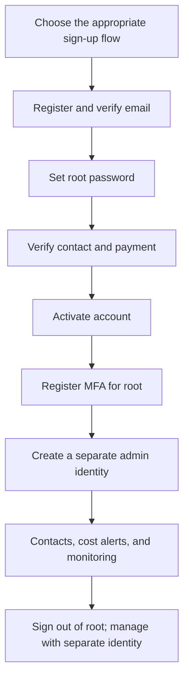

# AWS Account Initialization and Protecting the Root User

An AWS account (*AWS account*) is the fundamental boundary for managing identities, resources, billing, and operational responsibility in the cloud. When starting to learn AWS, creating a new account is only the first step: administrators must also protect the highest-privileged identity, set up a day-to-day administrative user, prepare recovery mechanisms, and control costs.

This content belongs to the **Accounts and Organizations** chapter of the **CLOUD_PROVIDERS_AWS** module. It serves as the foundation for safely deploying IAM, VPC, EC2, storage, databases, and serverless applications going forward.

## 1. Learning Objectives

After this lesson, you will be able to:

1. Distinguish between an AWS account, the root user, an administrative identity, and AWS Organizations.
2. Choose the right way to initialize an AWS environment and complete the traditional account registration workflow.
3. Protect the root user with a strong password, MFA, email management procedures, and recovery information.
4. Explain why the root user should not be used for daily tasks and why long-term access keys should not be created for root.
5. Configure initial safeguards: administrative access, contacts, root activity monitoring, and cost alerts.
6. Recognize the differences when managing the root user in a multi-account environment with AWS Organizations.

## 2. Understanding AWS Accounts and the Root User

An **AWS account** is the unit that owns resources and receives bills. A company can use multiple accounts, such as `company-dev`, `company-prod`, and `company-security`, to separate development, production, and security environments. Each account has a 12-digit **Account ID**; the Account ID is not a password or secret access key.

For accounts created via the traditional **Sign up for AWS (advanced)** registration flow, when signing up with an email and password, AWS creates the **AWS account root user** identity. The root user has very broad permissions in the account, including permissions for resources and billing information. This is not a regular IAM user; attaching an IAM policy to an IAM user does not reduce the root user's permissions. In an AWS Organizations environment, a *service control policy* (SCP) can restrict certain actions even for the root user within the organization.

Examples of tasks that may require the root user on a standalone account include: changing the root email or password, closing the account, restoring access when the last IAM administrator locks themselves out, or performing certain special operations related to Billing and S3. The exact list varies by account type and AWS feature, so check the [list of tasks requiring the root user](https://docs.aws.amazon.com/IAM/latest/UserGuide/id_root-user.html) before using it.

### Three Initialization Contexts to Distinguish

| Context | Initial Access Identity | Appropriate Root Handling |
| --- | --- | --- |
| **Sign up for AWS (advanced)**, standalone account | Root user email + password | Protect root with MFA, safeguard recovery information, create a separate administrative identity |
| **Sign up for AWS (new)**, project environment | AWS Builder ID and an AWS pre-configured project model | A project account **does not have a root user to sign in with**; protect your Builder ID and collaboration permissions according to this flow's guidelines |
| Member account (*member account*) created in **AWS Organizations** | Managed via organization-granted roles/permissions | New member accounts by default **do not have root credentials**; manage privileged operations through the organization |

AWS currently offers multiple sign-up flows. To directly practice **protecting the root user** and full account management, the guide below uses **Sign up for AWS (advanced)**. If your sign-up interface leads to AWS Builder ID and projects, refer to the documentation [Comparing ways to sign up for AWS](https://docs.aws.amazon.com/accounts/latest/reference/sign-up-for-aws.html), instead of trying to look for a root account that does not exist in a project.

## 3. Preparation Before Signing Up

An account used in a lab can still incur charges. In particular, an account intended for a company needs a clear owner and handover plan.

| What to Prepare | Rationale and Approach |
| --- | --- |
| **Account owner email** | Use an email address with long-term accessibility, protected by MFA. For enterprises, prefer an organization-controlled mailbox/mailing list; avoid relying solely on a personal email. |
| **Account name** | Choose a name that clearly identifies its purpose, e.g., `acme-training-sandbox` or `acme-prod`. The display name does not replace the Account ID. |
| **Root password** | Generate a strong, unique password using a password manager; do not reuse your email password or passwords from other accounts. |
| **MFA device** | Prepare a passkey or FIDO security key and, where appropriate, a backup MFA method stored separately. |
| **Contact information** | Have a valid phone number capable of receiving SMS/calls, an address, and a designated contact person. For enterprises, prefer an organization phone number. |
| **Payment and budget** | Prepare a valid payment method; define the desired spending limit, alert recipients, and responsibility for resource cleanup. |

Note: the root email is also a recovery path for account access. An attacker who compromises this mailbox could attempt to reset the root password. Therefore, securing the mailbox and controlling who can read its emails is just as important as securing the AWS Console.

## 4. Steps to Initialize an Account with the Advanced Flow

The actual workflow may vary slightly by country and AWS interface. Follow the instructions shown on the official page and do not enter payment details into links from unknown emails or websites.

1. Open the [AWS sign-up](https://signin.aws.amazon.com/signup) page and choose **Sign up for AWS (advanced)** if the interface prompts you to select a flow.
2. Enter the **root user email address** and **AWS account name**; receive the verification code via email and complete the verification step.
3. Set a strong, unique root password. AWS's minimum standards do not replace the recommendation to use a long, hard-to-guess password.
4. Select the provided account plan/option, enter your contact details, and accept the terms of service after reading them.
5. Provide a valid payment method; complete phone number verification or additional verification if requested by AWS.
6. Choose an AWS Support plan suitable for learning or operational purposes, then complete the registration.
7. Wait for the account activation email notification; go to the [AWS Management Console](https://console.aws.amazon.com/) and select **Root user** on the Advanced account sign-in page.
8. **Right during your first sign-in session**, set up MFA for the root user before creating any resources.



> **Do not share** passwords, OTP codes, MFA registration QR codes, recovery codes, or access keys with instructors, teammates, or lab documentation. Proof of completion should use status information with sensitive data redacted.

## 5. Protecting the Root User Immediately After Initialization

### 5.1. Enable and Back Up MFA

MFA (*multi-factor authentication*) requires an additional authentication factor alongside a password, reducing risk if the password is compromised. AWS requires MFA configuration for the root user on account types that have root sign-in; if not yet configured, users are prompted to enroll within an AWS-specified grace period upon sign-in. **Do not treat the grace period as a reason to delay setting up MFA**.

On an Advanced account, sign in as root and go to the root user's **Security credentials** section, locate the **Multi-factor authentication (MFA)** area, and follow the instructions to add a device. AWS supports options such as:

- **Passkey or FIDO security key:** preferred when possible because it resists credential *phishing* better than manually entered OTP codes.
- **TOTP authenticator app:** generates short time-based codes; protect the device and its backups according to your policy.
- **Hardware TOTP token:** an option when an organization requires a standalone device.

AWS supports registering multiple MFA devices for the same root user (currently up to **8** devices). In appropriate environments, set up at least two independent options to reduce the risk of lockout if one device is lost. Backup devices must be protected, stored, and tested according to organizational procedures; avoid keeping the password and MFA device together in a single easily compromised location.

**How to verify:** check the registered MFA status on the Security credentials page, sign out, and then confirm you can sign back in with a valid MFA method. Do not take screenshots of QR codes, secret key strings, or OTP entry screens as evidence.

### 5.2. Protecting the Password and Account Recovery Paths

- Keep the root password in a secret vault or trusted password manager with clear access controls. Do not store it in repositories, public notes, `.env` files, or source code.
- Protect the root email with MFA, monitor sign-in activity, and restrict who can open emails or reset the password.
- Maintain an accurate phone number so AWS can verify the account owner if support is needed. For company accounts, clearly document the owner and backup contacts.
- Periodically verify access to the mailbox, backup MFA devices, and emergency access request procedures. Do not test recovery by intentionally deleting or disabling all active MFA devices.
- Sign out of the root session once tasks requiring root privileges are complete.

### 5.3. Do Not Create Long-Term Access Keys for Root

An **Access key** consists of an Access Key ID and a Secret Access Key, used to sign AWS CLI commands or API requests. If a root access key is exposed, an attacker can perform highly privileged operations in the account without going through the standard sign-in interface.

Therefore:

1. **Do not create access keys for the root user** to run scripts, CI/CD pipelines, or learning examples.
2. Check the root user's **Access keys** section in Security credentials; the desired state is having no active root keys.
3. If legacy root keys are found, identify dependent systems and prioritize migrating them to an appropriate IAM role/identity; then deactivate and delete the keys following your organization's incident response and secret rotation procedures.
4. For automation tasks, use **IAM roles** and temporary credentials; for human users, prefer **IAM Identity Center** or federated identity sign-in.

Do not confuse **not creating root access keys** with **not being able to use the AWS CLI**: the CLI can run seamlessly using an appropriate administrative identity and temporary credentials.

### 5.4. Creating a Day-to-Day Administrative Identity

The root user should only appear when performing tasks exclusively reserved for root. For eligible accounts and organizations, AWS recommends using **AWS IAM Identity Center** to grant permissions to administrative users through users/groups, *permission sets*, and temporary login sessions.

Example workflow for an AWS organization:

1. From the organization's *management account*, enable an **IAM Identity Center organization instance** if one does not already exist.
2. Connect an identity source or create appropriate users/groups; require MFA for administrative users.
3. Create/configure an administrative permission set and assign it to the right users/groups on the right AWS accounts.
4. Open the **AWS access portal** to sign in with the provisioned identity and confirm access to the correct account.
5. Once verified, sign out of root and use the new administrative account for subsequent operations. For specific workloads, scope permissions down to the minimum required (*least privilege*).

**Important distinction:** IAM Identity Center has an **organization instance** and an **account instance**. An account instance serves supported applications within the scope of a single account and does not provide the full AWS account access delegation capabilities of an organization instance. A standalone account may be prompted to create AWS Organizations in order to use an organization instance; evaluate the governance impact before confirming that action.

Example of verifying the identity of an AWS CLI session already configured with valid administrative permissions:

```bash
aws sts get-caller-identity
```

The output displays `Account`, `Arn`, and `UserId`. If `Arn` contains `assumed-role/...`, you are operating via an assumed role; there is no reason to issue root access keys for this session. This is a read-only identity inspection command; it does not create resources and does not verify all permissions that the role possesses.

## 6. Securing the Account After the First Sign-In

### 6.1. Update Emergency Contacts

On the **Account** page, verify the email address, phone number, and **alternate contacts**:

| Contact Type | Role |
| --- | --- |
| **Billing** | Receives billing information and payment issues |
| **Operations** | Receives operational notifications or service disruptions |
| **Security** | Receives notifications related to security and incidents |

For teams, you can use an organization-controlled mailing list instead of a personal email; designate a primary owner and an alternate. Alternate contacts provide additional communication channels; they **do not replace** protecting the root email.

### 6.2. Enable Early Cost Alerts

From **Billing and Cost Management → Budgets**, create a monthly **Cost budget** matching your lab or project budget (for example, an illustrative target of `10 USD/month`), configure alert emails when actual spend approaches the threshold and, if appropriate, when forecasted spend exceeds it. Confirm recipient addresses as required by AWS.

**A budget is a tracking/alerting mechanism, not a guarantee that AWS will stop all resources when the threshold is reached.** Cost data may update with a delay. To reduce the risk of unexpected charges, you must still proactively check the Region, resource types, Free Tier/credit terms, and service pricing, and delete unnecessary resources after practicing.

### 6.3. Monitor Root Activity

AWS CloudTrail records management events, including AWS Console sign-ins. For the root user, `ConsoleLogin` events can be identified by `userIdentity.type = Root`; CloudTrail can be combined with EventBridge, Amazon SNS, and your organization's alerting mechanisms.

Example *event pattern* as a starting point for an Amazon EventBridge rule monitoring root sign-ins via AWS Sign-In/CloudTrail:

```json
{
  "source": ["aws.signin"],
  "detail-type": ["AWS API Call via CloudTrail"],
  "detail": {
    "eventSource": ["signin.amazonaws.com"],
    "eventName": ["ConsoleLogin"],
    "userIdentity": {
      "type": ["Root"]
    }
  }
}
```

This is an **illustrative sample**, not a complete alerting system. In a production implementation, you must verify the EventBridge event bus, where global sign-in events originate, the Region recording the events, notification delivery policies, and real testing. CloudTrail may log root sign-in events in `us-east-1`, `us-east-2`, or `us-west-2`; creating a rule only in another Region could miss events. Rather than frequently signing in as root to test alerts, validate using sample events or an approved testing procedure.

### 6.4. Risk Reference Table

| Risk | Potential Consequence | Priority Mitigation |
| --- | --- | --- |
| Root password compromised | Account takeover | Unique password, phishing-resistant MFA, email protection |
| Loss of the only MFA device | Unable to sign in when needed | Backup MFA method and recovery procedure |
| Using root for daily tasks | Increased chance of human error or high-privilege exposure | IAM Identity Center, IAM roles, and least privilege |
| Root access key leaked in source code | API access with broad privileges | Do not create root keys, use temporary credentials |
| Lab resources left running | Unexpected charges | Budgets, billing monitoring, resource cleanup schedule |
| Root logins not monitored | Difficulty detecting anomalous activity | CloudTrail, root login alerts, and on-call recipients |

## 7. The Root User in AWS Organizations

**AWS Organizations** helps manage multiple accounts under one organization, allowing accounts to be grouped into *organizational units* (OUs) and governed with policies. The organization's *management account* is distinct from its *member accounts*.

In the current model:

- **New member accounts created from AWS Organizations do not have root credentials by default**, even though the root user concept is still associated with that account. There is no need—and it is not possible—to sign in as root the way you would with a standalone Advanced account unless recovery is explicitly enabled.
- For legacy member accounts that still have root credentials, administrators can enable **centralized root access** to remove root credentials from member accounts, reducing the risk of unauthorized use.
- The management account or a delegated administrator account can perform **certain** privileged tasks on member accounts using temporary `sts:AssumeRoot` sessions when granted permission and when the corresponding feature is enabled. Not all root-only tasks are supported through this mechanism.
- Operations on member accounts are governed by organizational controls; do not attempt to enable root recovery or create access keys to bypass authorized workflows.

**Scenario:** a team has accounts `acme-prod` and `acme-dev` in AWS Organizations. When a new member needs to deploy EC2 in `acme-dev`, the administrator should grant access through IAM Identity Center and an appropriate role. Sharing the root password of `acme-dev` is unnecessary and defeats access control goals. If an S3 bucket has a policy denying all principals, the organization can consider an AWS-supported privileged session to recover the policy, following internal approval procedures.

## 8. Guided Hands-On Practice

**Context:** you are responsible for an AWS account used for learning and must hand it over in a secure state before starting to create VPCs and virtual machines. If you do not yet have an account, follow the registration steps above using the Advanced option. If you are using an organizational account or project account without a root user, only inspect what you are permitted to access; do not modify permissions or request root credentials unless authorized.

### Tasks

1. Record the **account name**, intended purpose, and Account ID in an approved location, without including credentials or authentication codes in the report.
2. Confirm whether the account uses the root sign-in flow or follows the project/member account model without root credentials.
3. For accounts with root sign-in: verify that root MFA is configured and has an appropriate backup plan; do not disclose MFA device/key details.
4. Verify that root has **no active access keys**. If keys are found, notify the owner and plan remediation; do not delete them immediately before identifying dependent systems.
5. Ensure a separate administrative identity with appropriate permissions exists, test signing in without root, and verify the identity via the Console or `aws sts get-caller-identity`.
6. Check the Billing/Security/Operations alternate contacts and create at least one budget alert if you have cost management permissions.
7. Check CloudTrail and describe how to alert on anomalous root sign-ins.
8. Sign out of the root session, document the checked items, and record who is responsible for ongoing monitoring.

### Inspection Report Template (No Secrets)

```text
Account purpose: training-sandbox
Account type: Advanced standalone / Organizations member / Project
Root sign-in applicable: Yes / No
Root MFA configured: Yes / No / N/A
Root active access keys: 0 / Needs review / N/A
Non-root admin access verified: Yes / No
Billing budget alert configured: Yes / No
Security contact verified: Yes / No
Root activity monitoring: Enabled / Planned
Owner / Review date: <owner> / <review-date>
```

**Completion criteria:** the report demonstrates that the administrator correctly identified the account type, protected the highest-privileged access path, can operate using a separate identity, and assigned recipients for security/cost risk signals. This lab does not require deploying paid resources.

## 9. Self-Check Questions

1. Why must you protect the root email in addition to enabling MFA on the AWS Console?
2. Why should you not create an access key for the root user to run the AWS CLI from a personal machine?
3. A new member account in AWS Organizations does not have a root password. Is this an account creation error? Why or why not?
4. How does IAM Identity Center help with day-to-day administration? How does an organization instance differ from an account instance?
5. If spending reaches 100% of a budget, does AWS Budgets automatically guarantee stopping charges for all resources?
6. If you have enabled CloudTrail alerts for root `ConsoleLogin`, what should you consider regarding Regions to avoid missing events?

## 10. Official Reference Documentation

- [AWS Account Management — Comparing ways to sign up](https://docs.aws.amazon.com/accounts/latest/reference/sign-up-for-aws.html).
- [AWS Account Management — Sign up for AWS (advanced)](https://docs.aws.amazon.com/accounts/latest/reference/getting-started.html).
- [IAM — Root user and tasks that require root](https://docs.aws.amazon.com/IAM/latest/UserGuide/id_root-user.html).
- [IAM — Root user best practices](https://docs.aws.amazon.com/IAM/latest/UserGuide/root-user-best-practices.html).
- [IAM — Multi-factor authentication for root user](https://docs.aws.amazon.com/IAM/latest/UserGuide/enable-mfa-for-root.html).
- [IAM — Centralize root access for member accounts](https://docs.aws.amazon.com/IAM/latest/UserGuide/id_root-enable-root-access.html).
- [IAM Identity Center — Instance types](https://docs.aws.amazon.com/singlesignon/latest/userguide/identity-center-instances.html).
- [AWS Account Management — Alternate contacts](https://docs.aws.amazon.com/accounts/latest/reference/manage-acct-update-contact-alternate.html).
- [AWS Cost Management — Creating a cost budget](https://docs.aws.amazon.com/cost-management/latest/userguide/create-cost-budget.html).
- [AWS CloudTrail — AWS Management Console sign-in events](https://docs.aws.amazon.com/awscloudtrail/latest/userguide/cloudtrail-event-reference-aws-console-sign-in-events.html).

> Core operating principle: **root is a privileged identity reserved for exceptional situations; everyday users and applications must have separate, short-lived permissions whenever possible, and be monitored.**
