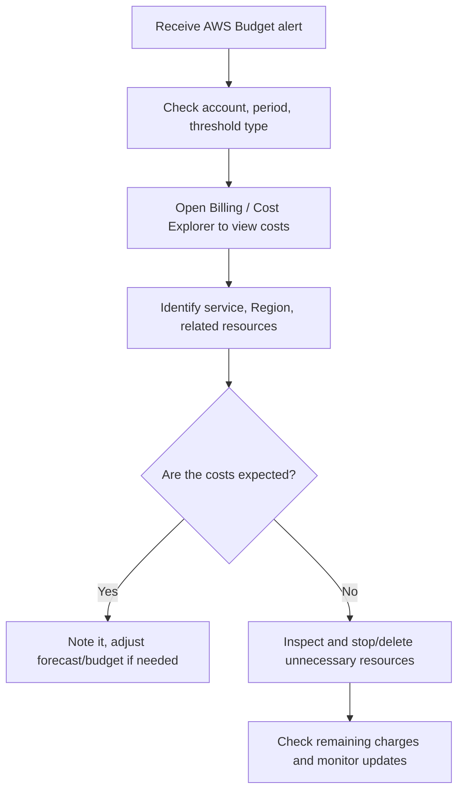

# Setting Up Initial Contact Information and Cost Alerts

> **Module:** CLOUD_PROVIDERS_AWS · **Chapter:** Accounts and Organizations  
> **Objective:** Prepare an AWS account with reliable points of contact and mechanisms to detect incurred costs before deploying resources.

## 1. Why Set This Up Immediately When Creating an Account?

While learning AWS, you will work with Regions/Availability Zones, IAM, VPCs, compute instances, storage, databases, and serverless services. A test or forgotten resource can continue incurring charges even after the application has stopped running. Similarly, if AWS sends a security or billing alert to an unmonitored address, an incident may not be handled in time.

Initial configuration needs to solve **two independent questions**:

1. **When AWS needs to reach out, who actually receives the notification?** This is the responsibility of the root sign-in email, the primary contact (*primary contact*), and the alternate contacts (*alternate contacts*).
2. **When costs rise, who knows early enough to investigate?** This is the responsibility of AWS Free Tier alerts, AWS Budgets, and, if needed, additional cost monitoring mechanisms.

This lesson focuses on a new AWS account while also pointing out differences when the account belongs to **AWS Organizations**. By completing this lesson, you should be able to:

- Distinguish between the root email, primary contact, alternate contacts, and budget alert recipient emails.
- Update contact information following the principle of not depending on a single individual.
- Enable alerts appropriate for AWS Free Tier and create a monthly cost budget.
- Choose alert thresholds, recipients, and response actions when thresholds are exceeded.
- Verify configuration results and recognize the limitations of AWS cost data.

## 2. Understanding the Different Types of Contact Information

AWS uses multiple types of contact addresses for different purposes. They do not replace one another.

| Component | Primary Role | Suggested Configuration for Teams or Enterprises |
|---|---|---|
| **Root user email** | Root sign-in identifier; receives critical ownership/account communications and account recovery support. | An organization-owned mailbox, well protected, with a handover procedure. |
| **Primary contact** | Name of the person/organization, company, address, phone number, and main contact details of the account. | Accurate legal/operating unit information; phone number capable of receiving verification codes when needed. |
| **Alternate contact — Billing** | Additional point of contact for billing issues. | Finance team or cost management owner. |
| **Alternate contact — Operations** | Point of contact for service and infrastructure operations. | Platform operations team or on-call engineering team. |
| **Alternate contact — Security** | Point of contact for security issues. | Security team or incident response contact. |
| **AWS Budgets notification email** | Receives notifications for a **specific budget** you configure. | Mailbox/team that needs to act when spending exceeds thresholds. |

**Common misconception:** Adding a Billing alternate contact **does not automatically create an AWS Budget**, and creating an AWS Budget **does not automatically update the alternate contact**. The invoice delivery email in *Payment preferences* is also a separate setting.

Illustrative example using placeholder addresses:

| Role | Sample Address |
|---|---|
| Root email | `aws-owner@example.com` |
| Billing alternate contact | `finance@example.com` |
| Operations alternate contact | `cloud-ops@example.com` |
| Security alternate contact | `security@example.com` |
| AWS Budgets recipient | `cloud-cost-alerts@example.com` |

The addresses above are samples only, not emails to use in a real account. For a personal learning account, one person may hold multiple roles; you should still ensure the mailboxes are active and accessible during an incident.

### 2.1. Protect the Root Identity Before Continuing

- Use a long-lived root email and protect email recovery options; avoid relying on the email of an employee whose access may soon expire.
- Configure **MFA** for root and protect the MFA devices/recovery methods.
- Restrict signing in as root for day-to-day work; use IAM Identity Center or an IAM role/user with appropriate permissions for administration.
- Do not create long-term access keys for root to run the CLI.

These practices reduce the risk of losing access to the account, especially for the **management account** of AWS Organizations. Changing the root email is a separate procedure, not the email field under *Primary contact*.

## 3. Updating Contact Information in the AWS Console

### 3.1. Prepare Permissions and Data

Sign in to the [AWS Management Console](https://console.aws.amazon.com/) with an identity that has permission to manage account information. For a standalone account or management account, relevant IAM permissions include:

| Action | Typical IAM Permissions Required |
|---|---|
| View/update primary contact | `account:GetContactInformation`, `account:PutContactInformation` |
| View/update alternate contacts | `account:GetAlternateContact`, `account:PutAlternateContact` |
| Delete alternate contact if needed | `account:DeleteAlternateContact` |

Do not grant broad administrative permissions to everyone just to change contact details. If you do not see the Edit button, check your current identity and access policies.

Have the company or individual name/address, phone number in proper international format, and active email addresses ready for each role. For the primary contact, AWS may require phone number verification; this number must be able to receive SMS when applicable.

### 3.2. Set Up the Primary Contact

1. In the AWS Console, select **the account name in the top-right corner → Account**.
2. Locate **Contact information** and choose **Edit**.
3. Review/update **Full name, Company name, Address, Phone number**, and other displayed fields.
4. Choose **Update**, then reload the page to verify the new information was saved.
5. If the system requests phone number verification, complete the verification step and check the status.

Primary contact information is used in contact, verification, and account recovery situations. The data should accurately reflect the account owner rather than being filled in arbitrarily just to submit the form.

### 3.3. Set Up the Three Alternate Contacts

1. Still on the **Account** page, locate **Alternate contacts** and choose **Edit**.
2. Specify the **Billing**, **Operations**, and **Security** types; each type has one set of contact details.
3. Fill in **Name**, **Email address**, **Phone number**, and **Title** appropriate for each role.
4. Choose **Update** and re-check that each contact type has been saved.

AWS allows one alternate contact per category. You can use a *distribution list* or group mailbox so notifications still reach the right people when team members change.

### 3.4. When the Account Belongs to AWS Organizations

If using a member account (*member account*), administrators can update contacts from **AWS Organizations → AWS accounts → select account → Contact info** in the management account. Centralized contact management requires the organization to enable **all features** and **trusted access** for AWS Account Management; a delegated administrator with appropriate permissions can also be used.

Example:

```text
AWS Organizations
└── Management account (centralized contact and billing management)
    ├── Development account  → Billing / Operations / Security contacts
    └── Production account   → Billing / Operations / Security contacts
```

Do not confuse permission to update contacts from Organizations with root sign-in access to a member account. Also do not assume contacts on the management account automatically become the contacts for every member account; check each account individually.

## 4. Enable AWS Free Tier Usage Alerts

**AWS Free Tier** depends on the account plan type, account creation date, available credits, and individual service offers. Do not interpret the phrase *Free Tier* to mean that all AWS resources are free.

To check:

1. Open the [AWS Billing and Cost Management Console](https://console.aws.amazon.com/costmanagement/).
2. Select **Billing preferences** under **Preferences**.
3. Under **Alert preferences**, choose **Edit**.
4. Check/enable **Receive AWS Free Tier usage alerts** if this option is available.
5. Enter an additional address in **Additional email address to receive alerts** if needed, then choose **Update**.
6. Open the **Free Tier** page or your current account plan details to view usage and applicable credits.

AWS can send alerts when usage of a service exceeds **85% of the corresponding Free Tier limit**. Alert configuration/recipients may differ by account type; for an **AWS Organizations management account**, check and proactively enable the option if you want to receive this type of alert.

**Do not rely solely on Free Tier alerts** because they only track free usage limits for eligible services; other charges can still occur. Creating a dedicated AWS Budget for total costs is the next step.

## 5. Creating Cost Alerts with AWS Budgets

**AWS Budgets** lets you set periodic budgets, track actual (*Actual*) and forecasted (*Forecasted*) costs, and send notifications when thresholds are reached. A standard *cost budget* is a **monitoring/alerting** mechanism; it **does not stop EC2, RDS, or other services by default**, nor does it guarantee your bill will not exceed the budget.

### 5.1. Two Ways to Get Started

| Creation Method | When to Choose | Meaning |
|---|---|---|
| **Use a template (simplified) → Zero spend budget** | Practicing when you want no unexpected charges outside the free scope. | Uses a pre-configured template to alert once spending starts according to template criteria. |
| **Use a template (simplified) → Monthly cost budget** | Wanting a reference monthly budget limit. | Uses a monthly budget template, typically including actual and/or forecasted alerts. |
| **Customize (advanced) → Cost budget** | Needing multiple thresholds, recipients, or account/service filters. | Gives granular control over cost calculation and alert trigger conditions. |

Learners can create a **Zero spend budget** to detect unexpected charges early and also create a **Monthly cost budget** to track expected spending. The *zero spend* template is also an alert, **not a resource lock or a guarantee of a zero bill**.

### 5.2. Hands-On: Create a 10 USD Monthly Budget

Suppose you deploy a test Java/Spring Boot application on AWS and set a tracking budget of **10 USD/month**. The 10 USD figure is a **practice assumption**, not a cost estimate for any specific architecture.

1. Go to **Billing and Cost Management → Budgets → Create budget**.
2. Select **Customize (advanced) → Cost budget → Next**.
3. Give it a name, such as `learning-monthly-cost-10usd`.
4. Choose **Period = Monthly**, budget method **Fixed** if you want the same amount across months; enter **10 USD** and verify the account currency.
5. Check **Budget scope**. If you want to cover all costs in an account, do not accidentally filter to a single service; if working within Organizations, specify the **Linked account** to monitor.
6. Under **Alert thresholds**, create the notifications shown in the table below.
7. Enter **Email recipients** as the mailbox of the person who actually handles costs; complete email confirmation if AWS requests it.
8. Review **Cost types** and options for taxes, credits, refunds, and technical support if they affect your monitoring goal.
9. Choose **Create budget**, then reopen the budget details to verify thresholds, period, scope, and recipients.

Example set of thresholds for a **10 USD/month** budget:

| Threshold | Type | When Notified | Recommended Action |
|---|---|---|---|
| 50% = 5 USD | **Actual** | Recorded costs reach the 5 USD threshold. | Inspect services and resources generating charges. |
| 80% = 8 USD | **Actual** | Recorded costs reach the 8 USD threshold. | Review test resources and remove unused ones. |
| 100% = 10 USD | **Forecasted** | Full-period forecasted cost reaches or exceeds 10 USD. | Adjust service usage plan if forecast data is available. |

**Actual** is based on recorded costs; **Forecasted** uses end-of-period estimates. According to AWS documentation, forecasting in AWS Budgets can require around **five weeks of usage data**, so do not expect forecasted alerts to trigger immediately on a brand-new account. For labs on newly opened accounts, prioritize **Actual** thresholds.

If you do not yet need advanced options, you can also select **Use a template (simplified) → Monthly cost budget**, adjust the budget amount and alert email, and then verify the parameters generated by the template.

### 5.3. How to Interpret Alerts Correctly

Consider the following scenario of recorded costs:

```text
Monthly budget: 10 USD
Day 05: AWS records 3 USD     → Below the 5 USD Actual threshold
Day 08: AWS records 5.5 USD   → May trigger the 50% Actual alert
Day 10: AWS records 8.2 USD   → May trigger the 80% Actual alert
End of month: the bill may exceed 10 USD if resources continue running
```

The word **may** is very important: billing data and notifications have latency. AWS Budgets typically updates **up to three times per day**, so incurred costs may be reflected later than when the resources were used. Alert thresholds are an investigation signal, **not a hard cap**. An *Actual* notification is typically sent the first time a threshold is crossed in the period; it does not mean every incremental increase sends a new email.

### 5.4. Workflow When Receiving an Email



For example, an EC2 instance may have been stopped, but an **EBS volume** or **snapshot** may still be incurring charges; a serverless application may generate costs from related services such as logging, data transfer, or databases. You need to inspect the **entire system**, not just the service running application code.

## 6. Budgets in AWS Organizations: Tracking the Right Account

With **consolidated billing**, the management account is generally responsible for paying the charges of member accounts. To configure appropriate alerts, decide on the monitoring scope:

| Goal | Suggested Configuration |
|---|---|
| Protect the overall organization budget | Create a budget in the **management account** tracking total aggregated costs and email the cost governance team. |
| Monitor the Development environment separately | Create a budget in the management account, apply filter **Linked account = Development**, and notify the Development owner. |
| Monitor Production separately | Create a budget filtered by **Linked account = Production** with appropriate thresholds and recipients. |
| Member account self-monitoring | Create a budget directly inside the member account if access permissions and organization policies allow. |

**Two practical notes:**

- A budget created in the management account **does not automatically appear** in a member account. Visibility depends on **the account that created the budget** and user permissions.
- Creating a budget filtered to one member account **does not mean** you have created budgets for all remaining accounts. Define the scope clearly, especially when adding new accounts to the organization.

Notification policies also need clear ownership: if an email goes to the finance team for awareness, while only the operations team has permissions to inspect or stop resources, an incident can still drag on. Link each alert to a **recipient, responder, and response threshold**.

## 7. Do You Need a CloudWatch Billing Alarm or Cost Anomaly Detection?

AWS provides several ways to monitor costs; for a new account, **AWS Budgets + Free Tier alerts** is an easy foundation to start with.

| Tool | Purpose | Key Note |
|---|---|---|
| **AWS Free Tier usage alerts** | Reminds when usage approaches Free Tier limits for eligible services. | Does not represent all charges. |
| **AWS Budgets** | Compares cost/usage against predefined budgets and thresholds. | Data updates periodically; alerts do not stop charges by default. |
| **CloudWatch billing alarm** | Tracks the **EstimatedCharges** metric and notifies via CloudWatch/SNS. | Global billing metrics are stored in **US East (N. Virginia), `us-east-1`**. |
| **AWS Cost Anomaly Detection** | Detects unusual spending spikes and sends notifications via subscriptions. | Complements budgets when wanting to catch unpredictable fluctuations. |

If you need a CloudWatch billing alarm, go to **Billing preferences → Alert preferences**, enable **Receive CloudWatch billing alerts**, and save; then switch to CloudWatch in Region **us-east-1** to create an alarm on the billing metric and configure notifications. You must confirm the Amazon SNS email subscription if using that channel. Per AWS documentation, once you enable CloudWatch billing alerts, you **cannot turn that option back off**; consider this before enabling it.

You do not need to set up a CloudWatch alarm just to complete this lab if AWS Budgets already meets your initial alerting goals.

## 8. Checking with the AWS CLI (Optional)

If you are using the AWS CLI with an IAM role or an identity with appropriate permissions, you can verify contact settings using **read-only** commands:

```bash
# Confirm the current identity; do not run with root access keys.
aws sts get-caller-identity

# View the primary contact of the current account.
aws account get-contact-information

# View the Billing alternate contact of the current account.
aws account get-alternate-contact --alternate-contact-type BILLING
```

For centralized administration, an administrator in the management account or a delegated administrator can pass `--account-id 123456789012` to read a member account's contact information if the organization has granted permissions and enabled the necessary integration.

Example command to set the **Billing alternate contact** for the current account:

```bash
aws account put-alternate-contact --alternate-contact-type BILLING --email-address finance@example.com --name "Finance Team" --phone-number "+12025550123" --title "Billing Owner"
```

These are illustrative values; replace them with real contacts and verify the target account before executing. Update commands should be run by authorized personnel; do not embed credentials or access keys in examples or source code.

Budget configuration also has an API/CLI, but performing the first setup via the Console helps clearly visualize cost scope, threshold types, and notification recipients.

## 9. Verifying Configuration Readiness

A hands-on lab is only complete once values are saved and verified. Use the following acceptance checklist:

| Item | Verification Method | Expected Result |
|---|---|---|
| Root email and recoverability | Check account details, mailbox access, and MFA. | Mailbox controlled by the owner, MFA protected. |
| Primary contact | Reopen **Account → Contact information**. | Accurate name, address, and phone number. |
| Three alternate contacts | Reopen **Account → Alternate contacts**. | Billing, Operations, Security have appropriate contacts. |
| Free Tier alerts | Check **Billing preferences → Alert preferences**. | Alert option/addresses appropriate for the account type. |
| AWS Budget | Open **Budgets → budget name → Details/Alerts**. | Correct monthly period, budget amount, account scope, thresholds, and email. |
| Email delivery flow | Verify confirmation email, mail filters, and on-call monitor. | Recipients can receive alerts and know who responds. |
| Response procedure | Document steps to open Cost Explorer/Billing and inspect resources. | Concrete actions defined when costs increase. |

Do not **intentionally create paid resources** just to trigger an alert. If actual costs have already been recorded, you can inspect the budget notification settings and observe the update cycle; keep in mind that email delivery is not instantaneous and may require address verification.

### 9.1. Common Errors

**Edit button is missing on the Account page.**  
Check whether you are in the right account and whether your IAM role/user has the corresponding Account Management permissions. For a member account, check the centralized management path via Organizations and trusted access.

**Added a Billing alternate contact, but not receiving budget emails.**  
Add the email directly to the budget's **notification** list and complete the subscription confirmation workflow; these two settings are separate.

**Created a new budget, but Forecasted alerts are not firing.**  
Verify that a Forecasted threshold was created and whether the account has enough historical data for forecasting. Use Actual thresholds during the initial phase.

**Seeing costs increase, but alert emails arrive late.**  
AWS has latency when aggregating billing data and sending alerts; open Cost Explorer/Billing to view available data. Do not treat alert emails as an instant cost-cutoff mechanism.

**Management account sees total costs, member account does not see the same budget.**  
A budget belongs to the account that created it and follows access permissions. Sign in to the correct account to check; if needed, provision view access or reporting per organizational procedures.

**Costs do not match expectations even when using only "free" services.**  
Check actual quotas by plan, Region, resource types, and supporting services; review taxes, support, storage, network, snapshots, and items outside the Free Tier.

## 10. Scenario Exercise

A three-person team is deploying a Java/Spring Boot course management application to learn AWS infrastructure. The team has one **management account** and two **member accounts**: `dev` for testing and `prod` for instructor demos. The team wants to know when costs exceed expectations and avoid missing security alerts.

**Practical requirements:**

1. Create a table of required email addresses for root, Billing, Operations, Security, and budgets; clearly note the owner responsible for each mailbox.
2. Describe how to update primary/alternate contacts in AWS Organizations for `dev` and `prod`.
3. Propose separate monthly budgets for the two accounts, such as `dev = 10 USD` and `prod = 20 USD`; choose at least two **Actual** thresholds, recipients, and post-alert actions.
4. Explain why merely configuring 20 USD for `prod` **does not prevent** actual charges from exceeding 20 USD.
5. List at least three cost sources to check after deleting the application, such as EBS volumes, snapshots, or networking resources.
6. Identify who manages the overall budget, linked-account budgets, and who has permission to view each budget.

**Evaluation hints:** A strong solution clearly separates notification recipients from incident responders, configures budgets covering the right accounts, prioritizes Actual alerts for new accounts, and acknowledges billing latency. You do not need to create paid resources to demonstrate your solution.

## 11. Knowledge Summary and References

A well-prepared AWS account needs both **accurate contact points** and **cost-tracking budgets**. Contact details support security, operations, and account recovery; budgets generate signals so responsible people can inspect and respond. In AWS Organizations, the management account can manage contacts and monitor costs for member accounts, provided permissions and scope are configured properly.

Official AWS documentation to reference when interfaces or features change:

- [AWS Account Management — Update the primary contact](https://docs.aws.amazon.com/accounts/latest/reference/manage-acct-update-contact-primary.html)
- [AWS Account Management — Update alternate contacts](https://docs.aws.amazon.com/accounts/latest/reference/manage-acct-update-contact-alternate.html)
- [AWS IAM — Root user best practices](https://docs.aws.amazon.com/IAM/latest/UserGuide/root-user-best-practices.html)
- [AWS Billing — Customizing billing preferences](https://docs.aws.amazon.com/awsaccountbilling/latest/aboutv2/billing-pref.html)
- [AWS Billing — Tracking Free Tier usage](https://docs.aws.amazon.com/awsaccountbilling/latest/aboutv2/tracking-free-tier-usage.html)
- [AWS Cost Management — Budget templates](https://docs.aws.amazon.com/cost-management/latest/userguide/budget-templates.html)
- [AWS Cost Management — Creating a cost budget](https://docs.aws.amazon.com/cost-management/latest/userguide/create-cost-budget.html)
- [AWS Cost Management — Managing costs with AWS Budgets](https://docs.aws.amazon.com/cost-management/latest/userguide/budgets-managing-costs.html)
- [AWS Billing — Consolidated billing with Organizations](https://docs.aws.amazon.com/awsaccountbilling/latest/aboutv2/consolidated-billing.html)
- [Amazon CloudWatch — Billing alarm for estimated charges](https://docs.aws.amazon.com/AmazonCloudWatch/latest/monitoring/monitor_estimated_charges_with_cloudwatch.html)

> **Operational note:** Console interfaces, Free Tier offers, and billing policies can change. When deploying in practice, confirm current settings and terms directly inside your AWS account.
