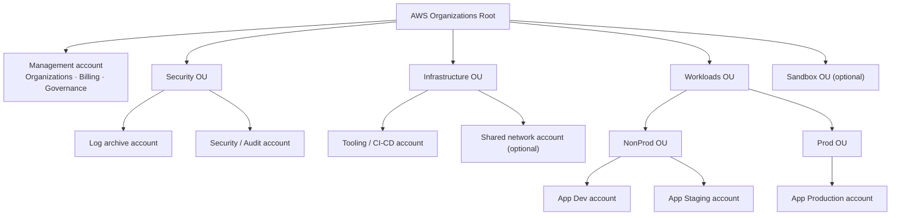

# Designing a Multi-Account Strategy for Dev, Staging, and Production on AWS

In the **Amazon Web Services (AWS)** ecosystem, an account (AWS account) is a critical boundary for managing identities, resources, costs, and the blast radius of incidents. As an application moves from development into real operations, placing all servers, databases, and users into a single account often creates risks: a single misconfigured IAM policy can affect production; an accidental deletion can wipe out data; and experimental costs can get mixed up with customer-serving costs.

This lesson belongs to the **Accounts and Organizations** chapter of the `CLOUD_PROVIDERS_AWS` module. The goal is to apply AWS Organizations, IAM, VPC, compute, storage, databases, serverless, monitoring, and backup services to build a **multi-account** strategy for three environments: **development (dev)**, **staging**, and **production (prod)**. A solid strategy enables teams to deploy safely, control costs, limit the blast radius when errors occur, and maintain clear recovery paths.

## 1. The Problem to Solve

Suppose a team operates an e-commerce application consisting of a frontend, an API, an order-processing queue, a database, and an image store. Within a single AWS account, the team creates resources using `dev-`, `staging-`, and `prod-` prefixes. This model is fast at first, yet relies solely on naming conventions to separate environments. The same account can still share service quotas, IAM permissions, audit configurations, and some foundational resources.

When splitting environments into multiple AWS accounts, we gain additional technical boundaries:

| Criterion | Single Account for All Environments | Separate Dev / Staging / Prod Accounts |
|---|---|---|
| IAM permission scoping | Hard to guarantee every policy filters the right environment | Permissions granted per account, combined with target account policies |
| Blast radius of misconfiguration | Easily spills over into production resources | Largely contained within the affected account |
| Cost tracking | Must rely heavily on tags, names, and detailed reports | Per-account figures available in AWS Organizations |
| Service quotas | Many quotas shared across account/Region scope | Many quotas isolated per account/Region |
| Data security | Easy to accidentally grant permissions from dev to production | Isolated permissions, encryption keys, databases, and network zones |
| Auditing and change control | Hard to distinguish experimental access from real changes | Clear policies and operational evidence per environment |
| Operational overhead | Less initial baseline setup | Requires automation for account creation and governance |

**Key takeaway:** multiple accounts create stronger protective boundaries, but do not automatically guarantee security. IAM policies, Service Control Policies (SCPs), network connectivity, data access controls, and deployment workflows must still be designed consistently.

### Purpose of Each Environment

| Environment | Primary Goal | Typical Permission Level | Data | Operational Requirements |
|---|---|---|---|---|
| **Dev** | Feature development, rapid experimentation, early bug detection | Developers can create/modify many resource types within allowed limits | Synthetic or de-identified data | Speed-optimized, resource cleanup schedules, low budget |
| **Staging** | Integration testing, regression, baseline performance, and release workflow | Primarily deployed via pipeline; controlled user access | Representative data without exposing sensitive production data | Production-like structure, monitoring, and release testing |
| **Production** | Serving real users, protecting data and availability | Few people with write access; deployed via approved automation roles | Real data, classified and encrypted | Change control, alerting, backups, recovery plans |

`Staging resembles production` in architecture, infrastructure versions, authentication mechanisms, and deployment path; it does not necessarily need the same server scale or data volume. Differences in size and traffic should be documented to avoid drawing false conclusions from performance tests.

## 2. Architectural Framework: AWS Organizations and Organizational Units

**AWS Organizations** enables centralized management of multiple AWS accounts within a single organization, organizing accounts into **Organizational Units (OUs)**, applying governance policies, and using consolidated billing. The **Management account** administers the organization, while **member accounts** host the majority of workloads. Avoid deploying business applications in the management account because it holds organization-wide privileges and is a sensitive security target.

A suitable starting layout for a small-to-medium enterprise:



In this diagram, security and tooling reside outside the application-hosting accounts so operations teams retain visibility, investigative capability, and deployment capability even if a workload account fails. If an organization currently has only one application and limited resources, it can start with three environment accounts plus essential foundational accounts, and split further as needs grow.

### Account Roles

| Account / Group | Responsibilities | What to Avoid |
|---|---|---|
| **Management** | Managing Organizations, consolidated billing, OU/SCP governance, organization-level administration setup | Hosting web servers, databases, or experimental workloads |
| **Log archive** | Receiving and storing centralized audit logs with strict retention policies and read/write controls | Allowing developers to delete or modify logs directly |
| **Security / Audit** | Managing centralized alerts and security tooling, investigating events | Sharing administrative roles with workloads |
| **Tooling / CI-CD** | Hosting build tools, artifact management, and cross-account automated deployments | Using long-term access keys or default full-admin roles |
| **Shared network** | Managing centralized connectivity, DNS, and on-premises connections if needed | Allowing uncontrolled flat peering across all environments |
| **Dev, staging, prod** | Running application resources for each environment | Sharing databases, secrets, or administrative accounts |
| **Sandbox** | Short-term experimentation, restricted services and costs | Using real customer data or keeping resources indefinitely |

**Scaling principle:** one app can start with a `dev/staging/prod` trio. When there are multiple product teams, consider **one account per workload (or workload group) per environment**, such as `payments-prod` and `catalog-prod`. The decision depends on release independence, data sensitivity, compliance requirements, cost, and operational capacity.

### Account, OU, and Region Are Not the Same Concept

- **Account**: boundary for identities, access policies, resources, and billing details.
- **OU**: a group of accounts receiving shared governance policies; an OU is not a private network, data zone, or place where applications run.
- **Region**: geographic location where AWS services are deployed; chosen based on latency, data residency rules, service availability, and recovery requirements.
- **Availability Zone (AZ)**: an isolated infrastructure zone within a Region; critical production workloads typically span at least two AZs to reduce single-AZ failure risk.

Separating accounts **does not replace** multi-AZ design or Regional disaster recovery strategies. Conversely, running across multiple Regions **does not replace** account separation.

## 3. Account Governance Rules from Day One

Account creation should be a standardized process rather than ad-hoc manual setup. AWS Control Tower can help establish a landing zone, guardrails/controls, and workflow-based account provisioning; organizations can also manage AWS Organizations and baselines with Infrastructure as Code (IaC) once they have the corresponding operational maturity.

For each new account, define:

1. **Owner**: the team accountable for business context, operations, security, and budget.
2. **Identity**: account name, dedicated root email, alias if used, application code, and environment; the Account ID is the official numeric identifier.
3. **Contacts**: appropriate technical, security, and billing contact details.
4. **Security bootstrap**: protecting the root user, MFA, staff access via IAM Identity Center, CloudTrail, and AWS Config/GuardDuty/Security Hub per baseline.
5. **Foundational infrastructure**: allowed Regions, VPC, DNS, encryption, secret management, tags, quotas, and backups.
6. **Operational tooling**: monitoring, alerting, budgets, pipelines, runbooks, and resource teardown workflows.

Example naming convention:

| Attribute | Dev | Staging | Production |
|---|---|---|---|
| Account name | `shop-dev` | `shop-staging` | `shop-prod` |
| OU | `Workloads/NonProd` | `Workloads/NonProd` | `Workloads/Prod` |
| Environment tag | `Environment=dev` | `Environment=staging` | `Environment=prod` |
| Owner | `Owner=shop-platform` | `Owner=shop-platform` | `Owner=shop-platform` |
| Data classification | Test/synthetic | Synthetic or masked | Real data |
| Deploy approval | Automated by development branch | Through pipeline after testing | Under change control |

Do not rely on **tags** as the sole security boundary: tags can be forgotten, altered, or misused in IAM policies. Use accounts, OUs, IAM, and cross-checked policies as the primary line of defense; tags support resource governance, cost allocation, and automation.

## 4. Access Control: IAM Identity Center, IAM Roles, and SCPs

An effective multi-account model separates three decision layers:

1. **Who is allowed to sign in?** Employee identities and groups are managed via AWS IAM Identity Center or an appropriate federated identity system.
2. **Once signed in, what can they do?** Permission sets and IAM roles/policies grant specific permissions inside each member account.
3. **What does the organization forbid even if an account grants itself permission?** SCPs in AWS Organizations set the **maximum permission boundary** for principals in member accounts.

SCPs **do not grant permissions**. An action is only available when IAM allows it and no effective policy layer blocks it. SCPs can apply to the root user of a member account, but do not restrict principals in the management account; additionally, **service-linked roles** are not restricted by SCPs under standard evaluation. Therefore, management account governance and permissions to use service-linked roles require dedicated safeguards.

### Sample Access Matrix

| Group | Dev | Staging | Production |
|---|---|---|---|
| Developer | Scoped development permissions, can create common resources | Read logs/metrics; changes via pipeline | Controlled read-only, no data modification |
| QA | Permissions to run tests and view needed logs | Run tests, read reports and metrics | No access to real data unless approved |
| SRE/Platform | Platform administration | Platform administration | Operate via audited privileged roles; prefer temporary access |
| Security | Inspect configurations, review evidence | Inspect configurations, review evidence | Investigate, monitor; incident response permissions per procedure |
| CI/CD role | Deploy in dev account | Deploy in staging account | Only deploy approved artifacts within designated scope |

Permission sets such as `DeveloperDev`, `ReadOnlyStaging`, `ReadOnlyProd`, and `ProductionOperator` express permissions by role and environment. Users are assigned permission sets to **specific accounts**, avoiding automatically mirroring dev admin privileges into prod.

**Essential baseline controls:**

- Protect the root user and critical administrative accounts with MFA; restrict daily use of root and establish audited emergency access (break-glass) procedures.
- Apply **least privilege**, separating approvers from pipeline identities when change control is required.
- Prefer **temporary credentials** via STS/role federation; minimize long-lived IAM user access keys.
- Restrict who can modify SCPs, sensitive IAM roles, KMS key policies, CloudTrail, and logging configurations.
- Periodically review access assignments, detect unused roles, and use IAM Access Analyzer to help check for unintended access.

### Example SCP Protecting Logging Capabilities

The following policy illustrates an **explicit deny** against stopping or deleting a CloudTrail trail, which can be used as part of a guardrail on a workload OU:

```json
{
  "Version": "2012-10-17",
  "Statement": [
    {
      "Sid": "DenyDisablingCloudTrail",
      "Effect": "Deny",
      "Action": [
        "cloudtrail:StopLogging",
        "cloudtrail:DeleteTrail"
      ],
      "Resource": "*"
    }
  ]
}
```

This is a minimal example, **not a complete security baseline**. In practice, you also need to protect permissions to modify log buckets, encryption keys, security detection settings, and SCP updates; test on a non-production OU before applying to production. Blocking APIs in member accounts also does not replace protecting the **organization trail**, log archive, and management account.

**Note on Region restriction:** SCPs based on `aws:RequestedRegion` have exceptions for global services and cross-Region operations; do not copy a policy denying all other Regions without verifying its impact on IAM, DNS, CloudFront, STS, and the services actually used.

## 5. Network and Data Isolation

### 5.1. Dedicated VPC per Environment

Each workload account typically owns its own VPC, spanning multiple subnets across AZs when availability is required. IP addressing should be planned so ranges do not overlap if future connectivity is needed.

| Component | Dev | Staging | Production |
|---|---|---|---|
| Account | `shop-dev` | `shop-staging` | `shop-prod` |
| Illustrative VPC CIDR | `10.10.0.0/16` | `10.20.0.0/16` | `10.30.0.0/16` |
| Subnets | Public if needed, private for app/data | Private for app/data, controlled ingress | Private for app/data, multi-AZ |
| Application tier | ECS/EC2/Lambda for testing | Same service types and deployment style as prod | ECS/EC2/Lambda per SLO, autoscaling |
| Database | RDS/Aurora or test database | Prod-compatible engine and schema | Encrypted database, backups, HA as required |
| Network access | Restricted to dev resources | Only required testing paths | Only permitted business traffic flows |

Do not set up full-mesh VPC peering from dev to prod by default. If there is a valid requirement such as a monitoring system or shared service, choose an appropriate connectivity architecture:

- **AWS Transit Gateway** to manage connectivity across multiple VPCs/accounts with segmented route tables.
- **AWS PrivateLink** to expose only a specific service over a private network, minimizing network blast radius.
- **AWS RAM** for supported, controlled AWS resource sharing scenarios.
- **Site-to-Site VPN / Direct Connect** if datacenter connectivity is needed; control routes and access identities per environment.

A network link only enables packet routing; **security groups, routes, IAM, resource policies, and application authentication** still govern actual access. Restrict egress, monitor VPC Flow Logs where appropriate, and prefer private endpoints for AWS services in sensitive environments.

### 5.2. Data and Encryption Keys

Separating accounts while copying the production database verbatim into dev defeats most data-protection benefits. Your data strategy should specify:

| Resource Type | Recommended Rule |
|---|---|
| Database RDS/Aurora/DynamoDB | Each environment has its own database/table; application permissions only access that environment's data |
| S3 buckets | Separate buckets or configure explicit per-account access; block public access per security needs and use strict bucket policies |
| Secrets Manager / SSM Parameter Store | Secrets, API tokens, endpoints, and read permissions separated by account/environment |
| KMS | Manage keys and key policies by sensitivity tier; allow cross-account sharing/decryption only intentionally |
| Snapshots / backups | Do not transfer real data to lower environments without de-identification or appropriate formal approval |
| EventBus / Queues | Per-environment EventBridge, SQS, SNS; resource policies restrict sources and destinations |

To build a production-like staging environment, use **synthetic data** or a copy that has been **masked/tokenized/anonymized** according to security requirements. Verify that synthetic data still represents important business edge cases: order size distribution, null cases, Unicode characters, record counts, key cardinality, and transaction frequency.

For encrypted sharing or copying **across accounts**, IAM permissions, resource policies, and **KMS key policies/grants** must all align; granting snapshot access does not automatically grant permission to decrypt the data. Design and test backup/restore flows before treating any backup as usable.

## 6. Cross-Account CI/CD: Build Once, Promote with Control

Your deployment strategy should guarantee that the exact artifact tested is the artifact promoted to production. You can use AWS CodePipeline/CodeBuild/CodeDeploy or another CI/CD platform combined with AWS STS.

```mermaid
flowchart LR
    SRC["Git / Pull request"] --> CI["Build + Unit test + Security scan"]
    CI --> ART["Immutable artifact<br/>image digest / version"]
    ART --> D["Deploy Dev account"]
    D --> DT["Integration tests"]
    DT --> S["Deploy Staging account"]
    S --> ST["E2E + smoke + migration test"]
    ST --> AP["Approval / change control"]
    AP --> P["Deploy Production account"]
    P --> MON["Post-deploy health checks<br/>+ rollback criteria"]
```



**Key characteristics of the pipeline:**

1. **Per-environment permission separation**: the pipeline assumes a role scoped only to deploy required resources in the target account; the dev role cannot deploy to prod.
2. **Identity federation**: external CI/CD systems should use OIDC or an appropriate federation mechanism instead of long-lived access keys; workloads inside AWS use IAM roles and STS.
3. **Build once**: store artifacts/images by immutable identifier, verify checksum/digest, and promote the exact same version across environments; separate configuration variables, secrets, and endpoints per account.
4. **Versioned IaC**: VPCs, IAM, ECS/EKS, Lambda, RDS, security groups, and alarms are managed with CloudFormation/CDK/Terraform or equivalent tools; store state in a protected location with execution locking.
5. **Testing gates**: unit tests → integration tests → staging smoke/E2E → migration verification → risk-appropriate production approval.
6. **Recovery**: have application rollback, schema compatibility planning, and post-release health checks. Rolling back source code does not automatically reverse data migrations.

### Example OIDC Federation Permission for a Production Deploy Pipeline

Once the production account has configured a trusted IAM OIDC identity provider, the role's trust policy can restrict the source to a specific **GitHub Actions environment**. Replace `<PROD_ACCOUNT_ID>`, repository, and environment with your organization's values:

```json
{
  "Version": "2012-10-17",
  "Statement": [
    {
      "Effect": "Allow",
      "Principal": {
        "Federated": "arn:aws:iam::<PROD_ACCOUNT_ID>:oidc-provider/token.actions.githubusercontent.com"
      },
      "Action": "sts:AssumeRoleWithWebIdentity",
      "Condition": {
        "StringEquals": {
          "token.actions.githubusercontent.com:aud": "sts.amazonaws.com",
          "token.actions.githubusercontent.com:sub": "repo:example-org/shop-app:environment:production"
        }
      }
    }
  ]
}
```

This policy only defines **who can assume the role**; you must also attach a permission policy restricting the actions and resources the role may deploy. The GitHub `production` environment needs appropriate protection/reviewer rules and branch restrictions; additionally, protect the workflow, repository, and runners since they are part of the trust chain. For CI/CD using AWS CodePipeline or another platform, the corresponding trust policy will differ.

### Database Change Flow

Suppose a release adds a `delivery_note` field to orders. The pipeline should run the migration in staging first and test both old and new application versions under a backward-compatible strategy (e.g., **expand → migrate → contract**). Production requires approval for migrations that risk table locks or breaking compatibility. Taking backups before major changes and rehearsing recovery reduces risk, but does not replace reviewing data impact.

## 7. Centralized Logging, Security Detection, and Monitoring

A multi-account organization needs cross-account observability while keeping permissions clearly separated. Distinguish **audit logs** (who called which API), **application logs** (what the app is doing), **metrics** (how the system is performing), and **security findings** (suspicious activity detected).

| Need | AWS Tooling Option | Recommended Placement |
|---|---|---|
| Record AWS API history | AWS CloudTrail organization trail, configurable across Regions | Send logs to the log archive account with tamper/delete protection |
| Track resource config and changes | AWS Config and aggregator | Enable recorders in monitored accounts/Regions, aggregate into the audit account |
| Detect anomalous behavior | Amazon GuardDuty | Manage organization-wide via a delegated administrator where appropriate |
| Aggregate security findings | AWS Security Hub | Centralize findings, prioritize, and assign remediation |
| App logs/metrics/traces | Amazon CloudWatch, X-Ray/OTel, and cross-account dashboards | Workloads emit telemetry; ops teams have environment-scoped view and alert access |
| Long-term log storage | Amazon S3, lifecycle, encryption, retention policies | Separate log buckets, tiered access; consider Object Lock for immutability requirements |

**Implementation note:** creating an AWS Config aggregator only aggregates already-recorded data; it does not automatically enable configuration recorders in every member account. An organization trail also requires designing storage location, encryption, access permissions, and collection health checks. CloudTrail data events, long-term log retention, and certain observability features carry separate costs and should be scoped intentionally.

Example incident response flow:

1. GuardDuty detects anomalous behavior in `shop-prod` and sends a finding to the security aggregator.
2. The security team queries CloudTrail to see which role called the API, when, and what target was affected.
3. SREs inspect metrics, traces, application logs, and customer order impact.
4. If needed, temporarily revoke the access path or deploy remediation through a controlled role while preserving evidence.
5. After the incident, update guardrails, IAM permissions, runbooks, and regression tests.

## 8. Cost, Quotas, and Per-Environment Resource Management

AWS Organizations supports **consolidated billing**: centralized payment management while still allowing per-account cost analysis. Combine account boundaries, cost allocation tags, AWS Cost Explorer/Cost and Usage Reports, AWS Budgets, and Cost Anomaly Detection sized to your organization.

| Environment | Typical Cost Policy | Example Actions |
|---|---|---|
| Dev | Prioritize low cost and easy cleanup | Shut down resources off-hours where appropriate, TTL for test resources, budget alerts |
| Staging | Balance prod parity with operating cost | Scheduled on/off if not continuously tested, same service types with fewer nodes |
| Production | Optimize for SLO, real load, and resilience | Autoscaling, appropriate capacity purchase plans, tracking cost-to-serve |

Practical principles:

- Use tags such as `Environment`, `Application`, `Owner`, and `CostCenter`; enforce mandatory tags in IaC/pipelines.
- Set separate budget alerts per account/environment and monitor unusual spend fluctuations.
- Build guarded cleanup mechanisms: dev shutdown schedules must never be applied blindly to stateful or production resources.
- Check quotas during design: many **service quotas** are scoped per **account + Region**, though not all; inspect service-specific quotas and request increases before release.
- Remember that **AWS Budgets does not stop spend by default**. Alerts, resource-creation permissions, and automated remediation are complementary tools, each with its own limits.

For example, the operations team notices the dev bill tripled because an engineer ran load tests on GPU EC2 instances. A separate dev account makes it easy to pinpoint the cause and resolve it without touching production configurations. However, if Savings Plans or centralized cost-allocation mechanisms are used, reports should still be viewed at both the account and organization levels.

## 9. Availability, Backups, and Recovery

**Account isolation** reduces the risk of cross-environment access or accidental mistakes. **High Availability (HA)** and **Disaster Recovery (DR)** address infrastructure failures and service disruptions. These three goals are related but not identical.

### Designing Production Around Recovery Targets

| Concept | Question to Answer | Design Direction |
|---|---|---|
| **SLO** | How reliable must the service be? | Define availability, latency, and error budget targets |
| **RPO** | How much data can be lost at most during an incident? | Backup/replication frequency and data consistency |
| **RTO** | How fast must service be restored? | Runbooks, standby infrastructure, DNS cutover, and database recovery time |
| **Multi-AZ** | If one AZ fails, does the app keep running? | Multi-AZ deployment, load balancing, DB HA configuration |
| **Cross-Region DR** | If a Region is disrupted, can we recover? | Cross-Region backups or replicas as needed, failover drills |
| **Cross-account backup** | If the prod account is compromised, are backups still safe? | Separate-permission backup vault/account, retention policies, and restore drills |

AWS Backup can help standardize backup plans and copy backups to appropriate accounts/Regions. Copying depends on support for each resource type, AWS Organizations/AWS Backup settings, and KMS permissions; do not assume every backup type copies identically with a single action.

Practice scenario: production runs an API on ECS/Lambda, stores images in S3, and stores orders in RDS/Aurora. The team must ensure the app continues serving if one AZ fails, maintain data backups, and have recovery documentation for accidental table deletion or loss of account admin access. A minimum rehearsal workflow includes selecting a backup, standing up a recovery environment, verifying data integrity, updating temporary endpoints, measuring actual RTO/RPO, and recording results.

## 10. Full Design Scenario: E-Commerce Application

Suppose an e-commerce system has a SPA frontend, an API, PostgreSQL, S3 for image storage, and SQS for background job processing. The team consists of six developers, two QA engineers, and a platform/SRE team.

**Proposed design:**

| Tier | Dev Account | Staging Account | Prod Account |
|---|---|---|---|
| Frontend | Dedicated hosting/test domain | Dedicated testing hosting and domain | Customer domain with CDN and TLS |
| API | ECS Fargate or Lambda, low-cost configuration | Same runtime and deployment style as prod | Multi-AZ, autoscaling, SLO monitoring |
| Database | Test PostgreSQL, generated data | Same engine/schema, masked or synthetic data | RDS/Aurora protected by IAM/KMS/backups, HA as required |
| Object storage | Dedicated bucket | Dedicated bucket | Dedicated production bucket, public access controls |
| Queue | Dev SQS | Staging SQS | Prod SQS, DLQ, and backlog alerts |
| Secrets | Dev Secrets Manager | Staging Secrets Manager | Prod Secrets Manager, strict access control |
| Observability | Logs and metrics for debugging | Testing tracing, alerts, deploy health | SLO-based alerts and on-call incident workflow |

**A typical release lifecycle:**

1. A developer opens a pull request. CI runs unit tests, linting, IaC checks, and builds an immutable artifact.
2. The pipeline assumes the dev role to deploy and runs integration tests against dev SQS and PostgreSQL.
3. Once automated tests pass, the pipeline deploys that exact artifact to staging and runs E2E, smoke tests, and migration tests.
4. Authorized approvers approve the production step per organizational rules; the pipeline assumes the production role with scoped deploy permissions.
5. After deployment, the system measures API errors, latency, SQS queue depth, database health, and business metrics such as order creation success rate.
6. If health checks breach thresholds, the runbook guides rolling back the application or shifting traffic; data follows the prepared migration strategy.

**Handling emergencies:** if a developer needs production access to troubleshoot an issue, do not share admin access keys. Authorized personnel use a scoped log-reading role or a break-glass procedure with justification, time limit, and auditing. Modifying live data requires a dedicated procedure.

### When Do You Need More Than Three Application Accounts?

- **Multiple apps with different owners**: split accounts by workload to reduce blast radius and simplify budgeting.
- **Different data sensitivity levels**: payment systems or PII may require separate accounts and stricter guardrails.
- **Sandbox/short-term experiments**: isolate to avoid impacting main dev quotas or costs.
- **Shared services**: dedicated tooling, network, security, backup, and DNS accounts with clear responsibilities.
- **Large-scale DR**: add a recovery account or secondary Region if warranted by risk and operational requirements.

Avoid proliferating accounts without purpose: every account carries setup, policy, monitoring, lifecycle, and access-management overhead. The right level of separation is the level the team can **operate consistently through automation**.

## 11. Phased Implementation Roadmap

### Phase 1 — Establish the Landing Zone

1. Create/configure AWS Organizations and consolidated billing; tightly lock down the management account.
2. Design the OU tree and decide on security, logging, tooling, and workload accounts.
3. Create the three `dev`, `staging`, and `prod` accounts with consistent ownership metadata and naming.
4. Set up IAM Identity Center/role federation, MFA, and permissions per the access matrix.
5. Configure baseline logging, auditing, encryption, budgets, and guardrails; test policies on a test OU first.

### Phase 2 — Standardize Infrastructure and Deployment

6. Plan CIDRs, Regions, and AZs; create VPCs, subnets, routes, and security groups via IaC.
7. Provision per-environment data stores, KMS keys, secrets, artifact registries, and monitoring systems.
8. Create CI/CD roles in target accounts and build/promote/deploy pipelines using temporary credentials.
9. Automate testing stages in dev/staging and establish production approval gates.

### Phase 3 — Operate and Validate

10. Test SCP denies, read-only/production access boundaries, network connectivity paths, and cross-environment data isolation.
11. Verify alerts, logs, budgets, quotas, backup restores, and rollbacks in a timed rehearsal.
12. Periodically audit access permissions, IaC drift, missing tags, cost anomalies, orphaned accounts, and needs to split additional workloads.

If migrating from an existing single account, **map dependencies first**: VPCs, routes, IAM, bucket policies, hardcoded ARNs in configuration, KMS keys, DNS, certificates, quotas, backups, CI/CD, and third-party permissions. Migrate workload by workload with a cutover plan and rollback option, rather than assuming you only need to swap the Account ID.

## 12. Common Mistakes and How to Fix Them

| Mistake | Consequence | Fix |
|---|---|---|
| Using the management account to run applications | Increases attack surface on Organizations governance | Place workloads in member accounts |
| Giving devs production admin roles for convenience | Easy to accidentally deploy/edit/delete live systems | Scope permissions per account, SSO/permission sets, audited roles |
| Sharing databases or secrets across environments | Data leakage and cross-environment operational coupling | Give each environment its own data stores and secrets |
| Treating an SCP as a permission-granting policy | Users still lack access; or security impact is misunderstood | Combine SCPs with IAM/resource policies and test effective behavior |
| Creating three accounts and skipping logs/guardrails | Hard to detect and investigate violations | Establish governance and logging baselines from the start |
| Staging differs from prod in runtime or core config | Tests fail to reflect the real environment | Share IaC modules with controlled configuration variables |
| Rebuilding artifacts when deploying to prod | May deploy code different from what was tested | Promote the same immutable image digest/artifact |
| Keeping backups without testing restores | Unknown whether backups actually work in an outage | Rehearse restores and measure RTO/RPO |
| Setting only a budget alert and thinking spend is capped | Resources can continue incurring charges | Combine alerts, creation permissions, quotas, TTLs, and monitoring |
| Allowing full-mesh dev → prod VPC connectivity | Expands lateral movement paths during a compromise | Segment routes, restrict service endpoints and resources |

## 13. Architecture Self-Assessment Checklist

A multi-account design is ready for operations when you can answer yes to these questions:

- [ ] Do dev, staging, and prod have separate accounts and clear owners?
- [ ] Does the management account avoid running regular application workloads?
- [ ] Are appropriate OUs and SCPs/guardrails in place and verified on a test account?
- [ ] Do developers have reasonable dev permissions without out-of-band write access to production?
- [ ] Do pipelines use roles/temporary credentials, narrow scopes, and production release approvals?
- [ ] Do tested artifacts have immutable identifiers and get promoted to production?
- [ ] Are data, secrets, KMS keys, and backups properly isolated, with no sensitive data in dev?
- [ ] Have VPCs, CIDRs, security groups, routes, and cross-account connectivity been reviewed?
- [ ] Are CloudTrail, centralized logging, monitoring, alerts, and investigation workflows active?
- [ ] Does each account have budgets, tags, cost anomaly monitoring, and quota management?
- [ ] Does production have SLO/RPO/RTO targets, appropriate multi-AZ design, and rehearsed restores?
- [ ] Are resources managed with IaC, change reviews, and drift detection?

## 14. Design Principles to Remember

**The AWS account is the first boundary; OUs and SCPs are the governance layer; IAM defines permissions; VPCs and resource policies control access paths; pipelines and operational procedures keep environments consistent.** When these layers work together well, developers retain experimentation speed in dev, QA gets a production-representative staging environment, and production maintains the protection and recoverability it needs.

For the `CLOUD_PROVIDERS_AWS` module, a multi-account strategy builds the foundation for selecting compute (EC2/ECS/Lambda), storage (S3), databases (RDS/Aurora/DynamoDB), integration (SQS/EventBridge), networking (VPC), security (IAM/KMS), observability (CloudWatch/CloudTrail), and cost safeguards matching **the right environment, the right permissions, and the right operational goals**. That is how you turn a runnable AWS design into a system that can be **governed, audited, and recovered** as it scales.

### AWS Reference Documentation

- [AWS Organizations — User Guide](https://docs.aws.amazon.com/organizations/latest/userguide/orgs_introduction.html)
- [Service Control Policies (SCPs)](https://docs.aws.amazon.com/organizations/latest/userguide/orgs_manage_policies_scps.html)
- [AWS Control Tower — User Guide](https://docs.aws.amazon.com/controltower/latest/userguide/what-is-control-tower.html)
- [AWS IAM Identity Center — User Guide](https://docs.aws.amazon.com/singlesignon/latest/userguide/what-is.html)
- [AWS Well-Architected — Security Pillar](https://docs.aws.amazon.com/wellarchitected/latest/security-pillar/welcome.html)
- [Creating an organization trail — AWS CloudTrail](https://docs.aws.amazon.com/awscloudtrail/latest/userguide/creating-trail-organization.html)
