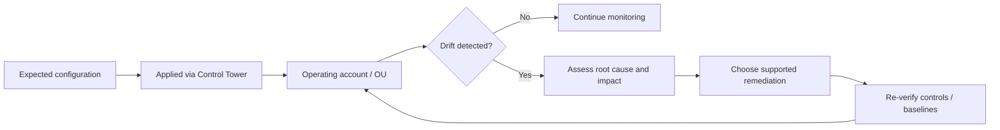

# AWS Control Tower and Building a Landing Zone

In a small project, a single AWS account may be enough for experimentation. But when an enterprise has multiple development teams, multiple environments (dev, staging, production), varying security requirements, and dozens of accounts, creating accounts manually easily leads to inconsistent configurations: missing logs, overly broad admin permissions, resources placed in the wrong Region, or poor cost control.

**AWS Control Tower** helps set up and govern a multi-account AWS environment according to a controlled foundational configuration. That foundation is called a **landing zone**. In the **Accounts and Organizations** chapter of the **CLOUD_PROVIDERS_AWS** module, learners connect AWS Organizations, IAM, VPC networking, Regions/AZs, compute, storage, databases, serverless, and monitoring into a governance model secure enough for teams to deploy applications independently.

> **Version note:** AWS Control Tower landing zone **4.0** (released November 17, 2025) introduces significant changes compared to guides for version 3.3 and earlier: service integrations can be selectively enabled/disabled, the OU structure is more flexible, and landing zones can be deployed with a controls-only focus. Therefore, do not assume every new landing zone automatically creates the same set of OUs, shared accounts, or enables all controls by default. When practicing, always check the active version and enabled options in the Console. [Source: Landing Zone 4.0 migration guide](https://docs.aws.amazon.com/controltower/latest/userguide/landing-zone-v4-migration-guide.html).

## 1. Learning Objectives

After this lesson, you will be able to:

1. Explain what a **landing zone** is and distinguish the roles of **AWS Control Tower**, **AWS Organizations**, and security/monitoring services.
2. Design an **OU and account** diagram to separate environments, costs, permissions, and blast radius.
3. Distinguish **preventive**, **detective**, and **proactive controls**, along with the concept of baselines and control guidance levels.
4. Plan the initialization, scaling, and operation of a landing zone, including with an existing AWS Organization.
5. Analyze common operational challenges: drift, admin permissions, centralized logging, costs, landing zone upgrades, and workload service selection.

## 2. What Is a Landing Zone?

A **landing zone** is an initial AWS environment designed and configured to organizational standards so workloads have a consistent "place to land." It typically includes:

- **Governance structure:** AWS Organization, organizational units (OUs), and accounts separated by responsibility.
- **Identity and access:** sign-in methods, group-based permissions, and cross-account access governance.
- **Policies and controls:** rules defining allowed actions, compliance alerts, and resource configuration checks.
- **Logging and observability:** collecting API activity, configuration state, alerts, and incident investigation data.
- **Networking and connectivity:** IP standards, VPCs, on-premises connectivity, network segmentation, and Internet access as needed.
- **Cost, operations, and recovery:** ownership metadata, tagging, budgets, backups, RTO/RPO, and account provisioning/decommissioning workflows.

A landing zone is an **organizational foundation**, not the entirety of your application infrastructure. A new account with a good landing zone still requires designing ALBs, EC2, ECS, EKS, Lambda, S3, RDS, DynamoDB, VPCs, subnets, and resilience suited to the specific workload.

### 2.1. How Does AWS Control Tower Differ from AWS Organizations?

| Component | Primary Function | Example |
|---|---|---|
| **AWS Organizations** | Creates/manages the AWS organization, groups accounts into OUs, applies org-level policies, and supports consolidated billing | Create `OU-Production` and apply an SCP restricting actions |
| **AWS Control Tower** | Orchestrates landing zone configuration, governs OUs/accounts, enables controls and baselines, and supports standardized account provisioning | Enable controls for an OU, track drift, create accounts via Account Factory |
| **IAM / IAM Identity Center** | Defines identities and service permissions, configures user/group/role access | Developer group accesses the dev account with assigned permissions |
| **AWS Config / CloudTrail** | Tracks resource configurations or records API activity as configured | Detect misconfigured S3 buckets, trace who changed a policy |
| **AWS Service Catalog / Account Factory** | Supports provisioning standardized accounts and extending account-vending workflows | Create account `app-a-dev` from an approved template |

**Key mindset:** Organizations provides the structural framework; Control Tower helps set up and maintain governance on top of that framework. Control Tower does not replace IAM, does not deploy your entire enterprise network automatically, and does not make a workload highly available with a single click.

### 2.2. Why Split into Multiple AWS Accounts?

An AWS account provides a useful boundary for access control, resource management, billing, and quotas. For example:

- Production workloads are not directly impacted when dev teams experiment with resources.
- A centralized log account restricts application teams from deleting or altering logs.
- Each product or environment can track costs more clearly via accounts, tags, and reports.
- OU-level policies can be rolled out across groups of accounts sharing governance requirements.

Even so, multiple accounts **do not automatically guarantee** data isolation or compliance if cross-account permissions, IAM roles, KMS keys, network policies, and resource sharing mechanisms are loosely configured.

## 3. Multi-Account Landing Zone Architecture

The diagram below is a **reference architecture** for a company with multiple product teams. It is a recommended design, not a structure that Control Tower forces you to create.

```text
AWS Organization
├── Management account (organization governance, billing, and Control Tower)
├── OU: Security-Integrations
│   ├── CloudTrail administration / centralized logging (if enabled)
│   ├── Config aggregation / security audit (if enabled)
│   └── Other security/backup integration accounts (if enabled)
├── OU: Infrastructure
│   ├── network-shared
│   └── shared-services
├── OU: Workloads
│   ├── OU: NonProduction
│   │   ├── app-a-dev
│   │   └── app-a-staging
│   └── OU: Production
│       ├── app-a-prod
│       └── app-b-prod
├── OU: Sandbox
│   └── sandbox-team-x
└── OU: Suspended (if needed by the organization)
    └── account-to-review
```

### 3.1. Role of Each Layer

| Layer | Role | Design Rules |
|---|---|---|
| **Management account** | Manages the Organization, consolidated billing, and Control Tower setup/orchestration | Strictly minimize business workloads and users with org-wide privileges |
| **Security / integration accounts** | Hosts log administration, Config aggregator, centralized security or backup functions if enabled | Separate security admins from app developers; restrict edit/delete access to audit data |
| **Infrastructure accounts** | Organizes shared networking resources, DNS, on-premises connectivity, and internal tooling | Manage changes via IaC, separate network administration permissions |
| **Workload accounts** | Runs applications and data by product/environment | Production has separate permissions, budgets, and change processes |
| **Sandbox accounts** | Experimentation with appropriate quotas and controls | Cost alerts, Region/service limits as needed; periodic resource cleanup |

In landing zone **4.0**, you are **not required** to use OUs named `Security` or `Sandbox`. However, accounts designated for **service integrations** must be placed according to the parent OU requirements of the corresponding version. Choose the structure based on permissions, responsibilities, and environment characteristics; avoid creating OUs simply after AWS product names. See [Key changes — Landing Zone 4.0](https://docs.aws.amazon.com/controltower/latest/userguide/key-changes-lz-v4.html).

### 3.2. Account, OU, Region, and VPC Boundaries

These are four distinct layers and cannot substitute for one another:

- **Account:** boundary for resource ownership, access, and cost tracking.
- **OU:** group of accounts for managing and applying scoped policies/controls.
- **Region:** geographic location for deploying services; relates to latency, data residency, and DR design.
- **VPC:** logical network boundary within a Region; subnets reside inside Availability Zones.

For example, `app-a-prod` can deploy across two AZs in the Singapore Region to withstand an AZ failure. Doing so **is not** creating two AWS accounts, and **is not** a recovery strategy for an entire Region outage.

## 4. Core Components of AWS Control Tower

### 4.1. Landing Zone and Home Region

During initialization, the administrator chooses a **home Region** for the landing zone; this is where Control Tower configurations are managed. AWS explicitly states that **the home Region cannot be changed after the landing zone is set up**, so choose it based on governance requirements and operational location. You can also designate **governed Regions** to extend governance coverage; supported Regions and control behavior depend on the service, control type, and version.

Choosing Regions is not solely based on user location. Consider where data is allowed to reside, service availability, latency, data transfer costs, and operational requirements. A **Region Deny control** can help restrict access in Regions outside the intended scope, but exceptions, global services, and workload impacts must be evaluated before enabling it.

### 4.2. Baselines: Foundational Configuration for OUs/Accounts

A **baseline** is a set of resources and configurations that establishes a governance foundation for an account or OU. Notable baselines include:

- `AWSControlTowerBaseline`: the traditional foundational configuration for Control Tower governance, applicable to an OU.
- `ConfigBaseline`: supports configuration recording to use **detective controls** in landing zone 4.0 without requiring the full `AWSControlTowerBaseline`.
- Baselines serving specific service integrations managed by AWS per the landing zone configuration.

**4.0 note:** enabling AWS Config integration **at the landing zone level** does not automatically mean every member account has a Config recorder enabled; to roll out recording to member accounts, you must enable the appropriate baseline on the OU. Baseline selection determines which features are available, especially when enabling detective controls or Account Factory.

[Reference: Baselines and landing zone version compatibility](https://docs.aws.amazon.com/controltower/latest/userguide/table-of-baselines.html).

### 4.3. Controls: Preventive, Detective, and Proactive

A **Control** (previously often called a *guardrail*) is a governance rule activated over an appropriate scope, usually an OU.

| Control Type | Typical Mechanism | Response | Example |
|---|---|---|---|
| **Preventive** | AWS Organizations policies such as SCPs, RCPs, or declarative policies (depending on control) | **Prevents** non-compliant actions at request time | Restrict changing logging settings or using disallowed Regions |
| **Detective** | AWS Config rules and supported inspection integrations | **Detects and reports** non-compliant state; does not automatically block actions | Detect storage resources misconfigured with public access |
| **Proactive** | CloudFormation hooks in supported provisioning flows | **Checks before creation**; rejects configurations violating rules | Block deploying a CloudFormation template that creates non-compliant resources |

Practical example: for an OU containing production accounts, you can apply preventive controls to block dangerous changes, detective controls to report non-compliant resources, and proactive controls to inspect deployment templates before resources are created. The three layers complement one another because each covers different scopes and acts at a different stage.

**Control guidance** also has three levels: **mandatory**, **strongly recommended**, and **elective**. These are **governance guidance levels**, distinct from the three **enforcement mechanisms** in the table above.

- **Mandatory:** rules protecting Control Tower components per each version/configuration. **Starting in landing zone 4.0, mandatory controls are no longer enabled by default**, so administrators must inspect actual status rather than relying on the guidance level name.
- **Strongly recommended:** controls recommended by AWS for common governance models, though still selected for deployment based on version and requirements.
- **Elective:** optional controls, typically aligned with specific enterprise policies.

**Two limitations to remember:**

1. **SCPs do not grant IAM permissions.** An action is only allowed when relevant permission layers grant it and no policy layer blocks it. SCPs mainly define maximum permission bounds for affected entities; they do not replace least privilege.
2. Do not treat all controls as absolute blocks. Detective controls identify violations after configuration changes; proactive controls only cover the deployment paths and resource types they support. Exceptions and policy scopes must be verified separately.

[Source: How controls work](https://docs.aws.amazon.com/controltower/latest/userguide/how-controls-work.html) and [Controls Reference — Control behavior](https://docs.aws.amazon.com/controltower/latest/controlreference/control-behavior.html).

### 4.4. Account Factory and Enrollment

**Account Factory** helps create member accounts using an approved configuration: target OU, account details, granted identities, and associated template configurations. It reduces errors when multiple teams continually need new accounts.

Reference workflow:

1. The application team submits a new account request: purpose, environment, owner, email, OU, and cost center.
2. The platform team reviews and selects the appropriate OU/baseline.
3. The administrator uses Account Factory to create the account, or uses an organization-approved automation pipeline.
4. The platform team verifies provisioning status, access permissions, logging, controls, tags, budgets, and alerts before handover.
5. The application team deploys workloads via authorized tooling, such as CloudFormation or Terraform.

**4.0-related condition:** provisioning, updating, or customizing **an account via Account Factory** requires the target OU to have `AWSControlTowerBaseline`. A landing zone in controls-only mode does not automatically include full Account Factory capabilities. For existing accounts/OUs, *register OU*, *enroll account*, and *enable baseline* processes must be evaluated against the current environment state and version. Traditionally enrolled accounts require appropriate permissions/roles, including `AWSControlTowerExecution` as documented.

[Reference: Provision and manage accounts with Account Factory](https://docs.aws.amazon.com/controltower/latest/userguide/account-factory.html).

## 5. Planning Before Creating a Landing Zone

Setting up Control Tower can create accounts and billable resources. Before executing in a real account, complete the following decision table.

| Question | Decision to Finalize | Risk If Skipped |
|---|---|---|
| Use a new or existing Organization? | Identify the **management account** and governance permissions | Resource conflicts, incorrect permissions, or impact on legacy policies |
| What is the Home Region? | Verify service support, operational location, and data residency | Choosing the wrong home Region, which cannot be changed after setup |
| Which Regions will be governed? | Select governed Regions and an appropriate Region policy | Resources created in Regions outside the intended scope |
| How will OUs be structured? | Separate security integrations, production, non-production, sandbox, infrastructure | Mixing sensitive workloads with test environments |
| Who manages identity? | IAM Identity Center or existing identity provider integration; group-based access | Shared privileged accounts, overly broad permissions |
| Which integrations to enable? | Config, CloudTrail, security roles, backups, mechanisms needed for controls | Unnecessary costs or missing audit trails |
| Where do shared accounts live? | Define placement and dedicated emails for integration accounts per version | Configuration conflicts / failing setup prerequisites |
| How will account vending work? | Use Account Factory? Which baselines are required? | Unable to provision accounts per the planned process |
| Who owns ongoing operations? | Owners for drift, upgrades, incidents, logs, access reviews, and costs | No responder when a control fails |

### 5.1. Case of an Existing Organization

AWS Control Tower can set up a landing zone on an **existing AWS Organization** and use the existing management account. OUs not managed by Control Tower are not necessarily altered automatically simply by enabling the service.

However, before extending governance to existing OUs/accounts, verify:

- Whether existing AWS Config, CloudTrail, IAM roles, S3 buckets, and Organizations policies conflict with Control Tower's configuration.
- Whether permissions/roles required for enrollment and account governance are in place.
- Whether the OU contains critical accounts where a new control could disrupt operational workflows.
- Whether a transition plan is needed for logging, IAM Identity Center, baselines, and communicating changes to teams.

**Do not bulk-move production accounts into a new OU or enable bulk preventive controls without testing in a validation account first.** Starting in landing zone 4.0, what counts as a Control Tower-governed resource is also more flexible: OUs/accounts with Control Tower resources enabled (such as controls/baselines) can be considered governed, not solely based on having `AWSControlTowerBaseline`.

[Reference: Plan your landing zone](https://docs.aws.amazon.com/controltower/latest/userguide/planning-your-deployment.html) and [Key changes 4.0](https://docs.aws.amazon.com/controltower/latest/userguide/key-changes-lz-v4.html).

## 6. Phased Landing Zone Setup Workflow

This is a **learning and design workflow**, not a guarantee that Console buttons keep identical labels across versions.

### Phase 1 — Design the Organizational Model

Finalize account/OU boundaries and owners, for example:

- `Security-Integrations`: hosts selected integration accounts per Control Tower 4.0 requirements.
- `Production`: real application accounts; strict change controls.
- `NonProduction`: dev/staging environments; controlled experimentation allowed.
- `Infrastructure`: shared network, DNS, or tooling if genuinely needed.
- `Sandbox`: experimental accounts with budgets and resource cleanup cycles.

Create a table for each OU: **purpose**, **owning team**, **controls**, **baseline**, **Regions**, **access mechanism**, **logging requirements**, **budget**.

### Phase 2 — Choose Landing Zone Configuration

In the AWS Control Tower Console, from the management account with appropriate permissions:

1. Select the home Region and review prerequisites for the landing zone version.
2. Specify the Organization setup, service integrations to use, and shared accounts; in landing zone 4.0, choosing integrations is an explicit decision.
3. Choose identity management, logging, retention, and governed Regions.
4. Review resources to be created, impact on the existing Organization, cost implications, and permissions before confirming.
5. Run the setup in an approved environment; monitor status until completion or a specific error appears.

**Do not treat a successful landing zone deployment as proof that every account has logging, every OU has a baseline, and every control is enabled.** Verify each integration and each OU individually.

### Phase 3 — Apply Baselines and Controls per OU

Example **recommended** policy matrix, not an AWS default control set:

| OU | Objective | Controls/Measures to Consider |
|---|---|---|
| Production | Prevent risky changes and unauthorized access | Least privilege, appropriate Region limits, logging, config monitoring, evaluate controls before enabling |
| NonProduction | Allow development while detecting deviations | Essential logging baseline, configuration checks, cost limits |
| Sandbox | Encourage responsible experimentation | Usage duration limits, resource/Region caps where appropriate, budgets, and cleanup procedures |
| Security-Integrations | Protect audit/governance infrastructure | Independent admin access, restrict log modification/deletion; follow Control Tower management rules |

For **detective controls**, verify that AWS Config recording and the required baseline are active on the target OU. For **preventive controls**, pre-assess legitimate administrative actions that might be blocked. For **proactive controls**, verify which pipelines and resource types are actually evaluated.

### Phase 4 — Provision a Pilot Account and Validate

Create **one pilot account** following the approved workflow (e.g., `app-a-dev`), then verify:

- The account appears in the right OU with the expected governance/baseline status.
- Users can sign in via the approved mechanism; privileges match the intended scope.
- Expected controls appear and produce expected results during safe testing.
- Logging, monitoring, and alerting mechanisms are enabled per organizational policy.
- Costs can be queried by account/tag; operations teams know who is responsible.

Only expand provisioning to remaining teams once the pilot account meets requirements.

### Phase 5 — Establish Long-Term Operations

A healthy landing zone needs recurring operational routines:

- Check for **governance drift** and baseline/control application errors.
- Track new landing zone versions and plan updates for affected OUs/accounts.
- Review administrative permissions, cross-account links, backup conditions, and recoverability.
- Monitor bills for Config, CloudTrail, CloudWatch, S3, data transfer, and workloads.
- Manage the account lifecycle: request, provision, handover, OU move, suspension, and closure via approved workflows.

## 7. Logging, Security, and Shared Responsibility

### 7.1. Commonly Combined Observability Layers

| Component | Question Answered | Notes |
|---|---|---|
| **CloudTrail** | Who called which API, when, and in which account? | Check whether the organization has an organization trail enabled or uses another CloudTrail strategy |
| **AWS Config** | How are resources configured, how did they change, and are they compliant with rules? | Config recording can incur costs, especially in accounts frequently creating/destroying resources |
| **CloudWatch** | What metrics, logs, and alarms does the workload have? | App logs and alarms must be configured separately; retention affects cost |
| **EventBridge** | Which governance events should trigger automated notifications/remediation? | Requires defining specific rules and targets |
| **Security Hub / GuardDuty** | Are any security issues detected or aggregated? | Must be enabled and scoped properly; not automatically included in every landing zone |

**4.0 version note:** **governance drift** notifications from Control Tower are routed to **EventBridge in the management account** instead of continuing with the legacy SNS pattern. If you want emails or forwarding to a ticketing system, administrators must configure appropriate EventBridge rules and targets.

### 7.2. The Shared Responsibility Model Still Applies

AWS operates the physical infrastructure and foundational components depending on the service category. Customers remain responsible for their data, access controls, service configurations, applications, secret management, incident response processes, and compliance obligations.

For example, Control Tower helps standardize governance but **does not automatically**:

- Decide which S3 permissions a Lambda application's IAM role should have.
- Design subnets and security groups for an RDS database.
- Guarantee backups can be restored within business RPO/RTO targets.
- Detect and fix every vulnerability caused by application code or configuration.

Landing zone design must connect governance layers with **least privilege**, **defense in depth**, **observability**, and **recovery testing**.

## 8. Common Implementation Pitfalls

### 8.1. Confusing Preventive Controls with Detective Controls

Suppose a company requires that S3 buckets holding business data must not be public. A detective control can report a non-compliant resource **after** detecting the configuration; it does not guarantee preventing every way a public bucket can be created. You must combine IAM/bucket policies, S3 Block Public Access, appropriate controls, and deployment validation per requirements.

### 8.2. Enabling SCPs While Still Granting Broad IAM Permissions

SCPs only set maximum permission bounds for entities within scope. **SCPs do not grant permissions** and do not replace IAM roles/policies. The right approach is: IAM defines required permissions; SCPs add organizational boundaries; logging and Config help verify behavior and state.

### 8.3. Putting Every Application in the Management Account

The management account holds sensitive org-wide privileges and should not run regular workloads. Use member accounts to reduce blast radius and clarify operational ownership.

### 8.4. Seeing Control Tower "Enabled" and Assuming Full Compliance

In version 4.0, Control Tower can be enabled with minimal integrations. You must inspect **each OU**: whether baselines are enabled, whether Config is deployed to member accounts, whether controls are active, and whether trails and alerts are properly configured.

### 8.5. Manually Modifying Control Tower-Managed Resources

Deleting or modifying roles, policies, StackSets, Config resources, or configurations created by Control Tower outside supported workflows can cause **drift** or governance failures. Investigate first and use AWS-supported update/reset/re-register workflows or APIs instead of ad-hoc manual edits.

### 8.6. Failing to Budget for Integration Costs

There is no separate surcharge for Control Tower itself, yet services activated by Control Tower **still incur charges**: for example, Config, CloudTrail, Service Catalog, S3 log storage, or other components. A landing zone is not completely free. In particular, check for duplicate CloudTrail trails, log retention settings, and the volume of resources recorded by Config.

[Reference: Pricing — AWS Control Tower](https://docs.aws.amazon.com/controltower/latest/userguide/pricing.html).

## 9. Maintenance, Drift, and Landing Zone Upgrades

**Drift** is a state where actual configuration diverges from the expected Control Tower governance state—for example, a Control Tower-managed SCP is modified out-of-band or a required role is deleted.



Depending on the drift type and version, AWS provides mechanisms such as **Reset**, **Re-register OU**, **Update landing zone**, updating accounts, or specific API calls to reapply configuration. Not all drift should be handled with the same button.

**Upgrades have two layers to track:**

1. **Landing zone version:** updates configuration and governance capabilities at the landing zone level.
2. **OU/account baselines and enrolled accounts:** sometimes need to be updated or re-registered individually after a landing zone upgrade.

For example, upgrading from 3.3 to 4.0 changes Config/CloudTrail integrations and how service integration accounts are managed. Read the migration guide, inventory active integrations, assess impact, and test on a low-risk OU before rolling out broadly. **Do not assume you can roll back to a previous landing zone version.**

[Reference: About landing zone updates](https://docs.aws.amazon.com/controltower/latest/userguide/about-updates.html), [Resolve drift](https://docs.aws.amazon.com/controltower/latest/userguide/resolve-drift.html).

## 10. Design Example: E-Commerce Company

**Context:** a company has two products, web and data teams, dev/staging/prod environments, and users primarily in Southeast Asia. The enterprise wants centralized access governance, to prevent experimentation from affecting production, resource change history, and cost control.

### 10.1. Proposed Design

| Component | Proposal | Explanation |
|---|---|---|
| Management | 1 management account for Organizations and Control Tower | Do not deploy e-commerce applications in this account |
| Security integrations | Dedicated OU for selected integration accounts | Centralized control over logs, security config, and integration governance |
| Production | `store-prod`, `analytics-prod` | Separate permissions, deployment risk, and product costs |
| NonProduction | `store-dev`, `store-staging`, `analytics-dev` | Allow development teams controlled testing |
| Sandbox | `innovation-sandbox` | Set budgets and resource cleanup lifecycle |
| Region | Evaluate `ap-southeast-1` and another Region suitable for compliance/latency | Choose home Region carefully; governed Regions per dedicated strategy |
| Identity | IAM Identity Center/federated IdP, role-based groups | Developers get dev permissions; production operations follow approval workflows |
| Logging | CloudTrail/Config and collection targets aligned with integration choices | Ensure investigation and configuration verification capabilities |
| Controls | Define preventive/detective/proactive controls for the Production OU | Verify enforcement scope and exceptions before applying |
| Cost | Per account + tags `product`, `owner`, `environment` | Support cost allocation and alerting |

### 10.2. Where Does the Application Run?

Inside `store-prod`, the application team can use:

- **VPC** with private subnets for application/database tiers and public subnets only if genuinely needed.
- **ALB + ECS or EC2**, or **API Gateway + Lambda** depending on traffic patterns and operational requirements.
- **RDS** or **DynamoDB** according to data and query models.
- **S3/CloudFront** for images and static assets; **SQS/EventBridge** for asynchronous jobs.
- **CloudWatch**, backup/recovery mechanisms, and workload-specific alarms.

The landing zone **governs the environment hosting the application**; internal workload architecture is still decided jointly by the development and platform teams.

### 10.3. Testing a Controlled Change

Suppose the dev team requests permission to deploy a service in an unapproved Region:

1. The administrator checks the business justification and Region policy.
2. If the Region is blocked by a preventive control or SCP, the request is denied within the applied policy scope.
3. The dev team switches to an approved Region or submits a formal change request.
4. The governance team checks logs and governance status to verify; if the policy changes, they first assess impact on other accounts in the OU.

This demonstrates the benefit of placing policies at the **OU/account boundary** with a clear exception-handling path.

## 11. Safe Hands-On Practice

### Lab A — Sketch a Landing Zone on Paper

You are a cloud platform engineer for a company with 4 teams (web, mobile, data, security). The company needs:

- Separation of dev and production.
- Centralized configuration auditing and action traceability.
- Sandbox access with controlled spending.
- Template-based account provisioning.
- Ensuring each team only has necessary permissions.

**Requirements:** draw the OU/account tree; fill in columns for owner, baseline, controls, Region, IAM, and cost; explain why production accounts should not be shared with sandbox workloads. Select one suitable preventive control, one detective control, and one proactive control. State the limitations of each control type and the prerequisite required to use Account Factory.

**Evaluation hints:** a good design clearly establishes permission and operational boundaries and does not need to match every sample diagram identically. Account Factory requires a compatible baseline; detective controls require configuration recording and appropriate service conditions.

### Lab B — Read-Only Inspection If Authorized

Only run this if you **already have an account with read permissions**, the AWS CLI configured, and administrator approval. You do not need to create a real landing zone to complete this lesson.

```bash
# Check current identity; creates no resources
aws sts get-caller-identity --profile learning

# In an account with Organizations permissions: view the organization
aws organizations describe-organization --profile learning
aws organizations list-roots --profile learning

# View existing landing zone in the home Region provided by your admin
aws controltower list-landing-zones \
  --region ap-southeast-1 \
  --profile learning
```

The final Control Tower command uses an **example Region**; replace it with your organization's actual home Region. Users without sufficient permissions will see `AccessDenied` or a similar error, which does not indicate a broken environment. The commands above only query information; they do not call resource creation/modification APIs.

If the organization has not enabled Control Tower, the list may be empty. Do not enable the service in a production account just "to try it out."

### Lab C — Scenario Analysis

**Scenario 1.** A production OU has a detective control checking EBS encryption. A staff member successfully creates an unencrypted volume, and later the control reports non-compliant. Is the control "broken"?

> Not necessarily. Detective controls primarily **detect** after a resource enters a non-compliant state. Preventing it upfront requires preventive layers or deployment template validation; also verify that the control is operating over the intended scope.

**Scenario 2.** A company enables Control Tower 4.0 with a controls-only configuration and then wants to use Account Factory to create a new account in an OU without a baseline. Why might this fail?

> Provisioning an account via Account Factory requires the OU to have `AWSControlTowerBaseline`. Being able to enable controls on an OU does not mean the prerequisites for Account Factory are met.

**Scenario 3.** After upgrading the landing zone, an OU shows that an update is needed. Why might updating only the landing zone not be enough?

> Baselines and managed resources in individual OUs/accounts may need to be updated or re-registered separately to reflect the new configuration.

**Scenario 4.** A development team uses the management account to run a web API because it is convenient. What is the risk?

> The management account holds permissions affecting the entire Organization and is highly sensitive; application workloads should live in member accounts to limit access, change, and cost risks.

**Scenario 5.** A company enables Control Tower and assumes its AWS bill will not increase because Control Tower is free. Is this correct?

> No. There is no direct fee for Control Tower itself, but AWS Config, CloudTrail, S3, Service Catalog, data transfer, and integrated/workload resources can still incur charges.

## 12. Design Review Checklist

- [ ] Business objectives, data sensitivity levels, Regions, and RTO/RPO requirements are clear.
- [ ] An Organization, OU, management account, and member accounts diagram exists.
- [ ] Security integrations, production, non-production, and sandbox are separated as needed.
- [ ] The home Region was chosen intentionally and governed Regions are defined.
- [ ] Landing zone version, active service integrations, and baselines are known.
- [ ] IAM Identity Center/IdP, roles, and privilege-granting workflows have clear owners.
- [ ] Every preventive/detective/proactive control has a clear rationale, scope, and verification method.
- [ ] Logging/Config operate in the intended accounts/Regions.
- [ ] Processes exist for account provisioning, OU moves, drift detection, and landing zone updates.
- [ ] Budgets, account owners, and cost monitoring schedules are established.
- [ ] Workloads still have dedicated designs for networking, IAM, data security, backups, monitoring, and recovery.

## 13. Summary

**AWS Control Tower** helps build and maintain a **multi-account landing zone** on top of AWS Organizations. Its primary value is standardizing account provisioning, security, and governance, enabling multiple teams to deploy workloads while maintaining clear boundaries of responsibility.

Designers must distinguish **OUs, accounts, Regions, and VPCs**, recognize **controls** and **baselines**, and understand that logging/identity integrations are operational choices with prerequisites and costs. Especially with landing zone 4.0, you cannot infer active capabilities simply from "Control Tower is enabled": you must verify the actual configuration. On top of that governance foundation, upcoming lessons on IAM, VPC, compute, storage, databases, integration, and serverless gain the context needed to build applications that are secure, observable, resilient, and cost-optimized.

### Official Documentation for Further Reading

1. [AWS Control Tower — What is AWS Control Tower?](https://docs.aws.amazon.com/controltower/latest/userguide/what-is-control-tower.html)
2. [Landing Zone v4.0 migration guide](https://docs.aws.amazon.com/controltower/latest/userguide/landing-zone-v4-migration-guide.html)
3. [Key changes — Landing Zone v4.0](https://docs.aws.amazon.com/controltower/latest/userguide/key-changes-lz-v4.html)
4. [Plan your AWS Control Tower landing zone](https://docs.aws.amazon.com/controltower/latest/userguide/planning-your-deployment.html)
5. [How controls work](https://docs.aws.amazon.com/controltower/latest/userguide/how-controls-work.html)
6. [Baselines and landing zone version compatibility](https://docs.aws.amazon.com/controltower/latest/userguide/table-of-baselines.html)
7. [Provision and manage accounts with Account Factory](https://docs.aws.amazon.com/controltower/latest/userguide/account-factory.html)
8. [Update your landing zone](https://docs.aws.amazon.com/controltower/latest/userguide/update-controltower.html)
9. [AWS Control Tower pricing](https://docs.aws.amazon.com/controltower/latest/userguide/pricing.html)
