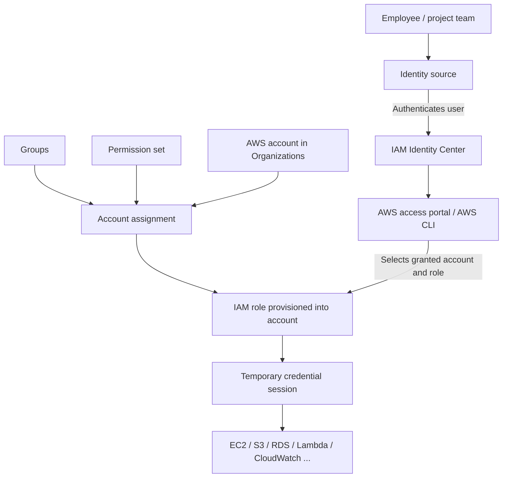
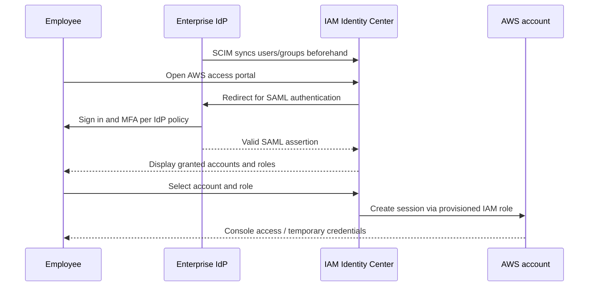

# IAM Identity Center and Centralized Sign-In

> **Chapter:** Accounts and Organizations · **Module:** `CLOUD_PROVIDERS_AWS`

## 1. The Problem: Managing Human Access Across Multiple AWS Accounts

Imagine an enterprise using AWS to run a Java application: a `dev` account for development, `staging` for testing, and `production` for live traffic. The application uses Amazon EC2 or AWS Lambda, Amazon RDS, Amazon S3, and IAM/VPC components. Developers need to view logs; operators need to update infrastructure; the security team needs to inspect CloudTrail; and finance needs to review costs. Creating a separate IAM user for each employee in every account quickly makes granting permissions, revoking access, enforcing MFA, and auditing activity difficult.

**AWS IAM Identity Center** is the AWS service for managing **workforce access** to AWS accounts and integrated applications. Users sign in with a centralized identity, choose an assigned account and role in the **AWS access portal**, and access the AWS Management Console or AWS CLI using **temporary credentials**.

Centralized sign-in is a key pillar of multi-account operations with **AWS Organizations**. It helps manage access consistently across Regions/AZs, IAM, VPCs, compute, storage, databases, integration, and serverless services—while supporting security, monitoring, recovery, and cost control goals.

**After this lesson, learners will be able to:**

1. Distinguish between authentication, authorization, SSO, and federation.
2. Explain the relationships among IAM Identity Center, AWS Organizations, identity sources, groups, permission sets, AWS account assignments, and IAM roles.
3. Choose an appropriate identity source model and IAM Identity Center instance type.
4. Design permissions by group, environment, and job function; restrict production administrative access.
5. Perform the Console setup workflow, sign in via the AWS CLI, and verify the active identity.
6. Recognize common errors, evaluate access logs, and handle employee onboarding/offboarding workflows.

## 2. Key Concepts to Distinguish

| Concept | Question Answered | Role in the System |
| --- | --- | --- |
| **Authentication** | *Who are you?* | Verifies identity via password, MFA, security key, or identity provider workflows. |
| **Authorization** | *What are you allowed to do?* | Determines which actions, resources, and conditions are accepted when calling AWS APIs. |
| **SSO (Single Sign-On)** | *One sign-in, where can you enter?* | Lets users access multiple granted apps/accounts without managing separate credentials for each. |
| **Identity federation** | *Who does AWS trust to verify identities?* | Uses an identity provider (IdP) to authenticate users and pass the assertion to another service. |
| **Identity source** | *Where are users and groups managed?* | IAM Identity Center directory, Microsoft Active Directory, or an external IdP. |
| **Permission set** | *Which permissions does an AWS account access role have?* | A permission template managed in IAM Identity Center, used to provision IAM roles into target accounts. |
| **Account assignment** | *Who has which permissions in which account?* | Links user/group + AWS account + permission set. |
| **AWS access portal** | *Where do users pick an account and role?* | The access portal displaying assigned AWS accounts and applications. |

Key point to remember: **a successful sign-in does not automatically grant access to an AWS account**, and **being granted an account does not mean having admin access to every resource inside that account**.

### 2.1. Relationship Between IAM, IAM Identity Center, and Organizations

- **AWS Organizations** manages the collection of AWS accounts, OUs (Organizational Units), org-level policies, and certain centralized governance features. Organizations defines which accounts belong to the organization and which constraints apply to them.
- **IAM Identity Center** manages workforce identities, access to accounts/apps, and centralized sign-in flows. This is where permission sets and account assignments are created for an **organization instance**.
- **AWS IAM** within each account evaluates resource access policies. When a permission set is assigned, IAM Identity Center provisions a **corresponding IAM role in the target account**. Users obtain sessions based on that role; effective permissions remain governed by other AWS policy layers.

Conceptual diagram:



This diagram illustrates **logical** relationships. IAM Identity Center creates and maintains roles when assignments exist; users do not need to manually create IAM users in each account. `AWSReservedSSO_*` is the AWS-managed role naming pattern commonly created for permission sets and **should not be modified or deleted directly** in IAM. To change permissions, edit the permission set and update/reprovision assigned accounts.

### 2.2. Example of Separating Human Identities and Workload Identities

An engineer opening the AWS Console or running the AWS CLI from a laptop is a **workforce identity**, well suited to IAM Identity Center. Conversely, an AWS Lambda function reading S3 or an application on Amazon ECS writing to RDS is a **workload identity**: use a Lambda execution role, ECS task role, IAM role for EC2, EKS Pod Identity, or an appropriate mechanism; never embed employee passwords or long-term access keys into source code. Amazon Cognito targets end-user application identities; it solves a different problem from workforce sign-in to AWS accounts.

## 3. Choosing an Identity Source: Built-In, Active Directory, or External IdP?

IAM Identity Center can use one of the following identity sources:

| Identity Source | When Appropriate | What Must Be Managed |
| --- | --- | --- |
| **Identity Center directory** | Small teams or organizations without an enterprise identity system. | Creating users, groups, authentication/MFA policies, and employee lifecycle inside IAM Identity Center. |
| **Microsoft Active Directory** | Existing AD infrastructure; wanting to use corporate identities via AWS Directory Service. | Directory connectivity, attribute sync/mapping, and MFA aligned with AD architecture and availability. |
| **External identity provider (IdP)** such as Microsoft Entra ID, Okta | Existing enterprise directory, groups, and sign-in policies. | Federation via SAML, provisioning via SCIM or manually, MFA at the IdP, attribute mapping, and federation certificates. |

**Distinguish SAML and SCIM** when using an external IdP:

- **SAML 2.0** passes authentication assertions from the IdP to IAM Identity Center. It handles sign-in federation; it **does not automatically sync user/group lists**.
- **SCIM 2.0** creates, updates, syncs, or revokes users and groups from the IdP into IAM Identity Center. It handles *provisioning*, and does not replace SAML during sign-in.
- If SCIM is not used, users/groups may need to be provisioned **manually** depending on IdP capabilities. An account existing in the IdP that has not been provisioned in IAM Identity Center cannot sign in or receive assignments.
- IAM Identity Center must match the SAML identity to the provisioned user. With an external IdP, check the `NameID` value against `Username` in Identity Center; formatting mismatches or case/value differences can cause errors.

A federation and provisioning flow:



**MFA:** With an external IdP, configure MFA at the **IdP**, because IAM Identity Center's built-in MFA policy does not apply to users signing in via an external IdP. With Identity Center directory or supported Active Directory configurations, configure MFA in IAM Identity Center per current documentation. Always test the user experience, backup devices, and recovery procedures if an MFA method is lost.

**Changing the identity source is an architectural change, not flipping a UI toggle.** Some transitions can drop assignments or require remapping identities. Before changing it in production, read the identity-source migration docs, inventory users/groups and assignments, prepare a rollback plan, and practice in a suitable environment.

## 4. Choosing IAM Identity Center Instance Type and Region

IAM Identity Center has an **organization instance** and an **account instance**; this choice directly determines multi-account permission capabilities.

| Criterion | Organization Instance | Account Instance |
| --- | --- | --- |
| Where created? | AWS Organizations **management account**. | A member account or standalone AWS account. |
| Access AWS accounts in Organizations via permission sets | **Yes**; standard choice for multi-account workforce access. | **No**; does not support multi-account permissions. |
| AWS access portal for account assignments | Yes. | Does not provide AWS account access via permission sets like an organization instance. |
| Applications | Supports full application use cases and features per configuration. | Suited for simpler single-account application use cases; limited feature set. |
| Delegated administration | Most administration can be delegated to a member account. | Not applicable like an organization instance. |
| When to choose? | Enterprises with `dev`, `test`, `prod`, security/operations accounts. | Standalone application use case in a single account without multi-account permission sets. |

**Note:** An organization instance is initialized via the management account, but to minimize how many people enter that critical account, configure a **delegated administrator** in a controlled member account. Certain operations must still be performed in the management account; do not treat delegation as granting unrestricted power over Organizations.

### 4.1. Choosing Region and Availability

- When creating an organization instance, pick a **primary Region** suited to operational, application, availability, and compliance requirements. The primary Region **cannot be changed directly** after instance creation.
- Placing Identity Center in one Region **does not restrict access** to AWS services in other Regions; the Identity Center Region and the Region hosting EC2, RDS, or Lambda are two separate decisions.
- IAM Identity Center supports **replicating an organization instance to additional Regions** in eligible Regions and configurations. This improves account access resilience if the primary Region experiences an outage; it does not mean every Region, every identity source, or every instance type is supported.
- Identity Center replication **does not migrate workloads or application data** to another Region. High-reliability applications still require separate Multi-AZ, backup, and DR designs for EC2/VPC/RDS/S3/application resources.
- Establish a protected and periodically tested **emergency/break-glass access** plan, since an external IdP outage can block SSO sign-in even when AWS services are healthy.

Before deploying, check [Organization and account instances](https://docs.aws.amazon.com/singlesignon/latest/userguide/identity-center-instances.html) and [Using IAM Identity Center across multiple AWS Regions](https://docs.aws.amazon.com/singlesignon/latest/userguide/multi-region-iam-identity-center.html), as features and prerequisites depend on timing, Region, and instance type.

## 5. Designing Permissions: Groups + Permission Sets + Account Assignments

A **permission set** describes the set of permissions placed into an IAM role in the target AWS account. However, a permission set **does not grant access to anyone** until it is assigned to a user/group and an account. Mental formula:

```text
Workforce access to an AWS account
    = Identity (user or group)
    + AWS account
    + Permission set
    + Effective control conditions in AWS
```

Example simulated enterprise with multiple accounts:

| Account | Group | Illustrative Permission Set | Scope of Work |
| --- | --- | --- | --- |
| `app-dev` | `developers` | `DeveloperDev` | Develop and operate resources in dev, scoped by project. |
| `app-staging` | `developers` | `StagingReadOnly` | View logs, configurations, and metrics to support testing. |
| `app-prod` | `developers` | `ProductionReadOnly` | Troubleshoot production issues without modifying infrastructure. |
| `app-prod` | `platform-operators` | `ProductionOperator` | Scoped operations following runbooks and approvals. |
| `audit` / governed accounts | `security-auditors` | `SecurityAudit` | Inspect configurations and security evidence. |
| `billing` / appropriate account | `finops` | `BillingView` | Analyze costs and budget reports per granted permissions. |

The permission set names in the table are **design examples only**; organizations define their own names and policies. Do not assume these names are AWS-managed permission sets or that AWS pre-populates all actions inside them.

### 5.1. What Does a Permission Set Contain?

Depending on design, a permission set can include:

1. **AWS managed policies** such as `ReadOnlyAccess` or job-function policies; verify actual scope before using.
2. **Customer managed policies** existing in the target AWS accounts with matching names/paths required by the permission set; coordinate versions and consistent deployment.
3. **Inline policy** authored by the organization to restrict actions, resources, and conditions.
4. **Permissions boundary**, when capping the maximum permissions of the IAM role.
5. **Session duration** for AWS account access sessions and other options supported by IAM Identity Center.

Example of an inline policy granting **read-only access to objects in a single S3 bucket**, illustrating the difference between bucket-level and object-level permissions:

```json
{
  "Version": "2012-10-17",
  "Statement": [
    {
      "Sid": "ListProjectBucket",
      "Effect": "Allow",
      "Action": "s3:ListBucket",
      "Resource": "arn:aws:s3:::example-team-artifacts"
    },
    {
      "Sid": "ReadProjectObjects",
      "Effect": "Allow",
      "Action": "s3:GetObject",
      "Resource": "arn:aws:s3:::example-team-artifacts/*"
    }
  ]
}
```

This is an **illustrative policy**, not accounting for KMS encryption, bucket policies, Object Ownership, SCPs, permissions needed by the Console, or data-specific conditions. Do not apply verbatim to production. Final effective permissions are governed by IAM evaluation rules, explicit denies, SCPs/RCPs if applicable, permission boundaries, session policies, and resource-based policies. An `AdministratorAccess` permission set does not automatically bypass an SCP restricting actions in a member account.

### 5.2. RBAC and ABAC

- **RBAC (role-based access control):** The `developers` group is assigned `ProductionReadOnly`; the `platform-operators` group is assigned `ProductionOperator`. Someone changing teams is added to/removed from the corresponding groups.
- **ABAC (attribute-based access control):** IAM Identity Center can pass employee attributes such as `Project` or `Department` as **session tags**; IAM policies use `aws:PrincipalTag/Project` to compare against resource tags. Useful when multiple projects share one permission set but must isolate resources per project.

Conceptual example: a user carries `Project=alpha`, and the IAM policy only allows operations on resource types supporting tag conditions with `Project=alpha`. To achieve this, you must **enable attributes for access control**, map trusted attributes, tag resources, author matching policies, and test thoroughly. Never trust an attribute that a user can self-edit to match another project.

### 5.3. Session Duration and Active Permissions

Distinguish at least three session layers:

- **IdP/workforce sign-in session** managed by the identity system and IAM Identity Center.
- **AWS access portal session** for selecting accounts, roles, and applications.
- **IAM role session** used in the AWS Console or AWS CLI, governed by the permission set's `Session duration`: default is typically **1 hour**, maximum **12 hours**.

Portal session expiration does not necessarily terminate an already-issued IAM role session immediately. When a user is removed from a group or disabled, they may lose the ability to start new sessions, yet **existing IAM role sessions remain valid until they expire**. Therefore, revoking access in high-risk situations requires an incident-response procedure and evaluation of active sessions. Set shorter session durations for production where appropriate to avoid leaving admin privileges open unnecessarily.

## 6. Setting Up IAM Identity Center for a Multi-Account Organization

This is a guided Console workflow, **not making direct changes to a learner's account**. Confirm administrative authority and target accounts before taking real actions.

### Step 1 — Prepare the AWS Organizations Structure

Create or use an existing organization, distinguishing the management account from member accounts. Define OUs/dev/staging/prod, compliance requirements, least privilege principles, and owners for each environment. Protect each account's root user, enable MFA, and avoid using the management account for daily work.

### Step 2 — Choose Organization Instance and Primary Region

From the management account, open **IAM Identity Center** and enable an organization instance following current documentation. Pick the Region with long-term planning since the primary Region cannot be arbitrarily changed. Assess whether multi-Region replication and sign-in redundancy are needed; evaluate AWS KMS cost implications if using customer-managed multi-Region keys.

### Step 3 — Choose the Identity Source

- For small labs: use the **Identity Center directory**, creating test users and a `developers` group.
- For enterprises: connect an external IdP via SAML, configure SCIM or provisioning per vendor documentation; ensure the `Username` attribute matches.

If using an external IdP, test sign-in and MFA before granting production access. Avoid switching an existing identity source without inventorying assignments and having a recovery plan.

### Step 4 — Create Groups and Test Users

Design groups around **job function and environment**, such as `developers`, `platform-operators`, and `security-auditors`. Prefer group assignments so onboarding/offboarding stays controllable; use direct user assignments only with specific, tracked justification. Ensure group membership changes are approved at the identity source.

### Step 5 — Create Permission Sets

Go to **Multi-account permissions → Permission sets**. Create minimal permission sets for clear needs: for example `ProductionReadOnly` using reviewed policies. Check session duration, attached policies, and permissions boundary requirements. Only create elevated roles with approval workflows or time-bounded access.

### Step 6 — Assign Groups to Accounts and Permission Sets

Go to **Multi-account permissions → AWS accounts**, select the target account, choose `Assign users or groups`, and select the group and permission set. Example:

```text
Account: app-prod
Group: developers
Permission set: ProductionReadOnly
```

IAM Identity Center creates/updates the corresponding AWS role in the target account. If you edit a permission set, **check the provision/reprovision status** to confirm target accounts receive the updated policy. Do not edit `AWSReservedSSO_*` roles directly in IAM, because subsequent provisioning can overwrite changes.

### Step 7 — Test Sign-In with a Real User

Have a test account in the group sign in to the **AWS access portal**. The user should see the expected assigned account and permission set, succeed on allowed APIs, and receive **AccessDenied** when attempting out-of-scope operations. Also test production access to confirm no unintended broad write permissions were granted.

### Step 8 — Finalize Operations and Auditing

Configure delegated administration where appropriate, and configure CloudTrail to log permission set changes, assignment updates, and sign-in activity. Establish periodic access reviews, offboarding procedures, session duration standards, alerts on sensitive permission changes, and a protected emergency access plan. Document owners for each group and permission set.

## 7. Signing In to IAM Identity Center with the AWS CLI

For developers, AWS CLI v2 supports sign-in sessions via IAM Identity Center, reducing the need to create and store **long-term access keys** on laptops. A user must be assigned an AWS account and permission set before configuring a profile for that account.

### 7.1. Interactive Profile Configuration

```bash
# Configure an IAM Identity Center profile
aws configure sso --profile app-dev-readonly

# Sign in via browser or the CLI-displayed verification flow
aws sso login --profile app-dev-readonly

# Verify the AWS account and role of the current session
aws sts get-caller-identity --profile app-dev-readonly

# Example read-only API call using the signed-in profile
aws s3api list-buckets --profile app-dev-readonly

# When finished, clear cached SSO tokens on the machine
aws sso logout
```

`list-buckets` requires `s3:ListAllMyBuckets`, so a permission set granting read access to only a single bucket (like the sample policy in section 5) may return `AccessDenied`; that can be expected behavior by design. Test using commands matching the granted permissions rather than loosening permissions just to make sample commands pass. `aws sso logout` clears local SSO tokens/cache, but does not guarantee revoking already-issued IAM role sessions or sessions on other devices.

`aws configure sso` may prompt for:

- **SSO session name:** local identifier for the SSO session.
- **SSO start URL / Issuer URL:** URL provided by the organization for sign-in.
- **SSO Region:** Region of the IAM Identity Center instance/endpoint handling sign-in.
- **Account / role:** AWS account and permission set assigned to the user.
- **Default client Region:** default Region for CLI resource API calls, which can differ from the SSO Region.
- **Profile name:** friendly local name, e.g., `app-dev-readonly`.

### 7.2. Understanding `~/.aws/config`

**Illustrative** configuration example containing no secrets:

```ini
[profile app-dev-readonly]
sso_session = company-sso
sso_account_id = 111122223333
sso_role_name = ProductionReadOnly
region = ap-southeast-1
output = json

[sso-session company-sso]
sso_start_url = https://example.awsapps.com/start
sso_region = ap-southeast-1
sso_registration_scopes = sso:account:access
```

`111122223333`, the URL, role name, and Region are placeholder values; use details provided by your organization. The `sso_role_name` must match the permission set/role AWS presents to the user. Notice the profile is named `app-dev-readonly` while `sso_role_name` is `ProductionReadOnly` to illustrate that the two names are independent; **in real environments, keep naming consistent** to avoid running commands in the wrong account. AWS CLI now supports token-provider configuration using `[sso-session]`, which is generally more convenient than legacy configuration.

### 7.3. Why Verify `get-caller-identity`?

On machines with multiple profiles or `AWS_ACCESS_KEY_ID`/`AWS_SECRET_ACCESS_KEY` environment variables, the CLI/SDK follows a credential precedence order. A command may run under a **different** identity than intended even after signing in with SSO. Therefore, before infrastructure operations—especially with CloudFormation, Terraform, EKS, or RDS—run:

```bash
aws sts get-caller-identity --profile app-dev-readonly
```

Inspect the `Account` and `Arn` fields to confirm you are in the right account/role. If using `AWS_PROFILE`, verify the variable points to the intended profile; never store static access keys in repositories, CI logs, or shell history. In CI/CD, prefer **IAM roles and workload-appropriate federation mechanisms** (such as a CI provider's OIDC) instead of an employee's SSO session.

## 8. Post-Deployment Governance, Security, and Monitoring

### 8.1. Workforce Lifecycle Access Controls

| Event | Required Actions | Verification Method |
| --- | --- | --- |
| **Onboarding** | Create/provision user, add to right groups, assign least-privilege access. | User sees expected accounts/permission sets; allowed commands work, prohibited actions are denied. |
| **Team/project transfer** | Update groups or attributes; remove old permissions. | Review assignments and active sessions; assess ABAC impact. |
| **Temporary privilege elevation** | Approve justification, set time limit, and log activity. | Ticket, owner, start/end timestamps, and revocation evidence exist. |
| **Offboarding** | Disable in IdP/Identity Center, revoke groups/assignments, handle related apps. | Cannot start new sessions; track active IAM role sessions until expiry or revoke via incident response. |
| **Periodic review** | Compare groups, permissions, and owners against current job needs. | Record showing excess permissions removed and permission sets updated. |

### 8.2. Logging and Anomaly Detection

**AWS CloudTrail** records IAM Identity Center management actions, Identity Store changes, sign-ins, and AWS API calls made after assuming a role. Depending on audit goals, inspect:

- Permission set create/edit/delete actions, assignment additions/removals, and group changes.
- Authentication events, such as `UserAuthentication` for successful sign-ins or related credential challenges.
- Resource activity in target accounts using temporary identities tied to Identity Center-provisioned IAM roles.

Configure a CloudTrail trail or CloudTrail Lake per retention and security requirements, shipping logs to a centralized location with strict access policies. Correlate `eventTime`, `userIdentity`, account/Region, `eventName`, source IP, and request parameters; note that sign-in event payloads and management API events have different schemas. You can use Amazon EventBridge, Amazon CloudWatch, and a SIEM to alert on sensitive actions. Multi-account organizations need centralized logging so auditors can investigate across environments.

### 8.3. Effective Permissions Depend on More Than the Permission Set

An `Allow` in an inline policy may not take effect if:

- A **Service Control Policy (SCP)** in AWS Organizations disallows the action in the member account.
- An **explicit Deny** exists in an IAM identity policy, resource-based policy, or related control layer.
- A **Permissions boundary** restricts the IAM role's maximum permissions.
- A resource policy or conditions such as Region, VPC endpoint, IP, or tags are not satisfied.
- The resource uses AWS KMS encryption and the session lacks permission on the corresponding key.

Conversely, an overly broad assignment must not be treated as safe just because an AWS account is in the `dev` OU. Build least-privilege policies, enforce separation of duties, keep production admin roles scarce, and apply IaC/peer review to broad permission sets.

### 8.4. Performance, Resilience, and Cost

IAM Identity Center is a managed identity service; proper design lowers access-management overhead and reduces risk from long-lived credentials. However, do not treat SSO configuration as a substitute for application recovery strategies. Organizations must:

- Test **emergency access** procedures when the IdP or federation flow is unavailable.
- Check prerequisites and costs of multi-Region replication/KMS if choosing redundancy at the Identity Center tier.
- Size logging retention, alerts, and auditing sensibly so CloudTrail, CloudWatch, S3 storage, or SIEM costs match actual needs.
- Scope developer/devops permissions per account to prevent accidentally deleting RDS/S3 or over-scaling EC2 in production.
- Apply owner, environment, and project tags alongside AWS Budgets/Cost Explorer to trace resource spend; SSO only authenticates and authorizes, and **does not enforce spending budgets**.

## 9. Common Errors and How to Diagnose Them

| Symptom | Possible Cause | Ordered Troubleshooting Steps |
| --- | --- | --- |
| IdP sign-in succeeds, but AWS portal does not recognize the user. | `NameID` does not match `Username`; user not provisioned; SAML/certificate mismatch. | Check IdP logs, SAML metadata, user record in Identity Center, and SCIM provisioning. |
| User can sign in, but cannot see the `app-prod` account. | Missing group membership, missing account assignment, or provisioning incomplete. | Check group in identity source, IAM Identity Center AWS accounts, and permission set assignment. |
| Account is visible, but AWS Console shows `AccessDenied`. | Policy lacks permission, or SCP/permissions boundary/resource policy/condition denies it. | Check action + ARN + policy evaluation; correlate CloudTrail and permission check results. |
| `aws sso login` reports invalid config/profile. | Wrong start/issuer URL, wrong SSO Region, unconfigured profile, outdated CLI, or expired session. | Re-run `aws configure sso`, check profile and AWS CLI version; sign in against the right endpoint. |
| CLI runs against the wrong account. | Wrong profile selected; higher-precedence credentials set; wrong `sso_account_id`. | Run `aws sts get-caller-identity --profile <profile-name>`; check environment variables and config file. |
| User removed from group, yet current session still works. | Issued IAM role session has not yet expired. | Check session duration, CloudTrail, and revocation/incident response workflow; do not assume instant termination. |
| Edited permission set, yet account has not received new permissions. | Provision/reprovision has not finished or failed. | Check permission set provisioning status and the corresponding role in the target account. |
| Access portal unavailable during an IdP/Region outage. | External auth infrastructure failure or IAM Identity Center disruption in that Region. | Check AWS Health, inspect multi-Region setup if configured, and use a tested emergency access runbook. |

**Troubleshooting discipline:** Separate three layers in order: (1) *Identity* — is the user recognized/provisioned? (2) *Assignment* — have the account and role been assigned? (3) *Authorization* — do IAM and other restricting policies allow the specific API? This avoids granting `AdministratorAccess` just to "make it work."

## 10. Practice Scenarios and Self-Check Questions

### Scenario A — Designing Permissions for a Three-Environment Enterprise

A team has 12 developers, 3 platform engineers, and 2 security auditors; a Java application runs on AWS Lambda, RDS, and S3 across `dev`, `staging`, and `production`. Requirements:

1. Choose **organization instance** or **account instance**, and explain why.
2. Propose at least three groups and three permission sets, presenting an assignment table per account.
3. Ensure developers can read production CloudWatch logs without modifying RDS or IAM in production.
4. Design time-bounded privilege elevation for platform engineers and a periodic access review process.
5. List at least five CloudTrail/CloudWatch signals to detect suspicious access or permission changes.

**Evaluation hints:** A sound design allows a new developer to get required access simply by being provisioned and added to the right group; departing developers have assignments revoked; and sensitive permissions require approvals and audit trails.

### Scenario B — Connecting Entra ID / Okta

An enterprise already has an IdP with mandatory MFA. Describe:

- What stage **SAML** handles and what stage **SCIM** handles.
- If SAML sign-in succeeds but the user sees no accounts, which components need inspection?
- If an employee leaves, why is deleting the user at the IdP insufficient to conclude all active IAM role sessions stopped immediately?
- A plan to ensure authorized personnel can still access AWS if the external IdP experiences an outage.

### Scenario C — CLI and Least-Privilege Policies

Create an SSO profile in a provided lab environment, sign in, and run `aws sts get-caller-identity`. Record the **account ID, ARN format, default Region, and profile name**. Test one allowed read-only command and one denied action; explain why they behave differently. Do not create long-term access keys or modify production settings in this exercise.

### Self-Check Questions

1. How do AWS Organizations and IAM Identity Center solve two different problems?
2. Why can a permission set exist while a user still cannot enter an AWS account?
3. In external IdP integration, what is the difference between SAML and SCIM?
4. Why can an account assignment with `AdministratorAccess` in its permission set still receive `AccessDenied`?
5. Must `sso_region` and `region` in an AWS CLI profile always be identical?
6. What can happen to active IAM role sessions when a user is removed from a group?
7. When should you design break-glass access instead of relying solely on federated sign-in?
8. Why is employee SSO not the right method for providing identity to a Lambda function or ECS task?

## 11. Official Documentation for Further Learning

- [AWS IAM Identity Center — User Guide](https://docs.aws.amazon.com/singlesignon/latest/userguide/what-is.html)
- [IAM Identity Center and AWS Organizations](https://docs.aws.amazon.com/singlesignon/latest/userguide/identity-center-and-orgs.html)
- [Organization and account instances](https://docs.aws.amazon.com/singlesignon/latest/userguide/identity-center-instances.html)
- [Identity source — External IdPs, SAML and SCIM](https://docs.aws.amazon.com/singlesignon/latest/userguide/manage-your-identity-source-idp.html)
- [Configure multi-account access](https://docs.aws.amazon.com/singlesignon/latest/userguide/manage-your-accounts.html)
- [Create and manage permission sets](https://docs.aws.amazon.com/singlesignon/latest/userguide/permissionsets.html)
- [Assign user or group access to AWS accounts](https://docs.aws.amazon.com/singlesignon/latest/userguide/assignusers.html)
- [Attributes for access control (ABAC)](https://docs.aws.amazon.com/singlesignon/latest/userguide/attributesforaccesscontrol.html)
- [Set permission set session duration](https://docs.aws.amazon.com/singlesignon/latest/userguide/howtosessionduration.html)
- [Understanding authentication sessions](https://docs.aws.amazon.com/singlesignon/latest/userguide/authconcept.html)
- [Delegated administration](https://docs.aws.amazon.com/singlesignon/latest/userguide/delegated-admin.html)
- [IAM Identity Center multi-Region](https://docs.aws.amazon.com/singlesignon/latest/userguide/multi-region-iam-identity-center.html)
- [AWS CLI — Configure IAM Identity Center authentication](https://docs.aws.amazon.com/cli/latest/userguide/cli-configure-sso.html)
- [IAM Identity Center — Logging using CloudTrail](https://docs.aws.amazon.com/singlesignon/latest/userguide/logging-using-cloudtrail.html)
- [IAM Identity Center — Sign-in events](https://docs.aws.amazon.com/singlesignon/latest/userguide/understanding-sign-in-events.html)

**Takeaway:** IAM Identity Center enables centralized human sign-in; Organizations defines account scope; and groups, permission sets, and account assignments translate job needs into AWS access. A solid deployment must **grant least privilege, verify effective permissions, monitor access sessions, audit changes, and maintain a sign-in recovery plan**.
