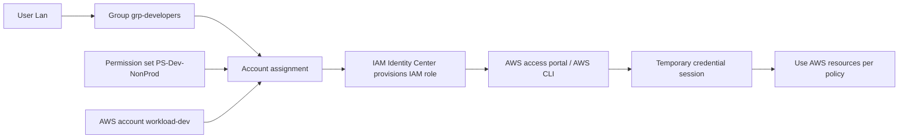
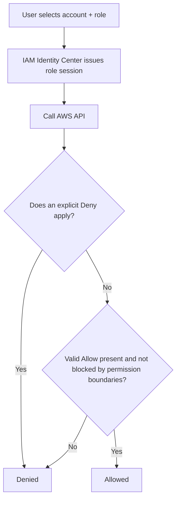

# Permission Sets and Job-Role-Based Access Control

When an organization uses multiple AWS accounts for **development**, **testing**, and **production**, manually granting permissions to individual employees in every account easily leads to excessive privileges, inconsistent configurations, and difficult revocation when staff change roles. **AWS IAM Identity Center** provides centralized governance based on job roles: each group is assigned appropriate **permission sets** on specific AWS accounts.

This lesson belongs to the **Accounts and Organizations** chapter of the **CLOUD_PROVIDERS_AWS** module. Having understood account structure, Regions/AZs, and the identity model, we use permission sets to prepare safe access controls for teams deploying VPCs, EC2, S3, RDS, Lambda, integration services, monitoring, recovery, and cost controls.

## 1. Learning Objectives

Upon completing this lesson, you will be able to:

1. Explain the roles of **users**, **groups**, **permission sets**, **AWS account assignments**, and **IAM roles** created by IAM Identity Center.
2. Distinguish permission sets from IAM policies, IAM roles, IAM groups, and organization-level control policies.
3. Design a permission matrix by job role and environment adhering to the **least privilege** principle.
4. Create a permission set, assign permissions to a group on a target AWS account, and verify access via the AWS access portal/AWS CLI.
5. Write a simple IAM policy restricting actions and resources, while identifying complementary controls such as SCPs and resource policies.
6. Update, revoke, and audit permissions when users switch teams, change responsibilities, or leave the organization.
7. Recognize common errors: missing account assignment, missing policies in target accounts, blocked permissions, or unexpired active sessions.

## 2. From Users to AWS Access

### 2.1. Core Components

| Component | Meaning | Example |
| --- | --- | --- |
| **User** | An individual's identity in an identity source connected to IAM Identity Center | `lan.nguyen` |
| **Group** | A collection of people sharing the same role, responsibilities, or access needs | `grp-developers` |
| **Permission set** | A permission template consisting of IAM policies and session settings, managed in IAM Identity Center | `PS-Dev-NonProd` |
| **AWS account** | The account boundary where permissions are granted | `workload-dev` |
| **Account assignment** | The binding **user/group + permission set + AWS account** | `grp-developers` uses `PS-Dev-NonProd` on `workload-dev` |
| **Provisioned IAM role** | Role created/managed by IAM Identity Center in the assigned account for temporary credential sessions | `AWSReservedSSO_PS-Dev-NonProd_...` |

**A permission set is not a user account and does not grant permissions immediately upon creation.** It is a template describing intended permissions. When an administrator creates an *account assignment*, IAM Identity Center *provisions* the corresponding IAM role in the target account and attaches the declared IAM policies. Assigned users can sign in via the **AWS access portal** or AWS CLI to use that role with temporary credentials.

If a person is assigned multiple permission sets on the same account, they typically see **multiple role choices** and pick one role for a session. Do not assume all permission sets are automatically merged into a single session.

### 2.2. Group-Based Provisioning Flow



In practice, a **group** can be assigned multiple permission sets across multiple accounts. The same permission set can also be reused across multiple groups and accounts when permission needs match. Therefore, think of the authorization model as a three-dimensional matrix:

**Who (user/group) → gets what permissions (permission set) → in which account (AWS account).**

This organization model is far cleaner than creating separate IAM users and access keys for every employee in every account.

### 2.3. Distinguishing Easily Confused Concepts

| Concept | Where Managed | Primary Role |
| --- | --- | --- |
| **IAM Identity Center group** | IAM Identity Center or external identity source | Centrally manages membership and assigns permissions |
| **IAM user group** | AWS IAM within one account | Groups IAM users inside that specific account |
| **IAM policy** | IAM / policy declared inside a permission set | Describes allowed/denied actions, resources, and conditions |
| **Permission set** | IAM Identity Center | Packages policies and session attributes for account assignment |
| **IAM role** | AWS IAM in the target account | Identity assumed in a session to call AWS services |
| **Service control policy (SCP)** | AWS Organizations | Caps maximum permissions within organization scope; does not grant permissions |
| **Permissions boundary** | IAM, attachable via permission set | Caps maximum permissions a role's identity-based policies can grant; does not grant permissions |

Example: someone with a permission set containing `s3:GetObject` can still be denied access to a bucket due to an **explicit deny** in an SCP or bucket policy, or due to missing KMS decryption permissions. Conversely, attaching an SCP to an OU does not automatically grant OU members S3 access.

## 3. Prerequisites Before Configuration

To use permission sets to grant access to **AWS accounts**, you need:

1. **AWS Organizations** with an **IAM Identity Center organization instance**. Verify **Multi-account permissions** is enabled. An **account instance** only serves supported application scenarios within a single account and **does not support permission sets for AWS account access**.
2. An administrator with permissions to manage IAM Identity Center and appropriate permissions on Organizations accounts. Do not practice day-to-day tasks using the root user.
3. A configured **identity source**: Identity Center directory, Active Directory, or an external identity provider (*external IdP*).
4. Created/synced **job-role groups** and members. If using an external IdP, group creation, membership changes, and MFA are usually managed in the external identity system; wait for sync before testing.
5. An inventory of accounts and existing governance policies (SCPs, IAM policies, resource policies) to avoid granting permissions beyond approved boundaries.

> **MFA note:** if the identity source is an external IdP, MFA policies for user authentication are typically configured at the IdP. Do not assume enabling MFA inside IAM Identity Center overrides that system's MFA rules.

## 4. Designing Permissions by Job-Role Group

### 4.1. Separating Responsibilities and Environments

Suppose an e-commerce system runs on AWS and uses:

- `workload-dev`: development environment for testing Lambda, S3, DynamoDB, and integration services.
- `workload-test`: environment for integration and resilience testing.
- `workload-prod`: production environment holding critical data.
- `security-tools`: centralized monitoring and security tooling.

Name groups after **job responsibilities**, not individual names. Example:

| Group | Intended Permission Set | Assigned Accounts | Scope of Duties |
| --- | --- | --- | --- |
| `grp-developers` | `PS-Developer-NonProd` | `workload-dev`, `workload-test` | Develop/test assigned application resources; no IAM/Organizations administration |
| `grp-release-operators` | `PS-Prod-Deploy` | `workload-prod` | Deploy approved releases and inspect service health; no full-account admin rights |
| `grp-platform-operators` | `PS-Platform-Operations` | `workload-dev`, `workload-test`, `workload-prod` | Operate infrastructure and monitor CloudWatch within delegated scope |
| `grp-security-auditors` | `PS-Security-Audit` | All relevant accounts | Read information needed to audit IAM, configs, and logs; no resource modification |
| `grp-finops` | `PS-Cost-View` | Management/appropriately delegated accounts | Monitor budgets and analyze costs per allowed Billing permissions |

**These names are illustrative only.** In real deployments, each permission set must contain IAM policies crafted for specific tasks; a name like `PS-Prod-Deploy` does not restrict deployment actions by itself. Billing/Cost Explorer permissions also depend on which account owns the bill, Billing configuration, and existing delegation mechanisms.

### 4.2. Principles for Selecting Permission Sets

- **Least privilege:** grant only required actions and resources. For instance, report viewers do not need `s3:PutObject` or `ec2:TerminateInstances`.
- **Separate non-production and production:** the same employee may have edit rights in dev but only read-only access in production; if production deployment is required, use a separate role and approval workflow.
- **Separation of duties:** developers should not by default approve security policy or billing changes.
- **Easy group-based revocation:** when staff leave `grp-release-operators`, update membership in the identity source instead of hunting down IAM users across every account.
- **Avoid widespread use of AdministratorAccess:** grant it only to truly necessary admin groups with MFA and auditing; prefer narrower daily roles.
- **Be careful with privilege-escalation permissions:** permissions such as `iam:PassRole`, managing IAM policies/roles, certain code-deployment capabilities, or editing pipelines can allow indirect privilege escalation if loosely controlled.

### 4.3. Role-Based vs. Attribute-Based Access Control

**Role-based access control (RBAC)** fits well when groups have stable duties. For example, members of `grp-security-auditors` receive an audit permission set across multiple accounts.

**Attribute-based access control (ABAC)** fits when controls must follow attributes like team or project. IAM Identity Center can pass identity attributes as **session tags** so IAM policies can use conditions like `aws:PrincipalTag/team` matched against resource tags. For instance, a developer can modify only resources tagged `team=payments`.

ABAC helps curb group/permission set proliferation as projects grow, but requires trustworthy attribute sources and resource tagging workflows. The lab below prioritizes **group-based RBAC** so you can observe the permission set mechanism clearly first.

## 5. Anatomy of a Permission Set

A permission set can use the following components:

| Component | Purpose | Points to Note |
| --- | --- | --- |
| **Predefined permission set** | Quick start with an AWS managed policy for common roles | Review policy details before using as scope can be broad |
| **AWS managed policies** | Reuse AWS-maintained policies such as `ReadOnlyAccess`, `SecurityAudit` | AWS may update policies; monitor changes affecting permissions |
| **Customer managed policies** | Use organization-managed IAM policies | Policies with the exact **name and path** must exist in **every target account** before assignment; IAM Identity Center does not create them |
| **Inline policy** | Define an IAM JSON policy directly inside the permission set | Convenient for small, specialized permissions; still requires change review |
| **Permissions boundary** | Set a maximum permission ceiling for the Identity Center-created role | A boundary does not grant new Allow permissions |
| **Session duration** | Limit AWS account session lifetime | Default is **1 hour**, configurable **1–12 hours**; pick enough for the task |

**Organization-instance multi-account permissions** apply to users accessing AWS accounts. A newly created permission set **without an account assignment** is not yet provisioned into any target account.

### 5.1. Example Inline IAM Policy for Read-Only Access to One S3 Bucket

A project audit team only needs to list and read objects in a sample documentation bucket `example-training-artifacts`. An inline policy could be:

```json
{
  "Version": "2012-10-17",
  "Statement": [
    {
      "Sid": "ListOneTrainingBucket",
      "Effect": "Allow",
      "Action": [
        "s3:ListBucket"
      ],
      "Resource": "arn:aws:s3:::example-training-artifacts"
    },
    {
      "Sid": "ReadObjectsInOneTrainingBucket",
      "Effect": "Allow",
      "Action": [
        "s3:GetObject"
      ],
      "Resource": "arn:aws:s3:::example-training-artifacts/*"
    }
  ]
}
```

Explanation:

- `s3:ListBucket` uses the **bucket** ARN, not individual object ARNs.
- `s3:GetObject` uses the **object** ARN path under the bucket.
- The policy does not grant `s3:PutObject`, `s3:DeleteObject`, or `s3:PutBucketPolicy`.
- The bucket name is an example: replace it with an actual bucket name in an authorized account before using.
- If the bucket is in another account, the bucket policy and cross-account conditions must allow access. If objects use SSE-KMS encryption, `kms:Decrypt` on the corresponding key may also be required.

These are **policy-proposed permissions**; effective permissions still depend on related policies and conditions. For instance, if an SCP or bucket policy contains a matching `Deny`, the result will still be `AccessDenied`.

### 5.2. How AWS Evaluates Permissions



In real deployments, AWS evaluates multiple layers such as identity-based policies, resource-based policies, SCPs, permissions boundaries, and session policies depending on the scenario. A permission appearing in a permission set **does not guarantee the API call will succeed**; conversely, resource policies and other granting mechanisms must also be checked when assessing effective permissions. **Explicit denies should always be investigated first** when troubleshooting access issues.

## 6. Creating a Permission Set and Assigning It to a Group

Hands-on example with `grp-security-auditors` and a test environment; Console steps may vary slightly across UI versions.

### Step 1. Verify Identity Source and Group

1. Open **AWS IAM Identity Center** in the Region where the organization instance is deployed.
2. Confirm **Settings / Identity source** and **Multi-account permissions** are configured.
3. Under **Groups**, verify that `grp-security-auditors` exists with the right members and group owner.
4. If the group is managed by an external IdP, update membership at the IdP and confirm it has synced to Identity Center.

**Do not create duplicate groups** inside Identity Center when an external identity source is the primary system of record.

### Step 2. Create the Permission Set

1. Under **Multi-account permissions → Permission sets**, choose **Create permission set**.
2. For initial safety testing, select **Predefined permission set** with an appropriate policy like `SecurityAudit` or `ReadOnlyAccess`; to narrow further, choose **Custom permission set** with a custom-designed policy.
3. Give it a meaningful name, e.g., `PS-Security-Audit`, and add a description of its purpose and owner.
4. Pick a **Session duration** suited to the job (typically starting with the 1-hour default).
5. With a custom permission set, configure AWS managed policies, customer managed policies, inline policies, and a permissions boundary **only as needed**. If using customer managed policies, ensure they already exist in target accounts with the exact name/path.
6. Review the permission list; choose **Create**.

At this point, the permission set is only defined inside IAM Identity Center. **No AWS account access exists yet merely because the permission set was created.**

### Step 3. Assign the Group to an Account

1. Go to **Multi-account permissions → AWS accounts**.
2. Select the **test account** `workload-test`; choose **Assign users or groups**.
3. At the identity selection step, search for and select the **group** `grp-security-auditors` rather than assigning individuals directly.
4. At the permission set selection step, select `PS-Security-Audit`.
5. At **Review and submit**, verify all three details: **account**, **group**, **permission set**. Choose **Submit**.
6. Monitor assignment/provisioning status until it completes successfully.

Afterward, IAM Identity Center creates and manages the corresponding IAM role in `workload-test`. In the IAM Console, a role named `AWSReservedSSO_...` may appear. **Do not edit policies/trust directly on this role**: the source of truth is the permission set and Identity Center; subsequent reprovisioning can overwrite out-of-band edits.

### Step 4. Verify the Assigned User's Experience

A member of `grp-security-auditors` signs in to the **AWS access portal** using the configured identity source and MFA. After selecting `workload-test`, they see the assigned `PS-Security-Audit` role; they select it to enter the AWS Console.

Learners should verify:

- **Right account:** do not confuse the test account with production.
- **Right role:** choose the permission set meant for the audit task.
- **Right permissions:** policy-allowed information is visible; out-of-scope modification actions are not granted.
- **No IAM user access keys generated:** sign in through the portal/role and obtain temporary credentials.

When multiple permission sets are assigned, pick the **least-privileged role sufficient for the task**, rather than always picking the highest-privileged admin role.

## 7. Verifying Access with the AWS CLI

AWS CLI v2 can sign in via IAM Identity Center without storing long-lived IAM user access keys. Example on a **machine with AWS CLI v2 installed**, executed by an authorized user:

```bash
# Configure a profile using IAM Identity Center (interactive prompt).
aws configure sso --profile training-audit

# Sign in via browser and MFA per the identity system.
aws sso login --profile training-audit

# Confirm the account ID and IAM role used by the current session.
aws sts get-caller-identity --profile training-audit

# Example read-only command: only run if permitted and the bucket exists.
aws s3 ls s3://example-training-artifacts --profile training-audit

# End the SSO session when done working.
aws sso logout
```

When running `aws configure sso`, the CLI asks for the AWS access portal start URL or issuer URL, the IAM Identity Center Region, and the account/role choice. These values are provided by your administrator—do not guess the Region or account. The profile name `training-audit` is a local machine alias, not the AWS account name.

The output of `aws sts get-caller-identity` shows **Account**, **Arn**, and **UserId**. The ARN typically contains `assumed-role/...` for role sessions. This command does not prove every effective policy; it only confirms which identity the session is using.

If the S3 command returns `AccessDenied`, review the permission set policy, assignment, bucket policy, SCPs, and KMS permissions if applicable. If it reports the bucket does not exist, that is **not** proof that the permission set blocked the action.

> **Safe practice:** do not run resource-deletion commands, alter IAM policies, or simulate destructive actions to verify denied permissions. Cross-check policies, logs, and Access Analyzer within your granted scope, or test against dedicated lab resources.

## 8. Updating, Change Control, and Revoking Permissions

### 8.1. Editing a Permission Set Can Affect Multiple Accounts

One permission set can be assigned to many accounts. When modifying a permission set's policies, session duration, or settings, identify **all assignments currently using it**; an overly broad edit could impact both dev and production.

An appropriate change-control workflow:

1. Document the business requirement and the scope of permissions to change.
2. Check which groups/accounts currently use the permission set.
3. Validate the new policy via peer review, IAM Access Analyzer, and an appropriate test environment.
4. Update the permission set in IAM Identity Center.
5. Check the **provision/reprovision** status of assigned accounts. In Console updates, IAM Identity Center helps update the corresponding roles/policies; with automation/APIs, follow the provisioning requirements of the API/workflow in use.
6. Have users start a fresh session when verifying new permissions, since older sessions may still be active.
7. Record the approver, rationale, timestamp, and verification result.

If two groups share a functional title but need different resource limits, consider **creating two permission sets** or conditional policies instead of broadening shared permissions across all accounts.

### 8.2. What Happens When Changing Teams or Leaving the Company?

Suppose Lan transfers from development to operations:

1. Identity administrators remove Lan from `grp-developers` and add her to the operations group **after approval**.
2. IAM Identity Center updates available access for new sign-in sessions once group state syncs.
3. Lan signs back in to the portal and sees only accounts/roles assigned to her current group.

**Revoking group membership does not immediately terminate every active AWS role session.** Already-issued temporary credentials typically remain valid until session expiration (permission sets can allow up to 12 hours). When emergency revocation is needed, security responders must apply appropriate blocking measures such as explicit denies/SCPs and handle active sessions per incident response procedures.

### 8.3. Scenario: Discovering Excess Permissions

An engineer in `grp-developers` sees `PS-Prod-Deploy` on `workload-prod`. Response steps:

1. Verify the account ID, visible role, and that person's group memberships.
2. Trace which **account assignment** is granting this permission set (possibly via a second group).
3. Cross-check against the approved authorization matrix.
4. Remove/fix the **assignment or source group**, checking the impact on other members.
5. Inspect access logs and apply emergency blocks if misuse is suspected; evaluate expiration times of existing sessions.

Do not manually edit the `AWSReservedSSO_...` role in the target account to fix excess permissions: changes made outside IAM Identity Center can be overwritten during reprovisioning.

## 9. Common Errors and How to Diagnose Them

| Symptom | Possible Cause | What to Check |
| --- | --- | --- |
| Created permission set, but no access appears in the portal | Missing **account assignment** | Check account, group, permission set, and provisioning status |
| Newly added group member still does not see the account | Group not yet synced from IdP, stale portal session, or wrong group assigned | Check identity source, membership, assignment status; sign in again |
| Assigning permission set fails | Customer managed policy missing or wrong **name/path** in target account | Create/sync the policy before assigning; verify provisioning permissions |
| Entered the right account, yet AWS actions are denied | Missing Allow, restrictive resource policy/SCP/permissions boundary, or missing KMS access | Inspect actual request, relevant policies, and CloudTrail/Access Analyzer |
| Edited permission set, yet permissions have not updated | Provisioning incomplete or still using an old role session | Check reprovisioning, then verify with a new session |
| One person sees multiple permission sets | User has multiple direct or group-based account assignments | Inspect each assignment; each role is a separate session choice |
| Account only has an IAM Identity Center account instance | Does not support AWS account permission sets | Requires an organization instance with multi-account permissions |

Additional note: IAM Identity Center **does not support nested groups** (groups inside groups) for membership management under its service model. When connecting an external IdP, check how group sync actually behaves; do not rely on nested groups assuming permissions will inherit.

## 10. Hands-On Exercise: Designing a Permission Matrix Without Paid Resources

**Context:** A company has two accounts: `training-dev` and `training-prod`. Three groups—`grp-app-dev`, `grp-ops`, and `grp-audit`—need access aligned with their duties. This lab can be completed as a design/Console-inspection exercise; creating real assignments is only for authorized administrators.

### Requirements

1. Name three permission sets: `PS-App-Dev`, `PS-Operations`, and `PS-Audit`.
2. Define minimum job-role permissions:
   - `PS-App-Dev`: view CloudWatch logs and edit application resources **only in dev**.
   - `PS-Operations`: monitor/troubleshoot delegated systems in both dev and prod; cannot modify IAM/Organizations.
   - `PS-Audit`: read configuration/security details in both accounts; cannot modify resources.
3. Build a **group–permission set–account** table; clearly state which group **must not** access production.
4. Pick one permission set and describe the IAM policy you would use, avoiding `*` on `*` unless formally justified.
5. If appropriately authorized, test assigning on **training-dev**, sign in via the portal, and run `aws sts get-caller-identity` to verify; do not create EC2/RDS or paid resources.
6. Describe how to update permissions when someone leaves a group and how to respond if access must be blocked immediately.

### Reference Matrix

| Group | training-dev | training-prod |
| --- | --- | --- |
| `grp-app-dev` | `PS-App-Dev` | **Not assigned** |
| `grp-ops` | `PS-Operations` | `PS-Operations` |
| `grp-audit` | `PS-Audit` | `PS-Audit` |

**Expected output:** a matrix table with group owners; intended permission lists; redacted screenshots showing **account/role names** if practiced live; identity verification output; and a short description of permission revocation. Do not attach tokens, access keys, passwords, MFA codes, or customer data.

### Analysis Questions

- If a developer needs to view production logs to investigate a bug without modifying resources, which additional role would you assign and on which account?
- If `grp-audit` is assigned `ReadOnlyAccess`, can you guarantee they can read every KMS-encrypted object? Why or why not?
- If `PS-Operations` is modified to add IAM management permissions, which accounts and groups could be affected?
- After removing someone from a group, why must you still pay attention to the expiration duration of issued AWS sessions?

## 11. Key Knowledge to Remember

- A **Permission set** is a permission template; an **account assignment** binds a group/user, permission set, and account to grant actual access.
- Managing access via **groups** makes onboarding, team transfers, and offboarding consistent; users do not need long-term access keys for the AWS CLI.
- One permission set can be reused across many accounts; editing it requires checking every place it is assigned.
- **IAM policies grant permissions**, while SCPs and permissions boundaries cap scope; resource policies and security conditions also participate in access evaluation.
- Users granted multiple roles should pick the **least-privileged role** for each task.
- Revoking a group/assignment does not necessarily invalidate already-issued **temporary sessions** immediately.

## 12. Official AWS Documentation

1. [Manage AWS accounts with permission sets — IAM Identity Center](https://docs.aws.amazon.com/singlesignon/latest/userguide/permissionsetsconcept.html).
2. [Create a permission set — IAM Identity Center](https://docs.aws.amazon.com/singlesignon/latest/userguide/howtocreatepermissionset.html).
3. [Assign user or group access to AWS accounts](https://docs.aws.amazon.com/singlesignon/latest/userguide/assignusers.html).
4. [IAM roles created by IAM Identity Center](https://docs.aws.amazon.com/singlesignon/latest/userguide/identity-center-and-iam-roles.html).
5. [Custom permissions and customer managed policies](https://docs.aws.amazon.com/singlesignon/latest/userguide/permissionsetcustom.html).
6. [Use IAM policies in permission sets](https://docs.aws.amazon.com/singlesignon/latest/userguide/howtocmp.html).
7. [Organization and account instances of IAM Identity Center](https://docs.aws.amazon.com/singlesignon/latest/userguide/identity-center-instances.html).
8. [Set session duration for AWS accounts](https://docs.aws.amazon.com/singlesignon/latest/userguide/howtosessionduration.html).
9. [Users, groups and provisioning in IAM Identity Center](https://docs.aws.amazon.com/singlesignon/latest/userguide/users-groups-provisioning.html).
10. [Configure AWS CLI to use IAM Identity Center](https://docs.aws.amazon.com/cli/latest/userguide/cli-configure-sso.html).
11. [IAM policy evaluation logic](https://docs.aws.amazon.com/IAM/latest/UserGuide/reference_policies_evaluation-logic.html).

> **Operational principle:** Whenever granting AWS access, always specify **which user/group**, **which job permissions**, **on which account**, **for how long**, and **who is responsible for auditing and revoking access**.
