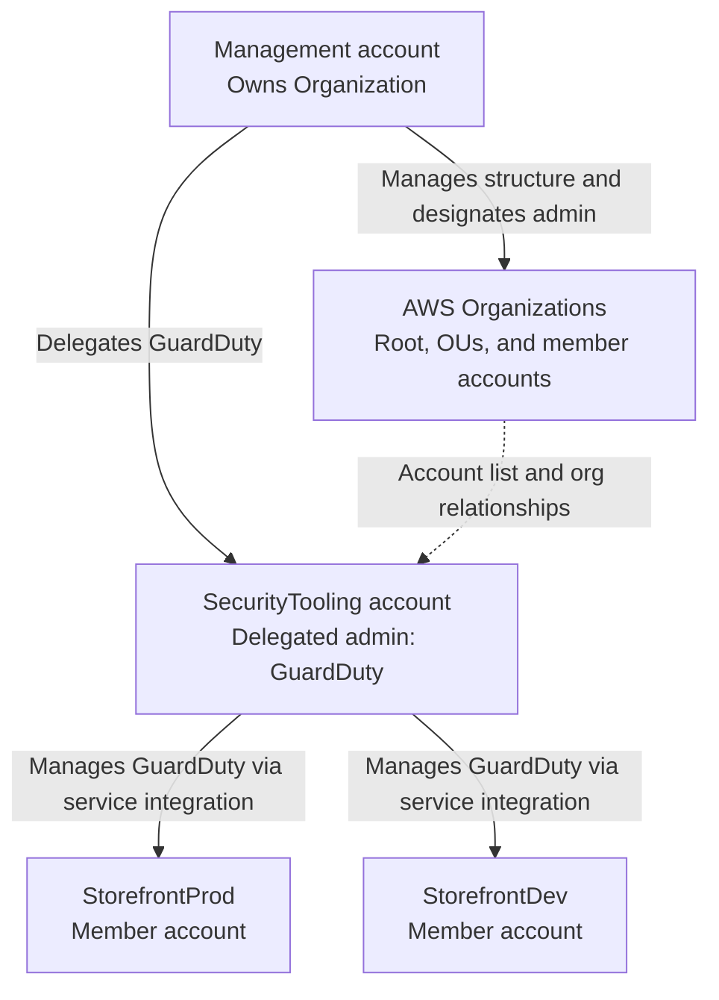

# Delegated Administrator and Centralized Service Management

## Learning Objectives

After this lesson, you will be able to:

1. Explain why **AWS Organizations** allows delegating administration of a service to a **member account** rather than operating every task in the **management account**.
2. Distinguish **delegated administrator for an AWS service**, **delegated administrator for AWS Organizations**, **trusted access**, cross-account IAM roles, and IAM Identity Center.
3. Describe the prerequisites, delegation steps, limitations, and verification methods for service administration delegation.
4. Build a centralized management model for GuardDuty and connect it with monitoring, configuration management, recovery, and cost in a multi-account AWS environment.
5. Identify configurations prone to losing administrative control or creating monitoring gaps.

## 1. The Problem: Multiple Accounts Requiring Unified Management

A company deploys an e-commerce system with separate AWS accounts for `Production`, `Development`, `Security`, and `SharedServices`. Independent accounts isolate workloads, IAM policies, VPCs, data, and many service quotas. However, the security team still needs to:

- Monitor threat detections across all accounts.
- Maintain security service configurations whenever new accounts are added.
- View compliance posture and alerts from a single place.
- Limit how many people must access the management account.
- Maintain procedures for auditing, recovery, and transferring administrative responsibility.

Signing into every account individually to enable services and inspect findings raises operational overhead and makes it easy to miss new accounts. Conversely, using the management account for every task unnecessarily expands the blast radius of the highest-privileged account.

A **Delegated administrator** is a way to organize administration per service: the management account designates a **member account** as the management focal point for organization-level capabilities supported by that service. The delegated account can centrally administer **within the scope of that service**, subject to IAM permissions and AWS-defined limits. Designating it does not turn that account into a second management account.

> Design principle: keep the management account primarily for mandatory organization-level operations; place security operations and shared systems in appropriate member accounts.

## 2. Roles in the Governance Model

| Component | Responsibilities | What It Does Not Automatically Have |
| --- | --- | --- |
| **Management account** | Owns the Organization, manages membership, OU structure, billing, and operations required at the management account. | Does not need to host every workload or operational dashboard. |
| **Member account** | Runs applications or handles dedicated duties such as security, logging, or networking. | Does not automatically have permission to read/control other accounts. |
| **Service delegated administrator** | Member account registered to administer **an AWS service supporting Organizations integration**. | Does not receive full Organizations control, nor automatically become admin for other services. |
| **Organizations delegated administrator** | Member account permitted to manage **specific Organizations policy operations** allowed by the management account via a resource-based delegation policy. | Does not automatically become delegated administrator for GuardDuty or other services. |
| **IAM principal** | User/role executing actual APIs. | Does not gain permissions merely because the account is a delegated administrator; requires IAM and related permission conditions. |

### Two Types of Delegated Administrator to Distinguish

**Type A — Delegated administrator for an AWS service.** Example: the `SecurityTooling` account administers Amazon GuardDuty for member accounts. Registration uses the integration mechanism between the **specific service** and Organizations; exact operational capabilities are defined by that service. The delegated account gains read access to certain Organization structure details and requires IAM permissions to call the service's APIs.

**Type B — Delegated administrator for AWS Organizations.** The management account can create a **resource-based delegation policy** specifying which member account may create, update, attach, or manage organization policy types within allowed bounds. For example, the platform team is delegated management of **backup policies** for certain OUs. This is separate from registering a service delegated administrator.

One account can hold multiple roles if genuinely needed, though separating duties between `SecurityTooling` and `PlatformOperations` helps reduce unrelated privileges.

## 3. Visualizing the Delegation Flow



In this diagram, `SecurityTooling` can aggregate and manage **GuardDuty** for `StorefrontProd` and `StorefrontDev` once integrated and configured. The diagram does **not** mean the security account can sign in to EC2 instances, read S3 buckets, or edit IAM in the two application accounts.

A common multi-account layout:

```text
Organization (Management account: 111122223333)
└── Root
    ├── OU: Security
    │   ├── SecurityTooling (222233334444)  -> GuardDuty delegated admin
    │   └── LogArchive (333344445555)       -> Centralized logs
    ├── OU: Workloads
    │   ├── Production
    │   │   └── StorefrontProd (444455556666)
    │   └── NonProduction
    │       └── StorefrontDev (555566667777)
    └── OU: Sandbox
        └── Experiment (666677778888)
```

The account IDs and names above are examples only. An **OU** is a logical governance group; an **account** is the unit designated as a delegated administrator. Placing an account inside the Security OU does not automatically grant delegation.

## 4. What Is Trusted Access and How Does It Differ from Delegated Administrator?

**Trusted access** lets a supported AWS service perform necessary operations across the Organization and member accounts on the organization's behalf. The service can create **service-linked roles** in required accounts to carry out management tasks for that service itself. This is a mechanism granting capabilities to a **trusted service**, not granting administrator rights to every user/role in an account.

**Delegated administrator** designates a **member account** to perform service administration across the organization. A service may support trusted access while **not** supporting delegated administrator; always check the official integration list before designing.

| Question | Trusted Access | Service Delegated Administrator |
| --- | --- | --- |
| Trusted / delegated entity | An AWS service integrated with Organizations. | A member account designated for that service. |
| Purpose | Allows the service to perform tasks across accounts in the Organization. | Allows authorized personnel/roles in the member account to centrally manage the service. |
| Prerequisite | The service must support trusted access integration. | The service must support delegated admin and meet its registration rules. |
| Automatically grants IAM permissions to users? | No. | No; requires appropriate IAM permissions. |
| Automatically rolls out configuration to every Region/account? | Not necessarily. | No; depends on configuration, member status, and service behavior. |

AWS recommends, wherever possible, **enabling or disabling trusted access via the integrated service's own console/API/CLI**. That allows the service to execute required initialization or cleanup steps. Calling Organizations commands directly may skip service-specific dependencies.

**Do not confuse with cross-account roles.** An IAM role in an application account can allow a security account to call `sts:AssumeRole`, but trust policies and IAM permissions must be explicitly configured. Delegated administrator uses Organizations-level integrations supported by **that service**, rather than a universal mechanism for assuming arbitrary cross-account roles.

**Do not confuse with IAM Identity Center.** IAM Identity Center distributes human sign-in access and permission sets across multiple accounts; delegated administrator designates an account to operate an organization-wide service capability. The two mechanisms complement each other.

## 5. Prerequisites and Workflow to Designate a Service Delegated Administrator

Before changing live configurations, confirm:

1. The Organization uses **all features**, not consolidated billing only, and the service supports delegated administrator.
2. The candidate account **is an active, valid member account**; check the limit/number of delegated administrators allowed by the service.
3. Trusted access for the service has been enabled via a service-supported workflow.
4. The user/role in the management account has permission to designate; the user/role in the delegated administrator has appropriate **IAM permissions** to manage the service.
5. Target **Regions**, participating accounts, auto-enable behavior for new accounts, costs, and recovery workflows are clearly defined.

### Standard Workflow

**Step 1 — Select the member account and service.** For example, use `SecurityTooling` to manage GuardDuty rather than deploying security dashboards in the management account.

**Step 2 — Enable Organizations/trusted access integration.** Follow GuardDuty's or the corresponding service's documentation; do not guess service principals.

**Step 3 — Designate the delegated administrator from the management account.** Depending on the service, use the **service-specific** action or the Organizations API `RegisterDelegatedAdministrator`. Prefer the service-documented workflow so initialization steps execute properly.

**Step 4 — Grant IAM permissions to operational roles.** Roles need permissions to use the service's delegated administration features; the organization must also review SCPs and other boundaries.

**Step 5 — Configure operations in the delegated account.** For example: enable GuardDuty in the Region, associate member accounts, configure auto-enable, and route findings to the appropriate monitoring destination.

**Step 6 — Verify per account and Region.** Check managed accounts, service status, data coverage, and detection capability on a test account.

**Step 7 — Transition to operations.** Monitor new accounts, configuration drift, costs, monitoring telemetry, and document the admin team's ownership.

## 6. Hands-On Example: Centralized Amazon GuardDuty Management

**Scenario:** A company has 30 application accounts across multiple environments. The security team wants to monitor threat detections with Amazon GuardDuty from `SecurityTooling`, while the management account keeps managing the Organization and billing.

GuardDuty allows one member account to act as delegated administrator. This setting is configured **per Region**; the account chosen as GuardDuty delegated administrator should be used consistently across all Regions where the organization deploys GuardDuty.

### 6.1. Identify Execution Identities

In this example:

| Illustrative Profile | AWS Account | Role |
| --- | --- | --- |
| `org-management` | `111122223333` | Performs the action designating the GuardDuty delegated administrator. |
| `security-admin` | `222233334444` | Configures GuardDuty for member accounts. |
| `application` | `444455556666` | Workload to be monitored. |

These profiles must be **separately configured by the learner using IAM Identity Center or another valid authentication mechanism**; they are not created automatically by AWS Organizations. The commands below are illustrative only and do not connect to a live AWS account.

Verify the active account before each operation:

```bash
aws sts get-caller-identity --profile org-management
aws sts get-caller-identity --profile security-admin
```

### 6.2. Designate the GuardDuty Delegated Administrator (Management Account)

Use the GuardDuty API to designate the account for Region `ap-southeast-1`:

```bash
aws guardduty enable-organization-admin-account \
  --admin-account-id 222233334444 \
  --region ap-southeast-1 \
  --profile org-management
```

Verify:

```bash
aws guardduty list-organization-admin-accounts \
  --region ap-southeast-1 \
  --profile org-management
```

The output should show account `222233334444` as the GuardDuty administrator in the selected Region. For multi-Region GuardDuty deployments, repeat per GuardDuty documentation; do not assume designating in one Region covers the globe.

### 6.3. Configure GuardDuty in the Delegated Account

First, ensure GuardDuty is enabled in the delegated account for the corresponding Region. Find the detector ID:

```bash
aws guardduty list-detectors \
  --region ap-southeast-1 \
  --profile security-admin
```

Suppose the output includes detector ID `0123456789abcdef0123456789abcdef`. You can configure automatic GuardDuty enablement for member accounts:

```bash
aws guardduty update-organization-configuration \
  --detector-id 0123456789abcdef0123456789abcdef \
  --auto-enable-organization-members NEW \
  --region ap-southeast-1 \
  --profile security-admin
```

Verify:

```bash
aws guardduty describe-organization-configuration \
  --detector-id 0123456789abcdef0123456789abcdef \
  --region ap-southeast-1 \
  --profile security-admin
```

Depending on requirements, GuardDuty supports these options:

| Value | Meaning |
| --- | --- |
| `NEW` | Automatically enables for **new accounts** joining the organization. Does not automatically cover all existing accounts. |
| `ALL` | Enables for both existing and new accounts within supported scope; configuration rollout may take time. |
| `NONE` | Does not auto-enable for new accounts; admins must manage members manually. Does not disable previously enabled accounts. |

Additional GuardDuty protection plans may have separate settings, Regional availability conditions, and distinct exceptions. Enabling core GuardDuty does not mean every protection plan is enabled.

**Minimum verification:** the delegated account has an active detector, target member accounts are associated and enabled, all active Regions are properly configured, and findings flow into the security team's alerting workflow. Re-verify after creating a new account or enabling a new Region.

### 6.4. Why Track Regions?

If GuardDuty is only enabled in `ap-southeast-1` while an application also runs in `ap-northeast-1`, configuration in the second Region does not appear automatically. For accounts enabling **opt-in Regions**, the order of enabling the Region vs. joining the Organization can also affect `NEW` mode. This is why an explicit list of active Regions must be part of the operational checklist.

## 7. Checking Delegated Administrator Registration with the Organizations CLI

The commands below are primarily **read-only**, suitable for auditing. Run them using an appropriately authorized role.

Check the Organization mode and trusted access integrations:

```bash
aws organizations describe-organization --profile org-management
aws organizations list-aws-service-access-for-organization \
  --profile org-management
```

List accounts delegated for GuardDuty:

```bash
aws organizations list-delegated-administrators \
  --service-principal guardduty.amazonaws.com \
  --profile org-management
```

Check which services `SecurityTooling` is delegated administrator for:

```bash
aws organizations list-delegated-services-for-account \
  --account-id 222233334444 \
  --profile org-management
```

**Note:** Organizations listing commands show org-level delegation relationships, but **do not prove** that operational configurations are complete in every service, account, and Region. Therefore, also cross-check the service's own APIs/dashboards, such as `guardduty list-organization-admin-accounts` and `describe-organization-configuration`.

### When to Use `register-delegated-administrator`?

Some services support registration directly via AWS Organizations. For example, **AWS Account Management** lets a member account manage certain account metadata in Organizations mode, after satisfying all features, trusted access, and required permissions:

```bash
# Run from the management account after integration prerequisites are met.
aws organizations register-delegated-administrator \
  --account-id 222233334444 \
  --service-principal account.amazonaws.com \
  --profile org-management
```

This example **only registers the account as delegated administrator for Account Management**. It does not grant arbitrary GuardDuty, EC2, or IAM permissions. Account Management APIs used by the delegated administrator must also support Organizations mode, and the IAM principal must hold matching permissions.

Do not blindly apply the command above to every service: **service principals**, maximum admin counts, registration prerequisites/flows, Region scopes, and deregistration procedures can differ. Always check the service's integration documentation.

## 8. Delegated Administrator for AWS Organizations Policies

AWS Organizations also lets the management account **delegate management of organization policies** using a **resource-based delegation policy**. This capability fits when delegating `BACKUP_POLICY` or a selected policy scope to a platform team without requiring operators to routinely log into the management account.

Suppose:

- `Management account` owns the Organization structure.
- `PlatformOperations` is the member account responsible for backup policies.
- The security team still manages GuardDuty via the separate **service delegated administrator** mechanism.

The management account can attach a delegation policy restricting **Principal** to the `PlatformOperations` account, **Action** to permitted Organizations actions such as `CreatePolicy`, `UpdatePolicy`, and `AttachPolicy`, and **Resource/Condition** constraining resource scope and policy types. IAM roles inside the delegated account **must still have matching IAM permissions**.

General workflow:

1. The management account defines the exact policy types, target OUs/accounts, and delegatable actions.
2. Create or update the resource-based delegation policy in **AWS Organizations → Settings → Delegated administrator for AWS Organizations**, or via the `PutResourcePolicy` API.
3. Grant a tightly scoped IAM policy to staff roles in the designated member account.
4. Test permissions with an allowed action, then test an **out-of-scope** action to verify permissions are not overly broad.
5. Monitor policy change history and periodically review delegated permissions.

You can inspect the delegation policy with:

```bash
aws organizations describe-resource-policy \
  --profile org-management
```

**Syntax note effective June 30, 2026:** AWS Organizations no longer accepts `NotAction` and `NotResource` in **delegation policies created or updated** from this date onward. Use explicit `Action` and `Resource` lists to scope permissions. For existing policies, review and replace legacy patterns before the next update.

Delegating Organizations policies **does not** grant permission to create member accounts, invite accounts, or change an account into the management account. Allowed structural and operational tasks must follow the Organizations actions AWS supports for delegation, alongside IAM permissions and the resource policy.

## 9. Permission Scope and Layered Security Safeguards

### 9.1. Being Delegated Admin Is Not Enough for an API Call to Succeed

For example, `SecurityTooling` is designated to manage GuardDuty, but the `SecurityAnalyst` role lacks `guardduty:UpdateOrganizationConfiguration`. That role cannot call the configuration API merely because it resides in the delegated account.

Conversely, a role with IAM `AdministratorAccess` in `SecurityTooling` must still obey **SCPs applied to member accounts**, barring AWS-defined exceptions. A delegated administrator is still a member account: SCPs do not disappear. **Service-linked roles** have separate rules and are not restricted by SCPs the way standard principals are.

| Layer | What Does It Control? |
| --- | --- |
| Organizations membership | Which accounts belong to the Organization. |
| Trusted access | Which services are allowed to run integrated tasks organization-wide. |
| Service delegated admin | Which member account administers a supported service. |
| Resource-based delegation policy for Organizations | Which account may manage which Organizations policy types/resources. |
| IAM, SCPs, and related controls | Which principal may call which APIs and what permission limits apply. |
| Per-service/Region configuration | Which accounts, Regions, data sources, and features are actually active. |

No single layer replaces all the others.

### 9.2. Implementation Principles

- **Least privilege:** separate dashboard-reader roles, integration-config roles, and emergency admin roles; avoid giving everyone full admin in the delegated account.
- **Separation of duties:** those editing Organizations policies, analysts triaging findings, and approvers of production changes should have distinct scopes of responsibility.
- **MFA and short-lived access:** use IAM Identity Center or short-lived role sessions; avoid long-term credentials.
- **Audit trail:** monitor delegation/revocation actions, policy edits, and service config changes via AWS CloudTrail and appropriate monitoring systems.
- **Protect logging:** centralize logs into a dedicated account; do not assume a delegated account automatically receives every log from other services.
- **Cost control:** enabling services and protection plans across many accounts/Regions incurs charges; monitor in Cost Explorer/Budgets and test first.
- **Roll out narrowly first:** especially for services with auto-enable on existing accounts or policies that could disrupt workloads.

## 10. Centralized Management with Other Services

| Need | Related Service/Mechanism | Role of Centralized Management |
| --- | --- | --- |
| Threat / anomalous behavior detection | **Amazon GuardDuty** | Manages members, detector configurations, and aggregates findings across supported Regions. |
| Security posture and findings | **AWS Security Hub** | Centralizes security findings/controls and pushes configuration per supported integration features. |
| Resource drift/configuration tracking | **AWS Config** | Collects, aggregates configurations, and evaluates compliance across accounts/Regions using supported integration mechanisms. |
| Vulnerability scanning | **Amazon Inspector** | Manages scanning operations and aggregates findings across linked accounts per supported features. |
| Backup and recovery | **AWS Backup + Organizations policies** | Standardizes backup policies across accounts/OUs; verify actual jobs, retention, and test restores. |
| Consistent infrastructure deployment | **AWS CloudFormation StackSets** | Deploys and updates stacks across multiple accounts/Regions using supported permission and integration models. |
| Log/API activity aggregation | **AWS CloudTrail** | Organization trail or centralized log data per configuration; verify Regions, access permissions, and storage. |

The services in this table **do not necessarily share the exact same delegated administrator registration process**. Some centralized management features rely on trusted access, organization-level settings, or IAM cross-account roles. Before deploying, look up `Supports delegated administrator` and `Supports trusted access` for each service in the AWS Organizations integration catalog.

### Connecting to Other AWS Architecture Areas

- **IAM:** human/application authorization, SCP controls, and cross-account roles.
- **VPC:** each member account has its own network; centralized networking must be designed via appropriate network services rather than relying on delegated admin alone.
- **Compute, S3, RDS:** workloads remain inside their owning accounts; centralized management does not move resources between accounts.
- **Serverless and integration:** EventBridge, Lambda, or finding-processing pipelines can automate responses, but need clear permission boundaries and limits.
- **Observability:** combine alerts, logs, metrics, and account/Region coverage tracking to catch unmonitored data sources.
- **Disaster recovery:** central backup policies are only one piece; test restores and verify target accounts, encryption, and retention.

## 11. Lifecycle Operations and Incident Handling

### 11.1. Creating a New Account

When account `NewShopProd` is created:

1. Verify the account is placed in the right OU and inherits protective policies.
2. Confirm the account appears in Organizations listings and each service's managed accounts scope.
3. Check auto-enable settings: `NEW` differs from `ALL`; Region-specific configurations must be repeated where needed.
4. Verify services are genuinely active and emitting valid data/telemetry.
5. Verify costs, tags, alerts, and operational owners.

### 11.2. Transferring Delegated Administrator to Another Account

For instance, replacing `SecurityTooling` with `SecurityOperations`. Do not immediately revoke the old delegated administrator first. You should:

- Document existing settings, Regions, member lists, and active finding pipelines.
- Read the **service-specific transition procedure**; some services require disassociating members or cleanup steps before switching.
- Designate the new account, enable the service, configure auto-enable, and verify data sources.
- Update alert routing, IAM permissions, and operational runbooks, then validate real detection capability.
- Deregister the old delegation in the order supported by the service while watching for monitoring gaps.

Specifically for GuardDuty, auto-enable settings can be tied to the new delegated administrator and **Region**, so re-verify them before onboarding member accounts.

### 11.3. Common Issues

| Symptom | Possible Cause | First Check |
| --- | --- | --- |
| Cannot register delegated admin | Service unsupported, trusted access not ready, invalid account, or quota exceeded. | Feature set, member status, service integration catalog, and API error message. |
| `AccessDenied` when a role in the delegated account calls an API | Missing IAM permissions, SCP/permission boundary/condition restriction, or action not delegated by the service. | `sts get-caller-identity`, IAM policy, SCPs, and service docs. |
| Existing accounts missing in GuardDuty | `NEW` setting applies only to newly joined accounts; existing accounts not yet associated/enabled. | Member list, detector, and Regional auto-enable setting. |
| One Region shows no findings | Admin not designated or service/members not enabled in that Region. | Region, GuardDuty admin, and active detector. |
| Changing delegated admin broke alert flows | Settings, member lists, or finding destinations were not migrated. | Service-documented handover procedure and per-Region configs. |
| Registered as delegated admin but cannot manage Organizations policies | Confused the two delegation types, or missing resource-based delegation policy/IAM. | Delegated admin type, `describe-resource-policy`, and IAM role. |

## 12. Scenario Exercise

**Context:** An organization has management account `111122223333`, 12 production accounts, 8 development accounts, and 1 security account `222233334444`. Workloads run in Singapore and Tokyo. The security team wants to centrally manage GuardDuty; the platform team should only manage backup policies for the Production OU.

**Task 1 — Permission Design.** Designate `222233334444` as the GuardDuty delegated administrator in the Regions needing protection, assign role-based IAM permissions, and protect the management account. The platform team can be delegated a scoped Organizations backup policy capability via a separate resource-based delegation policy with matching IAM and resource constraints.

**Task 2 — New Account Setup.** To have new production and development accounts automatically protected by GuardDuty, choose appropriate auto-enable settings in each Region. To enable existing accounts as well, evaluate `ALL`, protection plans, and cost implications.

**Task 3 — Testing.** Verify GuardDuty status in Singapore and Tokyo; verify a newly added account is enabled; simulate handling a test finding per service guidelines; verify that the platform role cannot alter policies outside its assigned OU/policy type.

**Task 4 — Review.** Identify remaining risks: wrong Region, unassociated members, missing IAM permissions, over-privileged roles in the delegated account, auto-enable settings not applied to legacy accounts, and multi-Region protection costs.

## 13. Self-Check

**Question 1.** Does a service delegated administrator automatically gain permission to create new AWS accounts and modify any OU?

**Answer:** No. It is administrative authority for a supported service; managing Organization membership/structure has separate limits and permissions.

**Question 2.** Is trusted access the same as granting `AdministratorAccess` to an IAM role in the Security account?

**Answer:** No. Trusted access grants integration capabilities to an **AWS service**; IAM permissions for human users/roles are a separate mechanism.

**Question 3.** Does GuardDuty delegated admin need to pay attention to Regions?

**Answer:** Yes. GuardDuty applies configuration per Region; ensure the same delegated administrator is designated across active Regions and verify detector/member status.

**Question 4.** Can an account delegated to manage GuardDuty automatically manage Organizations `BACKUP_POLICY`?

**Answer:** No. That is a different type of delegation, configured via an Organizations resource-based delegation policy and IAM permissions.

**Question 5.** If `NEW` is selected in GuardDuty and an existing account is not yet enabled, is AWS broken?

**Answer:** Not necessarily. `NEW` focuses on accounts joining after configuration; existing accounts must be onboarded using the appropriate setting/workflow.

**Question 6.** Can SCPs be bypassed on a delegated administrator account because it handles security?

**Answer:** No. A delegated administrator is still a member account and remains subject to SCPs governing IAM principals in member accounts per AWS rules.

## Official AWS References

- [AWS Organizations — Delegated administrator for AWS services](https://docs.aws.amazon.com/organizations/latest/userguide/orgs_integrate_delegated_admin.html)
- [AWS Organizations — Trusted access and service integration](https://docs.aws.amazon.com/organizations/latest/userguide/orgs_integrate_services.html)
- [AWS services that you can use with AWS Organizations](https://docs.aws.amazon.com/organizations/latest/userguide/orgs_integrate_services_list.html)
- [AWS Organizations — Delegated administrator for AWS Organizations](https://docs.aws.amazon.com/organizations/latest/userguide/orgs_delegate_policies.html)
- [Create a resource-based delegation policy](https://docs.aws.amazon.com/organizations/latest/userguide/orgs-policy-delegate.html)
- [GuardDuty — Designating a delegated administrator](https://docs.aws.amazon.com/guardduty/latest/ug/delegated-admin-designate.html)
- [GuardDuty — Auto-enable for Organizations](https://docs.aws.amazon.com/guardduty/latest/ug/set-guardduty-auto-enable-preferences.html)
- [AWS Account Management — Delegated administrator](https://docs.aws.amazon.com/accounts/latest/reference/using-orgs-delegated-admin.html)

**Takeaway:** AWS Organizations establishes account structure; **trusted access** lets integrated services operate organization-wide; **service delegated administrator** delegates service operations to a member account; **Organizations resource-based delegation policies** delegate partial policy management; and **IAM, SCPs, and per-Region settings** still govern actual operational capability.
