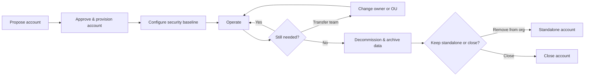

# Tag Policies, Quota Management, and Account Lifecycle

## 1. Context and Learning Objectives

In an enterprise using AWS, infrastructure typically spans multiple accounts: development, testing, production, data, and security. After creating accounts, the platform team must repeatedly answer three questions:

1. **Who owns the resources and costs?** Consistent tagging conventions are needed to classify environments, owners, and cost centers.
2. **Does the account or service have sufficient quota to deploy?** Teams must understand default quotas, applied quotas, how to track usage, and how to request quota increases.
3. **How is an account managed from creation to retirement?** Processes are needed for provisioning, OU placement, applying controls, operations, handover, and account closure.

This is part of **Accounts and Organizations** in the **CLOUD_PROVIDERS_AWS** track. These three areas directly support selecting and deploying AWS services across Regions/AZs, IAM, VPC, compute, storage, databases, integration, and serverless—while maintaining security, observability, recoverability, and cost control.

After this lesson, you will be able to explain Tag Policies in AWS Organizations; design tagging conventions; distinguish service quotas, Organizations quotas, and budgets; inspect and request quota increases; build an AWS account lifecycle governance workflow; and assess risks when moving or closing accounts.

## 2. Three Concepts and Scopes of Responsibility

| Component | Primary Function | Do Not Confuse With |
| --- | --- | --- |
| **Tag** | A `key=value` label attached to resources or certain AWS objects for classification and operations | IAM permissions or a certification that a resource is secure |
| **Tag policy** in **AWS Organizations** | Standardizes tag key/value casing, reports compliance, and enforces checks supported by services | IAM/SCP policies; does not grant permissions or auto-attach tags |
| **Service Quotas** | View quota values, monitor usage, and submit increase requests for adjustable quotas | Budget limits or a guarantee that physical capacity is always available |
| **Account lifecycle** | Workflow for creating, baseline-configuring, operating, moving OUs, retiring, removing, or closing an AWS account | The lifecycle of an individual EC2 instance or a single application |

Example: an organization has an `Production` OU containing account `payments-prod`. The `CostCenter=FIN-01` tag helps allocate costs; a tag policy enforces how `CostCenter` is formatted; Service Quotas determines how many VPCs can be created in a Region; and the account lifecycle process ensures `payments-prod` has an owner, CloudTrail enabled, and an audit before closure.

## 3. Designing an Organization-Wide Tagging System

A **tag** has two parts: `key` and `value`, such as `Environment=Production`. Keys and values are case-sensitive: `Environment`, `environment`, and `ENVIRONMENT` can be treated as different keys. Inconsistent conventions distort cost reports, resource searches, and tag-based access rules.

### 3.1. Recommended Tag Set

| Tag Key | Example Values | Question Answered |
| --- | --- | --- |
| `Environment` | `Development`, `Staging`, `Production` | Which environment does the resource belong to? |
| `CostCenter` | `FIN-01`, `OPS-02` | Which department is charged for the cost? |
| `Application` | `checkout`, `customer-portal` | Which application does the resource serve? |
| `OwnerTeam` | `platform`, `payments` | Which team receives alerts and handles incidents? |
| `ManagedBy` | `Terraform`, `CloudFormation`, `Manual` | How is the resource managed? |
| `DataClassification` | `Public`, `Internal`, `Confidential` | What protection tier does the data require? |

These values are **design examples only**, not a mandatory AWS tag list. An organization should publish its approved key catalog, valid values, who can modify conventions, how to tag shared resources, and how exceptions are handled.

Prefer readable, stable key names that contain no secrets. **Never store passwords, access keys, tokens, or sensitive data in tags.** Tags commonly appear in consoles, APIs, reports, or logs depending on the service. Permissions to view a resource can expose its tags.

### 3.2. Account Tags vs. Resource Tags

AWS Organizations allows attaching tags to certain Organizations objects, including **AWS accounts**, for account governance. For example, you can attach `OwnerTeam=payments` to the `payments-prod` account.

However, tagging an **account** does not mean every EC2 instance, S3 bucket, or RDS database inside that account automatically inherits that tag. For cost allocation and resource tracking, appropriate tags must be applied to each supported resource type, usually via IaC or resource provisioning workflows. For cost reporting, the relevant **user-defined cost allocation tags** must also be activated in AWS Billing/Cost Management. Do not assume tagging an account alone provides workload-level cost allocation.

## 4. How Do AWS Organizations Tag Policies Work?

A **Tag policy** is a type of organization governance policy. When AWS Organizations runs in **All features** mode, an organization can enable Tag Policies, author policies, and attach them to the **Organizations Root**, an **Organizational Unit (OU)**, or an **account**. Policies are merged down the organizational hierarchy to form the *effective tag policy* applied to an account.

```text
Organizations Root  [tag key naming conventions]
├── OU: Sandbox    [rules for test environments]
│   └── Account: app-dev
└── OU: Production [approved tag values]
    ├── Account: payments-prod
    └── Account: analytics-prod
```

Typically, organizations define consistent key casing at the Root and then tailor accepted values or enforcement scopes per OU. Moving an account to a different OU can change that account's **effective tag policy**. When multiple inherited policies merge, tag policy syntax operators such as `@@assign` and child-policy rules determine the outcome; do not assume policies simply concatenate or overwrite like plain text.

### 4.1. Basic Compliance Rules

Basic compliance rules help validate **tag key casing** and **allowed tag values** for resources in supported scope. They can run in **reporting** mode to surface deviations; for resource types supporting **enforcement**, they can block attaching or creating non-compliant tags.

Example tag policy for `Environment`:

```json
{
  "tags": {
    "Environment": {
      "tag_key": {
        "@@assign": "Environment"
      },
      "tag_value": {
        "@@assign": ["Development", "Staging", "Production"]
      },
      "enforced_for": {
        "@@assign": ["ec2:ALL_SUPPORTED"]
      }
    }
  }
}
```

Meaning:

- `tag_key` specifies the canonical key `Environment` with consistent capitalization.
- `tag_value` declares the three allowed values.
- `enforced_for` requests enforcement on **EC2 resource types that support** tag policy enforcement. `ec2:ALL_SUPPORTED` does not mean every resource type of every service is supported.
- The `@@assign` operator assigns values to policy elements using AWS Organizations Tag Policies syntax, which differs from IAM policy syntax.

**Important limitation:** With *basic compliance rules*, if a resource is created **without** an `Environment` tag, this check does not force the creator to add that key. It primarily validates tags that are present; enforcement support also depends on AWS-supported resource types. You cannot use the configuration above to claim every resource in an account has mandatory tags.

### 4.2. Required Tag Key: Detecting and Checking Mandatory Tags

AWS Tag Policies also supports **Required tag keys** to declare keys that must be present on supported resource types. The example below adds `CostCenter` to the required tag reporting list for EC2 instances:

```json
{
  "tags": {
    "CostCenter": {
      "tag_key": {
        "@@assign": "CostCenter"
      },
      "report_required_tag_for": {
        "@@assign": ["ec2:instance"]
      }
    }
  }
}
```

This capability should be understood in two layers:

1. **Reporting:** organization-wide compliance reports can locate supported resources missing required tags. However, reports do not unconditionally cover every untagged resource; combine them with resource inventory tools and other processes to find completely untagged resources.
2. **IaC enforcement:** can integrate with **CloudFormation, Terraform, or Pulumi** via AWS-supported mechanisms to warn or block deployments when tags are missing, depending on configuration and tool versions. Basic compliance rules alone do not provide this guarantee. You must enable the integration, choose the right mode, and verify which resource types are actually supported.

For resource creation via the console or direct API calls, organizations can consider **SCP/IAM policies with tag-based request conditions**, such as `aws:RequestTag/<TagKey>` or `aws:TagKeys` condition keys where supported by the API. Test thoroughly per action and service because support is not uniform—especially when a single API creates multiple resource types at once.

### 4.3. Tracking Compliance and Resolving Deviations

The AWS Resource Groups/Tagging API and compliance reports in AWS Organizations help identify resources that do not conform to the effective tag policy. You can query the list of required keys in the effective policy with:

```bash
aws resourcegroupstaggingapi list-required-tags --region ap-southeast-1
```

This command only reflects required tag keys defined under supported mechanisms and scopes; **it does not prove every resource is already tagged**. When inventorying, supplement with queries for untagged resources—such as AWS Resource Explorer with `tag:none` if configured—and inspect services outside report/enforcement coverage.

A sound operational workflow is: measure non-compliant resource counts by account/OU → identify owners → fix IaC or provisioning inputs → apply/fix tags on existing resources → re-verify reports → only then expand enforcement scope. Turning enforcement straight onto Root without testing in a small environment can break automated provisioning pipelines.

## 5. Service Quotas: Understanding AWS Limits Correctly

A **Quota** (formerly often called a *limit*) is a cap placed by an AWS service on resource counts or operations. Quotas can apply per **account**, per **Region**, or in some cases per specific **resource**; depending on the service, there are global quotas and Regional quotas.

Examples:

- One quota caps the number of VPCs per Region in an account.
- One quota caps the number of IAM roles in an account.
- Another quota caps the count or total capacity of a service's resources according to that service's calculation rules.

Do not memorize a single quota number as a universal truth for every account. **Default values and applied values can differ across accounts, Regions, over time, and by usage history.** Brand-new accounts may receive lower applied limits than published defaults. Always look up quotas in the exact target account and Region before designing large workloads.

### 5.1. Distinguishing Quota and Limit Types

| Concept | Meaning | How to Handle |
| --- | --- | --- |
| **Default quota** | AWS's initially published baseline for a quota | Check service docs and Service Quotas |
| **Applied quota** | The actual quota active for the target account or resource | Check Service Quotas at the exact scope; request an increase if adjustable |
| **Adjustable quota** | A quota eligible for increase requests | Submit an increase request; AWS may approve, deny, or partially approve |
| **Non-adjustable quota** | A quota with no standard increase path | Redesign architecture, distribute resources, or follow service guidance |
| **API throttling / rate limit** | Caps on API request frequency | Retry with exponential backoff, reduce concurrency, follow API guidance |
| **Budget / cost** | Tracks or controls spending against business thresholds | AWS Budgets, alerts, and resource lifecycle management |

Resolving a `ThrottlingException` is different from resolving a *quota exceeded* error. Increasing the VPC count quota does not fix API rate limiting; raising an EC2 quota also does not guarantee physical capacity is available in every Availability Zone at all times.

### 5.2. Workflow to View and Request Service Quota Increases

In the AWS Management Console, open **Service Quotas → AWS services**, select the service, Region, and quota to inspect. Read the **AWS default**, **applied value**, **adjustability**, and current utilization if available. For adjustable quotas, submit **Request quota increase** and monitor request status.

Example looking up Amazon VPC quotas in Singapore:

```bash
aws service-quotas list-service-quotas \
  --service-code vpc \
  --region ap-southeast-1
```

A quota increase request command looks like:

```bash
# Replace the quota code and value based on your lookup results
aws service-quotas request-service-quota-increase \
  --service-code vpc \
  --quota-code L-REPLACE_WITH_REAL_QUOTA_CODE \
  --desired-value 10 \
  --region ap-southeast-1
```

`L-REPLACE_WITH_REAL_QUOTA_CODE` is a placeholder only; replace it with the real `QuotaCode` retrieved from Service Quotas. The value `10` only illustrates syntax, not a recommended limit or guarantee of approval. If the target is a resource-level quota, identify the `ContextId`/ARN and follow the service's documented workflow.

A successfully submitted request **does not mean the quota increased immediately**. Some requests are auto-approved, while others require AWS Support review. Once approved, verify the new applied quota before scaling deployments. For non-adjustable quotas, evaluate architectural changes or splitting workloads appropriately.

### 5.3. Proactive Quota Management

Do not wait until launch day to check quotas. For growing workloads, maintain a tracking table:

| Account | Region | Service/Quota | Applied Quota | Current Usage | Internal Alert Threshold |
| --- | --- | --- | ---: | ---: | ---: |
| `app-dev` | `ap-southeast-1` | Quota A (hypothetical) | 20 | 8 | 80% |
| `payments-prod` | `ap-southeast-1` | Quota B (hypothetical) | 100 | 78 | 80% |
| `analytics-prod` | `ap-southeast-2` | Quota C (hypothetical) | 50 | 47 | 90% |

All numbers in the table are purely hypothetical. The goal is to combine **load forecasts, quotas, recovery needs, release plans**, and increase-approval lead times. Not every quota provides automated usage metrics.

AWS Service Quotas offers **Automatic Management** for supported quotas: when enabled, the service can send usage notifications at thresholds like 80%/95%; in appropriate modes, it can automatically submit increase requests for certain adjustable quotas. **Not every quota supports monitoring or auto-adjustment, and automated requests can still be denied.** Verify exactly which quotas are supported in your account/Region.

### 5.4. Quota Request Templates for New Accounts

When an enterprise creates many accounts, requesting quota increases one account at a time is tedious. A **Service Quotas request template** can automatically submit predefined increase requests whenever **a new account is created in Organizations**, provided the organization meets prerequisites and associates the template.

Limitations to remember:

- Requires Organizations in **All features** mode with template association enabled.
- Templates apply to **new accounts**, and do not automatically adjust quotas on accounts that already existed before the template was updated.
- Support follows AWS-defined Regions/scopes; a quota increase remains a **request**, not a guarantee of approval.

Account-vending designs should include a post-provisioning **applied quota check**, even when the organization already uses a template.

## 6. Quotas Specific to AWS Organizations

Beyond quotas for EC2, VPC, Lambda, or RDS, **AWS Organizations also has its own quotas**: maximum accounts allowed in the organization, number of OUs, number of policies or policies attached to a single target, account-creation rate/concurrency limits, and other API limits.

For example, an organization planning to add hundreds of accounts for new projects must check the **maximum number of accounts** quota. Checking Service Quotas for EC2/VPC alone is not enough. Some Organizations quotas can be requested for increase from the **management account**; closed accounts can still count toward the account limit during the post-closure period per AWS rules. Do not repeatedly retry account creation when hitting a quota error.

**Three layers to distinguish when scaling:**

```text
Organizations quota     → How many more accounts can be created/joined?
Service quota           → How many resources can each account/Region/resource use?
Budget & cost controls  → Does that usage align with budgets and cost alerts?
```

A multi-account design is sustainable only when all three layers are managed together alongside IAM/SCP security policies and operational monitoring.

## 7. AWS Account Lifecycle in Organizations

The lifecycle can be modeled into operational states as shown below. This is an **enterprise-proposed governance model**, not the literal set of API status names returned by AWS:



### 7.1. Proposal and Approval Stage

Before creating an account, define its purpose, accountable **owner**, environment, cost center, intended deployment Regions, data classification, and compliance requirements. A minimum handover dataset might include:

| Field | Example |
| --- | --- |
| Account name | `payments-prod` |
| Managed root email | `aws-payments-prod@example.com` |
| Target OU | `Production/Payments` |
| OwnerTeam | `payments` |
| CostCenter | `FIN-01` |
| Approved Region | `ap-southeast-1` |
| Administrative access method | IAM Identity Center / approved roles |
| Baseline | Logging, threat detection, backup, budget, tagging |

The email above is an example only; each new AWS account needs a valid email address not already used by another account. Do not use personal emails as long-term administrative contacts when corporate policy requires controlled shared addresses.

### 7.2. Creating New Accounts or Inviting Existing Ones

Two common paths exist:

- **Create account:** the management account creates a new account via the AWS Organizations Console/API/CLI. By default, Organizations creates an administrative role `OrganizationAccountAccessRole` in the new account so the management account can access it as permitted. Creation is **asynchronous**; check completion status before subsequent steps.
- **Invite account:** invites an existing AWS account to join the organization, and the account owner accepts. Organizations **does not automatically create** `OrganizationAccountAccessRole` in invited accounts; cross-account administrative access must be configured explicitly if needed.

Example AWS CLI syntax to create a new account, run only by an authorized principal in the **management account**:

```bash
aws organizations create-account \
  --email aws-payments-prod@example.com \
  --account-name "payments-prod"
```

The response may contain `CreateAccountStatus.Id` and `State: IN_PROGRESS`. Poll status using the returned request ID:

```bash
aws organizations describe-create-account-status \
  --create-account-request-id car-REPLACE_WITH_REQUEST_ID
```

Only proceed with account-dependent configuration once `State` becomes `SUCCEEDED`. If `FAILED`, inspect `FailureReason` to identify quota limits, duplicate email, billing issues, or other causes. Never treat the initial HTTP success response as meaning the account is ready.

### 7.3. Placing the Account in an OU and Configuring the Baseline

A newly provisioned account must be placed into an appropriate OU and receive organizational controls. **Moving an account to an OU can change effective SCPs, Tag Policies, and other organization policies.** For instance, moving from Sandbox to Production can enforce stricter Region and tagging rules.

Typical initialization tasks include:

1. **Identity and access:** protect the root user; set up access via IAM Identity Center or appropriate IAM roles; separate administrative and application permissions.
2. **Logging and monitoring:** verify CloudTrail configuration, critical alarms, security service integrations, and log destinations per organization architecture.
3. **Networking and data:** approved Regions/VPCs, encryption, storage retention, and recovery aligned with application RTO/RPO.
4. **Cost:** CostCenter/OwnerTeam, resource tags, budgets, cost allocation, and orphaned-resource detection.
5. **Quotas:** check applied quotas for needed services; request increases before large deployments.
6. **Validation:** test a sample deployment flow, access permissions, valid tag creation, and policy-denied edge cases.

AWS Control Tower or an Infrastructure as Code-based **account vending** system can standardize these steps. Regardless of tooling, verify results directly—an account merely appearing in Organizations does not guarantee its baseline is complete.

### 7.4. Operating and Modifying Accounts

Throughout active use, owners should periodically review:

- **Tag compliance:** percentage of resources carrying standard tags and unresolved exceptions.
- **Quota headroom:** remaining quota capacity, growth forecasts, and pending quota requests.
- **Security posture:** IAM permissions, OU-attached policies, logging status, vulnerabilities, or security findings.
- **Cost:** per-account/application spend, idle resources, budgets, and accountability.
- **Resilience:** backups, retention compliance, restore testing, and cross-account dependencies.

When performing **move account**, evaluate effective policies at the destination OU **before** making the move, then verify logging, networking, CI/CD permissions, tag reports, and operational rules afterward. The CLI supports `aws organizations move-account` with `--account-id`, `--source-parent-id`, and `--destination-parent-id`; retrieve IDs from Organizations rather than guessing from OU names.

## 8. Retirement: Removing an Account Is Completely Different from Closing It

### 8.1. Remove / Leave Organization

**Remove account from organization** turns an account into a **standalone AWS account**; the account **is not closed**. Afterward, the account becomes responsible for its own billing and is no longer governed by the former organization's policies. Because SCPs no longer apply, effective permissions for some principals **can become broader** than before if the account previously relied on SCPs for restrictions.

Before removing an account, verify contact details, payment methods, support plans, and standalone operational prerequisites. Also clean up delegated administrator roles, service integrations, cross-account access, and IAM roles created for management-account administration. **Cross-account administrative roles do not vanish automatically when an account leaves an organization**; review and revoke them if no longer needed. AWS also enforces waiting-period rules for newly created accounts in an organization and exceptions for certain account types.

This operation impacts both billing and security. For instance, if transferring an account to a subsidiary, the platform team must hand over ownership, billing, security, keys/secrets, and operational workflows before executing it.

### 8.2. Close Account

**Closing an account** is the decision to decommission the account. Before closing, run a checklist:

1. Confirm the owner and decision-maker, and record data retention requirements per corporate policy.
2. Check dependencies: DNS, IAM trusts, backups, shared VPCs, data pipelines, encryption keys, CI/CD pipelines, and other accounts calling APIs or accessing resources in this account.
3. Back up, export data, and verify retrieval/restoration outside the account being closed.
4. Review costs, service contracts/commitments, active subscriptions, resources, invoices, and billing access.
5. Record the Account ID, approval evidence, closure timestamp, and how to contact AWS Support if reopening is needed within the allowed window.

AWS provides a **90-day post-closure period**: during this window, you can contact AWS Support to request reopening subject to AWS terms. After that period, the account is permanently closed and **cannot be reopened**. Closure may not reflect immediately across all services/Regions, and residual bills can still arrive after submitting closure. Never treat closing an account as a substitute for proper data preservation or settling financial obligations.

In Organizations management, API account statuses can include values such as `ACTIVE`, `SUSPENDED`, `PENDING_CLOSURE`, and `CLOSED`, depending on the situation. **AWS-applied `SUSPENDED`** and an **intentional `CLOSE` account workflow** are not synonymous operational actions. When auditing, read actual status from the API/console; do not infer status from account names or zero traffic.

### 8.3. Comparing End-of-Lifecycle Decisions

| Decision | Account Continues to Exist? | Primary Impact | Operational Notes |
| --- | --- | --- | --- |
| Move OU | Yes, remains in the organization | Changes inherited policies | Check SCPs, Tag Policies, baselines, and deployment permissions |
| Remove / leave organization | Yes, becomes standalone | Loses former organization's policies and consolidated billing | Add payment method, revoke admin roles, audit security |
| Close account | Begins closure workflow | Stops service usage; enters post-closure period | Back up first, monitor 90-day window and billing obligations |

## 9. Integrated Scenario: Provisioning a New Production Account

A development team needs an `orders-prod` environment running APIs on ECS/Lambda with data in RDS, expecting rapid traffic growth after launch. The organization requires application-level cost reporting and forbids arbitrary tags in production infrastructure.

**Proposed design:**

1. **Approval:** record `OwnerTeam=orders`, `CostCenter=SALES-01`, `Environment=Production`, primary Region, and recovery targets.
2. **Account creation:** provision the new account in Organizations, confirm creation succeeded, and place it into the Production OU.
3. **Tag standardization:** apply tag policies for approved keys/values; verify enforcement support per resource type; declare Required tag keys with IaC integration to block deployments missing tags.
4. **Quota check:** inspect Regional quotas and current usage for VPC, compute services, databases, and related services; request increases before launch if forecasts approach limits.
5. **Security and operations:** finalize access roles, CloudTrail, alarms, backups, budgets, and run a test deployment with full tagging.
6. **Post-launch monitoring:** catch invalid tags, near-limit quotas, and cost anomalies; fix IaC templates rather than performing bulk manual edits.
7. **Project retirement:** inventory dependencies and data before deciding whether to retain, change owner/OU, remove, or close the account.

If **permission errors** appear post-deployment, distinguish IAM/SCP issues from tag policy violations. If **quota exceeded** occurs, check service quotas in the exact account/Region; if caused by invalid tag conventions, check effective tag policies and `enforced_for` settings. These three issues can look similar on the surface yet have completely different fixes.

## 10. Self-Check Exercises

**Question 1.** The operations team successfully creates an EC2 instance without an `Environment` tag, even though the organization enabled *basic compliance* with `enforced_for: ec2:ALL_SUPPORTED`. Is the tag policy definitely broken?

**Hint:** No. Basic compliance rules validate tags that are present, rather than forcing the key to be included. To check for missing required keys, use Required tag keys within supported scope and appropriate IaC checks; for supported APIs, also consider IAM/SCP tag conditions.

**Question 2.** A company creates a new account and wants to deploy a system in Singapore. In AWS Service Quotas, the AWS default value is higher than the applied value. Which value should be used for planning?

**Hint:** Use the **actual applied quota** in that account/Region, check adjustability, and request an increase if needed. Do not extrapolate from defaults or from another account's quotas.

**Question 3.** After an account moves from the `Sandbox` OU to the `Production` OU, a pipeline fails to create resources tagged `Environment=Dev`. Why?

**Hint:** Moving OUs changed the effective tag policy; the Production OU likely requires `Production` within supported enforcement scope. Also check SCPs and IAM if the error does not originate from the tag policy.

**Question 4.** An account is removed from Organizations, yet a former administrator can still assume a previously created administrative IAM role. Is this a contradiction?

**Hint:** No. Removing an account does not delete IAM roles created by the former organization. You must proactively revoke trusts/roles and re-evaluate permission boundaries since organization policies no longer apply.

**Question 5.** A team wants to close an account immediately as a project ends, while another account still reads data from an S3 bucket inside that account. What must be decided first?

**Hint:** Identify dependencies, data owners, retention rules, migration/backup plans, and test access after migration. Close only after data, security, billing plans, and formal approvals are settled.

## 11. Takeaways

**Tag policies** help maintain resource classification standards and support reporting/enforcement within service limits; they do not create tags automatically, and basic compliance does not guarantee every resource is tagged. **Service Quotas** define service usage limits at the applicable scope; Organizations quotas and budgets are separate concerns. **Account lifecycle** must be governed from provisioning through handover, removal, and closure, with continuous controls for IAM, monitoring, recovery, data, and cost.

### AWS Reference Documentation

- [AWS Organizations — Tag policies](https://docs.aws.amazon.com/organizations/latest/userguide/orgs_manage_policies_tag-policies.html)
- [Tag policy syntax and examples](https://docs.aws.amazon.com/organizations/latest/userguide/orgs_manage_policies_example-tag-policies.html)
- [Enforce tagging consistency](https://docs.aws.amazon.com/organizations/latest/userguide/orgs_manage_policies_tag-policies-enforcement.html)
- [Report tagging compliance](https://docs.aws.amazon.com/organizations/latest/userguide/orgs_manage_policies_tag-policies-report-tagging-compliance.html)
- [Enforce Required tag key with IaC](https://docs.aws.amazon.com/organizations/latest/userguide/enforce-required-tag-keys-iac.html)
- [AWS Service Quotas — User Guide](https://docs.aws.amazon.com/servicequotas/latest/userguide/intro.html)
- [Service Quotas request templates](https://docs.aws.amazon.com/servicequotas/latest/userguide/organization-templates.html)
- [AWS Organizations quotas](https://docs.aws.amazon.com/organizations/latest/userguide/orgs_reference_limits.html)
- [Create member accounts in Organizations](https://docs.aws.amazon.com/organizations/latest/userguide/orgs_manage_accounts_create.html)
- [Move accounts between OUs](https://docs.aws.amazon.com/organizations/latest/userguide/move_account_to_ou.html)
- [Remove member account from Organizations](https://docs.aws.amazon.com/organizations/latest/userguide/orgs_manage_accounts_remove.html)
- [Close an AWS account](https://docs.aws.amazon.com/accounts/latest/reference/manage-acct-closing.html)
