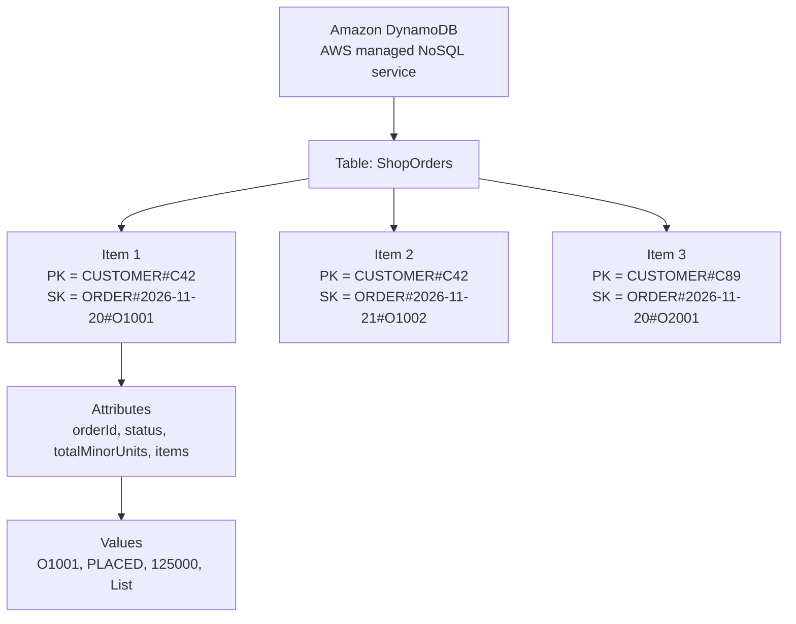
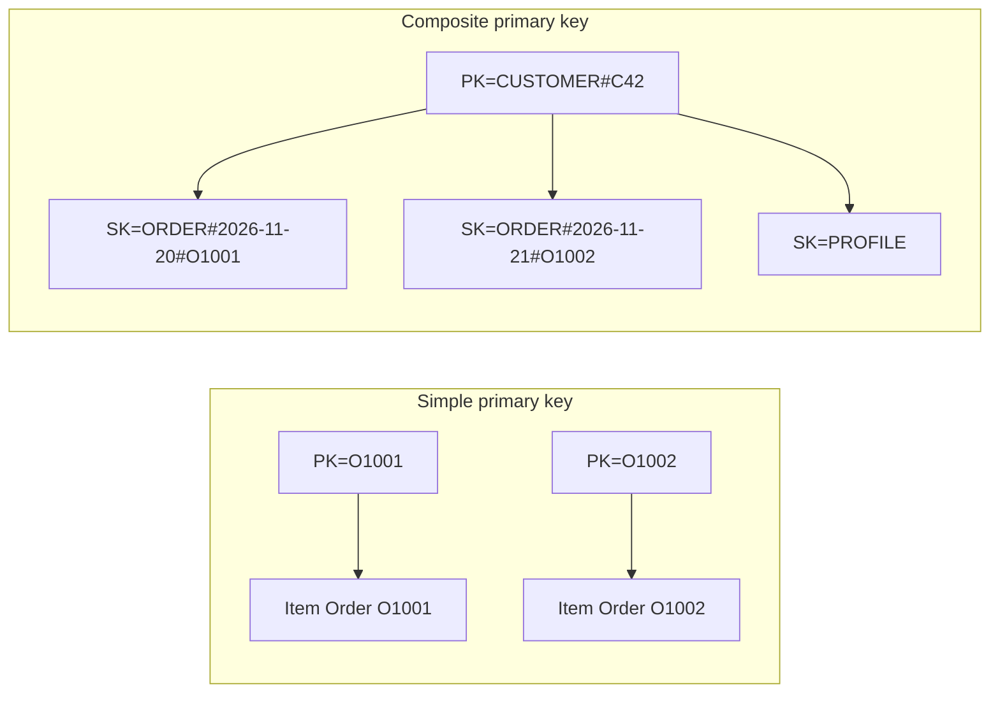
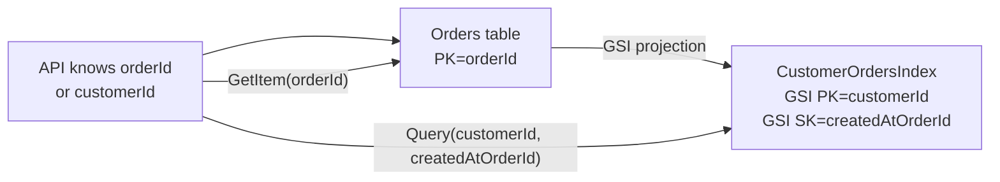
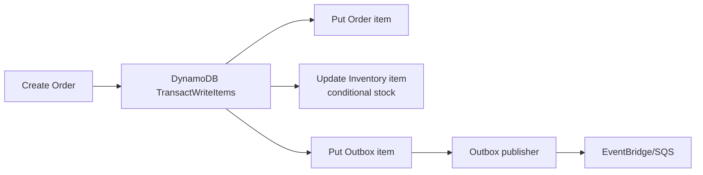
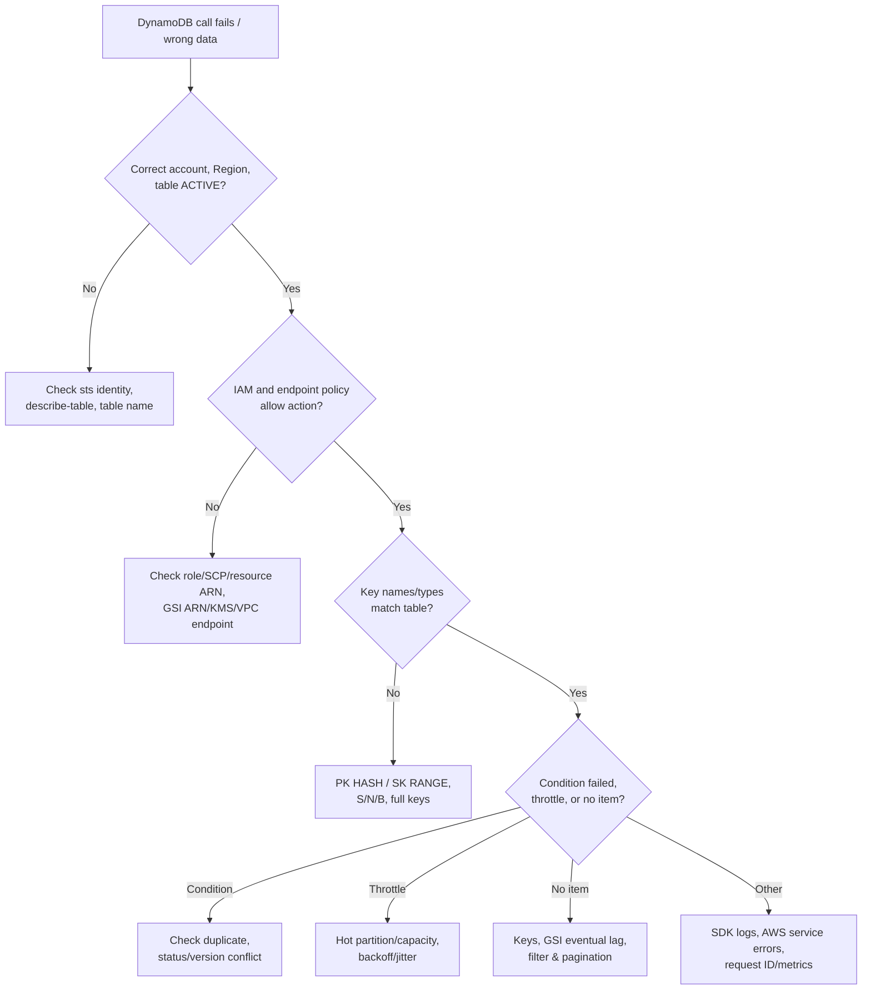
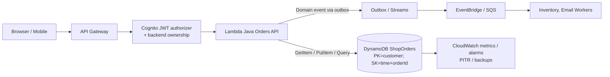

# DynamoDB Tables, Items, Attributes, and Primary Keys

**Amazon DynamoDB** is a fully managed NoSQL **key-value and document** database service from AWS, designed for applications that require low latency, scaling with traffic volume, and minimal server management overhead. In DynamoDB, data is stored in a **table**, each record is an **item**, and each property of an item is an **attribute**. DynamoDB locates and distributes items based on a **primary key**, rather than scanning all rows like an unindexed SQL query.

This lesson belongs to the **DynamoDB** chapter of the **CLOUD_PROVIDERS_AWS** module. On the journey of exploring the AWS ecosystem across Regions/AZs, IAM, VPC, EC2/ECS/Lambda, storage, databases, integration services, and serverless, learners need to choose how to store data so applications are **secure, observable, recoverable, and cost-controlled**. The focus here is on the most foundational concepts: **DynamoDB tables, items, attributes, and primary keys**, especially how the **partition key** and **sort key** determine data access capabilities.

The running example is the **Shop** system with customers, orders, and product line items. The backend can run in Java on EC2/ECS or Lambda, while DynamoDB stores the order records. All table names, customer IDs, ARNs, and data in this lesson are **illustrative**; no real customer information is used.

## 1. Learning Objectives

After this lesson, you will be able to:

1. Explain the **table → item → attribute → value** relationship and how it differs from relational tables.
2. Identify **String (S), Number (N), Binary (B), Boolean, Null, List, Map, and Set** data types.
3. Distinguish between a **simple primary key (partition key)** and a **composite primary key (partition key + sort key)**.
4. Explain **item uniqueness**, how DynamoDB hashes the partition key, and how it orders items within the same partition-key value.
5. Design keys based on **access patterns** such as looking up an order by ID, listing orders by customer, and filtering by time.
6. Create tables, write items, read items, query by key, and perform conditional updates using the **AWS CLI**.
7. Read/write basic data using the **AWS SDK for Java v2** with the `AttributeValue` type.
8. Identify risks such as **hot partitions**, costly `Scan` operations, lack of idempotency, item overwrites, and size limits.
9. Choose IAM, capacity, backup, monitoring, and cost-control principles for table design.

## 2. The DynamoDB Data Model in One Diagram



You can summarize this in a table:

| Concept | Meaning | Example in Shop |
|---|---|---|
| **Table** | A collection of items sharing a common primary-key schema | `ShopOrders` |
| **Item** | A record with a unique primary key in the table | Order `O1001` of `C42` |
| **Attribute** | A named field and value of an item | `status`, `totalMinorUnits` |
| **Attribute value** | Data paired with its DynamoDB type | `"PLACED"`, number `125000` |
| **Partition key** | Key component used to determine distribution and lookup | `PK = CUSTOMER#C42` |
| **Sort key** | Optional component that distinguishes/orders items with the same partition-key value | `SK = ORDER#2026-11-20#O1001` |
| **Primary key** | The complete key identifying an item | `(PK, SK)` for a composite key |

**Do not confuse:** DynamoDB **does not force every item in a table to have the exact same set of attributes**. However, **every item must have the primary key attributes matching the table schema**. If a composite key is chosen, both the partition key and sort key are required for every item in the base table.

## 3. What Is a Table?

In DynamoDB, a **table** is the logical unit that stores items along with operational configuration. A table has a unique name within an account/Region, a **primary-key schema**, a capacity mode, and settings such as indexes, encryption, backup, TTL, and DynamoDB Streams when enabled.

Unlike a relational database management system, when creating a DynamoDB table you **do not declare all columns/attributes** such as `orderId`, `customerName`, or `status`. You only need to declare **the key attributes** for the primary key and any indexes you define, along with other table settings.

### 3.1. What Does a Table Contain?

| Component | Characteristics |
|---|---|
| **Table name** | For example `ShopOrders`; used consistently in app configuration and IAM |
| **Primary key schema** | Mandatory partition key, optional sort key |
| **Items** | Records that may differ in non-key attributes |
| **Secondary indexes** | Support other access paths if designed |
| **Capacity mode** | On-demand or provisioned depending on the usage model |
| **Encryption** | DynamoDB encrypts data at rest, with key management options |
| **Backup/PITR** | Restores the table based on enabled capabilities/features |
| **TTL** | Optional automatic removal of expired items based on a timestamp |
| **Streams** | Emits records of item changes if enabled |

**A table belongs to a single AWS Region**, and DynamoDB automatically manages storing/distributing data across the service's infrastructure in that Region. If **multi-Region** replication is needed, you must design/deploy **global tables** or another DR mechanism; it does not happen automatically just because a table is created in a Region.

### 3.2. Does a DynamoDB Table Have a Schema?

The accurate answer is:

- **There is a schema for the primary key**: the names and data types of the partition key/sort key are defined at table creation time.
- **There is a schema for secondary index keys** when an index is created.
- **No fixed column schema is enforced** for non-key attributes at the table level.
- **The application still needs a business schema and validation** so items do not turn into messy data.

For example, these two items can coexist in `ShopOrders`:

```json
{
  "PK": "CUSTOMER#C42",
  "SK": "ORDER#2026-11-20T08:00:00Z#O1001",
  "orderId": "O1001",
  "status": "PLACED",
  "totalMinorUnits": 125000
}
```

```json
{
  "PK": "CUSTOMER#C42",
  "SK": "ORDER#2026-11-21T09:30:00Z#O1002",
  "orderId": "O1002",
  "status": "SHIPPED",
  "totalMinorUnits": 250000,
  "trackingCode": "TRACK-7788",
  "delivery": {
    "carrier": "EXAMPLE",
    "express": true
  }
}
```

The second item has `trackingCode` and `delivery`, while the first does not. That is valid if the application contract allows it. **DynamoDB does not automatically know** whether an order in the `PLACED` state is allowed to have a tracking code; the business logic must validate that itself.

### 3.3. How Does a Table Differ from a Relational Table?

| Perspective | DynamoDB table | Relational table |
|---|---|---|
| Structure | Fixed key schema, flexible non-key fields | Columns/types/constraints usually clearly defined |
| Efficient reads | Designed around keys and indexes | SQL planner, indexes, joins, and diverse query conditions |
| Data relationships | Often denormalization, aggregates, and access patterns | Foreign keys, normalization, joins |
| Schema changes | Table key schema is hard to change; non-key attributes are flexible | ALTER TABLE, migrations |
| Optimization | Partition key distribution, capacity, querying the right key | Query plan, index, statistics, joins |
| Consistency | Eventually or strongly consistent reads depending on API/index; supports transactions | Depends on database/isolation level and transaction |

You should not choose DynamoDB simply because "NoSQL is faster than SQL." It fits when access patterns are relatively clear and scalability/consistent low latency are priorities; if an app needs ad-hoc joins, many complex reports, or multi-table relational transactions, RDS/Aurora may make more sense.

## 4. What Is an Item?

An **item** is a collection of **attributes** stored together by DynamoDB and identified by its primary key. An item can contain scalar values, nested maps/lists, or sets.

### 4.1. A More Complete Illustrative Item

```json
{
  "PK": "CUSTOMER#C42",
  "SK": "ORDER#2026-11-20T08:00:00Z#O1001",
  "orderId": "O1001",
  "customerId": "C42",
  "createdAt": "2026-11-20T08:00:00Z",
  "status": "PLACED",
  "currency": "VND",
  "totalMinorUnits": 125000,
  "items": [
    {
      "sku": "SKU-100",
      "quantity": 2,
      "unitPriceMinorUnits": 62500
    }
  ],
  "paid": false,
  "delivery": null,
  "tags": ["first-order", "mobile"]
}
```

This is **JSON from the application logic perspective**. When calling the DynamoDB **low-level API** (CLI or SDK v2 with `AttributeValue`), each attribute is **tagged with a type** such as `S`, `N`, `BOOL`, `L`, or `M`. They are two different representations describing the same data.

### 4.2. Strengths of an Item

- Attributes in an item can be read in a single `GetItem` call by primary key.
- Individual attributes can be updated using `UpdateItem`, including nested maps/lists at appropriate levels.
- Conditional writes can check the state before updating to protect against concurrent modifications.
- Some use cases can keep a **small aggregate** inside a single item to reduce the number of reads.

### 4.3. Limitations of an Item

- **Maximum item size is 400 KB** under standard DynamoDB limits, including both attribute names and values per service rules.
- Large items increase RCU/WCU consumption, network transfer, and the risk of hitting the limit.
- You cannot arbitrarily use an item to store videos, PDF documents, or thousands of unbounded order lines.
- Non-key attributes do not have a fixed column schema, but **key fields must have the right type and be non-empty**.

For large documents/images, use **Amazon S3** and store `bucket/key/version/checksum` in the item. For an order with very many line items, consider splitting them into separate items and querying by partition/sort key instead of stuffing everything into a List that exceeds 400 KB.

## 5. Attributes and DynamoDB Data Types

An attribute is a **typed name → value pair** inside an item. DynamoDB supports scalar, document, and set types. Choose the right type so comparisons, sorting, and updates do not break semantics.

### 5.1. Commonly Used Types

| Type | Low-level notation | Example | Notes |
|---|---|---|---|
| **String** | `S` | `"ORD-1001"` | UTF-8; suitable for IDs, enums, ISO timestamps |
| **Number** | `N` | `"125000"` in wire format | SDK/CLI serializes as a numeric string; DynamoDB stores/compares it as a number |
| **Binary** | `B` | Base64-encoded bytes in JSON protocol | Intended for small byte payloads, not large files |
| **Boolean** | `BOOL` | `true` | Two states: true/false |
| **Null** | `NULL` | `true` means the attribute has a null value | Distinct from a missing attribute |
| **Map** | `M` | `{"carrier":...}` | Object of named child attributes |
| **List** | `L` | `[item1,item2]` | Ordered list; elements can have different types |
| **String Set** | `SS` | `["vip","loyal"]` | Unique strings, unordered |
| **Number Set** | `NS` | `["1","2","3"]` | Unique numbers |
| **Binary Set** | `BS` | List of binary values | Unique byte sequences |

**DynamoDB has no "automatic" JSON object/array type in the low-level API**: the application needs to map them to `M`/`L`. High-level mappers like the DynamoDB Enhanced Client or serialization libraries can abstract away some of this difference.

### 5.2. DynamoDB Numbers and Precision

In the wire-format API:

```json
{
  "totalMinorUnits": {
    "N": "125000"
  },
  "discountRate": {
    "N": "0.15"
  }
}
```

The value `"125000"` is inside a string under the `N` type tag, but **DynamoDB stores it as a number**, not a text string. DynamoDB supports numbers with **up to 38 digits of precision**. For financial applications:

- Prefer **integer minor units** with an explicit currency, or decimals with controlled rounding rules.
- In Java, use `BigDecimal`/`BigInteger` when appropriate, and avoid defaulting to storing everything via `double`.
- Do not force Number as a partition key just because the key is "all digits" if you need to preserve leading zeros or concatenate prefixes.

### 5.3. String, Timestamps, and Sort Semantics

Timestamps like `"2026-11-20T08:00:00Z"` are stored as **String**; DynamoDB does not inherently understand them as a datetime type. Use **UTC and a consistent fixed-width format** so lexicographical order matches chronological order.

**Common pitfall example:**

```text
"2026-1-9"   and   "2026-11-02"
```

If month/day values are not zero-padded, string ordering will not reliably reflect chronological order. You should use `YYYY-MM-DDTHH:mm:ss.SSSZ` or a fixed-width ISO 8601 UTC format; if numeric range queries are needed, you can use epoch milliseconds/seconds under a clearly documented convention.

### 5.4. Map and List

```json
{
  "delivery": {
    "M": {
      "carrier": {
        "S": "EXAMPLE"
      },
      "express": {
        "BOOL": true
      }
    }
  },
  "items": {
    "L": [
      {
        "M": {
          "sku": {
            "S": "SKU-100"
          },
          "quantity": {
            "N": "2"
          }
        }
      }
    ]
  }
}
```

Map/List are useful for small data belonging to an aggregate, but do not turn DynamoDB into an unbounded document database. The **400 KB per item** limit still applies to the entire nested tree.

### 5.5. Set vs. List

| Criterion | List | Set |
|---|---|---|
| Element ordering | Yes | Order not guaranteed |
| Allows duplicates | Yes | No |
| Allows mixed element types | Yes, depending on structure | A set can only be of type SS/NS/BS |
| Allows empty set | Not applicable | **Empty Set is invalid** |
| Example | List of order lines | Unique tags on an item |

**Do not confuse:** A Set is not an ordered list, and `NS` is a number set rather than a list of business numeric strings. If you need to store a list in creation order, use `L` or create separate items with sort keys.

### 5.6. Missing Attribute, NULL, and Empty String

These three states are distinct:

```text
1. Attribute "delivery" is absent
2. "delivery": {"NULL": true}
3. "delivery": {"S": ""}
```

For **non-key String/Binary attributes**, DynamoDB allows empty values under supported conditions. However, **primary key attributes** and **index key attributes** cannot be empty String/Binary values; key attributes require a valid scalar type. **Empty Sets are not supported**. Therefore, the contract must standardize when to omit a field and when to use `NULL`, instead of letting each service guess.

## 6. Primary Key: Item Identity, Not Just "a Column"

Every DynamoDB table has **exactly one primary-key schema**. There are two forms:

1. **Simple primary key:** only a **partition key**.
2. **Composite primary key:** a **partition key + sort key**.

Key attributes must be **top-level scalars** of type `S`, `N`, or `B`—not `M`/`L`/`BOOL`/`NULL`/`Set`. Key names and types are defined at table creation time.

### 6.1. Simple Primary Key

Example table `ShopOrdersById`:

```text
Table: ShopOrdersById
Primary key: orderId (String)

orderId = O1001   -> one unique item
orderId = O1002   -> one unique item
orderId = O2001   -> one unique item
```

In this table, **there cannot be two items with the same `orderId`**. Calling `PutItem` with the same partition key without a condition can **replace the entire existing item**.

Advantage: knowing `orderId` allows a direct `GetItem`. Disadvantage: listing a customer's orders chronologically is not solved efficiently by this primary key; you need a GSI or another design.

### 6.2. Composite Primary Key

Example table `ShopOrders`:

```text
Partition key (PK): CUSTOMER#C42
Sort key      (SK): ORDER#2026-11-20T08:00:00Z#O1001

PK                         SK
CUSTOMER#C42               ORDER#2026-11-20T08:00:00Z#O1001
CUSTOMER#C42               ORDER#2026-11-21T09:30:00Z#O1002
CUSTOMER#C89               ORDER#2026-11-20T10:30:00Z#O2001
```

Here:

- `PK` **can repeat** across multiple items.
- `SK` **can repeat** if `PK` is different.
- **The pair `(PK, SK)` must be unique within the same table.**

If you write an item with an existing `PK,SK` pair without a condition, the old item can be overwritten. If `PK` is the same but `SK` differs, it is a **new item**, not an update to the old item.

### 6.3. Diagram Distinguishing the Two Key Types



`SK=PROFILE` shows that a composite key can support multiple **item types** within a single logical partition when an app chooses single-table design; that is an advanced technique, not a requirement for every new application.

### 6.4. Key Schema Is Not Business Attribute Values

You can name keys `PK` and `SK`, or `customerId` and `orderCreatedAt`. AWS does not require the `PK/SK` prefix. However, the generic `PK/SK` convention is often useful with single-table design:

```text
PK = CUSTOMER#C42
SK = ORDER#2026-11-20T08:00:00Z#O1001
```

Prefixes like `CUSTOMER#` and `ORDER#` are **application conventions**, not DynamoDB keywords. They help express entity types and query patterns, but must be consistently documented and validated.

## 7. Partition Key Determines Distribution and Retrieval

DynamoDB applies **hashing on the partition key value** to determine how items are distributed across physical partitions managed internally by the service. You do not directly specify the physical partition or Availability Zone for individual items.

### 7.1. What Does "Same Partition Key" Mean?

With a composite key:

```text
PK = CUSTOMER#C42
  SK=ORDER#2026-11-20#O1001
  SK=ORDER#2026-11-21#O1002
  SK=ORDER#2026-11-23#O1003

PK = CUSTOMER#C89
  SK=ORDER#2026-11-20#O2001
```

Items with the same partition key form a **logical item collection** so DynamoDB can `Query` with the condition `PK = :value`. They are not guaranteed to stay on one single physical partition forever; DynamoDB can split, adapt, and manage capacity internally.

### 7.2. What Makes a Good Partition Key?

- Serves the primary queries executed by the application.
- Has **many distinct values (high cardinality)** and relatively even traffic distribution when the workload requires high scale.
- Does not concentrate all hot traffic onto a single `PK` value.
- Is stable and does not contain unnecessary sensitive data.
- Can be constructed/known by the caller that needs to read the item.

Examples:

| Partition key | Suitable? | Reason |
|---|---|---|
| Unique `orderId` | Often good for lookup by order ID | High cardinality, point access |
| `customerId` | Good for listing orders per customer | But a "mega" customer can become a hot key |
| `status="OPEN"` | **Very risky** as primary PK | Most orders concentrate into a few values |
| `date="2026-11-20"` | Risky for write-heavy systems | All events/day hit the same key |
| `random UUID` | Good write distribution | Cannot look up by business key without a mapping/index |

### 7.3. What Is a Hot Partition?

A **hot partition** occurs when a set of key values/physical partitions receives overly concentrated traffic, leading to throttling or increased latency even though the table has available capacity elsewhere. For example, an enterprise customer has millions of orders, and all requests Query/Update around `PK=CUSTOMER#ENTERPRISE`.

Solutions depend on the access pattern:

- Choose a partition key with good dispersion from the start.
- Use a planned composite sharding suffix (for example `CUSTOMER#C42#SHARD#03`) if write throughput is too high—trading off needing to Query multiple shards to aggregate.
- Use appropriate caching/aggregation for read hot keys.
- Use fine-grained item granularity and conditional updates to avoid write contention on a single item.
- Measure **throttling/hot keys** with CloudWatch and DynamoDB Contributor Insights when enabled, rather than optimizing by intuition.

DynamoDB has internal capacity adaptation/splitting mechanisms; they **do not remove the responsibility of designing access patterns and key distribution**. Do not assume simply raising WCU/RCU solves every hot-key bottleneck.

## 8. Sort Key: Multiple Items per PK and Query Ordering

The **sort key** is **optional at the table schema level**, but becomes **mandatory in every item** if the table has a composite primary key. Within an item collection sharing the same partition-key value, DynamoDB stores items ordered by the sort key for efficient `Query` operations.

### 8.1. String vs. Number Sort Key Differences

With a String sort key, DynamoDB sorts in UTF-8 byte order:

```text
"ORDER#1"
"ORDER#10"
"ORDER#2"
```

This is lexicographical order, **not numerical**. If numerical ordering is needed, you can use:

- A numeric sort key (Number type) when a type prefix is not needed.
- Fixed-width strings such as `ORDER#000001`, `ORDER#000002`, `ORDER#000010`.
- Fixed-width UTC ISO 8601 timestamps.

With a Number sort key, `1 < 2 < 10` numerically. Do not mix `S` and `N` types for the same key schema—DynamoDB will reject type mismatches.

### 8.2. Supported Conditions in Query

With `PK = :customer`, you can add sort key conditions:

| Condition | Meaning | Example |
|---|---|---|
| `SK = :value` | Match an exact sort-key value | `PROFILE` |
| `SK < :value`, `<=`, `>`, `>=` | Compare key values | Orders before a timestamp |
| `SK BETWEEN :a AND :b` | Filter by key range | Orders within a time range |
| `begins_with(SK, :prefix)` | Prefix filter on String/Binary sort key | `ORDER#` |

**KeyConditionExpression** requires an **equality condition on the partition key for a specific value**; you cannot Query a base table solely with `SK begins_with "ORDER#"` without specifying PK. If you need to query by other fields, design an index or data layout accordingly.

### 8.3. Ascending or Descending Order

`Query` on a sort key returns results in **ascending** order by default. Set `ScanIndexForward=false` to retrieve **descending** order within the same PK. This is especially useful when retrieving a customer's **10 most recent orders**, provided the sort key is designed so string order corresponds to time.

### 8.4. Multi-Component Composite Sort Keys

`SK = ORDER#2026-11-20T08:00:00Z#O1001` consists of:

1. `ORDER#`: entity type.
2. `2026-11-20T08:00:00Z`: timestamp, convenient for range Queries.
3. `O1001`: order ID, keeping the key unique when two orders share the same timestamp.

**There is no "composite sort key" syntax automatically parsed by DynamoDB**; it is **a single String** constructed by the application. The `#` character is a delimiter by convention. If components can contain the delimiter, they must be properly encoded/escaped to avoid collisions or parsing errors.

### 8.5. Do Not Arbitrarily Modify the Sort Key

The primary key defines the identity of an item, so **`UpdateItem` cannot directly modify primary key attributes**. If you want to change from `SK=ORDER#2026-11-20#O1001` to another key, in data terms that is **deleting the old item and creating a new item**, requiring proper handling of transactions/reference reads/indexes and emitted events. Do not choose a frequently changing field (such as shipping status) as a key if status updates happen often.

## 9. Key Design Starts from Access Patterns

A common mistake is sketching tables/schemas like SQL first, and only at the end asking **how the app will query the data**. With DynamoDB, the primary key and secondary indexes must be chosen around **access patterns**—the questions the application needs to answer efficiently.

### 9.1. List Queries Before Creating the Table

Suppose Shop needs:

| ID | Business question | Parameters known by caller | Frequency |
|---|---|---|---|
| AP-1 | Get a single order by `orderId` | `orderId` | Very high |
| AP-2 | List a customer's 20 most recent orders | `customerId` | High |
| AP-3 | List orders for a customer within a date range | `customerId`, from/to | Medium |
| AP-4 | Find orders to fulfill by `status` and warehouse | `status`, warehouse | Medium/high |
| AP-5 | Update order status while preventing unintended overwrites | `orderId` + expected state | High |
| AP-6 | Company-wide monthly revenue statistics | Date range, all customers | Periodic reporting |

**No single simple key schema optimizes all of AP-1 through AP-6.** AP-6 usually fits an analytics pipeline/S3/Athena/warehouse better than a full-table DynamoDB `Scan` every time a dashboard opens. AP-4 may need a GSI or queue/event-driven worker; AP-1/AP-2 drive the core key/index decisions.

### 9.2. Design A: Partition Key Is orderId

```text
Table: OrdersById
PK: orderId (String)

O1001 -> {customerId:C42, createdAt:2026-11-20, ...}
O1002 -> {customerId:C42, createdAt:2026-11-21, ...}
O2001 -> {customerId:C89, createdAt:2026-11-20, ...}
```

**Pros:** AP-1 and AP-5 use `GetItem`/`UpdateItem` directly by `orderId`; write distribution is usually good if IDs are well-distributed.

**Cons:** AP-2/AP-3 cannot Query by `customerId` on the base table because the partition key is `orderId`. You can add a **GSI** with partition key `customerId` and sort key `createdAt` or an appropriate composite key.

### 9.3. Design B: Partition Key by Customer, Sort Key by Time

```text
Table: ShopOrders
PK (S): CUSTOMER#<customerId>
SK (S): ORDER#<UTC_CREATED_AT>#<orderId>

CUSTOMER#C42 | ORDER#2026-11-20T08:00:00Z#O1001
CUSTOMER#C42 | ORDER#2026-11-21T09:30:00Z#O1002
CUSTOMER#C89 | ORDER#2026-11-20T10:30:00Z#O2001
```

**Pros:** AP-2 and AP-3 can use `Query PK = CUSTOMER#C42`, `begins_with`/`BETWEEN`, and sort by SK.

**Cons:** for AP-1 with only `orderId`, **you do not have enough of the key**; you would need both customerId and timestamp, or an index/mapping item. Adding a GSI keyed by `orderId` supports lookup, but you must understand that a GSI is a separate index structure with its own consistency and cost.

### 9.4. Design C: Base Table by orderId + GSI by Customer



This design is often easy to understand for a new application whose primary needs are **looking up an order by ID** and **listing orders by customer**.

However:

- A GSI has separate **write, read, and storage costs** depending on mode/configuration.
- A GSI only provides **eventually consistent reads**—no Strongly Consistent Reads.
- An order just written to the base table **may not appear immediately** on the GSI.
- The GSI projection needs to include the attributes the Query must display, or the application retrieves the resulting keys and fetches from the base table.

### 9.5. Is Putting Multiple Entities in One Table Always Better?

**Single-table design** is a technique for storing related entity types in the same table, combining `PK/SK` and GSIs to satisfy access patterns. It can save round trips, but increases complexity in key encoding, permissions, schema evolution, and testing.

Beginners should start by asking: **"What keys does each endpoint know, and what data does it need to return?"** and then pick the simplest table/index layout that meets the requirements. Do not force every relational table into one DynamoDB table just because an article says single-table is best practice.

## 10. Detailed Walkthrough of a Customer Item Collection

We will use **Design B** for the CLI examples in this lesson:

```text
Table: ShopOrders
Primary key:
  PK (String) = CUSTOMER#<customerId>
  SK (String) = ORDER#<timestamp>#<orderId>

Items:
  PK=CUSTOMER#C42
    SK=ORDER#2026-11-18T09:00:00Z#O0999
    SK=ORDER#2026-11-20T08:00:00Z#O1001
    SK=ORDER#2026-11-21T09:30:00Z#O1002

  PK=CUSTOMER#C89
    SK=ORDER#2026-11-20T10:30:00Z#O2001
```

### 10.1. Why Put the Timestamp in SK?

If SK were only `ORDER#O1001`, chronological listing would depend on ID ordering (which is not guaranteed to match time). By embedding a standardized timestamp format, `Query` can fetch **newest first** and filter a time range using key conditions.

### 10.2. Why Append orderId After the Timestamp?

Two orders can be created within the same second or even millisecond. If SK were only a timestamp, two orders under the same PK could have the **same key** and overwrite each other. The `orderId` suffix disambiguates them.

### 10.3. Changing Status Without Changing the Key

An order transitioning `PLACED → PAID → SHIPPED` keeps the same key:

```text
PK=CUSTOMER#C42
SK=ORDER#2026-11-20T08:00:00Z#O1001
```

Only `status` and business attributes change. This is a good choice: **the key is a stable identity**, while status can change without moving the item.

### 10.4. The Problem of Looking Up by orderId Alone

An API endpoint `GET /orders/O1001` may only receive `orderId` without knowing customerId/timestamp. With Design B, the backend **cannot call `GetItem` with the exact key** without knowing both `PK` and `SK`. Options:

1. Switch to Design A/C so PK is `orderId`, matching the primary access pattern.
2. Add a **GSI** with partition key `orderId`.
3. Store a **lookup item** `ORDER_LOOKUP#O1001` mapping to `(PK, SK)`, managing atomic/consistent updates as needed.
4. If the request always has `customerId` and `createdAt` from a trusted source, the key can be reconstructed; however, never trust a `customerId` supplied by an attacker without authorization checks.

Do not solve this by running `Scan FilterExpression orderId=:id` across the entire table on every request; that is an anti-pattern that drives up cost and latency as the table grows.

## 11. Creating a DynamoDB Table with AWS CLI

Practice in an **AWS sandbox account** with a properly authorized role. Creating real resources can incur charges, so verify the account/Region and clean up after the lab. All examples use Region `ap-southeast-1` and table `ShopOrders`.

### 11.1. Verify Caller Before Modifying Resources

```bash
aws sts get-caller-identity
aws dynamodb list-tables --region ap-southeast-1
```

Proceed only when the account is the right lab environment, not production. DynamoDB APIs have their own IAM permissions; succeeding with `aws sts get-caller-identity` **does not prove** the role has `dynamodb:CreateTable`.

### 11.2. CreateTable with a Composite Key

```bash
aws dynamodb create-table \
  --table-name ShopOrders \
  --attribute-definitions \
    AttributeName=PK,AttributeType=S \
    AttributeName=SK,AttributeType=S \
  --key-schema \
    AttributeName=PK,KeyType=HASH \
    AttributeName=SK,KeyType=RANGE \
  --billing-mode PAY_PER_REQUEST \
  --region ap-southeast-1

aws dynamodb wait table-exists \
  --table-name ShopOrders \
  --region ap-southeast-1
```

Explanation:

| Parameter | Role |
|---|---|
| `--table-name ShopOrders` | Table name |
| `AttributeName=PK,AttributeType=S` | Declares PK as String |
| `AttributeName=SK,AttributeType=S` | Declares SK as String |
| `KeyType=HASH` | Partition key, legacy API terminology |
| `KeyType=RANGE` | Sort key, legacy API terminology |
| `PAY_PER_REQUEST` | On-demand capacity billing, no initial RCU/WCU sizing required |
| `wait table-exists` | Waits until the table is ready before Put/Get |

**Do not declare attributes such as `status`, `orderId`, or `totalMinorUnits` in `--attribute-definitions`** if they are not keys of the table or an index. CreateTable only requires definitions for key attributes; passing extra unused attribute definitions can result in a validation error.

### 11.3. Inspect the Key Schema After Creation

```bash
aws dynamodb describe-table \
  --table-name ShopOrders \
  --region ap-southeast-1 \
  --query "Table.{Status:TableStatus,KeySchema:KeySchema,Attributes:AttributeDefinitions,Billing:BillingModeSummary}"
```

The output should show `PK HASH`, `SK RANGE`, both of type `S`, and the table in `ACTIVE` status. With `PAY_PER_REQUEST` mode, the billing summary structure may vary depending on the API response; do not assume the table was miscreated just because a summary field is omitted in a given context.

### 11.4. Can the Key Be Changed After Table Creation?

**You cannot directly ALTER the primary-key schema of an existing DynamoDB table.** To change from `PK=customerId` to `PK=orderId`, you must design a new table and perform data **migration/backfill**, dual-write synchronization during cutover, controlled traffic shifting, and a rollback plan.

GSIs can be created/deleted after a table exists within service limits; however, **LSIs must be defined at table creation time** and cannot be added to an existing table. That is why analyzing access patterns before creating a table is critical.

## 12. Writing an Item: PutItem and Overwrite Protection

Suppose we need to save order `O1001` for customer `C42`. With the DynamoDB low-level API, the item must use **AttributeValue wrappers** such as `{"S":"..."}` and `{"N":"..."}`:

```bash
aws dynamodb put-item \
  --table-name ShopOrders \
  --item '{
    "PK": {"S": "CUSTOMER#C42"},
    "SK": {"S": "ORDER#2026-11-20T08:00:00Z#O1001"},
    "orderId": {"S": "O1001"},
    "customerId": {"S": "C42"},
    "status": {"S": "PLACED"},
    "currency": {"S": "VND"},
    "totalMinorUnits": {"N": "125000"},
    "paid": {"BOOL": false},
    "createdAt": {"S": "2026-11-20T08:00:00Z"}
  }' \
  --condition-expression "attribute_not_exists(PK)" \
  --region ap-southeast-1
```

This uses **Bash/Unix** shell quoting. On Windows PowerShell, inline JSON escaping/quoting differs; it is more convenient to save the payload into a lab file and use `--item file://put-item.json`.

### 12.1. What Happens if PutItem Has a Duplicate Key?

When there is **no** `ConditionExpression`, `PutItem` with the same key **replaces the entire old item**. Any old field omitted from the new item will disappear, even if the developer only intended to "update status."

Example:

```text
Initial item:
  PK=CUSTOMER#C42
  SK=ORDER#2026-11-20T08:00:00Z#O1001
  status=PLACED, totalMinorUnits=125000, trackingCode=TRACK-01

PutItem with same PK/SK sending only status=SHIPPED:
  => totalMinorUnits and trackingCode may be lost.
```

To **create new without overwriting**, use:

```text
ConditionExpression: attribute_not_exists(PK)
```

With a composite primary key, DynamoDB evaluates the condition against the **item matching the exact PK/SK being written**, so another order with the same `PK` but a different `SK` is still inserted. `attribute_not_exists(PK)` does not mean "no item exists with this partition key."

### 12.2. What Does ConditionalCheckFailedException Mean?

If you rerun the same `PutItem` from the example above, the command returns `ConditionalCheckFailedException`. This is usually the **intended outcome of duplicate-creation prevention**, not necessarily a system failure. The application should distinguish legitimate duplicate requests from conflicts:

- If an event/request has the same business ID and equivalent payload, it can return an idempotent result.
- If the key already exists with conflicting data, return `409 Conflict` or handle per business policy.
- Do not remove the condition just to "make the write succeed" in production.

### 12.3. Number Type in the CLI

`"totalMinorUnits":{"N":"125000"}` is valid low-level DynamoDB JSON. If you send `{"N":125000}` instead of a string per the API shape, or send `{"S":"125000"}`, you may encounter a validation error or store the wrong type relative to the contract.

For safety and inspectability, use reviewed JSON payloads rather than building JSON by concatenating user input strings. Never allow users to supply DynamoDB type tags directly to bypass business validation.

## 13. Reading an Item by Key: GetItem

**GetItem** reads a single item when you have the **entire primary key**. With a composite key, both PK and SK are required:

```bash
aws dynamodb get-item \
  --table-name ShopOrders \
  --key '{
    "PK": {"S": "CUSTOMER#C42"},
    "SK": {"S": "ORDER#2026-11-20T08:00:00Z#O1001"}
  }' \
  --region ap-southeast-1
```

If strong consistency is required and supported by the table/base-item use case:

```bash
aws dynamodb get-item \
  --table-name ShopOrders \
  --key '{
    "PK": {"S": "CUSTOMER#C42"},
    "SK": {"S": "ORDER#2026-11-20T08:00:00Z#O1001"}
  }' \
  --consistent-read \
  --region ap-southeast-1
```

**By default, DynamoDB reads are eventually consistent** (unless consistent read is specified on the API). Strongly consistent reads are supported on base tables and LSIs per their respective configurations, but **not supported on GSIs**. Strong consistency consumes more read capacity than eventual consistency and is not supported on every API/access path.

### 13.1. Is a Missing GetItem an Error?

If no item matches the key, `GetItem` returns a response without an `Item`. That is a business **not found**, not a 500 error. Code must check whether the response contains an item rather than assuming every request finds data.

### 13.2. Can You Read Only Specific Attributes?

You can use `ProjectionExpression` to retrieve only the attributes you need:

```bash
aws dynamodb get-item \
  --table-name ShopOrders \
  --key '{
    "PK": {"S": "CUSTOMER#C42"},
    "SK": {"S": "ORDER#2026-11-20T08:00:00Z#O1001"}
  }' \
  --projection-expression "orderId, #st, totalMinorUnits" \
  --expression-attribute-names '{"#st":"status"}' \
  --region ap-southeast-1
```

**ProjectionExpression reduces returned payload size** and sometimes network/memory usage, but for DynamoDB base table reads, it **does not automatically reduce RCUs based on the number of projected attributes**: the full size of the read item determines read capacity consumption. To optimize cost, design appropriate item sizes, indexes, and access patterns.

### 13.3. IAM Does Not Automatically Authorize by customerId

Having IAM permission for the backend to read the table **does not mean every application user may view every item**. The API must derive the user identity from an authenticated source (Cognito/session), verify owner/tenant, and return only fields within scope. Never expose a DynamoDB table publicly to browsers or trust a `customerId` from a query string.

## 14. Querying by PK and SK Conditions

`Query` is typically the central operation in DynamoDB key-value/document modeling. It is efficient when the **partition key value** is known and items can be narrowed down by the sort key.

### 14.1. List All Orders of a Customer

```bash
aws dynamodb query \
  --table-name ShopOrders \
  --key-condition-expression "PK = :pk" \
  --expression-attribute-values '{
    ":pk": {"S": "CUSTOMER#C42"}
  }' \
  --region ap-southeast-1
```

Query requires **a single specific PK value** in the key condition. You cannot Query "all customers who placed orders today" on this schema without a dedicated index/aggregation strategy.

### 14.2. Fetch the 10 Most Recent Orders

```bash
aws dynamodb query \
  --table-name ShopOrders \
  --key-condition-expression "PK = :pk AND begins_with(SK, :prefix)" \
  --expression-attribute-values '{
    ":pk": {"S": "CUSTOMER#C42"},
    ":prefix": {"S": "ORDER#"}
  }' \
  --no-scan-index-forward \
  --limit 10 \
  --region ap-southeast-1
```

Explanation:

- `PK = :pk` selects the customer's item collection.
- `begins_with(SK, :prefix)` selects ORDER-type items.
- `--no-scan-index-forward` returns results in **descending** SK order.
- `--limit 10` caps the number of items **evaluated in a single page** per the Query API, not a guarantee of "returning exactly 10 matching items after FilterExpression."

Without a `FilterExpression` and when data matches the pattern, the result usually contains up to the first 10 items of the page, though you still need to check `LastEvaluatedKey` and pagination.

### 14.3. Query Orders for a Day by Prefix

```bash
aws dynamodb query \
  --table-name ShopOrders \
  --key-condition-expression "PK = :pk AND begins_with(SK, :dayPrefix)" \
  --expression-attribute-values '{
    ":pk": {"S": "CUSTOMER#C42"},
    ":dayPrefix": {"S": "ORDER#2026-11-20"}
  }' \
  --region ap-southeast-1
```

The prefix works because SK is designed with the timestamp following `ORDER#`. If SK were only `ORDER#O1001`, you could not query by date using a prefix like this.

### 14.4. Query a Time Range

```bash
aws dynamodb query \
  --table-name ShopOrders \
  --key-condition-expression "PK = :pk AND SK BETWEEN :from AND :to" \
  --expression-attribute-values '{
    ":pk": {"S": "CUSTOMER#C42"},
    ":from": {"S": "ORDER#2026-11-01T00:00:00Z"},
    ":to": {"S": "ORDER#2026-11-30T23:59:59Z#ZZZ"}
  }' \
  --region ap-southeast-1
```

This is an **illustrative lexicographical boundary example**; placing a bound like `#ZZZ` must match the exact format and key alphabet used by your application. When timestamp precision is not fixed, do not hardcode an "end of day 23:59:59" literal and assume it covers every millisecond. When you want to select the **entire month of November** under the defined SK convention, a simpler option is:

```text
PK = :customer AND begins_with(SK, "ORDER#2026-11")
```

To filter an **arbitrary time range**, use `BETWEEN` with **inclusive** endpoints computed by the application according to its normalized precision and key encoding. **KeyConditionExpression allows only one SK condition** alongside `PK = :customer`; you cannot use SQL-style `SK >= :start AND SK < :end` directly inside the same key condition to form a half-open range. If business logic needs a half-open range, re-express it as a valid inclusive `BETWEEN` condition or design a different sort key.

### 14.5. Paginate Queries—Never Assume All Items Fit in One Response

A Query returns **at most 1 MB of processed data per page** before pagination is required, even if more items exist or `Limit` is large. Check `LastEvaluatedKey`:

1. If `LastEvaluatedKey` is absent, the iteration has reached the end per the API.
2. If present, issue the next call with the corresponding `ExclusiveStartKey`.
3. If using the AWS SDK v2 Paginator, the library helps iterate pages, **but still generates requests and consumes RCUs**.
4. For HTTP APIs, encode/sign the pagination cursor server-side; never let clients tamper with arbitrary DynamoDB keys to read outside their tenant.

### 14.6. Query vs. Scan

| Criterion | `Query` | `Scan` |
|---|---|---|
| Primary condition | PK equals a single value, optional SK condition | Reads/evaluates many or all items in the table/index |
| Typical efficiency | Good when PK narrows to a small subset | Expensive when the table is large |
| Ordered by SK | Yes, within the same PK | No guaranteed business order |
| Use cases | Customer orders, latest orders, Get by index | Controlled maintenance/admin backfill |
| Risks | Hot keys, pagination, large result sets | Full-table capacity consumption, high latency |

**FilterExpression does not turn a Scan into a Query.** Filters are applied **after DynamoDB reads/evaluates items**, so a Scan with `FilterExpression status=:open` still consumes read capacity across all filtered-out items. Replace it with a key/index aligned with the access pattern.

## 15. Updating Individual Attributes with UpdateItem

When an order moves from `PLACED` to `PAID`, do not resend the entire item with `PutItem` if you only want to change a few fields. Use **UpdateItem** with **UpdateExpression** and **ConditionExpression** for controlled modifications.

### 15.1. Update Status with a Pre-State Condition

```bash
aws dynamodb update-item \
  --table-name ShopOrders \
  --key '{
    "PK": {"S": "CUSTOMER#C42"},
    "SK": {"S": "ORDER#2026-11-20T08:00:00Z#O1001"}
  }' \
  --update-expression "SET #st = :paid" \
  --condition-expression "attribute_exists(PK) AND #st = :placed" \
  --expression-attribute-names '{
    "#st": "status"
  }' \
  --expression-attribute-values '{
    ":paid": {"S": "PAID"},
    ":placed": {"S": "PLACED"}
  }' \
  --return-values ALL_NEW \
  --region ap-southeast-1
```

Meaning:

- `SET #st = :paid`: updates only the `status` attribute.
- `attribute_exists(PK)`: **ensures the item already exists** before updating.
- `#st = :placed`: transitions the state only if it is currently `PLACED`.
- `ExpressionAttributeNames`: aliases attribute names to avoid reserved words and express document paths cleanly.
- `ALL_NEW`: returns the item after a successful update.

**UpdateItem can create a new item if the key does not exist and the condition permits it.** Therefore, for "update existing order only" logic, the existence condition is essential. If the actual status is already `PAID` or `CANCELLED`, the command returns `ConditionalCheckFailedException`; the application must resolve the conflict per domain policy.

### 15.2. Atomic Counters and ADD

When counting processed orders, DynamoDB supports atomic updates. For example, on a **separate counter item**:

```text
PK=COUNTER#ORDERS#2026-11-20
SK=COUNTER
count=1234
```

You can increment `count` with an update expression, but **a single centralized counter item easily becomes a hot key** under heavy update volume. For high-scale workloads, use sharded counters or stream/analytics aggregation instead of writing every event to one item.

**Idempotency note:** atomic ADD does **not** mean "increment only once per event." If a worker processes a duplicate message, the counter still increments twice unless you use a business event ID with transaction/conditional deduplication.

### 15.3. Updating Maps and Nested Attributes

For example, updating `delivery.carrier` when `delivery` is an existing Map:

```text
SET delivery.carrier = :newCarrier
```

If the parent Map/attribute does not exist, a nested path update expression will fail; initialize the parent Map or handle it appropriately. Do not arbitrarily change `delivery` from String to Map just because DynamoDB allows flexible schemas—that is a breaking change in the application schema.

## 16. DeleteItem and Safe Deletion Conditions

Delete an item by its full PK/SK:

```bash
aws dynamodb delete-item \
  --table-name ShopOrders \
  --key '{
    "PK": {"S": "CUSTOMER#C42"},
    "SK": {"S": "ORDER#2026-11-20T08:00:00Z#O1001"}
  }' \
  --condition-expression "attribute_exists(PK) AND #st = :cancelled" \
  --expression-attribute-names '{"#st":"status"}' \
  --expression-attribute-values '{
    ":cancelled": {"S": "CANCELLED"}
  }' \
  --region ap-southeast-1
```

This example only allows deleting orders that are `CANCELLED`. The deletion condition is an illustrative policy; **real production systems typically retain transaction records** per retention/compliance rules instead of deleting them immediately. Consider soft deletes, business statuses, TTL for temporary data, and appropriate audit trails.

### 16.1. Why Does Deleting a Non-Existent Key Not Fail by Default?

Without a condition, `DeleteItem` on a non-existent key is treated as a successful operation by the API. If you need to verify the item existed, use `attribute_exists(PK)`. When auditing is needed, you can request `ReturnValues=ALL_OLD` and process the response in your workflow, though returning the old item alone is not a complete compliance solution.

### 16.2. You Cannot Delete an Entire "Customer Partition" with One DeleteItem

With a composite key, `DeleteItem` always requires **one specific PK/SK**. There is no `DeleteItem(PK=CUSTOMER#C42)` command to automatically delete all orders sharing a PK. To delete a set of items, you must Query the keys and use batch write/delete or a controlled workflow with pagination, retries, and proper permissions.

## 17. Java AWS SDK v2: Reading/Writing Items and Handling Primary Keys

When a Java application runs on **ECS, EC2, or Lambda**, it can use the `software.amazon.awssdk: dynamodb` module of the **AWS SDK for Java v2**. Credentials should come from an **IAM role/STS**, never hardcoded access keys in code.

### 17.1. Low-Level SDK and DynamoDbClient

The Java example below interacts directly with DynamoDB `AttributeValue`:

```java
package example.shop.dynamodb;

import java.util.Map;

import software.amazon.awssdk.regions.Region;
import software.amazon.awssdk.services.dynamodb.DynamoDbClient;
import software.amazon.awssdk.services.dynamodb.model.AttributeValue;
import software.amazon.awssdk.services.dynamodb.model.ConditionalCheckFailedException;
import software.amazon.awssdk.services.dynamodb.model.GetItemRequest;
import software.amazon.awssdk.services.dynamodb.model.GetItemResponse;
import software.amazon.awssdk.services.dynamodb.model.PutItemRequest;
import software.amazon.awssdk.services.dynamodb.model.QueryRequest;
import software.amazon.awssdk.services.dynamodb.model.QueryResponse;

public final class ShopOrdersExample {
    private static final String TABLE = "ShopOrders";
    private static final String PK = "CUSTOMER#C42";
    private static final String SK =
            "ORDER#2026-11-20T08:00:00Z#O1001";

    static AttributeValue s(String value) {
        return AttributeValue.builder().s(value).build();
    }

    static AttributeValue n(long value) {
        return AttributeValue.builder().n(Long.toString(value)).build();
    }

    static Map<String, AttributeValue> key() {
        return Map.of("PK", s(PK), "SK", s(SK));
    }

    static void createOrder(DynamoDbClient db) {
        Map<String, AttributeValue> item = Map.of(
                "PK", s(PK),
                "SK", s(SK),
                "orderId", s("O1001"),
                "customerId", s("C42"),
                "status", s("PLACED"),
                "currency", s("VND"),
                "totalMinorUnits", n(125000L),
                "createdAt", s("2026-11-20T08:00:00Z")
        );

        try {
            db.putItem(PutItemRequest.builder()
                    .tableName(TABLE)
                    .item(item)
                    .conditionExpression("attribute_not_exists(PK)")
                    .build());
        } catch (ConditionalCheckFailedException duplicate) {
            System.out.println("Order key already exists");
        }
    }

    static void readOneOrder(DynamoDbClient db) {
        GetItemResponse response = db.getItem(GetItemRequest.builder()
                .tableName(TABLE)
                .key(key())
                .consistentRead(true)
                .build());

        if (response.item().isEmpty()) {
            System.out.println("Order not found");
            return;
        }
        System.out.println("Order status: "
                + response.item().get("status").s());
    }

    static void listRecentOrders(DynamoDbClient db) {
        QueryResponse response = db.query(QueryRequest.builder()
                .tableName(TABLE)
                .keyConditionExpression(
                        "PK = :pk AND begins_with(SK, :prefix)")
                .expressionAttributeValues(Map.of(
                        ":pk", s(PK),
                        ":prefix", s("ORDER#")))
                .scanIndexForward(false)
                .limit(10)
                .build());

        response.items().forEach(item ->
                System.out.println(item.get("orderId").s()));

        // Production: handle LastEvaluatedKey/pages if more results are needed.
    }

    public static void main(String[] args) {
        try (DynamoDbClient db = DynamoDbClient.builder()
                .region(Region.AP_SOUTHEAST_1)
                .build()) {
            createOrder(db);
            readOneOrder(db);
            listRecentOrders(db);
        }
    }
}
```

**This teaching sample** requires a Java project with AWS SDK v2 dependencies/credentials and an existing table. Its advantage is showing the exact `AttributeValue.builder().s(...)` and `n(...)` usage. Its disadvantage is verbose code and risk of type serialization/deserialization mistakes, especially with nested maps/lists.

### 17.2. Do Not Create DynamoDbClient Per Request

In ECS/EC2/Lambda, reuse a `DynamoDbClient` configured with the proper Region and connection pooling across the application lifecycle. Instantiating a client per item creates overhead and increases latency. In Lambda, create the client **outside the handler** so execution environments can reuse it.

### 17.3. QueryPaginator in Java SDK v2

For a customer with thousands of orders, the first Query response is not enough. AWS SDK v2 provides `queryPaginator`:

```java
for (var page : db.queryPaginator(QueryRequest.builder()
        .tableName("ShopOrders")
        .keyConditionExpression("PK = :pk")
        .expressionAttributeValues(Map.of(
                ":pk", AttributeValue.builder()
                        .s("CUSTOMER#C42")
                        .build()))
        .build())) {
    for (var item : page.items()) {
        System.out.println(item.get("SK").s());
    }
}
```

This is a **code snippet meant to run in a scope with `DynamoDbClient db`**. Handle timeouts, retries, and **bound the number of pages** per the API contract; never let an HTTP endpoint accidentally load all orders of a huge customer into memory at once.

### 17.4. DynamoDb Enhanced Client

**DynamoDbEnhancedClient** maps POJOs/records using schemas, annotations, and a more convenient CRUD API. For example, a POJO has `@DynamoDbPartitionKey` on the PK getter and `@DynamoDbSortKey` on the SK getter.

The Enhanced Client reduces `AttributeValue` boilerplate, **but does not change DynamoDB semantics**: the primary-key schema remains fixed, Query still requires PK, and indexes still have separate consistency and capacity. Do not forget access patterns just because an ORM/mapper is used.

### 17.5. Keys and IAM Permissions in the Java Backend

The Java client accesses DynamoDB under the application's **IAM role**. However, **end-user** access to items must still be enforced at the application layer. If User A requests `/customers/C89/orders` while owning only `C42`, the backend must not construct `PK=CUSTOMER#C89` and return data merely because the task role has permission to Query the entire table.

## 18. Key Data and Key Limits to Remember

| Limit or rule | Typical value/semantics | Design implication |
|---|---|---|
| **Item size** | Maximum **400 KB** | Do not pack large histories/files into one item |
| **Partition key String length** | 1 to **2048 bytes** UTF-8 | No empty or overly long values |
| **Sort key String length** | 1 to **1024 bytes** UTF-8 | Composite key strings must stay bounded |
| **Key attribute type** | Only **String, Number, Binary** | Never use Map/BOOL/Set as keys |
| **Number precision** | Up to **38 digits** | Use exact decimal/integer types; avoid overflow |
| **Document nesting depth** | Up to **32 levels** | Do not store deeply nested JSON trees |
| **Empty sets** | Not allowed | Use absent attribute or empty List per contract |
| **Empty key String/Binary** | Not allowed | Validate before PutItem |
| **Primary key schema** | Chosen at table creation, cannot be altered directly | Requires migration to change keys |
| **Secondary index keys** | Scalar S/N/B with index-specific rules | Do not write wrong types to index keys |

These limits should be **cross-checked against AWS documentation** before making quota-dependent changes, as service features and quotas can evolve. Key byte limits are measured in **UTF-8 bytes**, not simple Unicode character counts; accented characters can take more bytes than ASCII characters.

### 18.1. Item Size Includes Attribute Names

If each item contains 100 fields with very long names, the attribute names themselves contribute to item storage size. This is not a reason to use cryptic names like `x1`, but avoid copying giant JSON objects into an item when the app only reads a few fields.

### 18.2. Limits Can Be Hit When Map/List Grows

A `history` map holding countless state transitions can push an item near 400 KB and cause update contention on that item. Instead of appending unbounded history into `history`, use:

```text
PK=CUSTOMER#C42
SK=ORDER#2026-11-20T08:00:00Z#O1001

PK=ORDER#O1001
SK=EVENT#2026-11-20T08:01:00Z#E01

PK=ORDER#O1001
SK=EVENT#2026-11-20T08:10:00Z#E02
```

**Note:** the example above shows a single-table pattern where event items are grouped under `PK=ORDER#O1001`. If used, you must catalog access patterns and ensure application logic/permissions do not mix up item types. You cannot "query all events" by the customer's PK from the Order PK group unless you add a mapping or index.

### 18.3. Sensitive Partition Keys

Avoid putting emails, phone numbers, tokens, or sensitive personal identifiers directly into PK/SK without good reason. Keys can appear in logs, traces, exports, and indexes; typically, use **opaque IDs** and keep sensitive data in attributes protected by appropriate permissions and encryption.

## 19. Indexes Change the Read Path, Not the Base Table Key

When query needs do not match the primary key, DynamoDB can use **secondary indexes**. They do not replace understanding PK/SK: every index also has **its own key schema**.

### 19.1. GSI — Global Secondary Index

Example with table `OrdersById` whose primary key is `orderId`:

```text
Base table:
  PK = orderId

GSI CustomerOrdersIndex:
  Partition key = customerId
  Sort key      = createdAtOrderId

Base GetItem:
  orderId=O1001

GSI Query:
  customerId=C42
  starts_with(createdAtOrderId, "2026-11")
```

A GSI has a **different partition/sort key** from the base table. The index is maintained from writes to the table and can serve queries by customer and time, but:

- **Eventually consistent reads only**.
- Has separate **capacity/storage costs**.
- Queries return attributes projected into the index and do not automatically fetch every non-projected field from the base table.
- GSI key values are **not required to be unique**; two items can share the same GSI key.
- An item missing any GSI key attribute will not appear in that index (**sparse index**).

### 19.2. LSI — Local Secondary Index

An LSI has the **same partition key as the base table** but a **different sort key**. It can support strong reads under supported configurations, but:

- **Can only be created at table creation time**; cannot be added later.
- Has storage/item-collection constraints and separate capacity impact; tables with an LSI are subject to a **10 GB item collection limit per partition key value** within service rules.
- Is not the default choice just because another filter is needed.

### 19.3. Quick Comparison Table

| Criterion | Primary key | GSI | LSI |
|---|---|---|---|
| Chosen at table creation | **Yes** | Can be added later within limits | **Must be created with the table** |
| Partition key | Main table key | Can be different | **Same as base table** |
| Sort key | Optional | Optional, can be different | Different from base table |
| Consistency | Eventual/strong reads per API | **Eventual only** | Can be eventual/strong |
| Writing data | Writes base item | Index updated from base writes | Index updated from base writes |
| Cost | Table capacity/storage | Index capacity/storage | Tied to base table and index storage |

**A GSI does not enforce uniqueness** for `orderId` on the base table if `orderId` is only a GSI key. If business rules require globally unique `orderId`, the primary key design, a lookup item with conditional write/transaction, or another domain constraint must enforce it.

## 20. Consistency and Correctness of Item Operations

DynamoDB is optimized for low latency and distributed data, so you must distinguish **an item write succeeding** from **a reader across every access path seeing the update immediately**.

### 20.1. Eventually Consistent vs. Strongly Consistent Reads

| Read source | Eventual consistency | Strong consistency | Notes |
|---|---|---|---|
| **Base table** | Yes | Yes (when supported by API) | GetItem/Query/Scan have a ConsistentRead option |
| **Local Secondary Index (LSI)** | Yes | Yes | Tied to the table's partition key |
| **Global Secondary Index (GSI)** | **Yes** | **No** | Newly written items may not yet appear on the GSI |
| **DynamoDB Streams** | Asynchronous change processing | Not a strong-read replacement for the table | Typically used for consumers/event processing |
| **Global tables replica in another Region** | Replication semantics per global-table model/version | Not strong cross-Region by default | Design conflict/DR per current documentation |

**Example:** immediately after `PutItem` writes Order O1001 to the base table, a `GetItem ConsistentRead=true` on the base table can see the item; however, a `Query` on the `CustomerOrdersIndex` GSI may temporarily miss it because the index updates asynchronously. Never treat GSI lag as "the order does not exist, create a new one" without proper business checks.

### 20.2. Single-Item Atomicity

A successful `PutItem` or `UpdateItem` applies changes to the item as an atomic unit per API behavior. **Conditional expressions** are invaluable to prevent races:

```text
Worker A: wants PLACED -> PAID
Worker B: wants PLACED -> CANCELLED

Condition for both:
  status must currently = PLACED

Only one update can succeed on the same state,
the other request receives a conditional check failure.
```

The application must handle business conflicts rather than retrying conditional failures infinitely. If multiple writers update the same item concurrently, use optimistic locking (a `version` field or expected state) to detect state changes.

### 20.3. Optimistic Locking with Version

Suppose an item has `version: 3`. A client reads version 3 and wants to update status:

```text
ConditionExpression: version = :expected
UpdateExpression: SET #status = :newStatus, version = :next

:expected = 3
:next = 4
```

This is **expression pseudocode**; values use the proper DynamoDB `N` type in the API. If another worker updates `version` to 4 first, the condition fails and the caller must re-read or return a conflict. Never allow clients to supply an arbitrary version that bypasses checks.

### 20.4. Transactions When Multiple Items Are Needed

If a workflow needs to update an Order item, an Inventory item, and an Outbox item **in a single transactional unit**, consider **TransactWriteItems** within service limits. Transactions provide atomicity across a group of DynamoDB items subject to API conditions and quotas; they do not turn calls to SQS, EventBridge, or a payment gateway into a single transaction with DynamoDB.

Example:



When the event publisher may retry after a lost ACK, a **business event ID and idempotent consumer** are still required. Do not call EventBridge directly and assume `TransactWriteItems` guarantees it is published exactly once.

### 20.5. Batch APIs Are Not Transactions

`BatchWriteItem` groups `PutRequest`/`DeleteRequest` calls, but **does not support per-item condition expressions or transactional all-or-nothing guarantees** like `TransactWriteItems`. It can also return `UnprocessedItems` requiring retries. Similarly, `BatchGetItem` can return `UnprocessedKeys`.

Therefore, import/backfill pipelines must:

- Retry unprocessed items/keys with exponential backoff and jitter.
- Account for duplicate/overwrite semantics.
- Cap concurrency to avoid heating up partitions.
- Never use BatchWrite for workflows requiring per-order uniqueness conditions.

## 21. Capacity Modes, RCU/WCU, and Per-Item Cost

Creating a table with `PAY_PER_REQUEST` (on-demand) removes the need to forecast fixed RCU/WCU values upfront. The alternative is **provisioned capacity**, where you configure read/write capacity (optionally with Application Auto Scaling). Both remain subject to throughput/design limits and have distinct pricing models.

### 21.1. Two Capacity Modes

| Criterion | On-demand | Provisioned |
|---|---|---|
| Best fit | Unpredictable, spiky traffic, development phase | Relatively predictable traffic with capacity planning |
| Billing model | Per read/write request unit and configuration/features | Per provisioned capacity and related resources |
| Load changes | DynamoDB manages capacity per mode behavior/quotas | Requires appropriate provisioning/auto scaling |
| Can it still throttle? | **Yes**, if limits/quotas or hot keys are exceeded | **Yes**, if capacity is insufficient or keys are hot |
| Optimization | Small keys/items, avoid scans and retries | Same + sizing/autoscaling |

**On-demand does not mean unlimited or free.** A buggy API loop or excessive table scans can still generate unexpected bills and quota throttling.

### 21.2. Impact of Item Size

In DynamoDB's standard capacity model:

- **1 WCU** typically covers **1 write/second for an item up to 1 KB** under provisioned capacity; larger writes consume additional units in 1 KB increments.
- **1 RCU** typically covers **1 strongly consistent read/second for an item up to 4 KB**, or **2 eventually consistent reads/second** for an item up to 4 KB; read consumption rounds up in 4 KB increments.
- GSI writes, transactions, and other modes/features have their own capacity/cost multipliers.

These numbers illustrate **capacity units**, not pricing. In on-demand mode, AWS translates operations into request units based on operation type and item size. USD pricing, free tier, quotas, and scaling policies can change; check current AWS Pricing and Service Quotas.

### 21.3. Rough Cost Comparison of Operations

| Item/operation | Relative impact | Notes |
|---|---|---|
| Put 0.5 KB item | About one standard write unit | GSI writes increase total cost |
| Put 3 KB item | More write units than 0.5 KB | Rounded up in 1 KB increments |
| Strong read 3 KB item | About one RCU/operation | Strong reads cost more than eventual reads |
| Eventual read 3 KB item | About half an RCU/operation | Do not confuse provisioned units with request count |
| Strong read 8 KB item | More RCUs than 3 KB item | Rounded up in 4 KB increments |
| Scan millions of items | Very resource-intensive | FilterExpression does not save read capacity |

### 21.4. Does Fetching Fewer Attributes Save RCUs?

For a base table:

```text
GetItem returns 3 attributes from a 20 KB item
GetItem returns 10 attributes from the same 20 KB item
```

In many cases, **RCUs are based on the size of the item read, not the projected response**. `ProjectionExpression` is still useful for reducing client data transfer and parsing, but it is not an automatic way to reduce base-item RCUs.

### 21.5. Secondary Costs from the Data Model

- **GSI**: index storage plus index read/write capacity.
- **Streams**: stream reads/consumers, Lambda invocations, and async processing.
- **PITR/Backups**: backup storage and restore costs.
- **Global tables**: replicated writes, cross-Region traffic, and model-specific operations.
- **CloudWatch**: logs, Contributor Insights, and extra metrics.
- **DynamoDB Export to S3**: export, S3, and Athena costs for analytics.
- **KMS**: key management and API usage costs.

Cost optimization should begin with **access patterns/PK/SK/item size** and actual queries, not merely switching billing modes.

## 22. IAM and Securing DynamoDB Data

For a Java backend on ECS/Lambda to read/write DynamoDB, the application should use an **IAM task/execution role** with exact actions and table ARNs—never root credentials or hardcoded access keys.

### 22.1. Illustrative IAM Policy

```json
{
  "Version": "2012-10-17",
  "Statement": [
    {
      "Sid": "ReadWriteShopOrders",
      "Effect": "Allow",
      "Action": [
        "dynamodb:GetItem",
        "dynamodb:PutItem",
        "dynamodb:UpdateItem",
        "dynamodb:Query"
      ],
      "Resource": [
        "arn:aws:dynamodb:ap-southeast-1:111122223333:table/ShopOrders"
      ]
    }
  ]
}
```

This policy permits operations on the **base table**; if the app needs to Query a GSI, you usually must also include the **index ARN** (for example `...:table/ShopOrders/index/CustomerOrdersIndex`) per DynamoDB IAM requirements. If the role needs `DeleteItem`, grant it deliberately; never grant `dynamodb:*` to a backend.

### 22.2. User API Authorization Is Not DynamoDB IAM

For instance, a user logs in via Cognito with `sub=user-C42` and sends `GET /orders/O2001` belonging to customer C89. The **ECS task's IAM role** may read the whole table, so **business authorization** must still verify that the order belongs to the right user/tenant. Never take `PK=CUSTOMER#C89` from the URL and treat it as caller authorization.

IAM condition keys like `dynamodb:LeadingKeys` can help restrict access by partition key in suitable application models, but require careful design and testing with STS/session principals, GSIs, and access patterns. **Never replace backend tenant checks** with an unreviewed policy.

### 22.3. Encryption, Secrets, and VPC

- DynamoDB supports **encryption at rest**; evaluate AWS-owned, AWS-managed, or customer-managed KMS keys according to policy.
- Communicate with the DynamoDB API over HTTPS/TLS; never put access keys/secrets inside item payloads.
- EC2/ECS/EKS/Lambda running in private subnets can use a **DynamoDB VPC gateway endpoint** in supported VPCs/Regions to reach the service via route/endpoint policies without routing all traffic through NAT.
- IAM permissions and endpoint policies are **two independent layers**; an Allow in one layer does not override a Deny in the other.
- Do not leak customer data in DynamoDB keys, logs, Streams, backups/exports, or unprotected test fixtures.

### 22.4. Least Privilege Practices by Environment

| Role | Dev | Staging | Production |
|---|---|---|---|
| Developer lab | CRUD on approved test tables | Read-only when needed | No direct writes |
| Shop API task role | Read/write app tables only | Read/write staging tables | Read/write specific production tables/indexes |
| Analytics/reporting | Aggregated/sandbox data | Per data access policy | Export/read via approved process only |
| Platform DBA/SRE | Backup/restore/capacity changes per change process | Same | Privileged changes with approval |
| Audit/Security | View config/logs | View config/logs | Appropriate read access, no data modification by default |

Separating AWS accounts by environment reduces blast radius. IAM is the boundary for AWS resource access; end-user business permissions still need application-level guardrails.

## 23. Monitoring, Backup, and Recovery

Even a table with well-designed keys can hit quota limits, throttling, accidental deletions, or duplicate consumer counts. Monitor both **DynamoDB infrastructure** and **business outcomes**.

### 23.1. Metrics to Monitor

| Metric | Meaning | Action |
|---|---|---|
| **ConsumedReadCapacityUnits** | Actual read capacity used | Inspect Query/Scan, item size, capacity mode |
| **ConsumedWriteCapacityUnits** | Write capacity | Inspect write bursts, GSIs, retries |
| **ReadThrottleEvents / WriteThrottleEvents** | Throttling events | Evaluate hot keys, quotas, capacity, retry backoff |
| **ThrottledRequests** | Throttled API requests | Track spikes and customer impact |
| **SuccessfulRequestLatency** | DynamoDB API latency | Check network, hot keys, SDK timeouts |
| **SystemErrors/UserErrors** | Distinguish system vs. bad request errors | Diagnose AWS/service vs. app data/permissions |
| **Contributor Insights** if enabled | Identify hot keys | Inspect PK distribution and write contention |
| **Business metrics** | Orders created/updated/conflicts/duplicates | Verify business correctness, not just HTTP 200 |

Not every CloudWatch metric appears with the exact same dimensions across all capacity modes or features. Verify metric names and dimensions against DynamoDB and CloudWatch documentation before creating alerts.

### 23.2. Backup and PITR

DynamoDB provides **on-demand backups** and **Point-in-Time Recovery (PITR)** to recover from mistakes per service capabilities. However:

- Enable/configure backup/PITR according to requirements before relying on it.
- **Restore** always creates a **new table**, requiring a plan for traffic cutover, index/config parity, and permissions checks.
- Backups do not prevent buggy code from overwriting items; conditional writes and IAM remain essential.
- Define **RPO/RTO** and practice restoring into a sandbox.
- If using Global Tables, Streams, or TTL, verify restore/reconfiguration behavior accordingly.

### 23.3. DynamoDB TTL Does Not Delete Instantaneously

TTL marks an item as expired using a **Number attribute containing Unix epoch seconds** (not milliseconds). DynamoDB removes expired items **asynchronously**, typically after some delay—not at the exact second the TTL passes.

The example below belongs to **a separate `Sessions` table using simple primary key `PK`**, not the `ShopOrders` table with a composite key; if placed in `ShopOrders`, it would also require `SK`:

```json
{
  "PK": "SESSION#S1001",
  "expiresAt": 1795131600
}
```

The JSON above is a logical view, not the low-level `AttributeValue` shape. In implementation, `expiresAt` is a DynamoDB Number. If the application must block session access after expiration, **it must check `expiresAt` on the read path** before returning data; do not rely solely on TTL deletion.

TTL also does not replace PII protection or transaction retention policies; never attach TTL to financial order records just to save costs while violating compliance.

### 23.4. DynamoDB Streams

When DynamoDB Streams is enabled, item changes emit records that can trigger a Lambda event source mapping. Streams are useful for:

- Syncing projections or search indexes.
- Building audit logs or an outbox publisher when designed reliably.
- Forwarding domain changes to EventBridge/SQS with retries and idempotency.

Streams do not automatically turn every update into a semantically accurate business event. For example, updating `status` from `PLACED` to `PAID` needs to distinguish `PaymentCaptured` from a manual data fix; design event contracts in the domain layer.

### 23.5. Multi-Region / Global Tables

**DynamoDB global tables** provide multi-Region replication. They suit applications needing global data access or DR, but carry:

- Replicated write and multi-Region infrastructure costs.
- Replication lag and conflict resolution semantics depending on the global table version/mode.
- Data residency/PII regulations and per-Region IAM/KMS setup.
- Complexity when multiple writers update the same item concurrently.

For the foundational module, simply remember that **creating a table in Singapore does not automatically create replicas in Tokyo or Sydney**. Consistency and DR must be explicitly designed when requirements span multiple Regions.

## 24. Diagnosing Common Table, Item, and Primary Key Errors

When DynamoDB returns an error, first determine whether it is a **schema/business condition error, a permissions error, or a capacity/network error**. Never treat every error by cranking up retries or opening IAM to `Action:*`.

### 24.1. Symptom Table

| Symptom | Common cause | Check |
|---|---|---|
| `ValidationException: The provided key element does not match the schema` | Missing SK, wrong PK/SK name, or wrong type | `describe-table`, `Key`, and AttributeValue type |
| `ValidationException` on `PutItem` | Invalid attribute type, empty set, empty key, or item over size limit | Low-level item shape/schema |
| `ResourceNotFoundException` | Wrong table/Region/account or table not yet ACTIVE | STS caller, Region, `describe-table` |
| `ConditionalCheckFailedException` | Key already exists, status/version mismatch on condition | Business conflict/duplicate semantics |
| `AccessDeniedException` | IAM policy/SCP/permissions boundary/VPC endpoint policy/KMS | Principal ARN, table/index ARN, and explicit denies |
| `ProvisionedThroughputExceededException` / throttling | Insufficient capacity, hot key, or quota | CloudWatch throttles, PK distribution, mode/quota |
| `Query` returns 0 even though item was just written | Wrong PK/SK prefix, GSI lag, filter excluded everything | Exact keys, GSI lag, LastEvaluatedKey |
| `GetItem` returns no Item | Wrong key or item does not exist | Exact key, ConsistentRead if needed |
| `Query` throws `ValidationException` for using SK without PK | KeyConditionExpression missing partition equality | Add `PK = :value` or switch index |
| `Scan` is very slow and consumes high RCUs | Query lacks proper key/index | Design access pattern and GSI |
| `Query Limit=10` returns fewer than 10 items | FilterExpression applied after read; page not full | Count, ScannedCount, LastEvaluatedKey |
| Java number unexpectedly read as String | Stored as `S` instead of `N` or mapper mismatch | DynamoDB AttributeValue type |
| String sort key `ORDER#10` sorts before `ORDER#2` | Lexicographical order, not zero-padded | Update key format/metadata and migrate |
| GSI Query does not show new item | Eventual consistency/propagation or item lacks GSI key | GSI key, index status, replication lag |
| UpdateItem creates an incomplete item | Missing existence check before update | `attribute_exists(PK)` |
| Data lost after PutItem | Overwrote entire item at the same key | Conditional Put, UpdateExpression |
| TTL-expired items still appear | TTL deletion is asynchronous | Check expiry on read path, TTL settings |
| Backend user A reads user B's data | Missing object/tenant authorization | Verified principal, business resource ownership |

### 24.2. Diagnostic Tree



### 24.3. Read-Only CLI for Investigation

```bash
aws sts get-caller-identity

aws dynamodb describe-table \
  --table-name ShopOrders \
  --region ap-southeast-1 \
  --query "Table.{Name:TableName,Status:TableStatus,Keys:KeySchema,Attributes:AttributeDefinitions,Indexes:GlobalSecondaryIndexes}"

aws dynamodb describe-continuous-backups \
  --table-name ShopOrders \
  --region ap-southeast-1
```

If the table does not exist, the describe command will fail—that is useful diagnostic information, not a reason to automatically create a production table with that name.

### 24.4. Inspecting Count and ScannedCount

For `Query/Scan`, a response may look like:

```json
{
  "Count": 3,
  "ScannedCount": 120,
  "LastEvaluatedKey": {
    "PK": {
      "S": "CUSTOMER#C42"
    },
    "SK": {
      "S": "ORDER#2026-11-20T08:00:00Z#O1001"
    }
  }
}
```

This is an **illustrative example, not an actual query result**. `Count` is the number of items returned in the page after filtering, while `ScannedCount` is the number of items evaluated before filtering. A large gap indicates an inefficient filter; review your keys/indexes. `LastEvaluatedKey` indicates there may be another page, not a point-in-time snapshot token across the entire table.

### 24.5. When Increasing Retries Makes Errors Worse

- Throttling from a hot PK is not fixed by aggressive simultaneous retries.
- Use exponential backoff with **jitter**, cap attempts, and watch SLAs.
- Avoid retrying `ConditionalCheckFailedException` as a transient error when the condition represents a business conflict.
- Never retry `ValidationException` from a schema mistake thousands of times.
- If the database is overloaded, adjust concurrency on Lambda/SQS ESM or apply rate limiting at the API.

## 25. End-to-End Scenario: Shop Orders on Lambda/Java and DynamoDB

A simple order-processing application architecture:



### 25.1. Create Order: Keys Must Come from Verified Data

1. Client submits checkout payload and an idempotency key.
2. Backend authenticates the user and resolves `customerId`/tenant from a **trusted source**, never trusting arbitrary input.
3. Backend generates a unique `orderId` and UTC timestamp, constructing:

   ```text
   PK = CUSTOMER#C42
   SK = ORDER#2026-11-20T08:00:00Z#O1001
   ```

4. Validate items, amount, currency, and required attributes.
5. Conditional `PutItem` or transaction writes order + outbox, preventing overwrites.
6. Return the business result and emit structured logs without PII/secrets.

**API-level idempotency** does not automatically prevent DynamoDB duplicates if the backend generates a fresh `orderId` on every client retry. You must map the idempotency key to the created order or use a suitable transaction/conditional write.

### 25.2. Get Orders by Customer

For route `GET /customers/C42/orders`:

- Verify the caller is authorized for customer C42.
- Construct `PK=CUSTOMER#C42`.
- `Query` prefix `ORDER#`, sort descending, paginate.
- Return only permitted fields.
- Never Scan the entire table, and never trust a client sending another customer's `ExclusiveStartKey`.

### 25.3. Get Order by ID Alone

If the route is `GET /orders/O1001`, the architecture must provide a way to find the key:

- **Adjust the table/index design** so PK is `orderId`, or add a GSI/lookup for `orderId`.
- Do not fan out `GetItem` across every customer guessing the PK.
- Do not use `Scan` for every request just because the table is small initially.

**This is the central lesson:** the primary key must be chosen based on **which fields are actually available in requests**, not merely on the shape of the entity.

### 25.4. Updating Order Status

An inventory worker receives `OrderPlaced` and performs a reservation. It wants to transition the order from `PLACED` to `RESERVED`:

- Once full PK/SK are known from the event contract/lookup, call `UpdateItem`.
- Condition `#status = :placed` or optimistic version.
- If the condition fails, re-read the actual state and do not overwrite `CANCELLED`.
- Deduplicate `eventId` in case the message is redelivered.
- If atomicity between domain items and the outbox is required, consider `TransactWriteItems` within supported limits.

### 25.5. Mistakes That Make Systems Slow or Insecure

| Mistake | Consequence | Fix |
|---|---|---|
| PK is `status` | Hot partition when many orders share a status | Use a well-distributed PK |
| SK is a constantly changing `status` | Must move items whenever status changes | Use stable keys; keep status as a regular attribute |
| Using `Scan` to find `orderId` | Cost/latency explodes as table grows | PK=orderId or GSI/lookup |
| Calling `PutItem` with partial data to change status | Can wipe omitted fields | UpdateItem + condition |
| Trusting `customerId` from URL | BOLA/IDOR | Verify user/tenant and resource ownership |
| GSI Query right after Put sees 0, creates duplicate | GSI eventual consistency | Base table check/idempotency |
| Using TTL as sole session lockout policy | Expired item remains briefly | Check expiry on read path |
| Funnelling all counters into one item | Hot key/write contention | Sharded counters/event analytics |
| Ignoring `LastEvaluatedKey` | Only reads first page, loses data | Paginate with a secure cursor |
| Using floating point for money | Rounding errors | Integer minor units/BigDecimal |

## 26. Lab: Create, Read, Query, and Update the ShopOrders Table

This lab is a **guide for learners to run themselves in an AWS sandbox account**. Worker STEP_4 only writes the Markdown lesson and does not execute AWS operations or create lab files. Use dummy data, configure an AWS Budget/alert, and **never test on a production table**.

### 26.1. Preparation

| Component | Lab value |
|---|---|
| AWS Region | `ap-southeast-1` |
| Table | `ShopOrders` |
| PK | `PK` (String) |
| SK | `SK` (String) |
| Capacity | `PAY_PER_REQUEST` |
| Customer A | `C42` |
| Customer B | `C89` |
| Orders | `O1001`, `O1002`, `O2001` |
| Principal | Sandbox IAM role with only the required DynamoDB permissions |

### 26.2. Step 1 — Verify Environment

```bash
aws sts get-caller-identity
aws dynamodb list-tables --region ap-southeast-1
```

Check the account ID and confirm it is an authorized practice account. If `ShopOrders` already exists, **do not delete/overwrite it**; inspect its key schema to verify whether it matches the lab table design.

### 26.3. Step 2 — Create Table

Run the `create-table` and `wait table-exists` commands from Section 11.2. Then:

```bash
aws dynamodb describe-table \
  --table-name ShopOrders \
  --region ap-southeast-1 \
  --query "Table.{Status:TableStatus,KeySchema:KeySchema,AttributeDefinitions:AttributeDefinitions}"
```

Expect `PK HASH` and `SK RANGE`, both String, and table `ACTIVE`.

### 26.4. Step 3 — Create Three Items with Conditional PutItem

Create item 1:

```bash
aws dynamodb put-item \
  --table-name ShopOrders \
  --item '{
    "PK": {"S": "CUSTOMER#C42"},
    "SK": {"S": "ORDER#2026-11-20T08:00:00Z#O1001"},
    "orderId": {"S": "O1001"},
    "customerId": {"S": "C42"},
    "createdAt": {"S": "2026-11-20T08:00:00Z"},
    "totalMinorUnits": {"N": "125000"},
    "status": {"S": "PLACED"}
  }' \
  --condition-expression "attribute_not_exists(PK)" \
  --region ap-southeast-1
```

Create item 2 for the same customer with a different SK:

```bash
aws dynamodb put-item \
  --table-name ShopOrders \
  --item '{
    "PK": {"S": "CUSTOMER#C42"},
    "SK": {"S": "ORDER#2026-11-21T09:30:00Z#O1002"},
    "orderId": {"S": "O1002"},
    "customerId": {"S": "C42"},
    "createdAt": {"S": "2026-11-21T09:30:00Z"},
    "totalMinorUnits": {"N": "250000"},
    "status": {"S": "PLACED"}
  }' \
  --condition-expression "attribute_not_exists(PK)" \
  --region ap-southeast-1
```

Create item 3 for a different customer:

```bash
aws dynamodb put-item \
  --table-name ShopOrders \
  --item '{
    "PK": {"S": "CUSTOMER#C89"},
    "SK": {"S": "ORDER#2026-11-20T10:30:00Z#O2001"},
    "orderId": {"S": "O2001"},
    "customerId": {"S": "C89"},
    "createdAt": {"S": "2026-11-20T10:30:00Z"},
    "totalMinorUnits": {"N": "45000"},
    "status": {"S": "PLACED"}
  }' \
  --condition-expression "attribute_not_exists(PK)" \
  --region ap-southeast-1
```

Notes:

- Same `PK=CUSTOMER#C42` with different SKs are **two valid items**.
- Rerunning item 1 with the condition produces the expected duplicate/conflict error.
- The `--item` JSON quotes in these examples are for Bash; if practicing on Windows PowerShell, save the JSON into a lab file and use `--item file://...` to avoid shell-escaping errors.

### 26.5. Step 4 — Read Exactly One Item with GetItem

```bash
aws dynamodb get-item \
  --table-name ShopOrders \
  --key '{
    "PK": {"S": "CUSTOMER#C42"},
    "SK": {"S": "ORDER#2026-11-20T08:00:00Z#O1001"}
  }' \
  --consistent-read \
  --region ap-southeast-1
```

**Practice question:** if you pass only `PK` without `SK` to GetItem, what happens? Expected: a **key schema validation error** because the table requires a composite key—DynamoDB does not automatically return all orders for C42.

### 26.6. Step 5 — Query C42's Two Orders

```bash
aws dynamodb query \
  --table-name ShopOrders \
  --key-condition-expression "PK = :pk AND begins_with(SK, :p)" \
  --expression-attribute-values '{
    ":pk": {"S": "CUSTOMER#C42"},
    ":p": {"S": "ORDER#"}
  }' \
  --no-scan-index-forward \
  --region ap-southeast-1
```

Expect `O1002` before `O1001` because SK contains a fixed-format lexicographically ordered timestamp. Order `O2001` is excluded because it belongs to C89's PK.

### 26.7. Step 6 — Conditional Status Update

Run the `UpdateItem` from Section 15.1 to transition `O1001: PLACED → PAID`. Verify the result:

```bash
aws dynamodb get-item \
  --table-name ShopOrders \
  --key '{
    "PK": {"S": "CUSTOMER#C42"},
    "SK": {"S": "ORDER#2026-11-20T08:00:00Z#O1001"}
  }' \
  --region ap-southeast-1
```

To be certain immediately after the write in the lab, add `--consistent-read` for the base table. Try rerunning with condition `#st=:placed`; the condition no longer holds and the update is rejected, illustrating an optimistic state transition.

### 26.8. Step 7 — Compare Query vs. Scan in a Small Lab

In a sandbox table with only three items:

```bash
aws dynamodb scan \
  --table-name ShopOrders \
  --return-consumed-capacity TOTAL \
  --region ap-southeast-1

aws dynamodb query \
  --table-name ShopOrders \
  --key-condition-expression "PK = :pk" \
  --expression-attribute-values '{
    ":pk": {"S": "CUSTOMER#C42"}
  }' \
  --return-consumed-capacity TOTAL \
  --region ap-southeast-1
```

Observe `Count`, `ScannedCount`, `ConsumedCapacity`, and the returned results. **In a three-item table, the difference may not stand out**; the key takeaway is that Scan reads a broader scope as tables grow very large, whereas Query scopes to the partition key.

### 26.9. Step 8 — Test "Wrong Key" to Understand Validation

On the sandbox, test a copy of GetItem missing SK, or `PK` as type `N` when the table key type is `S`. The expected outcome is a **validation error**, not returning all items.

There is no need to try creating a 401 KB item in the lab as it adds little value while wasting bandwidth and time; just understand the limit and validate item sizes in the application.

### 26.10. Step 9 — Clean Up Lab Resources When Permitted

Only delete a table **you created yourself for this lab**, after confirming the right Region/account and that no needed data remains:

```bash
aws dynamodb delete-table \
  --table-name ShopOrders \
  --region ap-southeast-1
```

**Do not run this command** if `ShopOrders` is shared by another team/application or holds important data. In organizational environments, cleanup is usually handled by IaC or the owner; never delete a production table just because you finished practicing.

### 26.11. Recommended Practice Evidence

| Evidence | What the learner demonstrates |
|---|---|
| KeySchema after CreateTable | Distinguishing PK HASH and SK RANGE |
| PutItem three orders | Same PK + different SK is allowed |
| Rerun PutItem with condition | Preventing duplicate-key overwrite |
| GetItem with full PK/SK | Reading an exact item |
| GetItem missing SK | Understanding composite key validation |
| Query PK=C42 | Retrieving only items in one item collection |
| Query descending | Sort key controls ordering |
| Conditional UpdateItem | Preventing invalid state transitions |
| Query vs. Scan consumed capacity | Recognizing efficient access patterns |

## 27. Self-Check Exercises and Suggested Answers

### Exercise A — Distinguish Table, Item, Attribute

Given the data:

```json
{
  "PK": "CUSTOMER#C42",
  "SK": "ORDER#2026-11-20T08:00:00Z#O1001",
  "orderId": "O1001",
  "status": "PAID",
  "totalMinorUnits": 125000
}
```

**Question:** identify the table, item, attributes, and primary key.

**Answer:** `ShopOrders` is the table, and the entire JSON object is one item; `PK`, `SK`, `orderId`, `status`, and `totalMinorUnits` are attributes. The primary key is the **pair (PK, SK)**, not `orderId` alone.

### Exercise B — Can Partition Keys Repeat?

Two items:

```text
PK=CUSTOMER#C42, SK=ORDER#2026-11-20#O1001
PK=CUSTOMER#C42, SK=ORDER#2026-11-21#O1002
```

**Answer:** **Yes**, because a composite primary key only requires the **pair (PK,SK)** to be unique. If the table had a simple primary key PK, two items with the same PK could not coexist independently.

### Exercise C — Can Sort Keys Repeat?

```text
PK=CUSTOMER#C42, SK=ORDER#O1001
PK=CUSTOMER#C89, SK=ORDER#O1001
```

**Answer:** At the key schema level, **yes**, because PK is different. However, if business `orderId` `O1001` must be globally unique across the system, the application must enforce uniqueness separately; the composite key above **does not automatically enforce global orderId uniqueness**.

### Exercise D — Choose Attribute Types

Design the fields:

| Field | Recommended type | Why |
|---|---|---|
| `orderId` | S | ID, may contain characters/leading zeros |
| `totalMinorUnits` | N | Integer smallest currency unit |
| `paid` | BOOL | Boolean state |
| `delivery` | M | Structured carrier/address attributes |
| `orderItems` | L or separate items | Ordered list, bounded by item size |
| `labels` unordered, no duplicates | SS | String Set |
| `createdAt` | S ISO UTC or N epoch | Depends on Query/sort/access patterns |

**Trap:** empty sets are invalid; empty String/Binary keys are invalid.

### Exercise E — Why Is PK=status a Poor Choice?

A table has 10 million orders with only three statuses: `PLACED`, `PAID`, `SHIPPED`. A developer proposes `PK=status` to view lists.

**Answer:** cardinality is far too low; most traffic concentrates onto just a few key values, causing hot partitions and making exact order lookups hard. Status usually belongs as a regular attribute, with a GSI/sparse index/queue for status-driven processing, or an analytics pipeline for reporting.

### Exercise F — Does GetItem Require SK?

The table uses `PK=customerId`, `SK=createdAtOrderId`. The caller only has `customerId`.

**Answer:** `GetItem` requires the **entire key**. To fetch all orders for a customer, use `Query` on `PK=customerId`. To fetch one specific order, you need SK or an index/mapping from `orderId`.

### Exercise G — Why Is the Sort Order Wrong?

A developer stores SK as:

```text
ORDER#1
ORDER#2
ORDER#10
```

After an ascending Query, `ORDER#10` appears before `ORDER#2`.

**Answer:** String sort keys sort lexicographically in UTF-8 order, not numerically. Zero-pad to fixed width (`ORDER#000001`, `ORDER#000002`, `ORDER#000010`) or use a numeric sort key if a prefix is unnecessary.

### Exercise H — PutItem Dropped Fields

The original item had `status`, `totalMinorUnits`, and `trackingCode`. A developer calls PutItem with the same PK/SK sending only `status="SHIPPED"`, and the old fields vanish.

**Answer:** PutItem **replaces the entire item** when given the same key without a condition. Use `UpdateItem SET #status=:shipped` with a business condition, or PutItem with full replacement data if a full replace is truly intended.

### Exercise I — Should Conditional Check Failures Be Retried?

Two workers concurrently attempt `PLACED → PAID` and `PLACED → CANCELLED`, both conditioned on status being PLACED. One receives `ConditionalCheckFailedException`.

**Answer:** do not retry blindly. This is a **detected business conflict/race**. The losing worker must read the new state, decide whether its business action is still valid, and respond or compensate accordingly.

### Exercise J — GSI Query Misses a New Order

The backend just ran PutItem into OrdersById, and immediately queries the `CustomerOrdersIndex` GSI, gets no results, and reports "no order found."

**Answer:** GSIs are **eventually consistent**. If you need an immediate consistent read of the state, run `GetItem` on the base table with the full key and consistent read if needed, or build the response from the write result. Never recreate an order just because an index read temporarily returned empty.

### Exercise K — How Does Query Differ from Scan?

An app needs 20 orders of `C42`, and the DynamoDB table has one million orders across all customers.

**Answer:** if `PK=CUSTOMER#C42`, use Query with PK and SK/pagination; Scan + FilterExpression `customerId=C42` still evaluates a massive amount of data, consuming excessive RCUs and latency.

### Exercise L — Does ProjectionExpression Reduce RCUs?

A 20 KB item has 50 fields. The backend only needs `status`, so it adds `ProjectionExpression=status`.

**Answer:** this reduces returned payload size and parsing overhead, **but does not automatically reduce the RCUs of a base-table GetItem**, since capacity is calculated from the size of the item read. Revisit item design or index projections to actually shrink the read footprint.

### Exercise M — Why Is TTL Unsuitable as the Sole Session Blocker?

A session item's `expiresAt` passed 10 minutes ago, yet DynamoDB still returns the item.

**Answer:** TTL deletion is **asynchronous**. The backend must check `expiresAt <= now()` on the read path to reject expired sessions. TTL only handles background cleanup, not synchronous authorization checks.

### Exercise N — Choosing Keys for Two Access Patterns

An application has two requirements:

1. `GET /orders/{orderId}` very frequently.
2. `GET /customers/{customerId}/orders?sort=recent` also frequently.

**Suggested answer:** base table `OrdersById` with PK=orderId enables `GetItem`; add GSI `CustomerOrdersIndex` with PK=customerId, SK=createdAtOrderId for chronological Queries. Alternatively, use a composite base key by customer with a GSI/lookup by `orderId` if that better fits priorities. Explicitly note **eventual consistency and GSI cost** in the trade-off.

### Exercise O — Multiple Items and Transactions

Checkout needs to create an Order, decrement inventory, and write an outbox record. A developer issues three sequential Put/Update requests and assumes they all succeed or roll back together.

**Answer:** independent requests do not form a transaction. If all items live in DynamoDB and fit within limits, consider `TransactWriteItems`; the outbox publisher emits events after commit. **EventBridge/SQS sends are not part of the DynamoDB transaction**, so outbox/retry/idempotency remain necessary.

### Exercise P — Designing for Massive Data

An order contains 50,000 order lines and total JSON exceeds 400 KB.

**Answer:** this cannot fit in a single DynamoDB item. Split order lines into separate items sharing a partition key with distinct sort keys suited for Query/pagination; if it is a document/blob, store it in S3 and keep metadata/references in DynamoDB. Consider hot keys, item sizes, and access patterns.

### Exercise Q — Why Shouldn't Dev Tables Share Production?

An experimental app has `dynamodb:*` permissions on the production table because a developer says "it only reads test data."

**Answer:** overly broad permissions risk corrupting or leaking production data. Use separate AWS accounts/tables for dev/staging, least-privilege IAM scoped to exact ARNs, and tenant-level business authorization. Configure CloudWatch alarms, backups, and IAM change reviews.

## 28. Checklist for Deploying DynamoDB Tables and Primary Keys

### Data Model

- [ ] Have an **access patterns** list before choosing PK/SK.
- [ ] Understand that tables do not declare fixed non-key attributes, but have an explicit **primary-key schema**.
- [ ] Every item includes the partition key, and the sort key if required by the table.
- [ ] Key attributes are top-level scalar S/N/B values, non-empty and within length limits.
- [ ] Simple primary key guarantees PK uniqueness; composite key guarantees **(PK, SK) pair uniqueness**.
- [ ] PK has sufficient cardinality/distribution to avoid hot partitions.
- [ ] SK encoding supports the desired range/prefix/ordering Queries.
- [ ] Timestamps in SK use UTC and a consistent format/precision.
- [ ] Key values remain stable when business attributes update.
- [ ] Frequently changing attributes like status are not chosen as identity keys.
- [ ] IDs follow a consistent convention across producers/APIs/consumers and are validated.

### Attributes and Item Contract

- [ ] Types `S/N/B/BOOL/NULL/M/L/SS/NS/BS` are chosen appropriately.
- [ ] Non-key attributes have business validation/schema enforced in the application.
- [ ] Required/optional/null/empty string rules are clearly defined.
- [ ] Monetary numbers use minor units or safe decimals; avoid relying on double rounding.
- [ ] Maps/Lists do not grow unbounded; total item size stays under 400 KB.
- [ ] Empty Sets are never created; String/Binary keys are never empty.
- [ ] Items containing sensitive data are minimized and access-controlled.
- [ ] Large blobs/files are stored in S3 instead of embedded in items.
- [ ] Business schema changes are versioned and tested, even though DynamoDB does not enforce columns.

### CRUD and Query

- [ ] Important Create/PutItem calls include conditions to prevent overwrites/duplicates.
- [ ] UpdateItem includes existence and expected state/version conditions when needed.
- [ ] DeleteItem checks state/record-retention rules per policy.
- [ ] GetItem calls provide the **full key** and handle missing items cleanly.
- [ ] Queries use PK equality; SK conditions match the key format.
- [ ] Scan + FilterExpression is not used for high-frequency online queries.
- [ ] Pagination uses `LastEvaluatedKey` without loading entire result sets into memory.
- [ ] Query/Scan `Count` vs. `ScannedCount` is monitored to catch wasteful filters.
- [ ] `ProjectionExpression` is used with accurate expectations around payload vs. RCUs.
- [ ] `ConditionalCheckFailed` is handled as a business conflict where appropriate.
- [ ] SDK retries use backoff/jitter with caps, and never infinitely retry validation errors.

### Indexes and Consistency

- [ ] When queries require keys other than PK, GSIs/LSIs are designed with clear access patterns.
- [ ] GSI eventual consistency is understood and not relied upon for immediate post-write confirmation.
- [ ] GSI projections and index storage/write/read costs are estimated.
- [ ] GSIs are not relied upon to enforce uniqueness when the primary key does not.
- [ ] LSIs are evaluated at table creation time, accounting for the item-collection limit.
- [ ] When multi-item atomicity is required, transactions are used instead of independent writes.
- [ ] Batch operations handle `UnprocessedItems`/`UnprocessedKeys`.

### Security, Operations, and Cost

- [ ] Table lives in the right AWS account/Region; dev/staging/prod are separated per policy.
- [ ] Backend uses IAM roles/temporary credentials, never hardcoded access keys.
- [ ] IAM specifies exact table/index ARNs and required actions; KMS/VPC endpoint policies are verified.
- [ ] End-user object/tenant authorization is enforced in the backend.
- [ ] On-demand or provisioned is chosen based on workload, never assumed free or unlimited.
- [ ] Metrics cover consumed capacity, throttling, request latency, and hot-key detection.
- [ ] AWS Budgets, Cost Explorer, and CloudWatch alarms are configured.
- [ ] Appropriate PITR/backups are enabled, and restore into a new table has been practiced.
- [ ] TTL uses epoch seconds, and the backend does not rely on exact-second TTL deletion.
- [ ] If Streams/Global Tables are enabled, latency, consistency, replication, and DR are accounted for.
- [ ] Scans, delete-table, restores, or replays are never run on production without approval.

## 29. Summary

**DynamoDB performs well when you design keys around how the application accesses data.** Keep this mental model in mind:

```text
Table: ShopOrders
   └─ Item: one order
        ├─ PK: CUSTOMER#C42         (partition key)
        ├─ SK: ORDER#...#O1001     (sort key)
        ├─ orderId: O1001          (non-key attribute)
        ├─ status: PLACED          (non-key attribute)
        └─ totalMinorUnits: 125000 (Number)

Primary key:
  Simple    -> unique PK
  Composite -> unique (PK, SK) pair

GetItem -> requires full primary key
Query   -> requires PK equality, optional SK condition
Scan    -> reads wide scope, usually unsuitable for hot APIs
GSI     -> alternative access path, eventual consistency
```

**The five most important principles:**

1. **A table is not a fixed-column SQL table.** Every item shares the key schema, while non-key attributes can vary.
2. **The primary key identifies an item.** With a composite key, `PK` can repeat and the **(PK, SK) pair** is what must be unique.
3. **Partition keys and sort keys must serve access patterns.** Poor design breaks Query feasibility, leading to Scans, hot keys, or complex migrations.
4. **Writes must be conditional when business rules require it.** Duplicate-key `PutItem` overwrites; `UpdateItem` and `ConditionExpression` prevent lost updates and state conflicts.
5. **Cost and reliability start with the data.** Item size, key distribution, GSIs, consistency, IAM, capacity, backups, and monitoring are all interconnected.

In the **CLOUD_PROVIDERS_AWS** module, mastering **DynamoDB tables, items, attributes, and primary keys** equips learners to build Java/serverless applications on DynamoDB intentionally: fast lookups, proper authorization, steady performance under load, recoverable data, and controlled AWS costs.

### AWS Reference Documentation

- [Amazon DynamoDB — Core components: tables, items, and attributes](https://docs.aws.amazon.com/amazondynamodb/latest/developerguide/HowItWorks.CoreComponents.html)
- [Amazon DynamoDB — Partitions and data distribution](https://docs.aws.amazon.com/amazondynamodb/latest/developerguide/HowItWorks.Partitions.html)
- [Amazon DynamoDB — Data types](https://docs.aws.amazon.com/amazondynamodb/latest/developerguide/HowItWorks.CoreComponents.html#HowItWorks.CoreComponents.PrimaryKey)
- [Amazon DynamoDB — Naming rules and data type limits](https://docs.aws.amazon.com/amazondynamodb/latest/developerguide/Constraints.html)
- [Amazon DynamoDB — Working with items](https://docs.aws.amazon.com/amazondynamodb/latest/developerguide/WorkingWithItems.html)
- [Amazon DynamoDB — Key condition expressions](https://docs.aws.amazon.com/amazondynamodb/latest/developerguide/Query.KeyConditionExpressions.html)
- [Amazon DynamoDB — Query filter expressions](https://docs.aws.amazon.com/amazondynamodb/latest/developerguide/Query.FilterExpression.html)
- [Amazon DynamoDB — Best practices for partition-key design](https://docs.aws.amazon.com/amazondynamodb/latest/developerguide/bp-partition-key-design.html)
- [Amazon DynamoDB — Global secondary indexes](https://docs.aws.amazon.com/amazondynamodb/latest/developerguide/GSI.html)
- [Amazon DynamoDB — Local secondary indexes](https://docs.aws.amazon.com/amazondynamodb/latest/developerguide/LSI.html)
- [Amazon DynamoDB — Read consistency](https://docs.aws.amazon.com/amazondynamodb/latest/developerguide/HowItWorks.ReadConsistency.html)
- [Amazon DynamoDB — Condition expressions](https://docs.aws.amazon.com/amazondynamodb/latest/developerguide/Expressions.ConditionExpressions.html)
- [Amazon DynamoDB — Error handling](https://docs.aws.amazon.com/amazondynamodb/latest/developerguide/Programming.Errors.html)
- [Amazon DynamoDB — On-demand capacity mode](https://docs.aws.amazon.com/amazondynamodb/latest/developerguide/on-demand-capacity-mode.html)
- [Amazon DynamoDB — Provisioned capacity mode](https://docs.aws.amazon.com/amazondynamodb/latest/developerguide/provisioned-capacity-mode.html)
- [Amazon DynamoDB — Time to Live](https://docs.aws.amazon.com/amazondynamodb/latest/developerguide/TTL.html)
- [Amazon DynamoDB — Point-in-Time Recovery](https://docs.aws.amazon.com/amazondynamodb/latest/developerguide/PointInTimeRecovery.html)
- [Amazon DynamoDB — DynamoDB Streams](https://docs.aws.amazon.com/amazondynamodb/latest/developerguide/Streams.html)
- [AWS SDK for Java v2 — DynamoDB code examples](https://docs.aws.amazon.com/sdk-for-java/latest/developer-guide/java_dynamodb_code_examples.html)
- [AWS Well-Architected — NoSQL database design](https://docs.aws.amazon.com/wellarchitected/latest/framework/welcome.html)
- [Amazon DynamoDB pricing](https://aws.amazon.com/dynamodb/pricing/)
