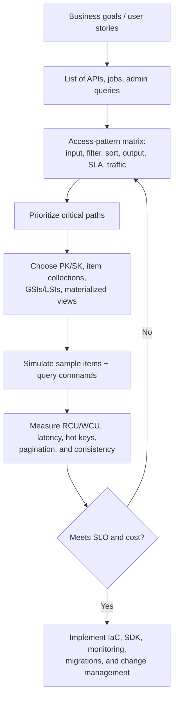
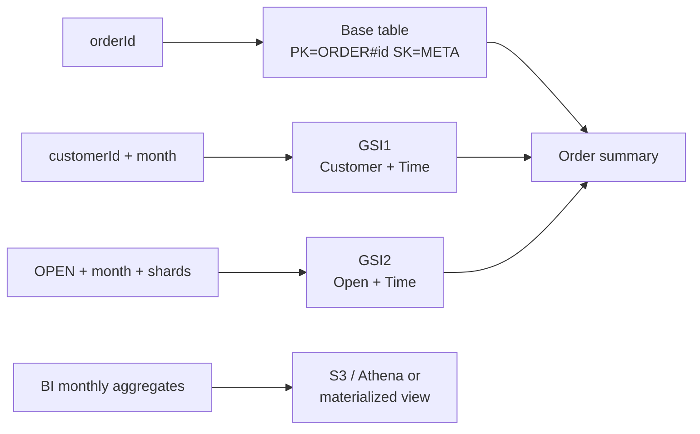
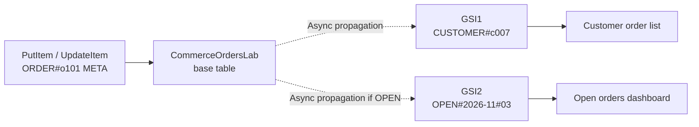
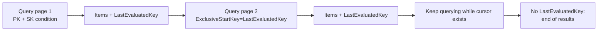
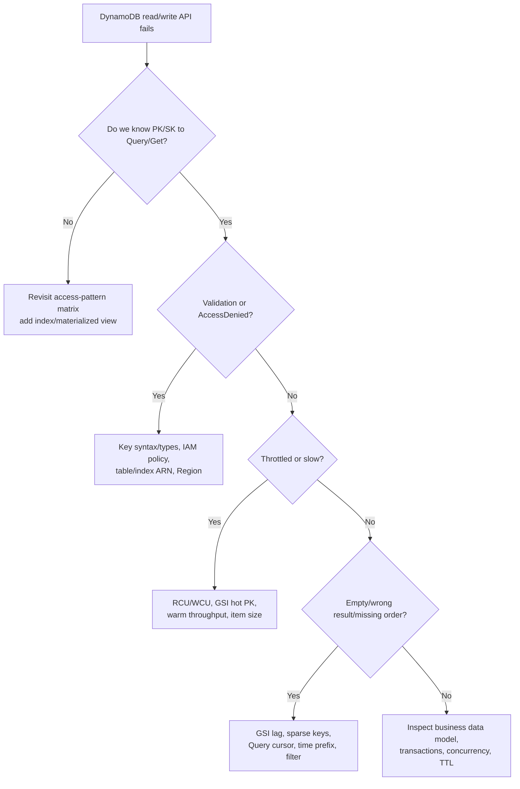
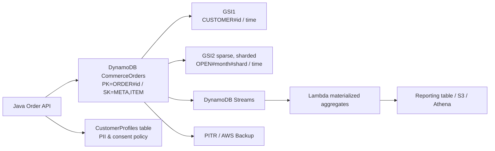

# Designing Access Patterns Before Designing Tables

## Learning Objectives

After this lesson, you will be able to:

1. Explain why **DynamoDB data modeling starts with access patterns** (how the application reads and writes data), rather than copying a relational table diagram.
2. Translate **user stories, API contracts, business flows, and SLOs** into an access matrix specifying **inputs, filter/sort conditions, frequency, returned data, and consistency requirements**.
3. Choose **partition keys (PK)**, **sort keys (SK)**, **composite keys**, **item collections**, and **sort-key prefixes** to perform efficient `GetItem`/`Query` operations without relying on `Scan` in hot paths.
4. Distinguish between **GSI** and **LSI**, design **sparse GSIs** and appropriate projections, and understand their limits around **eventual consistency, write costs, and hot partitions**.
5. Choose between **single-table, multi-table, or aggregate-oriented design** based on access relationships and operational boundaries, rather than treating single-table as a mandatory rule.
6. Model access patterns for a **Java/Spring Boot e-commerce system**, including order details, order lines, customer order lists, and open order lists.
7. Prototype with the **AWS CLI and AWS SDK for Java v2**, practicing paginated queries, conditional updates, and verifying **ConsumedCapacity**.
8. Analyze the impact on **IAM, data security, GSI synchronization, backups, recovery, cost observability, and future access pattern changes**.

## 1. The Starting Problem: What Do Users Ask, Not "What Tables Exist?"

Suppose an e-commerce application consists of an **Order API** written in Java/Spring Boot, a store admin portal, and an email service. The screens require:

- Customers open `GET /orders/{orderId}` to view **one order**.
- Customers open `GET /customers/{customerId}/orders?month=2026-11` to view **their orders sorted newest first**.
- The invoicing system fetches **an order and its line items** to generate a PDF.
- Operations staff look up **incomplete orders** within a date range, ordered by creation time.
- The fulfillment service updates `status=PAID` and must prevent stale operations from overwriting newer versions.
- An end-of-day data warehouse needs total revenue, top products, and historical analytics.

In an RDBMS, we usually start with:

```text
Customer(id, ...)
Order(id, customer_id, created_at, status, ...)
OrderItem(id, order_id, product_id, qty, price, ...)
```

Then we write `JOIN`, `WHERE`, `ORDER BY`, and add indexes as queries arise.

With **Amazon DynamoDB**, the questions above must be known **before choosing PK/SK/indexes**, because DynamoDB optimizes access by key. If you design `PK=orderId` while a critical API needs "**all unprocessed orders this week across the system**," having `status` and `createdAt` attributes on every item **does not automatically make that query efficient**. You need a suitable **access path**, such as a sparse GSI.

> **Core mindset:** design data so common operations can determine the **partition key** and return the required item set via `GetItem` or `Query`. Only after knowing those access paths should you decide how many tables and GSIs you need.

According to AWS, the right starting point is reviewing **user stories and use cases** (for new systems) or reading **query logs/metrics** (for existing systems), then listing the access patterns to serve. That is the foundation of the data model, not a final check. See [AWS — First steps for modeling relational data](https://docs.aws.amazon.com/amazondynamodb/latest/developerguide/bp-modeling-nosql.html).

## 2. DynamoDB vs. Relational Models: Different Optimization Targets

| Criterion | Relational database | DynamoDB |
| --- | --- | --- |
| Initial design | Entities, normalization, relationships, constraints. | **Access paths to serve**, cardinality, read/write rates, and payload size. |
| Queries | SQL with `JOIN`, `GROUP BY`, `ORDER BY`, ad-hoc indexes. | `GetItem`/`Query` by **PK/SK** or GSI/LSI; no server-side SQL JOINs in the RDBMS sense. |
| Keys | Primary/foreign keys; diverse indexes. | Primary key is a **partition key** or **partition + sort key**. |
| Pagination | OFFSET/keyset via SQL engine. | `LastEvaluatedKey` → `ExclusiveStartKey`. |
| Sorting | `ORDER BY` on suitable columns/indexes. | `Query` is sorted by **sort key within a single partition key**; no arbitrary global ordering. |
| Modeling relationships | JOIN across multiple tables. | **Item collections, composite sort keys, GSIs, denormalization**, or fetching multiple items in the application. |
| Consistency | Depends on isolation/transaction level. | Base tables and LSIs support strong reads; **GSIs are eventual only**. |
| Ad-hoc querying | Relatively flexible given indexes and cost trade-offs. | Difficult if queries were not planned ahead; requires adding a GSI/read model or analytics service. |

This **does not mean DynamoDB is better for every system**. If a workload needs dynamic SQL JOINs, many ad-hoc queries, multidimensional reporting/OLAP, or complex relational constraints, **Amazon RDS/Aurora**, **OpenSearch**, or **S3/Athena** may be a better fit for those parts.

### Basic Operation Types

| DynamoDB API | What does it require? | Best suited for |
| --- | --- | --- |
| `GetItem` | **Full PK**; for composite tables, both PK and SK. | Details of one item with a known key. |
| `BatchGetItem` | List of known keys, subject to batch limits and `UnprocessedKeys`. | Reading multiple items with known keys; **does not join or sort**. |
| `Query` | An **exact partition key equality** value and optional SK condition. | Listing items for a customer/order, filtering by prefix/range. |
| `Scan` | No PK needed; reads across partitions/table/index. | Backfills, exports, rare admin tasks; **avoid in frequent request paths**. |
| `PutItem`/`UpdateItem`/`DeleteItem` | Exact key and optional conditions. | Writing a single item with concurrency protection. |
| `TransactWriteItems` | A set of operations with atomic conditions. | Enforcing invariants across multiple items within transaction quotas. |

**Adding `FilterExpression` does not turn `Scan` into `Query`:** it applies **after reading items**, so it does not reduce the billable read capacity consumed by filtered-out items.

## 3. A Repeatable "Access-Pattern First" Process



### Step 1 — Gather Business Questions

Never write a vague requirement like "need order search." Be specific:

- What values **does the caller know when calling the API**? `customerId`, `orderId`, `status`, or nothing?
- Is the result **1 item**, 20 items, 10,000 items, or the entire history?
- Should it sort by `createdAt DESC` or by monetary amount?
- Must it read newly written data immediately (**read-after-write strong**), or is GSI lag of seconds/minutes acceptable?
- Are there mandatory filters by date, status, tenant, region, or tag?
- Is cursor pagination required, and what is the max page size?
- How many times per second is the screen called? How much higher are promotional peaks than normal load?
- Does data grow unboundedly under the same customer/tenant/status?

### Step 2 — Separate Primary and Secondary Patterns

**Primary access patterns** are paths that drive p95 latency or generate the heaviest traffic—for instance, looking up an order by ID or fetching a customer's list.

**Secondary access patterns** are less frequent paths that still must be correct—for example, a staff dashboard viewing unprocessed orders or end-of-day batch jobs.

Not every question must be served by the **same index**. Rare paths can go through a **materialized view** updated via DynamoDB Streams, a search index, or an analytics warehouse instead of adding GSIs for every field.

### Step 3 — Classify Data by *Size, Shape, and Velocity*

AWS recommends evaluating:

| Dimension | Questions | Impact on keys/indexes |
| --- | --- | --- |
| **Data size** | Number of orders, lines/order, individual item size, retention years. | 400 KB item limit; 1 MB query page limit; item collections may grow large. |
| **Data shape** | Which fields are always read together? One-to-many or many-to-many? | Embedded map/list, vertical partitioning, sort key prefixes, adjacency lists. |
| **Data velocity** | Reads/writes per second, seasonal peaks, does one tenant dominate? | High-cardinality PK, avoiding hot keys, sharding/GSIs. |

For example, in the Order API, an order has 1–50 line items. The **Order summary** is always displayed on its own, while the invoice worker needs every line. Splitting a **META item** and **ITEM#... items** under the same PK supports both fast GetItem and querying the entire item collection.

### Step 4 — Write a Matrix That Serves as a "Design Contract"

Each row should include at least:

1. **Pattern ID, actor/API/job**.
2. **Known input keys** and time/status conditions.
3. **Return shape, sort order, page size**.
4. **Read/write frequency, peak traffic, cardinality**.
5. **Consistency/SLO** and tenant security.
6. **Proposed PK/SK/GSI**, request count/cost, and trade-offs.

Do not rush to fill in the PK/SK column; first nail down **what the application actually needs to ask**.

## 4. Access Pattern Matrix for the Order System

Assumptions in this example:

- **120,000 orders/day**; during promotions, **2,000 orders/minute**.
- A typical customer has 1–500 orders/year; some enterprise tenants have significantly more.
- The API displays **20 most recent orders per page**.
- The detail page must reflect newly updated order data immediately after user confirmation.
- The operations page views **OPEN orders** across a date/month range.
- The marketplace-wide revenue reporting system runs **in batch**, not on an interactive GET API path.

| ID | Actor / question | Known input | Return / order | Load and consistency | Intended access path |
| --- | --- | --- | --- | --- | --- |
| **AP01** | Customer views **order details** | `orderId` | Single META item, latest state | Very high; may need strong | **GetItem** on base key |
| **AP02** | Invoice fetches **order + all lines** | `orderId` | META + ITEMs of one order | High; strong if needed | **Query** same PK; paginated |
| **AP03** | Customer views **20 orders in a month** | `customerId` + `YYYY-MM` | Summaries, `createdAt DESC` | High; eventual acceptable with refresh | **GSI by customer/time** |
| **AP04** | Ops views **OPEN orders in a date range** | month + timestamp range | Order summaries sorted by time | Medium, bursty; eventual | **Sparse/sharded GSI** |
| **AP05** | Fulfillment changes status | `orderId` + `expectedVersion` | Atomic update or conflict | High; strong condition | **UpdateItem** + version check |
| **AP06** | Create order and lines consistently | `orderId`, line list | Atomic order + lines | High; requires unique order | **TransactWriteItems** |
| **AP07** | Customer service fetches **order events** | `orderId` | Events by timestamp | Medium | **Query** `EVENT#` prefix |
| **AP08** | BI computes **monthly total revenue** | Date range, products | System-wide aggregate | Batch, high data volume | **S3/Athena/materialized aggregation**, never per-request Scan |

**These figures are design assumptions**, not AWS benchmarks or forecasts of a learner's workload. In a real project, pull numbers from product metrics, API logs, and load test results.

### AP03 and AP04 Do Not Come Free from AP01

Knowing `orderId` lets you access **one order**, not list orders by customer or status. Accessing by customer requires a **Customer → Orders** key path. Finding system-wide OPEN orders requires a load-distributed **Status/Time → Orders** path.



This is how you "let the **questions** dictate the **indexes**." Only after completing AP01–AP08 do we design the physical table.

## 5. Partition Keys, Sort Keys, and Item Collections

### 5.1. Primary Keys Come in Two Forms

1. **Simple primary key:** only `PK`; each PK value maps to at most one item.
2. **Composite primary key:** `PK + SK`; multiple items can share a PK, but **the `(PK, SK)` pair must be unique**.

In our example, table `CommerceOrdersLab` uses:

```text
PK (String) — partition key
SK (String) — sort key
```

An order's item collection:

| PK | SK | itemType | Core data |
| --- | --- | --- | --- |
| `ORDER#o101` | `META` | ORDER | customerId, createdAt, status, totalMinor, version |
| `ORDER#o101` | `ITEM#0001` | ORDER_ITEM | sku, quantity, unitPriceMinor |
| `ORDER#o101` | `ITEM#0002` | ORDER_ITEM | sku, quantity, unitPriceMinor |
| `ORDER#o101` | `EVENT#2026-11-20T08:45:00.000Z#e01` | ORDER_EVENT | PaymentAuthorized |
| `ORDER#o101` | `EVENT#2026-11-20T09:00:00.000Z#e02` | ORDER_EVENT | Shipped |

An **item collection** is the set of items sharing the **same partition-key value**; `Query(PK=ORDER#o101)` retrieves all of them in SK order. **You do not need a separate table for OrderItems** if the main read pattern is "all items belonging to one order."

### 5.2. Sort Key Prefixes Are Intentional Design

`META`, `ITEM#...`, `EVENT#...` are **application string conventions**, not special DynamoDB syntax. Prefixes enable:

- `GetItem(PK=ORDER#o101, SK=META)` → order summary.
- `Query(PK=ORDER#o101, begins_with(SK, "ITEM#"))` → order lines.
- `Query(PK=ORDER#o101, begins_with(SK, "EVENT#"))` → audit timeline.
- `Query(PK=ORDER#o101)` → entire item collection (requires pagination).

Sorting by SK **within the same PK** for String values uses **UTF-8 byte order**. A **fixed-width UTC ISO-8601** timestamp like `2026-11-20T09:00:00.000Z` ensures chronological order matches lexicographical order. Never mix timezones or date formats like `20/11/2026` and `2026-1-2` and expect chronological sorting.

### 5.3. Separate Items or Embedded List?

| Storage approach | Pros | Risks |
| --- | --- | --- |
| **One order item embedding `items: [...]`** | Single `GetItem` fetches order and lines; easy single-item atomic update. | **400 KB/item** limit; reading summary also pulls lines; editing individual lines can bloat the item. |
| **Separate META + ITEM#... under one PK** | Lean GetItem for summary; Query fetches lines; scales cleanly with line count and event timeline. | Multiple items per write; atomic creation requires transactions; requires pagination. |
| **Orders and OrderLines in two tables** | Clearer throughput/retention/ownership boundaries. | Joined reads require multiple requests; complex when frequently fetched together. |

Our illustrative design chooses **META + ITEM#...** because AP01 and AP02 have different access characteristics, and **Order events** can grow over time. This is a **choice for the assumed access patterns**, not a universal schema for every business.

## 6. Designing Access Paths from AP01–AP08

### 6.1. Base Table for AP01, AP02, AP05, AP06, and AP07

```text
Table: CommerceOrdersLab
  PK = ORDER#<orderId>
  SK = META | ITEM#<lineId> | EVENT#<utcTimestamp>#<eventId>
```

When `orderId=o101`:

- AP01 → `GetItem(ORDER#o101, META)`.
- AP02 → `Query(PK=ORDER#o101)`, or two prefix queries if only META/ITEMs are needed.
- AP05 → `UpdateItem(ORDER#o101, META)` with a version condition.
- AP06 → transaction writing META + all ITEM items.
- AP07 → `Query(PK=ORDER#o101, begins_with(SK, "EVENT#"))`.

Do not write `FilterExpression attribute_exists(orderId)` to search for ORDERs, as that still reads lots of unrelated data.

### 6.2. GSI1 for AP03: Orders by Customer and Time

On **only the ORDER META item**, add two attributes:

```text
GSI1PK = CUSTOMER#<customerId>
GSI1SK = <createdAtUTC>#ORDER#<orderId>
```

Example:

```text
GSI1PK = CUSTOMER#c007
GSI1SK = 2026-11-20T08:45:00.000Z#ORDER#o101
```

Create a GSI named `GSI1` using `GSI1PK` as partition key and `GSI1SK` as sort key, projecting only the fields needed for the list view. Then:

```text
Query GSI1
  GSI1PK = CUSTOMER#c007
  begins_with(GSI1SK, "2026-11")
  ScanIndexForward = false
  Limit = 20
```

Descending order within **one customer partition** is the core requirement of AP03. Placing `orderId` after the timestamp guarantees each GSI key distinguishes orders created in the same millisecond.

**Do not copy `GSI1PK`/`GSI1SK` onto `ITEM#...` items**: line items do not belong in the order summary list. When only a subset of items carries the index key attributes, the GSI is **naturally sparse**.

### 6.3. GSI2 for AP04: "Open Orders" and Hot-Key Risk

A naive design:

```text
GSI2PK = STATUS#OPEN
GSI2SK = <createdAt>
```

This concentrates **every OPEN order** onto a single logical partition key. At 2,000 orders/minute with multiple ops workers reading the same key, traffic can create a **hot key**. Adaptive capacity helps redistribute load, **but does not replace proper key design**.

The example design uses **month + shard**:

```text
GSI2PK = OPEN#2026-11#03
GSI2SK = 2026-11-20T08:45:00.000Z#ORDER#o101

shard = deterministicHash(orderId) mod 4  (00, 01, 02, 03)
```

**Only ORDER META items with `status=OPEN`** carry the two GSI2 attributes. When an order transitions to `PAID`/`CANCELLED`, **remove `GSI2PK` and `GSI2SK`** from META → the entry is automatically removed from GSI2 after propagation lag. This is a **sparse GSI** representing an "open orders" read model.

A screen querying November's OPEN orders will:

1. Query shards `OPEN#2026-11#00` through `...#03`.
2. In each shard, use `GSI2SK BETWEEN start AND end`.
3. Merge results by descending timestamp, paginating per-shard cursors.

This is a **controlled read fanout**: trading one hot key for four keys and up to four parallel requests per page. If the shard count grows, total requests and merge complexity rise too, so choose based on actual load.

**Do not pick a new random shard on each status update**; the shard must be deterministically derived from `orderId` so writes, updates, and deletes target the exact same GSI key.

### 6.4. AP08: Multi-Dimensional Aggregations Do Not Belong in Hot Queries

The requirement "top 100 best-selling products marketplace-wide for the year, filtered by region/campaign/category" is **analytics**. Running a full-table `Scan` on `CommerceOrdersLab` per request drives up cost and latency as data grows.

Options:

- **DynamoDB Streams → Lambda → materialized aggregate table**, e.g. `SALE#2026-11#PRODUCT#sku` with idempotent updates.
- **DynamoDB export to S3 → Athena/Glue** for large historical analytics.
- **OpenSearch** for multi-criteria filtering or text-relevance search when appropriate.
- **RDS/Aurora** if the application inherently relies on frequent relational reporting and JOINs.

Not every access pattern belongs in the same DynamoDB table; **the output of access-pattern analysis can be a decision to introduce another service**.

## 7. GSI, LSI, and Sparse Indexes: Choosing a Secondary Read Path

### 7.1. Comparing GSI and LSI

| Feature | Global Secondary Index (GSI) | Local Secondary Index (LSI) |
| --- | --- | --- |
| Partition key | Can be **different** from the base table. | **Must match** the base table. |
| Sort key | Can differ, or be omitted. | **Different** from the base table's sort key. |
| Creation time | At table creation **or added later**. | **Only at table creation**; cannot be added to an existing table. |
| ConsistentRead | **Eventual only**. | **Eventual or strong**. |
| 10 GB item collection limit | No LSI-style PK size limit on GSIs. | Tables with LSIs limit **each item collection sharing a base PK to ≤10 GB**. |
| Capacity/cost | Index has separate storage and read/write capacity; base writes propagate **asynchronously** to GSIs. | Shares table throughput, incurring read/write/index storage costs. |
| Typical quota | **20 GSIs/table** default; check current quotas. | **5 LSIs/table**. |
| Use case | Need queries by **`customerId`**, **`status`**, **`region`** instead of base `orderId`. | Need an alternate sort order **within the same PK** plus strong consistency. |

Our illustrative design uses **two GSIs**, no LSIs. Because queries by `customerId` and `OPEN/month/shard` use a **different partition key than `ORDER#orderId`**, LSIs cannot satisfy AP03/AP04.

### 7.2. A GSI Works Like a Read Model

When adding/updating an ORDER META item:



**GSI propagation is asynchronous**—usually fast, but without a read-after-write strong guarantee. Therefore:

- When returning the response for `POST /orders`, use **`orderId`/base-table strong GetItem** to verify the new state if needed, rather than immediately querying GSI1 and concluding the order was "lost."
- When status changes OPEN → PAID, a GSI2 Query may **temporarily return the stale entry**. If the dashboard triggers a sensitive action, re-verify with `GetItem` on the base table or use conditional writes/transactions.
- Never pass `ConsistentRead=true` on a GSI Query: the API rejects it.

### 7.3. Sparse GSIs Reduce Index Size and Write Cost

A GSI only contains entries for items that **have all index-key attributes present**. For GSI2 with `GSI2PK` and `GSI2SK`:

| Item | GSI2PK | GSI2SK | Present in GSI2? |
| --- | --- | --- | --- |
| Order o101, status OPEN | `OPEN#2026-11#03` | timestamp + orderId | **Yes** |
| Order o102, status PAID | *Absent* | *Absent* | **No** |
| Order o103, status CANCELLED | *Absent* | *Absent* | **No** |
| Order line `ITEM#0001` | *Absent* | *Absent* | **No** |
| Order event `EVENT#...` | *Absent* | *Absent* | **No** |

**Do not set `GSI2PK=""` or `null` to mean "not open"**: empty or wrongly typed key attributes cause validation errors; **omit the attributes completely** so the item is excluded from the GSI. When the status changes, remove both index key attributes to update the read model.

### 7.4. Projection: Returning Only Needed Data

Options:

- `KEYS_ONLY`: only index keys and base primary keys.
- `INCLUDE`: keys + specified non-key attributes, such as `status`, `totalMinor`, `customerId`.
- `ALL`: copies all attributes into the index.

For AP03, listing 20 orders only requires `orderId`, `createdAt`, `status`, and `totalMinor`. Using `INCLUDE` keeps the index leaner than `ALL`, reducing storage and write amplification when items carry large metadata.

**Note:** Querying a GSI **does not automatically fetch non-projected attributes from the base table**. If the frontend needs additional details outside the projection, you can use the returned base keys with `BatchGetItem` (handling `UnprocessedKeys`), or adjust the projection after weighing total cost and latency. With an LSI, queries can fetch non-projected attributes from the base table, incurring extra I/O.

### 7.5. Adding a GSI to an Existing Table

DynamoDB allows adding a **new GSI** to an existing table. However, do not treat it like an instant SQL index change:

1. Create the GSI via IaC/`UpdateTable`.
2. DynamoDB backfills index entries from the base table.
3. Monitor `IndexStatus=CREATING` and related metrics.
4. Only after `ACTIVE` and data/cost are verified, switch read traffic.
5. Maintain compatibility with older code and plan how to drop unused indexes.

GSI backfill/throughput can add load, and an under-provisioned GSI can cause **write throttling** on the base table. Manage migrations via staged rollouts—never add a new index right before a major launch without load evaluation.

## 8. Single-Table, Multi-Table, or Aggregate Design?

The answer is not always "**one DynamoDB table for the entire system**."

### 8.1. Single-Table Design

One table uses prefixed PK/SK values to store multiple entity types:

```text
PK=ORDER#o101, SK=META
PK=ORDER#o101, SK=ITEM#0001
PK=ORDER#o101, SK=EVENT#...
PK=CUSTOMER#c007, SK=PROFILE
PK=PRODUCT#sku55, SK=META
```

Pros:

- **Access-correlated entities** can be queried together.
- Fewer tables; multiple access patterns can be served via composite keys and overloaded GSIs.
- Some workflows fetch an entire aggregate in a single Query.

Cons:

- Complex key conventions and index overloading; changing one entity can impact shared indexes.
- Entity/tenant-level IAM permissions do not automatically get easier just by sharing a table.
- Retention/backup/PITR, table class, and billing mode are table-level settings, forcing entities with very different needs together.
- Requires strict team alignment on serialization, ownership, and migrations.

### 8.2. Multi-Table Design

Example:

```text
CommerceOrders: Order META + ITEM + EVENT
CustomerProfiles: Customer profile, PII, consent
ProductCatalog: Product searchable metadata
Inventory: SKU/Warehouse stock and reservations
```

Suitable when entities have:

- **Different operational ownership** (Inventory team independent from Orders team).
- **Independent access patterns** rarely needing the same Query.
- **Different compliance, retention, encryption/backup, throughput, or tenant boundaries**.
- A need to deploy, scale, and migrate independently.

The trade-off is that if the app needs combined results across tables, it must make additional API calls or build materialized read models; DynamoDB performs no automatic JOINs.

### 8.3. Aggregate-Oriented Design: A Practical Middle Ground

Organize items around **business aggregates frequently read/written together**, for example:

- Order META + lines + order events under one PK.
- Customer profiles separated due to distinct PII/lifecycle rules.
- Product catalog separated due to distinct update/search patterns.
- Inventory reservations keyed by `SKU#warehouse` or `reservationId` for concurrency.

This lesson's design uses **one Orders table** (without forcing the entire system into one table). That is practical because AP01/AP02/AP07 operate on the order collection, while inventory/customer lifecycles remain decoupled.

### 8.4. Decision Criteria

| Question | If "yes" | Recommendation |
| --- | --- | --- |
| Are entities usually read in the **same request**? | Order + OrderItems. | Same item collection or embedded aggregate. |
| Are there distinct IAM/PII/retention boundaries? | Customer PII vs. Order audit. | Multi-table or account boundary. |
| Are access patterns well-defined and stable? | Relatively stable transactional APIs. | Single-table can be effective. |
| Do ad-hoc query needs change weekly? | Exploratory analytics/search. | RDS/OpenSearch/Athena or separate read model. |
| Do different teams own deployments? | Inventory, payments, catalog. | Splitting tables by bounded context helps. |
| Could a single partition key grow unboundedly? | Large tenant or massive events under one PK. | Split aggregates, time buckets, archive, avoid LSI. |

**Rule of thumb:** choose the number of tables **after** understanding read/write flows—never start from a slogan like "DynamoDB always requires single-table."

## 9. Avoiding Hot Partitions and Designing Load Distribution

### 9.1. Partition Keys Need Appropriate Cardinality

DynamoDB hashes the partition key value to distribute storage and traffic across physical partitions. Many distinct, active PK values generally perform far better than a single value receiving heavy traffic.

| Proposed PK | Risk | Improvement |
| --- | --- | --- |
| `PK=STATUS#OPEN` | Every new order funnels into one hot PK. | `OPEN#YYYY-MM#shard`; or a separate read model. |
| `PK=DATE#2026-11-20` | All of today's uploads/orders hit the same PK. | Hash sharding, per-tenant/per-order PK. |
| `PK=TENANT#mega-tenant` | One large tenant can exceed load/size distribution. | Partition by tenant + entity/shard; consider tenant isolation. |
| `PK=ORDER#orderId` | Usually distributes well if orderIds vary. | Keep for Order aggregate; test orders with huge event counts. |

AWS states a **physical partition design maximum throughput** of roughly **3,000 read units/second** and **1,000 write units/second**, depending on item size and consistency. These are **not fixed requests/second limits** and do not mean every partition key is locked to those exact numbers: adaptive capacity/splitting, capacity mode, indexes, and request sizes all affect behavior.

### 9.2. Adaptive Capacity Does Not Replace Design

Adaptive capacity can dynamically reallocate throughput for hot partitions, but:

- A **single heavily written item** still hits physical/hot-key limits.
- A **GSI** can run hot even if the base table distributes well.
- Tables with an **LSI** are constrained by item-collection/physical-partition rules and the **10 GB per-PK limit**.
- If sudden traffic exceeds **warm throughput / on-demand maximum / provisioned capacity**, requests can still throttle.

Inspect distribution across **both the base table and GSIs**. A healthy base table does not guarantee GSI2 will not bottleneck when updating all OPEN statuses.

### 9.3. Write Sharding for OPEN Orders

Example with four shards:

```text
hash(o101) mod 4 = 3 → OPEN#2026-11#03
hash(o102) mod 4 = 1 → OPEN#2026-11#01
hash(o103) mod 4 = 0 → OPEN#2026-11#00
hash(o104) mod 4 = 2 → OPEN#2026-11#02
```

**The hash outputs shown here are illustrative**, not required outputs of `String.hashCode()`. The team must standardize a concrete algorithm (such as SHA-256 modulo shard count, or `Math.floorMod(orderId.hashCode(), N)` if all producers are Java), normalize text, and keep it stable across releases.

**Crucial trade-off:** querying monthly OPEN orders **cannot issue one Query and get a globally sorted list**. You must query each shard, merge the sorted lists, and manage per-shard cursors. Changing shard count from 4 → 16 requires keeping read logic compatible with older data or migrating.

### 9.4. Time Bucketing and Bounding Growth

If `ORDER#o101` accumulates millions of events over years, querying all events as one huge item collection takes many pages. Solutions:

- Keep only **recent events** under the ORDER PK and archive older ones to S3.
- Split the event timeline into `ORDER#o101#EVENTS#2026-11` (adjusting AP07 and monthly API fanout).
- Use `DynamoDB Streams → S3` or a dedicated event store.
- Set retention and TTL by policy, keeping in mind TTL deletion is **asynchronous**, not an exact N-second cron job.

This scaling design must be driven by **cardinality and retention** in the matrix, not patched only after the table grows too large.

## 10. Efficient Queries: KeyConditionExpression vs. FilterExpression

### 10.1. Query Always Requires Partition-Key Equality

For a base table with `PK`/`SK`:

```text
Valid:
  PK = "ORDER#o101"
  SK begins_with "ITEM#"

Valid:
  PK = "ORDER#o101"
  SK BETWEEN "EVENT#2026-11-01" AND "EVENT#2026-11-30~"

Conceptually invalid:
  status = "OPEN" AND createdAt > "2026-11-01"
  (does not specify a table or index partition key)
```

For `Query`, `KeyConditionExpression` requires **equality on the partition key**, while the sort key supports `=`, comparisons, `BETWEEN`, and `begins_with` per key schema rules. Non-key attributes use `FilterExpression` after reading, or must be promoted to index keys when the pattern is frequent.

### 10.2. FilterExpression Does Not Save Read Capacity

Suppose a customer has 5,000 orders, 100 of which are OPEN. Reading via:

```text
Query GSI1PK = CUSTOMER#c007
FilterExpression = status = "OPEN"
```

DynamoDB still **reads the index entries by key/page first**, then **discards** items failing the filter. It does not reduce read capacity charged for the scanned data. If filtering OPEN orders is a hot path, a **sparse index or materialized access path** is worth considering.

**`ProjectionExpression` also does not reduce read units consumed on the base table**, because read capacity is calculated from the size of the item read, not just the returned fields. Still, projections shrink **response bytes/network payload**; for a GSI, choosing a smaller projection at **index creation time** genuinely shrinks the stored index entry.

### 10.3. 1 MB Query Pages and LastEvaluatedKey

Each `Query` reads at most **1 MB of data per service response** (or stops earlier at `Limit`) before applying filters. When more items remain, the response includes `LastEvaluatedKey`.

Pagination flow:



**Very common pitfall:** with `FilterExpression`, a page can return **0 items** while **still returning `LastEvaluatedKey`**. Never conclude "no more data" just because `Items` is empty. Only the absence of `LastEvaluatedKey` means the query has finished.

For an API paginated at 20 results/page, return an **opaque continuation token** wrapping the DynamoDB cursor (integrity-protected or encoded per policy) instead of SQL-style `OFFSET=10000`. With multi-shard GSI2, the token must track **every shard's cursor** and merge state, not just a single `LastEvaluatedKey`.

### 10.4. Sort Order in Query

`ScanIndexForward=true` sorts ascending, `false` sorts descending **by sort key**. With `GSI1SK=timestamp#ORDER#id`, `false` returns newest orders first, provided timestamps are normalized properly.

**There is no global cross-partition ORDER BY in a single Query.** With four shards on GSI2, getting the "20 newest OPEN orders system-wide" requires pulling candidates from **each shard**, merging, and managing paging/concurrency cleanly in the application.

### 10.5. Strong vs. Eventual Consistency

| Read target | `ConsistentRead=true` supported? | Example |
| --- | --- | --- |
| Base table `GetItem`/`Query` | **Yes**. | Immediately verifying a newly written Order META state. |
| LSI `Query` | **Yes**. | Reading an alternate sort order within the same partition. |
| GSI `Query` | **No**. | Customer order list or OPEN index may lag. |
| Global table replica | Depends on specific consistency/replication model. | Never assume cross-Region replicas are immediately strongly consistent. |

For **critical paths** like verifying an order was paid, use **conditional writes and base-table strong reads** as needed rather than relying on a GSI right after an update. History screens can accept eventual consistency with smart refreshes/retries.

## 11. From Access Matrix to Capacity and Cost

### 11.1. Understanding Read/Write Units

DynamoDB offers **On-demand** and **Provisioned** modes. For estimation, start from capacity units:

- **1 WCU** covers one standard write **up to 1 KB**, rounded up per KB. Transactional writes typically consume **double** capacity.
- **1 RCU** covers one strongly consistent read **up to 4 KB**; an eventually consistent read consumes about **0.5 RCU** for the same payload; transactional reads typically consume double strong capacity.
- In On-demand mode, AWS bills correspondingly in **read/write request units**; GSI writes/reads and storage are billed separately per pricing schedules.

| Illustrative operation | Assumed size | Approximate capacity cost |
| --- | --- | --- |
| Put order META | 1.5 KB | About **2 write units** on the base table. |
| Strong GetItem META | 3 KB | About **1 read unit**. |
| Eventual GetItem META | 3 KB | About **0.5 read unit**. |
| Strong GetItem 10 KB | 10 KB | About **3 read units** (rounded up per 4 KB). |
| Put item updating GSI1 + GSI2 | Meta + index entries | **Base write + each GSI entry write/storage** based on projected data size. |
| Query filtering 100 items down to 5 | Reads 100 items | Consumes capacity for **100 items read**, not just 5 returned. |

These are **unit** examples, not USD quotes. In real code, enable `ReturnConsumedCapacity=TOTAL` or `INDEXES` to measure actual consumption. Transactions, conditional failures, GSI updates, global tables, and streams follow specific AWS pricing rules.

### 11.2. Choosing On-Demand vs. Provisioned

| Mode | Best for | What you still must control |
| --- | --- | --- |
| **On-demand (PAY_PER_REQUEST)** | New, spiky, unpredictable workloads; AWS's default recommendation for many apps. | Hot keys, account/table quotas, **warm throughput**, optional max throughput caps, cost spikes. |
| **Provisioned (RCU/WCU)** | Steady, predictable workloads; strict capacity/budget control. | Auto Scaling policies, burst behavior, throttles, GSI capacities. |

On-demand **does not mean infinite throughput**. AWS provides **warm throughput** (the read/write rate a table/GSI can support immediately) and configurable **maximum on-demand throughput** to cap cost/load per table/GSI, which triggers throttling if exceeded. Proactive pre-warming can incur fees; verify current quotas and pricing before peak events.

### 11.3. Index and Denormalization Costs

Suppose each order META is written once and has its status updated three times:

- The base table incurs write requests for every update.
- GSI1 stores summaries for customer queries, updating entries whenever projected fields change.
- GSI2 holds only OPEN orders: creating an entry when OPEN, and deleting it upon PAID/CANCELLED.
- If status is denormalized across multiple items, each transition may update multiple items or rely on stream materialization.

**A GSI is not free**: weigh write costs, storage, propagation, and consistency. Yet a well-used index is far cheaper than millions of `Scan` calls or extra round trips.

### 11.4. Estimating Load by Access Pattern, Not by Table

For example, AP03 receives **100 requests/second**, each returning **20 order summaries of 0.5 KB**:

```text
Estimated logical payload: 20 × 0.5 KB = 10 KB / Query.
Index read throughput: ~100 × 10 KB = 1 MB of data/second
                       before page/consistency/rounding overhead.
```

This is only a **rough estimate**—exact RCUs depend on index entry size, rounding, pagination, and consistency. Measure `ConsumedCapacity` during load testing and watch for GSI throttling. For AP04, also factor in the **4-shard fanout** and merge.

### 11.5. Trade-Offs: Latency, Consistency, Cost

| Goal | Common good approach | Trade-off |
| --- | --- | --- |
| Low latency for order details | Direct GetItem by PK/SK. | Requires knowing `orderId`; no arbitrary search. |
| Low latency listing customer orders | GSI1 projecting required fields. | Storage/write cost, eventual consistency. |
| Small OPEN index | Sparse GSI2. | Must set/remove index keys on status changes; lag. |
| Reduce hot GSI2 | Shard by month/hash. | More complex fanout and multi-cursor pagination. |
| Strong consistency after payment | Strong base-table GetItem + conditional write. | Higher read units than eventual; decouples read model from GSI. |
| Flexible analytics queries | S3/Athena/OpenSearch/materialized views. | ETL/Streams sync lag and extra infrastructure to operate. |

## 12. AWS CLI Lab: Creating the Table from Finalized Access Patterns

**Lab scope:** sandbox AWS account, Region `ap-southeast-1`, table `CommerceOrdersLab` **does not yet exist**. Commands can create billable resources. Do not run on production or modify tables used by another app. Ensure AWS CLI and IAM permissions (`dynamodb:CreateTable`/`PutItem`/`Query`/`UpdateItem`/`DeleteTable`) are configured appropriately.

### 12.1. Verify Environment

```bash
aws sts get-caller-identity
aws configure get region
```

Do not trust profile names or shell prompts alone; verify the **Account** and Region before creating or deleting a DynamoDB table.

### 12.2. Create the Table Configuration File

Save to `create-commerce-orders.json`:

```json
{
  "TableName": "CommerceOrdersLab",
  "BillingMode": "PAY_PER_REQUEST",
  "AttributeDefinitions": [
    { "AttributeName": "PK", "AttributeType": "S" },
    { "AttributeName": "SK", "AttributeType": "S" },
    { "AttributeName": "GSI1PK", "AttributeType": "S" },
    { "AttributeName": "GSI1SK", "AttributeType": "S" },
    { "AttributeName": "GSI2PK", "AttributeType": "S" },
    { "AttributeName": "GSI2SK", "AttributeType": "S" }
  ],
  "KeySchema": [
    { "AttributeName": "PK", "KeyType": "HASH" },
    { "AttributeName": "SK", "KeyType": "RANGE" }
  ],
  "GlobalSecondaryIndexes": [
    {
      "IndexName": "GSI1",
      "KeySchema": [
        { "AttributeName": "GSI1PK", "KeyType": "HASH" },
        { "AttributeName": "GSI1SK", "KeyType": "RANGE" }
      ],
      "Projection": {
        "ProjectionType": "INCLUDE",
        "NonKeyAttributes": [
          "orderId",
          "customerId",
          "createdAt",
          "status",
          "totalMinor"
        ]
      }
    },
    {
      "IndexName": "GSI2",
      "KeySchema": [
        { "AttributeName": "GSI2PK", "KeyType": "HASH" },
        { "AttributeName": "GSI2SK", "KeyType": "RANGE" }
      ],
      "Projection": {
        "ProjectionType": "INCLUDE",
        "NonKeyAttributes": [
          "orderId",
          "customerId",
          "status",
          "totalMinor"
        ]
      }
    }
  ]
}
```

**Why doesn't `AttributeDefinitions` list `status`/`totalMinor`?** Only attributes used as **table or index keys** must be defined at table creation; no rigid schema is declared for non-key fields. Other item attributes can be String/Number/Map/List per item, within DynamoDB limits.

Create the table:

```bash
aws dynamodb create-table \
  --cli-input-json file://create-commerce-orders.json \
  --region ap-southeast-1

aws dynamodb wait table-exists \
  --table-name CommerceOrdersLab \
  --region ap-southeast-1

aws dynamodb describe-table \
  --table-name CommerceOrdersLab \
  --region ap-southeast-1 \
  --query 'Table.{Status:TableStatus,Billing:BillingModeSummary,Keys:KeySchema,GSIs:GlobalSecondaryIndexes[].{Name:IndexName,Status:IndexStatus}}'
```

**Wait for both GSI1 and GSI2 to reach `ACTIVE`** before querying. The table being `ACTIVE` does not always mean every GSI is ready after index changes.

### 12.3. Write a Sample ORDER META Item

Save `order-meta.json`:

```json
{
  "PK": { "S": "ORDER#o101" },
  "SK": { "S": "META" },
  "itemType": { "S": "ORDER" },
  "orderId": { "S": "o101" },
  "customerId": { "S": "c007" },
  "createdAt": { "S": "2026-11-20T08:45:00.000Z" },
  "status": { "S": "OPEN" },
  "totalMinor": { "N": "125000" },
  "currency": { "S": "VND" },
  "version": { "N": "1" },
  "GSI1PK": { "S": "CUSTOMER#c007" },
  "GSI1SK": { "S": "2026-11-20T08:45:00.000Z#ORDER#o101" },
  "GSI2PK": { "S": "OPEN#2026-11#03" },
  "GSI2SK": { "S": "2026-11-20T08:45:00.000Z#ORDER#o101" }
}
```

The `03` value in GSI2 is used in the lab as a shard chosen by a deterministic routing function; in a real application, use a consistent algorithm—**never assign randomly** per operation.

```bash
aws dynamodb put-item \
  --table-name CommerceOrdersLab \
  --item file://order-meta.json \
  --condition-expression "attribute_not_exists(PK) AND attribute_not_exists(SK)" \
  --return-consumed-capacity TOTAL \
  --region ap-southeast-1
```

`ConditionExpression` ensures **existing META items are not overwritten** if the lab is rerun. If the item already exists, DynamoDB returns `ConditionalCheckFailedException`—this is expected behavior, not a reason to drop conditions in production.

### 12.4. Write Two ORDER ITEM Items

Save `order-item-1.json`:

```json
{
  "PK": { "S": "ORDER#o101" },
  "SK": { "S": "ITEM#0001" },
  "itemType": { "S": "ORDER_ITEM" },
  "sku": { "S": "SKU-AX11" },
  "quantity": { "N": "2" },
  "unitPriceMinor": { "N": "50000" }
}
```

Save `order-item-2.json`:

```json
{
  "PK": { "S": "ORDER#o101" },
  "SK": { "S": "ITEM#0002" },
  "itemType": { "S": "ORDER_ITEM" },
  "sku": { "S": "SKU-BB20" },
  "quantity": { "N": "1" },
  "unitPriceMinor": { "N": "25000" }
}
```

```bash
aws dynamodb put-item \
  --table-name CommerceOrdersLab \
  --item file://order-item-1.json \
  --condition-expression "attribute_not_exists(PK)" \
  --region ap-southeast-1

aws dynamodb put-item \
  --table-name CommerceOrdersLab \
  --item file://order-item-2.json \
  --condition-expression "attribute_not_exists(PK)" \
  --region ap-southeast-1
```

**The lab writes three items via separate commands for key-layout clarity, without atomic "create order + lines" guarantees.** In production for AP06, use `TransactWriteItems` when the entire order and its lines must be persisted atomically alongside idempotency.

### 12.5. AP01: GetItem Order Summary

```bash
aws dynamodb get-item \
  --table-name CommerceOrdersLab \
  --key '{"PK":{"S":"ORDER#o101"},"SK":{"S":"META"}}' \
  --consistent-read \
  --return-consumed-capacity TOTAL \
  --region ap-southeast-1
```

The output returns an `Item` containing status, customer, total, and version. `--consistent-read` requests **strong consistency** on the base table; use it only when business logic requires it.

### 12.6. AP02: Query Order Line Items

```bash
aws dynamodb query \
  --table-name CommerceOrdersLab \
  --key-condition-expression "PK = :pk AND begins_with(SK, :prefix)" \
  --expression-attribute-values '{":pk":{"S":"ORDER#o101"},":prefix":{"S":"ITEM#"}}' \
  --consistent-read \
  --return-consumed-capacity TOTAL \
  --region ap-southeast-1
```

Because ITEM items do not contain `GSI1PK`/`GSI2PK`, they **do not appear in the GSIs**, while still residing in the base table's item collection.

### 12.7. AP03: Query GSI1 by Customer and Month

```bash
aws dynamodb query \
  --table-name CommerceOrdersLab \
  --index-name GSI1 \
  --key-condition-expression "GSI1PK = :pk AND begins_with(GSI1SK, :month)" \
  --expression-attribute-values '{":pk":{"S":"CUSTOMER#c007"},":month":{"S":"2026-11"}}' \
  --scan-index-forward false \
  --limit 20 \
  --return-consumed-capacity INDEXES \
  --no-paginate \
  --region ap-southeast-1
```

Here there is **no `--consistent-read`** because GSIs only support eventual consistency. `--no-paginate` makes this example clearly show **a single response page** potentially accompanied by `LastEvaluatedKey` for cursor pagination.

### 12.8. AP04: Query One OPEN Shard on GSI2

```bash
aws dynamodb query \
  --table-name CommerceOrdersLab \
  --index-name GSI2 \
  --key-condition-expression "GSI2PK = :pk AND GSI2SK BETWEEN :from AND :to" \
  --expression-attribute-values '{":pk":{"S":"OPEN#2026-11#03"},":from":{"S":"2026-11-20T00:00:00.000Z"},":to":{"S":"2026-11-20T23:59:59.999Z#~"}}' \
  --scan-index-forward false \
  --return-consumed-capacity INDEXES \
  --region ap-southeast-1
```

This command reads only **shard 03**. To display **all OPEN orders** for the month/day, the application must query shards `00`–`03`, merge pages by `GSI2SK`, and advance cursors properly.

### 12.9. AP05: Status Update with Optimistic Concurrency

When the payment worker updates OPEN → PAID:

```bash
aws dynamodb update-item \
  --table-name CommerceOrdersLab \
  --key '{"PK":{"S":"ORDER#o101"},"SK":{"S":"META"}}' \
  --update-expression "SET #st = :paid, #ver = :next REMOVE GSI2PK, GSI2SK" \
  --condition-expression "#st = :open AND #ver = :expected" \
  --expression-attribute-names '{"#st":"status","#ver":"version"}' \
  --expression-attribute-values '{":paid":{"S":"PAID"},":open":{"S":"OPEN"},":expected":{"N":"1"},":next":{"N":"2"}}' \
  --return-values ALL_NEW \
  --return-consumed-capacity INDEXES \
  --region ap-southeast-1
```

Benefits:

1. **Condition** prevents a worker with a stale version from overwriting a newer state.
2. `status` and `version` update **atomically within one item**.
3. **Removing `GSI2PK`/`GSI2SK`** removes the order from the sparse OPEN index once GSI propagation completes.
4. GSI1 projects `status`, so it updates **asynchronously**.

If `ConditionalCheckFailedException` occurs, the worker must **re-read the current state** and handle idempotency/concurrency; never drop the condition to force the write. And never assume UpdateItem failed just because a GSI2 read still shows the old entry immediately afterward.

### 12.10. Clean Up Only Lab Resources

```bash
aws dynamodb delete-table \
  --table-name CommerceOrdersLab \
  --region ap-southeast-1

aws dynamodb wait table-not-exists \
  --table-name CommerceOrdersLab \
  --region ap-southeast-1
```

**Warning:** deleting a table permanently deletes all items and associated GSIs. Only do this when certain `CommerceOrdersLab` is a lab table with no other data/workers, after verifying the account and Region. In production, require backups/PITR, change approvals, and a migration plan before any destructive action.

## 13. Java SDK for DynamoDB: One Access Pattern per Repository Method

In a Java/Spring Boot project, model access patterns as **explicit repository methods** instead of letting every controller build arbitrary `ScanRequest` calls:

```text
OrderRepository
  getOrderSummary(orderId)                 # AP01
  getOrderLines(orderId)                   # AP02
  listOrdersByCustomer(customerId, month)  # AP03
  listOpenOrdersByDate(month, dayRange)    # AP04
  updateOrderStatus(orderId, version, ...) # AP05
  createOrderAtomically(order, lines)      # AP06
  listOrderEvents(orderId)                 # AP07
```

Each method should declare its **table/GSI, expected key, consistency, pagination, IAM resource, DTO shape, and quota**. This immediately reveals which parts of the design are impacted when product introduces a new read requirement.

### 13.1. Dependencies and Credentials

The AWS SDK for Java v2 provides the module:

```text
software.amazon.awssdk:dynamodb
```

Use your project's managed AWS SDK v2/BOM version, a supported Java runtime, and the **default credentials provider chain** (IAM role on EC2/ECS/EKS/Lambda or a dev AWS profile). Never hardcode access key IDs/secret access keys or mix dev/prod accounts.

The Java example uses the low-level `DynamoDbClient` to make PK/SK and Query APIs explicit. If using `DynamoDbEnhancedClient`, you can map item types to POJOs/beans while still honoring the **same key design and access-pattern constraints**.

### 13.2. GetItem (AP01) and Query GSI1 (AP03)

```java
import java.util.Map;
import software.amazon.awssdk.regions.Region;
import software.amazon.awssdk.services.dynamodb.DynamoDbClient;
import software.amazon.awssdk.services.dynamodb.model.AttributeValue;
import software.amazon.awssdk.services.dynamodb.model.GetItemRequest;
import software.amazon.awssdk.services.dynamodb.model.QueryRequest;
import software.amazon.awssdk.services.dynamodb.model.QueryResponse;
import software.amazon.awssdk.services.dynamodb.model.ReturnConsumedCapacity;

public final class OrderAccessRepository implements AutoCloseable {
    private final DynamoDbClient dynamoDb;
    private final String tableName;

    public OrderAccessRepository(String tableName) {
        this.dynamoDb = DynamoDbClient.builder()
                .region(Region.AP_SOUTHEAST_1)
                .build();
        this.tableName = tableName;
    }

    private static AttributeValue s(String value) {
        return AttributeValue.builder().s(value).build();
    }

    // AP01: exact key, strong read for read-after-write path.
    public Map<String, AttributeValue> getOrderSummary(String orderId) {
        return dynamoDb.getItem(GetItemRequest.builder()
                .tableName(tableName)
                .key(Map.of(
                        "PK", s("ORDER#" + orderId),
                        "SK", s("META")
                ))
                .consistentRead(true)
                .returnConsumedCapacity(ReturnConsumedCapacity.TOTAL)
                .build()).item();
    }

    // AP03: one service page; client must preserve LastEvaluatedKey.
    public QueryResponse listCustomerOrdersPage(
            String customerId,
            String yearMonth,
            Map<String, AttributeValue> cursor) {
        if (!yearMonth.matches("[0-9]{4}-[0-9]{2}")) {
            throw new IllegalArgumentException("yearMonth must be YYYY-MM");
        }

        QueryRequest.Builder request = QueryRequest.builder()
                .tableName(tableName)
                .indexName("GSI1")
                .keyConditionExpression(
                        "GSI1PK = :customer AND begins_with(GSI1SK, :month)")
                .expressionAttributeValues(Map.of(
                        ":customer", s("CUSTOMER#" + customerId),
                        ":month", s(yearMonth)
                ))
                .scanIndexForward(false)
                .limit(20)
                .returnConsumedCapacity(ReturnConsumedCapacity.INDEXES);
        if (cursor != null && !cursor.isEmpty()) {
            request.exclusiveStartKey(cursor);
        }
        return dynamoDb.query(request.build());
    }

    @Override
    public void close() {
        dynamoDb.close();
    }
}
```

In a controller/service:

```java
try (OrderAccessRepository repository =
             new OrderAccessRepository("CommerceOrdersLab")) {
    var oneOrder = repository.getOrderSummary("o101");
    var firstPage = repository.listCustomerOrdersPage("c007", "2026-11", null);

    firstPage.items().forEach(item -> {
        // Parse projected fields into a safe API DTO; avoid logging PII.
        System.out.println(item.get("orderId").s());
    });

    Map<String, AttributeValue> nextPageCursor = firstPage.lastEvaluatedKey();
    if (nextPageCursor != null && !nextPageCursor.isEmpty()) {
        var secondPage = repository.listCustomerOrdersPage(
                "c007", "2026-11", nextPageCursor);
        System.out.println("Second page count = " + secondPage.count());
    }
}
```

**Production considerations:**

- In Spring Boot, use a singleton/reused `DynamoDbClient` instead of creating/closing one **per HTTP request**; `try-with-resources` above is illustrative only.
- Verify `orderId`/`customerId` belongs to the right **tenant and authenticated caller**; the API must never return an order simply because a user guessed another ID.
- Return `LastEvaluatedKey` as a scoped/validated **opaque cursor**; never let clients modify cursors to access another tenant.
- When data changes between pages, `Query` pagination **does not yield a globally consistent snapshot**. Never treat it as an immutable accounting ledger.
- For GSI1, never enable strong reads and never assume newly created orders appear instantly; the UI can display the create-order response optimistically before the GSI list catches up.

### 13.3. Avoid an Unindexed `findAllByStatus` Repository Method

The code below is an **anti-pattern for hot APIs**:

```java
// Do not use for real-time transactional dashboards:
// ScanRequest.builder().tableName(tableName)
//   .filterExpression("#st = :open")
//   .build();
```

The solution for AP04 is **querying each GSI2 shard**. With N shards and needing the 20 newest orders system-wide, you must:

1. Query every shard with the same time range and `ScanIndexForward=false`.
2. Merge candidates using a priority queue ordered by timestamp/orderId.
3. Maintain state holding each shard's cursor and unconsumed candidates.
4. Limit fanout/concurrency, avoiding more N queries than necessary.
5. Accept GSI eventual consistency; re-verify the base table state before sensitive actions.

DynamoDB cannot execute a single `IN (shard00, shard01, ...)` partition-key Query to produce a globally sorted list. That is the **complexity cost of write sharding** that the matrix must document upfront.

## 14. Write Patterns: Conditions, Transactions, and Idempotency

### 14.1. Writing a Multi-Item Order Synchronously

If creating an order with one META and two ITEM rows sequentially without a transaction, a network failure can leave "META exists without a line item."

**`TransactWriteItems`** writes multiple items **all-or-nothing**. Current limits:

- Up to **100 actions** targeting **100 distinct items**.
- Total size of items in the transaction must not exceed **4 MB**.
- All tables in the transaction must be in the same **AWS account and Region**.
- Cannot target **the same item** with two actions in the same transaction.
- Use `ClientRequestToken` for an **idempotent transaction request within a 10-minute window**; do not treat it as long-term business deduplication.

Here is an abbreviated `create-order-transaction.json` example (when `ORDER#o202` does not yet exist):

```json
{
  "ClientRequestToken": "addd517e-d762-4b0a-b95c-0a42b40a78e1",
  "ReturnConsumedCapacity": "TOTAL",
  "TransactItems": [
    {
      "Put": {
        "TableName": "CommerceOrdersLab",
        "Item": {
          "PK": { "S": "ORDER#o202" },
          "SK": { "S": "META" },
          "itemType": { "S": "ORDER" },
          "orderId": { "S": "o202" },
          "customerId": { "S": "c007" },
          "status": { "S": "OPEN" },
          "version": { "N": "1" },
          "createdAt": { "S": "2026-11-20T09:00:00.000Z" },
          "totalMinor": { "N": "90000" },
          "GSI1PK": { "S": "CUSTOMER#c007" },
          "GSI1SK": { "S": "2026-11-20T09:00:00.000Z#ORDER#o202" },
          "GSI2PK": { "S": "OPEN#2026-11#01" },
          "GSI2SK": { "S": "2026-11-20T09:00:00.000Z#ORDER#o202" }
        },
        "ConditionExpression": "attribute_not_exists(PK)"
      }
    },
    {
      "Put": {
        "TableName": "CommerceOrdersLab",
        "Item": {
          "PK": { "S": "ORDER#o202" },
          "SK": { "S": "ITEM#0001" },
          "itemType": { "S": "ORDER_ITEM" },
          "sku": { "S": "SKU-CC55" },
          "quantity": { "N": "1" },
          "unitPriceMinor": { "N": "90000" }
        },
        "ConditionExpression": "attribute_not_exists(PK)"
      }
    }
  ]
}
```

Submit the transaction:

```bash
aws dynamodb transact-write-items \
  --cli-input-json file://create-order-transaction.json \
  --region ap-southeast-1
```

**Note:** this file writes **one META + one ITEM** for illustrative `o202` data; for multi-line orders, add a Put per line while staying within transaction limits. `GSI2PK=...#01` is an assumed lab shard, not a mandatory hash of `orderId`.

If retried with the same `ClientRequestToken` and parameters within 10 minutes, DynamoDB treats the transaction request idempotently; beyond that window, the application still needs a **business uniqueness key** like `orderId`/`checkoutRequestId` and conditional writes. `TransactionCanceledException` can stem from conflicts, failed conditions, capacity, or validation—diagnose the root cause instead of retrying infinitely.

### 14.2. Optimistic Locking When Updating Orders

When two workers both read `version=1`:

```text
Worker A: transitions OPEN → PAID with expectedVersion=1 → SUCCESS, version=2
Worker B: transitions OPEN → CANCELLED with expectedVersion=1 → CONDITIONAL FAILURE
```

The condition `version=:expected AND status=:expectedStatus` forces Worker B to re-read the state rather than overwriting payment. This is **concurrency design on a business aggregate**, not merely an API detail.

### 14.3. Idempotency vs. Optimistic Concurrency

- **Optimistic concurrency** prevents stale data from overwriting newer data.
- **Idempotency** ensures re-running a business operation does not produce a second side effect.

If a payment gateway captures funds but the network times out before `UpdateItem`, the request may be retried. Use a stable `paymentOperationId`, an idempotency record with a conditional write, or a provider idempotency key; never generate a new transaction ID on every retry.

### 14.4. BatchWriteItem and BatchGetItem Are Not Transactions

| API | Main limits/behavior | What it does NOT guarantee |
| --- | --- | --- |
| `BatchGetItem` | Up to 100 keys, 16 MB response, may return `UnprocessedKeys`. | Results are not guaranteed in request order; map by key. |
| `BatchWriteItem` | Up to 25 put/delete requests, 16 MB request, returns `UnprocessedItems`. | **Not atomic across the batch**, no per-item condition expressions like `PutItem`. |
| `TransactWriteItems` | Up to 100 actions, 4 MB total, same account/Region. | Does not make external side effects (email/payment) transactional. |

When an atomic invariant across order + lines is needed, use **transactions**. For large backfills where individual items can succeed/fail independently, batch APIs fit well as long as unprocessed items are retried with exponential backoff.

## 15. When Access Patterns Change: Add an Index or Change the Read Model?

Suppose six months later a product manager adds:

> "Let staff view **all orders containing a given SKU in the last 30 days**, sorted newest to oldest."

The original AP01–AP08 matrix lacks a **SKU → Orders** query. Existing ITEM rows carry `sku`, but **PK is `ORDER#orderId`**, so fast querying by SKU is impossible right now.

### Three Options

| Option | Design | Pros and cons |
| --- | --- | --- |
| **GSI3 on ITEM rows** | `GSI3PK=SKU#sku`, `GSI3SK=createdAt#ORDER#orderId#ITEM#lineId`. | Direct read path; increases write/index storage, requires timestamps on line items. |
| **Materialized lookup table** | `OrdersBySku` PK=`SKU#sku` SK=timestamp/orderId, updated by app/Streams. | Separate operational boundary; introduces eventual consistency/dual-write complexity. |
| **Search/analytics store** | Stream/export to OpenSearch/S3/Athena. | Great for flexible queries, adds operational latency and extra infrastructure. |

If this feature is a **frequent transactional API**, GSI3 may be preferred (assuming quotas/cost/consistency fit). If it is only a monthly report, Athena makes far more sense than paying continuous GSI write costs forever.

### Safe Change Process

1. Add row **AP09** to the matrix: inputs, filters, sort, result count, traffic, consistency, and SLO.
2. Measure cardinality/size per SKU; a **hot SKU** risks a hot partition, so consider sharding/bucketing.
3. Design the projection and index schema; if adding a GSI, update the application to populate key attributes on **new items**.
4. Create the GSI and backfill; indexes only include items having all key attributes, so **older items missing attributes** must be explicitly backfilled.
5. Monitor `IndexStatus`, throttling, GSI storage/write capacity, and query correctness on samples.
6. Cut consumers over to the new Query path via feature flags; keep a fallback/rollback plan.
7. Monitor cost and traffic post-release, then drop unused indexes once verified.

**You cannot alter the primary key schema of an existing table with `UpdateTable`.** Changing base `PK/SK` generally requires creating a new table, backfilling/migrating, shifting traffic, and reconciling data; similarly, LSIs cannot be added after table creation.

### Changing Shard Counts Is Not Just a Config Variable

For example, scaling GSI2 from 4 → 16 shards:

- Existing data written under `OPEN#2026-11#00..03` stays there.
- New data uses 16 shards; if readers only query 16 keys using the new hash without routing-version awareness, items can be missed or duplicated.
- Store a **`shardSchemeVersion`** or versioned partition-key prefix with a clear migration/dual-read plan.
- Pagination cursors across shards change structure, so old cursors cannot be honored indefinitely.

Schema evolution in DynamoDB means **evolving read/write paths and data contracts**, not just running ALTER TABLE.

## 16. Security and Tenant Isolation Starting at Access-Pattern Design

### 16.1. Data Keys Are Also Access Boundaries

A multi-tenant SaaS platform must guarantee Tenant A **can never read Tenant B's orders**, even if they know an `orderId`.

Initial design:

```text
PK = ORDER#o101
```

This works if each table/account holds only one tenant or application-level authorization is airtight. However, when a table is shared across tenants, embed **tenant context** into keys and every access path:

```text
Base PK   = TENANT#t55#ORDER#o101
GSI1PK    = TENANT#t55#CUSTOMER#c007
GSI2PK    = TENANT#t55#OPEN#2026-11#03
```

These keys ensure the repository always queries within the tenant resolved by the authentication layer, rather than accepting an arbitrary tenant ID from a client query string.

**This is an extension for multi-tenant production, distinct from the single-tenant lab in earlier sections.** Changing PK/GSI conventions like this requires updating all queries, IAM policies, data, and cursors—not just editing one line of code.

### 16.2. Least-Privilege IAM for Tables and Indexes

An IAM role allowed only to query the Orders base table and two GSIs might use:

```json
{
  "Version": "2012-10-17",
  "Statement": [
    {
      "Sid": "ReadOrdersOnly",
      "Effect": "Allow",
      "Action": [
        "dynamodb:GetItem",
        "dynamodb:BatchGetItem",
        "dynamodb:Query"
      ],
      "Resource": [
        "arn:aws:dynamodb:ap-southeast-1:111122223333:table/CommerceOrdersLab",
        "arn:aws:dynamodb:ap-southeast-1:111122223333:table/CommerceOrdersLab/index/GSI1",
        "arn:aws:dynamodb:ap-southeast-1:111122223333:table/CommerceOrdersLab/index/GSI2"
      ]
    }
  ]
}
```

This is a **read-only example policy** that **omits Scan and Update**. Writes require a separate role or explicitly added actions per workflow/CI. If hard tenant isolation at the IAM level is needed, evaluate the `dynamodb:LeadingKeys` condition key paired with key prefixes and principal tags, thoroughly tested across **the base table and every GSI**.

**IAM does not replace business authorization**: the DynamoDB role usually belongs to the backend Lambda/ECS service, not the end user logged in via Cognito. The backend must verify the JWT/identity and ownership of `customerId`/`orderId`/`tenantId` before issuing any query.

### 16.3. Sensitive Data and Index Modeling

- Avoid placing **emails, phone numbers, card numbers, or access tokens** in PK/GSI keys, since keys show up in logs, metrics, error messages, and API inputs.
- Use **opaque IDs** and properly permissioned attributes, placing PII in a separate bounded-context table if retention/consent rules differ.
- DynamoDB supports encryption at rest; use customer-managed KMS keys per compliance and policy, though encryption does not replace access control or field-level protection.
- For sensitive fields inside maps/lists, consider **application-level/attribute-level encryption**. If encrypted fields need searching, design a **blind index / deterministic lookup token** upfront and assess cryptographic trade-offs—do not expect DynamoDB Query to search arbitrary ciphertext.
- Enable **PITR**/AWS Backup per RPO/RTO and control restore permissions; test restores rather than treating TTL/Streams as backups.

### 16.4. Table/Index Resource Policies, VPC Endpoints, and Auditing

In private workload architectures:

- EC2/ECS/EKS/Lambda call DynamoDB over the AWS API, and can use a **Gateway VPC Endpoint for DynamoDB** in supported VPCs/Regions with route tables and endpoint policies.
- IAM permissions, SCPs, permissions boundaries, and VPC endpoint policies can each block a request.
- DynamoDB integrates with **CloudTrail** for management and data events per audit configuration; do not assume every `GetItem`/`Query` is logged without enabling data events and weighing their cost.
- For cross-account access, design IAM identity/resource permissions and encryption according to current DynamoDB/Region capabilities.

Never open IAM resources to `"*"` or make production tables broadly accessible just to silence an `AccessDeniedException`.

## 17. Observing Access Pattern Health in Production

### 17.1. What Should Dashboards Answer?

Seeing "table status ACTIVE" is not enough. Observability must tell you:

1. Are **AP01–AP07** actually using `GetItem`/`Query` on designed keys, or did a route sneak in a `Scan`?
2. Does **per-API p95/p99 latency** meet SLOs during peak traffic?
3. Are `ConsumedReadCapacityUnits`/`ConsumedWriteCapacityUnits` spiking on the base table or **which GSI**?
4. Are `ReadThrottleEvents`/`WriteThrottleEvents`, `ThrottledRequests`, or throttle reasons linked to a **hot key/index**?
5. Are GSI1/GSI2 in **`IndexStatus ACTIVE`** with acceptable propagation lag?
6. Are queries returning high **`ScannedCount`** and tiny **`Count`** due to overly broad filters?
7. Are responses returning **`LastEvaluatedKey`** while the application stops after page one, dropping results?
8. Are item-collection sizes, GSI counts, and total costs growing beyond projections?

### 17.2. CloudWatch and Contributor Insights

| Source | Metric/signal | Operational meaning |
| --- | --- | --- |
| DynamoDB CloudWatch | `ConsumedReadCapacityUnits` | Read capacity consumed on tables/GSIs. |
| DynamoDB CloudWatch | `ConsumedWriteCapacityUnits` | Write capacity, driven by base and GSI updates. |
| DynamoDB CloudWatch | `SuccessfulRequestLatency` | Server-side DynamoDB API latency, excluding full client/network time. |
| DynamoDB CloudWatch | `ReadThrottleEvents` / `WriteThrottleEvents` | Read/write throttling; inspect table and index dimensions. |
| DynamoDB CloudWatch | `ThrottledRequests` | Throttled requests; inspect error details and retries. |
| DynamoDB CloudWatch | `OnlineIndexPercentageProgress`/index status (during GSI creation) | Tracks backfill/index creation progress. |
| DynamoDB CloudWatch | `OnDemandMaxReadRequestUnits`/`OnDemandMaxWriteRequestUnits` | Configured on-demand caps, if set. |
| **CloudWatch Contributor Insights for DynamoDB** | Hot keys/throttled keys and request patterns when enabled. | Pinpoints skewed partition keys. |
| AWS Cost Explorer | DynamoDB read/write/storage, GSI, and backup costs. | Measures cost per business request. |
| Application traces/logs | `patternId`, `table/index`, latency, request units, pages. | Identifies which route has an inefficient access pattern. |

Metric names and availability can vary by capacity mode, Region, and AWS feature; check the DynamoDB metrics reference when building alerts. Contributor Insights incurs **additional charges**, so enable selectively and avoid sensitive data in keys.

### 17.3. Measuring with ReturnConsumedCapacity

In the CLI:

```bash
aws dynamodb query \
  --table-name CommerceOrdersLab \
  --index-name GSI1 \
  --key-condition-expression "GSI1PK = :pk" \
  --expression-attribute-values '{":pk":{"S":"CUSTOMER#c007"}}' \
  --return-consumed-capacity INDEXES \
  --no-paginate \
  --region ap-southeast-1
```

Inspect `ConsumedCapacity.TableName`, `CapacityUnits`, and `GlobalSecondaryIndexes` (depending on operation), alongside `Count`, `ScannedCount`, and `LastEvaluatedKey`.

**An access-pattern review heuristic:** an API returning 20 items while scanning thousands via `FilterExpression` is a red flag to revisit keys/indexes. Conversely, `ScannedCount ≈ Count` is healthier, **but not sufficient** to rule out hot keys, GSI lag, or excessive response pages.

### 17.4. Rare but Expensive Queries Can Cause Spikes

An admin dashboard opened **once an hour** that runs a `Scan` across 100 million items still consumes massive read units, inflating bills and competing with live API traffic.

Better approaches:

- Build a materialized summary for the dashboard.
- Use Export to S3/Athena for large-scale analytics.
- Schedule backfills/exports during off-peak hours with bounded concurrency.
- If a Scan is unavoidable, use parallel scans, page caps, rate limits, and a separate **throttle budget** off-peak.

Access-pattern design must evaluate **cost × frequency × data volume**; infrequent does not automatically mean cheap.

## 18. Testing Plan for the Access-Pattern Matrix

### 18.1. Correctness Testing

| Pattern | Test case | Pass criterion |
| --- | --- | --- |
| AP01 | Strong GetItem after OPEN→PAID update. | Returns PAID and incremented version. |
| AP02 | Order with 50 lines, Query `ITEM#` prefix. | No missing/duplicate items; pagination handled. |
| AP03 | Customer with orders across two months. | `begins_with(YYYY-MM)` returns only the target month, sorted DESC. |
| AP04 | OPEN orders spread across four shards in a day. | Fanout/merge returns complete, ordered list with stable next cursor under test conditions. |
| AP05 | Two workers update with same `expectedVersion`. | Only one succeeds; the other receives conditional failure. |
| AP06 | Transaction creating META + 2 lines where one condition fails. | No partial items persisted. |
| AP07 | Write multiple EVENT items for an order. | Query EVENT prefix returns exact timeline without ITEMs. |
| AP08 | Monthly revenue report. | Executes via analytics/materialized path, never full-table Scan in an API request. |

### 18.2. Consistency Testing

- After PutItem, **strong GetItem** on the base table must immediately see the new order.
- Querying GSI1 immediately after PutItem may miss the order temporarily, then see it after propagation.
- When status transitions OPEN→PAID, GSI2 may briefly retain the stale entry; sensitive actions must re-verify against the base table.
- If the UI requires "newly created order appears immediately in the list," use **optimistic UI updates** from the create-order response or direct GetItem—never rely on nonexistent GSI read-after-write strong consistency.

### 18.3. Load Testing

Simulate:

1. **Normal**: 100 orders/minute across many customers.
2. **Peak**: 2,000 orders/minute with high new-customer ratio.
3. **Skew**: one "mega" customer/tenant continuously creating orders.
4. **Hot status**: 90% of orders in OPEN state, hammering GSI2 with updates.
5. **Pagination**: customer with 10,000 orders, many pages, frontend rapidly clicking load more.
6. **Read-after-write**: payment update followed by instant UI reload.

Measure **latency, throttles, consumed RCU/WCU, GSI costs, per-shard skew, DB client retries**, and accuracy of returned items. The goal is validating the **matrix**, not just aggregate requests/second.

### 18.4. Failure and Recovery Testing

- GSI2 lags or throttles; API degrades gracefully or surfaces sync status.
- App retries `PutItem` after timeout; conditional expression prevents overwrites or business idempotency key protects state.
- GSI backfill runs during rising API traffic; measure write throttling and feature-flag rollback.
- Temporary IAM deny on an index ARN; confirm the error is observed rather than silently falling back to a costly Scan.
- Restore table from PITR to a new table, re-applying streams/indexes/permissions per runbook.
- Retention/TTL expiration; verify the application **never uses TTL as an exact business lock**, since deletion is asynchronous.

### 18.5. Pre-Production Table Review Checklist

- [ ] Every API/job has a clear **pattern ID** and **known input keys**.
- [ ] All critical request paths use `GetItem`/`Query` without Scan.
- [ ] Base PK/SK support aggregate reads; GSIs serve genuinely distinct lookup keys.
- [ ] GSI projections include only fields required by the screen/list.
- [ ] Strong vs. eventual consistency is documented per pattern.
- [ ] Hot keys, tenant skew, and partition distribution are evaluated.
- [ ] Cursors/pagination and timestamp formats are tested.
- [ ] Transactional writes and concurrency controls are in place.
- [ ] PII, IAM, KMS, tenant boundaries, and auditing are reviewed.
- [ ] Costs/quotas, alarms, backup/PITR, and migration plans exist.

## 19. Troubleshooting: Query Bug or Design Bug?

| Symptom | Likely cause | Resolution |
| --- | --- | --- |
| `Query` throws `ValidationException` missing PK condition | Filtering only by `status` or `createdAt` without a partition key. | Design a GSI/materialized path or supply PK equality in `KeyConditionExpression`. |
| Query returns empty despite item existing | Wrong PK/SK prefix, non-UTC timestamp, querying wrong index/Region. | Base `GetItem`, verify exact keys, validate types/casing and `IndexStatus`. |
| GSI query misses newly created order | **GSI eventual consistency** and replication lag. | Strong base-table read-after-write or retry/refresh per SLO. |
| `ConsistentRead=true` fails on GSI | GSIs do not support strong reads. | Remove strong flag on GSI; use base table for critical checks. |
| Query results sorted in wrong date order | Non-standard SK date format, mixed timezones, inconsistent zero-padding. | Standardize on `YYYY-MM-DDTHH:mm:ss.SSSZ` and sort-key conventions. |
| Filter returns 0 items yet `LastEvaluatedKey` is present | 1 MB page or `Limit` evaluated before filter. | Continue querying with `ExclusiveStartKey` until no cursor remains. |
| Query returns 20 items but burns high RCUs | `FilterExpression` discards most read items or projection is too wide. | Move common filters into key/GSI; inspect `ScannedCount` vs. `Count`. |
| OPEN dashboard is very slow | All OPEN orders hit `STATUS#OPEN` hot PK, or unoptimized shard fanout. | Time buckets, deterministic key sharding, rate limits, caching/dedicated read model. |
| `ProvisionedThroughputExceededException` / `ThrottlingException` | GSI/base hot partition, provisioned/on-demand max cap, traffic spike. | Check CloudWatch throttle reasons, consumed capacity, warm throughput, re-sharding, retry jitter. |
| `GetItem` gets AccessDenied while GSI Query works | IAM role has index ARN but lacks base table permission, or tenant policy blocks it. | Scope IAM/resource/endpoint policies accurately per table/index; avoid wildcards. |
| `ConditionalCheckFailedException` on update | Worker holds stale version/status or item already exists. | Re-read current item, resolve idempotency/concurrency, retry appropriately. |
| `TransactionCanceledException` on order creation | Duplicate META key, capacity, constraint, or transaction conflict. | Inspect cancellation reasons, business request ID, and item states; never drop conditions to overwrite. |
| GSI2 still shows PAID orders | GSI lag or `UpdateItem` failed to remove index-key attributes. | Inspect base META, `GSI2PK`/`SK`, propagation, and update expression. |
| GSI2 misses some OPEN orders | Older items lack `GSI2PK`/`GSI2SK`, incomplete backfill, wrong type. | Audit base data/migration and GSI `IndexStatus`. |
| Cannot add an LSI after table creation | LSIs can only be created during `CreateTable`. | Plan a table migration or use a suitable GSI. |
| Item collection with LSI approaches 10 GB | Too many items under the same PK. | Archive/repartition; avoid LSIs on unbounded collections. |
| Item > 400 KB fails to write | Embedded documents/lines/logs grew too large. | Split into separate items, offload payloads to S3, trim attributes. |
| Expired data still shows up past TTL | DynamoDB TTL **deletes asynchronously**, potentially taking days. | Filter/check expiration in app logic; never rely on TTL as a strict business cutoff. |
| Cursor from another tenant returns wrong data | API fails to bind cursor to query/tenant/caller auth. | Use opaque signed cursors encoding pattern/query scope; validate caller and expiration. |

### Layered Diagnostic Flow



**Never fix a Query error by switching to Scan by default** on hot APIs and large tables. First determine whether the issue is a missing access path, IAM/index misconfiguration, propagation lag, or wrong query keys.

## 20. Design Scenario: Flash Sale Campaign

### Context

An e-commerce application uses DynamoDB for its Order API:

- **1 million customers**, 20,000 orders/day normally and 400,000 orders/day during flash sales.
- At peak, a single merchant/tenant can generate 30% of traffic.
- Customers view their 20 most recent orders; the invoice worker needs the order + all lines.
- Ops needs to list OPEN orders from the last 48 hours.
- Payment workers write PAID/CANCELLED and must avoid races.
- The product team wants SKU-based search, but only after the initial launch.
- Compliance requires tighter retention and access controls on customer PII than on order metadata.

### 20.1. Start with Questions, Not Table Counts

Before deciding between one or multiple tables:

1. Which APIs have strict p95 latency targets and highest QPS?
2. Which flows have **known keys**: `orderId`, `customerId`, `sku`, or date/status?
3. How large can order/line items grow, and could embedding exceed 400 KB?
4. Does displaying the newest OPEN orders strictly require strong consistency?
5. Will one large tenant create hot keys on the status or customer GSI?
6. How much data is actually needed in list views, and can projections trim it?
7. Do PII/backup/retention boundaries justify separating a Customer table?

### 20.2. Proposed Architecture



Rationale:

- **Order summary and lines** are tightly coupled → same order item collection.
- **Customer order history** is a reverse access path → GSI1.
- **OPEN dashboard** needs only a subset → sharded sparse GSI2; ops re-checks base table before acting.
- **Customer PII** has distinct security/retention needs → separate table.
- **Reporting** avoids scanning millions of items per request → Streams/analytics view.

### 20.3. Trade-Offs and Alternatives

| Decision | Benefit | Cost/risk |
| --- | --- | --- |
| Single table for Order + Lines | Fewer round trips; collection Queries. | Transactional writes on creation; pagination when lines are many. |
| GSI1 by customer | Fast sorted customer history. | GSI storage/write cost, eventual consistency. |
| Sharded sparse GSI2 | Avoids OPEN hot key. | Complex N-way fanout and cursor merging. |
| Separate CustomerProfiles | Clear PII/ownership boundary. | Order API may need a separate call to read customer details. |
| Aggregates via Streams | Eliminates full scans for reports. | Eventual view; duplicate processing requires idempotency. |
| On-demand during flash sale | Easier elastic scaling than manual provisioned. | Must still check warm throughput, cost spikes, and quotas. |

### 20.4. What If the Team Proposes "Just Use PK=customerId"?

Approach:

```text
PK=CUSTOMER#c007
SK=ORDER#date#orderId
```

Customer queries work nicely, but:

- AP01 accessing a **single `orderId`** does not know `customerId` → requires a reverse index/lookup.
- AP02 Order + Lines becomes harder to group if SK is sorted by date/orderId without a clean aggregate prefix.
- AP04 system-wide OPEN orders still lacks a usable partition key.
- A huge customer can create a hot partition; multi-tenant IAM needs adjustment.

It is not wrong in every scenario, but **you must satisfy the entire matrix**, not optimize AP03 while breaking AP01/AP02.

### 20.5. Acceptance Criteria

The design is accepted when:

- AP01/02/03/04/05/06/07 have clear solutions without Scan on hot paths.
- API latency/cost and GSI throughput pass load testing at 400,000 orders/day.
- Order creation is idempotent and status updates are concurrency-safe.
- Business logic accounts for GSI eventual consistency and status view lag.
- Tenant/PII isolation, PITR/backups, error metrics, and rollback migrations are in place.
- There is a clean path to add AP09 by SKU without disrupting live data.

## 21. Common Misconceptions

**Misconception 1: "A DynamoDB table maps 1-to-1 to a SQL table."**

No. DynamoDB optimizes for access patterns; one item collection can hold Order + Lines, while a single domain can split across multiple tables when boundaries require it.

**Misconception 2: "Design all entities first, then just Scan for any missing query."**

Unacceptable for hot paths. `Scan` reads lots of irrelevant data; build the access matrix and pick keys/indexes upfront.

**Misconception 3: "Having `customerId` on an item lets me Query by `customerId`."**

No. `Query` requires the partition key **of the base table or an index**; reverse lookups usually require a GSI.

**Misconception 4: "`FilterExpression` reduces read capacity because it returns fewer rows."**

False. Filtering happens **after reading**, so `ScannedCount`/RCUs remain high even when `Count` is small.

**Misconception 5: "Using `ProjectionExpression` to return 2 fields is as cheap as reading 2 fields."**

No. `ProjectionExpression` shrinks the response payload, but read capacity is charged against the full item/index-entry size read, not just the output.

**Misconception 6: "GSIs support strong reads when needed."**

No. GSIs only support **eventually consistent reads**; base tables and LSIs can perform strong reads.

**Misconception 7: "Adding a GSI to a table has no write cost."**

No. GSIs incur storage and write update costs, and insufficient GSI capacity can cause write throttling.

**Misconception 8: "LSIs can be added anytime later."**

No. LSIs must be created with the table and impose a **10 GB per-PK** item collection limit.

**Misconception 9: "A `STATUS#OPEN` GSI is always good enough."**

Not necessarily. High traffic hitting one PK can create a hot key; time bucketing/sharding trades off fanout and cursor complexity.

**Misconception 10: "DynamoDB on-demand has infinite throughput."**

No. Hot partitions, quotas, warm throughput, and optional max throughput caps still apply.

**Misconception 11: "Single-table design is always better than multi-table."**

No. AWS guides you to choose based on access correlation, ownership, and operations; multi-table often fits distinct PII/inventory boundaries better.

**Misconception 12: "Querying 20 items always fits in one service response."**

No. Queries are capped at **1 MB before filtering**, and `LastEvaluatedKey` requires pagination; item count per page depends on item size.

**Misconception 13: "Seeing PAID in GSI2 means UpdateItem failed."**

Not necessarily. GSI propagation is asynchronous; check META on the base table first.

**Misconception 14: "DynamoDB transactions solve all external side effects."**

No. DynamoDB transactions do not cover payment gateways, SNS/email, or external databases; outbox/idempotency patterns are still required.

**Misconception 15: "TTL deletes items at the exact expiration timestamp."**

No. TTL deletion is **asynchronous** and can take days; applications must check expiry themselves when timing matters.

**Misconception 16: "Just bump the shard count from 4 to 16 in config."**

No. Readers, cursors, backfills, and routing versions must stay synchronized; data written under older shard schemes does not move automatically.

**Misconception 17: "Adding enough indexes lets DynamoDB run arbitrary SQL queries like RDS."**

No. GSIs only serve patterns matching their key schemas—they do not replace SQL JOINs, aggregations, or search engines for ad-hoc queries.

**Misconception 18: "Putting `tenantId` in the PK automatically makes the API secure."**

No. You still need caller authentication/authorization, least-privilege IAM, and cross-tenant checks; key conventions only reinforce those controls.

## 22. Self-Check Questions

**Question 1.** When designing DynamoDB for an ordering system, should you start from `Customer`/`Order` entities or from the questions the application must answer?

**Answer:** Start from **access patterns**: known input keys, filter/sort conditions, return shape, frequency, consistency, and SLOs. Entities are just one input to the design.

**Question 2.** Which operation should `GET /orders/{orderId}` use when `PK=ORDER#orderId` and `SK=META`?

**Answer:** **`GetItem`** with full `PK` and `SK`, optionally with `ConsistentRead=true` when read-after-write consistency is required.

**Question 3.** How do you fetch all line items of Order o101 when their SKs start with `ITEM#`?

**Answer:** `Query` the base table with `PK="ORDER#o101"` and `begins_with(SK,"ITEM#")`, paginating as needed.

**Question 4.** Can you Query a list by `customerId` when the base key is `PK=ORDER#orderId`?

**Answer:** Not directly. You need a **GSI** with `GSI1PK=CUSTOMER#customerId` or another read model.

**Question 5.** Why is `GSI1SK=timestamp#ORDER#orderId` well-suited for listing newest orders?

**Answer:** Standardized UTC timestamps sort chronologically in lexicographical order; `ScanIndexForward=false` yields newest first, and the `orderId` suffix disambiguates orders sharing a timestamp.

**Question 6.** What happens if a Query uses `FilterExpression status=OPEN`, reads 5,000 items, and returns only 100?

**Answer:** DynamoDB still consumes read capacity for all **data read**; filtering does not make reading 5,000 items as cheap as reading 100.

**Question 7.** How do GSIs and LSIs differ on partition keys?

**Answer:** A GSI can have a **different partition key from the base table**, while an LSI **uses the same partition key** and only changes the sort key.

**Question 8.** Which index type can be added to an existing table?

**Answer:** **GSIs** can be added later; **LSIs cannot be added** after table creation.

**Question 9.** Can you set `ConsistentRead=true` when querying GSI1?

**Answer:** No. GSIs are eventual-only; if strong consistency is required, read the base table or redesign the read path.

**Question 10.** Why remove `GSI2PK`/`GSI2SK` when an order is no longer OPEN?

**Answer:** Because a GSI only indexes items containing all index key attributes. Removing those keys **evicts the item from the sparse index**, keeping OPEN Queries free of PAID orders.

**Question 11.** Why can `GSI2PK=STATUS#OPEN` cause throttling?

**Answer:** Because every OPEN order hits a single logical partition key, creating a hot key; use time buckets/shards or another read model after measuring load.

**Question 12.** Is switching to 4 shards free in terms of read complexity?

**Answer:** No. Querying all OPEN orders must read **all four shards**, merge-sort results, and maintain separate cursors, increasing request count and logic complexity.

**Question 13.** Why can `LastEvaluatedKey` be non-empty while `Items` is empty?

**Answer:** Filters apply after the 1 MB/Limit read cap; the evaluated page might contain zero matches while more pages remain afterward.

**Question 14.** What is the maximum DynamoDB item size, and how does it affect Orders with many lines?

**Answer:** **400 KB/item**. If embedded lines push the document past the limit, split into multiple items under PK/SK or store large payloads in S3.

**Question 15.** If two workers both update `version=1`, how do you prevent overwrites?

**Answer:** Use **`UpdateItem` with `ConditionExpression`** checking the current version/status and incrementing version atomically; the second worker must re-read when the condition fails.

**Question 16.** How many actions and what total payload does `TransactWriteItems` support?

**Answer:** Up to **100 actions across 100 distinct items**, up to **4 MB** total, within the same account/Region; all succeed or all fail.

**Question 17.** Does `ClientRequestToken` guarantee a checkout request can never create duplicate orders?

**Answer:** No. The transaction token only covers a **10-minute window**; you still need business uniqueness/idempotency keyed on `checkoutRequestId`/`orderId` and conditional writes.

**Question 18.** When should you choose multi-table over single-table?

**Answer:** When entities have independent access patterns, ownership, retention, PII/IAM boundaries, throughput, or lifecycles; single-table fits aggregates frequently read together.

**Question 19.** A batch report needs annual revenue by product. Should it Scan the entire Order table per request?

**Answer:** Not on a hot request path. Consider DynamoDB Streams materialized aggregations or exporting to S3/Athena/OpenSearch/RDS as appropriate.

**Question 20.** Why can't On-demand mode be treated as infinite throughput?

**Answer:** **Hot partitions, table/GSI quotas, warm throughput, optional maximum throughput caps**, and service limits still apply; monitoring and load testing remain essential.

**Question 21.** If an item hasn't appeared in GSI1 right after PutItem, should you retry PutItem "to be sure it saved"?

**Answer:** Not blindly. Check the PutItem response, do a strong read on the base table, and allow GSI propagation; blind write retries cause duplicates or conditional errors.

**Question 22.** Why is placing a customer's email in the partition key a poor security choice?

**Answer:** Because email is PII and can leak into logs, traces, metrics, and keys; use an opaque customer ID with proper IAM and data access controls.

**Question 23.** If product requests a new query by SKU, what is the first step?

**Answer:** Add **AP09** to the access-pattern matrix with frequency, cardinality, sort, consistency, and SLO; only then choose between GSI3, a materialized view, or a search/analytics store.

**Question 24.** An item whose TTL expired one minute ago is still returned by GetItem. Is this a DynamoDB bug?

**Answer:** Not necessarily. TTL deletion is **asynchronous** and can take days; business logic must check the expiration timestamp itself when strict timing matters.

## 23. Reusable Design Summary Table

| Decision | Questions to answer | Signs you got it right |
| --- | --- | --- |
| **Access matrix** | Which API knows what keys, needs what lists, at what QPS? | Every hot path maps to a concrete key/index. |
| **Base PK** | Which aggregate is read together, and does the key distribute well? | GetItem/Query uses partition key equality. |
| **SK convention** | What prefixes, ranges, timelines, or sort orders are needed? | Clear prefixes, UTC sortable timestamps. |
| **GSI/LSI** | Do we need lookups by a different key or just another sort order within the same PK? | Indexes serve real patterns with lean projections. |
| **Sparse index** | Does only a subset of items need indexing? | GSI attributes exist only on the subset and are removed when inapplicable. |
| **Sharding** | Is there a hot status, tenant, or date? | Throughput spreads evenly; fanout/cursor cost is accepted. |
| **Consistency** | Must reads reflect writes immediately? | Strong base reads or eventual-aware UI tested. |
| **Transactions** | Must multi-item writes be atomic? | Atomic conditions/writes paired with business idempotency. |
| **Security** | Who may read which tenant/order? | Least-privilege IAM + application-layer authorization. |
| **Operations** | What about index lag, throttling, data growth, and cost? | Alarms, PITR, and real recovery/migration plans exist. |

## Official AWS References

- [DynamoDB — First steps for modeling relational data](https://docs.aws.amazon.com/amazondynamodb/latest/developerguide/bp-modeling-nosql.html)
- [DynamoDB — NoSQL design for DynamoDB](https://docs.aws.amazon.com/amazondynamodb/latest/developerguide/bp-general-nosql-design.html)
- [DynamoDB — Best practices for table design](https://docs.aws.amazon.com/amazondynamodb/latest/developerguide/bp-table-design.html)
- [DynamoDB — Data modeling building blocks](https://docs.aws.amazon.com/amazondynamodb/latest/developerguide/data-modeling-blocks.html)
- [DynamoDB — Best practices for designing and using partition keys](https://docs.aws.amazon.com/amazondynamodb/latest/developerguide/bp-partition-key-design.html)
- [DynamoDB — Sort key design](https://docs.aws.amazon.com/amazondynamodb/latest/developerguide/bp-sort-keys.html)
- [DynamoDB — Best practices for modeling relational data](https://docs.aws.amazon.com/amazondynamodb/latest/developerguide/bp-relational-modeling.html)
- [DynamoDB — Example relational data modeling](https://docs.aws.amazon.com/amazondynamodb/latest/developerguide/bp-modeling-nosql-B.html)
- [DynamoDB — Secondary indexes](https://docs.aws.amazon.com/amazondynamodb/latest/developerguide/SecondaryIndexes.html)
- [DynamoDB — Global secondary indexes](https://docs.aws.amazon.com/amazondynamodb/latest/developerguide/GSI.html)
- [DynamoDB — Local secondary indexes](https://docs.aws.amazon.com/amazondynamodb/latest/developerguide/LSI.html)
- [DynamoDB — General index guidelines](https://docs.aws.amazon.com/amazondynamodb/latest/developerguide/bp-indexes-general.html)
- [DynamoDB — Sparse indexes](https://docs.aws.amazon.com/amazondynamodb/latest/developerguide/bp-indexes-general-sparse-indexes.html)
- [DynamoDB — Using write sharding](https://docs.aws.amazon.com/amazondynamodb/latest/developerguide/bp-partition-key-sharding.html)
- [DynamoDB — Burst and adaptive capacity](https://docs.aws.amazon.com/amazondynamodb/latest/developerguide/burst-adaptive-capacity.html)
- [DynamoDB — Query API reference](https://docs.aws.amazon.com/amazondynamodb/latest/APIReference/API_Query.html)
- [DynamoDB — Filter expressions for Query](https://docs.aws.amazon.com/amazondynamodb/latest/developerguide/Query.FilterExpression.html)
- [DynamoDB — Query pagination](https://docs.aws.amazon.com/amazondynamodb/latest/developerguide/Query.Pagination.html)
- [DynamoDB — Transaction APIs](https://docs.aws.amazon.com/amazondynamodb/latest/developerguide/transaction-apis.html)
- [DynamoDB — Constraints and item size](https://docs.aws.amazon.com/amazondynamodb/latest/developerguide/Constraints.html)
- [DynamoDB — Throughput capacity modes](https://docs.aws.amazon.com/amazondynamodb/latest/developerguide/capacity-mode.html)
- [DynamoDB — Warm throughput](https://docs.aws.amazon.com/amazondynamodb/latest/developerguide/warm-throughput.html)
- [DynamoDB — Maximum on-demand throughput](https://docs.aws.amazon.com/amazondynamodb/latest/developerguide/on-demand-capacity-mode-max-throughput.html)
- [DynamoDB — IAM access to table and indexes](https://docs.aws.amazon.com/amazondynamodb/latest/developerguide/iam-policy-specific-table-indexes.html)
- [DynamoDB — Time to live](https://docs.aws.amazon.com/amazondynamodb/latest/developerguide/TTL.html)
- [DynamoDB — Pricing](https://aws.amazon.com/dynamodb/pricing/)

**Key takeaway:** Write the **access-pattern matrix before writing the schema**. From the questions "which keys are known, what sort order is needed, at what frequency, and with what consistency," choose the **base PK/SK**, add **GSI/LSI** for alternate key lookups, and use **sparse/sharded indexes** only when benefits outweigh write/fanout costs. A well-designed DynamoDB model lets **most critical APIs hit `GetItem`/`Query` directly**, enforces proper transactions/consistency, distributes load evenly, isolates tenants securely, and plans cleanly for future access-pattern evolution.
