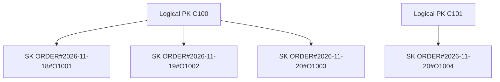
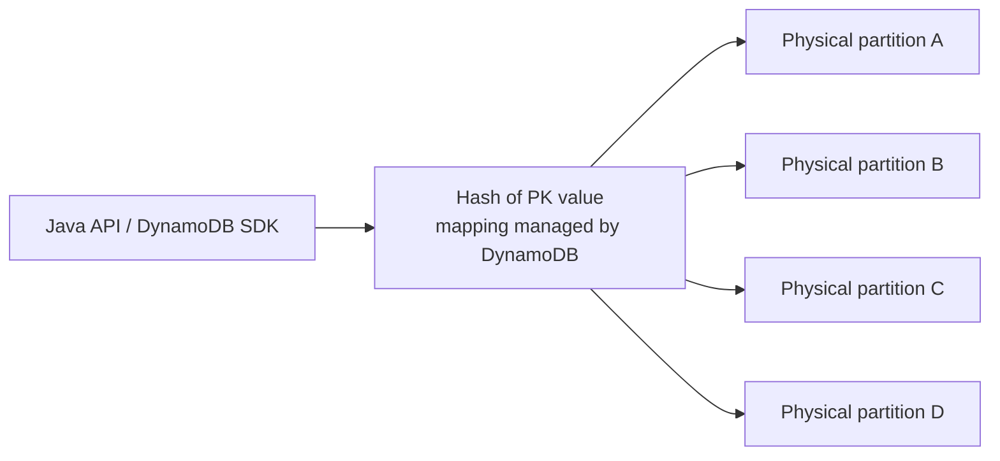
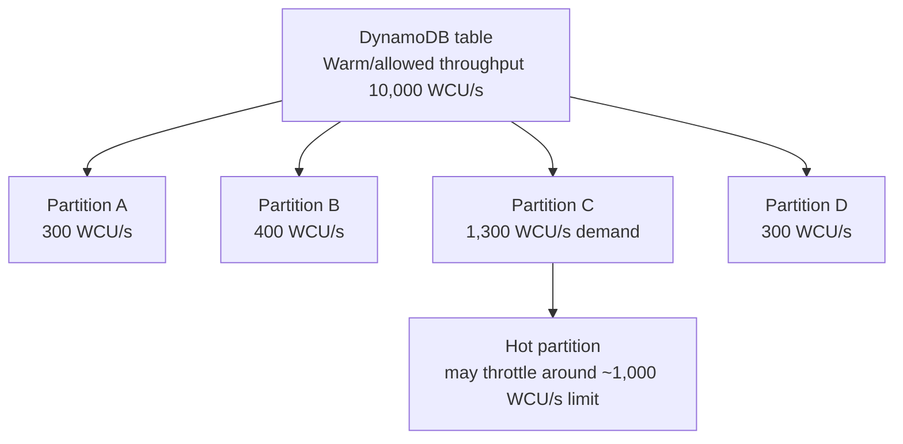
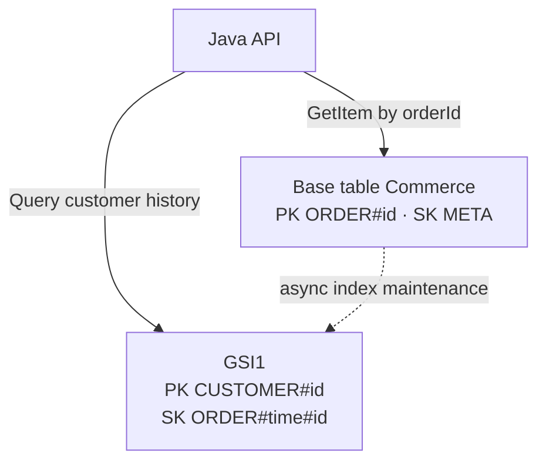
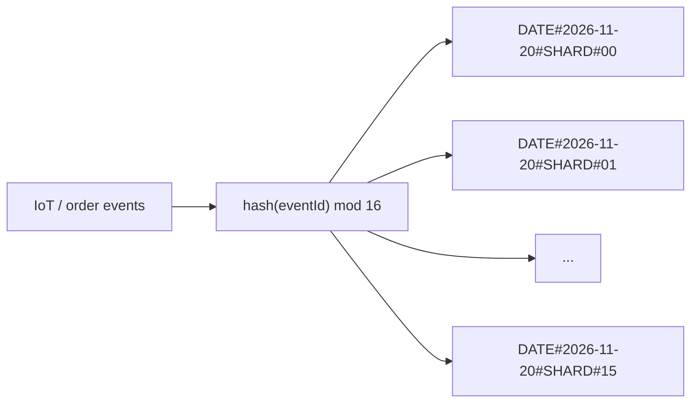
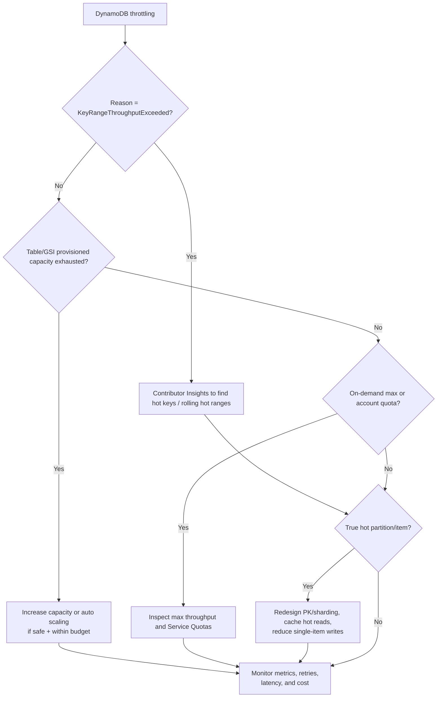

# Partition Keys, Sort Keys, and Data Distribution in Amazon DynamoDB

> **Chapter:** DynamoDB  
> **Module:** CLOUD_PROVIDERS_AWS  
> **Objective:** understand DynamoDB's item identification and data distribution mechanisms, select partition keys and sort keys based on access patterns, avoid hot partitions, use Query/secondary indexes/write sharding properly, and monitor latency, scalability, security, and cost.
>
> **Scope:** Amazon DynamoDB tables, item collections, physical partitions, global/local secondary indexes (GSI/LSI), read/write capacity, and Java/AWS CLI examples. Some quotas, warm throughput, and adaptive capacity characteristics vary by Region/service version; verify against current AWS documentation before deploying to production.

## 1. The Problem: Storing Orders for Fast Reads Without Flash-Sale Bottlenecks

An e-commerce application uses Java/Spring Boot on Amazon ECS or AWS Lambda. The dataset holds millions of orders, many users, multiple stores, and status update events.

The application needs to:

- Fetch **a single order** by order ID.
- List **a customer's orders**, newest first, within a date range.
- Fetch **pending orders** at a given store.
- Retrieve the **event history** of an order.
- Withstand sudden traffic spikes during a flash sale.
- Isolate tenant data and control request/resource consumption.

A naive approach creates a table with `status` as the partition key because dashboards frequently filter by status. However, there are only a few values (`PENDING`, `PAID`, `CANCELLED`); tens of thousands of writes with `PENDING` can concentrate onto a single key range, creating a **hot partition**.

Another approach puts the current date as the partition key:

```text
PK = DATE#2026-11-20
SK = ORDER#<orderId>
```

Nearly all of today's orders write to the same logical partition key. Table-level throughput might have plenty of headroom, yet requests hitting that same data range get throttled.

**The solution is not merely raising capacity:** you must design the key schema around **access patterns**, **load distribution**, and **physical partition limits**.

## 2. From SQL Primary Keys to DynamoDB Primary Keys

### 2.1. Item, Table, and Attribute

DynamoDB is a **NoSQL key-value/document database**:

- **Table:** a collection of items.
- **Item:** a record consisting of key attributes and other attributes.
- **Attribute:** a scalar, document (map/list), set, or other DynamoDB-supported value.
- **Primary key:** uniquely identifies an item within a table.

DynamoDB does not require every item to have the exact same columns like a relational table; however, **every item must have all primary key attributes with the exact declared data types**.

Example item:

```json
{
  "PK": "CUSTOMER#C100",
  "SK": "ORDER#2026-11-20T03:30:00Z#O9001",
  "orderId": "O9001",
  "status": "PAID",
  "total": 150000,
  "currency": "VND"
}
```

`PK` and `SK` are **attribute names chosen by the engineering team**. AWS does not require naming them `PK`/`SK`; they could be `CustomerId`/`OrderTime` or anything else. Using `PK`/`SK` is common in single-table design because it makes it easy to store multiple entity types in one schema.

### 2.2. Simple Primary Key: Partition Key Only

A `CustomerProfiles` table:

| Partition key `CustomerId` | Name | Tier |
|---|---|---|
| `C100` | Lan | Gold |
| `C101` | Minh | Silver |
| `C102` | An | Bronze |

- Each `CustomerId` value identifies **at most one item** in the table.
- `GetItem(CustomerId=C100)` retrieves that exact item.
- You cannot store **two items with the same `CustomerId`** in a partition-key-only table.

```text
TABLE CustomerProfiles
  Primary key: CustomerId (String)
  ├── CustomerId=C100 -> unique item
  ├── CustomerId=C101 -> unique item
  └── CustomerId=C102 -> unique item
```

Choose a simple key when the access pattern is primarily getting/updating a single object by unique ID without grouping multiple items under the same logical key.

### 2.3. Composite Primary Key: Partition Key + Sort Key

A `CustomerOrders` table:

| Partition key `CustomerId` | Sort key `OrderKey` | Status |
|---|---|---|
| `C100` | `ORDER#2026-11-18#O1001` | PAID |
| `C100` | `ORDER#2026-11-19#O1002` | PAID |
| `C100` | `ORDER#2026-11-20#O1003` | PENDING |
| `C101` | `ORDER#2026-11-20#O1004` | PAID |

Uniqueness is enforced on the **pair (`CustomerId`, `OrderKey`)**.

- Multiple items can share partition key `C100`.
- Two items cannot share **both the same partition key and sort key**.
- You can `Query` all orders of `C100` or a slice across a sort-key range.
- Items sharing the same partition key form an **item collection**.



**The sort key does not become a second partition key.** DynamoDB still hashes the **partition key value** to route data; the sort key organizes ordering and querying within the logical item collection.

### 2.4. Key Types, Sizes, and Immutability

| Key property | DynamoDB constraint |
|---|---|
| Partition key type | Scalar `String`, `Number`, or `Binary` |
| Sort key type | Scalar `String`, `Number`, or `Binary` |
| Partition key length | 1–2,048 bytes |
| Sort key length | 1–1,024 bytes |
| Item size | Maximum **400 KB** |
| Key uniqueness | Unique PK (simple), or unique PK+SK pair (composite) |
| Key updates | Cannot edit primary key in-place like a regular field |

Changing `CustomerId=C100` to `C200` in data modeling terms means **creating a new item with the new key and deleting the old item**, controlled with transactions/conditional logic as needed. Never design an application assuming a partition key can be UPDATED "directly."

## 3. Logical Partition Keys vs. Physical Partitions

### 3.1. Hashing the Partition Key to Determine Storage Placement

When you call `PutItem`, DynamoDB uses a **hash of the partition key value** to decide which partition range stores the data within its internal distribution structure.



- **Logical partition key:** a value such as `CUSTOMER#C100` chosen in your schema.
- **Physical partition:** an internal storage/throughput unit managed by DynamoDB.
- **Hash space:** how PK values map onto physical partitions.
- **Sort key:** orders items within the same logical PK; does not determine the initial hash.

**There is no DynamoDB API to ask that "PK=C100 always stay on server/AZ #3."** Physical partitions can be split and reorganized automatically.

### 3.2. One Physical Partition Can Hold Many Logical PKs

When a table is small, many partition-key values can reside on the same physical partition. Thus **having 10,000 distinct PKs does not mean having 10,000 physical partitions**.

Conversely, a single logical item collection can be split by DynamoDB across multiple physical partitions by sort-key ranges when conditions allow, to increase storage/throughput. Never architect on the assumption that "every item with the same PK stays on one physical partition forever."

### 3.3. What Does "Items with the Same Partition Key Are Co-Located" Mean?

AWS optimizes fetching **a range of sort keys** for the same PK. Practically, this means `Query(PK=..., SK BETWEEN ...)` is efficiently supported as an access path.

However, do not conclude that:

- A query for one logical PK **always reads strictly one physical partition**.
- A large logical PK **is never split**.
- Co-location implies unlimited transactions/isolation or automatic joins.
- The sort key can substitute for partition-key equality in `Query`.

**The benefit of sharing a PK is optimizing read patterns over related items**, not a promise of fixed server placement.

## 4. DynamoDB Physical Partitions and Throughput Limits

Per AWS documentation, a single physical partition is designed to handle up to roughly:

| Unit | Reference limit |
|---|---|
| **Write** | **1,000 WCU/second** |
| **Read** | **3,000 RCU/second**, in strongly consistent read units |
| **Eventually consistent reads** | Can correspond to roughly **6,000 reads/second for items ≤4 KB**, due to 0.5 RCU/read |
| **Storage** | A physical partition has a storage limit of roughly **10 GB** before splitting/reorganizing is needed |

These figures are **capacity units**, not "number of requests regardless of size."

For example, if each item written is **2 KB**, a normal write consumes **2 WCU**; 1,000 WCU/second translates to roughly **500 writes/second**, not 1,000.

**High total table capacity does not eliminate physical partition limits.** An on-demand table can sustain tens of thousands of WCU/second when traffic spreads evenly, yet a single hot key/partition can still throttle if traffic concentrates too heavily.

### 4.1. RCU, WCU, and Item Size

| Operation (illustrative) | Typical capacity unit |
|---|---|
| Write item ≤1 KB | 1 WCU |
| Write item 1.2 KB | 2 WCU |
| Strongly consistent read ≤4 KB | 1 RCU |
| Eventually consistent read ≤4 KB | 0.5 RCU |
| Transactional write ≤1 KB | 2 WCUs |
| Transactional strongly consistent read ≤4 KB | 2 RCUs |

Rounding rules apply per item/operation and differ across APIs, capacity modes, indexes, streams, and transactions; these are **foundational estimates** for learning. DynamoDB on-demand bills in **read/write request units**, though unit-equivalent sizing concepts remain useful.

### 4.2. Table-Level Throughput vs. Partition-Level Throughput



A table capable of 10,000 WCU/second total **does not** mean one physical partition can absorb 10,000 WCU/second. With poor key distribution, capacity cannot be utilized evenly.

## 5. What Makes a Good Partition Key?

### 5.1. High Cardinality and Reasonably Even Active Distribution

**Cardinality** is the number of **distinct values** an attribute has.

| Candidate partition key | Cardinality | Risk |
|---|---|---|
| Random/UUID `OrderId` | Very high | Usually good for lookup-by-ID distribution |
| `CustomerId` with millions of customers | High | Usually good if traffic doesn't cluster on a few customers |
| `DeviceId` across millions of devices | High | Good when traffic spreads; still watch for one very noisy device |
| `TenantId` with 5 tenants | Low | A large tenant can heat up one logical PK |
| `status` with 4 values | Very low | Easily hot when most writes are `PENDING` |
| `country` with dozens of values | Low/medium | Populous countries can run hot |
| `date=2026-11-20` | Historical values grow, **but today's date is scorching hot** | Rolling hot partition over time |

**High cardinality is helpful, not sufficient**: if one celebrity account draws 80% of requests, `UserId` still produces a hot key even if the table holds millions of users.

### 5.2. Focus on *Active* Cardinality

Suppose a table holds one million `OrderId`s, yet every second 95% of requests update **one record** `CAMPAIGN#BLACKFRIDAY`. Table-wide cardinality does nothing to relieve that item's hotspot.

When choosing a partition key, ask:

- During **one peak second**, how many PK values actually receive requests?
- How many **RCU/WCU** does each PK receive—not just request count?
- Is load spread **uniformly or skewed by Zipf/Pareto**?
- Is any key updated intensely on the **exact same item**?
- Over the next few days, when an event goes viral, will the distribution shift?

### 5.3. Keys That Commonly Cause Trouble

```text
BAD: PK = "ALL_ORDERS"
BAD: PK = "PENDING"
BAD: PK = "2026-11-20"
BAD: PK = "REGION#VN"    (when 95% of traffic comes from VN)

BETTER (depending on access patterns):
PK = "ORDER#<orderId>"
PK = "CUSTOMER#<customerId>"
PK = "TENANT#<tenantId>#MONTH#2026-11"
PK = "EVENT#2026-11-20#BUCKET#07"
```

**No single key fits every query.** Keying by `ORDER#<id>` enables get-by-ID and spreads writes, but does not directly list all orders of a customer without an appropriate index or item structure.

## 6. Sort Key: Ordering and Group Queries

The sort key allows DynamoDB to:

1. Store multiple items under the same logical partition key.
2. Provide **an ordered dimension** for range Queries.
3. Model hierarchies, versions, or time series.
4. Use `begins_with` and comparisons on the sort key.
5. Avoid Scan when reading a group of data with a known PK.

### 6.1. Customer Order History Example

Design:

```text
PK = CUSTOMER#C100
SK = ORDER#2026-11-20T03:30:00Z#O9001
```

| PK | SK | Total |
|---|---|---:|
| `CUSTOMER#C100` | `ORDER#2026-11-18T08:00:00Z#O9000` | 80,000 |
| `CUSTOMER#C100` | `ORDER#2026-11-20T03:30:00Z#O9001` | 150,000 |
| `CUSTOMER#C100` | `ORDER#2026-11-20T04:10:00Z#O9002` | 200,000 |

Query:

```text
PK = CUSTOMER#C100
begins_with(SK, "ORDER#2026-11")
ScanIndexForward = false
```

Results return **newest orders first**, based on sort key ordering.

### 6.2. Sorting Rules for String, Number, Binary

| Sort key type | Ordering behavior |
|---|---|
| `Number` | Numerical order |
| `String` | **UTF-8 byte order**, not language-specific collation rules |
| `Binary` | Byte order |

If a String sort key holds:

```text
"2"
"10"
"100"
```

Lexicographical order differs from numerical order. If storing numbers in strings and numeric sorting is needed, use **zero-padding**:

```text
"000002"
"000010"
"000100"
```

Do not expect locale-specific ordering or default case-insensitive comparisons on String sort keys.

### 6.3. Timestamps in Sort Keys

Use normalized UTC timestamps:

```text
ORDER#2026-11-20T03:30:00.000Z#O9001
ORDER#2026-11-20T03:31:00.000Z#O9002
```

Advantage: when timestamps share the same ISO 8601 format, timezone, and precision, string order matches chronological order.

Watch out:

- Do not mix `2026-11-20T10:00:00+07:00` with `2026-11-20T03:00:00Z` if strict ordering is required.
- Do not use variable-width timestamps or omit timezones.
- Events sharing a timestamp need a unique suffix `#<eventId>` to prevent overwrites.
- DynamoDB does not provide server-side auto-increment keys; if sequential IDs are needed, design separate concurrency/sequence handling.

### 6.4. Hierarchical Composite Sort Keys

Example storing organizational hierarchy:

```text
PK = ORG#ORG01
SK = DEPT#SALES
SK = DEPT#SALES#TEAM#EAST
SK = DEPT#SALES#TEAM#EAST#USER#U100
SK = DEPT#SALES#TEAM#WEST#USER#U101
```

You can Query `begins_with(SK, "DEPT#SALES#TEAM#EAST")` to fetch a subtree at a hierarchy level.

**Delimiter and escaping design:** if IDs can contain `#`, normalize/encode them upfront; never split strings casually and introduce ambiguity.

### 6.5. Storing Item Versions and History

A pattern:

```text
PK = DOCUMENT#D100
SK = VERSION#000001
SK = VERSION#000002
SK = VERSION#000003
SK = META#LATEST
```

- `VERSION#...` preserves immutable historical versions.
- `META#LATEST` can point to the most recent version.
- When writing a new version, use **`TransactWriteItems`** or conditional writes to update metadata consistently as needed.
- `Query` on `VERSION#` with `ScanIndexForward=false` fetches the latest version when versions are zero-padded properly.

**Do not update historical items in-place** if the goal is an immutable audit trail.

## 7. Read Operations and Their Relationship to Keys

### 7.1. GetItem

`GetItem` is appropriate when the **complete primary key** is known:

```text
GetItem(
  TableName="Orders",
  Key={"PK":"CUSTOMER#C100","SK":"ORDER#2026-11-20#O9001"}
)
```

- With a composite key, you must provide **both PK and SK**.
- Strongly consistent reads can be requested on base tables/LSIs when needed.
- You cannot list all items of a customer via `GetItem(PK only)` on a composite-key table.

### 7.2. Query

`Query` is appropriate when a **specific partition key value** is known, optionally with a sort key condition.

Logical syntax:

```text
PK = :customer
AND begins_with(SK, :orderPrefix)
```

Valid sort key conditions include:

- `=`, `<`, `<=`, `>`, `>=`.
- `BETWEEN`.
- `begins_with` for String/Binary sort keys.

**The partition key in `KeyConditionExpression` must use equality.** There is no `Query(PK BETWEEN A AND Z)` or `Query(begins_with(PK,...))` like SQL index scans.

### 7.3. Query Ordering by Sort Key and Pagination

- Default sort order is **ascending**.
- `ScanIndexForward=false` yields **descending**.
- Each Query page reads up to roughly **1 MB of data before `FilterExpression`** or stops at `Limit`.
- If the response includes `LastEvaluatedKey`, the client continues with `ExclusiveStartKey`.
- `Limit` caps **evaluated items** per page, not a guarantee of N matching results after heavy filtering.

**An empty Query result does not mean no more pages exist** if `LastEvaluatedKey` is present. Especially when `FilterExpression` filters out many items, a page can return zero `Items` while still requiring pagination.

### 7.4. FilterExpression Does Not Replace Partition Key Design

Misguided example:

```text
PK = ALL_ORDERS
FilterExpression = customerId = "C100"
```

DynamoDB still has to read all items in the key range to evaluate the filter. **`FilterExpression` runs after data is read**, so it typically **does not reduce consumed read capacity units**.

Distinction:

| Clause | Where does it run? | Effect |
|---|---|---|
| `KeyConditionExpression` PK + SK | Selects key range to read | Reduces data read by key |
| `FilterExpression` non-key attributes | After reading the page | Shrinks items returned over the network; does not reduce RCUs of read data |
| `ProjectionExpression` | Selects attributes to return | Shrinks response size; **does not reduce RCUs** since RCUs depend on read item size |

If filtering `status` across millions of items is frequent, use a **GSI or key schema matching the access pattern**, rather than turning `FilterExpression` into a full-table query.

### 7.5. Scan

`Scan` traverses the entire table/index or a segment; it requires no PK, but:

- Consumes read capacity proportional to all scanned data.
- Can degrade production latency or heat up key ranges.
- For large datasets, requires pagination or segmented parallel Scan when appropriate.
- Reserved for migrations, reindexing, or small/bounded batch analytics—never the default for API request paths.
- Strongly consistent Scan does not provide **table-wide snapshot isolation** across the duration of the scan.

**Principle:** define access patterns first, because DynamoDB shines when the application knows the primary or index key.

## 8. Designing by Access Patterns Instead of Relational Tables

A DynamoDB table does not offer arbitrary `WHERE ... ORDER BY ... JOIN ...` like a relational database. Write a requirements table:

| Access pattern | Input | Desired output | Required key/index |
|---|---|---|---|
| Get order by ID | `orderId` | One order | `PK=ORDER#id` or GSI by `orderId` |
| List customer orders | `customerId`, from/to | Paginated orders by time | `PK=CUSTOMER#id`, `SK=ORDER#timestamp#id` |
| Fetch pending orders of a merchant | `merchantId`, `status` | Orders awaiting fulfillment | GSI keyed by merchant + status/time bucket |
| Fetch order history | `orderId` | Chronological events | `PK=ORDER#id`, `SK=EVENT#timestamp#eventId` |
| Find events for a day | `eventDate` | Day's slice of data | Buckets + shards when writes are hot |
| View tenant's orders | `tenantId`, page | Paginated with tenant isolation | Composite tenant/customer PK or tenant GSI |
| Get customer profile | `customerId` | Profile item | `PK=CUSTOMER#id`, `SK=PROFILE` |

From this table, decide:

- One or multiple DynamoDB tables.
- Simple vs. composite primary key.
- Required GSIs/LSIs.
- Whether to **duplicate/denormalize** items to satisfy read paths.
- Whether high-volume access patterns need buckets/shards.
- Transaction and consistency semantics.

### 8.1. Should PK Be Tenant or Customer?

**Option 1:**

```text
PK = TENANT#T001
SK = ORDER#<timestamp>#<orderId>
```

Easy to query the whole tenant, but if T001 has heavy write volume, one logical PK runs hot; item collections also grow huge if LSIs exist.

**Option 2:**

```text
PK = TENANT#T001#CUSTOMER#C100
SK = ORDER#<timestamp>#<orderId>
```

Distributes load better across customers and queries one customer's orders easily. However, querying **all orders of a tenant** requires a GSI or batch/aggregation strategy rather than a single Query.

**Option 3:**

```text
PK = ORDER#<orderId>
SK = META
```

Get-by-order-ID and write distribution are strong if IDs are spread out, while querying customer orders requires a GSI or materialized access view.

**Choose based on critical access paths, not on which key name "looks neatest."**

## 9. Single-Table Design: Combining Multiple Entity Types in PK/SK

A common pattern using table `Commerce`:

| PK | SK | Item type |
|---|---|---|
| `CUSTOMER#C100` | `PROFILE` | Customer profile |
| `CUSTOMER#C100` | `ORDER#2026-11-20T03:30:00Z#O9001` | Order summary |
| `CUSTOMER#C100` | `ORDER#2026-11-20T04:00:00Z#O9002` | Order summary |
| `ORDER#O9001` | `META` | Order aggregate metadata |
| `ORDER#O9001` | `ITEM#SKU-01` | Order line |
| `ORDER#O9001` | `ITEM#SKU-02` | Order line |
| `ORDER#O9001` | `EVENT#2026-11-20T03:31:00Z#E001` | Event history |

Two queries:

- `PK=CUSTOMER#C100 AND begins_with(SK,"ORDER#")`: order summaries.
- `PK=ORDER#O9001`: aggregate metadata, line items, and events.

**Benefits:** fewer round trips for items read together; related items can be updated together in transactions when needed.

**Trade-offs:** schema complexity, duplicate records, migrations, transaction costs, IAM tenant boundaries, and access patterns that do not align with existing PKs. Not every DynamoDB workload must be single-table; **multi-table design** can be simpler to operate across distinct bounded contexts.

### 9.1. Item Collections Are Not Giant Nested JSON Documents

If an order has 10,000 line items, do not cram them into a single >400 KB item. Split them:

```text
PK ORDER#O9001 | SK META
PK ORDER#O9001 | SK ITEM#000001
...
PK ORDER#O9001 | SK ITEM#010000
```

Still evaluate collection item count/size, hot writes, pagination, LSI limits, and Query cost. **Splitting items does not automatically eliminate a hot PK.**

### 9.2. Transactions and Uniqueness

DynamoDB has no SQL foreign keys. If you need to guarantee:

- Order ID uniqueness.
- Order summary written atomically with details.
- Inventory counter never decremented below zero.

Use **conditional writes** (`attribute_not_exists`, version checks) or **`TransactWriteItems`** where appropriate. Key design handles routing; **consistency and invariants remain explicit decisions**.

## 10. Global Secondary Index (GSI): Adding an Access Path with a Different Key

### 10.1. GSIs Have Independent PK/SK

Suppose the base table has:

```text
Table Commerce:
  PK = ORDER#O9001
  SK = META
  CustomerId = C100
  OrderTime = 2026-11-20T03:30:00Z
```

To query orders by customer:

```text
GSI1PK = CUSTOMER#C100
GSI1SK = ORDER#2026-11-20T03:30:00Z#O9001
```



A GSI is an **automatically maintained index**, not a SQL join. It has **separate partition distribution and capacity** from the base table.

### 10.2. A GSI Can Become a New Hot Bottleneck

Base table distributes well:

```text
PK=ORDER#O0001
PK=ORDER#O0002
PK=ORDER#O0003
...
```

Yet the GSI has:

```text
GSI1PK=PENDING
GSI1PK=PENDING
GSI1PK=PENDING
...
```

Result: a **GSI hot partition** even though the base table spreads evenly.

Furthermore, **GSI write throttling can exert backpressure onto base table writes** because DynamoDB must maintain the index. When investigating throttling, inspect every GSI resource—not just primary table metrics.

### 10.3. GSI Consistency and Projections

- **GSI reads are always eventually consistent**; never request strong consistency on a GSI.
- GSIs have their own capacity/warm throughput and constraints depending on billing mode.
- GSIs contain only **projected** attributes alongside key fields per DynamoDB rules.
- `KEYS_ONLY` minimizes storage/write overhead, `INCLUDE` picks specific attributes, and `ALL` copies everything.
- **You cannot directly fetch non-projected attributes from the base table during a GSI Query**; if needed, the application must issue separate base-table `GetItem` calls.
- GSIs can be created/modified on existing tables; backfilling a new GSI takes time and adds load.

The right trade-off is **adding an index to cut Scan/Query cost on important access patterns** while accounting for storage and write amplification.

### 10.4. Sparse GSIs

If only incomplete orders need to appear in a processing index:

```text
Order PENDING:
  GSIStatusPK = MERCHANT#M100#OPEN#2026-11
  GSIStatusSK = 2026-11-20T03:30:00Z#O9001

Order PAID:
  GSIStatusPK = (absent)
  GSIStatusSK = (absent)
```

A GSI only indexes items that contain **all corresponding GSI key attributes**. Hence this is a **sparse index**: only pending/open items appear in it; once paid, updating/removing the index keys removes the item from the index.

**Watch out:** if one merchant processes hundreds of thousands of pending writes/second, GSI PK `MERCHANT#M100#OPEN#2026-11` can still overheat. Sparse indexes reduce item count, **without automatically guaranteeing workload distribution**.

## 11. Local Secondary Index (LSI): Same Partition Key, Different Sort Key

An LSI uses the **same partition key as the base table**, paired with a **different sort key** to query the same item collection in a different order.

Example table:

```text
PK = CUSTOMER#C100
SK = ORDER#<timestamp>#<orderId>
```

LSI:

```text
PK = CUSTOMER#C100
SortKey = TotalAmount
```

You can query a customer's orders by `TotalAmount` instead of timestamp within LSI capabilities.

### 11.1. LSI Constraints

| Property | LSI |
|---|---|
| Partition key | **Same as base table** |
| Sort key | Different from base table sort key |
| Created after table creation | **No**; must be declared at `CreateTable` |
| Strongly consistent reads | **Supported** (unlike GSI) |
| Throughput | **Shares** capacity with base table |
| Item collection size limit | **10 GB per partition key value**, including base data and projected LSI entries |
| Limit | Maximum 5 LSIs/table under standard quotas |

The **10 GB LSI item collection** limit is a classic pitfall. If a table has an LSI and `PK=TENANT#MEGA` accumulates 11 GB of base + index entries, further writes to that collection fail with `ItemCollectionSizeLimitExceededException`.

### 11.2. Crucial Distinction: What If There Is No LSI?

Per AWS documentation:

- If a table has **no LSI**, DynamoDB **can split an item collection** across multiple physical partitions by sort-key ranges as needed for storage and traffic.
- If a table **has an LSI**, all items in a PK's item collection must stay co-located within a single physical partition, resulting in the **10 GB** limit.

Therefore, the claim **"no partition key in DynamoDB can exceed 10 GB"** is **false**; that limit applies to item collections **only when a local secondary index exists**.

### 11.3. LSIs and Hot Keys

If a workload has an extremely hot `PK=TENANT#MEGA`, adaptive capacity cannot split the item collection by sort key the same way when **an LSI exists**. Avoid LSIs on collections that may grow huge or hot. Consider a GSI or changing the primary key model.

## 12. Hot Partitions, Hot Keys, and Rolling Hotspots

### 12.1. Different Kinds of "Hot"

| Type | Example | Symptom |
|---|---|---|
| **Hot PK value** | `PK=PENDING` receives most writes | Key-range throttling |
| **Hot item** | One counter `VOTES#GLOBAL` updated 5,000 times/sec | Conditional conflicts or WCU throttling |
| **Hot GSI key** | `GSI1PK=OPEN` | Base table writes also slow down/throttle |
| **Rolling hot partition** | Sequential writes to the newest timestamp/date range | Hotspot moves along with time |
| **Hot read** | Viral product receiving thousands of reads/sec | Read throttling despite low writes |
| **Hot tenant** | One enterprise generating most traffic | Tenant impacted, noisy neighbor |
| **Scan-induced hot range** | Batch scan reading sequentially by key order | Partition-level read pressure |

A table with many partitions can still report throttling if just one partition saturates. Distinguish **`KeyRangeThroughputExceeded`** from **`ProvisionedThroughputExceeded`**, **`MaxOnDemandThroughputExceeded`**, or **`AccountLimitExceeded`** via throttling reasons.

### 12.2. What Is Adaptive Capacity?

DynamoDB automatically includes **adaptive capacity** in both provisioned and on-demand modes:

- Rebalances capacity toward heavily accessed partitions.
- Can **isolate frequent items** or split item collections by sort key when conditions permit.
- Helps absorb access skew **within table capacity and physical-partition limits**.
- Is not a toggle enabled via a separate API.

**Adaptive capacity does not erase the 1,000 WCU / 3,000 RCU physical partition ceiling**, nor does it let a **single hot item** scale infinitely.

### 12.3. Split for Heat

When a key range remains persistently hot, DynamoDB can split it to spread load under suitable conditions. However:

- It cannot split **one continuously updated single item** into multiple application records if the key never changes.
- On tables **with an LSI**, item collections under one PK cannot be split like LSI-free tables.
- If writes always target monotonically increasing sort keys (newest), splitting may not permanently eliminate the hotspot because new writes keep hitting one edge.
- Splitting/adaptive responses are automatic but rely on internal heuristics and time—never an instant SLA for unpredicted spikes.

**Never build a production load test hoping "DynamoDB will surely split within 1 second."** Good key distribution remains the foundation.

### 12.4. Single Hot Item

A table has:

```text
PK = CAMPAIGN#FLASHSALE2026
SK = COUNT
```

Every new order runs `UpdateItem ADD count 1` on that exact item. Even with millions of other PKs in the table, this counter concentrates writes onto **one key**.

Common solutions are **sharded counters** (multiple independent counter items) or pushing events to a queue/stream for periodic aggregation, accepting the consistency trade-off. Unlike RDS, you cannot simply attach 10 read replicas to DynamoDB.

## 13. Write Sharding: Spreading Writes Across Multiple Partition-Key Values

### 13.1. The Idea

To write 10,000 events/second for the same day, instead of:

```text
PK = EVENT#2026-11-20
SK = 2026-11-20T...#<eventId>
```

use:

```text
PK = EVENT#2026-11-20#SHARD#00
PK = EVENT#2026-11-20#SHARD#01
...
PK = EVENT#2026-11-20#SHARD#15
```

Publishers pick a shard with a stable function such as:

```text
shard = hash(eventId) mod 16
```



With reasonably uniform distribution, load per logical PK drops sharply compared to one key.

### 13.2. There Is No Fixed Formula for Shard Count

Suppose you need 4,000 writes/second of 1 KB items, roughly ~4,000 WCU/second on one logical PK. Splitting across **8 shards** gives ~500 WCU/second per shard in theory. However:

- Hash distribution has variance; no shard is guaranteed to get exactly 500.
- Physical partitions may host multiple shard values.
- The item's GSIs can still run hot if GSI PKs are not sharded.
- Table-level provisioned/on-demand warm throughput must still cover the aggregate load.
- Writes >1 KB or transactional writes consume more than 1 WCU.

**Shard count comes from load testing and capacity analysis**, not a rule of thumb that 8 is always optimal.

### 13.3. Deterministic vs. Random Sharding

| Strategy | Property | When to use |
|---|---|---|
| `hash(eventId) % N` | Same `eventId` always lands on the same shard (if N is constant) | Need get-by-ID or idempotent routing |
| Random shard `0..N-1` | Easily spreads inserts | Write-heavy append; reads require knowing shard or fan-out |
| `hash(customerId) % N` | Same customer keeps a stable shard | Querying a customer within the same bucket when designed |
| Time bucket + shard | Narrows day/hour range while spreading writes | Time-series/IoT/analytics |

**Changing N** from 8 to 16 alters `hash(id)%N` mappings for existing IDs. Store a shard version, run a dual-read migration, or adopt consistent hashing.

### 13.4. Paying the Price on Reads

Sharding improves write distribution, but if a user asks for "all events on Nov 20":

- You must **Query 16 shard values**, potentially in parallel within concurrency limits.
- Merge/sort pages in the application.
- Manage **per-shard pagination cursors**; global pagination gets trickier.
- Spend more read units and handle retries/partial failures.

**Trade-off:** spreading writes across multiple PK values complicates cross-shard queries. Balance this against real query needs.

## 14. Time-Series Data: Why Timestamp/Date-Only PKs Often Run Hot

### 14.1. Common Anti-Pattern

A sensor app ingests thousands of events/second:

```text
PK = 2026-11-20
SK = 03:30:00.000#sensorA
```

Almost all of today's writes share the same PK. Tomorrow's traffic shifts the hotspot to the new day's PK—a **rolling hot partition**.

### 14.2. Design by Device + Time Bucket

If queries mostly target one sensor over a time range:

```text
PK = DEVICE#D100#MONTH#2026-11
SK = TS#2026-11-20T03:30:00.000Z#EVENT#E100
```

This distributes across millions of devices and bounds item collections per month. A "super-device" emitting 10,000 events/sec can still run hot, in which case add shards.

### 14.3. Design with Multiple Buckets per Day

If queries mostly fetch all events for a day:

```text
PK = DATE#2026-11-20#BUCKET#<00..31>
SK = TS#<UTC>#DEVICE#<deviceId>#EVENT#<eventId>
```

Reading a full day requires fanning out across 32 buckets. You can maintain a **GSI by device** for reverse lookups, provided you check GSI PK distribution.

### 14.4. Long-Term History Retention

DynamoDB excels at low-latency lookups/OLTP, not necessarily scanning terabytes of cold history repeatedly. Consider:

- **DynamoDB TTL** to expire items **asynchronously**, never as an exact-to-the-second deadline.
- **DynamoDB export to Amazon S3** with Athena/Glue analytics for historical data.
- Tiering retention per compliance requirements.
- Avoiding large Scans every minute on production tables just to power summary dashboards.

## 15. Ordering, Pagination, and Item Collection Limits

### 15.1. Sort-Key Queries Do Not Create Table-Wide Global Order

Example:

```text
PK CUSTOMER#C100 | SK ORDER#2026-11-20T02:00:00Z#O1
PK CUSTOMER#C200 | SK ORDER#2026-11-20T01:00:00Z#O2
```

`Query(PK=C100)` orders by time within C100. However, **no single regular table Query sorts all of C100+C200 by timestamp**.

For a global feed:

- Design a dedicated GSI or bucketed feed.
- Precompute/summarize the feed into a materialized view.
- Query multiple partitions and merge, accepting fan-out.
- Use a suitable search/analytics service when queries are highly ad-hoc.

### 15.2. Safe Pagination

A paginated API should not assume `page=1,2,3` with SQL-style offsets. DynamoDB **has no offset pagination** in Query.

Instead:

1. Call `Query` with `Limit`/`ExclusiveStartKey`.
2. Return data and a cursor wrapping `LastEvaluatedKey`.
3. Client passes the cursor for the next page.
4. Backend decodes/verifies the cursor and issues the next `Query`.
5. Include query/index context, tenant, and expiration/compatibility metadata in the cursor when needed.

**Never trust a client-tampered cursor** to access another tenant's PK. Sign cursors or enforce partition-key/tenant ownership from the auth context on every request.

### 15.3. The 10 GB Limit Applies Only to Tables with LSIs

Read carefully:

- **Without an LSI:** an item collection can grow beyond 10 GB as DynamoDB partitions it appropriately; still check throughput and Query costs.
- **With an LSI:** total base items plus projected LSI entries for **one PK value** are capped at **10 GB**.
- **GSIs:** are not bound by the LSI-style 10 GB item-collection limit; they maintain independent partitioning and capacity.

A massive tenant accumulating tens of GB of data **should not** be modeled as `PK=TENANT#T001` + LSI just to sort on two fields.

## 16. How Do Provisioned, On-Demand, and Warm Throughput Relate to Key Design?

### 16.1. Provisioned Capacity

In `PROVISIONED` mode, you specify:

- **Read capacity units (RCUs)** for the table.
- **Write capacity units (WCUs)** for the table.
- Capacity for each **GSI**, if any.
- Optionally **DynamoDB Auto Scaling** to adjust provisioned capacity from CloudWatch utilization.

**Auto Scaling adds aggregate throughput—it never changes the partition key.** If one logical key runs hot or a GSI PK has low cardinality, the table can still throttle after capacity scales up.

### 16.2. On-Demand Capacity

With `PAY_PER_REQUEST` (on-demand):

- DynamoDB manages capacity automatically and bills per actual request unit.
- Fits unpredictable or spiky workloads.
- Requires no upfront RCU/WCU sizing at table creation.
- Still subject to **physical-partition limits**, service quotas, and pre-burst warm/scale readiness.
- Supports configuring **maximum on-demand throughput** per table/GSI to cap spend/load, which throttles requests exceeding the cap.

**Pitfall:** picking on-demand and assuming `PK=ALL_ORDERS` scales writes infinitely. On-demand is a **capacity/billing mode**, not a cure for hot partitions.

### 16.3. Warm Throughput

**Warm throughput** is the read/write throughput a table or GSI can immediately serve based on the scaling headroom DynamoDB has prepared.

For workloads facing sudden promotional campaigns:

1. Check the current warm throughput of the table and GSIs.
2. Compare against expected peak traffic in units/second.
3. Consider proactively increasing warm throughput using supported APIs/features.
4. Run realistic load tests and watch `KeyRangeThroughputExceeded`.
5. Never assume high warm throughput fixes a **single-key hotspot**.

Hypothetical example:

```text
On-demand table warm throughput:
  Read: 30,000 read units/s
  Write: 10,000 write units/s

Campaign traffic:
  8,000 WCU/s total
  Of which 6,000 WCU/s hit only PK = CAMPAIGN#2026
```

Total WCU is under 10,000, yet writes piling onto that single key/item can still hit partition-level limits. **Distribute writes or change the data model**, instead of only bumping warm throughput.

### 16.4. Burst Capacity and Adaptive Capacity

- DynamoDB may draw on **burst capacity** when headroom exists under system conditions.
- **Adaptive capacity** shifts throughput toward hot partitions within overall capacity and physical limits.
- **Split for heat** can automatically relieve some sustained hotspots over time.
- There is no guarantee that extreme short spikes or single-item write hotspots will be absorbed.
- Never assume burst credits are always available; AWS can also use burst capacity for background maintenance.

**Long-term optimization:** good key design + right capacity mode + real measurements + retries with backoff/jitter.

## 17. Choosing Sort Keys to Optimize Queries Without Breaking Distribution

### 17.1. Good Pattern: User + Event Time

Assume 100,000 users, each generating 5–20 events/day:

```text
PK = USER#<userId>#MONTH#2026-11
SK = EVENT#2026-11-20T03:30:00Z#<eventId>
```

Benefits:

- Load spreads across many user/month keys.
- Querying a user's monthly events is efficient.
- Date/month buckets keep item collections bounded.
- Sort keys support time-range selection.

Limitations:

- Viral/hot users still need per-user sharding.
- Reading across multiple months requires multiple Queries.
- Global feeds require another index or access pattern.

### 17.2. Bad Pattern: Fixed PK + Timestamp SK

```text
PK = EVENTS
SK = 2026-11-20T03:30:00Z#<eventId>
```

Even with millions of unique sort key values:

- Initial hash routing still depends solely on **`PK=EVENTS`**.
- New writes always land at increasing timestamps.
- Split for heat is not guaranteed to eliminate rolling hotspots.
- If an LSI exists, the item collection hits the 10 GB limit.

**Unique sort keys do not increase partition-key cardinality.**

### 17.3. Do Not Pick Random PKs Blindly

If every item uses a random UUID as PK, write distribution is great. But if users need all orders for a customer:

- You cannot `Query(PK=CUSTOMER#C100)` when PK is a random order ID.
- You must build a GSI/materialized view or scan the table.
- Read cost and complexity increase.

Smart designs often pair **random/high-cardinality PKs for the write path** with **GSIs for required read paths**, or use **bucketed/sharded customer PKs** when per-customer write load is moderate.

## 18. DynamoDB GSI Write Sharding by Status

### 18.1. Problem with Low-Cardinality GSIs

A table has well-distributed `PK=ORDER#<UUID>`. Each order has:

```text
Status = PENDING
GSIStatusPK = PENDING
GSIStatusSK = 2026-11-20T03:30:00Z#<orderId>
```

During a flash sale, thousands of new orders carry `GSIStatusPK=PENDING`. The **GSI runs hot** even though the base table is well balanced.

### 18.2. Sharding the Status Index

Change to:

```text
GSIStatusPK = STATUS#PENDING#DAY#2026-11-20#SHARD#03
GSIStatusSK = TS#2026-11-20T03:30:00Z#ORDER#O9001
```

Function:

```text
shard = stableHash(orderId) % 16
```

To read all pending orders for Nov 20:

1. Query all **16 GSI PK values**.
2. Merge/sort in the application.
3. Bound concurrency and total read units.
4. Track `LastEvaluatedKey` per shard.
5. Account for GSI eventual consistency or re-verify status before acting.

### 18.3. Do Not Create 16 Shards Unnecessarily

At 3 pending orders/second on a small table of a few thousand items, a single `STATUS#PENDING` GSI may be completely fine. Sharding:

- Multiplies query count.
- Complicates pagination.
- Makes group-wide transactional lookups/sorting harder.
- Complicates migrations when changing shard counts.

**Sharding is a solution when measurements or estimates show hotspot risk**, not a mandatory rule for every table.

### 18.4. Checking State in Consumers

With an eventually consistent index, an order that just moved from `PENDING` to `PAID` can briefly remain in the pending GSI. Consumers must:

- Re-read the base item when accuracy matters.
- Use conditional updates to guard valid transitions.
- Never treat "item appeared in GSI" as proof the transaction is still open.
- Carry an idempotency key.

DynamoDB keys/indexes assist retrieval; **they do not replace transaction-conflict controls**.

## 19. Hot Counter Pattern: Sharded Counters and Aggregation

### 19.1. Single-Item Counter Bottleneck

```text
PK = CAMPAIGN#BIGSALE
SK = COUNTER
Count = 123456
```

Many Lambda invocations update the exact same item simultaneously. DynamoDB supports atomic increments, yet throughput remains pinned to one item.

### 19.2. Sharded Counters

```text
PK = CAMPAIGN#BIGSALE | SK = COUNTER#00
PK = CAMPAIGN#BIGSALE | SK = COUNTER#01
...
PK = CAMPAIGN#BIGSALE | SK = COUNTER#31
```

These still share the **same PK** and differ only by sort key. On an **LSI-free** table, DynamoDB may split the item collection when appropriate, yet under extreme traffic a physical partition can still saturate. A stronger approach for **hash-key distribution** is:

```text
PK = CAMPAIGN#BIGSALE#SHARD#00 | SK = COUNTER
PK = CAMPAIGN#BIGSALE#SHARD#01 | SK = COUNTER
...
PK = CAMPAIGN#BIGSALE#SHARD#31 | SK = COUNTER
```

Now every shard has a **distinct PK value**, spreading hash routing cleanly.

### 19.3. Reading the Total Counter

To compute the total:

\[
\text{TotalVotes} = \sum_{i=0}^{31} \text{CountShard}_i
\]

You need:

- `BatchGetItem` or multiple GetItem/Query calls.
- Summing in the application or via a materialized aggregator.
- Accepting multiple round trips and consistency trade-offs.
- For near-real-time totals, using stream aggregation/caching instead of reading 32 items on every HTTP request.

**Distributed counting across multiple items does not form an atomic transaction over the whole total**, so do not treat such estimates as a strict financial ledger without stronger guarantees.

## 20. Diagnosing Throttling: Table, Index, or Key Range?

### 20.1. Classifying Root Causes

DynamoDB returns **throttling reasons** to distinguish:

| Reason type | General meaning | Action |
|---|---|---|
| `KeyRangeThroughputExceeded` | One physical key range/partition is overloaded | Identify hot keys, spread access, cache, shard |
| `ProvisionedThroughputExceeded` | Consumption exceeded total provisioned capacity of table/GSI | Increase provisioned capacity/Auto Scaling or shed load |
| `MaxOnDemandThroughputExceeded` | Exceeded configured on-demand maximum throughput cap | Raise cap if safe or reduce traffic |
| `AccountLimitExceeded` | Exceeded service/account quota | Check Service Quotas and request increase if justified |

Reasons can pinpoint **reads vs. writes** and **table vs. index** affected. Never blindly "add WCUs" for every throttle, as root causes differ.

### 20.2. Essential CloudWatch Metrics

| Metric | What it shows |
|---|---|
| `ConsumedReadCapacityUnits` | Read capacity consumed |
| `ConsumedWriteCapacityUnits` | Write capacity consumed |
| `ProvisionedReadCapacityUnits` | Provisioned RCUs when in provisioned mode |
| `ProvisionedWriteCapacityUnits` | Provisioned WCUs when in provisioned mode |
| `ReadThrottleEvents` | Read throttle events per metric definition |
| `WriteThrottleEvents` | Write throttle events |
| `ReadKeyRangeThroughputThrottleEvents` | Read throttles caused by key-range limits |
| `WriteKeyRangeThroughputThrottleEvents` | Write throttles caused by key-range limits |
| `ThrottledRequests` | Throttled requests; not strictly 1-to-1 with throttle events |
| `SuccessfulRequestLatency` | Successful request processing latency at DynamoDB |
| `ReturnedItemCount` | Items returned by Query/Scan |
| `UserErrors` / `SystemErrors` | Client vs. service errors |
| GSI-specific metrics | Select the right `GlobalSecondaryIndexName` dimension |

**Never use a 5-minute CloudWatch average to conclude per-second peaks did not hit partition limits.** Hotspots show up in tight spike windows and per-key distributions.

### 20.3. CloudWatch Contributor Insights

**CloudWatch Contributor Insights for DynamoDB** identifies hot/throttled keys when enabled on the right table/GSI and mode:

- **Throttled keys**: focuses on keys experiencing throttling.
- **Accessed and throttled keys**: tracks both heavily accessed keys and throttled keys.
- Distinguishes partition-key-only vs. partition+sort key reports.
- Incurs charges per events/requests depending on mode; enable intentionally.
- Key values can expose PII if emails/phones are placed in PK. Enforce report access controls, masking/naming conventions, and log hygiene.

**Recommendation:** format keys like `TENANT#<opaqueId>` rather than raw emails whenever possible; this stays stable when users change emails and prevents PII leaks in diagnostics.

### 20.4. Troubleshooting Decision Tree



### 20.5. Retries Do Not Fix Bad Keys

AWS SDKs provide retries with **exponential backoff + jitter** for throttled requests, but:

- Aggressive retries worsen hotspots.
- Retries need max attempts and time budgets.
- `BatchWriteItem` can return `UnprocessedItems` even when the API call itself does not fail.
- `ConditionalCheckFailed` is not a throttle to be retried unconditionally.
- Idempotent writes and unique event IDs are essential so retries never create duplicates.
- Design backpressure across API Gateway/SQS/Lambda concurrency when downstream saturates.

## 21. Java AWS SDK v2: Querying by PK/SK

Examples use **AWS SDK for Java v2**. Assumptions:

- Table `Commerce` already exists.
- Partition key is String `PK` and sort key is String `SK`.
- The Java runtime obtains AWS credentials via an ECS/EC2/Lambda **IAM role** or lab environment—never hardcoded access keys.
- Region `ap-southeast-1` is illustrative only.
- The code below is **read-only**.

### 21.1. Query Customer Orders, Newest First

```java
import java.util.Map;
import java.util.List;
import java.util.ArrayList;

import software.amazon.awssdk.regions.Region;
import software.amazon.awssdk.services.dynamodb.DynamoDbClient;
import software.amazon.awssdk.services.dynamodb.model.AttributeValue;
import software.amazon.awssdk.services.dynamodb.model.QueryRequest;
import software.amazon.awssdk.services.dynamodb.model.QueryResponse;
import software.amazon.awssdk.services.dynamodb.model.ReturnConsumedCapacity;

public class CustomerOrdersQuery {

    public static void main(String[] args) {
        try (DynamoDbClient dynamo = DynamoDbClient.builder()
                .region(Region.AP_SOUTHEAST_1)
                .build()) {

            Map<String, AttributeValue> values = Map.of(
                    ":pk", AttributeValue.builder()
                            .s("CUSTOMER#C100").build(),
                    ":prefix", AttributeValue.builder()
                            .s("ORDER#").build()
            );

            Map<String, AttributeValue> cursor = null;
            int pageNo = 0;

            do {
                QueryRequest.Builder builder = QueryRequest.builder()
                        .tableName("Commerce")
                        .keyConditionExpression(
                                "PK = :pk AND begins_with(SK, :prefix)")
                        .expressionAttributeValues(values)
                        .scanIndexForward(false)
                        .limit(25)
                        .returnConsumedCapacity(ReturnConsumedCapacity.TOTAL);

                if (cursor != null && !cursor.isEmpty()) {
                    builder.exclusiveStartKey(cursor);
                }

                QueryResponse response = dynamo.query(builder.build());
                System.out.println("Page " + (++pageNo)
                        + " count=" + response.count()
                        + ", RCU=" + response.consumedCapacity());

                for (Map<String, AttributeValue> item : response.items()) {
                    System.out.println(item.get("PK").s()
                            + " / " + item.get("SK").s());
                }

                cursor = response.lastEvaluatedKey();
            } while (cursor != null && !cursor.isEmpty());
        }
    }
}
```

**Key takeaways:**

- `PK = :pk` is mandatory in `KeyConditionExpression`.
- `begins_with(SK,...)` reads only the customer's matching SK slice.
- `scanIndexForward(false)` returns descending SK order.
- `limit(25)` caps items evaluated per page, not "total response is always 25 items."
- `lastEvaluatedKey` drives continuation, never offsets.
- `returnConsumedCapacity(TOTAL)` exposes read consumption, while RCUs are still billed on data read.

**In a real HTTP API, never return unbounded pages in one request.** Enforce page sizes, timeouts, cursors, and per-tenant quotas.

### 21.2. GetItem with a Composite Key

```java
import java.util.Map;

import software.amazon.awssdk.services.dynamodb.DynamoDbClient;
import software.amazon.awssdk.services.dynamodb.model.AttributeValue;
import software.amazon.awssdk.services.dynamodb.model.GetItemRequest;
import software.amazon.awssdk.services.dynamodb.model.GetItemResponse;

public class GetOrderExample {
    public static GetItemResponse getOrder(
            DynamoDbClient dynamo,
            String customerId,
            String orderKey) {

        return dynamo.getItem(GetItemRequest.builder()
                .tableName("Commerce")
                .key(Map.of(
                        "PK", AttributeValue.builder()
                                .s("CUSTOMER#" + customerId).build(),
                        "SK", AttributeValue.builder()
                                .s(orderKey).build()))
                .consistentRead(true)
                .build());
    }
}
```

`consistentRead(true)` works on **table GetItem**. When querying a GSI, **never** enable strongly consistent reads because GSIs do not support them.

### 21.3. Querying the Right GSI Partition

Suppose an item has:

```text
GSI1PK = MERCHANT#M100#OPEN#2026-11#SHARD#03
GSI1SK = TS#2026-11-20T03:30:00Z#ORDER#O9001
```

Query code:

```java
QueryRequest request = QueryRequest.builder()
        .tableName("Commerce")
        .indexName("GSI1")
        .keyConditionExpression(
                "GSI1PK = :pk AND begins_with(GSI1SK, :prefix)")
        .expressionAttributeValues(Map.of(
                ":pk", AttributeValue.builder()
                        .s("MERCHANT#M100#OPEN#2026-11#SHARD#03").build(),
                ":prefix", AttributeValue.builder()
                        .s("TS#2026-11").build()))
        .scanIndexForward(false)
        .build();

QueryResponse response = dynamo.query(request);
```

**This is a code fragment assuming `dynamo` and imports are in scope**, not a complete class. Across 16 shards, the app must query each `GSI1PK` and merge results rather than issuing one single `Query`.

## 22. Conditional Writes: Protecting Data When PK/SK Collide

Key uniqueness alone does not stop `PutItem` from overwriting an old item. By default, `PutItem` with an existing key **replaces the existing item**.

To create only if absent:

```java
import java.util.Map;

import software.amazon.awssdk.services.dynamodb.DynamoDbClient;
import software.amazon.awssdk.services.dynamodb.model.AttributeValue;
import software.amazon.awssdk.services.dynamodb.model.PutItemRequest;

public class SafeOrderWriter {
    // Modifies data. Run only against a lab table with proper permissions.
    public static void putIfAbsent(
            DynamoDbClient dynamo,
            String customerId,
            String orderKey,
            String orderId) {

        dynamo.putItem(PutItemRequest.builder()
                .tableName("Commerce")
                .item(Map.of(
                        "PK", AttributeValue.builder()
                                .s("CUSTOMER#" + customerId).build(),
                        "SK", AttributeValue.builder()
                                .s(orderKey).build(),
                        "orderId", AttributeValue.builder()
                                .s(orderId).build()))
                .conditionExpression(
                        "attribute_not_exists(PK) AND attribute_not_exists(SK)")
                .build());
    }
}
```

**Key takeaways:**

- `attribute_not_exists` prevents overwriting when an item with the same key already exists.
- If the condition fails, the SDK throws `ConditionalCheckFailedException`; this is **not** throttling.
- To update multiple items/counters consistently, consider **`TransactWriteItems`** within AWS limits and with idempotency.
- For order creation, determine whether the unique business key is `orderId` or `customerId+orderTime`. A bare timestamp can collide.
- This Java snippet **modifies the table** if run, so never run it in production preflight checks.

### 22.1. When Using the DynamoDB Enhanced Client

AWS SDK v2 provides **`DynamoDbEnhancedClient`** and annotations like `@DynamoDbPartitionKey` and `@DynamoDbSortKey` to map Java beans to DynamoDB tables. This is purely a convenient mapping API: **it does not solve hot partitions or GSI design**.

## 23. AWS CLI: Inspecting Table Key Configuration

These commands are **read-only**, though Query/Scan **still consume read capacity and can incur costs**. Use AWS CLI v2, an appropriate read-only IAM policy, and the right Region.

### 23.1. Describe Table: KeySchema and GSIs/LSIs

```bash
aws dynamodb describe-table \
  --region ap-southeast-1 \
  --table-name Commerce \
  --query 'Table.{Name:TableName,KeySchema:KeySchema,AttributeDefinitions:AttributeDefinitions,GSIs:GlobalSecondaryIndexes[*].{Name:IndexName,KeySchema:KeySchema},LSIs:LocalSecondaryIndexes[*].{Name:IndexName,KeySchema:KeySchema},BillingModeSummary:BillingModeSummary,Status:TableStatus}' \
  --output json
```

Example `KeySchema`:

```json
[
  { "AttributeName": "PK", "KeyType": "HASH" },
  { "AttributeName": "SK", "KeyType": "RANGE" }
]
```

Here:

- `HASH` = partition key.
- `RANGE` = sort key.
- `AttributeDefinitions` declares only key attributes for the table/indexes, **not every attribute in items**.

### 23.2. List Tables

```bash
aws dynamodb list-tables \
  --region ap-southeast-1 \
  --query 'TableNames' \
  --output table
```

Never use `list-tables` in one Region to infer that tables do not exist in other Regions.

### 23.3. Query by Key, Not Scan

```bash
aws dynamodb query \
  --region ap-southeast-1 \
  --table-name Commerce \
  --key-condition-expression 'PK = :pk AND begins_with(SK, :prefix)' \
  --expression-attribute-values '{
    ":pk": {"S": "CUSTOMER#C100"},
    ":prefix": {"S": "ORDER#"}
  }' \
  --scan-index-forward false \
  --limit 25 \
  --return-consumed-capacity TOTAL \
  --no-paginate \
  --output json
```

In the output:

- `Items` is the returned page.
- `Count` is the number of items returned.
- `ScannedCount` is the number of items evaluated by the query.
- `ConsumedCapacity` reports capacity units used.
- `LastEvaluatedKey`, if present, must be passed to `--exclusive-start-key` on the next call.

**This uses Bash quoting**; PowerShell requires appropriate JSON quoting. Never copy real API endpoints or key credentials into source code.

### 23.4. GetItem with Full PK + SK

```bash
aws dynamodb get-item \
  --region ap-southeast-1 \
  --table-name Commerce \
  --key '{
    "PK": {"S": "CUSTOMER#C100"},
    "SK": {"S": "PROFILE"}
  }' \
  --consistent-read \
  --return-consumed-capacity TOTAL \
  --output json
```

If a table has only PK, omit SK. If composite, omitting SK is an invalid lookup.

### 23.5. Querying a GSI

```bash
aws dynamodb query \
  --region ap-southeast-1 \
  --table-name Commerce \
  --index-name GSI1 \
  --key-condition-expression 'GSI1PK = :pk' \
  --expression-attribute-values '{
    ":pk": {"S": "MERCHANT#M100#OPEN#2026-11#SHARD#03"}
  }' \
  --scan-index-forward false \
  --return-consumed-capacity INDEXES \
  --output json
```

GSIs only support **eventually consistent reads**; never pass `--consistent-read` on a GSI Query.

### 23.6. Checking Metrics and IAM

```bash
aws cloudwatch list-metrics \
  --region ap-southeast-1 \
  --namespace AWS/DynamoDB \
  --metric-name WriteKeyRangeThroughputThrottleEvents \
  --output json

aws cloudwatch list-metrics \
  --region ap-southeast-1 \
  --namespace AWS/DynamoDB \
  --metric-name ReadKeyRangeThroughputThrottleEvents \
  --output json
```

`list-metrics` only lists metric/dimension combinations that have emitted data (with possible delay); it does not return time-series values. Use CloudWatch dashboards or `get-metric-data` for values over time.

### 23.7. Inspecting Contributor Insights per Table/Index

```bash
aws dynamodb describe-contributor-insights \
  --region ap-southeast-1 \
  --table-name Commerce \
  --output json
```

If the table has GSIs, pass `--index-name GSI1` to inspect a GSI's status. Choose the right mode and monitor costs/permissions when viewing reports.

### 23.8. Scan Is Read-Only, Not Harmless

```bash
# Run only in labs or approved small tables.
aws dynamodb scan \
  --region ap-southeast-1 \
  --table-name Commerce \
  --select COUNT \
  --return-consumed-capacity TOTAL \
  --output json
```

`--select COUNT` **does not reduce RCUs** as if it were "metadata-only." On large tables, Scan still reads every item to count them, driving up costs and throttling risk.

## 24. Infrastructure as Code: Schema for Keys and GSIs

### 24.1. Sample CloudFormation Template

This illustrative template **can create a billable DynamoDB table**. Never deploy into a production account without reviewing billing, IAM, PITR, retention, and deletion policies.

```yaml
AWSTemplateFormatVersion: '2010-09-09'
Description: DynamoDB composite keys and a GSI (lab)

Resources:
  CommerceTable:
    Type: AWS::DynamoDB::Table
    DeletionPolicy: Retain
    UpdateReplacePolicy: Retain
    Properties:
      TableName: LabCommerce
      BillingMode: PAY_PER_REQUEST
      AttributeDefinitions:
        - AttributeName: PK
          AttributeType: S
        - AttributeName: SK
          AttributeType: S
        - AttributeName: GSI1PK
          AttributeType: S
        - AttributeName: GSI1SK
          AttributeType: S
      KeySchema:
        - AttributeName: PK
          KeyType: HASH
        - AttributeName: SK
          KeyType: RANGE
      GlobalSecondaryIndexes:
        - IndexName: GSI1
          KeySchema:
            - AttributeName: GSI1PK
              KeyType: HASH
            - AttributeName: GSI1SK
              KeyType: RANGE
          Projection:
            ProjectionType: INCLUDE
            NonKeyAttributes:
              - orderId
              - status
              - createdAt
      PointInTimeRecoverySpecification:
        PointInTimeRecoveryEnabled: true
      SSESpecification:
        SSEEnabled: true
      Tags:
        - Key: Environment
          Value: lab
        - Key: Purpose
          Value: dynamodb-key-design
```

**Notes:**

- `AttributeDefinitions` lists only **key fields** used by the table/GSI, not every application attribute.
- `PAY_PER_REQUEST` does not require `ProvisionedThroughput`.
- `ProjectionType: INCLUDE` projects only selected non-key fields for the GSI's access pattern.
- The GSI indexes only items containing `GSI1PK`/`GSI1SK`, enabling **sparse GSI** designs.
- `PointInTimeRecoveryEnabled` protects against logical errors (at extra cost); PITR **is not cross-Region multi-active DR**.
- `DeletionPolicy: Retain` prevents data deletion when the CloudFormation stack is deleted, though retained tables continue incurring storage costs.
- CloudFormation **cannot alter an existing table's key schema** to new PK/SK attributes just by editing template properties; primary key changes require a data migration.

### 24.2. Treating `GSI1PK`/`GSI1SK` as an API Contract

In the application, index attributes must be written alongside items. Example:

```json
{
  "PK": "ORDER#O9001",
  "SK": "META",
  "orderId": "O9001",
  "status": "PENDING",
  "createdAt": "2026-11-20T03:30:00Z",
  "GSI1PK": "MERCHANT#M100#OPEN#2026-11#SHARD#03",
  "GSI1SK": "TS#2026-11-20T03:30:00Z#ORDER#O9001"
}
```

Once the order becomes `PAID`, the application can **REMOVE `GSI1PK`/`GSI1SK`** so the item drops out of the pending sparse GSI. Use conditional updates if state transitions race.

## 25. IAM Permissions by Partition Key and Multi-Tenant Security

### 25.1. Key Design Supports ABAC / Tenant Isolation

DynamoDB supports the **`dynamodb:LeadingKeys`** condition key to restrict leading partition key values for supported operations.

Illustrative concept: an identity may only read keys prefixed with `TENANT#T001#`.

```json
{
  "Version": "2012-10-17",
  "Statement": [
    {
      "Effect": "Allow",
      "Action": [
        "dynamodb:GetItem",
        "dynamodb:Query"
      ],
      "Resource": "arn:aws:dynamodb:ap-southeast-1:111122223333:table/Commerce",
      "Condition": {
        "ForAllValues:StringLike": {
          "dynamodb:LeadingKeys": [
            "TENANT#T001#*"
          ]
        }
      }
    }
  ]
}
```

**This is an illustrative IAM policy snippet, not a complete production policy.** Verify action/resource/index ARNs, wildcard behavior, tenant identity injection from IAM principal tags, and every allowed API.

### 25.2. Do Not Rely Solely on IAM LeadingKeys

Risks:

- A shared backend role can read across tenants, while code reads `tenantId` from a user-supplied request without verifying the JWT.
- A GSI uses a PK without a tenant prefix, so index-key checks may not enforce the same boundary as the base table.
- Batch APIs or transaction requests require extra policy checks.
- A client-modified cursor might attempt to query another tenant.
- Primary keys containing emails/phones expose PII in logs and Contributor Insights.

**Verify tenant identity in the application, align index keys with tenant boundaries, and enforce IAM least privilege.** Additional layers include KMS, CloudTrail, VPC endpoints, PITR, and data-level authorization.

## 26. Cost of Key Design

### 26.1. Read/Write Amplification

A single write to a base item can:

1. Write to the base table (WCU/WRU).
2. Update one or more GSIs (extra write units and index storage).
3. Emit stream events if DynamoDB Streams is enabled.
4. Incur downstream Lambda/S3 export/CloudWatch processing costs depending on architecture.

**Do not create a GSI on every field for "ad-hoc queries."** Indexes carry maintenance overhead and can become bottlenecks.

### 26.2. Read Capacity Example

A Query page reads **40 KB** of data using strongly consistent reads:

\[
\text{Approx. RCUs} = \lceil 40 / 4 \rceil = 10
\]

If eventually consistent, roughly **5 RCUs**, based on read size and unit rounding rules. This is a general illustration; actual DynamoDB billing depends on individual item boundaries and API modes, so **inspect `ConsumedCapacity` for exact units**.

If a `FilterExpression` trims the response to 2 KB after reading 40 KB, RCUs **do not drop to 0.5 RCU** just because the response is smaller.

### 26.3. Writes with a GSI Example

Suppose each order item is 1.5 KB and the projected GSI entry is 0.6 KB:

- Normal base write: **2 WCU** (rounded up per 1 KB).
- GSI write: roughly **1 WCU** for the 0.6 KB index entry.
- Total around **3 WCUs**, before additional GSIs, transactions, or other operations.

This is an **illustrative model**; GSI updates, deletes, and missing keys affect actual units. Use `ReturnConsumedCapacity=INDEXES` and Cost Explorer to observe real usage.

### 26.4. Sharding Has Operational Cost

Sharding into 16 buckets avoids hot writes, but reading a full day requires 16 queries and client-side merging. If full-day reads are very frequent, RCUs and latency can rise significantly.

Alternatives:

- Use **per-customer/device partition keys** if entity-scoped access is primary.
- Maintain a **materialized daily summary** so dashboards never scan all raw items.
- Offload analytics/history to S3/Athena.
- Cache hot reads with DAX/ElastiCache/CDN when appropriate.
- Use event-driven aggregation instead of updating one counter item thousands of times per second.

### 26.5. On-Demand Maximum Throughput as a Cost Guardrail

On-demand supports setting **maximum throughput** on tables and GSIs to cap read/write request units per second. It acts as a **guardrail**, though exceeding it triggers throttling and impacts user experience.

Combine it with:

- CloudWatch alarms.
- AWS Budgets and Cost Anomaly Detection.
- Request prioritization.
- App-side rate limiting and bulkheads.
- Partition-aware key design.
- Targeted CloudWatch Contributor Insights with cost oversight.

## 27. Changing the Partition Key When a Table Already Has Data

### 27.1. Why Is Changing a Primary Key Hard?

The primary key schema is fixed when a DynamoDB table is created. You **cannot edit the partition key or sort key of an existing table like renaming a normal field**.

Changing from:

```text
PK = status
SK = orderId
```

to:

```text
PK = ORDER#orderId
SK = META
```

typically requires **creating a new table** (or a new data model within the existing table via planned migration), migrating data, and cutting over the application.

### 27.2. Safe Migration Process

1. **Inventory:** catalog every access pattern, Query, GSI, Stream, TTL, and consumer relying on the old key.
2. **Design new schema:** select proper PK/SK and measure hotspot risk from real traffic.
3. **Create new table/indexes:** configure on-demand/provisioned capacity, PITR, KMS, IAM, and alarms.
4. **Backfill:** DynamoDB Export to S3 + import/ETL, or rate-limited Scan + BatchWrite.
5. **CDC:** use DynamoDB Streams with a consumer/DMS/sync logic to replicate ongoing writes during migration.
6. **Data validation:** compare item counts, business keys, totals, statuses, and checksum/sample audits.
7. **Dual-read/dual-write/cutover:** choose a consistency strategy; enforce idempotent writes and event ordering.
8. **Load test:** monitor GSI write throttles, read latency, and capacity/cost.
9. **Rollback:** keep the source table, a routing plan, and know which updates would lag on rollback.
10. **Decommission:** delete the source only after retention, audit, and approved backups.

**Never "change the primary key and expect DynamoDB to automatically rehash every item"**; migration is an explicit data and application engineering project.

### 27.3. When Only One Access Path Is Missing

If the existing primary key is sound, you can add a **GSI** instead of creating a new table. Keep in mind:

- GSIs have eventual consistency and capacity/storage costs.
- The new index key itself can become hot.
- Backfilling takes time.
- A GSI does not change how the base table identifies records via `GetItem`.

A GSI is usually far less invasive when the gap is **querying by an additional attribute** rather than a base-table write hotspot.

## 28. Troubleshooting: Common Points of Confusion

| Symptom / observation | Cause | Correct action |
|---|---|---|
| Table has spare WCU yet writes still throttle | One hot key range | Inspect `WriteKeyRangeThroughputThrottleEvents` and Contributor Insights |
| GSI query is slow while base table is healthy | GSI PK or GSI throughput is hot | Inspect GSI metrics and GSI key distribution |
| `Query` fails saying PK is missing | Only a sort key condition was supplied | Add partition-key equality condition |
| `GetItem` with only PK fails on composite table | Missing sort key | Pass both PK and SK, or use `Query` |
| `Query` with Filter returns few items at high cost | Filter runs after reading | Move condition into SK or an index |
| Query stops at 1 MB of data | Pagination | Continue reading with `LastEvaluatedKey` |
| Empty page still has `LastEvaluatedKey` | Filter discarded all items on that page | Continue paginating |
| Orders out of chronological order | String SK timestamp is non-standard or mixed timezone | Normalize to fixed-width UTC ISO timestamps |
| "PK is unique across the table" on composite table | Uniqueness applies to the `(PK, SK)` pair | Clarify item identity semantics |
| Item unexpectedly overwritten | `PutItem` with matching key | Use conditional writes or transactions |
| On-demand still throttles | Key-range limit, max throughput cap, or account quota | Check throttling reasons |
| Adaptive capacity didn't save a counter | Single hot item exceeds limits | Sharded counters or async aggregation |
| GSI `PK=STATUS` is hot | Low cardinality | Composite key, time buckets, or write sharding |
| LSI writes fail after years | Item collection >10 GB | Monitor size; drop LSI in a redesigned model |
| 16 sort-key shards still run hot | Still sharing the same PK | Distribute across distinct **PK values** via write sharding |
| Today's time-series partition is hot | PK is today's date | Use device ID, time buckets, and shards |
| Strongly consistent GSI Query fails | GSIs are eventual-only | Use base table/LSI strong reads or adjust design |
| `Scan COUNT` costs too much | Scan still reads all items | Maintain summary/aggregate patterns |
| Cross-tenant data leak | Keys/indexes lack tenant boundaries | Enforce IAM, auth checks, `LeadingKeys`, and cursor validation |
| CloudWatch averages look low yet 429s happen | Short spikes or hot keys masked by averages | Use per-key metrics, Contributor Insights, and load tests |
| Base writes throttle when GSI lacks WCU | GSI write backpressure | Scale/optimize index and cut write amplification |
| Changing shard count made items "disappear" | `hash % N` mapping shifted | Track shard versions, migrate, or use lookup strategies |
| No replica-like "global Query" exists | Ordering applies only within one PK Query | Use a GSI, materialized view, or fan-out |
| Auto Scaling raised provisioned WCU yet throttling persists | Physical partition limit hit | Fix key distribution, not just total WCU |

## 29. Practice Exercises with Answers

### Exercise 1 — Simple Key or Composite Key?

A `Users` table needs only one profile per `userId`, never multiple items per user. Which key should you choose?

**Answer:** **Simple `PK=userId`** is usually sufficient. A composite key only helps if access patterns need multiple items or hierarchies grouped under the same user.

### Exercise 2 — Uniqueness with a Sort Key

The table already has `PK=C100`, `SK=ORDER#1`. Can you insert `PK=C100`, `SK=ORDER#2`?

**Answer:** **Yes.** The `(PK, SK)` pair defines uniqueness. Writing `PK=C100` and `SK=ORDER#1` again overwrites unless guarded by a condition.

### Exercise 3 — Does the Sort Key Determine the Physical Partition?

A colleague claims: "With the same PK and different SKs, DynamoDB hashes SK to pick different partitions."

**Answer:** **Incorrect regarding initial routing.** DynamoDB hashes the partition key; the sort key controls ordering inside the collection. DynamoDB may later split a collection by SK ranges when conditions allow.

### Exercise 4 — Low Cardinality

A table stores 2 million orders with `status` (4 values) as PK. What is the risk?

**Answer:** Reads/writes concentrate onto just a few logical PK values—especially `PENDING`—causing hot partitions. Key PK by order, customer, or buckets, and use a GSI/status sharding if needed.

### Exercise 5 — High Cardinality Yet Still Hot?

A table has `PK=userId` with 10 million users; one user receives 10,000 requests/second. Can it run hot?

**Answer:** **Yes.** Active traffic skew determines hotspots, not just the total count of distinct keys.

### Exercise 6 — Read/Write Units

A single physical partition receives 1,500 writes/second of 2 KB items (normal writes). Estimate the WCU demand.

**Answer:** \(1{,}500 \times 2 = 3{,}000\) WCU/second. This exceeds the ~1,000 WCU/second per physical partition guideline and requires load distribution.

### Exercise 7 — Strong vs. Eventual Reads

A 4 KB item is read 2,000 times/second on a single hot partition. Compare RCUs.

**Answer:** Strong reads take ~2,000 RCU/second; eventual reads take ~1,000 RCU/second. Eventual reads halve unit consumption, though they do not fix every hotspot and trade off consistency.

### Exercise 8 — KeyConditionExpression

A Query specifies `begins_with(SK,"ORDER#")` without a PK equality condition. Is it valid?

**Answer:** **No.** Query requires equality on the partition key. Global prefix searches require a different GSI or access pattern.

### Exercise 9 — Does FilterExpression Save RCUs?

A Query reads 100 KB, and the Filter returns only 5 KB. How much data are RCUs billed on?

**Answer:** On the **data read** (~100 KB per item accounting), not the 5 KB returned. Filters do not lower consumed read capacity.

### Exercise 10 — Pagination

A Query response returns `Items=[]` and a non-empty `LastEvaluatedKey`. Have we reached the end of the data?

**Answer:** **Not necessarily.** The filter may have discarded every item on that page; continue querying while `LastEvaluatedKey` is present.

### Exercise 11 — String Sort Keys

Do String SKs `"1"`, `"2"`, `"10"` sort in the same order as Numbers `1`, `2`, `10`?

**Answer:** **No.** Strings sort by UTF-8 bytes. Use a numeric type or zero-pad: `001`, `002`, `010`.

### Exercise 12 — Timestamps

SK sometimes stores `2026-11-20T10:00:00+07:00` and sometimes `2026-11-20T03:01:00Z`. Should you expect strict chronological sorting?

**Answer:** **No.** Normalize to UTC with fixed-width precision before writing.

### Exercise 13 — Local Secondary Index and 10 GB

A table has an LSI, and `PK=TENANT#BIG` accumulates 11 GB of base items + LSI entries. What happens?

**Answer:** Writes can fail with `ItemCollectionSizeLimitExceededException`, because item collections on tables with LSIs are capped at 10 GB. Redesign/bucket or migrate off the LSI.

### Exercise 14 — Without an LSI

A table **without an LSI** holds 20 GB of items under the same logical PK. Does it inevitably violate a 10 GB item-collection limit?

**Answer:** **No.** AWS can split the item collection across physical partitions by sort-key ranges. You still need to monitor throughput and Query costs.

### Exercise 15 — GSI Read Consistency

A service queries a GSI with `ConsistentRead=true`. What should you expect?

**Answer:** Unsupported; GSIs are **eventually consistent**. Move critical reads to the base table/LSI or redesign.

### Exercise 16 — Hot GSI

Base table uses `PK=OrderId` UUID, while a GSI uses `PK=PENDING`. During a flash sale, write throttles spike. Why?

**Answer:** The GSI has a low-cardinality key and its own capacity; GSI write throttling applies backpressure onto base-table writes.

### Exercise 17 — Write Sharding

4,000 writes/second of 1 KB items hit a single PK. Split evenly across 8 distinct PK values, what is the average load per shard?

**Answer:** ~500 WCU/second/shard ideally; real load still depends on hash variance, physical partition placement, table capacity, and GSI effects.

### Exercise 18 — Sort-Key Shards vs. Partition-Key Shards

A developer creates 16 items with `PK=CAMPAIGN#SALE`, `SK=COUNT#00..15` and claims hash routing is now distributed.

**Answer:** **Not guaranteed.** They still share one PK. To spread hash routing directly, use 16 distinct **PK values** (e.g., `CAMPAIGN#SALE#SHARD#n`).

### Exercise 19 — Read Fan-Out

An app uses 32 day shards but needs a timestamp-sorted list of all events for the day. Can one Query return the whole sorted day?

**Answer:** **No.** Query each shard and merge/sort, managing separate pagination cursors and RCU costs.

### Exercise 20 — Shard Count Migration

Old data was written with `hash(id)%8`, and new code uses `hash(id)%16`. Can reads under the new formula miss items?

**Answer:** **Yes.** Store a shard version or migrate data with dual-reads until migration completes.

### Exercise 21 — Contributor Insights

A table sees rising `WriteKeyRangeThroughputThrottleEvents`; what tool pinpoints the hot PK values?

**Answer:** CloudWatch **Contributor Insights for DynamoDB** on the affected table or GSI, choosing Throttled keys or Accessed and throttled keys mode.

### Exercise 22 — Does On-Demand Still Throttle?

An on-demand table has 8,000 WCU/second total traffic and 10,000 WCU/second warm capacity, yet one single PK receives 4,000 WCU/second.

**Answer:** Yes, it can throttle due to key-range/physical-partition limits rather than lack of aggregate capacity. Spread the load or change the schema.

### Exercise 23 — Identity Isolation

PK is `TENANT#T100#CUSTOMER#C1`. The frontend passes an arbitrary `tenantId` in the URL, and the backend passes it straight into `Query`.

**Answer:** Insecure. The backend must resolve the tenant from a trusted JWT/IAM context; optionally reinforce with `dynamodb:LeadingKeys`/ABAC and index-aware policies.

### Exercise 24 — Single-Table vs. Multi-Table

A team insists DynamoDB requires storing every entity in **one table**.

**Answer:** **False.** Single-table design is beneficial for certain correlated access patterns; multiple tables often make bounded contexts, ownership, and operations simpler.

### Exercise 25 — DynamoDB Table Migration

A team wants to change PK from `status` to `orderId` on a production table simply by updating a CloudFormation property.

**Answer:** You cannot change a primary key schema in-place like a regular attribute. You need a new table/model, backfill/CDC, validation, cutover, and rollback plan.

### Exercise 26 — Cost of a GSI

A 1.5 KB item is written with a 0.6 KB projected GSI entry. Estimate WCUs for a standard write.

**Answer:** Roughly 2 WCU for the base write plus ~1 WCU for the GSI entry (~3 WCUs total before other factors). Measure `ConsumedCapacity`/`Indexes` for exact numbers.

### Exercise 27 — Sparse GSI

A GSI indexes only items with both GSI key attributes present. Once an order is PAID and the app removes one key attribute, does it remain in the GSI?

**Answer:** Once the index updates asynchronously, the item **is no longer indexed** because it lacks the key attribute; account for propagation lag.

### Exercise 28 — Missing Partition Equality

Table `Commerce` has `PK=CUSTOMER#id` and `SK=ORDER#time`. Users want all orders across all customers on Nov 20 via `Query(SK prefix date)`.

**Answer:** Invalid without partition equality. Design a date/day-bucket GSI, materialized view, or separate analytics path.

## 30. Pre-Production Partition Key and Sort Key Checklist

1. **Access patterns:** document inputs, outputs, tenant scope, sort orders, and filters for every GetItem/Query.
2. **Primary key:** choose simple vs. composite; verify exact uniqueness semantics.
3. **Cardinality:** are there enough **active partition key values** at peak?
4. **Skew:** are there hot users, products, tenants, statuses, campaigns, or devices?
5. **Physical limits:** account for ~1,000 WCU / 3,000 RCU per partition, adjusted for item size and consistency.
6. **Sort key:** standardize prefixes, types, UTC timestamps, and zero-padding; prevent collisions.
7. **Item collections:** estimate size and growth rate; remember **LSIs cap at 10 GB/PK**.
8. **Query efficiency:** PK equality + sort-key conditions; never use `FilterExpression` as a substitute for Query design.
9. **Pagination:** `LastEvaluatedKey`/`ExclusiveStartKey`, page sizes, cursors, and tenant authorization.
10. **Read consistency:** strongly consistent base/LSI reads when needed; GSIs are eventual.
11. **Indexes:** add GSIs/LSIs only for real access patterns; avoid low-cardinality hot GSI PKs.
12. **Write sharding:** choose deterministic or random sharding appropriately; manage shard counts, versions, and query fan-out.
13. **Time series:** use device/entity/time buckets; never funnel all today's writes into one PK.
14. **Hot reads:** evaluate DAX/ElastiCache/CDN caching while respecting consistency needs.
15. **Hot writes:** use sharded counters or batching/async processing to avoid single-item contention.
16. **Billing mode:** provisioned with Auto Scaling vs. on-demand; check warm throughput and optional max caps.
17. **Observability:** CloudWatch per table/GSI, throttle reasons, and Contributor Insights weighted against cost.
18. **Retries:** SDK backoff + jitter, idempotency, `BatchWrite` `UnprocessedItems`, bounded retries.
19. **Security:** least-privilege IAM, `dynamodb:LeadingKeys` when appropriate, KMS, PITR, and tenant isolation.
20. **Cost:** RCU/WCU/WRU/RRU, projected index storage, GSI write amplification, scan/fan-out costs.
21. **Migration:** changing PK/schema requires backfill/CDC, cutover/rollback, and data validation.
22. **Load testing:** benchmark hot keys, hottest tenants, peak writes, Query pagination, and GSI throughput.
23. **Resilience:** practice PITR restore drills and plan Global Tables/multi-Region DR explicitly; key design alone does not provide DR.
24. **Ownership:** record data model ADRs and guaranteed query/index contracts.
25. **Periodic review:** whenever access patterns or traffic distributions shift, re-evaluate hotspots and capacity.

**Final takeaway:** the **partition key** drives hash routing and load distribution in DynamoDB; the **sort key** governs ordering and range queries within a partition's item collection—**it is not a second hash key**. A table with huge aggregate throughput can still stall on **hot partitions** or **hot GSIs**. The durable fix is designing around **access patterns, active key cardinality, item sizes, time buckets, and targeted sharding**, backed by CloudWatch monitoring, IAM tenant boundaries, and cost controls.

## Official AWS Documentation

- [DynamoDB primary key concepts](https://docs.aws.amazon.com/amazondynamodb/latest/developerguide/HowItWorks.CoreComponents.html)
- [Data distribution and partitions in DynamoDB](https://docs.aws.amazon.com/amazondynamodb/latest/developerguide/HowItWorks.Partitions.html)
- [Best practices for designing partition keys](https://docs.aws.amazon.com/amazondynamodb/latest/developerguide/bp-partition-key-design.html)
- [Distributing workload across partition keys](https://docs.aws.amazon.com/amazondynamodb/latest/developerguide/bp-partition-key-uniform-load.html)
- [Best practices for using sort keys](https://docs.aws.amazon.com/amazondynamodb/latest/developerguide/bp-sort-keys.html)
- [DynamoDB Query key condition expressions](https://docs.aws.amazon.com/amazondynamodb/latest/developerguide/Query.KeyConditionExpressions.html)
- [DynamoDB Query filter expressions](https://docs.aws.amazon.com/amazondynamodb/latest/developerguide/Query.FilterExpression.html)
- [Paginating table Query results](https://docs.aws.amazon.com/amazondynamodb/latest/developerguide/Query.Pagination.html)
- [DynamoDB data modeling building blocks](https://docs.aws.amazon.com/amazondynamodb/latest/developerguide/data-modeling-blocks.html)
- [DynamoDB global secondary indexes](https://docs.aws.amazon.com/amazondynamodb/latest/developerguide/GSI.html)
- [DynamoDB local secondary indexes and item collection size](https://docs.aws.amazon.com/amazondynamodb/latest/developerguide/LSI.html)
- [Best practices for secondary indexes](https://docs.aws.amazon.com/amazondynamodb/latest/developerguide/bp-indexes-general.html)
- [Sparse index patterns](https://docs.aws.amazon.com/amazondynamodb/latest/developerguide/bp-indexes-general-sparse-indexes.html)
- [DynamoDB adaptive and burst capacity](https://docs.aws.amazon.com/amazondynamodb/latest/developerguide/burst-adaptive-capacity.html)
- [DynamoDB warm throughput](https://docs.aws.amazon.com/amazondynamodb/latest/developerguide/warm-throughput.html)
- [DynamoDB on-demand maximum throughput](https://docs.aws.amazon.com/amazondynamodb/latest/developerguide/on-demand-capacity-mode-max-throughput.html)
- [DynamoDB partition-key throttling mitigation](https://docs.aws.amazon.com/amazondynamodb/latest/developerguide/throttling-key-range-limit-exceeded-mitigation.html)
- [Troubleshooting DynamoDB throttling](https://docs.aws.amazon.com/amazondynamodb/latest/developerguide/TroubleshootingThrottling.html)
- [Diagnosing throttling with Contributor Insights](https://docs.aws.amazon.com/amazondynamodb/latest/developerguide/throttling-diagnosing-workflow.html)
- [DynamoDB limits and constraints](https://docs.aws.amazon.com/amazondynamodb/latest/developerguide/Constraints.html)
- [DynamoDB IAM condition keys](https://docs.aws.amazon.com/amazondynamodb/latest/developerguide/specifying-conditions.html)
- [DynamoDB pricing](https://aws.amazon.com/dynamodb/pricing/)
