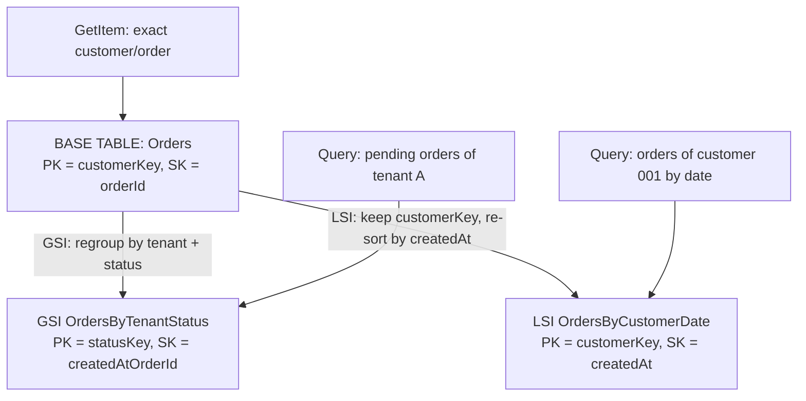
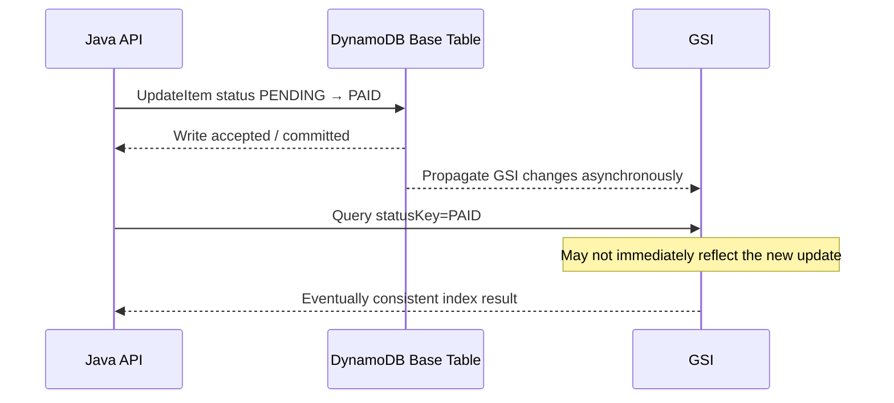
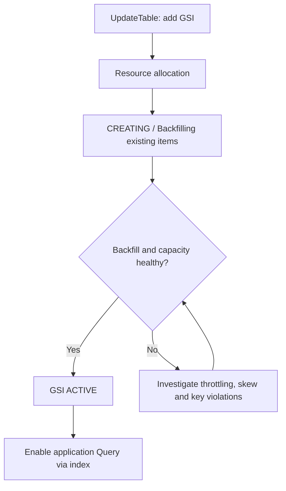

# Global Secondary Indexes and Local Secondary Indexes in Amazon DynamoDB

A **Java Spring Boot** system stores orders in **Amazon DynamoDB**. The table's primary key is optimized for "list orders of customer A," yet the customer support team wants "list all pending orders for tenant X chronologically," and the profile page wants "view customer A's orders by creation time, newest first."

With only a primary key, a developer might reach for a full-table `Scan` with a `FilterExpression`. That may work on a few hundred records, but it burns huge read capacity, latency, and cost once the table holds millions of orders. **Secondary indexes** provide alternate query keys without duplicating data via a self-managed pipeline.

DynamoDB offers two common secondary index types:

- **Global Secondary Index (GSI):** has a different partition key from the base table and optionally a different sort key. Fits queries **spanning across multiple base-table partition keys**, is maintained asynchronously, and supports **eventually consistent reads only**.
- **Local Secondary Index (LSI):** keeps the **same partition key** as the base table while using a **different sort key**. Fits changing sort order **within a single item collection**, supports **strongly consistent reads**, must be created at table creation time, and imposes a **10 GiB limit per item collection**.

> **Important update:** Since November 2025, DynamoDB supports **multi-attribute keys for GSIs**: up to four attributes forming the partition key and four attributes forming the sort key, instead of always concatenating fields into one synthetic string. The foundational hands-on examples in this lesson still use traditional GSI partition/sort keys for readability; Section 13 explains the new option. See [AWS What's New: GSI multi-attribute keys](https://aws.amazon.com/about-aws/whats-new/2025/11/amazon-dynamodb-multi-attribute-composite-keys-global-secondary-indexes/).

This lesson belongs to the **DynamoDB** chapter of the **CLOUD_PROVIDERS_AWS** module, connecting to how secure applications are designed on AWS: distributing data across Region/AZ infrastructure, IAM/VPC, storage, serverless/Lambda, access-pattern selection, throttling monitoring, recovery, and cost optimization.

## 1. Learning Objectives

After this lesson, you will be able to:

1. Distinguish between base table primary keys, partition keys, sort keys, **GSIs**, **LSIs**, index keys, projections, and item collections.
2. Choose between a **GSI or LSI** driven by concrete access patterns rather than starting with "what extra index should we add?"
3. Explain why **GSI eventual consistency** can return stale data, whereas **LSI strong consistency** only helps queries within the same base partition key.
4. Design index keys with sufficient dispersion to avoid hot partitions and the LSI 10 GiB limit.
5. Evaluate trade-offs of `KEYS_ONLY`, `INCLUDE`, and `ALL`, including base-table fetches during LSI reads.
6. Write GSI/LSI `Query` calls using the **AWS SDK for Java v2** with proper pagination, `IndexName`, and `ConsistentRead`.
7. Provision tables with GSIs/LSIs in **CloudFormation**, and add GSIs to existing tables through a safe rollout process.
8. Understand GSI backfill, write throttling/back-pressure, sparse indexes, WCU/RCU capacity, and CloudWatch monitoring.
9. Diagnose `ValidationException`, `ItemCollectionSizeLimitExceededException`, missing projected attributes, and data lag.
10. Apply checklists for IAM/KMS security, multi-tenant isolation, migrations, testing, and cost management.

## 2. The DynamoDB Data Model and Why Indexes Exist

**Amazon DynamoDB** is a fully managed NoSQL key-value/document database that scales without administering DB servers. DynamoDB organizes data by each item's **primary key**.

There are two common primary key shapes:

- **Simple primary key:** only a **partition key**, e.g., `userId`.
- **Composite primary key:** **partition key + sort key**, e.g., `customerKey + orderId`.

In the base table, the primary key must **uniquely** identify an item. DynamoDB distributes data and throughput across internal partitions based on keys. When calling `Query`, you specify a partition key value and optionally a condition on the sort key.

```text
Base table: Orders

Partition key: customerKey (String)
Sort key:      orderId     (String)

customerKey                  orderId       status      createdAt
---------------------------------------------------------------------------
TENANT#A#CUSTOMER#001       ORDER#1001    PENDING     2026-11-20T08:00:00Z
TENANT#A#CUSTOMER#001       ORDER#1002    PAID        2026-11-20T09:00:00Z
TENANT#A#CUSTOMER#002       ORDER#1003    PENDING     2026-11-20T09:15:00Z
TENANT#B#CUSTOMER#010       ORDER#2001    PENDING     2026-11-20T10:00:00Z
```

With this primary key, two efficient queries are:

```text
GetItem(customerKey=TENANT#A#CUSTOMER#001, orderId=ORDER#1002)
Query(customerKey=TENANT#A#CUSTOMER#001)
```

However, to query "all `PENDING` orders for tenant A," partition key `customerKey` falls short: orders are scattered across many customers. And to query "customer 001's orders by `createdAt`," sort key `orderId` does not generally sort chronologically.

**Indexes solve the problem of adding alternate access paths** without altering the base table's primary key.

## 3. GSI vs. LSI: Core Comparison Table

| Criterion | **Global Secondary Index (GSI)** | **Local Secondary Index (LSI)** |
|---|---|---|
| Partition key | **Can differ** from base table | **Must match** base table |
| Sort key | Optional in typical GSI schemas; can differ from base | **Mandatory** and **different** from base table sort key |
| Query scope | Across items grouped by the **GSI partition key**; can span many base partitions | Within **a single base partition key value** |
| Physical distribution | Independent partition space and capacity | Item collection co-located with base partition |
| Creation time | At table creation or **added to an existing table** | **Only at table creation** |
| Index deletion | GSI can be deleted later | Cannot delete an LSI independently; usually requires creating a new table |
| Read consistency | **Eventually consistent only** | **Eventually or strongly consistent** |
| Provisioned capacity | GSI has dedicated RCUs/WCUs | Shares RCUs/WCUs with base table |
| On-demand billing | Index requests/writes billed separately; inherits table mode | Billed against base table activity |
| Querying unprojected attributes | **Cannot auto-fetch** from base table during GSI Query | **Can fetch** from base table, adding read cost and latency |
| Per-base-PK size limit | Not subject to LSI's 10 GiB item collection limit | **10 GiB/item collection**, including base items and related LSI entries |
| Default quota | **20 GSIs/table**, quota increase requestable | **5 LSIs/table**, fixed quota |
| Best fit | Cross-customer/status/time lookups, alternate partition distribution | Same-customer queries by alternate sort key + strong reads |

**One-line rule of thumb:** A GSI **regroups data**, while an LSI **re-sorts data within the same group**.

Sources: [AWS — Secondary index comparison](https://docs.aws.amazon.com/amazondynamodb/latest/developerguide/SecondaryIndexes.html), [DynamoDB service quotas](https://docs.aws.amazon.com/amazondynamodb/latest/developerguide/ServiceQuotas.html).

## 4. Visualizing the Two Indexes



### 4.1. A GSI Creates a New Access Path

In the base table, each customer is a logical partition key; a GSI can gather all `PENDING` orders of tenant A together, even though those orders live under customers 001, 002, 003, etc.

```text
GSI OrdersByTenantStatus

statusKey                 createdAtOrderId                     base orderId
------------------------------------------------------------------------------------
TENANT#A#STATUS#PENDING   2026-11-20T08:00:00Z#ORDER#1001     ORDER#1001
TENANT#A#STATUS#PENDING   2026-11-20T09:15:00Z#ORDER#1003     ORDER#1003
TENANT#A#STATUS#PAID      2026-11-20T09:00:00Z#ORDER#1002     ORDER#1002
TENANT#B#STATUS#PENDING   2026-11-20T10:00:00Z#ORDER#2001     ORDER#2001
```

**This is the GSI's partition key**, not the base table's primary key. Index entries may share the same GSI key value—**GSI keys have no uniqueness constraint** like the base table primary key.

### 4.2. An LSI Changes the Sort Key for the Same Customer

```text
LSI OrdersByCustomerDate

customerKey                  createdAt                    base orderId
--------------------------------------------------------------------------
TENANT#A#CUSTOMER#001       2026-11-20T08:00:00Z        ORDER#1001
TENANT#A#CUSTOMER#001       2026-11-20T09:00:00Z        ORDER#1002
TENANT#A#CUSTOMER#002       2026-11-20T09:15:00Z        ORDER#1003
```

`Query(customerKey=TENANT#A#CUSTOMER#001)` on the LSI can return newest orders first via the `createdAt` sort key. Yet it **cannot** return orders across all customers of tenant A given just `tenantId`: the partition key on the LSI is still `customerKey`.

### 4.3. "Global" Does Not Mean "Scan Everything"

The word "global" means **the index has an independent key distribution** from the base table—not that a GSI `Query` magically searches every item without a key condition. `Query` still requires a valid key condition. If you need the whole index, `Scan` exists, but is usually expensive and unsuitable for primary production paths.

## 5. GSI: Key Schema, Data, and Eventual Consistency

Each standard GSI is created with an **index partition key** and an optional **index sort key**. Key attributes must be top-level **String, Number, or Binary** scalars. Attributes chosen as index keys do not have to be base keys.

DynamoDB **automatically maintains** GSIs when the application calls `PutItem`, `UpdateItem`, or `DeleteItem` on the **base table**. The application **never calls PutItem/UpdateItem directly on an index**.



### 5.1. Why Are GSIs Eventual Only?

Changes to a GSI are propagated **asynchronously** from the base table. Right after a write, querying the GSI may:

- Miss a newly added item.
- Still show a deleted item.
- Return stale projected values.
- Temporarily show an item under its old status before its index key moves from `PENDING` to `PAID`.

Under normal conditions propagation is fast, yet there is no **hard latency SLA** an application can rely on. **Never loop thousands of retries** trying to force a GSI to behave as strongly consistent.

### 5.2. `ConsistentRead=true` Does Not Work on GSIs

DynamoDB supports **eventually consistent reads only** on GSIs. Passing `ConsistentRead: true` to a GSI Query triggers `ValidationException`; there is no other flag to turn on strong reads for a GSI.

For flows that must see a newly created order right away:

- Use **`GetItem`** on the base table with `ConsistentRead=true` when the exact primary key is known.
- Or use **`Query`** on an LSI with `ConsistentRead=true` when sharing the partition key and the model supports it.
- Or return the newly written object directly from the mutation/API response and refresh later using versions/correlation.
- Never rely on a GSI as the sole proof of a transactional invariant requiring strong consistency.

Sources: [GSI consistency](https://docs.aws.amazon.com/amazondynamodb/latest/developerguide/GSI.html), [Read consistency](https://docs.aws.amazon.com/amazondynamodb/latest/developerguide/HowItWorks.ReadConsistency.html).

### 5.3. Sparse GSIs: Only a Subset of Items Appears

An item **only appears in a GSI** when all required index key attributes are present with valid values. If `statusKey` or `createdAtOrderId` is absent, the item is omitted from that index.

This is a **sparse index**—handy for queries like:

- Only incomplete orders.
- Only `READY` jobs awaiting workers.
- Only records flagged for manual review.
- Only active sessions.

**Watch out:** if a producer bug omits a key attribute, GSI queries will **miss the item** even though it exists in the base table. Monitor data quality and never treat "missing from GSI" as proof of "does not exist."

## 6. LSI: Same Partition Key, Different Sort Key

An LSI can only be declared **when creating the base table**, and requires the base table to have a **composite primary key**. The LSI uses the **same partition key**, while its sort key must differ from the base table's sort key.

Example:

```text
Base table:
    PK customerKey; SK orderId

LSI OrdersByCustomerDate:
    PK customerKey; SK createdAt
```

With an LSI, DynamoDB indexes each partition key's item collection ordered by the LSI sort key, supporting:

- `Query customerKey = A AND createdAt BETWEEN start AND end`.
- Ascending/descending sorting by `createdAt` via `ScanIndexForward`.
- `ConsistentRead=true` when strong reads are needed.
- Fetching non-projected fields from the base table (with extra read cost/latency).

### 6.1. How LSIs Differ in Design Questions

An LSI **does not** support querying "all orders with `status=PENDING` across all customers" when the base PK is `customerKey`, because you still must provide `customerKey`. Whenever a query needs a different **partition key**, use a GSI or redesign the table primary key.

### 6.2. LSIs and Strong Consistency

When querying an LSI with `ConsistentRead=true`, DynamoDB returns strongly consistent reads within that LSI's scope. However, that:

- **Does not** make a multi-item or multi-table distributed operation automatically atomic.
- **Does not** resolve network timeouts after a write commit whose result is unknown.
- **Does not** enable strong reads on a separate GSI.
- **Does not** fix an access pattern lacking the right partition key.

Source: [Local secondary indexes](https://docs.aws.amazon.com/amazondynamodb/latest/developerguide/LSI.html).

## 7. Designing from Access Patterns Before Picking an Index

A disciplined design workflow:

1. List **every business question** the API must answer.
2. Identify partition keys directly derivable from request/auth context.
3. Specify sort keys, ranges, pagination, ordering, projected fields, and consistency.
4. Estimate **cardinality**, item-collection growth, request rates, and burst traffic.
5. Map each question to the base table, LSI, GSI, or another access pattern.
6. Assess risks: GSI lag/hot keys, LSI 10 GiB limit, write amplification.
7. Write sample queries and load-test with realistic data skew.

### 7.1. Decision Matrix for Orders

| Question | Condition | Consistency needed? | Access path |
|---|---|---|---|
| Fetch one exact order | `customerKey` + `orderId` | May need strong | Base `GetItem` |
| List all orders of one customer | `customerKey` | Eventual/strong per use case | Base `Query` |
| List customer's orders by date | `customerKey` + `createdAt` range | May need strong | **LSI `OrdersByCustomerDate`** |
| List a tenant's PENDING orders | `tenantId` + `status` + time | Eventual acceptable for dashboard | **GSI `OrdersByTenantStatus`** |
| View newly created order right after POST | Exact base key | Strong / read-your-write | Base `GetItem` or write response |
| Search all orders containing substring in notes | Full-text condition | Not a key lookup | OpenSearch/search engine; never default Scan |
| Monthly revenue analytics | Large aggregation | Batch/near-real-time | Streams → warehouse/aggregation, never Query + Filter all items |

### 7.2. Name Indexes After Queries

Use descriptive names reflecting **access patterns**, such as `OrdersByTenantStatus` and `OrdersByCustomerDate`, rather than `Index1`/`Index2`. Index names form part of the AWS SDK/IaC contract and appear in IAM policies and dashboards.

### 7.3. Isolate Tenants at the Key Level

For example, `customerKey = TENANT#A#CUSTOMER#001`. In multi-tenant apps, derive the tenant from **verified IAM/Cognito/JWT context**—never trust an arbitrary `customerKey` sent by the client. GSI keys must also enforce tenant scoping so tenants never bleed into one query.

## 8. Projection: KEYS_ONLY, INCLUDE, ALL

When creating a GSI or LSI, you choose a **projection**—which attributes from the base item are copied into the index. Every index always stores **base table primary key attributes** and **index key attributes**; you choose which extra fields to include.

| Projection | What is stored? | Pros | Cons |
|---|---|---|---|
| `KEYS_ONLY` | Base keys + index keys | Smallest footprint, minimal write/storage overhead | Queries cannot return extra fields directly |
| `INCLUDE` | Keys + listed `NonKeyAttributes` | Balances read performance with write/storage cost | Must anticipate needed fields |
| `ALL` | All item attributes | Most flexible queries | Higher storage and WCU cost whenever fields change |

### 8.1. Example with an Order Item

```json
{
  "customerKey": "TENANT#A#CUSTOMER#001",
  "orderId": "ORDER#1001",
  "tenantId": "A",
  "statusKey": "TENANT#A#STATUS#PENDING",
  "createdAt": "2026-11-20T08:00:00Z",
  "createdAtOrderId": "2026-11-20T08:00:00Z#ORDER#1001",
  "status": "PENDING",
  "totalMinorUnits": 159900,
  "shippingAddress": {
    "city": "HCM",
    "street": "(stored securely)"
  }
}
```

The dashboard API only needs `orderId`, `status`, `createdAt`, and `totalMinorUnits`. If the GSI uses `INCLUDE` for `status, createdAt, totalMinorUnits`, reads are served **entirely from the GSI** without copying sensitive `shippingAddress` data into the index.

**Do not pick `ALL` just "so you don't have to think."** It bloats index size, raises storage/write costs, and replicates sensitive data across extra access paths.

### 8.2. GSIs Do Not Auto-Fetch Unprojected Attributes

If a GSI only projects `status` and `totalMinorUnits`, a GSI query requesting `shippingAddress` cannot fetch it automatically from the base table.

Valid approaches:

- Include the needed attributes in the projection.
- Query the GSI for **base keys**, then call `BatchGetItem`/`GetItem` on the base table at additional read capacity cost.
- For sensitive fields, intentionally omit them from the projection so retrieving them requires a tightly controlled base-table read with strict IAM/authorization.

**Note:** passing `ProjectionExpression` on a GSI Query **cannot add** unprojected attributes; it only narrows what the index already stores.

### 8.3. LSIs Can Fetch from the Base Table

If an LSI Query requests `shippingAddress` when it is not projected, DynamoDB **automatically fetches** it from the base table, increasing read capacity and latency. This convenience is also a **performance trap**.

Sources: [GSI projections](https://docs.aws.amazon.com/amazondynamodb/latest/developerguide/GSI.html), [LSI projections and fetching](https://docs.aws.amazon.com/amazondynamodb/latest/developerguide/LSI.html).

## 9. Query, FilterExpression, and Pagination: Avoiding Wasted Reads

DynamoDB `Query` accepts:

- `TableName`, optional `IndexName`.
- `KeyConditionExpression` — condition on the index/base key selecting the slice to read.
- `FilterExpression` — filters **after** reading items matching the key condition.
- `ProjectionExpression` — selects attributes to return.
- `Limit`, `ExclusiveStartKey` — pagination.
- `ScanIndexForward` — ascending/descending sort key order.
- `ConsistentRead` — `true` valid for base/LSI, **invalid for GSI**.

### 9.1. Why FilterExpression Cannot Replace an Index

Suppose you query all orders of a tenant through a GSI partition containing 100,000 records and filter `status=PENDING` down to 200 records.

DynamoDB still **reads all items matching the key condition first**, then discards non-matching ones, so `FilterExpression` does not save the read capacity spent on those 99,800 discarded records. To optimize, put `status` into the index key/access path so `Query` reads only what you need.

### 9.2. `Limit` and 1 MB Pages

`Query` caps each page at **1 MB of data read** before pagination triggers. `Limit` bounds **the number of items evaluated** per API call, never guaranteeing N returned items if `FilterExpression` drops rows.

- If `LastEvaluatedKey` is present, more pages may remain.
- When `LastEvaluatedKey` is present, never treat `Items=[]` as "end of results."
- Continue with `ExclusiveStartKey` under the same index/key context.
- Never let clients tamper with raw cursors to switch tenants; sign or encapsulate tokens per your API contract.

### 9.3. String Sort Keys Are Not Automatically Dates

Consistent UTC ISO-8601 strings such as `2026-11-20T08:00:00Z` align lexicographical order with chronological order within the same format. Mixing timezone offsets, missing zero-padding, or inconsistent millisecond precision breaks chronological ordering.

Alternatively, store epoch milliseconds as a DynamoDB Number. Choose the schema based on query patterns and range-sorting needs.

## 10. AWS SDK for Java v2: Querying a GSI

Example method listing `PENDING` orders for tenant A by `createdAtOrderId`, newest first. The fields below assume GSI `OrdersByTenantStatus` with `statusKey` and `createdAtOrderId` already exists.

```java
import java.util.Map;

import software.amazon.awssdk.services.dynamodb.DynamoDbClient;
import software.amazon.awssdk.services.dynamodb.model.AttributeValue;
import software.amazon.awssdk.services.dynamodb.model.QueryRequest;
import software.amazon.awssdk.services.dynamodb.model.QueryResponse;
import software.amazon.awssdk.services.dynamodb.model.ReturnConsumedCapacity;

public final class OrdersByStatusQuery {
    private final DynamoDbClient dynamo;

    public OrdersByStatusQuery(DynamoDbClient dynamo) {
        this.dynamo = dynamo;
    }

    public QueryResponse latestPending(
            String tenantId, Map<String, AttributeValue> cursor) {

        // Production: tenantId MUST come from trusted auth context.
        String pk = "TENANT#" + tenantId + "#STATUS#PENDING";

        QueryRequest.Builder builder = QueryRequest.builder()
            .tableName("Orders")
            .indexName("OrdersByTenantStatus")
            .keyConditionExpression("statusKey = :pk")
            .expressionAttributeValues(Map.of(
                ":pk", AttributeValue.fromS(pk)
            ))
            .scanIndexForward(false)
            .limit(25)
            .returnConsumedCapacity(ReturnConsumedCapacity.INDEXES);

        if (cursor != null && !cursor.isEmpty()) {
            builder.exclusiveStartKey(cursor);
        }

        // No consistentRead(true): a GSI supports eventual reads only.
        return dynamo.query(builder.build());
    }
}
```

**When used in an HTTP API:**

- Resolve `tenantId` from trusted identity; **never** let users pass unauthorized tenant IDs.
- `QueryResponse.items()` returns items for **one page**, not necessarily all items.
- Pass `QueryResponse.lastEvaluatedKey()` to fetch the next page.
- `ReturnConsumedCapacity.INDEXES` reveals RCUs consumed from the index.
- Use tight projections so sensitive PII is not returned unnecessarily.
- In production, encode/sign cursor tokens or manage cursors server-side so clients cannot alter keys.
- If read-your-writes is required right after a mutation, use base `GetItem` or caching rather than expecting instant index updates.

### 10.1. Querying a Time Range

Because `createdAtOrderId` begins with an ISO-8601 timestamp, `BETWEEN` or `begins_with` works cleanly.

```java
QueryRequest request = QueryRequest.builder()
    .tableName("Orders")
    .indexName("OrdersByTenantStatus")
    .keyConditionExpression(
        "statusKey = :status AND begins_with(createdAtOrderId, :day)")
    .expressionAttributeValues(Map.of(
        ":status", AttributeValue.fromS("TENANT#A#STATUS#PENDING"),
        ":day", AttributeValue.fromS("2026-11-20")
    ))
    .scanIndexForward(false)
    .build();
```

This is a fragment meant inside a method with proper imports, **not a standalone Java class**. `begins_with` works only on compatible sort key types. For time ranges, enforce uniform timezones and formatting.

## 11. AWS SDK for Java v2: Querying an LSI with Strong Reads

Example querying "orders for customer 001 in November" on `OrdersByCustomerDate`:

```java
import java.util.Map;

import software.amazon.awssdk.services.dynamodb.DynamoDbClient;
import software.amazon.awssdk.services.dynamodb.model.AttributeValue;
import software.amazon.awssdk.services.dynamodb.model.QueryRequest;
import software.amazon.awssdk.services.dynamodb.model.QueryResponse;
import software.amazon.awssdk.services.dynamodb.model.ReturnConsumedCapacity;

public final class OrdersByCustomerDateQuery {
    private final DynamoDbClient dynamo;

    public OrdersByCustomerDateQuery(DynamoDbClient dynamo) {
        this.dynamo = dynamo;
    }

    public QueryResponse inNovember(String trustedCustomerKey) {
        QueryRequest req = QueryRequest.builder()
            .tableName("Orders")
            .indexName("OrdersByCustomerDate")
            .keyConditionExpression(
                "customerKey = :customer AND createdAt BETWEEN :from AND :to")
            .expressionAttributeValues(Map.of(
                ":customer", AttributeValue.fromS(trustedCustomerKey),
                ":from", AttributeValue.fromS("2026-11-01T00:00:00Z"),
                ":to", AttributeValue.fromS("2026-11-30T23:59:59Z")
            ))
            .consistentRead(true)
            .scanIndexForward(false)
            .limit(50)
            .returnConsumedCapacity(ReturnConsumedCapacity.INDEXES)
            .build();

        return dynamo.query(req);
    }
}
```

**Why is `consistentRead(true)` valid?** Because this is an **LSI**, not a GSI. Read capacity is charged to the **base table**; `ReturnConsumedCapacity` helps inspect index/table read consumption.

**Warning on this example:** ending at `23:59:59Z` can miss records with fractional seconds after 23:59:59; production should handle half-open bounds `>= 2026-11-01T00:00:00Z` and `< 2026-12-01T00:00:00Z` within sort-key syntax capabilities. Since DynamoDB `KeyConditionExpression` does not support combining `>=` and `<` on the same sort key directly, use `BETWEEN` with a tightly normalized upper bound matching real data (or numeric epochs with an appropriate upper bound). Never mix timestamp formats arbitrarily.

### 11.1. Does LSI GetItem Exist?

**No.** Both GSIs and LSIs are queried via `Query` or `Scan` with `IndexName`. `GetItem` and `BatchGetItem` **do not accept `IndexName`** to read a secondary index directly. When you know the base primary key, call `GetItem` on the base table.

Source: [DynamoDB LSI Query](https://docs.aws.amazon.com/amazondynamodb/latest/developerguide/LSI.html).

## 12. Sparse Index Pattern: Indexing Only Actionable Items

Suppose the system only needs "orders currently `PENDING`." You do not have to index every status. Keep `pendingIndexPK` and `pendingIndexSK` **only while the status is PENDING**.

```text
Base table item status=PENDING:
    pendingIndexPK = "TENANT#A#PENDING"
    pendingIndexSK = "2026-11-20T08:00:00Z#ORDER#1001"

Once transitioned to PAID:
    REMOVE pendingIndexPK, pendingIndexSK
```

The `PendingOrdersIndex` GSI contains only items that retain both index keys. When an item changes status, DynamoDB updates the index asynchronously and removes the stale entry.

### 12.1. Benefits

- Tiny index when pending items are a small fraction of historical volume.
- Less write/storage overhead on completed items.
- Queries read only the actionable subset.

### 12.2. Correctness Traps

- If a producer forgets to populate the sparse keys when entering PENDING, the item **never appears in the index**.
- If concurrent workers pick up the same item, the GSI Query can serve stale entries. Use a **conditional `UpdateItem`** on the base item to claim/transition state.
- Never treat disappearance from the GSI as proof that a business transaction committed and reconciled.
- For job schedulers, avoid a hot GSI partition caused by all jobs writing `PENDING` to one key.

### 12.3. A Sparse GSI Is Not a Server-Side Queue

A GSI queried for "ready tasks" **does not** provide SQS visibility timeouts, lease/ack semantics, DLQs, or managed retries. For distributed worker queues, use SQS/Step Functions where suitable, or explicitly build conditional claims and durable leases in DynamoDB.

## 13. GSI Multi-Attribute Keys: New Feature and Usage

Current AWS documentation supports **multi-attribute composite keys on GSIs**. Instead of manually building:

```text
GSI_PK = "TENANT#A#STATUS#PENDING"
GSI_SK = "2026-11-20T08:00:00Z#ORDER#1001"
```

you can define a GSI key using **natural attributes**:

```text
GSI partition key attributes:
    tenantId   (String)
    status     (String)

GSI sort key attributes:
    createdAt  (String)
    orderId    (String)
```

DynamoDB hashes the multi-attribute partition key and orders by the multi-attribute sort key automatically; you no longer have to materialize `TENANT#...` strings in Java code.

### 13.1. Supported Rules

- A GSI supports up to **4 partition key attributes** and **4 sort key attributes** (up to 8 total).
- Key attributes must be scalar `String`, `Number`, or `Binary`.
- A `Query` on a multi-attribute GSI must specify **equality conditions on all partition key attributes**.
- Sort key conditions proceed **left-to-right** in declared order without skipping intermediate attributes.
- Range conditions (`>`, `<`, `BETWEEN`, `begins_with`) apply to the appropriate final position in the sort-key predicate chain.
- Do not confuse **multi-attribute GSIs** with LSIs: an LSI remains **same base partition key + alternate sort key** with its own semantics.

### 13.2. Benefits and Trade-Offs

| Scenario | Multi-attribute GSI | Synthetic string GSI |
|---|---|---|
| Existing data already has `tenantId`, `status`, `createdAt` | No need to backfill concatenated fields before creating the GSI | Must backfill `statusKey`/`createdAtOrderId` onto items |
| Need typed numeric sorting | Can use natural Number keys | Requires zero-padding or consistent encoding in Strings |
| Flexibility of ordering/hierarchy | Built from declared attribute order per feature rules | Can actively encode custom hierarchies inside strings |
| Older apps/SDKs/IaC tooling | Must verify tool/version support | Classic pattern, broadly supported and easy to test |

**Choose based on your AWS SDK/CloudFormation/IaC version support.** The CloudFormation template in Section 18 uses the **traditional GSI style** so it works with foundational setups; avoid the newer schema if your pipeline or tooling does not support it yet.

Sources: [AWS GSI multi-attribute key schema](https://docs.aws.amazon.com/amazondynamodb/latest/developerguide/GSI.html), [Design pattern](https://docs.aws.amazon.com/amazondynamodb/latest/developerguide/GSI.DesignPattern.MultiAttributeKeys.html).

## 14. LSI Item Collections and the 10 GiB Limit

An **item collection** is **all items in the base table sharing the same partition key value**, plus their associated LSI entries.

On a table with **at least one LSI**, DynamoDB enforces a **10 GiB limit per item collection**. This is **not a 10 GiB limit for the entire table**; a table can grow huge across many partition key values as long as no single collection exceeds the limit.

```text
Table Orders (with LSI OrdersByCustomerDate):

PK = TENANT#A#CUSTOMER#001
  ↳ Order 1001 + LSI entries
  ↳ Order 1002 + LSI entries
  ↳ ...
  ↳ Order 999999 + LSI entries

Total item collection (base + related LSI entries) > 10 GiB
→ writes growing that collection will fail.
```

### 14.1. Why Is This Limit Dangerous?

If a model uses `PK=TENANT#A` and stores millions of tenant A orders in one item collection, adding an LSI blocks growth once that tenant hits 10 GiB. This is a **logical per-partition-key limit** that raising RCUs/WCUs cannot fix.

Operations that add items or expand that collection fail with **`ItemCollectionSizeLimitExceededException`**. Never retry this error infinitely.

### 14.2. Mitigating the Risk

- Use a **bounded** partition key scope—such as a customer/order group with realistic bounds.
- Pass `ReturnItemCollectionMetrics=SIZE` on writes to monitor `SizeEstimateRangeGB`.
- Alert early, e.g., at **8 GiB**, well before 10 GiB.
- Archive old data and trim projected attributes where data contracts allow.
- If a collection can grow unboundedly, **prefer a GSI or redesign the data model**.
- Once an LSI exists, you cannot simply "drop the LSI" like SQL to remove the limit: you typically must **migrate to a new table** without an LSI.

### 14.3. A Design Mistake to Catch Early

**Never create an LSI on a table with `PK=tenantId` if a tenant can accumulate millions of unbounded orders** just to sort by `createdAt`. A GSI or a partition key bucketed by tenant/time is more appropriate, provided you evaluate access patterns and query fan-out.

Source: [LSI item collection limits](https://docs.aws.amazon.com/amazondynamodb/latest/developerguide/LSI.html).

## 15. Non-Unique Index Keys, Sorting, and Duplicate Values

### 15.1. Base Primary Key Must Be Unique

The table's primary key uniquely identifies an item. `PutItem` with the same key **overwrites** unless guarded by a `ConditionExpression`.

### 15.2. GSI and LSI Sort Keys Need Not Be Unique

Multiple items can share identical index key values—for instance, two orders from the same customer created in the same second with the same `createdAt`. An LSI can hold multiple items with the same `customerKey + createdAt` because DynamoDB still distinguishes them by **base primary key**.

However, **ordering among items sharing the same LSI/GSI sort key is not business-deterministic**. If the UI needs stable deterministic pagination, consider:

- Combining `timestamp + orderId` in the index sort key.
- Using high-precision timestamps plus an event/order sequence.
- Using a multi-attribute GSI sort key `createdAt, orderId` where supported.
- Never assuming the database returns secondary-key ties in base PK order.

### 15.3. LSI Time Queries with Identical Timestamps

In `OrdersByCustomerDate`, where the sort key is just `createdAt`, orders sharing a timestamp sit adjacent without a defined tie-breaker. If the API requires strictly stable ordering, change the model (a GSI sort key with a tie-breaker, or a redesigned base SK).

## 16. Capacity: How GSIs and LSIs Consume Differently

### 16.1. Provisioned Mode

| Operation | GSI | LSI |
|---|---|---|
| `Query` index | Consumes **GSI RCUs** | Consumes **base table RCUs** |
| Insert/update affecting index | Consumes **GSI WCUs** and base table WCUs | Consumes **base table WCUs** for base/index work |
| Index capacity config | GSI has separate provisioned read/write capacity | LSI has no separate provisioned throughput |
| Index lacks write capacity | **Can throttle base table writes** (GSI back-pressure) | Table throttles per base capacity and partition |
| Scaling capacity | Provision/autoscale per GSI | Provision/autoscale on the table |

**Common trap:** an `UpdateItem` on the **base table** can get throttled because **a GSI ran out of write capacity**, even while the base table has plenty of headroom. Monitor metrics per **GSI**, not just at the table level.

### 16.2. On-Demand Mode

GSIs inherit the **base table's capacity mode**. In on-demand mode, you do not set per-GSI `ProvisionedThroughput`, yet **index reads, writes, and storage still incur charges**, quotas, and per-partition/index limits. LSI activity counts against the base table.

**GSIs are never free just because the base table uses `PAY_PER_REQUEST`.**

### 16.3. Sample Calculations

Assume writing **one 1.8 KiB base item** and one **0.5 KiB GSI entry**:

```text
Base PutItem:
  ceil(1.8 KiB / 1 KiB) = 2 equivalent write units.

GSI Insert:
  ceil(0.5 KiB / 1 KiB) = 1 equivalent write unit.

Example total impact:
  2 base write units + 1 GSI write unit = 3.
```

This is a **simplified non-transactional write example**; projections, old→new key updates, index delete+insert pairs, transactions, index counts, and billing modes all alter real totals.

For a **GSI eventual read** of 8 index entries totaling 16 KiB:

```text
Reading 16 KiB from GSI (eventually consistent)
= ceil(16 / 4) × 0.5 = 2 equivalent RCUs

If querying an LSI strongly consistently for the same 16 KiB projected data:
= ceil(16 / 4) × 1 = 4 equivalent RCUs
```

**Note on LSI fetches:** if unprojected attributes must be pulled from the base table, additional base-table read capacity is consumed beyond the 4 illustrative RCUs.

Sources: [GSI capacity](https://docs.aws.amazon.com/amazondynamodb/latest/developerguide/GSI.html), [LSI capacity](https://docs.aws.amazon.com/amazondynamodb/latest/developerguide/LSI.html), [DynamoDB pricing](https://aws.amazon.com/dynamodb/pricing/).

## 17. Write Amplification and Updating Index Keys

When the application updates a base item, DynamoDB updates matching index entries. For a GSI:

| Base item change | GSI impact |
|---|---|
| New item has all GSI keys | Adds index entry |
| New item lacks a GSI key | No index entry |
| Only non-key, non-projected field changes | Usually no index entry update needed |
| Projected attribute changes | Updates index entry |
| GSI partition/sort key changes | **Deletes old entry, inserts new entry** |
| GSI key removed from item | Deletes index entry |
| Base item deleted | Deletes corresponding index entry |

### 17.1. Why Indexing by `status` Can Be Expensive

An order moving `PENDING → PAID → SHIPPED → COMPLETED` changes `statusKey` repeatedly. Each transition triggers a **GSI delete + insert** instead of a simple single write.

If the order item is large and GSI projection = `ALL`, write and storage costs climb sharply. Consider:

- Projecting only fields needed by the dashboard.
- Using a sparse index only for states needing operational processing.
- Separating event history from current state in the schema.
- Sizing traffic for status updates, not just initial inserts.

### 17.2. Index Write Throttling Propagates to the Base Table

If a GSI lacks update capacity, base writes suffer back-pressure. Adding an index to a large production table **does not only affect queries targeting that index**.

Monitor `WriteThrottleEvents`, `ThrottledRequests`, `ConsumedWriteCapacityUnits`, and per-index/Region metrics. In provisioned mode, size index WCUs to match base-table write patterns and configure autoscaling and alarms.

Source: [GSI write throttling and back-pressure](https://docs.aws.amazon.com/amazondynamodb/latest/developerguide/gsi-throttling.html).

## 18. CloudFormation: Orders Table with Both a GSI and an LSI

The template below defines a **new table** in one Region. Applying it creates a real DynamoDB table and incurs charges.

```yaml
AWSTemplateFormatVersion: '2010-09-09'
Description: DynamoDB Orders with a GSI and an LSI

Resources:
  OrdersTable:
    Type: AWS::DynamoDB::Table
    DeletionPolicy: Retain
    UpdateReplacePolicy: Retain
    Properties:
      TableName: OrdersLearningExample
      BillingMode: PAY_PER_REQUEST
      PointInTimeRecoverySpecification:
        PointInTimeRecoveryEnabled: true
      SSESpecification:
        SSEEnabled: true
      AttributeDefinitions:
        - AttributeName: customerKey
          AttributeType: S
        - AttributeName: orderId
          AttributeType: S
        - AttributeName: createdAt
          AttributeType: S
        - AttributeName: statusKey
          AttributeType: S
        - AttributeName: createdAtOrderId
          AttributeType: S

      KeySchema:
        - AttributeName: customerKey
          KeyType: HASH
        - AttributeName: orderId
          KeyType: RANGE

      LocalSecondaryIndexes:
        - IndexName: OrdersByCustomerDate
          KeySchema:
            - AttributeName: customerKey
              KeyType: HASH
            - AttributeName: createdAt
              KeyType: RANGE
          Projection:
            ProjectionType: INCLUDE
            NonKeyAttributes:
              - status
              - totalMinorUnits

      GlobalSecondaryIndexes:
        - IndexName: OrdersByTenantStatus
          KeySchema:
            - AttributeName: statusKey
              KeyType: HASH
            - AttributeName: createdAtOrderId
              KeyType: RANGE
          Projection:
            ProjectionType: INCLUDE
            NonKeyAttributes:
              - status
              - createdAt
              - totalMinorUnits
              - tenantId

Outputs:
  TableName:
    Value: !Ref OrdersTable
  TableArn:
    Value: !GetAtt OrdersTable.Arn
```

### 18.1. Explaining the Choices

- `AttributeDefinitions` declares only **key attributes** of the table and indexes—**not** every column like a SQL schema.
- Base `KeySchema`: `customerKey + orderId`.
- `LocalSecondaryIndexes`: same partition key, alternate sort key `createdAt`.
- `GlobalSecondaryIndexes`: alternate partition key `statusKey`, alternate sort key `createdAtOrderId`.
- `ProjectionType: INCLUDE` trims projected fields to lower storage and write costs.
- `PAY_PER_REQUEST` avoids picking fixed RCUs/WCUs in learning environments, **but is not free**.
- `PointInTimeRecoveryEnabled` aids recovery from data errors per service capabilities; indexes **do not replace backups/PITR**.
- `DeletionPolicy: Retain` preserves the table if the stack is deleted per CloudFormation rules, so **cleanup must be performed manually with approval** to avoid forgotten ongoing charges.
- `SSEEnabled` enables service-supported default encryption; customer-managed KMS keys require separate key setup and IAM/key policies.
- A hardcoded `TableName` conflicts if multiple stacks deploy; production should use naming conventions, parameters, and tags.

### 18.2. This Is a Data Model Example, Not CSV Format

When writing an order, the application supplies the right keys and types:

```json
{
  "customerKey": { "S": "TENANT#A#CUSTOMER#001" },
  "orderId": { "S": "ORDER#1001" },
  "createdAt": { "S": "2026-11-20T08:00:00Z" },
  "statusKey": { "S": "TENANT#A#STATUS#PENDING" },
  "createdAtOrderId": { "S": "2026-11-20T08:00:00Z#ORDER#1001" },
  "status": { "S": "PENDING" },
  "tenantId": { "S": "A" },
  "totalMinorUnits": { "N": "159900" }
}
```

This is **DynamoDB's low-level AttributeValue JSON representation**, not plain document JSON. Java AWS SDK v2 can use low-level `Map<String, AttributeValue>` or Enhanced Client/POJO mappers as needed.

## 19. Adding a GSI to an Existing Table: Online Creation and Backfill

A GSI can be added while a table is live. When a new index is added, DynamoDB **backfills** from the base table to build index entries for existing items.



### 19.1. Key Facts

- `IndexStatus=CREATING` while building; only query the index in the application once `ACTIVE`.
- During backfill, DynamoDB scans/evaluates existing items and copies valid index keys and projected fields.
- Items lacking an index key are omitted from the GSI; wrong types or key sizes cause **index key violations**.
- A new GSI can cause **base writes to throttle**, especially if the index partition key has low dispersion or index write capacity is too low.
- Building a large GSI takes time; never treat "`UpdateTable` returned success" as meaning the index is ready for queries.
- Very large tables may be subject to AWS Support checks/allowlisting per current documentation.

### 19.2. Safe Rollout Process

1. Check base table/index quotas and validate access patterns on realistic large sample data.
2. Verify GSI key types on existing records; backfill skips or flags items with key violations.
3. Estimate index storage, write amplification, and cost.
4. Create the GSI during off-peak hours when possible; account for potential base-traffic throttling.
5. Watch `OnlineIndexPercentageProgress`, index status, base writes/throttling, and errors.
6. **Never route application queries to the GSI until `ACTIVE`**.
7. Reconcile sample counts and sparsity rules, keeping GSI eventual consistency in mind.
8. Roll out feature flags/pipelines incrementally, alerting on business SLOs and cost.
9. If back-pressure occurs, follow a runbook to shed load or cancel creation per supported AWS states/conditions.
10. Post-rollout, tune capacity/autoscaling and monitor the new index as an independent resource.

### 19.3. LSIs Have No Online Add Equivalent

**You cannot run `UpdateTable` to add an LSI** to an existing table. If a new LSI is needed:

- Create a **new table** with the LSI at `CreateTable`.
- Migrate/import/stream data with planned dual writes or CDC.
- Shift application traffic under control.
- Or use a **GSI** if the access pattern and eventual consistency allow it.

Choosing an LSI upfront requires weighing **future schema flexibility** and item-collection limits—not just saving one GSI.

Sources: [Managing GSIs online](https://docs.aws.amazon.com/amazondynamodb/latest/developerguide/GSI.OnlineOps.html), [LSI creation](https://docs.aws.amazon.com/amazondynamodb/latest/developerguide/LSI.html).

## 20. AWS CLI Index Inspection (Read-Only)

Examples use Region `ap-southeast-1` and illustrative table names. Run in an AWS account/profile with appropriate `dynamodb:DescribeTable`/`Query` permissions.

```bash
# Verify AWS caller
aws sts get-caller-identity

# Inspect index names, key schemas, and statuses
aws dynamodb describe-table \
  --table-name OrdersLearningExample \
  --region ap-southeast-1 \
  --query 'Table.{Status:TableStatus,Keys:KeySchema,LSI:LocalSecondaryIndexes,GSIs:GlobalSecondaryIndexes}' \
  --output json

# Query GSI (eventually consistent)
aws dynamodb query \
  --table-name OrdersLearningExample \
  --index-name OrdersByTenantStatus \
  --key-condition-expression 'statusKey = :pk' \
  --expression-attribute-values '{":pk":{"S":"TENANT#A#STATUS#PENDING"}}' \
  --max-items 10 \
  --region ap-southeast-1

# Query LSI with strong consistency
aws dynamodb query \
  --table-name OrdersLearningExample \
  --index-name OrdersByCustomerDate \
  --key-condition-expression 'customerKey = :pk' \
  --expression-attribute-values '{":pk":{"S":"TENANT#A#CUSTOMER#001"}}' \
  --consistent-read \
  --max-items 10 \
  --region ap-southeast-1
```

**Note:** AWS CLI `--max-items` is a **client-side pagination** flag, not identical to DynamoDB's service `Limit`. Handle `NextToken`/pagination per SDK/CLI mode so the app never assumes one call returned the whole dataset.

### 20.1. Modifying a GSI via CLI Is a Write Operation

```bash
# ILLUSTRATIVE ONLY; DO NOT RUN AGAINST PRODUCTION WITHOUT REVIEW.
# UpdateTable adding/deleting a GSI affects data, capacity, and cost.
aws dynamodb update-table --help
```

Manage index changes via **IaC (CloudFormation/Terraform)** and reviewed change plans rather than running ad-hoc production updates without impact analysis.

## 21. Hot Partitions and Data Skew in GSIs

### 21.1. Why Can an Alternate Key Also Run Hot?

Suppose 70% of company revenue comes from tenant A and most orders are `PENDING`:

```text
statusKey = TENANT#A#STATUS#PENDING
```

Thousands of writers update GSI entries under the exact same **logical partition key**. Even though the base table spreads evenly across `customerKey`, **the GSI still runs hot**. DynamoDB adaptive capacity helps, yet does not erase single-key workload and query-structure limits.

### 21.2. Sharding a Hot GSI Key

One option:

```text
GSI PK = TENANT#A#STATUS#PENDING#SHARD#0
GSI PK = TENANT#A#STATUS#PENDING#SHARD#1
...
GSI PK = TENANT#A#STATUS#PENDING#SHARD#7
```

Producers pick a shard using a deterministic hash of `orderId`. Readers wanting all PENDING orders of tenant A must:

1. Query **8 shard keys**.
2. Merge/sort results by timestamp.
3. Manage pagination/cursors **per shard**.
4. Deduplicate by base primary key if needed and account for eventual consistency.

**Trade-off:** spreads writes better, while increasing query fan-out, code complexity, RCUs, latency, and removing strict global ordering. Do not shard prematurely at low throughput.

### 21.3. Do Multi-Attribute GSIs Replace Sharding?

Sometimes combining partition attributes (`tenantId + status + region/site/customerGroup`) boosts cardinality and helps spread load. However, if all traffic hits **one exact key combination**, hot-key risk remains. Choose keys from **real traffic distributions**, not just schema attribute counts.

Sources: [Index best practices](https://docs.aws.amazon.com/amazondynamodb/latest/developerguide/bp-indexes-general.html), [GSI write throttling](https://docs.aws.amazon.com/amazondynamodb/latest/developerguide/gsi-throttling.html).

## 22. Business-Level Consistency, Transactions, and Idempotency

### 22.1. GSI Lag Is Not a Transaction Failure

For example, `PutItem` succeeds, yet an immediate `Query GSI` misses the item. That is **eventual propagation**, not DynamoDB losing the write.

**Never re-insert the same order under a new `orderId`** just because a GSI query missed it. Check the base table with the full key and strong read when needed, and enforce operation IDs and conditional writes to prevent duplicates.

### 22.2. A GSI Is Not a Uniqueness Constraint

Two distinct base items can share the same `statusKey` and `createdAtOrderId`. To guarantee unique emails, unique usernames, or unique payment intents, a GSI **does not provide a SQL-style UNIQUE key constraint**.

Use a **transactional unique sentinel item** or properly scoped conditional writes on base-table keys. Querying a GSI to "check if it exists" and then inserting is a **race condition**, worsened by eventual consistency.

### 22.3. What Does an LSI Strong Read Mean in a Workflow?

An LSI query with `ConsistentRead=true` guarantees the read reflects committed updates per DynamoDB semantics. Still, when multiple items must update atomically, use **`TransactWriteItems`** or an appropriate domain pattern.

### 22.4. Read Ordering and User Interfaces

When a dashboard reads from an eventually consistent GSI:

- Use optimistic UI for newly created items.
- Display `PENDING`/`PROCESSING` states clearly.
- Poll or reconcile by request ID/primary key when needed.
- Never treat a sub-second to few-second sync delay as proof of failure.
- Track business data freshness metrics if SLOs require them.

## 23. IAM, KMS, VPC, and Index Security

### 23.1. IAM Can Scope Down to Table and Index ARNs

A role needing read-only access to `OrdersByTenantStatus` can be granted `dynamodb:Query` on that index ARN alone:

```json
{
  "Version": "2012-10-17",
  "Statement": [
    {
      "Sid": "QueryOnlyStatusIndex",
      "Effect": "Allow",
      "Action": ["dynamodb:Query"],
      "Resource": [
        "arn:aws:dynamodb:ap-southeast-1:111122223333:table/OrdersLearningExample/index/OrdersByTenantStatus"
      ]
    }
  ]
}
```

If the app also needs base-table `GetItem`, grant **separate** permissions on the table ARN with scoped actions and resources. IAM alone does not validate business tenant ownership from a client-supplied string.

### 23.2. Multi-Tenant Authorization

- Encode `tenantId`/`customerKey` into keys per the business contract.
- Resolve the tenant from a **trusted identity** (verified Cognito/OIDC/IAM/app claims).
- Validate request parameters; never let clients pick arbitrary index names or `statusKey` values.
- Enforce field-level access in the API; projections are not a complete authorization boundary.
- If using `dynamodb:LeadingKeys`/ABAC, write conditions matching the partition key **of each specific operation/index** and test base, LSI, and GSI paths; a table-level condition does not automatically guard every GSI access path.

### 23.3. Encryption and Networking

- DynamoDB supports encryption at rest; SSE can use AWS-owned, AWS-managed, or customer-managed KMS keys as required.
- Customer-managed KMS keys require proper IAM and key policies for both the app and key administrators.
- Java Lambda/ECS in private VPCs can use a **DynamoDB Gateway VPC Endpoint** (where supported by Region/VPC) to reach DynamoDB without NAT charges on that traffic.
- DynamoDB does not run like an EC2 database inside your private subnet; do not configure RDS-style TCP 5432 security groups.
- Apps still need valid outbound HTTPS/TLS, endpoint policies, IAM, and VPC route tables.
- Never log raw PII/secrets or leak them in query responses; GSI projections can replicate sensitive fields.

### 23.4. Backups and DR

GSIs and LSIs **are not backups**. Accidental deletes or corruption on the base table propagate directly to indexes. Use **PITR, on-demand backups/AWS Backup, and Global Tables/cross-Region strategies** to meet RPO/RTO; index consistency never replaces a DR plan.

## 24. CloudWatch and Diagnosing Index Performance

### 24.1. Metrics to Track

| Group | Metrics/signals | Purpose |
|---|---|---|
| Read capacity | `ConsumedReadCapacityUnits` per table/GSI | How much read capacity do index queries burn? |
| Write capacity | `ConsumedWriteCapacityUnits` per table/GSI | Write amplification or back-pressure? |
| Provisioned | `ProvisionedReadCapacityUnits` / `ProvisionedWriteCapacityUnits` | Is there sufficient headroom? |
| Throttling | `ReadThrottleEvents`, `WriteThrottleEvents`, `ThrottledRequests` | Is the table or GSI throttling? |
| Index lifecycle | `OnlineIndexPercentageProgress`, `IndexStatus` | Has backfill finished? |
| Index errors | `ValidationException` / `ItemCollectionSizeLimitExceededException` | Key type/quota/LSI 10 GiB violations? |
| Hot keys | Contributor Insights (if enabled) | Partition-key read/write skew |
| Application | Query p95/p99, `ScannedCount`, `Count` | Are filters wasting reads? |
| Cost | AWS Cost Explorer / Budgets | Did storage/WCU/RCU spike after adding an index? |

**Note:** inspect metrics using **`TableName` + `GlobalSecondaryIndexName` dimensions** when diagnosing GSIs. A table-only dashboard can miss GSI-driven throttling. Since LSIs share base table capacity, monitor table and request-level consumed capacity.

### 24.2. Step-by-Step Diagnostic Order

1. Identify whether the `Query` targets the **base table**, **GSI**, or **LSI**.
2. Inspect `KeyConditionExpression`: is there a valid partition-key equality condition?
3. Verify `IndexName` and key schema via `DescribeTable`.
4. Check if `ProjectionExpression` asks for unprojected attributes on a GSI.
5. Check whether `ConsistentRead` was mistakenly enabled on a GSI.
6. Check GSI status: `CREATING` or `ACTIVE`.
7. Inspect `ConsumedCapacity`, `Count`, `ScannedCount`, and `LastEvaluatedKey`.
8. Check CloudWatch GSI/table throttles, hot keys, backfill progress, and key violations.
9. For LSIs, monitor item collection size and `ItemCollectionSizeLimitExceededException`.
10. Measure end-to-end latency and business correctness—not just HTTP `200`.

### 24.3. Common Error Matrix

| Symptom | Possible cause | Fix |
|---|---|---|
| GSI Query right after Put misses item | Eventual consistency | Use strong base `GetItem` for read-your-write; wait for propagation |
| `ValidationException` with `ConsistentRead=true` | GSIs do not support strong reads | Remove `true` or change access path |
| GSI Query complains attribute not projected | GSIs cannot fetch base attributes | Adjust projection/model or call base `GetItem` separately |
| LSI Query suddenly gets slow | Fetching unprojected fields from base table, large collection | Project frequently read fields, measure RCUs |
| Base writes throttled after adding GSI | GSI write back-pressure / hot key | Inspect index metrics, index capacity, and partition-key design |
| Item missing from GSI | Missing GSI key, index lag, or key violation | Inspect base item and GSI status |
| `ItemCollectionSizeLimitExceededException` | LSI 10 GiB per base PK limit | Archive, repartition, or migrate table |
| `ValidationException` on key type | GSI/LSI key not S/N/B or type mismatch | Fix schema/data and backfill safely |
| GSI stuck `CREATING` for hours | Huge backfill, skew, or capacity limits | Monitor progress, quotas, AWS docs/support |
| GSI returns duplicates for same index key | Index keys **are not unique** | Rely on base primary key and explicit domain constraints |
| Pagination drops or duplicates items during writes | Dataset/index mutated across pages, eventual | Design stable cursors/versions/idempotent clients |
| IAM `AccessDenied` only on GSI | Role lacks `table/.../index/...` ARN | Grant exact index ARN with least privilege |
| Shrinking projection didn't cut RCUs | Read size stayed inside same billing step or filter still scans | Measure `ConsumedCapacity` under real traffic |
| Hot tenant/status stalls GSI | One index partition key takes excessive traffic | Shard/redesign keys, inspect Contributor Insights |

Sources: [CloudWatch DynamoDB metrics](https://docs.aws.amazon.com/amazondynamodb/latest/developerguide/metrics-dimensions.html), [Troubleshooting throttling](https://docs.aws.amazon.com/amazondynamodb/latest/developerguide/TroubleshootingThrottling-cloudwatch.html).

## 25. Migration When Current Indexes No Longer Fit

### 25.1. Adding a GSI: Blue/Green Read Path

1. Define the new query and key format (synthetic or multi-attribute).
2. Ensure older items contain required fields; backfill attributes if missing.
3. Create the GSI and monitor `CREATING`/`ACTIVE` plus throttles.
4. Reconcile sample queries, especially sparsity and tenant isolation.
5. Shift a slice of read traffic to the GSI behind a feature flag and compare latency/cost.
6. Cut over fully once SLOs pass, keeping rollback to the old path during a soak period.
7. Clean up the old index once obsolete and safe under change policy.

### 25.2. Need to Add an LSI on a Live Table?

There is no online API to add an LSI. Pick one of these paths:

- **GSI:** if eventual reads and the new key distribution are acceptable.
- **Table migration:** create a new table with the required LSI, backfill/copy data, sync via CDC/dual-writes, then cut over.
- **Change base primary key:** if chronological querying is dominant, base SK might become `timestamp#orderId`; re-evaluate all access patterns.

### 25.3. Common Migration Mistakes

- Writes to the source table during copying cause drift without CDC/reconciliation.
- The new table's LSI item collection exceeds 10 GiB immediately during import.
- Older records have null/missing GSI keys → unexpected sparse omissions.
- IAM or app config points to the old index name, triggering `ResourceNotFoundException`.
- Routing queries to an index before it reaches `ACTIVE`.
- Projections miss fields the client needs to render.
- No rollback or read verification, causing data loss or downtime.

**Never run a full-table Scan on production for a backfill without calculating read pressure, quotas, cost, and rate limits.**

## 26. Java System Scenario: Choosing GSIs/LSIs by SLO

A platform serves 50 tenants, each with 10,000–2,000,000 orders whose statuses update constantly. Three APIs exist:

```text
GET /customers/{customerId}/orders
GET /customers/{customerId}/orders?sort=createdAt
GET /admin/orders?tenantId=A&status=PENDING
```

A viable design:

| API | Access path | Why |
|---|---|---|
| Customer orders | Base PK `customerKey` | Queries within one customer |
| Customer orders by date | LSI `OrdersByCustomerDate` **if item collection stays bounded** | Same PK, alternate sort, supports strong reads |
| Tenant admin pending orders | GSI `OrdersByTenantStatus` | Aggregates orders across many customers |
| Definitely read newly created order | Base `GetItem(ConsistentRead=true)` | Independent of GSI propagation |
| Multi-year historical reports | Export/S3/Athena or reporting pipeline | Avoids forcing one GSI to serve full analytics |

### 26.1. Why Revisit the LSI Under Growth?

If a single `customerKey` can grow past 10 GiB of base items + LSI entries, do not create an LSI. You could shard base PK like `CUSTOMER#001#YEAR#2026`, but then full-history queries must fan out across years. If that clashes with requirements, choose a GSI or a different data model.

### 26.2. Should Admin Dashboards Rely Solely on a GSI?

For listing PENDING orders, eventual reads are usually fine with minor staleness. However, when an admin clicks "Confirm order," the backend must execute a **conditional update** on the base item—never assuming the GSI row guarantees the order is still `PENDING`.

### 26.3. Index Cost Rises When Status Changes Frequently

`OrdersByTenantStatus` uses `statusKey`, which changes on every order transition. Each change triggers a GSI delete + insert; across multiple GSIs, write amplification multiplies. Size capacity for expected update rates, projected item size, and worst-case hot status partitions—not just new orders/second.

## 27. Scenario Exercises

### Exercise A — Changing the Partition Key

Table `Orders` uses `PK=customerId, SK=orderId`. You need to find all orders with `status=PENDING` across multiple customers.

**Question:** LSI or GSI? **Answer:** **GSI**, because the partition key must differ from `customerId`. An LSI cannot query across customers when the base PK is unknown.

### Exercise B — Strong Consistency

Right after a successful `PutItem`, the app queries a GSI and misses the item. The team sets `ConsistentRead=true` on the GSI query.

**Answer:** Strong reads are unavailable on GSIs; DynamoDB throws a validation error. Use a strong base `GetItem` or another read-your-write mechanism.

### Exercise C — LSI and the 10 GiB Limit

A table has an LSI with `PK=tenantId`. One tenant's item collection reaches 9.8 GiB and is about to grow by 2 GiB.

**Answer:** High risk of `ItemCollectionSizeLimitExceededException`; adding WCUs/RCUs will not remove the limit. Archive, repartition, migrate, or switch to a GSI.

### Exercise D — Projection

A GSI uses `KEYS_ONLY`, and a client requests `shippingAddress` from the same Query. Will it be returned automatically?

**Answer:** **No.** GSIs never auto-fetch from the base table. Expand the projection or retrieve base items by their primary keys via `GetItem`.

### Exercise E — LSI Missing a Projected Field

An LSI uses `INCLUDE(status)`; a Query also requests `shippingAddress`.

**Answer:** DynamoDB fetches it from the base table, consuming extra read capacity and latency. If queried often, consider projecting it while weighing storage, write cost, and PII exposure.

### Exercise F — GSI Write Throttling

Base-table `UpdateItem` fails with `ProvisionedThroughputExceededException` even though the table has spare RCU/WCU headroom. A new GSI was recently added.

**Answer:** GSI back-pressure can throttle base writes. Inspect GSI WCUs, partition skew, per-index metrics, and online backfill impact.

### Exercise G — Sparse GSI

A `PENDING` order is missing from `PendingOrdersIndex` because `pendingIndexPK` was omitted. Will raising read consistency fix it?

**Answer:** No. Without the key attribute, the item **is not indexed at all**. Fix the producer/data quality and conditionally backfill missing keys.

### Exercise H — Key Uniqueness

A team uses a GSI key on `email` to check whether an email exists before creating a new user.

**Answer:** GSI keys **are not unique**, and eventual GSI reads introduce a race. Use a conditional write or transactional unique sentinel item on properly scoped base keys.

### Exercise I — Multi-Attribute GSI

You have `tenantId`, `status`, `createdAt`, and `orderId`, and want to index by `tenant + status` sorted by `createdAt + orderId` without concatenating strings.

**Answer:** Consider a **multi-attribute GSI** with partition key `(tenantId, status)` and sort key `(createdAt, orderId)`. Queries must supply equality on both partition key attributes, with sort predicates ordered left-to-right. Verify SDK/IaC support first.

### Exercise J — RCU Calculation

A `Query` reads 8 GSI entries totaling 16 KiB projected size using eventual consistency.

**Answer:** Roughly `(16 / 4) × 0.5 = 2 RCUs` equivalent; combine with other requests and the table's billing mode when estimating bills.

### Exercise K — Backfill

A new GSI is created and `DescribeTable` shows `CREATING`. The application immediately sends `Query(IndexName=...)`.

**Answer:** Deployment must wait for `ACTIVE` while monitoring `OnlineIndexPercentageProgress` and base write throttles; `UpdateTable` succeeding does not mean the index is queryable yet.

### Exercise L — Client Pagination

A Query sets `Limit=25`, `FilterExpression` filters out 24 items, and the response returns 1 item plus `LastEvaluatedKey`.

**Answer:** More pages remain; `Limit` never guarantees 25 items after filtering. Continue using a protected cursor without over-reading unboundedly.

### Exercise M — Hot GSI Partition

A company-wide `PK=STATUS#PENDING` GSI receives 50,000 events/second all hitting the exact same key.

**Answer:** Hot key/partition throttling will likely occur. Design appropriate tenant/time-bucket/shard keys, benchmark, and inspect Contributor Insights; sharding adds read fan-out complexity.

### Exercise N — LSI Online Add

An existing `Orders` table holds data and has no LSI. A developer suggests running `UpdateTable` to add an LSI.

**Answer:** Unsupported. You must create a new table with the LSI at creation time, or serve the access pattern with a GSI if suitable.

### Review Questions

1. Must a GSI keep the same partition key as the base table?
2. Can an LSI use a different sort key from the base table?
3. Can an LSI be created after table creation?
4. Do GSI reads support `ConsistentRead=true`?
5. Do LSI reads support strongly consistent reads?
6. Does `KEYS_ONLY` projection store the base table's primary keys?
7. Does a GSI auto-fetch unprojected attributes from the base table?
8. Can an LSI fetch unprojected attributes from the base table?
9. Does `FilterExpression` reduce read capacity consumed by items read and then discarded?
10. Does `Limit` guarantee returning exactly N items after filtering?
11. Can `GetItem(IndexName=...)` query a GSI or LSI directly?
12. Are GSI keys unique like the base table primary key?
13. Do items missing a GSI key appear in that GSI?
14. Is GSI write capacity independent from the base table in provisioned mode?
15. Can an under-provisioned GSI throttle base table writes?
16. Does an LSI use base-table capacity or its own index capacity?
17. On a table with an LSI, does the 10 GiB limit apply to the whole table or per item collection?
18. What data counts toward an LSI item collection?
19. What is the default GSI quota per table, and is it adjustable?
20. What is the LSI quota per table?
21. How many partition and sort attributes do multi-attribute GSI keys support at maximum?
22. Can a multi-attribute GSI query omit one of its partition key attributes?
23. Does `IndexStatus=CREATING` mean the GSI is ready for live traffic?
24. Can GSI backfill increase table throttling?
25. When `PENDING→PAID` changes a GSI key, what happens inside the index?
26. If a GSI Query misses an item right after a write, does that prove the write failed?
27. Can a GSI enforce a unique email constraint?
28. Why is a hot GSI PK still dangerous when the base PK is well-distributed?
29. If an IAM role only has `dynamodb:Query` on the table ARN, can it automatically query a GSI ARN?
30. Can secondary indexes replace backups/PITR?

**Quick answers:** (1) no; (2) yes; (3) no; (4) no; (5) yes; (6) yes; (7) no; (8) yes, at extra read cost; (9) no; (10) no; (11) no; (12) no; (13) no; (14) yes; (15) yes; (16) base table; (17) per item collection; (18) items sharing the base PK + related index entries; (19) 20, adjustable; (20) 5; (21) 4+4; (22) no; (23) no; (24) yes; (25) deletes old entry and inserts new entry; (26) no; (27) no; (28) hot index partition key; (29) no, must grant the exact index ARN; (30) no.

## 28. Production Checklist

- [ ] Cataloged access patterns, estimated request rates, cardinality, and read/write ratios.
- [ ] Know when to change the partition key (GSI) vs. only the sort key (LSI).
- [ ] GSIs are used only with eventual consistency; critical paths have read-your-write solutions.
- [ ] LSIs are declared only at table creation; no expectation of online add/drop.
- [ ] Projected item-collection growth against the **10 GiB** per-base-PK cap if using an LSI.
- [ ] Verified GSI/LSI key attributes, `S/N/B` data types, and missing-key sparsity behavior.
- [ ] Considered **multi-attribute GSIs** over synthetic keys where tooling supports them.
- [ ] Index names and key schemas are conflict-free with clear conventions and ownership.
- [ ] GSI PKs distribute well without creating a global `STATUS#PENDING` hot key.
- [ ] Sharding/fan-out plans are ready if a tenant or status grows too hot.
- [ ] Projections (`KEYS_ONLY`/`INCLUDE`/`ALL`) match returned fields, write/storage cost, and PII scope.
- [ ] `Query` uses proper key conditions rather than `Scan`/`FilterExpression` over large datasets.
- [ ] `ConsistentRead=true` is never passed on GSIs; used purposefully on base/LSIs.
- [ ] Pagination handles `LastEvaluatedKey`, including empty filtered pages and the 1 MB limit.
- [ ] When querying a GSI followed by base `GetItem`, IAM, read capacity, and consistency are accounted for.
- [ ] GSI provisioned capacity/autoscaling or on-demand quotas are sized properly.
- [ ] Write amplification from multiple GSIs, status transitions, and projections is calculated.
- [ ] Alarms cover table/GSI `ReadThrottleEvents`, `WriteThrottleEvents`, and `ConsumedCapacity`.
- [ ] Online GSI creation includes backfill monitoring, feature flags, and a rollback plan.
- [ ] Queries never route to a GSI before `ACTIVE` and data reconciliation.
- [ ] LSI item-collection metrics are monitored under rapid growth.
- [ ] Multi-tenant identity is enforced at the API; projections are never treated as authorization.
- [ ] IAM policies specify exact table/index ARNs, KMS, and VPC endpoints as needed.
- [ ] DynamoDB PITR/backups/DR have dedicated plans; indexes are never treated as backups.
- [ ] Benchmarks cover happy paths, concurrent status updates, GSI lag, hot keys, and throttling.
- [ ] Total costs cover storage, index RCUs/WCUs, CloudWatch/Contributor Insights, and migrations.
- [ ] Runbooks cover query regressions, data quality, capacity throttling, and schema migrations.

## 29. Summary

**GSI** and **LSI** both add ways to query DynamoDB data, but solve **two different problems**:

- **GSIs** redistribute items by an **alternate partition key** and optional sort key; they can be added after table creation and scale independently, **but offer eventual consistency only** and add write/storage costs.
- **LSIs** keep the base table's **same partition key**, swap the sort key, support **strong reads**, and can fetch non-projected attributes—at the cost of creation only at table creation time and a **10 GiB item collection limit**.
- **Projections** drive performance/storage; **`KeyConditionExpression`** controls how much data is read, while `FilterExpression` filters after reading.
- **Multi-attribute GSI keys** expand index modeling across natural attributes without always needing string concatenation.
- **Backfills, throttling, hot partitions, index lag, IAM, and eventual consistency** must be planned upfront before taking indexes to production.
- In Java on AWS, write queries with SDK v2, use base-table strong reads when required, enforce business invariants with idempotency and conditional updates, and measure real consumed capacity and latency.

A great index is not the one storing the most attributes—it is the one that **serves the exact access pattern, distributes well, provides the right consistency, keeps costs predictable, and creates zero operational surprises as load scales**.

### Official AWS References

1. [Improving data access with secondary indexes](https://docs.aws.amazon.com/amazondynamodb/latest/developerguide/SecondaryIndexes.html)
2. [Using global secondary indexes](https://docs.aws.amazon.com/amazondynamodb/latest/developerguide/GSI.html)
3. [Local secondary indexes](https://docs.aws.amazon.com/amazondynamodb/latest/developerguide/LSI.html)
4. [DynamoDB read consistency](https://docs.aws.amazon.com/amazondynamodb/latest/developerguide/HowItWorks.ReadConsistency.html)
5. [General guidance for secondary indexes](https://docs.aws.amazon.com/amazondynamodb/latest/developerguide/bp-indexes-general.html)
6. [Managing GSI online operations](https://docs.aws.amazon.com/amazondynamodb/latest/developerguide/GSI.OnlineOps.html)
7. [GSI write throttling and back pressure](https://docs.aws.amazon.com/amazondynamodb/latest/developerguide/gsi-throttling.html)
8. [GSI multi-attribute keys pattern](https://docs.aws.amazon.com/amazondynamodb/latest/developerguide/GSI.DesignPattern.MultiAttributeKeys.html)
9. [AWS What's New — GSI composite multi-attribute keys](https://aws.amazon.com/about-aws/whats-new/2025/11/amazon-dynamodb-multi-attribute-composite-keys-global-secondary-indexes/)
10. [DynamoDB service quotas](https://docs.aws.amazon.com/amazondynamodb/latest/developerguide/ServiceQuotas.html)
11. [DynamoDB Query operation](https://docs.aws.amazon.com/amazondynamodb/latest/developerguide/Query.html)
12. [DynamoDB Query key condition expressions](https://docs.aws.amazon.com/amazondynamodb/latest/developerguide/Query.KeyConditionExpressions.html)
13. [DynamoDB Query filter expressions](https://docs.aws.amazon.com/amazondynamodb/latest/developerguide/Query.FilterExpression.html)
14. [Working with GSI in Java](https://docs.aws.amazon.com/amazondynamodb/latest/developerguide/GSI.html)
15. [Working with LSI in Java](https://docs.aws.amazon.com/amazondynamodb/latest/developerguide/LSI.html)
16. [DynamoDB CloudWatch metrics and dimensions](https://docs.aws.amazon.com/amazondynamodb/latest/developerguide/metrics-dimensions.html)
17. [Troubleshooting DynamoDB throttling](https://docs.aws.amazon.com/amazondynamodb/latest/developerguide/TroubleshootingThrottling-cloudwatch.html)
18. [AWS CloudFormation DynamoDB Table](https://docs.aws.amazon.com/AWSCloudFormation/latest/TemplateReference/aws-resource-dynamodb-table.html)
19. [AWS SDK for Java v2 DynamoDB examples](https://docs.aws.amazon.com/sdk-for-java/latest/developer-guide/java_dynamodb_code_examples.html)
20. [DynamoDB condition expressions](https://docs.aws.amazon.com/amazondynamodb/latest/developerguide/Expressions.ConditionExpressions.html)
21. [DynamoDB pricing](https://aws.amazon.com/dynamodb/pricing/)
22. [AWS Well-Architected Reliability Pillar](https://docs.aws.amazon.com/wellarchitected/latest/reliability-pillar/welcome.html)
