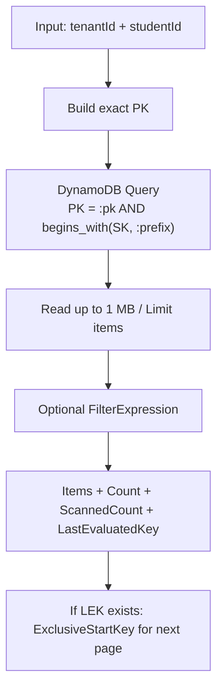
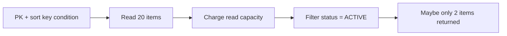
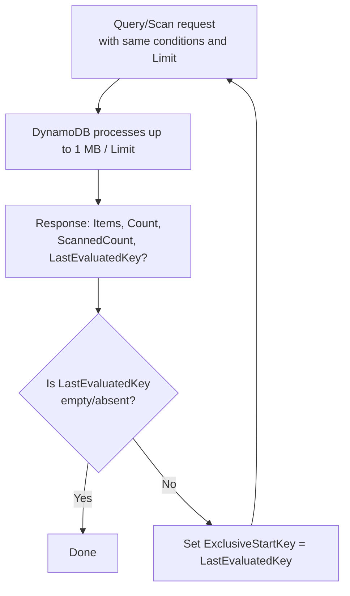
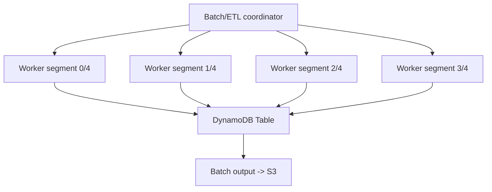
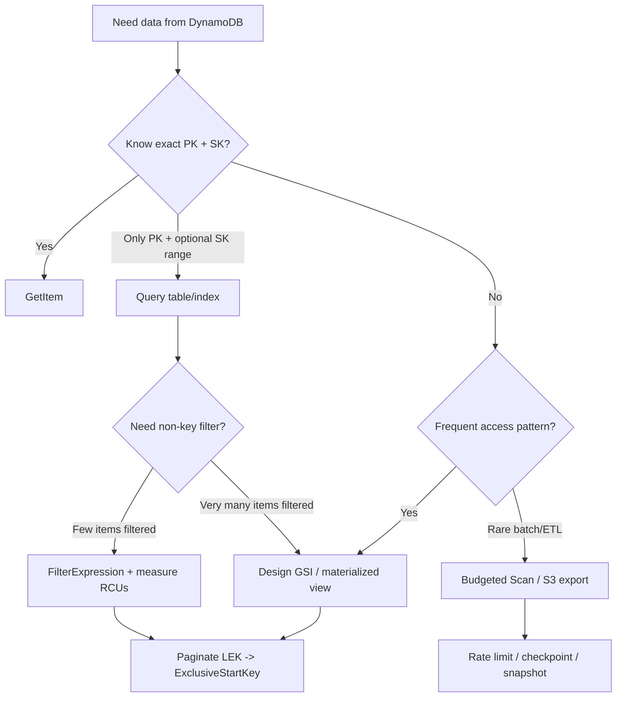

# Query, Scan, Pagination, and Filter Expressions

> **Module:** CLOUD_PROVIDERS_AWS  
> **Chapter:** DynamoDB  
> **Lesson:** Query, Scan, Pagination, and Filter Expressions  
> **Context:** Learn how to read data efficiently from Amazon DynamoDB in Java/Spring Boot applications, AWS Lambda, and the AWS ecosystem with IAM, API Gateway, monitoring, recovery, and cost control.

## 1. The Problem: Finding the Right Data Instead of Reading the Whole Table

Suppose a Java learning platform stores course enrollments and student activity in **Amazon DynamoDB**. An API must support:

- Listing the **20 most recent enrollments** for student `student-17`.
- Filtering enrollments still in `ACTIVE` status.
- Showing the next page when a user clicks **Load more**.
- Finding all students enrolled in course `java-101`.
- Running a nightly admin report that scans all data.
- Preventing a single HTTP request from accidentally reading millions of items, spiking costs and throttling.

Both approaches pursue data filtering, yet consume vastly different resources:

```text
Query:
  Has matching partition key -> reads a targeted slice -> filters/returns results.

Scan:
  Does not rely on a partition key -> traverses many or all items -> filters/returns results.
```

**A filter expression does not turn a Scan into a Query.** DynamoDB applies `FilterExpression` **after the read phase**, so it can return very few records while consuming capacity to read massive amounts of data.

### Learning Outcomes

After this lesson, you will be able to:

1. Distinguish `Query`, `Scan`, `GetItem`, and Global Secondary Index (GSI) design scenarios.
2. Write `KeyConditionExpression` following partition key and sort key rules.
3. Use `FilterExpression`, `ProjectionExpression`, `ExpressionAttributeNames`, and `ExpressionAttributeValues`.
4. Understand `Limit`, **1 MB pages**, `Count`, `ScannedCount`, and `LastEvaluatedKey`.
5. Implement pagination with `ExclusiveStartKey` using AWS CLI and AWS SDK for Java 2.x.
6. Never confuse AWS CLI paginator's `NextToken` with DynamoDB's `LastEvaluatedKey`.
7. Design secure cursor pagination for REST APIs with IAM/JWT and multiple tenants.
8. Evaluate read consistency, GSIs/LSIs, RCUs, hot partitions, parallel Scan, and throttling errors.
9. Test, monitor CloudWatch, and choose access patterns rather than optimizing by guesswork.

## 2. Sample Data Model: Partition Key and Sort Key

Table `CourseActivity` has a **composite primary key**:

| Attribute | Type | Role |
|---|---|---|
| `PK` | String | Partition key |
| `SK` | String | Sort key |
| `tenantId` | String | Business attribute |
| `studentId` | String | Business attribute |
| `courseId` | String | Business attribute |
| `status` | String | `ACTIVE`, `PENDING`, `CANCELLED` |
| `enrolledAt` | String ISO 8601 UTC | Enrollment timestamp |
| `GSI1PK` | String | Partition key on GSI depending on item |
| `GSI1SK` | String | Sort key on GSI depending on item |

**Key convention** for this lesson:

```text
Base table:
  PK = TENANT#school-01#STUDENT#student-17
  SK = ENROLLMENT#2026-11-18T09:30:00Z#ORDER#order-001

Global secondary index GSI1:
  GSI1PK = TENANT#school-01#COURSE#java-101
  GSI1SK = ENROLLMENT#2026-11-18T09:30:00Z#STUDENT#student-17
```

Strings like `TENANT#...` are an **application design convention**, not special syntax natively parsed by DynamoDB.

### 2.1. Sample Data

| PK | SK | courseId | status | enrolledAt |
|---|---|---|---|---|
| `TENANT#school-01#STUDENT#student-17` | `ENROLLMENT#2026-11-16T11:00:00Z#ORDER#o1` | java-101 | ACTIVE | 2026-11-16T11:00:00Z |
| Same PK | `ENROLLMENT#2026-11-18T09:30:00Z#ORDER#o2` | aws-101 | PENDING | 2026-11-18T09:30:00Z |
| Same PK | `ENROLLMENT#2026-11-19T07:20:00Z#ORDER#o3` | java-202 | ACTIVE | 2026-11-19T07:20:00Z |
| `TENANT#school-01#STUDENT#student-42` | `ENROLLMENT#2026-11-17T08:40:00Z#ORDER#o4` | java-101 | ACTIVE | 2026-11-17T08:40:00Z |
| `TENANT#school-02#STUDENT#student-88` | `ENROLLMENT#2026-11-17T08:40:00Z#ORDER#o5` | java-101 | ACTIVE | 2026-11-17T08:40:00Z |

In the real table, every row stores the full `PK` and `SK`; "Same PK" above just avoids repeating a long string.

**Why include ISO 8601 UTC in the sort key?** When timestamps share a consistent format (UTC, uniform precision and length), **UTF-8 byte** order of string timestamps matches chronological order. Never mix arbitrary timezones/formats/offsets and expect lexicographical sorting to work.

### 2.2. Access Patterns Before Creating Indexes

| Requirement | Required key/access pattern |
|---|---|
| Fetch a specific enrollment when PK/SK are known | `GetItem` |
| 20 newest enrollments of one student | `Query PK = ... AND begins_with(SK, 'ENROLLMENT#')`, reversed |
| Enrollments within a date range | `Query PK = ... AND SK BETWEEN ... AND ...` |
| Students enrolled in course java-101 | `Query GSI1PK = TENANT#school-01#COURSE#java-101` |
| ACTIVE students in course java-101 (frequent, high volume) | Design a GSI key encoding `status` or a materialized view, **not just filtering the whole GSI** |
| Scheduled full-table report | Controlled `Scan` or export data to S3 |

**DynamoDB is access-pattern-first NoSQL.** If you want to query on an attribute not present in a key/index, there is no "any WHERE clause is fast" optimizer like a SQL engine choosing an index automatically.

## 3. Query: Requires Equality on a Partition Key

`Query` locates items sharing **one partition-key value** in a table or index. With a composite key, you can add a sort key condition to narrow the slice read.

General syntax:

```text
KeyConditionExpression:
  partition_key = :partitionValue
  [AND sort_key condition]
```

Supported sort key operators:

| Operator/function | Example | Meaning |
|---|---|---|
| `=` | `SK = :exact` | One exact sort key |
| `<`, `<=` | `SK < :until` | Before a key threshold |
| `>`, `>=` | `SK >= :from` | From a key threshold onward |
| `BETWEEN` | `SK BETWEEN :from AND :to` | Inclusive range on both ends |
| `begins_with` | `begins_with(SK, :prefix)` | Sort key prefix |

**Invalid in `KeyConditionExpression`:**

- Omitting an equality condition on the **partition key**.
- Using `contains(PK, :fragment)` or `PK > :value` instead of `PK = :value`.
- Referencing non-key attributes like `status` or `courseId` (unless they are keys of the **queried index**).
- Using `OR` to select multiple partition key values.
- Querying a sort key range without specifying the partition key.

### 3.1. Query Is Not a Scan with an Extra Filter



The key condition **locates the data slice to read**, while `FilterExpression` screens results **after** reading that slice.

### 3.2. Ordering Results by Sort Key

`Query` on a table/index with a sort key returns items in **sort key order**:

- `Number` sort keys: numerical order.
- `String` sort keys: UTF-8 byte order.
- Default: **ascending**.
- `ScanIndexForward=false`: **descending**.

Example with three enrollments on Nov 16/18/19 under the same PK and `ENROLLMENT#` prefix:

```text
ScanIndexForward=true:
  ENROLLMENT#2026-11-16...
  ENROLLMENT#2026-11-18...
  ENROLLMENT#2026-11-19...

ScanIndexForward=false:
  ENROLLMENT#2026-11-19...
  ENROLLMENT#2026-11-18...
  ENROLLMENT#2026-11-16...
```

**Scan does not support `ScanIndexForward`.** Never expect Scan results to arrive ordered by key or timestamp.

## 4. AWS CLI: Querying by Partition Key and Prefix

The commands in this lesson target **AWS CLI v2**, Region `ap-southeast-1`, and an assumed sandbox table populated as in Section 2.

### 4.1. Check Account and Table First

```bash
aws sts get-caller-identity

aws dynamodb describe-table \
  --table-name CourseActivity \
  --region ap-southeast-1 \
  --query 'Table.{Status:TableStatus,KeySchema:KeySchema,Indexes:GlobalSecondaryIndexes[].IndexName}'
```

Never run Queries against a production table without knowing IAM permissions, key schema, and expected item read volume.

### 4.2. Query at Most 25 Items per Read

```bash
aws dynamodb query \
  --table-name CourseActivity \
  --key-condition-expression '#pk = :pk AND begins_with(#sk, :prefix)' \
  --expression-attribute-names '{"#pk":"PK","#sk":"SK"}' \
  --expression-attribute-values '{":pk":{"S":"TENANT#school-01#STUDENT#student-17"},":prefix":{"S":"ENROLLMENT#"}}' \
  --scan-index-forward \
  --limit 25 \
  --return-consumed-capacity TOTAL \
  --no-paginate \
  --region ap-southeast-1
```

**Note:** `--scan-index-forward` (with no value) means `true`; to get newest items first, use `--no-scan-index-forward`—**do not** pass the string `false` after `--scan-index-forward`. Correct example:

```bash
aws dynamodb query \
  --table-name CourseActivity \
  --key-condition-expression '#pk = :pk AND begins_with(#sk, :prefix)' \
  --expression-attribute-names '{"#pk":"PK","#sk":"SK"}' \
  --expression-attribute-values '{":pk":{"S":"TENANT#school-01#STUDENT#student-17"},":prefix":{"S":"ENROLLMENT#"}}' \
  --no-scan-index-forward \
  --limit 25 \
  --return-consumed-capacity TOTAL \
  --no-paginate \
  --region ap-southeast-1
```

**Important:** `--limit 25` does not guarantee 25 items after filtering, nor does it bypass the 1 MB cap. `--no-paginate` prevents the CLI from auto-fetching all pages so you can see a single service call and its `LastEvaluatedKey`.

### 4.3. Query by Date Range

With ISO UTC sort keys for the same student:

```bash
aws dynamodb query \
  --table-name CourseActivity \
  --key-condition-expression '#pk = :pk AND #sk BETWEEN :start AND :end' \
  --expression-attribute-names '{"#pk":"PK","#sk":"SK"}' \
  --expression-attribute-values '{":pk":{"S":"TENANT#school-01#STUDENT#student-17"},":start":{"S":"ENROLLMENT#2026-11-01"},":end":{"S":"ENROLLMENT#2026-12-01"}}' \
  --region ap-southeast-1
```

**Boundary trap:** `BETWEEN` is **inclusive on both ends**; using `ENROLLMENT#2026-12-01` as an upper bound works for ISO keys with a `T...` suffix, but is not an exact half-open interval for every schema. For strict business boundaries, standardize timestamps: you cannot write two separate sort-key conditions (`>= :start AND < :end`) in one `KeyConditionExpression` (only one sort-key condition is allowed), so use `BETWEEN` with a normalized end-of-day bound or a numeric epoch-millis sort key.

### 4.4. Partition-Key Queries Can Still Bottleneck If the PK Is "Hot"

If many callers concurrently Query **one partition key value** (e.g., `TENANT#school-01#COURSE#popular-course`), the table can experience hot-key throttling regardless of overall provisioned headroom. Address this via key distribution, caching, adaptive capacity, controlled sharding, or a different access pattern. **Never switch to Scan to dodge a hot partition**: Scan is usually worse.

## 5. FilterExpression: Post-Read Filtering Without Saving RCUs

Suppose we need enrollments with `status=ACTIVE` for one student. We can add a filter:

```bash
aws dynamodb query \
  --table-name CourseActivity \
  --key-condition-expression '#pk = :pk AND begins_with(#sk, :prefix)' \
  --filter-expression '#status = :active' \
  --expression-attribute-names '{"#pk":"PK","#sk":"SK","#status":"status"}' \
  --expression-attribute-values '{":pk":{"S":"TENANT#school-01#STUDENT#student-17"},":prefix":{"S":"ENROLLMENT#"},":active":{"S":"ACTIVE"}}' \
  --no-scan-index-forward \
  --limit 20 \
  --return-consumed-capacity TOTAL \
  --no-paginate \
  --region ap-southeast-1
```

**Execution order to remember:**

1. Narrow the key range via `KeyConditionExpression`.
2. Read up to `Limit` **evaluated items** or **1 MB**.
3. Evaluate `FilterExpression` on those read items.
4. Return matching items, `Count`, `ScannedCount`, consumed capacity, and pagination key if needed.



If 20 items are read and only 2 are ACTIVE:

```text
Limit = 20
ScannedCount = 20  (read/evaluated before filter)
Count = 2          (returned after filter)
Read capacity = based on items read, NOT the 2 returned results
```

These numbers are illustrative. An API demanding exactly 20 ACTIVE records may have to issue multiple sequential Queries, paying read capacity on each call.

### 5.1. Useful Filter Expressions

| Expression | Meaning |
|---|---|
| `#status = :active` | Exact status match |
| `#score >= :minScore` | Score at or above threshold |
| `attribute_exists(#completedAt)` | Attribute is present |
| `attribute_not_exists(#deletedAt)` | Attribute is absent |
| `contains(#tags, :tag)` | List/set/string contains value |
| `begins_with(#title, :prefix)` | String begins with prefix |
| `#status IN (:a, :b)` | Membership in value set |
| `#score BETWEEN :low AND :high` | Within range |

**Note:** `FilterExpression` **cannot reference the partition key or sort key attributes** of the queried table/index. Key conditions belong in `KeyConditionExpression`. Its role is filtering **non-key attributes**, not bypassing partition design.

### 5.2. When Is FilterExpression Still Reasonable?

- Partition key and sort key already narrow to a small slice, and the filter drops only a few items.
- Infrequent optional filtering where the RCU cost is accepted.
- Low traffic where adding a GSI would cost more in writes/index storage than the read savings.
- Trimming payload bytes over the wire.

**When it is NOT reasonable:** Filtering `status=ACTIVE` across millions of enrollments of a tenant via Scan on every HTTP request. Use a GSI, sparse index, or materialized view instead.

## 6. ProjectionExpression and ExpressionAttributeNames/Values

### 6.1. ProjectionExpression: Choosing Returned Attributes

When you only need to display:

```text
courseId, status, enrolledAt
```

Add:

```bash
--projection-expression 'PK, SK, courseId, #st, enrolledAt' \
--expression-attribute-names '{"#pk":"PK","#sk":"SK","#st":"status"}'
```

This is a **parameter snippet** to append to an existing Query command, not a standalone AWS CLI command.

**Key point:** On a **base table** Query, `ProjectionExpression` does not reduce RCUs, because DynamoDB charges read capacity on the **size of the item read**, not the attributes returned. However, it reduces response bytes, serialization overhead, network transfer, and accidental exposure of sensitive fields to clients.

**Index exception:** If you design a GSI with `KEYS_ONLY` or a lean `INCLUDE` projection, reading the **smaller materialized index item** can reduce index read cost—different from applying `ProjectionExpression` on an already-large base item.

### 6.2. ExpressionAttributeNames

Some attribute names collide with **reserved words** (e.g., `status` often needs aliasing), or contain dots, hyphens, or special characters. Use `#...` aliases:

```json
{
  "#pk": "PK",
  "#sk": "SK",
  "#st": "status",
  "#date": "enrolledAt"
}
```

For example, `#st = :active`; DynamoDB substitutes `#st` with attribute name `status`.

### 6.3. ExpressionAttributeValues

Values are passed via `:...` placeholders—**never concatenate raw user input** into expressions.

```json
{
  ":pk": {"S": "TENANT#school-01#STUDENT#student-17"},
  ":prefix": {"S": "ENROLLMENT#"},
  ":active": {"S": "ACTIVE"},
  ":minScore": {"N": "70"}
}
```

In the DynamoDB low-level API, `S` is String, `N` is Number **serialized as a string**, `BOOL` is Boolean, and `NULL`, `M`, `L`, etc. have their own formats.

**Never pass `{"S":"70"}` for `:minScore` if `score` is stored as Number**, because DynamoDB does not perform implicit type coercion like some SQL engines.

### 6.4. Three Commonly Confused Clauses

| Clause | When it runs | Saves read capacity? |
|---|---|---|
| `KeyConditionExpression` | Selects partition and sort-key range **before reading** | **Potentially yes**, by narrowing items read |
| `FilterExpression` | **After reading** the DynamoDB page | **No** |
| `ProjectionExpression` | Selects attributes **returned** | **No** for the same set of base-table items |

## 7. Scan: Reading a Table or Index Without a Partition Key

`Scan` reads items across the entire table/index, optionally filtering afterward. It is typically appropriate for:

- Controlled batch migrations with clear deadlines.
- Small sandbox data inventories.
- Background maintenance/ETL with a capacity budget, never serving low-latency user requests.
- Audits/anomaly exploration when no matching index exists.
- One-off data inspection prior to index redesign.

**Never** use Scan for per-request calls like "list 10 enrollments of student A" when a PK-based Query works.

### 7.1. Cost Difference

Suppose a table holds **1,000,000 items**, averaging **1 KB** each, and only 100 items belong to one student.

- A targeted `Query` by PK reads roughly 100 items (across one or a few pages).
- `Scan + FilterExpression` must evaluate all ~1,000,000 items to find every match across the table.
- Filtering reduces **returned bytes**, not read capacity consumed by scanned items.
- `Limit=100` merely stops **one page** after evaluating at most 100 items or 1 MB—it does not mean the whole table was checked.

Counts and sizes are illustrative; real cost depends on item sizes, consistency, indexes, and capacity mode.

### 7.2. Scan Has No Reliable Ordering

`Scan` results are **not sorted by SK**, even when the table has a sort key. Never run Scan + client-side sorting on one 100-item page and treat it as "the 100 newest records in the table": you have not read the rest of the table.

If you need "newest" across partitions, build a GSI or feed/materialized view with a meaningful key and Query by sort key.

### 7.3. Scan Read Consistency

- By default, Scan uses **eventually consistent reads**.
- `ConsistentRead=true` can be set when scanning supported **base tables/LSIs**.
- **Strongly consistent Scan does not guarantee table-wide snapshot isolation**: items can mutate while pages are read; there is no atomic point-in-time snapshot at scan start.
- GSIs support **eventually consistent reads only**.

For reports needing a consistent point-in-time snapshot, consider **DynamoDB Export to S3 with PITR** when appropriate, or CDC/streaming pipelines with explicit cutoffs—never flip on StrongRead and claim atomic reporting.

## 8. Pagination: 1 MB, LastEvaluatedKey, ExclusiveStartKey

**DynamoDB Query and Scan process at most ~1 MB of data per call**, or stop earlier if `Limit` is reached. This limit applies **before** `FilterExpression` and `ProjectionExpression`.

**Standard low-level loop:**



Simplified sample response:

```json
{
  "Items": [
    {
      "PK": {"S": "TENANT#school-01#STUDENT#student-17"},
      "SK": {"S": "ENROLLMENT#2026-11-19T07:20:00Z#ORDER#o3"}
    }
  ],
  "Count": 1,
  "ScannedCount": 5,
  "LastEvaluatedKey": {
    "PK": {"S": "TENANT#school-01#STUDENT#student-17"},
    "SK": {"S": "ENROLLMENT#2026-11-18T09:30:00Z#ORDER#o2"}
  }
}
```

**Key points:**

1. `LastEvaluatedKey` marks where DynamoDB stopped **evaluating**, not necessarily the last item returned after filtering.
2. Pass that exact key map into `ExclusiveStartKey` for the next page.
3. Keep table/index, key conditions, filters, sort direction, and auth context unchanged; changing conditions mid-pagination invalidates the cursor's result set.
4. Only when `LastEvaluatedKey` is **absent or empty** has the query finished.
5. **A non-empty `LastEvaluatedKey` does not guarantee the next page contains items**; it may hit the final boundary and return empty.

### 8.1. Empty Page with a Present LastEvaluatedKey

Suppose `Limit=5` filtering for ACTIVE, and the first five items are all PENDING:

```json
{
  "Items": [],
  "Count": 0,
  "ScannedCount": 5,
  "LastEvaluatedKey": {
    "PK": {"S": "TENANT#school-01#STUDENT#student-17"},
    "SK": {"S": "ENROLLMENT#2026-11-18T09:30:00Z#ORDER#o2"}
  }
}
```

**Wrong:** `if (items.isEmpty()) break;`

**Right:** As long as `LastEvaluatedKey` is present, keep querying (within the app's request/latency budget) because subsequent pages may hold ACTIVE items.

### 8.2. Limit Is Not Post-Filter Page Size

| `Limit` | `ScannedCount` before filter | `Count` after filter | Cursor possible? |
|---:|---:|---:|---|
| 10 | 10 | 8 | Yes |
| 10 | 10 | 0 | Yes |
| 10 | 3 | 3 | No |
| 100 | 40 (hit 1 MB first) | 2 | Yes |

All numbers above are hypothetical. You cannot ask DynamoDB to "return **exactly** 20 items after filtering" simply by setting `Limit=20`.

### 8.3. Offset Pagination Does Not Fit

DynamoDB has no native `OFFSET 50000` for `Query`/`Scan` like SQL. Skipping 50,000 items still requires reading and paying capacity from the start—costly and inconsistent as data mutates.

APIs should prefer **cursor-based pagination**:

```text
GET /enrollments?limit=20
-> items[], nextCursor

GET /enrollments?limit=20&cursor=<opaque-token>
-> items[], nextCursor or null
```

### 8.4. Page Consistency Is Not a Snapshot

If an item is inserted or changes status between page 1 and page 2:

- `ExclusiveStartKey` resumes from its position in the keyspace.
- On eventually consistent queries/indexes, updates may not be visible yet.
- An item whose filtered attribute mutates mid-pagination may appear twice or be skipped depending on timing.
- Pagination over **live mutable data** never guarantees a frozen snapshot free of duplicates or omissions.

For strict audit consistency, use snapshots/exports or a version/cutoff/query design tailored for it.

## 9. AWS CLI: Proper Pagination and the Three Token Mechanisms

AWS CLI has a **client-side paginator**, while DynamoDB has **service-level pagination**. They are not the same.

### 9.1. A Single Service Request with --no-paginate

```bash
aws dynamodb query \
  --table-name CourseActivity \
  --key-condition-expression 'PK = :pk' \
  --expression-attribute-values '{":pk":{"S":"TENANT#school-01#STUDENT#student-17"}}' \
  --limit 2 \
  --no-paginate \
  --region ap-southeast-1
```

If more data remains, the service response includes `LastEvaluatedKey`. On the next call, pass that exact map:

```bash
aws dynamodb query \
  --table-name CourseActivity \
  --key-condition-expression 'PK = :pk' \
  --expression-attribute-values '{":pk":{"S":"TENANT#school-01#STUDENT#student-17"}}' \
  --limit 2 \
  --exclusive-start-key '{"PK":{"S":"TENANT#school-01#STUDENT#student-17"},"SK":{"S":"ENROLLMENT#2026-11-18T09:30:00Z#ORDER#o2"}}' \
  --no-paginate \
  --region ap-southeast-1
```

**Never hardcode sample keys as real cursors**: `ExclusiveStartKey` must come from the previous response of the same table/index/query. On a GSI, the cursor map contains **both the GSI keys and base-table primary key**; always pass the returned map verbatim.

### 9.2. CLI --page-size and --max-items

| Flag | Layer | Behavior |
|---|---|---|
| `--limit` | DynamoDB API | Max items evaluated before filtering for **each API request** |
| `--page-size` | AWS CLI paginator | Service request size per call (typically maps to API limit) |
| `--max-items` | AWS CLI paginator | Caps total CLI output items and returns a CLI `NextToken` if more remain |
| `--starting-token` | AWS CLI paginator | Resumes from CLI `NextToken` |
| `--no-paginate` | AWS CLI | Disables auto-fetching subsequent pages |
| `--exclusive-start-key` | DynamoDB API | Resumes from **service `LastEvaluatedKey`** |

**Never pass a CLI `NextToken` to DynamoDB `ExclusiveStartKey`.** Never pass service `LastEvaluatedKey` JSON to `--starting-token`. They are two distinct cursor formats.

Example of CLI-managed output sizing:

```bash
aws dynamodb query \
  --table-name CourseActivity \
  --key-condition-expression 'PK = :pk' \
  --expression-attribute-values '{":pk":{"S":"TENANT#school-01#STUDENT#student-17"}}' \
  --page-size 10 \
  --max-items 20 \
  --region ap-southeast-1
```

If the output includes `NextToken`, pass `--starting-token <NextToken>` on the next command with matching arguments. Per AWS CLI guidance, avoid mixing mismatched `--page-size` and `--max-items` values that yield unpredictable results; choose compatible CLI pagination settings or manage the service cursor directly.

## 10. Scan and Filtering with AWS CLI

### 10.1. Bounded Single-Page Scan

```bash
aws dynamodb scan \
  --table-name CourseActivity \
  --filter-expression '#status = :active' \
  --expression-attribute-names '{"#status":"status"}' \
  --expression-attribute-values '{":active":{"S":"ACTIVE"}}' \
  --limit 100 \
  --return-consumed-capacity TOTAL \
  --no-paginate \
  --region ap-southeast-1
```

This command **reads at most 100 items / 1 MB before filtering**; it does not guarantee returning 100 ACTIVE items or checking the whole table.

### 10.2. Counting Only via Select COUNT

```bash
aws dynamodb scan \
  --table-name CourseActivity \
  --select COUNT \
  --no-paginate \
  --return-consumed-capacity TOTAL \
  --region ap-southeast-1
```

**Do not mistake `COUNT` for a free metadata query.** DynamoDB still reads items to count them, consumes read capacity, and respects the 1 MB/page cap. An exact full-table count at a point in time requires paginating through every page or maintaining an explicit counter with suitable consistency.

`DescribeTable.Table.ItemCount` is a **periodically updated estimate**, not a live exact counter for arbitrary filters.

### 10.3. Reading Specific Attributes

```bash
aws dynamodb scan \
  --table-name CourseActivity \
  --projection-expression 'PK, SK, courseId, #st' \
  --expression-attribute-names '{"#st":"status"}' \
  --limit 50 \
  --no-paginate \
  --region ap-southeast-1
```

Network payloads shrink when items have many attributes, yet **RCUs do not drop** just from adding a projection expression while scanning the same table.

### 10.4. Risks of Running Scan in Production

- A full scan can trigger **RCU/ReadRequestUnits bursts**, raising latency or throttling live API traffic.
- Filters do not reduce data read, only data returned.
- Scan has no ordering and no snapshot isolation.
- `--no-paginate` does not avoid full scans when the caller still loops for all results.
- AWS CLI's default auto-pagination can accidentally read **the entire table**, burning resources and money.

**Recommendation:** run production Scans only under an approved change plan/budget with `Limit`, paging, backoff, capacity monitoring, and off-peak scheduling. For large analytics, use DynamoDB Export to S3 with Athena/Glue.

## 11. Global Secondary Indexes and Local Secondary Indexes

When an access pattern does not match the primary key, evaluate an index **before falling back to Scan for frequent HTTP requests**.

### 11.1. GSI: Querying by Course

Create a GSI `GSI1` with:

```text
GSI1 partition key = GSI1PK
GSI1 sort key      = GSI1SK

GSI1PK = TENANT#school-01#COURSE#java-101
GSI1SK = ENROLLMENT#2026-11-17T08:40:00Z#STUDENT#student-42
```

AWS CLI:

```bash
aws dynamodb query \
  --table-name CourseActivity \
  --index-name GSI1 \
  --key-condition-expression '#pk = :course AND begins_with(#sk, :p)' \
  --expression-attribute-names '{"#pk":"GSI1PK","#sk":"GSI1SK"}' \
  --expression-attribute-values '{":course":{"S":"TENANT#school-01#COURSE#java-101"},":p":{"S":"ENROLLMENT#"}}' \
  --no-scan-index-forward \
  --limit 25 \
  --no-paginate \
  --region ap-southeast-1
```

**Key points:**

- A GSI has its **own partition key and sort key**, independent of the base table.
- GSI reads are **eventually consistent**; `ConsistentRead=true` on a GSI is rejected.
- A GSI stores only **projected** attributes; querying a GSI never auto-fetches non-projected attributes from the base table.
- Creating/maintaining a GSI adds **write amplification**, storage, and separate read costs; do not add GSIs indiscriminately.
- A GSI can be a **sparse index**: only items carrying valid index key attributes appear in it per schema rules.
- The GSI status must be `ACTIVE` before querying in production; creating a GSI on a large table takes backfill time.

### 11.2. LSI: Same Partition Key, Different Sort Key

**Local Secondary Index (LSI)**:

- Shares the **same partition key as the base table**.
- Uses a **different sort key**.
- Must be defined at **table creation time**; cannot be added once the table exists.
- Supports **strongly consistent reads** on Query/Scan.
- On tables with an LSI, each item collection sharing a partition key faces a **10 GB limit**.
- If non-projected attributes are requested, DynamoDB fetches them from the base table, adding read capacity and latency.

**Do not switch from a GSI to an LSI just to get strong consistency** when you need to partition by course; LSIs cannot introduce a new partition key.

### 11.3. When Should a Filter Become Part of an Index Key?

Suppose an API frequently fetches **ACTIVE enrollments for a course** with hundreds of thousands of students. If a GSI keys only on `COURSE#java-101` and filters `status`, read capacity consumption can be huge.

A dedicated GSI could use:

```text
GSI2PK = TENANT#school-01#COURSE#java-101#STATUS#ACTIVE
GSI2SK = ENROLLED#2026-11-18T09:30:00Z#STUDENT#student-17
```

Whenever status changes, the app **must consistently update the index key attributes** on the base item. The GSI reflects changes asynchronously (eventually consistent). Never rely on stale GSI reads as the sole confirmation of payment when transactional correctness is required.

**Trade-off:** Queries become far cheaper for this pattern, while every write updates an extra index, increasing cost and complexity.

## 12. Read Consistency: Eventual by Default, Strong Only Where Supported

| Read source | Eventually consistent | Strongly consistent |
|---|---|---|
| Base table (single Region) | Yes | **Yes**, via `ConsistentRead=true` |
| LSI | Yes | **Yes**, via `ConsistentRead=true` |
| GSI | **Yes** | **No** |
| Base-table Scan | Yes | Item-level yes, **no table-wide snapshot** |

**Eventually consistent**: results might not reflect an immediately preceding write, though DynamoDB converges quickly.

**Strongly consistent**: returns the most up-to-date committed version as of the read, within supported Region/table/index boundaries. It still does not turn a multi-request paginated loop into a single transactional snapshot.

### 12.1. Strongly Consistent Query on Base Table

```bash
aws dynamodb query \
  --table-name CourseActivity \
  --key-condition-expression 'PK = :pk' \
  --expression-attribute-values '{":pk":{"S":"TENANT#school-01#STUDENT#student-17"}}' \
  --consistent-read \
  --limit 20 \
  --no-paginate \
  --region ap-southeast-1
```

Never combine `--consistent-read` with `--index-name GSI1`. AWS rejects it because GSIs only support eventual reads.

### 12.2. When Is Strong Consistency Needed?

- Right after persisting an enrollment, verifying **existence** on the base table before returning a sensitive status.
- Reading a freshly updated state to decide the next workflow step when business semantics truly require read-after-write.

**Conditional writes and transactions are still necessary** when concurrent callers modify an item. A strong read followed by an unconditional `UpdateItem` still has a race window between read and write.

### 12.3. Global Tables Are a Separate Topic

DynamoDB Global Tables offer consistency modes tied to specific configurations, including newer multi-Region options. This lesson focuses on **Query/Scan on a single table/index in one Region**. Never infer from single-Region `ConsistentRead=true` that every cross-Region read in any Global Table mode is synchronous and strong; check the documentation for the specific Global Table mode.

## 13. Java 17 + AWS SDK for Java 2.x: Paginated Queries

In a Spring Boot or Java Lambda backend, use **AWS SDK for Java 2.x** with the IAM role of the ECS task, EC2 instance, or Lambda execution environment. Never hardcode AWS access keys.

Typical Maven dependency: `software.amazon.awssdk:dynamodb`, version-managed via the project's AWS SDK BOM.

### 13.1. Low-Level Query API Example

Complete Java 17 single-page query logic; the table and sample data must exist in your sandbox account:

```java
package example.course.dynamodb;

import java.util.Map;
import software.amazon.awssdk.regions.Region;
import software.amazon.awssdk.services.dynamodb.DynamoDbClient;
import software.amazon.awssdk.services.dynamodb.model.AttributeValue;
import software.amazon.awssdk.services.dynamodb.model.QueryRequest;
import software.amazon.awssdk.services.dynamodb.model.QueryResponse;
import software.amazon.awssdk.services.dynamodb.model.ReturnConsumedCapacity;

public final class EnrollmentQuery {
    private static final String TABLE = "CourseActivity";

    private EnrollmentQuery() {}

    public static QueryResponse queryActivePage(
            DynamoDbClient dynamo,
            String tenantId,
            String studentId,
            Map<String, AttributeValue> cursor) {

        // Production MUST resolve tenantId/studentId from verified identity,
        // never trust client-supplied tenantId.
        String pk = "TENANT#" + tenantId + "#STUDENT#" + studentId;

        QueryRequest.Builder request = QueryRequest.builder()
                .tableName(TABLE)
                .keyConditionExpression(
                    "#pk = :pk AND begins_with(#sk, :prefix)")
                .filterExpression("#st = :active")
                .expressionAttributeNames(Map.of(
                    "#pk", "PK",
                    "#sk", "SK",
                    "#st", "status"))
                .expressionAttributeValues(Map.of(
                    ":pk", AttributeValue.builder().s(pk).build(),
                    ":prefix", AttributeValue.builder()
                        .s("ENROLLMENT#").build(),
                    ":active", AttributeValue.builder()
                        .s("ACTIVE").build()))
                .scanIndexForward(false)
                .limit(25)
                .returnConsumedCapacity(ReturnConsumedCapacity.TOTAL);

        if (cursor != null && !cursor.isEmpty()) {
            request.exclusiveStartKey(cursor);
        }

        return dynamo.query(request.build());
    }

    public static void main(String[] args) {
        try (DynamoDbClient client = DynamoDbClient.builder()
                .region(Region.AP_SOUTHEAST_1).build()) {

            Map<String, AttributeValue> cursor = Map.of();
            int requestCount = 0;
            int matchingItems = 0;

            do {
                QueryResponse response = queryActivePage(
                    client, "school-01", "student-17", cursor);

                matchingItems += response.items().size();

                System.out.printf(
                    "page=%d returned=%d evaluated=%d capacity=%s%n",
                    requestCount + 1,
                    response.count(),
                    response.scannedCount(),
                    response.consumedCapacity() == null
                        ? "n/a"
                        : response.consumedCapacity().capacityUnits());

                cursor = response.lastEvaluatedKey();
                requestCount++;

                // Lab guardrail: prevent unbounded loops / budget overruns.
            } while (cursor != null
                    && !cursor.isEmpty()
                    && requestCount < 20);

            System.out.println("Matching items seen: " + matchingItems);
        }
    }
}
```

**What to notice:**

- `QueryRequest.limit(25)` caps items **evaluated per request**, not guaranteeing 25 ACTIVE records post-filter.
- `QueryResponse.items()` holds items returned **after filtering**.
- `QueryResponse.scannedCount()` reports items read/evaluated before filtering.
- `QueryResponse.lastEvaluatedKey()` provides the key map for the next request.
- `returnConsumedCapacity(TOTAL)` lets you compare consumption across access patterns.
- The loop caps at **20 requests** in the lab; it does not guarantee exhaustion if the cursor is still non-empty.
- Avoid logging full `response.items()` when they contain student data.

**Production:** Enforce budgets on latency, capacity, low-level request count, item count, and tenant ownership—never let callers trigger unbounded loops.

### 13.2. SDK v2 Paginator

AWS SDK v2 includes `queryPaginator(...)` to automatically follow `LastEvaluatedKey`:

```java
QueryRequest request = QueryRequest.builder()
    .tableName("CourseActivity")
    .keyConditionExpression("#pk = :pk")
    .expressionAttributeNames(Map.of("#pk", "PK"))
    .expressionAttributeValues(Map.of(
        ":pk", AttributeValue.builder()
            .s("TENANT#school-01#STUDENT#student-17")
            .build()))
    .limit(25)
    .build();

// Caution: this for-loop can automatically issue VERY MANY API requests.
for (QueryResponse page : client.queryPaginator(request)) {
    System.out.println("Page count: " + page.count());
}
```

`queryPaginator` is handy for batch jobs walking an entire partition, but **dangerous inside low-latency HTTP APIs** if one request fans out into hundreds of calls. For a "Load more" UI, fetch **one or a bounded handful of pages** and return a cursor.

### 13.3. Java Async Paginator

`DynamoDbAsyncClient` provides `queryPaginator(...)` returning `SdkPublisher<QueryResponse>` in SDK v2. Async designs need:

- Subscriber backpressure.
- Caps on pages, calls, and concurrency.
- Per-request cancellation/deadlines.
- Streaming consumption instead of buffering huge partitions into one List.
- Safeguards for AWS client resources, exception propagation, and retry policies.

An async API does not turn a Scan into an efficient Query; it only changes how the app dispatches calls and consumes responses.

## 14. DynamoDB Enhanced Client: Querying with Java Models

The **Enhanced Client** maps DynamoDB attributes to Java beans and exposes `PageIterable<T>`/`PagePublisher<T>`. Add `software.amazon.awssdk:dynamodb-enhanced` matching your SDK version.

### 14.1. Minimal Model

```java
package example.course.dynamodb;

import software.amazon.awssdk.enhanced.dynamodb.mapper.annotations.DynamoDbAttribute;
import software.amazon.awssdk.enhanced.dynamodb.mapper.annotations.DynamoDbBean;
import software.amazon.awssdk.enhanced.dynamodb.mapper.annotations.DynamoDbPartitionKey;
import software.amazon.awssdk.enhanced.dynamodb.mapper.annotations.DynamoDbSortKey;

@DynamoDbBean
public class EnrollmentItem {
    private String pk;
    private String sk;
    private String courseId;
    private String status;

    @DynamoDbPartitionKey
    @DynamoDbAttribute("PK")
    public String getPk() { return pk; }
    public void setPk(String pk) { this.pk = pk; }

    @DynamoDbSortKey
    @DynamoDbAttribute("SK")
    public String getSk() { return sk; }
    public void setSk(String sk) { this.sk = sk; }

    public String getCourseId() { return courseId; }
    public void setCourseId(String courseId) { this.courseId = courseId; }

    public String getStatus() { return status; }
    public void setStatus(String status) { this.status = status; }
}
```

If the table holds extra attributes outside the bean fields, the Enhanced Client still reads the mapped properties; to use GSIs with the Enhanced Client, declare secondary-index keys with `@DynamoDbSecondaryPartitionKey` and `@DynamoDbSecondarySortKey` or an explicit `TableSchema`.

### 14.2. Querying and Processing Pages

```java
package example.course.dynamodb;

import java.util.Map;
import software.amazon.awssdk.regions.Region;
import software.amazon.awssdk.services.dynamodb.DynamoDbClient;
import software.amazon.awssdk.enhanced.dynamodb.DynamoDbEnhancedClient;
import software.amazon.awssdk.enhanced.dynamodb.DynamoDbTable;
import software.amazon.awssdk.enhanced.dynamodb.TableSchema;
import software.amazon.awssdk.enhanced.dynamodb.Key;
import software.amazon.awssdk.enhanced.dynamodb.model.Page;
import software.amazon.awssdk.enhanced.dynamodb.model.PageIterable;
import software.amazon.awssdk.enhanced.dynamodb.model.QueryConditional;
import software.amazon.awssdk.enhanced.dynamodb.model.QueryEnhancedRequest;

public final class EnhancedQueryExample {
    public static void main(String[] args) {
        try (DynamoDbClient lowLevel = DynamoDbClient.builder()
                .region(Region.AP_SOUTHEAST_1).build()) {

            DynamoDbEnhancedClient enhanced =
                DynamoDbEnhancedClient.builder()
                    .dynamoDbClient(lowLevel).build();

            DynamoDbTable<EnrollmentItem> table =
                enhanced.table(
                    "CourseActivity",
                    TableSchema.fromBean(EnrollmentItem.class));

            QueryEnhancedRequest request =
                QueryEnhancedRequest.builder()
                    .queryConditional(
                        QueryConditional.sortBeginsWith(
                            Key.builder()
                                .partitionValue(
                                    "TENANT#school-01#STUDENT#student-17")
                                .sortValue("ENROLLMENT#")
                                .build()))
                    .scanIndexForward(false)
                    .limit(25)
                    .build();

            PageIterable<EnrollmentItem> pages = table.query(request);

            // Caution: iterating all of PageIterable can trigger many page queries.
            int maxPages = 10;
            int processedPages = 0;

            for (Page<EnrollmentItem> page : pages) {
                for (EnrollmentItem item : page.items()) {
                    // Lab: log only redacted/non-sensitive keys.
                    System.out.println(item.getSk());
                }

                if (++processedPages >= maxPages) {
                    break;
                }
            }
        }
    }
}
```

**Do not confuse:** `QueryConditional.sortBeginsWith` still requires a partition value inside `Key`. The Enhanced Client never permits a Query without a partition key.

### 14.3. Single Page and Cursor in Enhanced Client

Each `Page<T>` exposes `lastEvaluatedKey()`. When an API needs explicit pagination, pass `QueryEnhancedRequest.exclusiveStartKey(...)` instead of looping to exhaustion. Just like the low-level client, preserve the query context and protect cursors on HTTP APIs.

**Important:** The Enhanced Client handles pagination mechanics, **but does not make `FilterExpression` save RCUs**, does not make GSIs strongly consistent, and does not stop full Scans when code calls `table.scan()`.

## 15. Designing Secure REST API Cursor Pagination

With Spring Boot / API Gateway:

```text
GET /students/me/enrollments?status=ACTIVE&limit=20

Response:
{
  "items": [
    {"courseId":"java-202","status":"ACTIVE"}
  ],
  "nextCursor": "opaque-signed-token"
}
```

On the next request:

```text
GET /students/me/enrollments?status=ACTIVE&limit=20&cursor=opaque-signed-token
```

### 15.1. Never Issue Raw Modifiable Cursors

`LastEvaluatedKey` can expose tenant/student IDs and internal key shapes. Returning raw JSON directly to clients without binding it to auth context lets users:

- Tamper with `PK` inside the cursor to read another tenant.
- Replay student A's cursor inside student B's session.
- Reuse a cursor from `status=ACTIVE` on a `status=CANCELLED` query.
- Feed a GSI cursor into a base-table query.
- Send oversized cursors to inflate parsing costs.

**Even though IAM/backend checks must block unauthorized reads, treat every incoming cursor as untrusted client-controlled input.**

### 15.2. Contents of a Signed Cursor

A sound internal cursor payload:

```json
{
  "version": 1,
  "expiresAt": "2026-11-20T04:00:00Z",
  "tenantId": "school-01",
  "subject": "student-17",
  "table": "CourseActivity",
  "index": null,
  "queryHash": "sha256-of-normalized-query",
  "scanIndexForward": false,
  "lastEvaluatedKey": {
    "PK": {"S": "TENANT#school-01#STUDENT#student-17"},
    "SK": {"S": "ENROLLMENT#2026-11-18T09:30:00Z#ORDER#o2"}
  }
}
```

**This is an illustrative internal payload, not a DynamoDB API response.** The server can base64url-encode and sign with HMAC-SHA256—or use AEAD encryption—to issue an opaque token, storing keys in AWS Secrets Manager/KMS with rotation. **Plain Base64 does not prevent tampering**, and HMAC signing alone does not encrypt contents; if a cursor holds sensitive data, encrypt it or store it server-side.

### 15.3. Cursor Validation Rules

1. Authenticate the caller via JWT/IAM/Lambda authorizer at the trust boundary.
2. Extract `tenantId` and `studentId` **from the verified identity**, never from request parameters.
3. Clamp `limit` between 1 and an approved cap (e.g., max 50 API items).
4. Verify cursor signature/tag, expiration, version, and max length.
5. Cross-check subject, tenant, table, index, filter, and sort direction against the current request.
6. If valid, extract `LastEvaluatedKey` and pass it as `ExclusiveStartKey`.
7. Cap the number of DynamoDB pages read per **latency/capacity budget**.
8. Return results and a fresh cursor without exposing IAM credentials or raw tokens.
9. Reject invalid/expired cursors with a clear client error (e.g., 400) without leaking implementation details.

### 15.4. Returning Exactly 20 Post-Filter Items Can Require Multiple Pages

When `FilterExpression` drops many items, the backend might try:

```text
collected = []
cursor = verified request cursor
maxApiCalls = 5

while collected.size < 20 AND apiCalls < maxApiCalls:
    result = Query(Limit=remainingBudget, ExclusiveStartKey=cursor)
    collected += result.Items
    cursor = result.LastEvaluatedKey
    if cursor is empty: break

return first 20 collected + nextCursor from correct position
```

**Critical trap:** If the backend **collects 30 matching items, returns 20**, and sets `nextCursor` to page 30's `LastEvaluatedKey`, it **skips the 10 unsent items**. Fix this by never reading past what you return, buffering with an exact server-side/stateful cursor, or letting page sizes vary per low-level call. Never slice the list after reading and blindly attach the page's trailing LEK.

A clean strategy is **one HTTP page per low-level Query page**, returning 0–`limit` items; the UI handles an empty page with a non-null `nextCursor` by continuing "Load more" as needed.

### 15.5. Authorization Is Mandatory, Independent of the Cursor

The backend must verify object/tenant ownership on every read. If a caller passes `studentId=student-99` with a token belonging to `student-17`, the server still queries only the verified identity's key—or denies access unless an instructor role permits it.

**Never use a cursor for authorization:** a cursor proves pagination position, **not user permissions**.

## 16. Parallel Scan: Walking Large Tables in Batch Jobs

DynamoDB supports **parallel Scan** so multiple workers process logical segments of a table or index concurrently. Each worker passes `Segment` and `TotalSegments`.



### 16.1. AWS CLI: Single Segment

```bash
aws dynamodb scan \
  --table-name CourseActivity \
  --segment 0 \
  --total-segments 4 \
  --limit 100 \
  --return-consumed-capacity TOTAL \
  --no-paginate \
  --region ap-southeast-1
```

Launch separate workers for `Segment = 0, 1, 2, 3`. Each worker:

- Tracks its **own** `LastEvaluatedKey` for that segment.
- Passes that segment's `ExclusiveStartKey` on the next request.
- Keeps `TotalSegments` and `Segment` unchanged throughout the run.
- Paces reads with rate limiting/backoff so table read capacity is not overwhelmed.

**Never pass segment 0's cursor to segment 1.** Never change `TotalSegments` mid-scan and assume old cursors still point to the same logical slice.

### 16.2. Java SDK v2: Per-Segment Scan

```java
ScanRequest.Builder request = ScanRequest.builder()
    .tableName("CourseActivity")
    .segment(segmentIndex)
    .totalSegments(totalSegments)
    .limit(100)
    .returnConsumedCapacity(ReturnConsumedCapacity.TOTAL);

if (cursor != null && !cursor.isEmpty()) {
    request.exclusiveStartKey(cursor);
}

ScanResponse page = client.scan(request.build());
// Persist page.lastEvaluatedKey() for this specific worker/segment.
```

This is a **method snippet** where `client`, `segmentIndex`, `totalSegments`, and `cursor` are already initialized; import `ScanRequest`, `ScanResponse`, `DynamoDbClient`, and `AttributeValue`.

### 16.3. Parallel Scan Does Not Save RCUs

Parallel Scan can cut **wall-clock time** given available capacity and workers, but:

- Total data read **does not shrink**.
- It consumes read capacity **much faster**, risking impact on production traffic.
- Too many workers trigger throttling and retry storms.
- Each worker must manage its own cursor, errors, rate limits, and checkpoints.
- Mutations during the scan mean results are not a consistent snapshot.
- Running parallel scans in Lambda requires managing memory, timeouts, concurrency, and S3 output.

**Never use Parallel Scan for end-user pagination.** Reserve it for ETL, audits, and background jobs.

## 17. Read Capacity, On-Demand/Provisioned, and Cost

Query/Scan cost depends on **data volume read**, consistency, call count, and pricing mode. In DynamoDB:

- **Provisioned capacity:** reads consume RCUs from the table/GSI budget; exceeding capacity can throttle.
- **On-demand:** billed per read request unit, subject to throughput/quota rules.
- For non-transactional reads, one item or equivalent read up to **4 KB** consumes roughly **1 strongly consistent read unit** or **0.5 eventually consistent read unit**.
- Items larger than 4 KB consume more units per defined read-size increments.
- GSIs carry independent index capacity/costs, while LSIs share base-table capacity per model rules.
- `FilterExpression` or `ProjectionExpression` on the same item set **does not lower read units**.

### 17.1. Single-Item Example

Reading a **3 KB** item via non-transactional `GetItem`:

```text
Strongly consistent read   ≈ 1 RCU/RRU
Eventually consistent read ≈ 0.5 RCU/RRU
```

A **9 KB** item spans three 4 KB chunks:

```text
9 KB -> ceil(9 / 4) = 3 chunks
Strong   ≈ 3 read units
Eventual ≈ 1.5 read units
```

These numbers illustrate rounding and consistency rules—not an exact invoice for every Query/Scan, where aggregate accounting, item collections, indexes, and partitioning rules apply.

### 17.2. FilterExpression Saves Bandwidth, Not Capacity

Suppose a Query reads a group of items whose billable read volume equals **400 KiB**, and the filter returns only **20 KiB**:

```text
Data evaluated/read: 400 KiB
Response sent:        20 KiB
Capacity consumed:    based on items/bytes READ (400 KiB),
                      NOT the 20 KiB response
```

If the app routinely needs just that 20 KiB slice, promote the filter condition into a **GSI key**. Although the GSI adds write/storage cost, it can dramatically cut long-term read costs.

### 17.3. Select COUNT Is Not Free Counting

`Select=COUNT` omits item attributes from the response, yet DynamoDB still reads items for Query/Scan, enforces the 1 MB/page limit, and charges RCUs. If a dashboard constantly displays active student counts, maintain a **materialized counter** with proper transactions/idempotency instead of scanning on every page load.

### 17.4. Optimizing Around Access Patterns

| Technique | Effect |
|---|---|
| Narrow `KeyConditionExpression` as much as possible | Cuts items read |
| Add a GSI for frequent queries | Avoids Scans/heavy filters; adds write/index cost |
| Right sort direction and tight `Limit` | Cuts per-request work and latency |
| Eventual consistency where acceptable | Halves read capacity vs. strong reads |
| `ProjectionExpression` | Shrinks response bytes; does not cut base-table RCUs |
| Cache in app / CloudFront / Redis | Cuts repeated reads when slight staleness is okay |
| DynamoDB Export to S3 | Fits analytics/snapshots without running app Scans |
| Adaptive capacity / key distribution | Reduces hot-key throttling |
| Cap API cursors and background workers | Keeps costs and backpressure within budget |

### 17.5. Heavy Reads Carry Downstream Request Costs

Beyond DynamoDB read capacity, account for log ingestion, Lambda duration, API Gateway requests, data transfer, GSI storage/writes, AWS KMS, and Glue/Athena/S3 analytics. Never assume "I only returned 20 items, so it must be cheap."

## 18. IAM and Multi-Tenant Data Isolation

### 18.1. Do Not Give Every API Client Scan Permission

An AWS Lambda/ECS backend typically runs under an **execution role / task role**. Grant only:

- `dynamodb:Query` on required tables/GSIs.
- `dynamodb:GetItem` where key lookups are needed.
- `dynamodb:Scan` exclusively to ETL roles actually tasked with table scans.
- Avoid `dynamodb:*` on `Resource:"*"`.

The **tenant-prefixed PK model** from Section 2 enables IAM partition-key checks using condition key `dynamodb:LeadingKeys`.

### 18.2. Tenant-Scoped IAM Condition Example

If the caller's IAM session carries principal tag `tenant=school-01` from a **verified source**, a policy can restrict Query/GetItem to PKs starting with `TENANT#school-01#`:

```json
{
  "Version": "2012-10-17",
  "Statement": [
    {
      "Sid": "TenantScopedReadOnly",
      "Effect": "Allow",
      "Action": [
        "dynamodb:GetItem",
        "dynamodb:Query"
      ],
      "Resource": [
        "arn:aws:dynamodb:ap-southeast-1:123456789012:table/CourseActivity",
        "arn:aws:dynamodb:ap-southeast-1:123456789012:table/CourseActivity/index/GSI1"
      ],
      "Condition": {
        "ForAllValues:StringLike": {
          "dynamodb:LeadingKeys": [
            "TENANT#${aws:PrincipalTag/tenant}#*"
          ]
        },
        "Null": {
          "dynamodb:LeadingKeys": "false"
        }
      }
    }
  ]
}
```

**Explanation:**

- `ForAllValues` is required with `dynamodb:LeadingKeys`; adding `Null=false` prevents unintended grants when a request omits partition keys.
- `${aws:PrincipalTag/tenant}` reads a tag from a **controlled IAM principal**, never client-supplied input.
- Only `GetItem`/`Query` are allowed—**not `Scan`**, because Scan has no `LeadingKeys` in the request and reads across partitions.
- When querying `GSI1`, **`GSI1PK` must also start with the tenant prefix** so the policy stays coherent and secure.
- This policy isolates by **tenant**, not individual students within a tenant; the backend must still enforce student ownership and roles.

**Scope:** This is an illustrative IAM pattern. In production, verify effective IAM permissions, index ARNs, session tags, permissions boundaries, SCPs, resource policies, KMS, and trust boundaries.

### 18.3. App JWTs and IAM Execution Roles Are Different

When API Gateway uses a JWT authorizer for end users, a Lambda backend typically executes under **one shared execution role**. IAM sees only the Lambda's role—it does not know the HTTP caller's `studentId`. Therefore:

1. API Gateway validates the JWT; Lambda extracts claims from trusted integration context.
2. Backend derives tenant/student/roles from verified identity, never query parameters.
3. Backend constructs keys matching verified tenant/student/role permissions.
4. The IAM execution role grants access only to needed tables/indexes.
5. Per-tenant isolation via session tags/AssumeRole can be added if the architecture explicitly designs and audits that trust chain.
6. Guard against BOLA/IDOR when a caller tampers with `studentId` or cursors.

Never assume attaching an IAM `GetItem` policy automatically isolates User A from User B when all requests share one Lambda role.

### 18.4. Encryption and Data Permissions

DynamoDB provides encryption at rest per service configuration, with customer-managed KMS keys available when required. However, encryption at rest **does not replace** IAM authorization, tenant checks, auditing, and cursor security. Never write PII, JWTs, or AWS credentials into access logs or debug dumps.

## 19. CloudWatch: Measuring Whether Queries Are Actually Efficient

Monitor at least:

| Metric / signal | When it helps |
|---|---|
| `ConsumedReadCapacityUnits` | Total read capacity consumed, per table/GSI |
| `ReadThrottleEvents` | Read operations throttled by capacity/partition pressure |
| `ThrottledRequests` | Throttled requests broken down by API/table/index dimensions |
| `SuccessfulRequestLatency` | Query/Scan latency at DynamoDB |
| `SystemErrors`, `UserErrors` | Service vs. client errors |
| `ConditionalCheckFailedRequests` | Conditional write rejections when app enforces idempotency |
| CloudWatch Contributor Insights | Identifies hot keys/access patterns when enabled |
| AWS SDK retry metrics/logs | Client-side attempts, backoff, and timeouts |
| App-level counters | `Count`, `ScannedCount`, pages, bytes, duration, and cursor hits |

### 19.1. Filter Selectivity Ratio

A useful metric:

```text
Filter selectivity = Count / ScannedCount

Example:
  Query:  18 / 20 = 90% retained
  Scan:   15 / 5000 = 0.3% retained
```

**A low ratio is not always a bug** (e.g., a batch audit intentionally hunting rare events), yet on a high-frequency API it signals the need to revisit keys or indexes.

Notes:

- `Count` and `ScannedCount` apply to **one low-level page**.
- Aggregate across pages to compute multi-page totals.
- Never log full `Items` or PII just to compute selectivity.
- Never judge solely from one warm/cold call; track p95/p99, cost, and traffic spikes.

### 19.2. Inspecting CloudWatch Metrics via AWS CLI

List actual metric dimension sets:

```bash
aws cloudwatch list-metrics \
  --namespace AWS/DynamoDB \
  --metric-name ConsumedReadCapacityUnits \
  --region ap-southeast-1
```

Then select the exact table/index dimensions on dashboards (e.g., `TableName=CourseActivity`, or adding `GlobalSecondaryIndexName=GSI1` where supported). Never assume every metric shares identical dimensions.

### 19.3. Logging for Java/HTTP APIs

Log at minimum:

```text
requestId=...
operation=Query
table=CourseActivity
index=base|GSI1
pageCount=1
scannedCount=20
returnedCount=3
capacityUnits=...
durationMs=...
retryCount=...
```

**Never log:** Full PKs containing user IDs unnecessarily, full item JSON with PII, bearer JWTs, opaque cursors, or IAM session credentials.

For traceability, hash/redact tenant/student IDs and propagate a correlation request ID across API Gateway → Lambda → DynamoDB.

## 20. Troubleshooting and Typical Mistakes

| Error / symptom | Common cause | Resolution |
|---|---|---|
| `ValidationException: Query condition missed key schema element` | Missing partition-key equality | Check table/index key schema and `KeyConditionExpression` |
| `Query key condition not supported` | Using `contains`/`OR` or unsupported operator on key | Switch to PK equality + supported sort-key conditions |
| `ValidationException: Filter Expression can only contain non-primary key attributes` | Putting PK/SK inside Query's filter | Move key conditions to `KeyConditionExpression` |
| `Reserved keyword` in expression | Using attribute name like `status` unaliased | Use `ExpressionAttributeNames` |
| `Type mismatch` | Passing `S` for a Number attribute or vice versa | Verify `AttributeValue` type |
| `The table does not have the specified index` | GSI missing, misspelled, or not `ACTIVE` | Run `DescribeTable`, check `IndexName` |
| `Consistent reads are not supported on global secondary indexes` | Passing `ConsistentRead=true` on GSI | Use eventual reads on GSI; use base table for strong reads |
| Query returns empty right after write | Eventual consistency, GSI lag, or wrong PK | Verify item key, GSI key, and consistency |
| Query returns fewer items than Limit | `FilterExpression`, 1 MB cap, or fewer matching items | Inspect `Count`/`ScannedCount`/`LastEvaluatedKey` |
| Query returns 0 items yet has LEK | Page contained only items rejected by filter | Continue pagination within budget |
| Scan is very slow / burns RCUs | Full table traversal, post-read filtering | Build a GSI/Query, rate-limit, or export to S3 |
| Scan results not in chronological order | Scan does not sort | Never use Scan for "newest" |
| `ProvisionedThroughputExceededException` / throttling | Insufficient capacity, hot key, or burst | Exponential backoff + jitter, distribute keys, tune mode/capacity |
| `AccessDeniedException` | Wrong IAM action/resource/index ARN or `LeadingKeys` | Inspect principal, role, table/GSI ARNs, and conditions |
| Pagination duplicates/skips rows during live updates | No snapshot; filter/index mutated mid-pagination | Use cutoffs/versions, consistency checks, or snapshots |
| GSI cursor errors when used on base table | Key/schema/context mismatch | Bind cursor to table/index/query hash |
| REST API returns 200 with missing items | Backend stopped when `Items` was empty despite LEK | Stop only when LEK is empty or budget cap returns next cursor |
| Java SDK reads entire table automatically | Calling paginator/Enhanced Client and iterating all pages | Cap requests and restrict production Scans |
| `Count=0` and `ScannedCount=0` still consumes capacity | Reading missing keys / minimum read charge | Account for minimum read charges and response semantics |

### 20.1. Decision Tree



## 21. Performance and Cost Review Workflow

Never swap Query for Scan because "the command is shorter." Follow these steps:

1. **Describe the access pattern:** tenant, user, course, status, time range, ordering, page size.
2. **Inspect the schema:** table PK/SK and GSIs, projected attributes, index statuses.
3. **Inspect the query:** PK equality, SK condition, `FilterExpression`, `ProjectionExpression`.
4. **Measure a single request:** `ReturnConsumedCapacity=TOTAL`, `Count`, `ScannedCount`, `LastEvaluatedKey`, duration.
5. **Measure across pages:** page count, latency, filter selectivity, read consumption.
6. **Verify consistency:** base/LSI strong vs. GSI eventual; does business logic need read-after-write?
7. **Evaluate concurrency:** do hundreds of callers hitting one PK create a hot key or retry storm?
8. **Review security:** IAM actions, resource ARNs, `LeadingKeys`, JWT ownership, opaque cursors.
9. **Calculate cost:** on-demand/provisioned, GSI writes, storage, app logs, and downstream services.
10. **Propose improvements:** revise key schema, add a GSI, add caching, move analytics to S3, trim scan jobs.
11. **Test realistically:** 1/10/100/1,000 items, empty pages with cursors, concurrent writes, throttling errors, and tampered tokens.
12. **Monitor post-deploy:** alarms, retry rates, p95 latency, cost anomalies, and rollback readiness.

### 21.1. Decision Table

| Requirement | Recommended option |
|---|---|
| One item by composite key | `GetItem` |
| N items of one user, sorted by date | `Query` PK + SK, `ScanIndexForward=false` |
| Data needing light filtering of a few records | `Query` + `FilterExpression` |
| Filter discards 99.99% of items on every request | Redesign key / GSI / materialized view |
| "Load more" in web/mobile UI | `Query` + LEK cursor, never offset |
| Scheduled analytics across millions of items | Export to S3/Athena or bounded Scan |
| Walking a huge table within a time budget | Rate-limited/checkpointed Parallel Scan |
| Need immediate read-after-write | Strongly consistent base/LSI read where supported |
| Querying via a GSI | Eventual consistency with tailored projection |
| Multi-tenant serverless API | Tenant-prefixed PK + backend ownership + least-privilege IAM |

## 22. Lab: Paginated Enrollment Listing for Course API

**Environment:** sandbox AWS account in an authorized Region with a scoped IAM role. This lab uses `CourseActivity` and synthetic data (never real student records). You may use DynamoDB on-demand to avoid sizing provisioned capacity in a small test, while still capping operations since usage is billable.

### 22.1. Preparation

1. Create a sandbox table with `PK (S)` and `SK (S)`.
2. Create `GSI1` with `GSI1PK (S)` and `GSI1SK (S)` if testing course queries.
3. Insert sample enrollment items covering `ACTIVE`/`PENDING`/`CANCELLED` across two students and two tenants.
4. Ensure sample timestamps use consistent ISO UTC formatting.
5. Record table name, Region, ARN, and IAM setup.
6. Enable default CloudWatch metrics; if using Contributor Insights, enable deliberately and watch costs.
7. Document your budget and post-lab cleanup steps.

### 22.2. Task A: Query

- Query by `PK = TENANT#school-01#STUDENT#student-17`.
- Add `begins_with(SK, 'ENROLLMENT#')`.
- Reverse order with `ScanIndexForward=false`.
- Set `Limit=2` and `--no-paginate`; inspect `LastEvaluatedKey`.
- Pass `ExclusiveStartKey` to fetch the next page.
- Add `FilterExpression status=ACTIVE`; compare `Count` and `ScannedCount`.
- Try `ProjectionExpression`; note returned bytes and `ConsumedCapacity`.

### 22.3. Task B: Scan

- Scan the table with `Limit=5` and filter `status=ACTIVE`.
- Observe that a page can return 0–5 items while still returning a cursor.
- Record `Count`, `ScannedCount`, and consumed capacity.
- Compare against Query for one student and explain why costs differ.
- On a small sandbox table, try a 2-segment parallel scan with separate checkpoints.
- Never run unbounded Scans if budget is tight or throttling occurs.

### 22.4. Task C: Java SDK v2

- Implement `queryPage(tenantId, studentId, lastEvaluatedKey)` based on Section 13.
- Build a Java Enhanced Client bean reading `PK`/`SK`/`courseId`/`status`.
- Cap low-level requests per HTTP call.
- Return `nextCursor` protected with HMAC/encryption; test tampering with the cursor or changing tenant in the URL and verify rejection.
- Issue two calls with the same cursor while mutating data; observe consistency effects.

### 22.5. Measurement Log Table

| Run | Operation | Limit | Filter | Count | ScannedCount | ConsumedCapacity | LEK? | Duration |
|---|---|---|---|---:|---:|---:|---|---|
| A1 | Query PK | 2 | None | Measure | Measure | Measure | Yes/No | Measure |
| A2 | Query PK | 2 | ACTIVE | Measure | Measure | Measure | Yes/No | Measure |
| A3 | Query GSI1 | 5 | None | Measure | Measure | Measure | Yes/No | Measure |
| B1 | Scan table | 5 | ACTIVE | Measure | Measure | Measure | Yes/No | Measure |
| B2 | Parallel Scan | 5/segment | ACTIVE | Measure | Measure | Measure | Yes/No | Measure |

Do not fill in fake benchmark numbers; record real sandbox responses/CloudWatch metrics and note item sizes when comparing.

### 22.6. Negative Tests and Common Pitfalls

| Test | Input | Expected outcome |
|---|---|---|
| T1 | Query with only `status = ACTIVE` and no PK | `ValidationException` |
| T2 | Valid PK Query where filter matches nothing | Empty `Items`, yet LEK may still be present |
| T3 | Query `GSI1` with `ConsistentRead=true` | Rejected |
| T4 | Change PK tenant from `school-01` to `school-02` | Rejected by IAM/backend |
| T5 | Submit cursor with invalid signature | Rejected by API before calling DynamoDB |
| T6 | Reuse a GSI page cursor on a base-table query | Rejected by API due to query context mismatch |
| T7 | Stop loop when `Items` is empty despite present LEK | Test catches missing results |
| T8 | Run huge Scan with no throttle control | Stopped by budget guardrail; never run in prod |
| T9 | `FilterExpression` references PK/SK | Rejected or must move to key condition |
| T10 | Pass AWS CLI `NextToken` into `ExclusiveStartKey` | Client validation error; distinguish both tokens |
| T11 | Query GSI immediately after write | Test handles eventual consistency appropriately |
| T12 | Batch count using `COUNT` reads only one page | Test catches incomplete total |

### 22.7. Deliverable Requirements

Write a brief report containing: the key/index schema, one Query and one Scan with measured metrics, a pagination cursor example, an explanation of `Count`/`ScannedCount`, tenant authorization verification, and one cost-optimization recommendation.

## 23. Self-Check Questions

**1. Can `Query` run without knowing a partition key value?**  
No. `Query` requires an **equality condition** on the table or index partition key.

**2. Can `Query` use `contains(PK, :x)` to find all partitions sharing a prefix?**  
No. Partition key conditions require equality; querying across a different grouping requires designing an index/key.

**3. Which operators can sort key conditions use?**  
`=`, `<`, `<=`, `>`, `>=`, `BETWEEN`, and `begins_with` within valid conditions.

**4. In what order does `Query` return data?**  
Ordered by sort key within the same partition-key value; ascending by default, descending with `ScanIndexForward=false`.

**5. Does `Scan` sort by sort key?**  
No. Never use Scan to retrieve the "20 newest records across the table."

**6. Does `FilterExpression` make DynamoDB read fewer items?**  
No. It applies after DynamoDB has already read the page's items.

**7. Does `ProjectionExpression` reduce RCUs for the same base-table items?**  
No. It trims returned attributes; capacity still charges against the full items read.

**8. Does `Limit=20` guarantee returning 20 ACTIVE items after filtering?**  
No. `Limit` caps evaluated items, or stops at 1 MB before filtering.

**9. If a Query response has `Items=[]`, is the data definitely exhausted?**  
No. Check `LastEvaluatedKey`; the filter may have discarded every item on that page.

**10. How does `LastEvaluatedKey` differ from `ExclusiveStartKey`?**  
LEK is the cursor returned by the server; the client passes that cursor verbatim into `ExclusiveStartKey` on the next request.

**11. Does a non-empty `LastEvaluatedKey` guarantee the next page has items?**  
No. Only an absent/empty LEK confirms completion; the next call may return empty.

**12. Can an AWS CLI `NextToken` be passed to `ExclusiveStartKey`?**  
No. `NextToken` is the CLI paginator's opaque token; `ExclusiveStartKey` expects a DynamoDB key map.

**13. Does a GSI support strongly consistent Queries?**  
No. GSIs only support eventually consistent reads.

**14. Does an LSI have a different partition key from the base table?**  
No. An LSI shares the same PK with a different sort key, declared at table creation time.

**15. Does a strongly consistent Scan guarantee a table-wide snapshot?**  
No. It provides item-level consistency, not snapshot isolation.

**16. Does Parallel Scan automatically save read capacity?**  
No. It splits work across segments, finishing faster while consuming capacity faster.

**17. Is `SELECT COUNT` treated as a free metadata operation?**  
No. Query/Scan with `COUNT` still reads items, consumes capacity, and paginates.

**18. When a multi-tenant API shares one IAM execution role, what ensures User A reads only A's data?**  
The backend must enforce permissions and construct keys from the verified identity; a shared IAM role cannot distinguish end users on its own.

**19. Why shouldn't raw `LastEvaluatedKey` be issued as an authorization token?**  
Cursors do not prove authorization and can be tampered with or replayed across tenants/queries; bind them to identity and request parameters.

**20. When should you design a GSI instead of using `FilterExpression`?**  
When a recurring access pattern discards most read items or requires querying by a different partition key.

## 24. Summary and Official AWS References

**Query** is the primary choice whenever access patterns align with partition and sort keys, targeting data rather than scanning broadly. **Scan** reads many or all items and should be used deliberately for bounded batch, maintenance, or analytics tasks. **`FilterExpression`** and **`ProjectionExpression`** shrink returned payloads, **but never save read capacity on the same base-table item set**.

DynamoDB **paginates at up to 1 MB before filtering**; `Limit` bounds evaluated items, not post-filter counts. Advance pages by passing `LastEvaluatedKey` into `ExclusiveStartKey`, stopping only when no key remains—**never stop just because `Items` is empty**. For REST APIs, use verified cursors bound to tenant/user/query context, cap request budgets, and measure real usage.

### AWS Documentation

- [Amazon DynamoDB — Query operation](https://docs.aws.amazon.com/amazondynamodb/latest/developerguide/Query.html)
- [Amazon DynamoDB — Key condition expressions](https://docs.aws.amazon.com/amazondynamodb/latest/developerguide/Query.KeyConditionExpressions.html)
- [Amazon DynamoDB — Filter expressions for Query](https://docs.aws.amazon.com/amazondynamodb/latest/developerguide/Query.FilterExpression.html)
- [Amazon DynamoDB — Other Query considerations, Count, ScannedCount, RCUs](https://docs.aws.amazon.com/amazondynamodb/latest/developerguide/Query.Other.html)
- [Amazon DynamoDB — Paginating Query results](https://docs.aws.amazon.com/amazondynamodb/latest/developerguide/Query.Pagination.html)
- [Amazon DynamoDB — Scan operation](https://docs.aws.amazon.com/amazondynamodb/latest/developerguide/Scan.html)
- [Amazon DynamoDB — Scan API Reference and snapshot warning](https://docs.aws.amazon.com/amazondynamodb/latest/APIReference/API_Scan.html)
- [Amazon DynamoDB — Projection expressions](https://docs.aws.amazon.com/amazondynamodb/latest/developerguide/Expressions.ProjectionExpressions.html)
- [Amazon DynamoDB — Expression attribute names](https://docs.aws.amazon.com/amazondynamodb/latest/developerguide/Expressions.ExpressionAttributeNames.html)
- [Amazon DynamoDB — Expressions and placeholders](https://docs.aws.amazon.com/amazondynamodb/latest/developerguide/Expressions.html)
- [Amazon DynamoDB — Global secondary indexes](https://docs.aws.amazon.com/amazondynamodb/latest/developerguide/GSI.html)
- [Amazon DynamoDB — Local secondary indexes](https://docs.aws.amazon.com/amazondynamodb/latest/developerguide/LSI.html)
- [Amazon DynamoDB — Read consistency](https://docs.aws.amazon.com/amazondynamodb/latest/developerguide/HowItWorks.ReadConsistency.html)
- [Amazon DynamoDB — Fine-grained IAM access control with LeadingKeys](https://docs.aws.amazon.com/amazondynamodb/latest/developerguide/specifying-conditions.html)
- [Amazon DynamoDB — Read capacity consumption](https://docs.aws.amazon.com/amazondynamodb/latest/developerguide/read-write-operations.html)
- [Amazon DynamoDB — Cost optimization for table usage patterns](https://docs.aws.amazon.com/amazondynamodb/latest/developerguide/CostOptimization_TableUsagePatterns.html)
- [AWS SDK for Java 2.x — DynamoDB programming/pagination](https://docs.aws.amazon.com/amazondynamodb/latest/developerguide/ProgrammingWithJava.html)
- [AWS SDK for Java 2.x — Enhanced Client paginated Query/Scan](https://docs.aws.amazon.com/sdk-for-java/latest/developer-guide/ddb-en-client-use-multirecord.html)
- [AWS CLI — Pagination options](https://docs.aws.amazon.com/cli/latest/userguide/cli-usage-pagination.html)
- [Amazon DynamoDB — CloudWatch metrics](https://docs.aws.amazon.com/amazondynamodb/latest/developerguide/metrics-dimensions.html)
- [Amazon DynamoDB — Export table to S3](https://docs.aws.amazon.com/amazondynamodb/latest/developerguide/S3DataExport.HowItWorks.html)
- [Amazon DynamoDB — Pricing](https://aws.amazon.com/dynamodb/pricing/)

> **Key takeaway:** **`KeyConditionExpression` narrows data before reading; `FilterExpression` filters after reading.** Paginate with `LastEvaluatedKey`/`ExclusiveStartKey` instead of `OFFSET`; track RCUs and `ScannedCount`, prevent multi-tenant data leaks, and favor `Query`/GSI for recurring access patterns.
