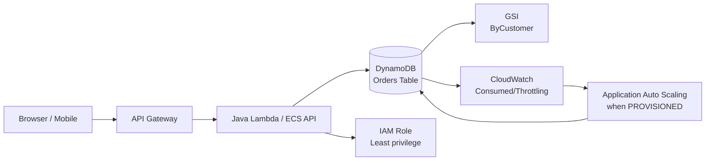
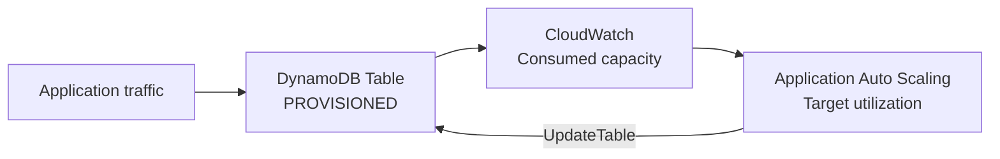
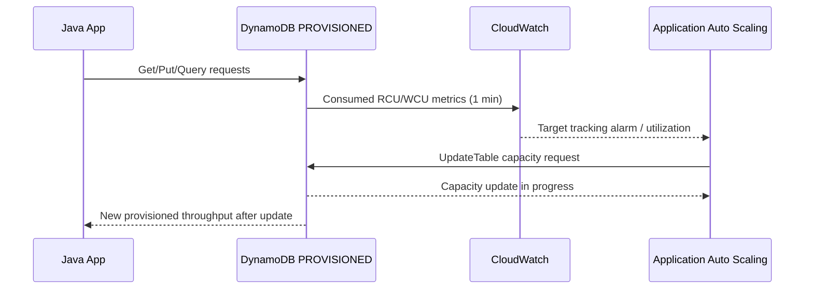
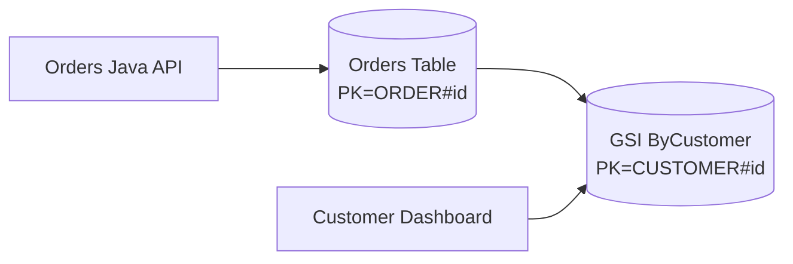
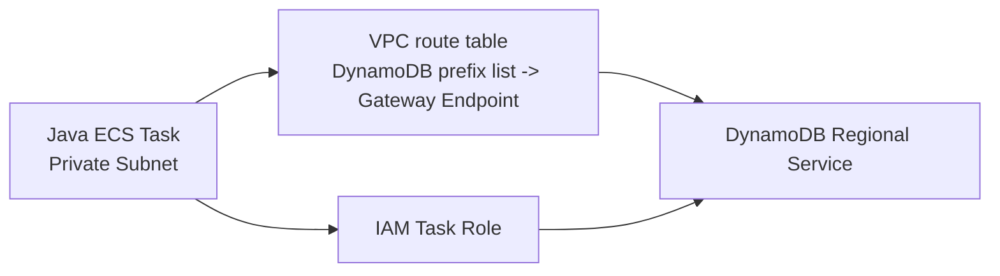
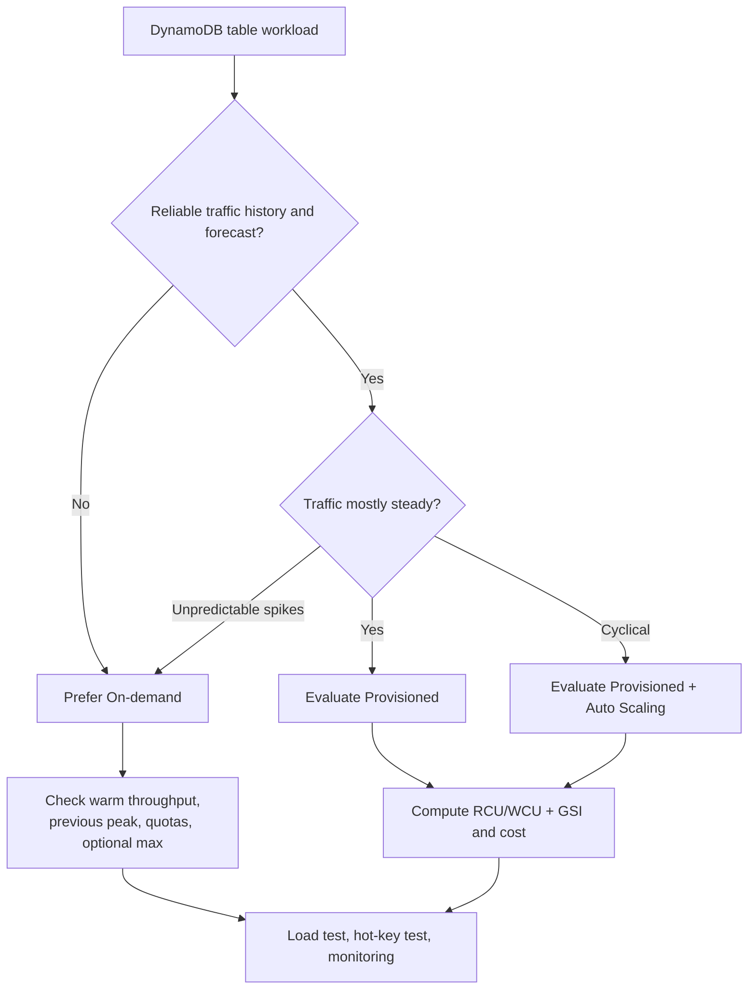

# On-Demand, Provisioned Capacity, and Auto Scaling

Amazon DynamoDB is a fully managed NoSQL database from AWS delivering **partition-key** access, low latency, and massive scalability. Yet two tables with the exact same schema can behave very differently in **cost**, **traffic spike handling**, and **throttling causes** simply because they use different **capacity modes**.

DynamoDB offers two primary throughput modes: **On-demand (`PAY_PER_REQUEST`)** and **Provisioned (`PROVISIONED`)**. With provisioned capacity, you can enable **DynamoDB Auto Scaling** via **AWS Application Auto Scaling**. Understanding **RCU, WCU, RRU, WRU, target utilization, warm throughput, GSI capacity, and hot partitions** enables informed configuration instead of raising capacity by guesswork.

This lesson belongs to the **DynamoDB** chapter of the **CLOUD_PROVIDERS_AWS** module. Learners combine data modeling, IAM, Regions/AZs, EC2/ECS/EKS/Lambda, AWS SDK for Java, CloudWatch, and budgeting to build safely scalable applications. Any prices, quotas, rates, and simulations in this lesson only hold meaning alongside **actual Regions, pricing tables, and real workloads**; no single number fits every environment.

> **Principle:** **On-demand** scales throughput automatically and bills by request units consumed; **Provisioned** sets RCU/WCU capacity and bills by provisioned capacity; **auto scaling** is merely a mechanism that adjusts provisioned capacity via metrics and target tracking—**not a third capacity mode**.

## 1. Learning Objectives

After this lesson, you will be able to:

1. Distinguish **DynamoDB On-demand, Provisioned, and Provisioned + Auto Scaling**.
2. Explain **RCU/RRU, WCU/WRU** and how they scale with **item size, consistency, and transactions**.
3. Estimate throughput from requests/second, item size, consistency, read/write ratios, and GSIs.
4. Choose **On-demand** for unpredictable loads and **Provisioned** for steady, forecastable workloads.
5. Describe **warm throughput**, previous traffic peaks, and throttling risks during sudden surges.
6. Configure **maximum throughput** on on-demand tables as a **best-effort** cost guardrail.
7. Set up and evaluate auto scaling policies including **minimum, maximum, and target utilization** for table reads/writes and GSIs.
8. Explain why target tracking does not absorb all traffic spikes instantaneously.
9. Distinguish **table-level throttling**, **hot partitions**, **GSI write back-pressure**, and service quota limits.
10. Read CloudWatch metrics, consumed capacity in AWS SDK/CLI, and throttling reasons in responses.
11. Use AWS CLI and AWS SDK for Java v2 to run inventories, create sandbox tables, and inspect request units.
12. Design **exponential backoff + jitter** retries, conditional writes/idempotency, and key distribution.
13. Compare **capacity-hours** vs. **request units** via formulas without hardcoding unit prices.
14. Plan capacity, monitoring, and budget controls for an orders table with seasonal traffic.

## 2. Where Does DynamoDB Fit in Application Architecture?



DynamoDB is a **regional managed service**; applications call DynamoDB over AWS SDK/APIs via **IAM**. You never run a database server cluster, pick EC2 instances for DynamoDB, or place a DB instance inside a private VPC subnet. AWS manages storage and partitioning.

**Capacity mode is a setting on tables and GSIs**, not a TCP connection option like RDS. Partition/sort keys, indexes, backups, IAM policies, and metrics all remain the same across both modes.

| Component | Decision | Example |
| --- | --- | --- |
| **Partition key** | Data distribution and access | `PK=ORDER#abc` or `PK=CUSTOMER#42` |
| **Sort key** | Item ordering within a logical partition | `SK=2026-11-20#ORDER#abc` |
| **Capacity mode** | How throughput is allocated and billed | `PAY_PER_REQUEST`, `PROVISIONED` |
| **Read consistency** | Throughput cost and data freshness | Eventually consistent, strongly consistent |
| **Global Secondary Index (GSI)** | Queries for additional access patterns | `GSI1PK=CUSTOMER#42` |
| **Application Auto Scaling** | Adjusts provisioned RCU/WCU | Target tracking 70% |
| **Warm throughput** | Immediately available throughput from history or pre-warming | Read/write units per second |
| **IAM** | Which principal may call which DynamoDB API | `dynamodb:GetItem`, `PutItem` |
| **CloudWatch** | Monitoring usage, throttling, and cost | `ConsumedReadCapacityUnits` |

## 3. Core Characteristics of the Two Capacity Modes

### 3.1. On-Demand — `PAY_PER_REQUEST`

- Does not require specifying fixed RCU/WCU counts for the table.
- DynamoDB handles throughput scaling; throughput billing depends on **actual read/write request units consumed**.
- Best suited for new development, erratic traffic, unpredictable workload shifts, or idle periods with zero traffic.
- Supports configuring **maximum on-demand throughput** for table or GSI reads/writes as a guardrail.
- Can still **throttle** due to hot partition keys, account/table quotas, configured maximum throughput, or surges exceeding warm/previous peak limits too rapidly.

### 3.2. Provisioned — `PROVISIONED`

- Explicitly sets the **RCUs** and **WCUs** the table can sustain.
- Throughput charges are based on **provisioned RCU-hours and WCU-hours**, **regardless of how many requests actually ran** that hour.
- Reads/writes exceeding provisioned capacity can throttle even when the service is healthy.
- Best suited for steady, measurable, and predictable throughput.
- Can enable **Application Auto Scaling** for table reads/writes and each GSI's reads/writes using target utilization and min/max capacity.

### 3.3. Provisioned + Auto Scaling

This is still **PROVISIONED**:



Auto scaling saves money compared to pinning fixed capacity at long-term peak when workloads are cyclical, **but it is not instantaneous**. Scaling decisions rely on CloudWatch metrics, introducing evaluation and capacity-update latency.

### 3.4. Quick Comparison

| Criterion | **On-demand** | **Fixed Provisioned** | **Provisioned + Auto Scaling** |
| --- | --- | --- | --- |
| Billing mode | `PAY_PER_REQUEST` | `PROVISIONED` | `PROVISIONED` |
| Need to specify RCU/WCU? | No | **Yes** | Needs min/max and initial capacity |
| Throughput billing | Consumed request units | Provisioned capacity-hours | Provisioned capacity-hours adjusted by policy |
| Operational complexity | Low | Medium/high | Medium/high |
| Spiky/unpredictable load | **Good fit** | Easy to waste or throttle | Can lag behind spikes |
| Steady 24/7 workload | Can work | **Worth evaluating** | Worth evaluating |
| Short multi-second spikes | Adapts within warm/peak limits | Relies on headroom and burst | Auto scaling cannot react instantly |
| Target tracking config? | Not needed | No | **Yes** |
| Cost guardrails | Optional max throughput, Budgets | Explicit RCU/WCU | Min/max/target + Budgets |
| Hot partition risk | **Yes** | **Yes** | **Yes** |

**Starting recommendation:** For new workloads without traffic history, evaluate **On-demand** first. Consider Provisioned once you have enough metrics/statistics to compare total cost and throttling risk.

## 4. What Is a Capacity Unit?

DynamoDB meters throughput based on the **actual size of data read or written**, not just SDK call counts.

### 4.1. Read Capacity

One read unit corresponds to:

| Read type | Item up to 4 KiB | Read unit |
| --- | --- | --- |
| **Strongly consistent** | 1 read | **1 RCU or 1 RRU** |
| **Eventually consistent** | 1 read | **0.5 RCU or 0.5 RRU** |
| **Transactional read** | 1 read | **2 RCU or 2 RRU** |

Reading items larger than **4 KiB** consumes proportionally more units, rounded up in 4 KiB increments. Under on-demand, **RRU** measures usage/billing; under provisioned, **RCU** defines provisioned throughput per second.

To estimate for a single item:

\[
\text{Read units} =
\left\lceil\frac{\text{item size (KiB)}}{4}\right\rceil
\times\text{consistency multiplier}
\]

Where the consistency multiplier is **1** (strong), **0.5** (eventual), or **2** (transactional). This is a **simplified formula for `GetItem` on an existing item**; `Query`, `Scan`, and missing-item reads have additional capacity accounting details.

### 4.2. Write Capacity

One **write unit** covers one write for an item up to **1 KiB**:

\[
\text{Write units}
=\left\lceil\frac{\text{item size (KiB)}}{1}\right\rceil
\times\text{transaction multiplier}
\]

- Normal write: multiplier **1**.
- Transactional write: multiplier **2** for write actions inside a transaction per DynamoDB rules.

`PutItem`, `UpdateItem`, and `DeleteItem` each have specific consumption rules. For instance, `UpdateItem` charges based on the larger of the item's before- and after-image sizes—not just the changed bytes. Failed conditional writes still consume write capacity per service rules.

### 4.3. Unit Calculation Examples

| Operation | Size | Calculation | Result |
| --- | --- | --- | --- |
| Strong GetItem | 3 KiB | ceil(3/4) × 1 | **1 read unit** |
| Eventual GetItem | 3 KiB | ceil(3/4) × 0.5 | **0.5 read unit** |
| Strong GetItem | 6 KiB | ceil(6/4) × 1 | **2 read units** |
| Eventual GetItem | 8 KiB | ceil(8/4) × 0.5 | **1 read unit** |
| Transactional GetItem | 8 KiB | ceil(8/4) × 2 | **4 read units** |
| PutItem | 900 bytes | ceil(900/1024) | **1 write unit** |
| PutItem | 2.5 KiB | ceil(2.5/1) | **3 write units** |
| Transactional PutItem | 2.5 KiB | 3 × 2 | **6 write units** |

**KiB** here uses multiples of **1024 bytes**, matching how DynamoDB measures item sizes in documentation.

## 5. Calculating RCU/WCU from Request Rate

### 5.1. Read Sizing Problem

An application performs **100 strongly consistent `GetItem`/second** on 3 KiB items:

\[
\text{RCU needed} = 100 \times \lceil 3/4 \rceil = 100
\]

If eventual consistency is acceptable:

\[
\text{RCU needed} = 100 \times 0.5 = 50
\]

If each item grows to 7 KiB while staying strong:

\[
100 \times \lceil 7/4 \rceil = 200\ \text{RCU}
\]

**100 requests/second does not automatically mean 100 RCUs**: item size, consistency, transactions, and operation type all change the math.

### 5.2. Write Sizing Problem

An API writes **60 items/second** of 2.2 KiB items:

\[
60 \times \lceil 2.2/1 \rceil = 180\ \text{WCU}
\]

If each item is written inside a transaction:

\[
60 \times 3 \times 2 = 360\ \text{WCU}
\]

This still excludes **GSI write amplification**, Global Tables, and other operations.

### 5.3. Batch, Query, and Scan Are Not Free

- `BatchGetItem`: each item rounds up its read capacity individually.
- `BatchWriteItem`: each item consumes write units individually—one batch does not cost 1 WCU.
- `Query`: capacity depends on data read/evaluated under the key condition, not just what the frontend displays.
- `Scan`: reads broadly and burns units rapidly, impacting hot partitions and cost.
- `FilterExpression` in `Query`/`Scan` filters **after reading**, never reducing consumed RCUs.
- `ProjectionExpression` on a table read usually **does not** reduce consumed RCUs, since billing counts the full item accessed.
- Querying a **GSI** consumes read units from the **index**, while base-table writes incur **index write units**.

**Optimizing access patterns and key design usually saves far more than bumping RCU/WCU.**

## 6. On-Demand: Automatic Scaling Mechanics

### 6.1. No Need to Declare RCU/WCU

Creating an On-demand table:

```text
TableName: Orders
Partition key: pk (String)
Sort key: sk (String)
BillingMode: PAY_PER_REQUEST
```

The application can start at tiny traffic without paying for idle provisioned RCUs/WCUs. Throughput charges come from actual request units consumed, alongside storage, backups, streams, Global Tables, or data transfer if used.

### 6.2. Default Warm Throughput

Per AWS documentation, a **new on-demand table** starts with **default warm throughput immediately available** up to roughly:

- **12,000 read units/second**.
- **4,000 write units/second**.

These figures represent initial baseline capacity—**not a fixed monthly charge**, and they do not bypass other quotas. A table automatically raises its warm throughput as it serves higher sustained traffic.

**Warm throughput** is the throughput a table or GSI can sustain **immediately**, based on traffic history or proactive pre-warming. It exists in both on-demand and provisioned modes, though it does not replace **billing mode** or provisioned RCU/WCU settings.

### 6.3. What Does "Up to Double the Previous Peak" Mean?

DynamoDB on-demand can immediately accommodate traffic up to roughly **2× its previous peak** achieved (subject to quotas, partition limits, and current policies).

For example, if a table previously reached 10,000 read units/second, it can quickly serve around 20,000 read units/second under normal scaling rules. If traffic jumps past **2× the previous peak within 30 minutes**, DynamoDB **can throttle** while allocating additional capacity.

Hence the claim "on-demand never throttles" is **false**.

### 6.4. Pre-Warming for Major Campaigns

A storefront expects a 100× traffic flash sale within minutes. Instead of assuming on-demand will automatically leap past its previous peak:

1. Check current **`WarmThroughput`** on the table **and every GSI**.
2. Forecast peak RRUs/WRUs using item sizes, consistency, and GSI writes.
3. Verify **per-table/index and Region quotas**.
4. Consider raising warm throughput **before the event** via the pre-warm capability.
5. Monitor completion status and load-test with distributed keys.
6. Account for cost: **proactively pre-warming warm throughput can incur charges**, whereas organic warm throughput growth from traffic history does not carry a separate fee.
7. Check hot keys, upstream API/Lambda concurrency, and downstream SLOs.

**Pre-warming does not fix a hot partition key.** It expands aggregate capacity, not data modeling.

## 7. On-Demand Maximum Throughput: A Guardrail, Not Auto Scaling

DynamoDB lets you set **`MaxReadRequestUnits`** and **`MaxWriteRequestUnits`** on an on-demand table or GSI.

Example:

```yaml
BillingMode: PAY_PER_REQUEST
OnDemandThroughput:
  MaxReadRequestUnits: 5000
  MaxWriteRequestUnits: 1500
```

Purpose: the application sets a **target rate cap**; exceeding the configured limit causes requests to fail with `ThrottlingException`. This helps stop runaway jobs from inflating bills or overwhelming downstream systems.

**Do not confuse max on-demand throughput with provisioned RCU/WCU or Application Auto Scaling min/max.**

| Property | On-demand max throughput | Provisioned max auto scaling |
| --- | --- | --- |
| Purpose | Caps consumption rate of an on-demand table/GSI | Caps RCU/WCU that auto scaling can provision |
| Unit | Read/write request units/second | Provisioned RCU/WCU |
| Billing | Per request units consumed | Per capacity provisioned |
| Scale-in/scale-out policy? | Not needed | Yes, when auto scaling is enabled |
| Exceeding threshold | Can throttle | Can throttle when demand exceeds capacity |
| Strict hard cap? | **No**: AWS describes it as **best effort**; bursts can exceed target | Max capacity is a policy ceiling; quotas still apply |

On-demand maximum throughput can be exceeded briefly due to **burst capacity** per AWS documentation. Thus it is **not a strict hard billing cap**. Pair it with AWS Budgets, alarms, IAM, load tests, and application guardrails.

### 7.1. Service Quota Limits

AWS currently documents default table-level limits around **40,000 read and write units/second** for on-demand per service quotas, adjustable on request. Actual quotas depend on account/Region and can change; **always check Service Quotas**, never hardcode 40,000 in application logic.

Even at low request rates, an on-demand table can throttle if requests pile onto a single **hot key** well below the table-level quota.

## 8. Provisioned: Explicit Capacity Allocation

### 8.1. What Does a Provisioned Table Declare?

```yaml
BillingMode: PROVISIONED
ProvisionedThroughput:
  ReadCapacityUnits: 120
  WriteCapacityUnits: 200
```

In simple terms, the table can sustain about 120 strongly consistent reads/s of items ≤4 KiB (or 240 eventually consistent reads/s), and 200 writes/s of items ≤1 KiB, **provided traffic spreads evenly** and no other limits interfere.

**It does not mean** the table guarantees exactly 120 HTTP calls/s in every case: request sizes and individual physical partitions vary.

### 8.2. Calculating Provisioned Throughput Cost

For a table provisioned with `R` RCUs and `W` WCUs over `H` hours:

\[
C_{\text{throughput}} \approx
R\times H\times P_{\text{RCU-hour}}
+W\times H\times P_{\text{WCU-hour}}
\]

If capacity changes over time, sum across intervals:

\[
C_{\text{throughput}} \approx
\sum_i (R_i P_R + W_i P_W)\Delta t_i
\]

Unit rates `P_R`/`P_W` depend on Region, table class, reserved capacity, and current pricing. This covers **throughput cost only**—excluding storage, backups, PITR, data transfer, streams/exports, or GSI storage/capacity.

### 8.3. Does Provisioned Have Burst Capacity?

DynamoDB provides **burst capacity** to absorb brief spikes above normal provisioned rates within service rules. However:

- **Burst capacity is not guaranteed sustained throughput**.
- Never use burst as an excuse to set min RCU/WCU below steady traffic.
- Hot partitions can still throttle.
- Chronically under-provisioned capacity triggers SDK retries and high latency.

### 8.4. Provisioned Tables with GSIs

A provisioned table might have:

```text
Orders base table:
  RCU = 300
  WCU = 200

GSI ByCustomer:
  RCU = 100
  WCU = 220
```

**Each GSI has its own provisioned throughput.** Querying a GSI consumes GSI read units, and updating indexed attributes consumes GSI write units. If GSI write throughput falls short, **base-table writes can also throttle** due to index back-pressure.

Never monitor only the base table while ignoring GSIs.

## 9. Sizing Capacity with Headroom

### 9.1. Sizing Workflow

1. Catalog **access patterns**: `GetItem`, `Query`, `PutItem`, `UpdateItem`, `DeleteItem`, Batch, Transactions, GSI queries.
2. Measure **actual item sizes** (including attribute names and types).
3. Forecast **average, p95/p99, and peak requests/s**, separating normal days from sales events.
4. Classify strong/eventual/transactional reads and GSI eventual reads.
5. Compute **consumed RCU/WCU** for the table and **every GSI**.
6. Pick a headroom/target utilization factor for latency and retries.
7. Validate **key distribution** and partition limits.
8. Account for quotas, warm throughput, and Auto Scaling lag.
9. Load-test in a sandbox, inspecting CloudWatch and `ReturnConsumedCapacity`.
10. Compare on-demand vs. provisioned across the **full usage schedule**, not peak alone.

### 9.2. Orders Table Sizing Example

Assume on average:

- 120 `GetItem`/s on 3 KiB items, eventual reads.
- 40 `PutItem`/s on 1.5 KiB items.
- One GSI serving 60 `Query`/s, averaging 2 KiB of index data per query.
- Each Put creates an 800-byte GSI entry.

Estimate **base table**:

\[
R_{\text{base}}=120\times 0.5=60\ \mathrm{RCU}
\]

\[
W_{\text{base}}=40\times\lceil 1.5\rceil=80\ \mathrm{WCU}
\]

Estimate **GSI**:

\[
R_{\text{GSI}}=60\times 0.5=30\ \mathrm{RCU}
\]

\[
W_{\text{GSI}}=40\times\lceil 0.8\rceil=40\ \mathrm{WCU}
\]

Logical totals are **60 RCU + 80 WCU on the table** and **30 RCU + 40 WCU on the GSI**, with GSI billed and bounded separately. These numbers assume each Query matches one item's volume and every write updates the GSI; in practice measure **actual consumed capacity**, as Queries span multiple items and GSI projections change entry sizes.

### 9.3. 70% Target Utilization

To run provisioned capacity at 70% target utilization for a steady workload:

\[
R_{\text{provisioned}}\approx
\left\lceil\frac{60}{0.70}\right\rceil=86\ \mathrm{RCU}
\]

\[
W_{\text{provisioned}}\approx
\left\lceil\frac{80}{0.70}\right\rceil=115\ \mathrm{WCU}
\]

This is only an **estimate of target provisioned headroom**; target tracking adjusts based on metrics/min/max with lag. Setting max capacity too low still causes throttling.

## 10. How Does DynamoDB Auto Scaling Work?

DynamoDB Auto Scaling uses **AWS Application Auto Scaling** to manage provisioned read/write capacity on a table or GSI.



For each scalable dimension, configure:

- **Minimum capacity** — lowest RCUs/WCUs the policy will scale down to.
- **Maximum capacity** — highest RCUs/WCUs the policy is allowed to reach.
- **Target utilization** — desired consumed/provisioned percentage.

Example:

```text
Orders table READ:
  Min: 50 RCU
  Max: 1500 RCU
  Target utilization: 70%

Orders table WRITE:
  Min: 20 WCU
  Max: 600 WCU
  Target utilization: 65%
```

**Reads and writes are separate scaling dimensions**—they do not have to share min/max values. Each GSI also needs its own scaling policies when in provisioned mode.

### 10.1. Auto Scaling Does Not Scale in Milliseconds

Per AWS documentation:

- DynamoDB emits consumed capacity metrics at **1-minute granularity**.
- Scale-out typically triggers once utilization exceeds target for **two consecutive minutes**, plus CloudWatch/alarm latency.
- Scale-in typically requires **15 consecutive datapoints** below target to avoid oscillation.
- After the policy triggers, `UpdateTable` itself takes time to apply.

Total reaction time can be **several minutes or more**. During that window, requests exceeding current provisioned units **can be throttled**.

> **Consequence:** DynamoDB Auto Scaling fits gradual traffic shifts with sufficient duration—**it cannot handle a 100× spike arriving in a few seconds**.

### 10.2. Valid Target Utilization Range

AWS supports **20%–90%** target utilization for DynamoDB Auto Scaling.

| Target | Trade-off |
| --- | --- |
| 30% | Generous capacity buffer, higher provisioned cost |
| 50% | More headroom for fluctuating traffic |
| 70% | Common balanced baseline |
| 85–90% | Saves capacity when very flat, but throttles easily on spikes |
| Below 20% or above 90% | Outside supported service target range |

**Never pick 90% for a bursty app** just to trim costs. Factor in p95/p99 latency, service quotas, min/max bounds, and retry behavior.

### 10.3. Min/Max Capacity and Peak Periods

If a policy sets:

```text
min=10 RCU
max=100 RCU
target=70%
```

while the app steadily needs **500 RCU/s**, auto scaling **cannot** solve it: the policy caps out at **100 RCU**. Raising max requires checking load budgets, quotas, and costs—waiting longer will not help.

Conversely, setting `min=500 RCU` when overnight traffic uses only 5 RCU/s means you still pay for 500 RCU overnight—auto scaling **never scales below minimum**.

### 10.4. Scheduled Scaling and Planned Peaks

If traffic surges every evening at 19:00 or on Black Friday:

- For provisioned tables, schedule a **proactive capacity increase** ahead of peak, letting target tracking fine-tune afterward.
- For on-demand tables, verify **warm throughput/pre-warming** and previous peaks.
- In both cases, test **GSI capacity and key distribution** before launch.
- Monitor downstream Lambda/API/SQS and app layers—not just DynamoDB.

## 11. Treat Every GSI as Its Own Capacity Resource

### 11.1. When a Table Has a GSI



A GSI serves a separate access pattern:

- Querying the GSI consumes **GSI read units**, not base-table reads.
- Base-table `Put/Update/Delete` operations that alter indexed entries consume **GSI write units**.
- GSI queries are **eventually consistent only**; strongly consistent reads are unsupported on GSIs.
- Index projections alter entry size, affecting index read, write, and storage costs.
- A provisioned GSI lacking WCUs causes **back-pressure throttling** on base-table writes.

### 11.2. Provisioned GSI Capacity and Policies

Example:

```text
Orders table:
  Read 200 RCU with auto scaling
  Write 300 WCU with auto scaling

ByCustomer GSI:
  Read 100 RCU with auto scaling
  Write 350 WCU with auto scaling
```

Setting **base-table WCU=300** does not automatically mean every GSI needs 300 WCU. Factor in projected item sizes, the fraction of writes hitting the index, and dedicated workloads. AWS recommends provisioning enough GSI write capacity relative to the table to avoid back-pressure; base numbers on measurements.

### 11.3. On-Demand GSI Limits

GSIs on on-demand tables do not declare separate provisioned RCUs/WCUs, yet you can still configure **maximum on-demand throughput** per **individual index**. When an index hits its cap or a hot partition, related table operations can throttle.

**Inspect resource ARNs** in `ThrottlingReasons` to pinpoint whether the table or a specific index throttled.

### 11.4. Local Secondary Indexes (LSIs)

LSIs differ from GSIs in keys, consistency, and capacity:

- LSIs draw read/write throughput from the **base table**—no separate provisioned throughput like GSIs.
- LSIs support strongly consistent reads where applicable.
- LSIs impose design constraints (such as the 10 GiB item-collection limit).
- You do not configure separate auto scaling policies for an LSI.

## 12. Hot Partitions and Adaptive Capacity

A table with 10,000 total WCUs **does not guarantee** a single partition key can sustain 10,000 writes/s. DynamoDB distributes data and throughput across partition keys and physical partitions.

### 12.1. Hot Key Example

Poor design:

```text
PK = "TODAY"
SK = timestamp#orderId
```

All new orders share `"TODAY"` as the partition key, concentrating writes; the table can suffer **key-range throughput throttling** despite abundant aggregate provisioned/on-demand capacity.

Better design:

```text
PK = "CUSTOMER#<customerId>"
SK = "ORDER#<createdAt>#<orderId>"
```

Or with write sharding when needed:

```text
PK = "DATE#2026-11-20#SHARD#03"
SK = "ORDER#<orderId>"
```

**Write sharding** requires planning cross-shard Queries/aggregations, added code complexity, and consistency. Never add shards purely out of buzzword fear of "hot partitions": measure first.

### 12.2. Adaptive Capacity Does Not Break Partition Limits

DynamoDB's **adaptive capacity** shifts throughput across partitions based on usage. However, it **does not bypass physical per-partition throughput limits** or fix severely skewed data models.

A common educational reference is **roughly 3,000 RCU and 1,000 WCU per physical partition** under standard service conditions, though capacity mode, item size, access patterns, and partition splitting govern real behavior. **Never treat these numbers as a substitute for current AWS quota docs.**

### 12.3. Signs of a Hot Partition

- Throttling occurs even when overall table consumed/provisioned utilization is low.
- Requests cluster heavily on one partition key or key range.
- `ThrottlingReasons` reports `KeyRangeThroughputExceeded`.
- Contributor Insights / CloudWatch reveals top hot keys or traffic skew.
- Raising table capacity fails to relieve throttling proportionally.

Remediation includes **redesigning the partition key**, write sharding, appropriate caching, workload isolation, and request smoothing—not just raising max RCU/WCU.

## 13. Throttling Has Multiple Distinct Causes

AWS classifies four primary throttling reason groups:

| Group | Applies to which mode? | Example reason |
| --- | --- | --- |
| **Key range / partition throughput** | Both | `TableWriteKeyRangeThroughputExceeded` |
| **Provisioned capacity exhausted** | Provisioned | `TableReadProvisionedThroughputExceeded` |
| **Account / table quota exhausted** | On-demand | `TableWriteAccountLimitExceeded` |
| **Configured on-demand maximum** | On-demand | `IndexReadMaxOnDemandThroughputExceeded` |

`ThrottlingReasons` identifies:

- **Resource type:** `Table` or `Index`.
- **Operation:** `Read` or `Write`.
- **Limit:** `KeyRangeThroughputExceeded`, `ProvisionedThroughputExceeded`, `AccountLimitExceeded`, or `MaxOnDemandThroughputExceeded`.
- **Resource ARN:** the exact table or GSI being throttled.

**`ThrottlingException` does not automatically mean "buy more capacity."** It might be a hot key, under-sized GSI WCU, an intentionally low on-demand max cap, or an account service quota.

## 14. Monitoring with CloudWatch Metrics

### 14.1. Core Metrics

| Metric | Used for |
| --- | --- |
| `ConsumedReadCapacityUnits` | Measuring read units consumed |
| `ConsumedWriteCapacityUnits` | Measuring write units consumed |
| `ProvisionedReadCapacityUnits` | Current provisioned read capacity |
| `ProvisionedWriteCapacityUnits` | Current provisioned write capacity |
| `ReadThrottleEvents` / `WriteThrottleEvents` | Tracking read/write throttle events |
| `ThrottledRequests` | Viewing throttled requests across metric dimensions |
| `SuccessfulRequestLatency` | DynamoDB service-side latency |
| `SystemErrors` / `UserErrors` | Service vs. client errors |
| `OnDemandMaxReadRequestUnits` | Configured on-demand read maximum |
| `OnDemandMaxWriteRequestUnits` | Configured on-demand write maximum |
| `AccountMaxReads` / `AccountMaxWrites` | Account quota visibility where supported |
| Per-index metrics | Inspecting GSIs independently |
| Contributor Insights | Pinpointing hot keys / traffic skew when enabled |

Metric names, dimensions, and availability vary by mode and feature. Never build one generic dashboard assuming every metric emits identically across all tables.

### 14.2. Reading Metric Units Correctly

`ConsumedReadCapacityUnits` in CloudWatch is often aggregated as **Sum over 1 minute**. To convert to average read units/s:

\[
\text{Avg RUs/s} \approx
\frac{\text{ConsumedReadCapacityUnits Sum over 1 minute}}{60}
\]

If CloudWatch reports `Sum=4,200` read units in 1 minute:

\[
4200/60 = 70\ \text{average read units/s}
\]

**This is a 1-minute average**—it hides multi-second sub-minute spikes, partition-key skew, and client-side latency. When tuning auto scaling, inspect both sustained utilization and spike profiles.

### 14.3. Real-World Target Utilization

\[
\text{Utilization}
= \frac{\text{consumed RCU/s}}{\text{provisioned RCU/s}}
\times 100\%
\]

If averaging 70 RCU/s on a table provisioned at 100 RCU:

\[
\text{Utilization} \approx 70\%
\]

When setting targets, account for traffic spikes, CloudWatch reporting delay, and scaling speed.

### 14.4. Application-Side Observability

Emit structured logs/metrics capturing:

- `operation`: `GetItem`, `Query`, `PutItem`, `BatchWriteItem`.
- `tableName`/`indexName` (without leaking sensitive values).
- Request duration and retry attempts.
- SDK `ReturnConsumedCapacity`.
- Throttling reason codes and affected resource ARN.
- AWS request ID and trace/correlation ID.
- Error types and rates per API route.
- Business outcomes and duplicate write counts.

**Never log full items containing PII, access keys, user tokens, or secrets** just to debug capacity.

## 15. AWS SDK for Java v2: Measuring Consumed Capacity

Common Maven dependency: `software.amazon.awssdk:dynamodb`, versioned via the **AWS SDK BOM**.

### 15.1. GetItem with ReturnConsumedCapacity

```java
package example.dynamodb;

import software.amazon.awssdk.services.dynamodb.DynamoDbClient;
import software.amazon.awssdk.services.dynamodb.model.AttributeValue;
import software.amazon.awssdk.services.dynamodb.model.GetItemRequest;
import software.amazon.awssdk.services.dynamodb.model.GetItemResponse;
import software.amazon.awssdk.services.dynamodb.model.ReturnConsumedCapacity;

import java.util.Map;

public final class ReadOrder {
    public static void main(String[] args) {
        String table = System.getenv().getOrDefault(
            "DDB_TABLE", "OrdersDemo");

        try (DynamoDbClient db = DynamoDbClient.create()) {
            GetItemRequest request = GetItemRequest.builder()
                .tableName(table)
                .key(Map.of(
                    "pk", AttributeValue.builder().s("ORDER#42").build(),
                    "sk", AttributeValue.builder().s("META").build()))
                .consistentRead(false) // Eventually consistent
                .returnConsumedCapacity(ReturnConsumedCapacity.TOTAL)
                .build();

            GetItemResponse response = db.getItem(request);
            if (response.hasItem()) {
                System.out.println("Order exists");
            }
            if (response.consumedCapacity() != null) {
                System.out.println("Read units consumed = "
                    + response.consumedCapacity().capacityUnits());
            }
        }
    }
}
```

This example is **read-only**, though running against real AWS still incurs request/capacity usage. The SDK resolves Region and credentials via the **default provider chain** and IAM role—**never hardcode access keys or secrets**.

### 15.2. PutItem with Conditional Expression and Capacity

```java
package example.dynamodb;

import software.amazon.awssdk.services.dynamodb.DynamoDbClient;
import software.amazon.awssdk.services.dynamodb.model.AttributeValue;
import software.amazon.awssdk.services.dynamodb.model.ConditionalCheckFailedException;
import software.amazon.awssdk.services.dynamodb.model.PutItemRequest;
import software.amazon.awssdk.services.dynamodb.model.PutItemResponse;
import software.amazon.awssdk.services.dynamodb.model.ReturnConsumedCapacity;

import java.util.Map;

public final class CreateOrder {
    public static void main(String[] args) {
        String table = System.getenv().getOrDefault(
            "DDB_TABLE", "OrdersDemo");
        String orderId = "ORDER#demo-42";

        Map<String, AttributeValue> item = Map.of(
            "pk", AttributeValue.builder().s(orderId).build(),
            "sk", AttributeValue.builder().s("META").build(),
            "status", AttributeValue.builder().s("NEW").build());

        try (DynamoDbClient db = DynamoDbClient.create()) {
            PutItemRequest request = PutItemRequest.builder()
                .tableName(table)
                .item(item)
                .conditionExpression("attribute_not_exists(pk)")
                .returnConsumedCapacity(ReturnConsumedCapacity.TOTAL)
                .build();

            PutItemResponse response = db.putItem(request);
            System.out.println("Consumed write units = "
                + response.consumedCapacity().capacityUnits());
        } catch (ConditionalCheckFailedException duplicate) {
            System.out.println("Order already exists: no overwrite");
        }
    }
}
```

**This is a WRITE example—run only in a sandbox against a dedicated lab table.** The conditional expression prevents overwriting an existing item with the same primary key; complex workflows need proper idempotency keys/transactions. Failed conditional writes still consume capacity. Never blindly retry if a request may have committed before a network drop.

### 15.3. Least-Privilege IAM Permissions

A Lambda/ECS task reading and writing `OrdersDemo` never needs `dynamodb:*`:

```json
{
  "Version": "2012-10-17",
  "Statement": [
    {
      "Effect": "Allow",
      "Action": [
        "dynamodb:GetItem",
        "dynamodb:Query",
        "dynamodb:PutItem"
      ],
      "Resource": [
        "arn:aws:dynamodb:ap-southeast-1:123456789012:table/OrdersDemo",
        "arn:aws:dynamodb:ap-southeast-1:123456789012:table/OrdersDemo/index/*"
      ]
    }
  ]
}
```

**Real policy scoping** should align actions and resources tightly; never grant index ARNs to actions that do not use indexes. Combine with `dynamodb:LeadingKeys` condition keys where multi-tenant models and IAM designs fit. Remember that resource/IAM authorization never replaces per-order business ownership checks.

## 16. AWS CLI: Inspecting Mode and Capacity Before Changing Anything

These commands are **read-only**; replace table, Region, and profile for your assigned account:

```bash
aws sts get-caller-identity --profile training

# Table, BillingMode, GSIs, throughput, warm throughput.
aws dynamodb describe-table \
  --table-name OrdersDemo \
  --region ap-southeast-1 --profile training

# Extract specific fields only.
aws dynamodb describe-table \
  --table-name OrdersDemo \
  --query "Table.{Status:TableStatus,BillingMode:BillingModeSummary.BillingMode,RCU:ProvisionedThroughput.ReadCapacityUnits,WCU:ProvisionedThroughput.WriteCapacityUnits,GSIs:GlobalSecondaryIndexes,Warm:WarmThroughput,OnDemandMax:OnDemandThroughput}" \
  --region ap-southeast-1 --profile training

# View existing Application Auto Scaling targets and policies.
aws application-autoscaling describe-scalable-targets \
  --service-namespace dynamodb \
  --region ap-southeast-1 --profile training

aws application-autoscaling describe-scaling-policies \
  --service-namespace dynamodb \
  --region ap-southeast-1 --profile training
```

An on-demand table reports `ProvisionedThroughput.ReadCapacityUnits=0` in `describe-table` output (or omits certain summary fields in some states). Never conclude "the table has zero capacity" because RCU/WCU show zero: inspect **`BillingModeSummary`, `WarmThroughput`, and `OnDemandThroughput`**.

### 16.1. Reading CloudWatch Metrics

```bash
# Illustrative: Sum of consumed read units in a 15-minute UTC window.
aws cloudwatch get-metric-statistics \
  --namespace AWS/DynamoDB \
  --metric-name ConsumedReadCapacityUnits \
  --dimensions Name=TableName,Value=OrdersDemo \
  --statistics Sum \
  --period 60 \
  --start-time 2026-11-20T00:00:00Z \
  --end-time 2026-11-20T00:15:00Z \
  --region ap-southeast-1 --profile training
```

Replace the time window with a **period containing real traffic**. If datapoints are empty, verify Region, `TableName`/`GlobalSecondaryIndexName` dimensions, retention, and interval. Never treat missing datapoints as guaranteed zero usage.

### 16.2. Inspecting Auto Scaling for a Specific Resource

```bash
aws application-autoscaling describe-scaling-policies \
  --service-namespace dynamodb \
  --resource-id table/OrdersDemo \
  --region ap-southeast-1 --profile training

aws application-autoscaling describe-scaling-activities \
  --service-namespace dynamodb \
  --resource-id table/OrdersDemo \
  --region ap-southeast-1 --profile training
```

Inspect `ScalableDimension` for read/write; if the policy targets a GSI, `ResourceId` looks like `table/OrdersDemo/index/ByCustomer`.

## 17. AWS CLI: Creating On-Demand and Provisioned Tables in a Sandbox

> **Change and cost warning:** `create-table` and `update-table` create or modify AWS resources, incurring read/write/storage charges or impacting production if run against the wrong Region or table. Run only in an approved sandbox with an owner and cleanup plan. **Never run these commands on real tables while purely studying theory.**

### 17.1. Create an On-Demand Table

```bash
aws dynamodb create-table \
  --table-name OrdersDemo \
  --attribute-definitions \
    AttributeName=pk,AttributeType=S \
    AttributeName=sk,AttributeType=S \
  --key-schema \
    AttributeName=pk,KeyType=HASH \
    AttributeName=sk,KeyType=RANGE \
  --billing-mode PAY_PER_REQUEST \
  --region ap-southeast-1 --profile training

aws dynamodb wait table-exists \
  --table-name OrdersDemo \
  --region ap-southeast-1 --profile training
```

Do not pass RCU/WCU values when creating a `PAY_PER_REQUEST` table.

### 17.2. Create a Provisioned Table

```bash
aws dynamodb create-table \
  --table-name OrdersProvisionedDemo \
  --attribute-definitions AttributeName=pk,AttributeType=S \
  --key-schema AttributeName=pk,KeyType=HASH \
  --billing-mode PROVISIONED \
  --provisioned-throughput ReadCapacityUnits=20,WriteCapacityUnits=10 \
  --region ap-southeast-1 --profile training
```

This sets **fixed initial capacity**; automatic adjustments require configuring Application Auto Scaling.

### 17.3. Set On-Demand Maximum Throughput

```bash
# Modifies an existing table. Best-effort target, not a hard billing cap.
aws dynamodb update-table \
  --table-name OrdersDemo \
  --on-demand-throughput MaxReadRequestUnits=5000,MaxWriteRequestUnits=1200 \
  --region ap-southeast-1 --profile training
```

Adjust values as needed; never set a cap below production traffic without reviewing `ThrottlingReasons` and cost impact. Can also be configured per GSI where supported.

### 17.4. Switching Modes

```bash
# PROVISIONED -> PAY_PER_REQUEST (subject to switch frequency limits).
aws dynamodb update-table \
  --table-name OrdersProvisionedDemo \
  --billing-mode PAY_PER_REQUEST \
  --region ap-southeast-1 --profile training

# PAY_PER_REQUEST -> PROVISIONED (requires appropriate initial capacity).
aws dynamodb update-table \
  --table-name OrdersDemo \
  --billing-mode PROVISIONED \
  --provisioned-throughput ReadCapacityUnits=100,WriteCapacityUnits=50 \
  --region ap-southeast-1 --profile training
```

**Verify GSI capacity** when switching to provisioned; every GSI also needs proper settings. `UpdateTable` is asynchronous—wait for `ACTIVE` and read back settings before proceeding.

Under current documentation, you can switch **PROVISIONED → PAY_PER_REQUEST up to four times within a rolling 24-hour window**, whereas **PAY_PER_REQUEST → PROVISIONED** can be requested anytime, subject to API lifecycle rules.

**Important detail:** Switching modes in the **AWS Console** can delete existing auto scaling settings; switching via **CLI/SDK** can preserve policies and reapply them when returning to provisioned. Always inventory and verify targets, policies, and alarms after any mode switch.

## 18. AWS CLI: Configuring DynamoDB Application Auto Scaling

The examples below **mutate AWS state**; use only in a sandbox on a **table already in `PROVISIONED` mode**.

### 18.1. Register Read Scalable Target

```bash
aws application-autoscaling register-scalable-target \
  --service-namespace dynamodb \
  --resource-id table/OrdersProvisionedDemo \
  --scalable-dimension dynamodb:table:ReadCapacityUnits \
  --min-capacity 20 \
  --max-capacity 1000 \
  --region ap-southeast-1 --profile training
```

### 18.2. Create Target Tracking Policy

```bash
# BASH quoting. On PowerShell/cmd, use a JSON file or appropriate escaping.
aws application-autoscaling put-scaling-policy \
  --policy-name orders-read-target-70 \
  --service-namespace dynamodb \
  --resource-id table/OrdersProvisionedDemo \
  --scalable-dimension dynamodb:table:ReadCapacityUnits \
  --policy-type TargetTrackingScaling \
  --target-tracking-scaling-policy-configuration \
    '{"TargetValue":70.0,"PredefinedMetricSpecification":{"PredefinedMetricType":"DynamoDBReadCapacityUtilization"}}' \
  --region ap-southeast-1 --profile training
```

Target tracking at 70% aims to keep consumed/provisioned utilization around 70% **over time**, without guaranteeing instant scaling.

### 18.3. Auto Scaling for Writes

```bash
aws application-autoscaling register-scalable-target \
  --service-namespace dynamodb \
  --resource-id table/OrdersProvisionedDemo \
  --scalable-dimension dynamodb:table:WriteCapacityUnits \
  --min-capacity 10 \
  --max-capacity 600 \
  --region ap-southeast-1 --profile training

aws application-autoscaling put-scaling-policy \
  --policy-name orders-write-target-70 \
  --service-namespace dynamodb \
  --resource-id table/OrdersProvisionedDemo \
  --scalable-dimension dynamodb:table:WriteCapacityUnits \
  --policy-type TargetTrackingScaling \
  --target-tracking-scaling-policy-configuration \
    '{"TargetValue":70.0,"PredefinedMetricSpecification":{"PredefinedMetricType":"DynamoDBWriteCapacityUtilization"}}' \
  --region ap-southeast-1 --profile training
```

### 18.4. When GSIs Are Present

Replace the resource ID with:

```text
table/OrdersProvisionedDemo/index/ByCustomer
```

and use scalable dimensions:

```text
dynamodb:index:ReadCapacityUnits
dynamodb:index:WriteCapacityUnits
```

**Never create auto scaling policies for an on-demand table**, as on-demand does not use provisioned RCUs/WCUs. For IAM, Application Auto Scaling uses a service-linked role; scope `application-autoscaling:*` permissions with least privilege and resource controls.

### 18.5. Rollback and Cleanup

When finishing the lab:

1. Verify `sts get-caller-identity`, resource tags, and owners.
2. Inspect `describe-scaling-policies` and `describe-scalable-targets`.
3. Delete only policies, targets, and tables **created for the sandbox**.
4. Check PITR, backups, streams, Global Tables, and dependent resources.
5. Never delete a production table because its name resembles a demo table.

## 19. On-Demand vs. Auto Scaling: Avoiding Misconceptions

| Statement | True/False | Explanation |
| --- | --- | --- |
| "On-demand auto-scales and needs no target tracking" | **True** | `PAY_PER_REQUEST` manages throughput automatically |
| "On-demand never throttles" | **False** | Hot keys, quotas, max throughput, and steep surges still throttle |
| "Provisioned auto scaling is a third billing mode" | **False** | Still `PROVISIONED` |
| "Auto scaling can take several minutes" | **True** | CloudWatch + `UpdateTable` latency |
| "70% target means AWS guarantees exactly 70% every second" | **False** | Long-term target, not a hard per-second SLA |
| "GSIs have separate capacity in provisioned mode" | **True** | Separate RCU/WCU + scaling policies |
| "Raising table RCU fixes a GSI starved of WCU" | **False** | Must address index write capacity / back-pressure |
| "Hot keys can throttle under on-demand" | **True** | Partition-level throughput limits still apply |
| "On-demand max throughput is a strict budget cap" | **False** | AWS documents it as best effort with burst |
| "Provisioned bills for allocated RCU/WCU even when idle" | **True** | Throughput billed by capacity-hours |
| "Query with FilterExpression only charges RCUs for final items" | **False** | Filters run after reading |
| "GSIs support strongly consistent reads" | **False** | GSI reads are eventual only |

## 20. Retries, Backoff, and Idempotency

### 20.1. Handling Throttling

AWS SDK for Java v2 provides built-in retry strategies, yet applications must still design:

- **Exponential backoff + jitter**.
- Reasonable retry counts and deadlines aligned with API SLOs.
- Pacing on batch jobs instead of infinite retries.
- Identifying **which resource throttled** via `ThrottlingReasons`.
- Preventing retry storms from thousands of concurrent Lambda invocations.
- Queuing/backpressure for streaming/batch workers when downstream lags.

### 20.2. Throttled Writes vs. Duplicate Writes

If a client calls `PutItem` and experiences a network timeout after DynamoDB commits but before the response returns, the client **cannot be sure** whether the write succeeded. Unconditional retries risk overwriting items or duplicating side effects.

To mitigate risk:

- Use a **conditional expression** like `attribute_not_exists(pk)` when creating unique records.
- Use business idempotency keys and conditional updates/version attributes.
- When multi-item atomicity is needed, evaluate **`TransactWriteItems`** accounting for limits and cost.
- Re-read state when outcomes are uncertain instead of looping blindly.
- Never confuse `ThrottlingException` with `ConditionalCheckFailedException`: conditional failures generally **should not be retried identically**.

### 20.3. Cost of Retries

Throttling drives up:

- API attempt counts, end-to-end latency, Lambda execution duration/timeouts, and log volume.
- Application retries piling onto already-hot bursts.
- Even when throttled attempts consume less capacity than successful calls, **never assume retries are free or harmless**.
- Fixing root causes cuts costs far better than raising SDK retry counts.

## 21. Private Networking and IAM with DynamoDB

### 21.1. How DynamoDB Differs from RDS VPC Placement

DynamoDB is a regional managed API; tables **do not live inside a private subnet of your VPC** like RDS instances. Java Lambda/ECS/EC2 workloads call DynamoDB via HTTPS signed AWS SDK requests.

Workloads inside **private subnets** can use a **DynamoDB Gateway VPC Endpoint** to reach the service over AWS's private network without traversing NAT for supported DynamoDB traffic.



**Gateway endpoints do not attach Security Groups directly like interface endpoints.** IAM policies, endpoint policies, route table associations, VPC CIDRs/NACLs, and DNS/service endpoints all remain critical.

### 21.2. Never Hardcode Credentials

- Lambda uses an **execution role**.
- ECS tasks use a **task role**.
- EC2 uses an **instance profile**.
- EKS uses **Pod Identity / IRSA** per environment.
- Java SDK loads credentials from the default chain.
- Scope `dynamodb:GetItem/Query/PutItem` to exact table/index ARNs and key conditions where applicable.

**IAM does not replace data-level authorization.** A service permitted to call `GetItem` on a table must still verify that the caller/tenant owns the requested order.

## 22. Calculating and Comparing Costs on Paper

Never hardcode unit prices, since **Region, table class, reserved capacity, features, and timing** all affect rates. Use symbolic rates:

- `P_RRU` = price per 1 million on-demand read request units.
- `P_WRU` = price per 1 million on-demand write request units.
- `P_RCUh` = price per provisioned RCU-hour.
- `P_WCUh` = price per provisioned WCU-hour.
- `H` = hours in the measurement period.

### 22.1. Steady Workload Example

Suppose **100 strong reads/s** of ≤4 KiB items and **20 writes/s** of ≤1 KiB items run continuously for **30 days** (720 hours).

Monthly request units:

\[
\text{RRU}=100\times 3600\times 720 =259{,}200{,}000
\]

\[
\text{WRU}=20\times 3600\times 720 =51{,}840{,}000
\]

Estimated on-demand throughput cost:

\[
C_{\mathrm{OD}}
=\frac{259{,}200{,}000}{10^6}P_{\mathrm{RRU}}
+\frac{51{,}840{,}000}{10^6}P_{\mathrm{WRU}}
\]

If provisioned at 70% target utilization:

\[
R\approx\lceil 100/0.7\rceil=143;\quad
W\approx\lceil 20/0.7\rceil=29
\]

\[
C_{\mathrm{Prov}}
\approx (143P_{\mathrm{RCUh}}+29P_{\mathrm{WCUh}})\times 720
\]

Provisioned figures reflect **average sizing** only. Real designs must size peaks, partitions, GSIs, and auto scaling behavior rather than assuming policies sit flat at 143/29 every hour.

### 22.2. Seasonal Traffic Example

A table receives traffic 8 hours/day and almost none during 16 nighttime hours. Provisioned min capacity still incurs overnight costs, whereas on-demand bills throughput strictly per request.

To choose:

1. Plot traffic by hour of day and day of week.
2. Convert HTTP requests into **actual capacity units** (not raw request counts).
3. Estimate Provisioned min/max/time-weighted capacity.
4. Include GSI read/write capacity and cost.
5. Add **storage, PITR/backups, Streams, Global Tables, exports, and data transfer**.
6. Start on-demand if the workload is new or erratic.
7. Once steady, compute the break-even point against provisioned, monitor for 2–4 weeks, and tune.

### 22.3. Costs That Do Not Disappear Under On-Demand

| Line item | On-demand | Provisioned |
| --- | --- | --- |
| Read/write throughput | Request units | Provisioned capacity-hours |
| Table/index storage | Yes | Yes |
| Backups / PITR / on-demand backups | When enabled | When enabled |
| Streams / Export to S3 / Import | Per feature usage | Per feature usage |
| Global Table replication | Per mode and replicas | Per mode and replicas |
| Data transfer | Per network path | Per network path |
| CloudWatch logs/alarms / Contributor Insights | Per usage | Per usage |
| KMS customer-managed keys | When configured | When configured |
| App Lambda / ECS / API Gateway | Separate | Separate |

**On-demand does not mean an entire DynamoDB account costs zero with zero requests**: storage and enabled features still incur charges.

### 22.4. Reserved Capacity

For provisioned throughput, AWS offers **reserved capacity** options under applicable terms. Never buy reserved capacity blindly for a lower hourly headline rate: forecast long-term usage, and understand commitments, table classes, and Regional scope first.

See [DynamoDB pricing](https://aws.amazon.com/dynamodb/pricing/) and the [AWS Pricing Calculator](https://calculator.aws/) for current rates.

## 23. When to Choose Which Mode?



**Practical guidelines:**

- **New service with unknown traffic:** On-demand; monitor request units and spend.
- **Batch workload running a few days/month:** On-demand usually wins by avoiding idle provisioned charges, though peaks and quotas must still be checked.
- **Flat 24/7 traffic:** compare provisioned against on-demand.
- **Gradual hourly/daily swings:** Provisioned + auto scaling balances cost well.
- **100× flash sale in 10 seconds:** On-demand with pre-warming/smoothing or scheduled provisioned scale-ups; test key distribution and the entire pipeline.
- **Strict latency-sensitive SLAs:** evaluate min capacity buffers, retries, GSIs, and API/Lambda limits—never decide purely on unit price.
- **Tables with skewed keys:** fix the data model before switching capacity modes.

## 24. Switching Modes: Operational Risks

### 24.1. Provisioned → On-Demand

- DynamoDB drops fixed RCU/WCU caps and bills per request unit consumed.
- Switching can take several minutes; during transition, throughput may still track prior provisioned capacity.
- **Up to four switches per rolling 24 hours** per AWS limits.
- Can configure on-demand max throughput cost guardrails.
- **Auto scaling settings:** the Console may delete them; SDK/CLI may retain configs for reuse—audit carefully.

### 24.2. On-Demand → Provisioned

- Choose initial RCU/WCU for the **table and every GSI** to cover consumed peaks.
- Inspect the last 30 minutes of CloudWatch consumption, p95/peak, and forecasts.
- Enable auto scaling min/max/target if desired and verify the service-linked role.
- Monitor `ProvisionedReadCapacityUnits`, `ProvisionedWriteCapacityUnits`, and throttles.
- Never drop capacity sharply during peak hours without a rollback plan.

### 24.3. Migration Runbook

```text
1. Identify table ARN, Region, owner, GSIs, Global Tables.
2. Capture 14–30 days consumed/peak/trough metrics.
3. Compare on-demand vs provisioned costs.
4. Check quota, warm throughput, hot keys and GSI back-pressure.
5. Review IAM/change approval and IaC drift implications.
6. Schedule change outside peak or plan prewarming/capacity buffer.
7. Execute UpdateTable in approved environment.
8. Wait for ACTIVE / readback mode and settings.
9. Verify auto scaling targets/policies and GSI settings.
10. Observe metrics, errors, latency, costs.
11. Record rollback plan; watch 24h switch restrictions.
```

**Switching billing mode does not alter the database schema or create a snapshot.** Production changes still require backups/PITR, clear ownership, and change review.

## 25. Architecture for a Black Friday Campaign

Suppose an **Orders table** normally handles:

```text
Normal:
  Reads: 1,000 RRU/s
  Writes: 200 WRU/s
  GSI queries: 500 RRU/s

Campaign:
  Reads: 30,000 RRU/s
  Writes: 8,000 WRU/s
  GSI queries: 15,000 RRU/s
  Rise time: < 5 minutes
```

### 25.1. Why Can Provisioned + Auto Scaling Be Too Slow?

If provisioned min sits at 1,000 RCU / 200 WCU and scaling waits on CloudWatch alarms, traffic can multiply dozens of times **before** `UpdateTable` finishes. Never count on burst capacity to carry a planned major event.

Use scheduled scale-ups or early pre-provisioning, and check GSI WCUs/RRUs, key distributions, and quotas.

### 25.2. Why Does On-Demand Also Need Preparation?

- Check current **warm throughput** on the table and all indexes.
- If the new peak exceeds 2× the previous peak too quickly, consider **paid pre-warming**.
- Check default/increased service quotas and on-demand max throughput caps.
- Load-test with realistic distributed partition keys—never one hot key.
- Monitor `ThrottlingReasons` rather than only aggregate `ThrottledRequests`.
- Check Lambda concurrency, API Gateway throttling, and upstream queues, as bottlenecks often sit outside DynamoDB.

### 25.3. Technical Readiness Plan

| Component | Preparation |
| --- | --- |
| DynamoDB table | Billing mode, throughput targets, warm throughput |
| GSIs | Projected item sizes, query rate, write amplification, peak throughput |
| Partition keys | Avoid funneling writes into a single `PK=BLACK_FRIDAY` |
| Java SDK | Timeouts, retry + jitter, consumed capacity logging |
| Lambda / ECS | Concurrency, connection, and request limits |
| CloudWatch | Dashboards + alerts on throttles, latency, consumption |
| Cost | Budgets, best-effort on-demand max guardrails, quotas |
| Recovery | Idempotency, DLQ/SQS buffering if needed, rollback plan |
| IAM | Least privilege, no exposed credentials |
| Data safety | PITR/backups, conditional writes, encryption |

## 26. Practice Lab: Sizing Capacity for an Ordering System

### 26.1. Context

A Java Spring Boot API runs on ECS Fargate behind API Gateway/ALB, backed by DynamoDB table `Orders` and GSI `ByCustomer`. Traffic has normal days and Flash Sale days.

| Parameter | Normal day | Flash Sale |
| --- | --- | --- |
| `GetItem` eventual, 2 KiB item | 100/s | 2,000/s |
| `PutItem` 2.3 KiB item | 20/s | 500/s |
| GSI query eventual, 4 KiB index data/query | 50/s | 1,000/s |
| Traffic profile | Roughly steady hourly | Surges within minutes |

### 26.2. Task A — Calculate Units

**Normal day:**

\[
R_{\mathrm{base}}=100\times 0.5=50\ \mathrm{RCU/s}
\]

\[
W_{\mathrm{base}}=20\times\lceil 2.3\rceil=60\ \mathrm{WCU/s}
\]

\[
R_{\mathrm{GSI}}=50\times 0.5=25\ \mathrm{RCU/s}
\]

**Flash Sale:**

\[
R_{\mathrm{base}}=2{,}000\times 0.5=1{,}000\ \mathrm{RCU/s}
\]

\[
W_{\mathrm{base}}=500\times 3=1{,}500\ \mathrm{WCU/s}
\]

\[
R_{\mathrm{GSI}}=1{,}000\times 0.5=500\ \mathrm{RCU/s}
\]

Still missing **GSI write units**, because GSI projected attributes and the rate at which base writes mutate the index were not specified. Propose how to **measure actual GSI consumed capacity** instead of making up numbers.

### 26.3. Task B — Choose Mode

Answer:

1. If the app is new with no historical peak, which mode should be evaluated first?
2. If traffic is steady and measurable most of the year, when is provisioned cheaper?
3. If the Flash Sale spikes in 1 minute, why might target tracking fall short?
4. What must on-demand check regarding **warm throughput and previous peak**?
5. Why can raising table RCUs without checking GSI WCUs still result in throttling?
6. Why is a table with well-distributed partition keys better than `PK=TODAY`?

### 26.4. Task C — Design Auto Scaling

Assume provisioned is chosen:

```text
Orders table READ:
  min=75, max=2000, target=70%
Orders table WRITE:
  min=100, max=3000, target=65%
ByCustomer GSI READ:
  min=50, max=1200, target=70%
ByCustomer GSI WRITE:
  calculate from actual indexed write usage
```

Evaluate:

- Is max high enough for the Flash Sale?
- Do min and target waste money during low-traffic hours?
- How far ahead of the campaign should scheduled scaling run, and based on what data?
- Which alarms are needed if `max=3000 WCU` is hit while `ConsumedWriteCapacityUnits` keeps climbing?
- How will scale-in lag after the campaign ends?

### 26.5. Task D — Identify Throttling Causes

Given four events:

```text
A. TableReadProvisionedThroughputExceeded
B. IndexWriteProvisionedThroughputExceeded
C. TableWriteKeyRangeThroughputExceeded
D. TableReadMaxOnDemandThroughputExceeded
```

Identify each error's **capacity mode, resource, operation, and limit**, and propose fixes:

- A: adjust baseline capacity / auto scaling max or evaluate mode fit.
- B: increase/optimize GSI write capacity, projection, and access patterns.
- C: fix hot keys/sharding/distribution rather than just buying throughput.
- D: inspect the on-demand max guardrail, cost risk, and raise/keep the limit per approval.

### 26.6. Task E — Read-Only Audit

If given an AWS sandbox with an existing table, run Section 16 **without creating a new table**. Record:

```text
Account / Region: ...
Table name / ARN (redacted): ...
BillingMode: PAY_PER_REQUEST / PROVISIONED
Table class: Standard / Standard-IA
Partition key / Sort key: ...
GSIs / projections: ...
Table RCU/WCU or on-demand max: ...
GSI RCU/WCU or on-demand max: ...
WarmThroughput (table and indexes): ...
Previous peak / expected future peak: ...
Consumed RCU/WCU: hourly/daily, p95/peak
ThrottlingReasons / affected ARN: ...
Auto Scaling min/max/targets: ...
Policy status / scaling activities: ...
Hot key indicators / Contributor Insights: ...
SDK ReturnConsumedCapacity used? ...
Retry and idempotency strategy: ...
IAM role / VPC endpoint: ...
Cost estimate / owner / review date: ...
```

### 26.7. Passing Criteria

Learners accurately explain modes/billing, compute RCU/WCU and consistency correctly, never confuse target tracking with on-demand, identify GSI read/write capacity, hot keys, and throttle reasons, complete a read-only audit, and estimate costs using real Regions and traffic. Creating a live AWS table is not mandatory.

## 27. Self-Check Questions

1. What capacity modes does DynamoDB offer?
2. Why is Provisioned + Auto Scaling **not** a third capacity mode?
3. Does On-demand bill throughput based on allocated capacity or request units consumed?
4. Does Provisioned bill even when a table has zero reads/writes during an hour?
5. How many read units does a strongly consistent 3 KiB `GetItem` consume?
6. How many read units does an eventually consistent 3 KiB `GetItem` consume?
7. How many read units does a strongly consistent 9 KiB `GetItem` consume?
8. How many write units does a 2.2 KiB `PutItem` consume?
9. How do transactional writes/reads differ in capacity from normal operations?
10. Does `FilterExpression` reduce RCUs in `Query`/`Scan`?
11. When querying a GSI, is read capacity charged to the table or the index?
12. Why can GSI write throttling create back-pressure on the base table?
13. Do GSIs support strongly consistent reads?
14. What is the default on-demand warm throughput for a new table?
15. How does the 2× previous peak rule affect traffic spikes?
16. When is pre-warming needed, and why can it incur charges?
17. Is on-demand max throughput a strict hard billing cap?
18. What are the main throttling categories besides insufficient provisioned RCU/WCU?
19. Which min/max/target parameters does an auto scaling policy need for table reads/writes?
20. What is the valid target utilization range for DynamoDB Auto Scaling?
21. Why can't auto scaling keep up with a multi-second spike?
22. Provisioned 100 RCU consuming 70 RCU/s on average yields what utilization?
23. If `max=100 WCU` while workloads demand 500 WCU/s, will the policy fix it?
24. Can an on-demand table experience hot-partition throttling?
25. Will raising base-table RCU fix GSI write throttling?
26. What does `ReturnConsumedCapacity` measure?
27. When receiving `ConditionalCheckFailedException`, should you retry the exact same request?
28. How do IAM and a DynamoDB Gateway VPC Endpoint solve two different problems?
29. Why can an on-demand table with zero requests still incur storage/backup charges?
30. When switching `PAY_PER_REQUEST` → `PROVISIONED`, what must you check for GSIs and auto scaling settings?
31. Why inspect `ResourceArn` inside `ThrottlingReasons`?
32. When should SQS be considered to smooth write spikes into DynamoDB?

## 28. Official AWS Documentation

1. [DynamoDB throughput capacity modes](https://docs.aws.amazon.com/amazondynamodb/latest/developerguide/capacity-mode.html).
2. [On-demand capacity mode](https://docs.aws.amazon.com/amazondynamodb/latest/developerguide/on-demand-capacity-mode.html).
3. [Provisioned capacity mode](https://docs.aws.amazon.com/amazondynamodb/latest/developerguide/provisioned-capacity-mode.html).
4. [DynamoDB read and write operations](https://docs.aws.amazon.com/amazondynamodb/latest/developerguide/read-write-operations.html).
5. [Understanding warm throughput](https://docs.aws.amazon.com/amazondynamodb/latest/developerguide/warm-throughput.html).
6. [Warm throughput scenarios](https://docs.aws.amazon.com/amazondynamodb/latest/developerguide/warm-throughput-scenarios.html).
7. [Maximum on-demand throughput for tables and GSIs](https://docs.aws.amazon.com/amazondynamodb/latest/developerguide/on-demand-capacity-mode-max-throughput.html).
8. [DynamoDB Auto Scaling](https://docs.aws.amazon.com/amazondynamodb/latest/developerguide/AutoScaling.html).
9. [Auto scaling cost optimization](https://docs.aws.amazon.com/amazondynamodb/latest/developerguide/CostOptimization_AutoScalingSettings.html).
10. [Capacity mode switching considerations](https://docs.aws.amazon.com/amazondynamodb/latest/developerguide/bp-switching-capacity-modes.html).
11. [DynamoDB capacity mode evaluation](https://docs.aws.amazon.com/amazondynamodb/latest/developerguide/CostOptimization_TableCapacityMode.html).
12. [Global Secondary Indexes](https://docs.aws.amazon.com/amazondynamodb/latest/developerguide/GSI.html).
13. [Secondary indexes considerations](https://docs.aws.amazon.com/amazondynamodb/latest/developerguide/SecondaryIndexes.html).
14. [DynamoDB service quotas](https://docs.aws.amazon.com/amazondynamodb/latest/developerguide/Constraints.html).
15. [Troubleshooting throttling](https://docs.aws.amazon.com/amazondynamodb/latest/developerguide/TroubleshootingThrottling.html).
16. [Diagnosing throttling reasons](https://docs.aws.amazon.com/amazondynamodb/latest/developerguide/throttling-diagnosing-workflow.html).
17. [DynamoDB error handling](https://docs.aws.amazon.com/amazondynamodb/latest/developerguide/Programming.Errors.html).
18. [DynamoDB global tables billing](https://docs.aws.amazon.com/amazondynamodb/latest/developerguide/global-tables-billing.html).
19. [AWS CLI DynamoDB create-table](https://docs.aws.amazon.com/cli/latest/reference/dynamodb/create-table.html).
20. [AWS CLI DynamoDB update-table](https://docs.aws.amazon.com/cli/latest/reference/dynamodb/update-table.html).
21. [AWS CLI Application Auto Scaling register-scalable-target](https://docs.aws.amazon.com/cli/latest/reference/application-autoscaling/register-scalable-target.html).
22. [AWS CLI Application Auto Scaling put-scaling-policy](https://docs.aws.amazon.com/cli/latest/reference/application-autoscaling/put-scaling-policy.html).
23. [AWS SDK for Java v2 DynamoDB examples](https://docs.aws.amazon.com/sdk-for-java/latest/developer-guide/java_dynamodb_code_examples.html).
24. [DynamoDB pricing](https://aws.amazon.com/dynamodb/pricing/).
25. [AWS Pricing Calculator](https://calculator.aws/).

> **Key takeaway:** Start with **on-demand** when workloads are unknown; evaluate **provisioned** when traffic is steady and measurable for forecasting; enable **auto scaling** to adjust provisioned RCUs/WCUs over time. Always compute capacity from **item size + consistency + transactions + GSIs**, verify **warm throughput and hot keys**, inspect **`ThrottlingReasons`**, implement **AWS SDK retries/idempotency**, monitor CloudWatch, and compare **throughput + storage + add-on features** in your target Region.
