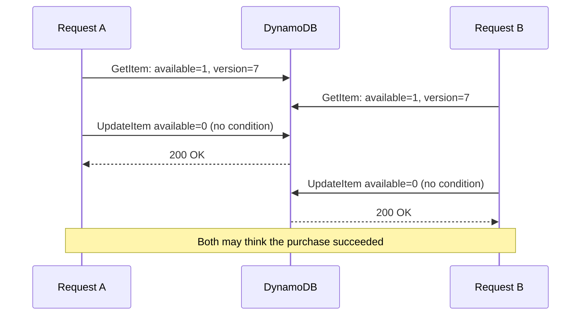
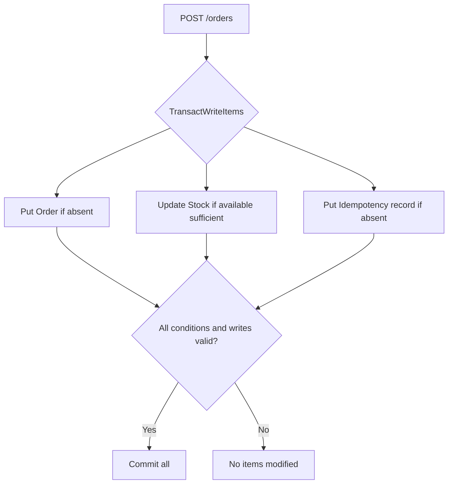
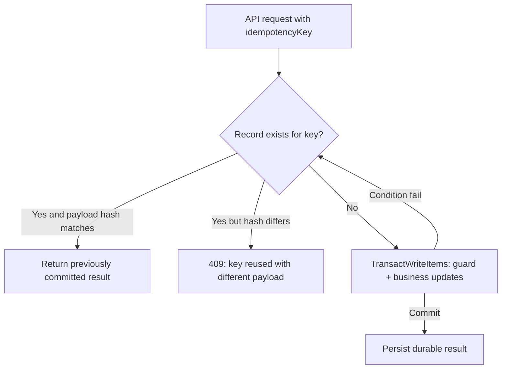
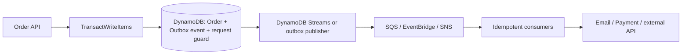
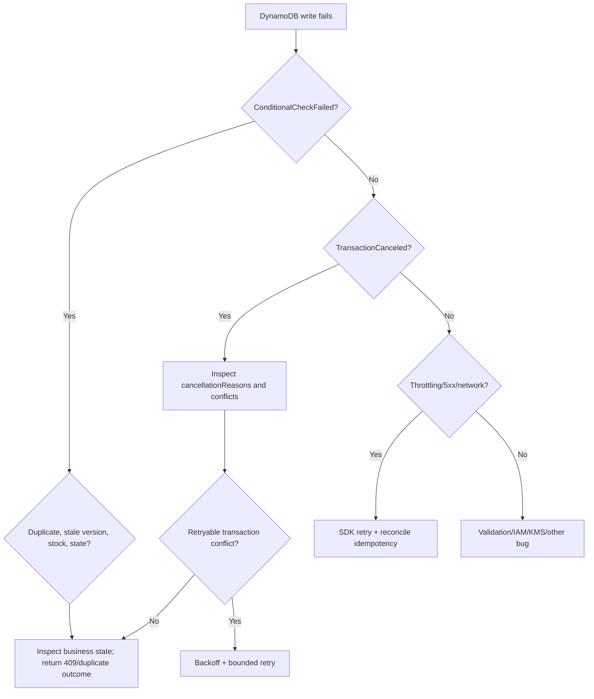
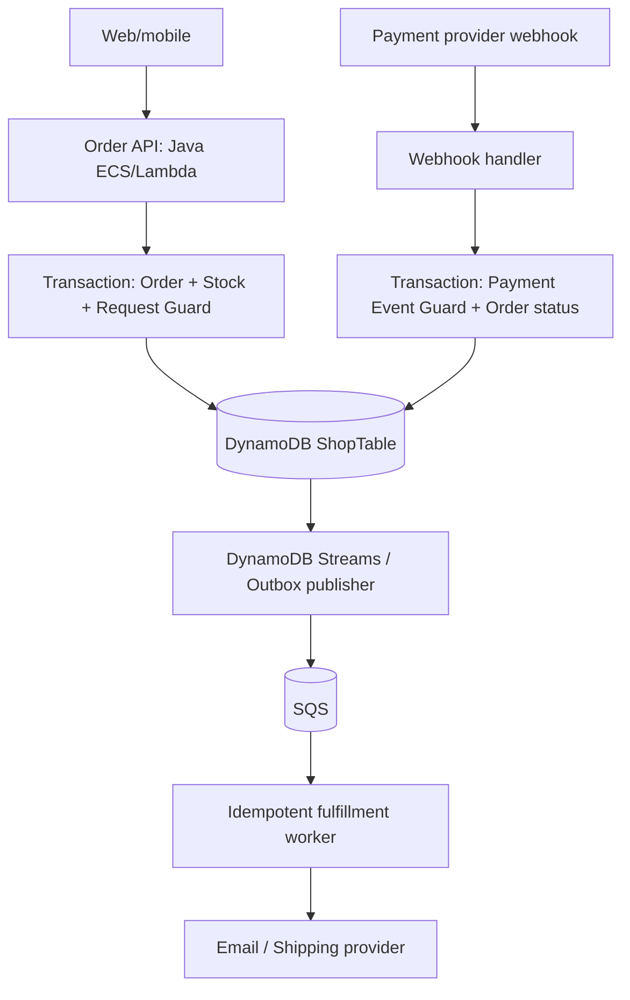

# Conditional Writes, Optimistic Locking, and Transactions

## 1. The Data Consistency Problem in DynamoDB

Suppose an e-commerce system runs Java Spring Boot on Amazon ECS/Lambda and stores orders, inventory, and shopping carts in **Amazon DynamoDB**. During a promotion, two concurrent requests try to buy the last remaining unit of a product; at the same time, warehouse staff adjust stock counts and a payment provider resends an already-processed webhook. If each request simply reads data and writes back based on what it read, the application can oversell inventory, lose an update, or record the same transaction twice.

**DynamoDB** provides essential primitives to resolve these races:

- **Conditional write:** executes `Put`/`Update`/`Delete` only if a condition on the item's current state evaluates to true.
- **Optimistic locking (OCC):** stores a **version** on the item and updates only when the version still equals the value the client read.
- **Transaction:** executes multiple actions across different items on an **all-or-nothing** basis within supported boundaries.

This lesson belongs to the **DynamoDB** chapter of the **CLOUD_PROVIDERS_AWS** module. The module covers AWS infrastructure from Regions/AZs, IAM, VPC, compute, storage, and databases to integration/serverless, emphasizing service selection, secure deployment, monitoring, recovery, and cost control. This lesson dives deep into **enforcing conditions and data integrity during DynamoDB writes**, rather than merely listing CRUD APIs.

After this lesson, you will be able to:

1. Distinguish **single-item atomic updates**, **optimistic concurrency control**, and **multi-item ACID transactions**.
2. Write accurate `ConditionExpression` rules for conditional creation, inventory decrements, lost-update prevention, and conditional deletes.
3. Implement a `version` attribute and separate legitimate business conflicts from transient infrastructure errors that warrant retries.
4. Use `TransactWriteItems`, `TransactGetItems`, and `ClientRequestToken` within service limits.
5. Design order placement that atomically updates **order, inventory, and idempotency records**.
6. Build AWS CLI and **AWS SDK for Java 2.x** examples, and inspect CloudWatch metrics, IAM, and costs.
7. Recognize what transactions **do not** solve: external payments/email, multi-Region replication, Streams consumers, and schema access patterns.

## 2. Why Naive Read-Then-Write Can Fail

Two Java services simultaneously read a DynamoDB item:

```json
{
  "PK": "PRODUCT#P100",
  "SK": "STOCK",
  "available": 1,
  "version": 7
}
```

Both A and B read `available=1`. If both compute `1 - 1 = 0` and send an **unconditional** `UpdateItem`, both can return "purchase succeeded" when only one unit existed. On another field, two concurrent editors cause a **lost update**: A's new value gets overwritten by B.



**Even `ConsistentRead=true` does not fix a read–modify–write race.** A strongly consistent read returns the freshest state at read time, yet the data can still change **between the read and the write**. Conditions must be checked **atomically as part of the write** inside DynamoDB.

### 2.1. Three Scopes for Solving Concurrency

| Need | Suitable mechanism | Scope of guarantee |
| --- | --- | --- |
| Insert a user only if absent | `PutItem` + `attribute_not_exists` | Single item |
| Decrement inventory if sufficient | `UpdateItem` + `ConditionExpression` | Single item, atomic check-and-update |
| User edits profile from a read version | `version = expectedVersion` then increment version | Single item, detects stale writes |
| Create order and decrement stock together | `TransactWriteItems` | Multiple items/tables within transaction scope |
| Deduplicate repeated payment webhooks | Idempotency item + condition/transaction | DynamoDB data impact; still must handle external side effects |
| Read multiple items in a transactional snapshot | `TransactGetItems` | Multiple items via transactional read |

**A single DynamoDB item is already atomic for single-item writes.** Contention does not automatically require multi-item transactions: a well-crafted conditional `UpdateItem` is often simpler and cheaper.

## 3. ConditionalExpression Concepts in DynamoDB

`PutItem`, `UpdateItem`, and `DeleteItem` all support **`ConditionExpression`**. DynamoDB evaluates the expression **against the current item at the exact primary key of the request**; only if it evaluates to `true` does the mutation apply.

```text
Client sends:
  Key = (PK="PRODUCT#P100", SK="STOCK")
  UpdateExpression = "SET #qty = #qty - :one"
  ConditionExpression = "#qty >= :one"

DynamoDB at write time:
  checks whether current qty >= 1?
      YES -> subtract 1 and commit atomically
      NO  -> reject the entire UpdateItem
```

If the condition evaluates to false, the API throws **`ConditionalCheckFailedException`** (HTTP 400, business check failure) and **performs no write**. Never treat this blindly as a server error to retry infinitely.

### 3.1. Common Operators and Functions

| Expression | Meaning | Example |
| --- | --- | --- |
| `attribute_exists(path)` | Attribute exists on the item | Update only if item already exists |
| `attribute_not_exists(path)` | Attribute does not exist | Create only if no item exists at key |
| `#v = :expected` | Current value equals expected | Optimistic locking |
| `#stock >= :qty` | Sufficient quantity remains | Safe stock decrement |
| `#status IN (:new,:pending)` | Status is in allowed set | State transition guard |
| `begins_with(#sort, :prefix)` | String/binary path starts with prefix | Format/value validation |
| `contains(#tags, :tag)` | String/set/list contains value | Membership predicate |
| `size(#items) < :limit` | Compare attribute length/count | Cap list growth below limit |
| `AND`, `OR`, `NOT`, `( )` | Combine predicates | Reject conflicting states |

**`ConditionExpression` is not a SQL `WHERE` clause**—it cannot lock or scan arbitrary rows/items. It evaluates one item at the specified **primary key**; enforcing uniqueness on an arbitrary email requires modeling a guard key/item, not writing a table-wide SQL-style constraint.

### 3.2. ExpressionAttributeNames and ExpressionAttributeValues

In DynamoDB expressions, `#name` aliases attribute names and `:value` passes **typed values**. This avoids reserved keyword conflicts, dots or special characters in attribute names, and string-concatenation injection bugs.

```json
{
  "ExpressionAttributeNames": {
    "#status": "status",
    "#version": "version"
  },
  "ExpressionAttributeValues": {
    ":expected": { "N": "7" },
    ":next": { "S": "PAID" }
  }
}
```

**`N` holds a numeric string in DynamoDB AttributeValue JSON**, not a raw JSON number. Similarly, `S` is String, `BOOL` is Boolean, `M` is Map, and `L` is List. Enhanced Client mappers convert Java types automatically, whereas low-level CLI calls require explicit type wrappers.

### 3.3. What Does DynamoDB Consume When a Condition Fails?

Evaluating a condition requires reading the existing item; a failed condition **can still consume capacity** based on item size even though **no write commits**. Never assume hundreds of thousands of failed conditional writes are free or harmless to throughput. Monitor CloudWatch `ConditionalCheckFailedRequests`, cost, and capacity, separating normal domain contention from broken retry loops.

## 4. Conditional Create: Preventing Accidental Overwrites

By default, `PutItem` **replaces the entire item** when the primary key already exists (any omitted attributes vanish). If `PutItem` is meant as "insert only if absent," add a condition.

### 4.1. AWS CLI PutItem Only If Absent

Suppose test table `ShopTable` has String **partition key `PK`** and String **sort key `SK`**:

```bash
aws dynamodb put-item \
  --table-name ShopTable \
  --item '{
    "PK": {"S": "ORDER#O101"},
    "SK": {"S": "META"},
    "customerId": {"S": "C001"},
    "status": {"S": "CREATED"},
    "version": {"N": "1"}
  }' \
  --condition-expression 'attribute_not_exists(#pk)' \
  --expression-attribute-names '{"#pk":"PK"}' \
  --region ap-southeast-1
```

If `(ORDER#O101, META)` does not exist yet, DynamoDB creates it. If it already exists, DynamoDB raises `ConditionalCheckFailedException` and **preserves the existing record**, preventing retry overwrites. On a composite-key table, the check targets **that exact `(PK, SK)` item**—it does not block other items sharing `PK` with a different `SK`.

### 4.2. Using Conditions to Guard State Transitions

An order follows `CREATED → PAID → FULFILLED`; a late callback must never revert `FULFILLED` back to `CREATED`. Guard the transition:

```text
UpdateExpression: SET #status = :paid
ConditionExpression: #status = :created

If status is still CREATED -> transition to PAID.
If status is already PAID or CANCELLED -> reject.
```

This is a **state transition guard**, rather than full OCC when multiple unrelated fields change concurrently. You can combine both status and version checks for stronger protection.

### 4.3. Note on TTL and Expired Keys

**DynamoDB TTL** deletes items **asynchronously** after expiration; an item whose TTL has passed **can still exist** until the background TTL process removes it. Consequently, `attribute_not_exists(PK)` can still fail on an item that is logically "expired" in the app.

If your design allows reusing a logical key after expiry, check the TTL attribute inside the condition and update state explicitly—**never rely on TTL deleting at the exact second of expiration**. For idempotency keys especially, expiring too early would allow an old transaction to be reprocessed as brand new.

## 5. Atomic Update: Safe Single-Item Inventory Decrement

When remaining stock lives in **one item**, you can validate and decrement stock in **a single `UpdateItem`**. No prior `GetItem` is needed just to subtract inventory:

```bash
aws dynamodb update-item \
  --table-name ShopTable \
  --key '{"PK":{"S":"PRODUCT#P100"},"SK":{"S":"STOCK"}}' \
  --update-expression 'SET #available = #available - :qty' \
  --condition-expression 'attribute_exists(#pk) AND #available >= :qty' \
  --expression-attribute-names '{"#pk":"PK","#available":"available"}' \
  --expression-attribute-values '{":qty":{"N":"1"}}' \
  --return-values ALL_NEW \
  --region ap-southeast-1
```

Two requests simultaneously subtracting 1 from `available=1`:

```mermaid
sequenceDiagram
    participant A as Buyer A
    participant D as DynamoDB
    participant B as Buyer B
    A->>D: Update if available >= 1; available = available - 1
    B->>D: Update if available >= 1; available = available - 1
    D-->>A: Success (available = 0)
    D-->>B: ConditionalCheckFailedException
    Note over D: Only one request can claim the last unit
```

Which of A or B wins in reality is nondeterministic; the diagram merely illustrates one winner. **The condition and update execute atomically on the item**, preventing overselling for that SKU as long as every update path enforces the condition.

### 5.1. Safe Counter Increments

For counters without special guards, use a single `UpdateItem`:

```text
UpdateExpression:
  SET #total = if_not_exists(#total, :zero) + :one

ExpressionAttributeValues:
  :zero = 0
  :one = 1
```

This is an **atomic increment**, never "read total, add 1 in Java, write back." For bounded counters, add a `ConditionExpression` cap. However, **atomic increment does not guard against duplicate requests**: if a client retries a committed increment, the counter adds again. For event-level idempotency, pair with versions, dedup records, or transactions.

### 5.2. Conditional DeleteItem

To delete a shopping cart only if it has not checked out yet:

```bash
aws dynamodb delete-item \
  --table-name ShopTable \
  --key '{"PK":{"S":"CART#C001"},"SK":{"S":"META"}}' \
  --condition-expression '#status = :open' \
  --expression-attribute-names '{"#status":"status"}' \
  --expression-attribute-values '{":open":{"S":"OPEN"}}' \
  --region ap-southeast-1
```

If the cart is already `CHECKED_OUT` or missing, the condition fails and **no deletion occurs**. For recoverable deletions, consider **soft deletes / status transitions** instead of `DeleteItem` to retain audit trails and restore capability where policy requires.

## 6. Optimistic Locking: Updating Only the Version You Read

**Optimistic concurrency control (OCC)** assumes conflicts are relatively infrequent. Instead of holding long database locks, the application reads the item along with a **version number**, performs edits, and sends an update conditioned on **`version = expectedVersion`**. If someone else updated it first, the version no longer matches and the write is rejected.

```mermaid
sequenceDiagram
    participant A as Staff A
    participant D as DynamoDB
    participant B as Staff B
    A->>D: GetItem -> version 7
    B->>D: GetItem -> version 7
    A->>D: Update status=PAID if version=7; version=8
    D-->>A: Success, version 8
    B->>D: Update status=CANCELLED if version=7; version=8
    D-->>B: ConditionalCheckFailedException
    B->>D: GetItem -> version 8; reconcile changes
```

**Never blindly overwrite after detecting a conflict.** User B likely needs to inspect the new state and decide whether cancelling an already-paid order is valid. Automatically re-reading the new version and retrying `CANCELLED` without checking business rules degenerates OCC into last-writer-wins.

### 6.1. The Read–Compare–Write Cycle

1. `GetItem` fetches the item at primary key, including `version=7`.
2. Application validates business rules and prepares changes.
3. `UpdateItem` sets `ConditionExpression="#version = :expected"`.
4. The update expression modifies data **and increments version in the same atomic operation**.
5. On success, the client receives the new version; on failure, the client handles the conflict.

Application/SDK writes must increment version **on every mutation to OCC-protected fields**. If one service bypasses version checks with an unconditional write, OCC in other services can no longer protect updates.

### 6.2. CLI Example Guarding Version

Suppose `ORDER#O101/META` currently has `version=7` and `status=CREATED`:

```bash
aws dynamodb update-item \
  --table-name ShopTable \
  --key '{"PK":{"S":"ORDER#O101"},"SK":{"S":"META"}}' \
  --update-expression 'SET #status = :paid, #version = #version + :one' \
  --condition-expression '#version = :expected AND #status = :created' \
  --expression-attribute-names '{"#status":"status","#version":"version"}' \
  --expression-attribute-values '{
    ":paid":{"S":"PAID"},
    ":created":{"S":"CREATED"},
    ":expected":{"N":"7"},
    ":one":{"N":"1"}
  }' \
  --return-values ALL_NEW \
  --region ap-southeast-1
```

If version is 7 and status is CREATED, it atomically transitions to `status=PAID, version=8`. If version is already 8 or status is CANCELLED, the entire update is rejected. Include **both version and status** in the condition when they enforce two distinct business checks.

### 6.3. When Is OCC Unnecessary?

For a simple atomic counter, `ADD` or `SET counter=counter+:one` usually suffices. If incrementing a view count does not need to block concurrent increments, version checks add needless conflicts. Conversely, for **order state transitions, multi-field edits, or financial updates**, versions protect read–modify–write integrity.

### 6.4. Strong Reads Reduce Stale Reads, Not Replace Versions

DynamoDB supports **strongly consistent `GetItem`** on base tables and LSIs where applicable; **GSIs support eventually consistent reads only**. A strong read fetches the latest committed version before editing, **but does not lock the item** between read and write. Therefore, the version condition remains essential.

## 7. Java SDK 2.x: Conditional UpdateItem with Version

The Java snippet below uses the **AWS SDK for Java 2.x low-level `DynamoDbClient`**. It assumes `ShopTable` has String `PK`/`SK` keys and a Number `version` attribute; credentials and Region come from the AWS SDK default provider chain.

```java
import java.util.Map;
import software.amazon.awssdk.services.dynamodb.DynamoDbClient;
import software.amazon.awssdk.services.dynamodb.model.AttributeValue;
import software.amazon.awssdk.services.dynamodb.model.ConditionalCheckFailedException;
import software.amazon.awssdk.services.dynamodb.model.ReturnValue;
import software.amazon.awssdk.services.dynamodb.model.UpdateItemRequest;

public final class OrderOptimisticLock {

    private static AttributeValue s(String value) {
        return AttributeValue.builder().s(value).build();
    }

    private static AttributeValue n(long value) {
        return AttributeValue.builder().n(Long.toString(value)).build();
    }

    public static Map<String, AttributeValue> setStatus(
            DynamoDbClient dynamo,
            String tableName,
            String orderId,
            String newStatus,
            long expectedVersion) {

        UpdateItemRequest request = UpdateItemRequest.builder()
                .tableName(tableName)
                .key(Map.of(
                        "PK", s("ORDER#" + orderId),
                        "SK", s("META")))
                .updateExpression(
                        "SET #status = :next, #version = #version + :one")
                .conditionExpression(
                        "attribute_exists(#pk) AND #version = :expected")
                .expressionAttributeNames(Map.of(
                        "#pk", "PK",
                        "#status", "status",
                        "#version", "version"))
                .expressionAttributeValues(Map.of(
                        ":next", s(newStatus),
                        ":expected", n(expectedVersion),
                        ":one", n(1)))
                .returnValues(ReturnValue.ALL_NEW)
                .build();

        try {
            return dynamo.updateItem(request).attributes();
        } catch (ConditionalCheckFailedException conflict) {
            // In HTTP APIs, typically map to 409 Conflict after
            // distinguishing stale version vs. deleted record.
            throw new IllegalStateException(
                    "Order was modified or no longer exists", conflict);
        }
    }
}
```

This illustrates calling DynamoDB, **not a complete production API**. Production apps also need to:

- Validate `newStatus`, allowed state transitions, and caller authorization on `orderId`.
- Map concurrency failures to **`409 Conflict`** or an appropriate domain error without leaking sensitive details.
- Distinguish `ConditionalCheckFailedException` from `ProvisionedThroughputExceededException`, `ThrottlingException`, network timeouts, or KMS/IAM errors.
- Never increment versions outside DynamoDB when atomicity is required.
- Emit logs/traces correlated by request ID without logging secrets or PII.

### 7.1. DynamoDB Enhanced Client and `@DynamoDbVersionAttribute`

With the AWS SDK for Java 2.x **Enhanced Client**, you can annotate a bean's `version` property with `@DynamoDbVersionAttribute` alongside **`VersionedRecordExtension`**. The extension automatically enforces conditional writes and version increments per SDK rules:

```java
import software.amazon.awssdk.enhanced.dynamodb.mapper.annotations.DynamoDbBean;
import software.amazon.awssdk.enhanced.dynamodb.mapper.annotations.DynamoDbPartitionKey;
import software.amazon.awssdk.enhanced.dynamodb.mapper.annotations.DynamoDbSortKey;
import software.amazon.awssdk.enhanced.dynamodb.extensions.annotations.DynamoDbVersionAttribute;

@DynamoDbBean
public class OrderRecord {
    private String pk;
    private String sk;
    private Long version;

    @DynamoDbPartitionKey
    public String getPk() { return pk; }
    public void setPk(String pk) { this.pk = pk; }

    @DynamoDbSortKey
    public String getSk() { return sk; }
    public void setSk(String sk) { this.sk = sk; }

    @DynamoDbVersionAttribute
    public Long getVersion() { return version; }
    public void setVersion(Long version) { this.version = version; }
}
```

In default Enhanced Client configuration, **`VersionedRecordExtension` is active by default**; if you customize extensions explicitly, ensure it remains included. Initial version values and increment rules follow SDK extension behavior; avoid mixing **manual low-level version writes** with **Enhanced Client writes** unless both follow the exact same convention. Test Put/Update/Delete and custom conditions on your target SDK version.

### 7.2. Why Not Use Distributed Locks for Every Update?

OCC works well when conflicts are infrequent because no lock is held while users edit data. If an item is a **hot counter** updated by thousands of clients per second, OCC version checks generate heavy failed writes and retries. In that case consider:

- Switching to **atomic increments** when only addition/subtraction is needed.
- **Write sharding** for counters that do not require instant single-item consistency.
- Queuing/partitioning by key to serialize updates ahead of the database.
- Transactions or single-item conditions to enforce critical invariants.

**Never introduce a system-wide distributed lock** when a single-item atomic condition solves the problem.

## 8. Handling Conditional Failures and Retries Properly

`ConditionalCheckFailedException` can signify several distinct outcomes:

- A user attempted to create a duplicate `orderId`.
- Inventory ran out.
- Status was no longer in the expected state.
- Version went stale due to a concurrent request.
- The item was deleted or expired via TTL.

**Never treat all of them as transient infrastructure faults.** Classify by **use case**, return consistent client responses, and retry only when justified.

| Scenario | Appropriate behavior |
| --- | --- |
| Order placed when `stock=0` | Return out-of-stock / `409`; do not retry blindly |
| User A edited version 7, now at 8 | Re-read item and prompt/merge changes per business rules |
| Producer resends same `requestId` | Read idempotency record and return prior result if payload matches |
| Write failed due to throttling | SDK retries with exponential backoff + jitter; tune capacity/hot keys |
| Timeout leaves write outcome unknown | Check durable state / idempotency key before re-executing side effects |
| Transaction conflict between two workflows | Bounded transaction retry after backoff, re-evaluating fresh conditions |

### 8.1. `ReturnValuesOnConditionCheckFailure`

DynamoDB supports **`ReturnValuesOnConditionCheckFailure=ALL_OLD`** on single-item conditional writes and transaction actions. When a condition fails, the error response returns the **existing item**, letting you inspect stale versions or stock counts without a separate `GetItem`.

```bash
aws dynamodb update-item \
  --table-name ShopTable \
  --key '{"PK":{"S":"ORDER#O101"},"SK":{"S":"META"}}' \
  --update-expression 'SET #status = :newStatus' \
  --condition-expression '#version = :expected' \
  --expression-attribute-names '{"#status":"status","#version":"version"}' \
  --expression-attribute-values '{
    ":newStatus":{"S":"PAID"},
    ":expected":{"N":"999"}
  }' \
  --return-values-on-condition-check-failure ALL_OLD \
  --region ap-southeast-1
```

This example intentionally passes version 999 to trigger a failure; if your test item actually has version 999 it will succeed, so **run only in a sandbox**. Because the old item can contain user data, **never log `ALL_OLD` verbatim or forward it raw to browsers** without authorization and data minimization.

### 8.2. Retries Are Not Infinite Loops

A sound retry policy:

1. Catch `ConditionalCheckFailedException` separately: stop, inspect status/version, or return conflict.
2. Catch throttling, network, and transient 5xx errors: retry **with a cap**, exponential backoff + jitter, and a time budget.
3. For requests **with side effects**, pair retries with idempotency keys and transactional guards.
4. When write commit outcome is uncertain, **reconcile durable state** before recreating orders or charging payments.
5. Configure CloudWatch alerts on abnormal conflict rates to catch "thundering herd" retry bugs early.

**A conditional failure is a valid concurrency outcome** and belongs in domain handling rather than defaulting to HTTP 500.

## 9. Transactions in DynamoDB: When One Item Is Not Enough

When a new order must **decrement inventory** and **create an order record** together, two separate API calls risk partial failure:

```text
1. Update stock available = available - 1  -> SUCCESS
2. Put order                            -> FAIL

Result:
  Inventory decreased, yet no order exists.
```

Or in reverse order:

```text
1. Put order                             -> SUCCESS
2. Update stock                          -> FAIL

Result:
  Order exists without reserved inventory.
```

**`TransactWriteItems`** groups multiple actions into **one transaction**: either every condition passes and all changes commit, or **zero actions commit**. Supported actions inside a transaction:

- **`Put`**: insert/replace an item, optionally with a condition.
- **`Update`**: modify an item, optionally with a condition.
- **`Delete`**: delete an item, optionally with a condition.
- **`ConditionCheck`**: assert a condition on another item without modifying it.



### 9.1. ACID and Scope of DynamoDB Transactions

Within supported boundaries, DynamoDB transactions provide ACID properties:

- **Atomicity:** all items commit or none do.
- **Consistency:** conditions are evaluated and mutations applied within the transaction, enforcing application-defined invariants.
- **Isolation:** transactional operations coordinate under DynamoDB isolation semantics; contention can raise transaction conflicts/cancellations.
- **Durability:** committed data is stored durably per DynamoDB's Regional architecture.

**DynamoDB does not enforce "never oversell" automatically** if you forget `available >= :qty`. Transactions only make your declared actions atomic; without conditions, a transaction can still drive stock negative.

### 9.2. Limits to Remember

| Constraint | Operational impact |
| --- | --- |
| **Max 100 actions/items** per transaction | Cannot batch thousands of records into one call |
| **Max 4 MB total item size** | Large items can exceed the limit even with fewer actions |
| **At most one action per unique item** | Cannot `ConditionCheck` and `Update` the same item in one transaction |
| **Same AWS account and Region** | No atomic transactions across accounts or across Regions |
| **400 KB item size limit still applies** | Transactions do not raise individual item limits |
| **Capacity, hot partitions, conflicts, throttling still apply** | Throughput is not unlimited |
| **Excludes external services** | SQS/SNS/email/payment providers are outside the ACID transaction |

**Never substitute `BatchWriteItem` for `TransactWriteItems`.** BatchWrite groups Puts/Deletes **without supporting `ConditionExpression`**, can return `UnprocessedItems`, and does not provide transactional all-or-nothing atomicity.

### 9.3. Conflicts and Isolation Are Not Free

Two overlapping transactions modifying the same item can conflict. DynamoDB rejects one with **`TransactionCanceledException`** or conflict errors; the application inspects `CancellationReasons` when provided by the SDK and retries **the entire transaction** within bounded retry budgets.

Using transactions does not guarantee 100% of calls succeed—transactions protect **integrity on commit**, while raising contention and capacity cost and requiring proper error responses.

## 10. Hands-On `TransactWriteItems`: Creating an Order and Reserving Inventory

Suppose `ShopTable` has a composite key:

| Item | PK | SK | Attributes |
| --- | --- | --- | --- |
| Stock | `PRODUCT#P100` | `STOCK` | `available = 5` |
| New order | `ORDER#O301` | `META` | Does not exist yet |
| Idempotency key | `REQUEST#req-001` | `META` | Does not exist yet |

An order buys **2 units**. We want three changes to succeed **together**: create the order, decrement stock by 2, and mark the request ID as used.

### 10.1. JSON File `transact-order.json`

```json
[
  {
    "Put": {
      "TableName": "ShopTable",
      "Item": {
        "PK": {"S": "ORDER#O301"},
        "SK": {"S": "META"},
        "customerId": {"S": "C001"},
        "productId": {"S": "P100"},
        "quantity": {"N": "2"},
        "status": {"S": "CREATED"},
        "version": {"N": "1"}
      },
      "ConditionExpression": "attribute_not_exists(#pk)",
      "ExpressionAttributeNames": {"#pk": "PK"}
    }
  },
  {
    "Update": {
      "TableName": "ShopTable",
      "Key": {
        "PK": {"S": "PRODUCT#P100"},
        "SK": {"S": "STOCK"}
      },
      "UpdateExpression": "SET #available = #available - :qty",
      "ConditionExpression": "attribute_exists(#pk) AND #available >= :qty",
      "ExpressionAttributeNames": {
        "#pk": "PK",
        "#available": "available"
      },
      "ExpressionAttributeValues": {
        ":qty": {"N": "2"}
      }
    }
  },
  {
    "Put": {
      "TableName": "ShopTable",
      "Item": {
        "PK": {"S": "REQUEST#req-001"},
        "SK": {"S": "META"},
        "orderId": {"S": "O301"},
        "requestHash": {"S": "example-payload-hash"}
      },
      "ConditionExpression": "attribute_not_exists(#pk)",
      "ExpressionAttributeNames": {"#pk": "PK"}
    }
  }
]
```

**All three items have distinct primary keys**, satisfying "no two actions on the same item." If stock is insufficient, the order exists, or the request key exists, **the entire transaction cancels** with zero partial deductions.

### 10.2. Running CLI from a Sandbox Account

```bash
# Verify account to avoid sending transactions to production tables
aws sts get-caller-identity

aws dynamodb transact-write-items \
  --transact-items file://transact-order.json \
  --client-request-token 'shop-order-req-001' \
  --region ap-southeast-1
```

This command **writes real data**. The lesson assumes `ShopTable` already exists with String `PK`/`SK` keys, the stock item has `available >= 2`, and IAM permissions are set; no live AWS resources were read or modified while authoring this material.

`--client-request-token` is the **API-level idempotency token for `TransactWriteItems`**, which expires; it **never replaces** the durable `REQUEST#req-001` record. In the example `requestHash` is a placeholder; production should compute a canonical payload hash to catch different payloads reusing the same key.

### 10.3. Reading State Back

```bash
aws dynamodb get-item \
  --table-name ShopTable \
  --key '{"PK":{"S":"PRODUCT#P100"},"SK":{"S":"STOCK"}}' \
  --consistent-read \
  --region ap-southeast-1

aws dynamodb get-item \
  --table-name ShopTable \
  --key '{"PK":{"S":"ORDER#O301"},"SK":{"S":"META"}}' \
  --consistent-read \
  --region ap-southeast-1

aws dynamodb get-item \
  --table-name ShopTable \
  --key '{"PK":{"S":"REQUEST#req-001"},"SK":{"S":"META"}}' \
  --consistent-read \
  --region ap-southeast-1
```

Three separate `GetItem` calls execute at three different instants; **they are not a multi-item transactional snapshot**. To read multiple items as a transactional snapshot, use **`TransactGetItems`**. In a test environment, verify stock decreased by 2 and the order + idempotency records appeared together.

### 10.4. When the Client Resends the Same Request

A repeat request with `req-001` hits one of two cases:

1. Within the **API idempotency window**, the same `ClientRequestToken` with **identical parameters** is recognized by DynamoDB as the same call.
2. After that window, or from another producer, the transaction fails at the **guard `Put`** because `REQUEST#req-001` already exists.

When the guard exists, the backend **must not return HTTP 500**. Read the guard record, verify the payload hash/`orderId`, and either return the previously created result or reject with "idempotency key reused with different payload."

### 10.5. Never Generate a New Random ID on Retries

If a client retries the same action while the server generates a new `O302` and `REQUEST#random-2`, both the order ID and guard ID change → the transaction **fails to detect** that both requests represent the same business command. The business idempotency key must stay stable across retries of **the same operation**, typically supplied by the client or pre-allocated and persisted by the server.

## 11. ClientRequestToken and 10-Minute Idempotency

`TransactWriteItems` supports `ClientRequestToken` to deduplicate transaction calls within a **10-minute window**:

- **Same token + identical parameters** inside the window → operation treated as idempotent.
- **Same token + different parameters** inside the window → `IdempotentParameterMismatch`.
- **After the window**, the old token is treated as a fresh request, so it cannot serve as a permanent business idempotency key.

```text
10:00:00  POST /orders requestId=req-001
          Transaction(token=req-001) -> Commit

10:00:05  Network timeout, server/client retry
          Transaction(token=req-001, identical parameters)
          -> DynamoDB recognizes retry of the same transaction.

10:11:00  A new request reuses token req-001
          -> outside 10-minute window; does not protect business key
             without the REQUEST#req-001 guard item.
```

**Never change `createdAt`, random order IDs, or payload contents across retries using the same client token** if you expect idempotent handling. If parameters differ, DynamoDB rejects with a mismatch—which is proper protective behavior.

### 11.1. Business Idempotency Must Outlive Short Windows

A payment webhook can be redelivered by a provider **days later**. Business deduplication should persist an item like:

```json
{
  "PK": "PAYMENT_EVENT#evt-7788",
  "SK": "META",
  "payloadHash": "sha256-of-canonical-event",
  "paymentId": "pay-42",
  "result": "APPLIED",
  "processedAt": "2026-11-20T09:00:00Z"
}
```

Retain the record for at least the retry horizon + audit policy. If enabling TTL, accept that **once deleted**, an old event could look new again. For financial transactions, align retention/ledger rules with compliance instead of short TTLs.

### 11.2. Never Perform External API Side Effects Inside a DynamoDB Transaction

`TransactWriteItems` cannot commit atomically with **Stripe/PayPal/payment processors**, SNS, SQS, email, or third-party HTTP APIs. If you charge payment first and the transaction cancels, you need **compensation/refund/idempotency**. If the transaction commits first and SQS publishing fails, you need a **transactional outbox** or DynamoDB Streams + an at-least-once consumer.

One pattern:

1. Transaction writes `Order`, `OUTBOX#event-id`, and the idempotency guard.
2. A consumer reads DynamoDB Streams (or a worker polls the outbox) and publishes the event.
3. Downstream consumers process idempotently by `eventId`.
4. If publishing fails or duplicates occur, retry while tracking delivery state.

**An atomic DynamoDB transaction does not mean system-wide exactly-once execution**; the transaction boundary ends at the items in that DynamoDB API call.

## 12. ConditionCheck, TransactGetItems, and Same-Item Restrictions

### 12.1. ConditionCheck vs. Conditional Update

Suppose you only want to create an order if the customer is still **ACTIVE**:

```json
{
  "ConditionCheck": {
    "TableName": "ShopTable",
    "Key": {
      "PK": {"S": "CUSTOMER#C001"},
      "SK": {"S": "META"}
    },
    "ConditionExpression": "#active = :yes",
    "ExpressionAttributeNames": {
      "#active": "active"
    },
    "ExpressionAttributeValues": {
      ":yes": {"BOOL": true}
    }
  }
}
```

Include this in `TransactWriteItems` to require the customer to remain active at transaction time; it **does not modify the customer item**. You can combine it with order, stock, and idempotency writes within transaction limits.

**Crucial rule:** within one transaction, **never place both `ConditionCheck` and `Update` on the exact same item**. To modify stock **and** verify sufficient stock, put the condition **inside the `Update` action** as shown in Section 10. Use `ConditionCheck` only when checking a **separate** unmodified item.

### 12.2. TransactGetItems Reads Multiple Items Transactionally

When a screen needs **order + stock** in a transactional read, use `TransactGetItems` with `Get` actions:

```json
[
  {
    "Get": {
      "TableName": "ShopTable",
      "Key": {
        "PK": {"S": "ORDER#O301"},
        "SK": {"S": "META"}
      }
    }
  },
  {
    "Get": {
      "TableName": "ShopTable",
      "Key": {
        "PK": {"S": "PRODUCT#P100"},
        "SK": {"S": "STOCK"}
      }
    }
  }
]
```

Save as `transact-read.json`, then run:

```bash
aws dynamodb transact-get-items \
  --transact-items file://transact-read.json \
  --region ap-southeast-1
```

**`TransactGetItems`** reads items under transactional read semantics without writing. When only one item is needed, `GetItem --consistent-read` is simpler and cheaper; never wrap every screen in `TransactGetItems`.

### 12.3. Strongly Consistent Reads Do Not Mean Multi-Item Snapshots

Two sequential `GetItem --consistent-read` calls do not guarantee both items reflect the same logical instant under concurrent writers. `Query` or `Scan` reads many items **without providing an atomic multi-item snapshot** just by enabling `ConsistentRead`, and **GSIs do not support strong reads**. When you genuinely need a transactional multi-item read, use `TransactGetItems` within service limits.

## 13. Multi-Item Uniqueness: Emails and Reservation Keys

DynamoDB enforces uniqueness solely by **item primary key**, with no relational-style `UNIQUE` constraint across arbitrary attributes. A **GSI on email** speeds up looking up users by email **but does not stop two users from registering the same email**.

### 13.1. Why Querying a GSI Before PutItem Fails

```text
Service A: Query GSI email=a@example.com -> none found
Service B: Query GSI email=a@example.com -> none found
Service A: Put USER#U1 -> success
Service B: Put USER#U2 -> success

Result: two user items with the same email.
```

Beyond the Query-then-Put race, GSIs are **eventually consistent**, making them unreliable for uniqueness checks. The standard solution is a **uniqueness guard item** keyed by the normalized email.

### 13.2. Transaction with a Guard Item

One transaction contains:

```text
Put USER#U1 / PROFILE
  ConditionExpression: attribute_not_exists(PK)

Put EMAIL#<normalizedEmail> / UNIQUE
  ConditionExpression: attribute_not_exists(PK)
  userId: U1
```

Two requests with the same email contend on the **exact same guard key**; only one transaction creates the guard. **Never put raw PII emails directly in logs, metrics, or partition keys** if data policy restricts exposure; use canonicalization + HMAC with a secret key and clear rotation strategy, storing encrypted display values appropriately.

### 13.3. Changing Email Must Swap Guards in One Transaction

Changing a user's email from A to B typically requires three actions:

1. **Put guard B** if absent.
2. **Update user** to email B with OCC version/status checks.
3. **Delete guard A** if guard A still points to that user.

Running these separately risks orphaned guards or two emails pointing to one user on partial failure. Transactions ensure atomicity across the **declared items**, while the client still handles "email B already taken" and retry/idempotency.

**Never `ConditionCheck` and `Delete` the same guard A** inside one transaction; put `#userId = :expectedUser` directly inside the `Delete` action because DynamoDB forbids acting twice on the same item.

## 14. Designing Idempotency for APIs and Asynchronous Events

### 14.1. Two Types of Retries

- **Client/API retry:** user clicks checkout, response times out, user clicks again; the request may already have committed.
- **Event-driven retry:** an SQS Lambda consumer receives a message again, or EventBridge/SNS redelivers under at-least-once delivery.

Both need a stable business key—typically a **command ID, request ID, or event ID** rather than a fresh ID on each attempt.



### 14.2. An Idempotency Record Is More Than a "Processed" Flag

A practical schema stores:

| Attribute | Example | Purpose |
| --- | --- | --- |
| `PK` | `REQUEST#req-001` | Operation identifier |
| `status` | `COMPLETED` / `IN_PROGRESS` | Lifecycle state |
| `payloadHash` | SHA-256/HMAC of canonical request | Detects key reuse with different payload |
| `resultReference` | `ORDER#O301` | Returns original result |
| `createdAt` / `updatedAt` | UTC timestamps | Audit and troubleshooting |
| `expiresAt` | Epoch seconds | TTL matching retry horizon/policy |

If `IN_PROGRESS` is written first and business writes happen in a second request, you need **leases, state machines, and timeout recovery**. In Section 10's transaction pattern, the guard and order are created **in the same transaction**, avoiding "guard exists without order" inside DynamoDB. Still, returning HTTP responses, charging payments, and publishing outbox events remain external steps needing reconciliation.

### 14.3. Transactional Outbox and DynamoDB Streams



Writing an outbox event in the **same transaction** as order/stock prevents lost events from "DB committed, publish failed." **DynamoDB Streams does not provide exactly-once downstream delivery**; stream processors can retry, and records from multiple items in one transaction are not guaranteed to arrive at a downstream target in one atomic batch or even contiguously. Deduplicate downstream using `eventId` and persistent dedup state.

### 14.4. Do Not Use TTL as an Infinite Deduplication Window

If a webhook can retry after 30 days while the idempotency record has a 1-day TTL, a day-30 retry will execute as a fresh write. Size retention around your **business retry horizon, audit rules, and security policy**, not a blanket 24 hours. Since DynamoDB TTL deletes asynchronously, never treat it as an exact timer either.

## 15. Transaction Conflicts, Capacity, and Controlled Retries

### 15.1. Why Can a Transaction Be Canceled?

`TransactionCanceledException` occurs when:

- A condition fails: insufficient stock, stale version, duplicate guard.
- Another concurrent transaction modifies a related item, causing a **transaction conflict**.
- An item/action violates validation, constraints, or size limits.
- Capacity/throttling prevents the transaction from running.
- IAM/KMS or configuration permission errors are returned by the service.

Each cause requires a different response; **not every `TransactionCanceledException` is a retryable transaction conflict**. In the Java SDK, `CancellationReasons` provides per-action details; map them to domain error codes and telemetry without leaking raw items or secrets to clients.

### 15.2. Retry Pattern for Transaction Conflicts

```text
attempt = 0
while attempt < MAX_ATTEMPTS:
    attempt++
    try TransactWriteItems(same logical command, stable idempotency key)
    if success: return business result

    if conditional failure:
        inspect business state; return conflict/not available

    if transaction conflict or throttling:
        backoff with jitter, then retry WITHIN deadline

    if ambiguous timeout:
        reconcile business idempotency record before new write

return retryable response / queue job for later
```

Note that **same logical command** does not mean **identical `TransactWriteItems` request bytes** if you re-read state and rebuild the transaction. Inside the `ClientRequestToken` window, changing parameters triggers `IdempotentParameterMismatch`; **allocate a new token for a genuinely new transaction** after verifying state and business keys rather than reusing an old token on modified parameters.

### 15.3. Hot Partitions and Contention

A global item like `COUNTER#ALL_ORDERS` modified by thousands of concurrent transactions creates a **hot key**, transaction conflicts, and throughput bottlenecks—even in **on-demand** mode. DynamoDB scales partition capacity within limits, but cannot serialize infinite conflicting writes onto a single item.

Solutions depend on invariants:

- For statistics, use **sharded counters** when aggregated reads are acceptable.
- For products, partition by SKU/warehouse where business rules permit.
- For inventory, use reservation tokens or per-SKU queues to reduce contention.
- For financial ledgers, avoid breaking invariants just for throughput; use proper domain orchestration/ledgers.

**Never treat transactions as a band-aid for flawed data modeling.** Fixing partition keys and access patterns usually has far greater impact than raising WCUs on a hot item.

## 16. Java SDK 2.x: `TransactWriteItems` for Order Placement

The example below executes Put order, Update stock, and Put request guard in **one single transaction**. All mutations occur in one `TransactWriteItems` call, not three independent `PutItem`/`UpdateItem` calls. Full input validation, security checks, and HTTP exception mapping are omitted for clarity.

```java
import java.util.List;
import java.util.Map;
import software.amazon.awssdk.services.dynamodb.DynamoDbClient;
import software.amazon.awssdk.services.dynamodb.model.AttributeValue;
import software.amazon.awssdk.services.dynamodb.model.Put;
import software.amazon.awssdk.services.dynamodb.model.TransactionCanceledException;
import software.amazon.awssdk.services.dynamodb.model.TransactWriteItem;
import software.amazon.awssdk.services.dynamodb.model.TransactWriteItemsRequest;
import software.amazon.awssdk.services.dynamodb.model.Update;

public final class PlaceOrderTransaction {
    private static AttributeValue s(String value) {
        return AttributeValue.builder().s(value).build();
    }

    private static AttributeValue n(long value) {
        return AttributeValue.builder().n(Long.toString(value)).build();
    }

    public static void reserve(
            DynamoDbClient dynamo,
            String table,
            String orderId,
            String productId,
            String requestId,
            long quantity) {

        if (quantity <= 0) {
            throw new IllegalArgumentException("quantity must be positive");
        }

        Put order = Put.builder()
                .tableName(table)
                .item(Map.of(
                        "PK", s("ORDER#" + orderId),
                        "SK", s("META"),
                        "productId", s(productId),
                        "quantity", n(quantity),
                        "status", s("CREATED")))
                .conditionExpression("attribute_not_exists(#pk)")
                .expressionAttributeNames(Map.of("#pk", "PK"))
                .build();

        Update stock = Update.builder()
                .tableName(table)
                .key(Map.of(
                        "PK", s("PRODUCT#" + productId),
                        "SK", s("STOCK")))
                .updateExpression(
                        "SET #available = #available - :qty")
                .conditionExpression(
                        "attribute_exists(#pk) AND #available >= :qty")
                .expressionAttributeNames(Map.of(
                        "#pk", "PK", "#available", "available"))
                .expressionAttributeValues(Map.of(":qty", n(quantity)))
                .build();

        Put requestGuard = Put.builder()
                .tableName(table)
                .item(Map.of(
                        "PK", s("REQUEST#" + requestId),
                        "SK", s("META"),
                        "orderId", s(orderId)))
                .conditionExpression("attribute_not_exists(#pk)")
                .expressionAttributeNames(Map.of("#pk", "PK"))
                .build();

        TransactWriteItemsRequest transaction =
                TransactWriteItemsRequest.builder()
                        .transactItems(
                                TransactWriteItem.builder().put(order).build(),
                                TransactWriteItem.builder().update(stock).build(),
                                TransactWriteItem.builder().put(requestGuard).build())
                        .clientRequestToken(requestId)
                        .build();

        try {
            dynamo.transactWriteItems(transaction);
        } catch (TransactionCanceledException canceled) {
            // Could be out-of-stock, duplicate guard, or transaction conflict.
            // Classify cancellationReasons and reconcile state.
            throw canceled;
        }
    }
}
```

**Prerequisites for this example:** an AWS SDK for Java 2.x version with matching model classes, a table with String `PK`/`SK` keys, an existing stock item with a sufficient Number `available` value, IAM permissions, and a `requestId` meeting `ClientRequestToken` rules without reusing it for different payloads within 10 minutes.

**This snippet illustrates only the transaction path:** it omits payload hash storage, customer authorization, order-status checks, and payments, so **do not copy verbatim into production**. If a client loses the response after commit, the backend must inspect the durable request guard and order before issuing a fresh orderId/requestId.

### 16.1. When to Use the Enhanced Client?

**Enhanced Client** maps DynamoDB items to Java beans/records and includes a versioning extension, simplifying standard CRUD. For **multi-item transactions** or complex conditional logic, you can use `DynamoDbEnhancedClient.transactWriteItems` per the SDK API or use the low-level client as above so every transaction action is explicit.

**Never mix manually managed versions with Enhanced Client auto-incremented versions without testing.** If one service uses Enhanced Client and another uses low-level `UpdateItem`, all services must enforce one consistent version convention.

### 16.2. When an Operation Spans Thousands of Items

If importing 20,000 records, splitting them into 200 transactions does **not make all 20,000 items atomic**. Each independent transaction can commit or roll back on its own.

Alternatives:

- **Sagas/workflows** via Step Functions with compensating actions where needed.
- **Application-level state machines:** write batches as `PENDING`/`COMMITTED` and publish only once finalized.
- **Business partitioning** into smaller idempotent transactions with audit trails and replay.
- **`BatchWriteItem`** for non-atomic bulk imports, retrying `UnprocessedItems`.

Split transactions according to **business invariants**, not merely API size limits.

## 17. Local Single-Item Atomicity, Transactions, and Cross-Region Integrity

### 17.1. DynamoDB Consistency: Eventual and Strong

Within a single Region:

- Base-table **`GetItem`** can read eventually consistent (default) or strongly consistent with `ConsistentRead=true`.
- **LSIs** support strongly consistent reads on read APIs.
- **GSIs are eventually consistent only**, so a freshly written base item may not appear yet.
- **`TransactGetItems`** provides transactional reads across multiple items within supported bounds.

**Even with strong reads, always enforce conditions on concurrent writes.** Another write can always land between `Get` and `Update`.

### 17.2. DynamoDB Global Tables and Multi-Region Conflicts

If using DynamoDB Global Tables, verify **your configuration's replicated consistency mode**. Under **Multi-Region Eventual Consistency (MREC)**, concurrent writes across Regions reconcile via **last-writer-wins**; a successful version condition in Region A **does not lock** the same logical item against a concurrent write in Region B.

AWS also offers Global Tables with **Multi-Region Strong Consistency (MRSC)** under distinct supported constraints, yet **never assume all modes share identical transaction/replication guarantees**. `TransactWriteItems` **is not an atomic commit across multiple Regions**; read the docs for your active mode and test conflicts and consistency against real architecture.

For financial workflows requiring strict global ordering, define an **authoritative writer Region**, partition ownership, ledger/versioning strategies, and failover rules. Never treat an item's `version=8` as a cross-Region distributed lock.

### 17.3. Streams and Event Consumers Do Not See a "Transaction Batch"

One `TransactWriteItems` call can modify both order and inventory together. With **DynamoDB Streams** enabled, item mutations produce stream records, yet AWS does not guarantee **all records from one transaction appear in the same batch, consecutively, or get processed atomically** by consumers. Records from other transactions can interleave as well.

Therefore, downstream consumers must never assume "seeing an ORDER record means the INVENTORY record is definitely in the same Lambda batch." When you need a **committed business event**, write an **outbox event item** inside the same transaction and process by event ID, or coordinate via controlled downstream workflows.

## 18. Cost and Capacity for Conditional Writes, OCC, and Transactions

From a DynamoDB billing perspective, account for **read/write request units**, item sizes, retry attempts, contention levels, and API types:

| Option | Relative cost / impact |
| --- | --- |
| Unconditional `UpdateItem` | Write request capacity by item size/mode |
| Conditional `UpdateItem` (succeeds) | Atomic conditional write; evaluates condition on read item |
| Failed conditional write | Commits no write, yet still consumes **capacity** for condition evaluation |
| OCC under heavy contention | Escalating read/write attempts, latency, and contention |
| `TransactWriteItems` | Transactional writes consume **higher capacity units** than equivalent non-transactional writes |
| `TransactGetItems` | Transactional reads consume **higher capacity** than equivalent standard Gets |
| Throttling retries | Increases attempts, latency, consumed capacity, and monitoring cost |
| GSIs / Streams / Global Tables | Adds extra writes, replication, retention, and separate costs |

Under DynamoDB's request-unit model, a **transactional write** generally consumes **double the write request units** of a non-transactional write of the same item size; transactional reads carry an analogous multiplier. **Actual USD rates** vary by Region, On-Demand vs. Provisioned, payload size, table class, and current pricing—never extrapolate dollar figures without checking AWS Pricing.

### 18.1. Relative Sizing Example

Suppose an order transaction spans three items, each ≤1 KB, with no extra GSIs/streams:

```text
3 successful non-transactional writes:
  roughly 3 write request units (if each item <= 1 KB)

3 transactional writes:
  roughly 6 write request units under transactional write billing

However:
  non-transactional writes give no all-or-nothing guarantee;
  the transaction protects order + stock + request guard.
```

**Never cut costs by dropping atomicity on financial or stock invariants** where overselling far outweighs saving a few request units. Conversely, do not wrap a single-item update in a transaction when `UpdateItem` + condition suffices.

### 18.2. Backoff Can Be Cheaper Than Relentless Retries

When 50 clients concurrently update one hot order at version 7, only one wins and the rest hit condition failures. If all 50 retry immediately, they collide again, inflating latency and wasted units. Apply **exponential backoff + jitter** with **capped attempts** on retryable conflicts, and adjust domain flows when conflicts are valid outcomes.

### 18.3. On-Demand Does Not Solve Logical Conflicts

**DynamoDB On-Demand mode** scales capacity billing and throughput with traffic, but never eliminates version conflicts or splits one hot item into multiple items. Key distribution, throttling policies, concurrency control, and access patterns still matter just as much.

## 19. Security and IAM: Conditions Do Not Replace Authorization

`ConditionExpression` is a **data predicate**, not a caller authorization mechanism. A user submitting `orderId=O101` who guesses the right version must never be allowed to modify someone else's order simply because `version=7` matches. The app must authenticate callers, verify **ownership/tenant**, and enforce IAM permissions.

### 19.1. Least Privilege for Java / ECS / Lambda

| Component | Required permissions | Should NOT grant |
| --- | --- | --- |
| Read-only API | `GetItem`/`Query` on allowed tables/indexes | `DeleteTable`/`UpdateTable` |
| Order write service | `PutItem`/`UpdateItem`/transactions scoped to exact resources | `dynamodb:*` across all tables |
| DynamoDB Streams worker | Stream shard/record read permissions for event source mapping | Table write/delete if read-only event handler |
| CI/CD infrastructure | Schema, index, and PITR management under approval | Production admin on runtime roles |
| Backup/restore operator | Audited backup/restore permissions | Blanket backup-delete rights for all developers |

With **`TransactWriteItems`**, IAM must permit the corresponding actions across **all referenced tables/items** per DynamoDB's authorization model. Never assume a role permitted to Put orders can automatically Update inventory if inventory lives in a separate table or under stricter conditions. With multi-tenant partition keys, evaluate **`dynamodb:LeadingKeys`** to restrict leading partition keys by identity, tested alongside application-level tenant ownership.

### 19.2. Multi-Tenant Isolation

A key pattern might use `PK = "TENANT#<tenantId>#ORDER#<orderId>"` or partition by tenant/entity per scale needs. If an API trusts a client-supplied `tenantId` without verifying JWT/IAM identity, an attacker can swap `tenantId` and mutate another tenant's data. Transactions happily provide atomicity **on the wrong tenant's items** if authorization is missing.

Principles:

1. Authenticate callers (IAM, JWT/authorizer) before calling DynamoDB.
2. Derive tenant ID from trusted identity/context, never solely from the request body.
3. Verify business permissions and item state.
4. IAM policies and item conditions complement—never replace—each other.
5. Encrypt/redact PII in logs, exception payloads, DynamoDB Streams consumers, and traces.

### 19.3. Encryption, Networking, and Backups

- DynamoDB encrypts data **at rest** using your chosen key management option; customer-managed KMS keys add control and auditability at extra cost and key-policy complexity.
- Clients connect over **HTTPS/TLS**. Workloads in private subnets can use a **DynamoDB Gateway VPC Endpoint** with endpoint policies and route tables to keep Regional DynamoDB traffic off NAT/Internet.
- DynamoDB is a managed Regional API, **not a TCP database listening on 5432/3306** like Aurora. With a VPC endpoint, IAM, endpoint policies, and table policies must still permit operations.
- Enable **Point-in-Time Recovery (PITR)** and backups per policy, and practice restores instead of just flipping the switch. **Conditional writes and transactions do not replace backups.**
- Enforce table deletion protection, CloudTrail auditing, IaC change reviews, and Service Control Policies.

### 19.4. What Happens When Using `ALL_OLD` on Condition Failures?

If `ReturnValuesOnConditionCheckFailure=ALL_OLD` is enabled, the error response can include **the entire existing item**. Enforce strict permissions, redaction, response mapping, and log hygiene. Never forward the full item to the frontend just to say "stale version"—return **`409 Conflict`** with an error code and the minimal fields the caller is authorized to see.

## 20. CloudWatch Metrics, Tracing, and Concurrency Monitoring

DynamoDB emits metrics in the **`AWS/DynamoDB`** namespace; combine them with AWS SDK metrics and application logs to diagnose concurrency issues. Essential metrics:

| Metric / signal | Meaning | When to act |
| --- | --- | --- |
| **`ConditionalCheckFailedRequests`** | Rejected conditional requests | Spikes above baseline, high OCC conflicts, duplicate requests |
| **`TransactionConflict`** | Concurrent transaction conflicts in DynamoDB | Contention, hot partitions/items |
| **`ConsumedReadCapacityUnits`** | Consumed read capacity | Failed conditions, `GetItem`/`Query`, transaction reads |
| **`ConsumedWriteCapacityUnits`** | Actual write capacity | Transactional writes, item sizes, retry patterns |
| **`ThrottledRequests`** and throttle events | Throttled calls | Capacity shortfalls, hot keys, Global Table/index impact |
| **`SuccessfulRequestLatency`** | DynamoDB service-side latency for successful calls | Isolate service latency from app/network latency |
| **`SystemErrors`** | Service-side errors | Check AWS service health and retries |
| **`UserErrors` / domain error codes** | Client/validation failures | Separate legitimate conflicts from coding bugs |
| **Client-side retry counts / timeouts** | SDK/HTTP retry activity | Spot network issues or hot items |
| **Business invariants** | Oversells prevented, duplicate events, stale versions | Measure data integrity, not just uptime |

### 20.1. Do Not Page on Every Conditional Failure as an Incident

An idempotent API receiving a redelivered webhook will attempt the guard `Put` and hit `ConditionalCheckFailedException`—which is **working as designed**. Alerting on raw conditional failure counts generates endless false positives.

Instead:

- Classify **expected duplicates**, **stale client versions**, and **unexpected conflicts** in application telemetry.
- Track conflict rates by operation, resource, and tenant (without placing PII in metric dimensions).
- Set thresholds against baselines and **latency/business SLOs**.
- Track **SDK retries and `TransactionConflict`** separately from intentional conditional rejections.
- Inspect request shapes and load whenever a release increases conflict rates.

### 20.2. Commands to Discover Available Metrics

```bash
# Read CloudWatch metric metadata; makes no resource changes
aws cloudwatch list-metrics \
  --namespace AWS/DynamoDB \
  --metric-name ConditionalCheckFailedRequests \
  --region ap-southeast-1

aws cloudwatch list-metrics \
  --namespace AWS/DynamoDB \
  --metric-name TransactionConflict \
  --region ap-southeast-1

# Check current table and billing mode
aws dynamodb describe-table \
  --table-name ShopTable \
  --region ap-southeast-1
```

Build dashboards and alarms using the **exact dimensions returned by CloudWatch**; never assume every metric exposes identical `Operation` or `GlobalSecondaryIndexName` dimensions. DynamoDB metrics also have aggregation delays that differ from application traces.

### 20.3. CloudTrail, Logging, and Data Access

CloudTrail logs DynamoDB control-plane management calls; **data-plane operations** like `PutItem`/`UpdateItem` require enabling **data events** if deep auditing is required. Never assume CloudTrail records every transacted item payload by default.

Structured logs should capture:

```json
{
  "operation": "PlaceOrder",
  "requestId": "req-001",
  "orderId": "O301",
  "result": "CONFLICT",
  "expectedVersion": 7,
  "retryAttempt": 1,
  "durationMs": 23
}
```

These values are illustrative. In production, never log full item payloads, tokens, credentials, emails/addresses, or payment cards; log request/correlation IDs and sanitized error codes.

## 21. Runbook: Separating Business Conflicts from Retryable Errors

| Symptom | Suspect | How to verify |
| --- | --- | --- |
| Second `PutItem` wipes attributes | Missing `ConditionExpression`; `PutItem` replaced item | Add `attribute_not_exists`; audit write paths |
| Concurrent edits lose an update | Read–modify–write without version check | Add OCC version and 409 conflict handling |
| Inventory drops negative | `UpdateItem` lacks `available >= qty` guard | Add atomic conditional update |
| Order created without deducting stock | Two independent write calls | Switch to `TransactWriteItems` or saga |
| Transactions always cancel | Bad condition, duplicate guard, missing item, validation | Check `CancellationReasons`, item states, request shape |
| Frequent `TransactionConflict` | Hot item with many concurrent writers | Partition, serialize, reduce contention, backoff |
| Transaction retry returns `IdempotentParameterMismatch` | Same `ClientRequestToken` with altered parameters | Keep payload identical, or start a fresh logical attempt properly |
| Duplicate request after 10 min runs as new | Relied only on `ClientRequestToken` without business guard | Persist durable idempotency record / unique key |
| Duplicate guard hits yet API returns 500 | Legitimate duplicate treated as server error | Read record, compare payload hash, return prior outcome |
| GSI Query saw "no email" yet two users registered | Eventual GSI + read/write race | Transaction uniqueness guard item |
| `BatchWriteItem` succeeds yet items are missing | `UnprocessedItems` or non-atomic batch | Retry unprocessed items individually; never treat as transaction |
| Condition failure leaks customer item to UI | `ALL_OLD` exposed directly | Strip PII/logs and enforce authorization |
| Client times out on write | Commit status unknown | Reconcile via idempotency record / `GetItem` |
| Writes slow even on On-Demand | Hot partitions, conflicts, or large items | Review key design, metrics, SDK retries, load tests |
| Streams consumer sends duplicate emails | At-least-once delivery downstream | Event ID, outbox, consumer deduplication |
| Multi-Region Global Table writes drop versions | MREC conflict reconciliation | Writer ownership / mode-specific consistency |
| KMS / `AccessDenied` | Misconfigured IAM, endpoint, or KMS key policy | Check role identity, KMS grants, resource policies |

### 21.1. Diagnostic Decision Tree



### 21.2. Read-Only Commands for On-Call

```bash
aws sts get-caller-identity

aws dynamodb describe-table \
  --table-name ShopTable \
  --region ap-southeast-1 \
  --query 'Table.{Status:TableStatus,KeySchema:KeySchema,BillingMode:BillingModeSummary,ItemCount:ItemCount,Indexes:GlobalSecondaryIndexes}'

aws dynamodb get-item \
  --table-name ShopTable \
  --key '{"PK":{"S":"ORDER#O301"},"SK":{"S":"META"}}' \
  --consistent-read \
  --region ap-southeast-1

aws dynamodb get-item \
  --table-name ShopTable \
  --key '{"PK":{"S":"REQUEST#req-001"},"SK":{"S":"META"}}' \
  --consistent-read \
  --region ap-southeast-1
```

Reading production items can return PII; on-call engineers must hold proper authorization and never paste raw items into public chat or tickets. **Never run `BatchWrite`, purge/`DeleteTable`, edit policies, or crank up capacity blindly as a first debugging step.** First establish error type, blast radius, and durable data state.

## 22. Case Study: Orders, Inventory, and Payment Webhooks

A merchant sells product `P100`. When a customer places an order, the system must reserve 2 units of stock and record the order; when a payment webhook arrives, the order transitions `CREATED → PAID` exactly once. The payment provider may redeliver webhooks, and two customers may order the same SKU simultaneously.

### 22.1. Proposed Architecture



**Order creation:**

1. Client sends `POST /orders` with `Idempotency-Key=req-001`.
2. API authenticates user/tenant, validates `productId`/`quantity`, and computes canonical payload hash.
3. API calls `TransactWriteItems`: Put order if absent, Update stock if sufficient, Put request guard if absent.
4. On commit, return `201 Created` with `orderId`. On timeout, inspect guard/order before retrying.
5. If stock is insufficient, return business `409 Out of Stock`—not HTTP 500.

**Payment webhook:**

1. Verify provider signature/authenticity and extract a stable `providerEventId`.
2. Transactionally Put `PAYMENT_EVENT#eventId` if absent and Update order **only when status/expected version permits**.
3. If the event was already processed, return idempotent success without re-crediting or re-deducting stock.
4. If the event arrives out of order, reject or route to reconciliation per the state-machine contract.
5. Write an outbox event to trigger shipping/email; downstream consumers deduplicate on their own.

**Note:** the payment provider may already have captured funds before DynamoDB sees the webhook. A DynamoDB transaction cannot roll back an external provider charge; use ledgers, reconciliation, and refund/compensation workflows when states diverge.

### 22.2. Data State Across Concurrent Scenarios

| Scenario | Expected outcome |
| --- | --- |
| Two clients buy the last remaining unit simultaneously | Only one conditional stock update/transaction commits |
| Client times out after order commits | Retry with same request key returns existing order |
| Payment webhook delivered 3 times | Event guard applies business mutation once |
| Staff edits stale order version | OCC condition fails, requiring review/merge |
| Stock sufficient but Order Put conflicts | Transaction rolls back stock—no orphaned deduction |
| Order and stock commit, SQS publish fails | Outbox/Streams retries with dedup—no lost business event |
| Worker sends email then crashes before logging | May send duplicate; use provider idempotency or workflow state |
| Active-active Global Table across two Regions | Must design multi-Region conflict handling explicitly; never rely on single-Region OCC |

### 22.3. Invariants to Test

- Stock never goes negative when all deductions go through conditions/transactions.
- Every valid `requestId` maps to at most one order result, even on retries past 10 minutes.
- `version` increments once per OCC-protected business mutation.
- Orders never revert from `PAID` back to `CREATED`/`CANCELLED` outside allowed state transitions.
- A failed transaction never leaves an **order without stock** or **deducted stock without an order**.
- Logs and metrics clearly distinguish concurrency conflicts, duplicate webhooks, and throttling.
- External side effects use reconciliation/deduplication rather than equating "DynamoDB commit" with "shipment completed."

## 23. Step-by-Step Sandbox Hands-On Practice

This walkthrough uses a **small table** so learners can verify these primitives firsthand. All mutating/deleting commands **must run in an authorized AWS sandbox account**, after verifying Region, account, and budget—never on production. This lesson provides commands for reference only and **does not execute AWS APIs**.

### 23.1. Create the PK/SK Test Table

```bash
aws sts get-caller-identity

aws dynamodb create-table \
  --table-name ShopTable \
  --attribute-definitions AttributeName=PK,AttributeType=S AttributeName=SK,AttributeType=S \
  --key-schema AttributeName=PK,KeyType=HASH AttributeName=SK,KeyType=RANGE \
  --billing-mode PAY_PER_REQUEST \
  --region ap-southeast-1

aws dynamodb wait table-exists \
  --table-name ShopTable \
  --region ap-southeast-1
```

The command fails if `ShopTable` already exists in that account/Region; never recreate or delete an existing real table. On shared sandboxes, pick a unique table name and substitute it consistently throughout. `PAY_PER_REQUEST` is DynamoDB On-Demand, which still incurs request and storage charges—not infinite free usage.

### 23.2. Initialize Stock Once

```bash
aws dynamodb put-item \
  --table-name ShopTable \
  --item '{
    "PK":{"S":"PRODUCT#P100"},
    "SK":{"S":"STOCK"},
    "available":{"N":"1"}
  }' \
  --condition-expression 'attribute_not_exists(#pk)' \
  --expression-attribute-names '{"#pk":"PK"}' \
  --region ap-southeast-1
```

If rerun, the condition detects the existing item. This intentionally prevents accidentally resetting stock with another `PutItem`.

### 23.3. Race Two Decrements on the Last Unit

Run the conditional `UpdateItem` command from Section 5 twice (e.g., from two terminals/requests). With `available=1`, **only one operation commits**, while the other receives `ConditionalCheckFailedException` once the condition no longer holds. Read it back:

```bash
aws dynamodb get-item \
  --table-name ShopTable \
  --key '{"PK":{"S":"PRODUCT#P100"},"SK":{"S":"STOCK"}}' \
  --consistent-read \
  --region ap-southeast-1
```

Expected result is `available=0`. If a command hit throttling/network issues or did not run cleanly, **never assume one succeeded**—verify actual persisted state.

### 23.4. Test Order Creation and Duplicate Writes

Run `PutItem` from Section 4 with a new `orderId`. The first call creates the order; the second fails the condition and preserves the item. Next, run OCC from Section 6 with the **matching `expectedVersion`**, observing the incremented version; rerun with the stale version to observe the conflict. For every test, record **item state before** and **after** rather than only checking exit codes.

### 23.5. Test All-or-Nothing Transactions

Restock `P100` to sufficient inventory via **a controlled, approved sandbox operation** without touching production data. Run `transact-order.json` from Section 10, then read back the order, stock, and request guard. Next, reuse the same order ID or test an item with insufficient stock to observe cancellation; verify **zero partial changes** committed on failure.

### 23.6. Test Idempotent Retries and Cleanup

- Retry with the **same token and identical transaction params** within 10 minutes and observe DynamoDB idempotency.
- Send a duplicate business request **in a fresh transaction**: the guard key or order key rejects it, allowing the app to read and return the existing result.
- Alter the payload while reusing the same token within 10 minutes to observe `IdempotentParameterMismatch`.
- Inspect RCU/WCU, latency, and conditional failures in CloudWatch (accounting for metric delay).
- When done, **delete only the sandbox table you created and are authorized to delete**; DynamoDB deletion is irreversible without backups/snapshots, so never put `delete-table` inside automated scripts carelessly.

### 23.7. Verification Matrix

| Test | Expected outcome | Writes data? |
| --- | --- | --- |
| Conditional `PutItem` (new) | Creates exactly one item | Yes |
| Conditional `PutItem` (duplicate key) | `ConditionalCheckFailed`, old item preserved | No write committed |
| Decrement stock at `available=1` | One succeeds, one fails | Yes, for the winner |
| OCC with stale version | `ConditionalCheckFailed` | No write committed |
| Valid order/stock/guard transaction | All items update | Yes |
| Transaction with insufficient stock | Zero items changed by that transaction | No write committed |
| Same `ClientRequestToken` + params within 10 min | Idempotent transaction retry | No new business outcome created |
| `GetItem` with `ConsistentRead` | Reads latest item in Region/base table | Read-only, still consumes RCUs |

## 24. Production Design and Deployment Checklist

1. **Identify the business invariant.** Is the rule non-negative stock, linear order versions, unique emails, or multi-item atomic state changes?
2. **Pick the smallest sufficient primitive.** Single item → conditional `UpdateItem`; stale edits → OCC; multiple items → `TransactWriteItems`; external side effects → workflows/outbox.
3. **Design keys and access patterns.** Partition/sort keys must support conditions on the **exact item**; never query a GSI before `PutItem` to enforce uniqueness.
4. **Use expression placeholders.** `ExpressionAttributeNames`/`Values` instead of string concatenation; validate `S`/`N`/`BOOL` types and reserved keywords.
5. **Prevent accidental overwrites.** Create-only `PutItem` requires `attribute_not_exists`; test existing-key behavior explicitly.
6. **Manage versions consistently.** Every write path to an OCC-protected item must check and increment `version` per one convention, or use atomic operations where semantics fit.
7. **Stay within transaction limits.** Max 100 items/actions, 4 MB total, never touch an item twice, same Region/account, sufficient capacity.
8. **Include conditions inside transactions.** Guard absent, sufficient stock, valid status/version transitions; **all-or-nothing never validates business rules without conditions**.
9. **Idempotency for both APIs and events.** Stable request IDs, payload hashes, durable result records, and TTL/retention covering the retry horizon; the 10-minute `ClientRequestToken` is only a secondary layer.
10. **Classify errors and retries.** Conditional failures are domain outcomes; transaction conflicts, throttling, and 5xx use bounded backoff retries; ambiguous outcomes trigger state reconciliation.
11. **Bound contention.** Load-test hot items, global counters, and concurrent reservations; use sharding/serialization where invariants permit.
12. **Test reads at the right consistency.** Base-table strong `Get` never replaces conditional writes; GSIs are eventual; use transactional reads only when multi-item consistency is truly needed.
13. **Enforce IAM and tenant boundaries.** Least privilege, `dynamodb:LeadingKeys` where suitable, app-layer authorization, encryption, VPC endpoints, and auditing.
14. **Keep data durable.** PITR/backups, deletion protection, proper TTL assumptions, streams/outbox, and Regional DR plans.
15. **Track cost and SLOs.** Transactional request units, conditional failures, `TransactionConflict`, throttles, p95 latency, and successful business commits.
16. **Test failure modes.** Concurrent writers, duplicate webhooks, provider timeouts, network ambiguity, Streams retries, Global Tables conflicts, and incident runbooks.

## 25. Self-Check Questions

**Question 1.** Two requests both read `available=1` via strongly consistent `GetItem` and then write `available=0`. Why can both still report success?

**Hint:** Strong reads do not lock items between read and write. Use `UpdateItem + ConditionExpression="available >= 1"` to check and decrement atomically.

**Question 2.** How do you use `PutItem` to create an order only if the key does not already exist?

**Hint:** `ConditionExpression=attribute_not_exists(PK)`. With a composite key, the condition checks the item at that exact `(PK, SK)` pair.

**Question 3.** Is `ConditionalCheckFailedException` automatically a 500 server error that should be retried?

**Hint:** No. It typically indicates conflicts, stale versions, insufficient stock, or duplicates—handle it in business logic per use case.

**Question 4.** What does optimistic locking protect?

**Hint:** Using a `version` attribute, updating only when `version=expected` and incrementing version in the same write detects stale updates.

**Question 5.** Why increment `version` inside the same `UpdateItem` instead of making two separate API calls?

**Hint:** If data/status updates and a separate version write fails, OCC breaks. An atomic write preserves the invariant.

**Question 6.** A transaction must update stock and verify sufficient stock. Should you put `ConditionCheck(stock)` and `Update(stock)` in the same transaction?

**Hint:** No. DynamoDB forbids two transaction actions on the **same item**. Put `available >= :qty` directly in the `Update` action.

**Question 7.** What are the maximum item/action count and total payload size for `TransactWriteItems`?

**Hint:** **100 unique items/actions** and **4 MB** total size, with each item still capped at 400 KB.

**Question 8.** Can a DynamoDB transaction atomically commit an order in Singapore and charge a third-party payment API?

**Hint:** No. Transactions are atomic only within DynamoDB in one Region/account; payments and external services need idempotency, outboxes, sagas, and compensation.

**Question 9.** Is `ClientRequestToken` enough to block a duplicate payment webhook retried 30 days later?

**Hint:** No. The token window lasts only **10 minutes**; you need a durable idempotency record/ledger covering your retry horizon.

**Question 10.** What happens if you send the same client token with a different request JSON within 10 minutes?

**Hint:** DynamoDB returns `IdempotentParameterMismatch`, refusing to merge two transactions with different payloads.

**Question 11.** Does querying a GSI by email and finding nothing before `PutItem` guarantee email uniqueness?

**Hint:** No. GSIs are eventual and Query-then-Put races. Use a guard item keyed by normalized email created transactionally with a condition.

**Question 12.** Can failed conditions consume capacity and incur costs?

**Hint:** Yes. DynamoDB must read the item to evaluate the condition even without committing a write; monitor read capacity and `ConditionalCheckFailedRequests`.

**Question 13.** Why shouldn't `BatchWriteItem` replace `TransactWriteItems`?

**Hint:** BatchWrite does not support conditional expressions, can return `UnprocessedItems`, and does not guarantee all-or-nothing atomicity.

**Question 14.** What is the security risk of `ReturnValuesOnConditionCheckFailure=ALL_OLD`?

**Hint:** Error payloads can contain the entire existing item, including sensitive fields; enforce authorization, redaction, and avoid returning/logging raw items.

**Question 15.** If a GSI does not show a newly written record, does that prove the transaction failed?

**Hint:** No. GSIs are eventually consistent; verify against the base table with strong `GetItem`/transactional reads and idempotency state.

**Question 16.** In an MREC Global Table, two Regions concurrently update the same key/version. Does OCC in Region A protect Region B?

**Hint:** No. Understand replication/conflict semantics for your Global Tables mode, and design writer ownership and business reconciliation.

**Question 17.** The order transaction committed, yet an SQS consumer sent two emails; did the DynamoDB transaction fail?

**Hint:** Not necessarily. Transactions do not extend to email; Streams/SQS have independent at-least-once delivery/retries, so consumers must be idempotent.

**Question 18.** If every transaction updates one `GLOBAL#COUNTER` item with high conflict rates, will simply raising WCUs fix it?

**Hint:** Unlikely. That is a **hot item/contention** bottleneck; consider sharding, queue serialization, or changing access patterns per invariants.

## 26. Takeaways

**DynamoDB conditional writes** ensure **condition evaluation and mutation on an item happen as one atomic operation**. Use `attribute_not_exists` to block accidental overwrites on creation, `available >= qty` for safe inventory deductions, and `ConditionExpression` to guard state transitions. **Optimistic locking** uses a **version** attribute to catch stale edits and prevent lost updates; on conflicts, respond or reconcile per business rules rather than overwriting blindly.

**`TransactWriteItems`** provides **all-or-nothing atomicity across multiple items** using `Put`, `Update`, `Delete`, and `ConditionCheck` within limits of **100 unique actions/items and 4 MB**, never touching one item twice and never spanning accounts or Regions atomically. **`TransactGetItems`** provides transactional multi-item reads. Transactions guarantee atomicity **inside DynamoDB**, not across email, payment providers, SQS, or downstream side effects.

**Idempotency is mandatory** whenever retries, timeouts, or at-least-once delivery exist. `ClientRequestToken` only covers **10 minutes**, so APIs and event consumers need durable business idempotency records. Production operations require monitoring `ConditionalCheckFailedRequests`, `TransactionConflict`, throttling, and business SLOs, protecting IAM/tenant boundaries, designing clean partition keys, configuring backups/PITR, sanitizing logs, and testing real concurrency races. Pick the simplest primitive that satisfies your invariants and total cost—never drop essential conditions just to shave off a few request units.

### AWS Reference Documentation

- [Amazon DynamoDB — Condition expressions](https://docs.aws.amazon.com/amazondynamodb/latest/developerguide/Expressions.ConditionExpressions.html)
- [Amazon DynamoDB — Operators and functions for expressions](https://docs.aws.amazon.com/amazondynamodb/latest/developerguide/Expressions.OperatorsAndFunctions.html)
- [Amazon DynamoDB — Update expressions](https://docs.aws.amazon.com/amazondynamodb/latest/developerguide/Expressions.UpdateExpressions.html)
- [Amazon DynamoDB — Expression attribute names](https://docs.aws.amazon.com/amazondynamodb/latest/developerguide/Expressions.ExpressionAttributeNames.html)
- [Amazon DynamoDB — Optimistic locking with version number](https://docs.aws.amazon.com/amazondynamodb/latest/developerguide/DynamoDBMapper.OptimisticLocking.html)
- [AWS SDK for Java 2.x — Enhanced Client extensions](https://docs.aws.amazon.com/sdk-for-java/latest/developer-guide/ddb-en-client-extensions.html)
- [Amazon DynamoDB — Transactions and transaction APIs](https://docs.aws.amazon.com/amazondynamodb/latest/developerguide/transaction-apis.html)
- [Amazon DynamoDB — DynamoDB transaction best practices](https://docs.aws.amazon.com/amazondynamodb/latest/developerguide/transaction-apis.html#transaction-best-practices)
- [Amazon DynamoDB — Read consistency](https://docs.aws.amazon.com/amazondynamodb/latest/developerguide/HowItWorks.ReadConsistency.html)
- [Amazon DynamoDB — Global Tables](https://docs.aws.amazon.com/amazondynamodb/latest/developerguide/GlobalTables.html)
- [Amazon DynamoDB — DynamoDB Streams and change data capture](https://docs.aws.amazon.com/amazondynamodb/latest/developerguide/Streams.html)
- [Amazon DynamoDB — Time to Live (TTL)](https://docs.aws.amazon.com/amazondynamodb/latest/developerguide/TTL.html)
- [Amazon DynamoDB — Best practices for querying/indexes](https://docs.aws.amazon.com/amazondynamodb/latest/developerguide/bp-indexes.html)
- [Amazon DynamoDB — Error handling with DynamoDB](https://docs.aws.amazon.com/amazondynamodb/latest/developerguide/Programming.Errors.html)
- [Amazon DynamoDB — CloudWatch metrics](https://docs.aws.amazon.com/amazondynamodb/latest/developerguide/metrics-dimensions.html)
- [Amazon DynamoDB — IAM authorization](https://docs.aws.amazon.com/amazondynamodb/latest/developerguide/security-iam.html)
- [Amazon DynamoDB — DynamoDB VPC endpoints](https://docs.aws.amazon.com/amazondynamodb/latest/developerguide/vpc-endpoints-dynamodb.html)
- [Amazon DynamoDB — Point-in-time recovery](https://docs.aws.amazon.com/amazondynamodb/latest/developerguide/PointInTimeRecovery.html)
- [AWS CLI — TransactWriteItems](https://docs.aws.amazon.com/cli/latest/reference/dynamodb/transact-write-items.html)
- [Amazon DynamoDB pricing](https://aws.amazon.com/dynamodb/pricing/)
