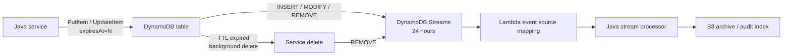
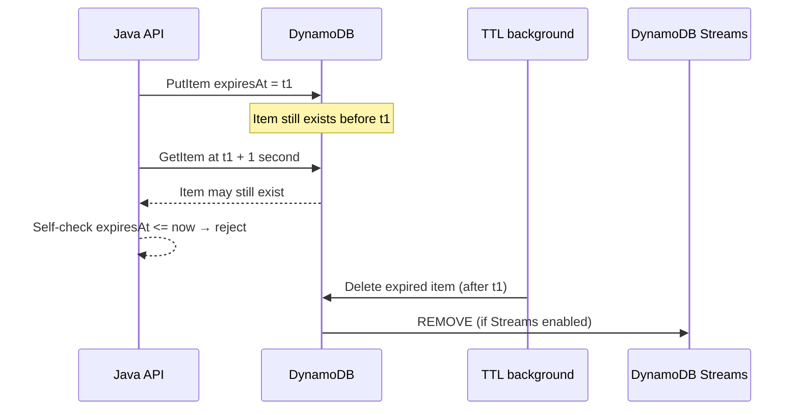
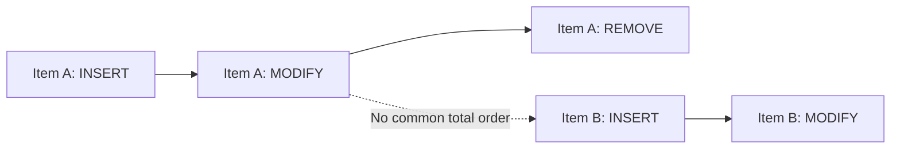
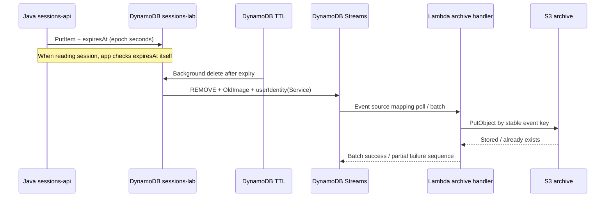

# TTL, DynamoDB Streams, and Change Data Processing

> **Chapter:** DynamoDB  
> **Module:** `CLOUD_PROVIDERS_AWS`  
> **Context:** In the AWS ecosystem, DynamoDB helps store application state with low latency; Time to Live (TTL) cleans up expired data, while DynamoDB Streams records changes so components can process them asynchronously. This lesson combines service selection, IAM/KMS security, Lambda/Java, monitoring, recovery, and cost.  
> **Note:** All tables, accounts, ARNs, buckets, timestamps, and data below are examples only. Commands that create/modify resources must be run in an authorized practice environment and not applied directly to production.

## Learning Objectives

After completing this lesson, you can:

1. Explain that **DynamoDB TTL** is a background data-deletion mechanism, not a timer that executes events to the exact second.
2. Store TTL as **Number: Unix epoch seconds**, compute it accurately from `Instant` in Java, distinguish seconds from milliseconds, and recognize invalid TTL data.
3. Handle items that are **expired but not yet deleted** during `GetItem`, `Query`, or `Scan`; use `FilterExpression` and `ConditionExpression` in the right places.
4. Distinguish **DynamoDB Streams** from TTL, Kinesis Data Streams, EventBridge Pipes, and backup/PITR; explain the **24-hour** stream retention limit.
5. Choose `KEYS_ONLY`, `NEW_IMAGE`, `OLD_IMAGE`, or `NEW_AND_OLD_IMAGES` appropriately for auditing, syncing search indexes, or archiving expired items.
6. Read `INSERT`, `MODIFY`, and `REMOVE` records and identify **TTL service deletion** records using `userIdentity` in the Region where TTL actually performed the deletion.
7. Configure a Lambda **event source mapping** and control `StartingPosition`, batch size, retries, checkpoints, `ParallelizationFactor`, error destinations, and event filtering.
8. Write an **idempotent** Java consumer that returns **partial batch failures using the DynamoDB stream sequence number**, without confusing it with an SQS message ID.
9. Analyze Global Tables, TTL replication, stream ordering, IAM/KMS, costs, monitoring, and failure/replay strategies.
10. Design a testable and fault-tolerant **session expiry → DynamoDB TTL → Streams → Lambda → S3 archive** pipeline.

## 1. Two Different Mechanisms: TTL and Streams

**TTL** determines *when an item is considered expired* so DynamoDB can clean it up via a background process. **DynamoDB Streams** records *changes that actually occurred* on the table.



**A change in DynamoDB can produce a stream record; a TTL value passing its expiration time does not mean the item is immediately deleted or gets a stream record at that exact moment.**

### 1.1 What TTL Does and Does Not Guarantee

| What TTL can do | What TTL does not guarantee |
|---|---|
| Store a per-item expiration timestamp | Deleting the item at the exact instant of expiration |
| Delete expired items via a background process | An expired token/session immediately disappearing from `GetItem` |
| Delete without consuming write throughput in the Region where the TTL delete occurs | Zero storage/read cost while the item is still waiting to be deleted |
| Emit a service `REMOVE` record when Streams is enabled | Stream records acting as an event scheduler with an exact SLA |
| Help keep the table smaller over the long term | Replacing backups, long-term audit logs, or compliance retention policies |

### 1.2 What Streams Does and Does Not Guarantee

| What Streams can do | What Streams does not guarantee |
|---|---|
| Record `INSERT`/`MODIFY`/`REMOVE` in near real time | Retaining stream data beyond **24 hours** |
| Store keys and optional old/new images | Capturing historical data from before Streams was enabled |
| Preserve the order of changes **for the same item** | Global ordering across all items/partitions |
| Allow Lambda to read records and process asynchronously | Exactly-once execution of Lambda/backend |
| Serve as a source for CDC and cache/index synchronization | Serving as a multi-year immutable audit archive |

### 1.3 Contextual Example

An e-commerce application stores:

- `SESSION#...`: login sessions with `expiresAt`.
- `CART#...`: temporary shopping carts with a longer TTL.
- `ORDER#...`: critical orders **without TTL**.
- `LOCK#...`: soft locks with a short expiration and logical expiry checks at read time.

When a session expires, the backend must treat it as expired **immediately in authorization logic**, even if DynamoDB still holds the record; TTL will clean it up later. When DynamoDB actually deletes the record, Streams can be used to save a snapshot to S3 or run non-time-critical cleanup.

## 2. TTL Schema: A Number Attribute in Unix Epoch Seconds

To use TTL:

1. Choose an item attribute, for example `expiresAt`.
2. Enable TTL at the **table** level with the exact attribute name `expiresAt`.
3. Set that attribute's value to a DynamoDB **Number** representing **Unix epoch seconds** (UTC).
4. Maintain the business expiration policy, such as session expiry or shopping cart retention period.

An illustrative item:

```json
{
  "PK": {"S": "SESSION#sess-a12"},
  "SK": {"S": "META"},
  "tenantId": {"S": "tenant-demo"},
  "userId": {"S": "user-demo"},
  "createdAt": {"S": "2026-11-20T03:30:00Z"},
  "expiresAt": {"N": "1795231800"}
}
```

`expiresAt` is **N**, not `S`, and not an ISO-8601 date string; the value is only an example. DynamoDB TTL attribute names are **case-sensitive**, so `ExpiresAt` and `expiresAt` are not the same field.

### 2.1 Seconds vs. Milliseconds

```java
import java.time.Duration;
import java.time.Instant;

Instant expires = Instant.now().plus(Duration.ofHours(24));
long epochSeconds = expires.getEpochSecond();      // correct
long epochMillis = expires.toEpochMilli();         // WRONG if used as TTL
```

Putting epoch **milliseconds** into TTL typically produces a timestamp thousands of years in the future, causing the item not to expire when expected.

**Do not multiply by 1,000** before storing; when you need expiry "30 minutes from now", use `Instant.now().plus(Duration.ofMinutes(30)).getEpochSecond()`.

### 2.2 TTL Values That Will Be Ignored

DynamoDB TTL ignores or does not treat a value as a valid TTL when:

- The item does not have the configured TTL attribute.
- The attribute is not a **Number**.
- The value is **more than 5 years in the past** according to AWS rules.
- The value is a string type such as `"2026-12-01T00:00:00Z"`.
- There is an attribute name mismatch due to case sensitivity.
- TTL on the table is not yet in an active state.

TTL does not automatically require items to have `expiresAt`. In a single-table design, many critical items can **omit TTL** and therefore will not automatically expire.

### 2.3 One Table Has One Configured TTL Attribute Name

You cannot enable two parallel TTL attributes `cartExpiresAt` and `sessionExpiresAt` as two independent TTL configurations in the same table. Standardize on the name `expiresAt` and calculate the expiration policy **per item**:

```text
SESSION#... : expiresAt = now + 24 hours
CART#...    : expiresAt = now + 30 days
ORDER#...   : no expiresAt
```

If an additional `businessExpiresAt` field is needed for business logic, it can be kept separately, though the TTL service only follows the attribute enabled on the table.

## 3. TTL Does Not Delete on Exact Time: Designing Expiration Checks

DynamoDB deletes TTL items **asynchronously**, typically within a few days, and deletion can lag behind the `expiresAt` timestamp. AWS does not guarantee a delete job executes at the exact second of expiry.



### 3.1 `GetItem` Can Still Return an Expired Item

Even when `expiresAt < now`, the item can still be returned by `GetItem` before TTL deletion completes. Therefore, when validating a session:

```java
long now = Instant.now().getEpochSecond();
boolean isExpired = expireAt != null && expireAt <= now;

if (isExpired) {
    // Do not grant access even if DynamoDB still has the record.
    throw new SecurityException("Session expired");
}
```

In security systems, do not rely on the TTL service for immediate token/session revocation. If immediate blocking on logout is required, update a `revoked` state or perform a conditional delete; the backend checks both `expiresAt` and the revocation state.

### 3.2 `Query` and `Scan` Using FilterExpression

AWS recommends filtering out expired items on reads:

```text
KeyConditionExpression: PK = :pk
FilterExpression: attribute_not_exists(expiresAt) OR expiresAt > :now
```

- `KeyConditionExpression` limits items by partition/sort key, matching how DynamoDB queries.
- `FilterExpression` runs **after reading the key-matching items**, so it **does not reduce consumed RCUs**, though it can reduce returned data.
- `Query` also has a page size limit; if items are all filtered out, a result may have `Items=[]` while still returning `LastEvaluatedKey`. Proper pagination is required.
- For `GetItem`, which has no `FilterExpression`, the application must check expiry itself.
- For GSIs, data propagation and read consistency also depend on the index; TTL does not guarantee all indexes are cleared immediately upon expiry.

### 3.3 Expired Items Can Still Be Modified

Before the TTL background process deletes it, an expired item can be updated, deleted, or have its **TTL extended**. If `expiresAt` is set in the future or the TTL attribute is removed **before the item is deleted**, DynamoDB no longer considers the item expired under the new value.

However, there is a race condition between the modification and the service delete. To avoid "reviving" an expired session or writing to an item that was just deleted, use `ConditionExpression` and a business version.

Example of updating only a still-valid session:

```text
ConditionExpression: attribute_exists(PK) AND expiresAt > :now
UpdateExpression: SET lastSeenAt = :now, expiresAt = :future
```

An update request for an expired item is rejected with `ConditionalCheckFailedException`. If business logic allows renewal after expiry, it must re-authenticate/accept the risk and design concurrency clearly.

### 3.4 TTL Is Not Suitable for Exact Scheduling

| Requirement | Usually appropriate solution |
|---|---|
| Clean up temporary sessions/carts/logs after a retention period | **DynamoDB TTL** |
| Prevent expired sessions from accessing immediately | **Check expiry on read/authorize** |
| Send an email at exactly 9:00 AM tomorrow | **EventBridge Scheduler**, Step Functions Wait, or a scheduling service |
| Transition an order to EXPIRED at deadline | Scheduler + re-read state and conditional update |
| Retain full multi-year change history | S3 audit/archive or a stream pipeline with long retention |
| Run best-effort cleanup after item deletion | **TTL + DynamoDB Streams + Lambda** |

**Key point:** TTL deletion is a "data has been deleted" event, not a guaranteed notification emitted at the exact business deadline.

## 4. Enabling, Checking, and Changing TTL

### 4.1 Read TTL Configuration (read-only)

```bash
aws dynamodb describe-time-to-live \
  --table-name sessions-lab \
  --region ap-southeast-1 \
  --output json
```

Output when enabled:

```json
{
  "TimeToLiveDescription": {
    "TimeToLiveStatus": "ENABLED",
    "AttributeName": "expiresAt"
  }
}
```

Possible statuses include `ENABLING`, `ENABLED`, `DISABLING`, and `DISABLED`. Do not mark a test as successful before the status has completed transitioning.

### 4.2 Enable TTL (modifies resource)

```bash
aws dynamodb update-time-to-live \
  --table-name sessions-lab \
  --time-to-live-specification "Enabled=true,AttributeName=expiresAt" \
  --region ap-southeast-1
```

**Warning:** Changing TTL on a real table can delete data that has an expiry attached; know beforehand how many items already have `expiresAt`.

According to the AWS API, enabling/disabling TTL can take **up to one hour** to complete; making another change call during this window can result in `ValidationException`. If you want to change the TTL attribute name, follow the workflow disable → wait for completion → enable the new attribute; do not treat it as an instant update.

### 4.3 Testing an Item on a Pre-Created Table

Using Bash; `expiresAt` is calculated from current UTC:

```bash
EXPIRY=$(date -u -d '+1 hour' +%s)

aws dynamodb put-item \
  --table-name sessions-lab \
  --item "{\"PK\":{\"S\":\"SESSION#test-001\"},\"SK\":{\"S\":\"META\"},\"expiresAt\":{\"N\":\"$EXPIRY\"}}" \
  --region ap-southeast-1
```

This command **writes a real item** and depends on GNU `date`, so it will not run verbatim on PowerShell/Windows; in a Java application, create items using the SDK and `Instant`.

### 4.4 Do Not Disable TTL to "Quickly Delete" Items

Disabling TTL **stops the automatic cleanup mechanism**; it does not immediately delete all expired items. If you want exact bulk deletion, you need a scan/Query job aligned with access patterns and batch deletes with controlled capacity, timing, and cost.

## 5. Writing TTL Items from Java (AWS SDK for Java v2)

Example of a Java service creating a session record with a 24-hour TTL. The illustrative table has a composite key `PK`, `SK`. Dependency `software.amazon.awssdk:dynamodb`.

```java
package example.dynamodb;

import java.time.Duration;
import java.time.Instant;
import java.util.Map;
import software.amazon.awssdk.regions.Region;
import software.amazon.awssdk.services.dynamodb.DynamoDbClient;
import software.amazon.awssdk.services.dynamodb.model.AttributeValue;
import software.amazon.awssdk.services.dynamodb.model.PutItemRequest;

public final class SessionStore {
    private static final String TABLE = "sessions-lab";

    private final DynamoDbClient dynamoDb;

    public SessionStore(DynamoDbClient dynamoDb) {
        this.dynamoDb = dynamoDb;
    }

    public void createSession(String sessionId, String userId) {
        long expires = Instant.now()
            .plus(Duration.ofHours(24))
            .getEpochSecond();

        Map<String, AttributeValue> item = Map.of(
            "PK", AttributeValue.builder()
                .s("SESSION#" + sessionId).build(),
            "SK", AttributeValue.builder().s("META").build(),
            "userId", AttributeValue.builder().s(userId).build(),
            "expiresAt", AttributeValue.builder()
                .n(Long.toString(expires)).build()
        );

        dynamoDb.putItem(PutItemRequest.builder()
            .tableName(TABLE)
            .item(item)
            .conditionExpression(
                "attribute_not_exists(PK) AND attribute_not_exists(SK)")
            .build());
    }

    public static void main(String[] args) {
        try (DynamoDbClient db = DynamoDbClient.builder()
                .region(Region.AP_SOUTHEAST_1).build()) {
            new SessionStore(db).createSession(
                "demo-001", "user-demo");
        }
    }
}
```

### 5.1 Why Include ConditionExpression?

This pattern prevents overwriting an existing session with the same key. If `PutItem` has no condition and collides on the key, it can replace the old item, emit a Streams `MODIFY` event, and corrupt business state.

Note that `attribute_not_exists(PK) AND attribute_not_exists(SK)` is an example uniqueness guard; with a DynamoDB composite primary key, `attribute_not_exists(PK)` is typically sufficient for a conditional put on an item with the same full key. Business rules must determine whether an already-expired sessionId can be recreated.

### 5.2 Reading with Expiry Validation

After `GetItem`, parse:

```java
import java.time.Instant;
import java.util.Map;
import software.amazon.awssdk.services.dynamodb.model.AttributeValue;

static boolean usable(Map<String, AttributeValue> item) {
    if (item == null || item.isEmpty()) return false;
    AttributeValue ttl = item.get("expiresAt");
    if (ttl == null || ttl.n() == null) return false;

    long expirationSeconds = Long.parseLong(ttl.n());
    return expirationSeconds > Instant.now().getEpochSecond();
}
```

This snippet enforces the policy "a session **must** have a TTL". For tables that also contain persistent records without a TTL, read policy should classify the record type rather than assuming missing `expiresAt` is invalid by default.

### 5.3 Clock Skew and Security

- Use UTC/Epoch; do not compute TTL using local time such as `LocalDateTime.now()`.
- If tokens/sessions are critical, account for safe clock skew across systems.
- Do not trust a TTL sent by the browser to let a session live 100 years; the backend sets the expiration policy.
- Do not log session tokens/keys or user PII.
- Use DynamoDB conditional writes/version checks to prevent concurrency races.

## 6. DynamoDB Streams: Change Data Capture (CDC)

**DynamoDB Streams** is an ordered log of **item-level** changes enabled per table, retaining records for up to **24 hours**.

Operations that emit records typically include:

- `PutItem` creating an item: `INSERT`.
- `UpdateItem` or replacing an item with changes: `MODIFY`.
- `DeleteItem` or TTL service delete: `REMOVE`.
- Transaction writes (when modifying items): corresponding stream records.

An `UpdateItem` that does not actually change any data may **not** emit a record according to AWS documentation.

### 6.1 Four Stream View Types

| StreamViewType | Record contents | Use case |
|---|---|---|
| `KEYS_ONLY` | Primary key of the changed item | Trigger fetching/computing from key, workloads needing minimal payload |
| `NEW_IMAGE` | Item **after** INSERT/MODIFY | Sync projections/search indexes to the new state |
| `OLD_IMAGE` | Item **before** MODIFY/REMOVE | Save snapshot before deletion, analyze prior data |
| `NEW_AND_OLD_IMAGES` | Both before and after images, when the event type has the corresponding image | Diff changes, audit, sync indexes, and archive TTL deletes |

**When you want to archive TTL-deleted items, choose `OLD_IMAGE` or `NEW_AND_OLD_IMAGES`.** `KEYS_ONLY` does not contain the pre-deletion payload; `NEW_IMAGE` does not help retrieve the full body of a `REMOVE`.

### 6.2 Old/New Images by Event

| Event | Keys | OldImage | NewImage |
|---|---|---|---|
| `INSERT` | Yes | No | Yes if view includes new image |
| `MODIFY` | Yes | Yes if view includes old image | Yes if view includes new image |
| `REMOVE` | Yes | Yes if view includes old image | No |

Do not try to read `NewImage` in a `REMOVE` event and treat `null` as a service bug.

### 6.3 Stream Retention Is Only 24 Hours

Streams retain records for only **24 hours**; older records may be trimmed. This is **not** a durable long-term audit/event log, and DynamoDB Streams retention cannot be extended to 7 days via Lambda's `MaximumRecordAgeInSeconds`.

If a consumer stops longer than retention:

- Expired records can no longer be re-read from DynamoDB Streams.
- Setting `MaximumRetryAttempts=-1` only means retrying until the record is dropped due to age/retention; it does not keep the record forever.
- To replay across multiple days, you need a dedicated archive pipeline, Kinesis Data Streams with appropriate configured retention, an EventBridge/SQS/S3 outbox, or state recovery via batch snapshot/reconciliation.

## 7. Enabling Streams and Reading Configuration

### 7.1 View Table Stream Status (read-only)

```bash
aws dynamodb describe-table \
  --table-name sessions-lab \
  --region ap-southeast-1 \
  --query 'Table.{Name:TableName,StreamSpec:StreamSpecification,StreamArn:LatestStreamArn,Status:TableStatus}' \
  --output json
```

You might see:

```json
{
  "Name": "sessions-lab",
  "StreamSpec": {
    "StreamEnabled": true,
    "StreamViewType": "NEW_AND_OLD_IMAGES"
  },
  "StreamArn": "arn:aws:dynamodb:ap-southeast-1:111122223333:table/sessions-lab/stream/2026-11-20T03:00:00.000",
  "Status": "ACTIVE"
}
```

`StreamArn` is the ARN of the **stream instance**, not the table ARN. Use the stream ARN when configuring the Lambda event source mapping.

### 7.2 Enable Streams on an Existing Table (modifies resource)

```bash
aws dynamodb update-table \
  --table-name sessions-lab \
  --stream-specification StreamEnabled=true,StreamViewType=NEW_AND_OLD_IMAGES \
  --region ap-southeast-1
```

If a table already has a stream, changing the view type usually requires **disabling and re-enabling** it with the new configuration; doing so can create a **new stream ARN**, affecting Lambda mappings/consumer positions. Do not make ad-hoc changes while a stream is in use by Global Tables or other consumers.

### 7.3 Streams Have No Historical Data Prior to Enabling

Enabling Streams at 10:00 **does not generate `INSERT` events for items that already existed at 9:00**. If you need to seed a search index/analytics initially:

1. Export/Scan existing data with an appropriate strategy.
2. Enable Streams and create a valid consumer/checkpoint.
3. Combine the snapshot with CDC without creating gaps or duplication.
4. Apply versioning/idempotency to merge snapshot + stream events.

Do not confuse DynamoDB Streams with database backup/PITR; their purpose and retention differ.

## 8. DynamoDB Stream Event: Schema and Ordering

A Lambda event from DynamoDB Streams has an outer `Records[]`. Each record typically contains:

- `eventID` and `eventName`.
- `eventSource="aws:dynamodb"`.
- `awsRegion` and `eventSourceARN`.
- `dynamodb.Keys`, `NewImage`, `OldImage` when configured.
- `dynamodb.SequenceNumber`.
- `dynamodb.ApproximateCreationDateTime`.
- `dynamodb.StreamViewType` and `SizeBytes`.
- `userIdentity` when added, such as a TTL service delete in the originating Region.

Abbreviated example:

```json
{
  "Records": [
    {
      "eventID": "evt-record-001",
      "eventName": "MODIFY",
      "eventVersion": "1.1",
      "eventSource": "aws:dynamodb",
      "awsRegion": "ap-southeast-1",
      "eventSourceARN": "arn:aws:dynamodb:ap-southeast-1:111122223333:table/sessions-lab/stream/2026-11-20T03:00:00.000",
      "dynamodb": {
        "ApproximateCreationDateTime": 1795145400,
        "Keys": {
          "PK": {"S": "SESSION#demo-001"},
          "SK": {"S": "META"}
        },
        "OldImage": {
          "status": {"S": "ACTIVE"},
          "expiresAt": {"N": "1795231800"}
        },
        "NewImage": {
          "status": {"S": "REVOKED"},
          "expiresAt": {"N": "1795231800"}
        },
        "SequenceNumber": "1234567890123456789",
        "StreamViewType": "NEW_AND_OLD_IMAGES",
        "SizeBytes": 230
      }
    }
  ]
}
```

`eventVersion`, timestamps, sequence numbers, and ARNs in the example are illustrative only. `OldImage`/`NewImage` typically contain **DynamoDB AttributeValue JSON** like `{"S":"..."}`/`{"N":"..."}`, not plain business JSON.

### 8.1 To What Extent Does Streams Guarantee Ordering?

AWS guarantees that stream records for the **same item** appear in the exact order the item was modified. There is no global order across multiple items.



With Lambda event source mapping:

- A stream has **shards**; Lambda reads according to shard lineage and checkpoints.
- `ParallelizationFactor` 1–10 allows multiple concurrent batches/shard.
- Lambda preserves ordering under the stream's same-item/partitioning constraint.
- Consumers should not infer that updates to two different items form a single transaction order merely because their timestamps are close.

### 8.2 One Record in a Stream Is Not One Lambda Invocation

A single Lambda invocation can receive **multiple Records**. The same record can also be retried by Lambda multiple times due to errors, timeouts, or at-least-once delivery semantics. Therefore:

> **"A stream record appearing once in the log" does not mean "the business side effect runs only once".**

Durable idempotency is required for every consumer with business side effects: email, billing, ledger, S3 export, search index.

## 9. TTL Service Deletion vs. Manual DeleteItem

When TTL actually deletes an item, Streams has `eventName="REMOVE"`. To distinguish it from an application-triggered `DeleteItem`, in the **Region where the TTL delete occurred**, the record includes `userIdentity`:

```json
{
  "Records": [
    {
      "eventName": "REMOVE",
      "userIdentity": {
        "type": "Service",
        "principalId": "dynamodb.amazonaws.com"
      },
      "dynamodb": {
        "Keys": {
          "PK": {"S": "SESSION#demo-001"}
        },
        "OldImage": {
          "PK": {"S": "SESSION#demo-001"},
          "expiresAt": {"N": "1795231800"}
        },
        "SequenceNumber": "1234567890123456790",
        "StreamViewType": "OLD_IMAGE"
      }
    }
  ]
}
```

This sample omits many technical fields and shows only the identifying fields.

### 9.1 Rule for Identifying a TTL Delete

```text
eventName == "REMOVE"
AND userIdentity.type == "Service"
AND userIdentity.principalId == "dynamodb.amazonaws.com"
```

**Do not treat every `REMOVE` as caused by TTL**, because the app can call `DeleteItem` for logout, state reset, or legal deletion requests. Do not rely solely on `OldImage.expiresAt <= now` because the app can also actively delete an expired item.

### 9.2 With Global Tables, Only the Originating Region Has the Service TTL Marker

With DynamoDB Global Tables supporting TTL, an item may be deleted by TTL in Region A and the delete **replicated** to Regions B/C.

- **Region where TTL executed:** the stream record has `userIdentity.type=Service` and `principalId=dynamodb.amazonaws.com`.
- **Regions receiving the replicated delete:** the stream record **does not have** the TTL identification fields above.
- A Lambda that only filters for TTL service deletes in Region B/C may **never see** the replicated delete.
- If you need one archive per TTL delete, design consumers in the originating Region / emit events using an architecture that handles cross-Region deduplication appropriately.

Do not use the record's `awsRegion` alone to infer every delete is TTL, and do not assume Global Tables form a globally ordered stream.

## 10. Processing Pattern: TTL → Streams → Lambda → S3

Example: sessions need to live for 24 hours. When DynamoDB actually cleans up an item, the system saves an **OldImage** snapshot to S3 for internal auditing/support workflows within the permitted retention window.



### 10.1 Why Choose OLD_IMAGE?

If you want to archive content **before it is deleted**, use `OLD_IMAGE` or `NEW_AND_OLD_IMAGES`. With only `KEYS_ONLY`:

- You cannot call `GetItem` after the item has already been deleted and expect to retrieve the full snapshot.
- If you only need the key to clean up a secondary system, `KEYS_ONLY` may suffice; design for idempotency and missing data.
- If an indexer needs to create/update/delete search docs, `NEW_AND_OLD_IMAGES` is usually more convenient.

### 10.2 Archive Must Have Retention and Privacy Policies

An S3 archive should not be kept "indefinitely" just because TTL removed the data from DynamoDB:

- Define processing purpose, retention duration, and personal data deletion requirements.
- Use a private S3 bucket, Block Public Access, TLS, and SSE-KMS if policy requires it.
- Set appropriate S3 lifecycle retention; consider S3 Object Lock only when audit compliance truly requires it, noting the implications on deletion permissions.
- Do not store raw session tokens/passwords in archived `OldImage`.
- If items contain PII, archive only necessary fields or apply redaction/encryption per policy.
- Monitoring/permissions for the S3 archive differ from DynamoDB Streams.

## 11. Lambda Event Source Mapping: Who Reads the Stream?

In the DynamoDB Streams → Lambda model, the **Lambda event source mapping polls** the stream using permissions from the **Lambda execution role** and invokes the handler in batches. DynamoDB **does not** need a `lambda:AddPermission` resource-based policy like SNS/API Gateway to actively push to the function.

### 11.1 Components

| Component | Responsibility |
|---|---|
| DynamoDB table + Streams | Write change records to shards |
| Event source mapping | Poll shards, batch, checkpoint, invoke Lambda |
| Lambda execution role | Permissions for `dynamodb:DescribeStream`, `GetRecords`, `GetShardIterator`, `ListStreams`, CloudWatch Logs, and target resources |
| Lambda handler | Classify events, run business logic, idempotency, return success/failure |
| Failure destination | Store metadata or payload of discarded records based on supported destination type |
| CloudWatch metrics | IteratorAge, Errors, Throttles, Duration, concurrency, on-failure counts |

### 11.2 StartingPosition: LATEST vs TRIM_HORIZON

| Value | Meaning | Risk |
|---|---|---|
| `TRIM_HORIZON` | Start from the oldest record **still within the 24-hour retention** | May process unwanted backlog/records if data already exists |
| `LATEST` | Start from the most recent point when the reader becomes active | May **miss** records during mapping creation/update due to eventual consistency |

AWS recommends `TRIM_HORIZON` to avoid losing events during mapping initialization. This **does not recover** records older than 24 hours.

### 11.3 Mapping Takes Time to Start Up

Creating/updating an event source mapping can take a few minutes for polling to become active or updated. Do not publish an event immediately after creating a `LATEST` mapping and assume Lambda will definitely see it.

States to check: `Creating`, `Enabling`, `Enabled`, `Updating`, `Disabled`, `Failed` per the API. Inspect `State`, `LastProcessingResult`, and timestamps.

### 11.4 Batching and Parallelism

- Lambda's base polling interval for DynamoDB Streams is typically around **4 times/second per shard**.
- `BatchSize` defaults to **100**, maximum **10,000** per documentation.
- Batches are also capped by the **6 MiB** invocation payload limit.
- `MaximumBatchingWindowInSeconds` can buffer up to **300 seconds**, default **0**.
- `ParallelizationFactor` defaults to **1**, maximum **10** concurrent batches/shard.
- Even when parallelized, ordering of changes belonging to the **same item** is preserved under supported semantics.

Increasing batch size reduces invocations but increases processing time, memory, and retry blast radius. Increasing parallelization does not automatically give downstream APIs/DynamoDB/S3 more capacity.

### 11.5 Multiple Consumers Reading One Stream

According to Lambda/DynamoDB guidance:

- For a **single-Region table that is not a global table**, design for **at most about two Lambda functions** reading a stream shard concurrently to avoid throttling.
- For **Global Tables**, AWS generally recommends **one Lambda function** reading a stream shard to reduce contention.
- If you need to fan out to many services, consider **one processor publishing events to SNS/EventBridge/SQS**, EventBridge Pipes, or a suitable stream architecture.

Do not create ten Lambda event source mappings on the same stream just because ten teams want to receive every event.

## 12. Partial Batch Failure: What Happens When One Record Errors?

By default, Lambda only checkpoints a batch when the **entire batch succeeds**. If the handler throws at record 5/100, the whole batch can be retried, including records 1–4 that were already written to S3 or had DB side effects.

To reduce reprocessing:

1. Enable `FunctionResponseTypes=ReportBatchItemFailures` on the event source mapping.
2. Have the handler return `batchItemFailures` with `itemIdentifier` set to the **`dynamodb.SequenceNumber`** of the first failed record.
3. Lambda uses the lowest sequence number as the checkpoint and retries from that record onward.

```json
{
  "batchItemFailures": [
    {
      "itemIdentifier": "1234567890123456790"
    }
  ]
}
```

**Do not use `eventID`, `receiptHandle`, or `MessageId`.** For SQS, the item identifier is the SQS message ID; for **DynamoDB Streams**, the item identifier is the **stream sequence number**.

### 12.1 Why Stop at the First Failed Record?

If a batch has records in sequence order:

```text
seq=101 → processed OK
seq=102 → processed OK
seq=103 → error
seq=104 → not processed yet
seq=105 → not processed yet
```

Returning `itemIdentifier=103` lets Lambda retry **from 103 onward**. If the handler continued processing 104–105 while only reporting failure on 103, those could still be retried and require idempotency. For workloads requiring simple ordering, **stopping at the first error** makes correctness easier to prove.

### 12.2 Key Retry Configurations

| Mapping option | Meaning |
|---|---|
| `MaximumRetryAttempts` | Limit number of error retries; default -1 until the record expires |
| `MaximumRecordAgeInSeconds` | Limit record age before discarding; does not extend 24h Streams retention |
| `BisectBatchOnFunctionError` | Split a failing batch in two to isolate the failing record |
| `FunctionResponseTypes` | Must contain `ReportBatchItemFailures` for partial responses to be processed |
| `DestinationConfig.OnFailure` | Send metadata/info about discarded records/batches to a supported destination |
| `ParallelizationFactor` | Increase parallel processing per shard while preserving per-item ordering |
| `MaximumBatchingWindowInSeconds` | Increase batching, which can change latency and error batch size |

If `ReportBatchItemFailures` is **not enabled**, a handler returning valid partial-failure JSON will still not make Lambda partial-checkpoint as expected.

### 12.3 Streams Mapping DLQ Is Not Like an SQS Source-Queue DLQ

DynamoDB Streams does not have an "SQS source queue" by default. An error destination configured on the **Lambda event source mapping** can be **SQS/SNS**, and destinations supporting full-record storage like S3 depend on source type/version. With an SQS/SNS failure destination, the payload is typically **invocation/stream metadata**, not a full copy of the entire item; proper recovery/replay capability must be designed.

**Do not wait until records pass 24 hours to investigate:** if you only have metadata and the stream has trimmed, you cannot retrieve the lost `OldImage` from the stream.

## 13. Java Lambda Consumer: Saving TTL-Deleted OldImage to S3

Example Java 21 handler receiving the JSON event as a Map to keep the contract clear. It processes only **TTL service REMOVE** events from the **Region where the deletion originated**. Each archived object uses a stable key based on stream ARN + sequence number and uses an S3 conditional put to prevent overwrites.

Dependencies:

- `com.amazonaws:aws-lambda-java-core`.
- `software.amazon.awssdk:s3`.
- `com.fasterxml.jackson.core:jackson-databind`.

Environment: `ARCHIVE_BUCKET`.

```java
package example.dynamodb;

import com.amazonaws.services.lambda.runtime.Context;
import com.amazonaws.services.lambda.runtime.RequestHandler;
import com.fasterxml.jackson.databind.ObjectMapper;
import java.nio.charset.StandardCharsets;
import java.security.MessageDigest;
import java.util.HexFormat;
import java.util.List;
import java.util.Map;
import software.amazon.awssdk.core.sync.RequestBody;
import software.amazon.awssdk.services.s3.S3Client;
import software.amazon.awssdk.services.s3.model.PutObjectRequest;
import software.amazon.awssdk.services.s3.model.S3Exception;

public final class TtlArchiveHandler
        implements RequestHandler<Map<String, Object>, Map<String, Object>> {

    private static final String BUCKET =
        System.getenv("ARCHIVE_BUCKET");
    private static final S3Client S3 = S3Client.create();
    private static final ObjectMapper JSON = new ObjectMapper();

    @Override
    public Map<String, Object> handleRequest(
            Map<String, Object> event, Context context) {

        Object rawRecords = event.get("Records");
        if (!(rawRecords instanceof List<?> records)) {
            throw new IllegalArgumentException("Missing Records");
        }

        for (Object rawRecord : records) {
            Map<String, Object> record = objectMap(rawRecord);
            Map<String, Object> change = objectMap(record.get("dynamodb"));
            String sequence = requiredString(change, "SequenceNumber");

            try {
                if (isLocalTtlDelete(record)) {
                    archiveOldImage(record, change, sequence);
                }
                // Non-TTL events: intentionally ignored.
            } catch (Exception ex) {
                // Do not log OldImage/PII/secret.
                context.getLogger().log(
                    "Archive failure for stream sequence; will retry\n");
                return Map.of(
                    "batchItemFailures",
                    List.of(Map.of("itemIdentifier", sequence)));
            }
        }

        return Map.of("batchItemFailures", List.of());
    }

    private static boolean isLocalTtlDelete(Map<String, Object> record) {
        if (!"REMOVE".equals(record.get("eventName"))) {
            return false;
        }
        Map<String, Object> identity =
            objectMap(record.get("userIdentity"));
        return "Service".equals(identity.get("type"))
            && "dynamodb.amazonaws.com".equals(identity.get("principalId"));
    }

    private static void archiveOldImage(
            Map<String, Object> record,
            Map<String, Object> change,
            String sequence) throws Exception {

        Object oldImage = change.get("OldImage");
        if (!(oldImage instanceof Map<?, ?>)) {
            throw new IllegalStateException(
                "OLD_IMAGE stream view required");
        }
        String streamArn = requiredString(record, "eventSourceARN");
        String archiveKey = "ttl-deletes/" +
            sha256(streamArn + ":" + sequence) + ".json";

        byte[] body = JSON.writeValueAsBytes(Map.of(
            "streamArn", streamArn,
            "sequenceNumber", sequence,
            "oldImage", oldImage
        ));

        PutObjectRequest request = PutObjectRequest.builder()
            .bucket(BUCKET)
            .key(archiveKey)
            .contentType("application/json")
            .ifNoneMatch("*")
            .build();

        try {
            S3.putObject(request, RequestBody.fromBytes(body));
        } catch (S3Exception ex) {
            if (ex.statusCode() == 412) {
                return; // Object already exists: idempotent retry.
            }
            throw ex;
        }
    }

    private static String sha256(String input) throws Exception {
        byte[] digest = MessageDigest.getInstance("SHA-256")
            .digest(input.getBytes(StandardCharsets.UTF_8));
        return HexFormat.of().formatHex(digest);
    }

    @SuppressWarnings("unchecked")
    private static Map<String, Object> objectMap(Object input) {
        if (!(input instanceof Map<?, ?>)) return Map.of();
        return (Map<String, Object>) input;
    }

    private static String requiredString(
            Map<String, Object> input, String field) {
        Object value = input.get(field);
        if (!(value instanceof String s) || s.isBlank()) {
            throw new IllegalArgumentException(
                "Required stream field missing");
        }
        return s;
    }
}
```

### 13.1 Why Use a Stable Object Key?

Lambda may invoke the handler again for the same record. If each retry generated a new key using a random timestamp, S3 could receive multiple duplicate archive copies. Hashing **stream ARN + sequence number** ensures the same stream record uses the same key.

`If-None-Match: *` prevents overwriting an existing object; S3 can return 412 (object already exists). With concurrent conditional writes, other error statuses may require controlled retries per the SDK. **Do not assume repeated requests are completely free** — API/compute costs still apply.

### 13.2 Why Process Sequentially and Stop on Error?

DynamoDB Streams cares about per-item ordering. This code processes records sequentially and returns the **sequence number of the first failing record**, so Lambda retries it and the unprocessed remainder. This is a simple choice that reduces duplication compared to "continue processing and fail everything".

### 13.3 Limitations to Address in Production

This handler illustrates the contract and is not complete for strict auditing:

- Configure **ReportBatchItemFailures** on the mapping.
- Control timeout/S3 retries, encryption, lifecycle, and bucket policy.
- Standardize archive schema/versioning and PII redaction.
- If using S3 Object Versioning/replication, define retention and costs.
- With Global Tables, the handler only receives TTL service deletes in the Region where deletion happened; multi-Region processing/routing may be needed.
- If a record is missing sequence/OldImage, pre-loop validation might fail the entire batch instead of returning a partial response; configure logging/alerting, bisect, and on-failure handling.
- Do not send every stream event to S3 just to process TTL if an appropriate event filter can be used.
- A single S3 `PutObject` result does not replace immutable/non-deletable audit trail requirements, IAM governance, or legal hold.

## 14. Event Filtering: Saving Lambda Invocations, While Understanding Filters

AWS allows configuring filters on the event source mapping so Lambda only receives matching records.

### 14.1 Filtering TTL Service Deletes

Per AWS DynamoDB TTL + Streams documentation, the dedicated filter pattern is:

```json
{
  "userIdentity": {
    "type": ["Service"],
    "principalId": ["dynamodb.amazonaws.com"]
  }
}
```

With this filter, Lambda is only invoked for records with the matching identity, which are TTL service deletes in the originating Region. It is **insufficient** for receiving TTL deletes replicated to another Region because the identity field does not exist on replicated stream records.

### 14.2 Filtering by Item Attributes

In a DynamoDB stream event, business attributes are wrapped in AttributeValue form, for example:

```json
{
  "dynamodb": {
    "NewImage": {
      "entityType": {
        "S": ["ORDER"]
      },
      "status": {
        "S": ["PAID"]
      }
    }
  }
}
```

This is an **event filter pattern**, not an actual stream record: the lists `["ORDER"]`/`["PAID"]` are values accepted by the filter. To filter by `NewImage`, the stream view must include NEW_IMAGE/NEW_AND_OLD_IMAGES.

### 14.3 Filtering Is Not Authorization

If a client has permission to write `entityType=ORDER` or `tenantId=tenant-a` itself, it can create records that match the filter. IAM must still restrict who can write to the table; the handler must still validate permissions/business schema.

**Filtered records are never retried via the Lambda handler**, because they are dropped by the filter before invocation. Do not rely on filters to "guarantee every event was audited" if filter policies can be changed outside a review process.

## 15. Setting Up the Lambda Mapping with AWS CLI

> **Warning:** Commands that create/modify mappings change infrastructure and can incur Lambda invocations/costs. Execute only in an authorized account. ARNs and function names are placeholders.

### 15.1 Check Stream ARN and Lambda Role (read-only)

```bash
aws dynamodb describe-table \
  --table-name sessions-lab \
  --region ap-southeast-1 \
  --query 'Table.LatestStreamArn' \
  --output text

aws lambda get-function-configuration \
  --function-name ttl-archive-handler \
  --region ap-southeast-1 \
  --query '{Name:FunctionName,Runtime:Runtime,Handler:Handler,Timeout:Timeout,Role:Role}' \
  --output json
```

### 15.2 Create Mapping with Partial Batch Failures

**Bash** example:

```bash
aws lambda create-event-source-mapping \
  --function-name ttl-archive-handler \
  --event-source-arn arn:aws:dynamodb:ap-southeast-1:111122223333:table/sessions-lab/stream/2026-11-20T03:00:00.000 \
  --starting-position TRIM_HORIZON \
  --batch-size 100 \
  --maximum-batching-window-in-seconds 1 \
  --function-response-types ReportBatchItemFailures \
  --bisect-batch-on-function-error \
  --maximum-retry-attempts 10 \
  --region ap-southeast-1
```

Replace the stream ARN with the value from `DescribeTable`. If the stream already has records from the past 24 hours, `TRIM_HORIZON` can trigger backlog processing, so the handler needs idempotency and a data plan.

### 15.3 Create Mapping with a TTL Filter

You can combine filter criteria, for example:

```bash
aws lambda create-event-source-mapping \
  --function-name ttl-archive-handler \
  --event-source-arn arn:aws:dynamodb:ap-southeast-1:111122223333:table/sessions-lab/stream/2026-11-20T03:00:00.000 \
  --starting-position TRIM_HORIZON \
  --batch-size 100 \
  --function-response-types ReportBatchItemFailures \
  --filter-criteria '{"Filters":[{"Pattern":"{\"userIdentity\":{\"type\":[\"Service\"],\"principalId\":[\"dynamodb.amazonaws.com\"]}}"}]}' \
  --region ap-southeast-1
```

**Do not create both mappings for the same purpose in production**. These are **two illustrative approaches**: the first mapping has no filter and the handler identifies TTL itself; the second filters before invocation while the handler still checks safely. In PowerShell, JSON escaping rules differ from Bash; use a JSON file with `file://`/CLI input file to reduce quoting errors.

### 15.4 Read Mapping (read-only)

```bash
aws lambda list-event-source-mappings \
  --function-name ttl-archive-handler \
  --region ap-southeast-1 \
  --query 'EventSourceMappings[].{UUID:UUID,State:State,Source:EventSourceArn,BatchSize:BatchSize,StartingPosition:StartingPosition,LastProcessingResult:LastProcessingResult,FunctionResponseTypes:FunctionResponseTypes}' \
  --output json
```

Check:

- `State=Enabled`.
- `LastProcessingResult` and errors.
- `FunctionResponseTypes` includes `ReportBatchItemFailures`.
- Whether `EventSourceArn` matches **LatestStreamArn**.
- `BatchSize`, `ParallelizationFactor`, `MaximumRetryAttempts`, and on-failure destination.
- CloudWatch `IteratorAge` is not growing continuously.

### 15.5 Failure Destination

When failures/retry limits cause records to be discarded, the Lambda event source mapping can send notifications to **SQS/SNS** and feature-supported destinations like S3. If using SQS/SNS, verify **whether the payload contains enough data for recovery or only metadata**, and that permissions exist to send to the destination.

Do not use the DynamoDB source table itself to write all failure notifications if doing so could create a stream-trigger feedback loop.

## 16. IAM, KMS, and Data Protection

### 16.1 Lambda Execution Role Permissions

Example policy to **read only** one stream:

```json
{
  "Version": "2012-10-17",
  "Statement": [
    {
      "Sid": "ReadSessionChanges",
      "Effect": "Allow",
      "Action": [
        "dynamodb:DescribeStream",
        "dynamodb:GetRecords",
        "dynamodb:GetShardIterator",
        "dynamodb:ListStreams"
      ],
      "Resource": "arn:aws:dynamodb:ap-southeast-1:111122223333:table/sessions-lab/stream/*"
    },
    {
      "Sid": "WriteArchive",
      "Effect": "Allow",
      "Action": ["s3:PutObject"],
      "Resource": "arn:aws:s3:::company-ttl-archive-demo/ttl-deletes/*"
    }
  ]
}
```

The policy also needs logging/tracing permissions based on runtime/configuration and appropriate for the setup. `ListStreams` sometimes requires broader resource scope depending on IAM action semantics; verify against the actual IAM reference/simulator before deploying. For strict least privilege, separate statements can be adjusted for list/describe actions according to API-supported resource types.

### 16.2 Why Not Grant `lambda:InvokeFunction` to the DynamoDB Service Principal?

The Lambda service manages the event source mapping, **polls** DynamoDB Streams via the execution role, and invokes the function. This is a **pull integration**, unlike SNS/API Gateway triggers that use a resource-based permission for the service principal.

For a Lambda archiving to S3:

- Grant stream read permissions to the Lambda execution role.
- Grant S3 write permissions to the role and corresponding bucket policy.
- If the S3 bucket uses SSE-KMS, the role also needs KMS permissions per bucket/key policy.
- Do not add `dynamodb:DeleteItem` to a role that only needs to read TTL changes.
- Do not grant wildcard S3 write across all buckets if only one archive prefix is used.

### 16.3 Streams Contain Data Per `OLD_IMAGE/NEW_IMAGE`

If the table stores:

- Session tokens,
- Email/phone/address,
- Internal pricing/business secrets,

then stream records can contain those fields depending on the view type. Choose the right stream view for the need, redact/transform before emitting downstream, configure CloudWatch log retention, and restrict stream read access.

### 16.4 KMS Encryption and Networking

DynamoDB encrypts data at rest, including stream data per the service. When using a customer managed key, the key policy/grants/IAM must align. A Lambda in a private VPC needs routes to S3/DynamoDB/KMS via endpoints/NAT and corresponding security/network policies.

Do not place Lambda in a VPC just hoping Streams will be "more secure" without accounting for networking/cold starts; event source mapping polling is managed by the Lambda service, while your **code** calling S3/DynamoDB needs connectivity from its runtime environment.

## 17. Global Tables: How TTL, Streams, and Costs Differ from Single-Region

Global Tables have different consistency models; distinguish between:

- **MREC (multi-Region eventual consistency):** TTL is supported and settings synchronize across replicas.
- **MRSC (multi-Region strong consistency):** per current AWS documentation, **TTL deletion configuration is not supported**.

### 17.1 TTL Replicated Deletes

With an MREC global table:

1. The TTL service deletes the item in Region A.
2. The delete is replicated to Regions B/C.
3. The **initial TTL delete** in Region A does not incur a corresponding write throughput charge.
4. **Replicated deletes** in Regions B/C **consume replicated write capacity**, incurring cost.
5. If replicas are provisioned too low, replicated delete workloads can contribute to throttling.
6. In streams in B/C, the replicated delete record does not carry the `userIdentity` TTL marker as in Region A.

Therefore, "TTL deletes are free" holds in the **source Region** but is **incorrect if ignoring replicated write charges** in Global Tables.

### 17.2 Avoiding Side-Effect Processing Across Multiple Regions

If an archive Lambda is deployed in all three Regions and every stream consumer processes every `REMOVE`:

- One TTL delete can trigger multiple processing actions due to replicated stream changes.
- If writing to the same S3 bucket/DB, this can double-charge or write duplicates.
- Use a strategy to determine origin, event idempotency, and region ownership.
- If archiving only TTL service deletes, filter `userIdentity` in the originating Region; carefully test mixed origins and failover scenarios.

### 17.3 Global Tables Do Not Provide a Global Total Order

MREC replication has eventual consistency and conflict handling under the Global Tables model; stream records across Regions can differ. Do not use timestamps/sequence numbers from two stream ARNs in different Regions to infer an absolute order across all changes.

For critical cross-Region transactions, design conflict rules, idempotency, and reconciliation, or choose a consistency model/architecture that meets the requirements.

## 18. Monitoring TTL and Streams/Lambda with CloudWatch

### 18.1 Metrics Worth Watching

| Source | Metric / signal | Purpose |
|---|---|---|
| DynamoDB | `TimeToLiveDeletedItemCount` | Number of items actually deleted by TTL by table/time |
| DynamoDB | Table `ConsumedReadCapacityUnits`/`ConsumedWriteCapacityUnits` | Storage/read/write workload and cost |
| DynamoDB | `ThrottledRequests`/`SystemErrors` | Table/index capacity or errors |
| Lambda event source mapping | `IteratorAge` (ms) | Whether the consumer is lagging behind stream records |
| Lambda | `Errors`/`Throttles`/`Duration` | Handler errors, concurrency, latency |
| Lambda | `Invocations`, concurrent executions | Workload/cost/scale |
| S3 | Object creation errors/logs, bucket usage | Whether archiving is working |
| Global Tables | `ReplicationLatency` for MREC | Lag of changes between Regions |
| Custom business metrics | Expired sessions rejected, archived TTL deletes, skipped records | Business correctness |

**Important:** `TimeToLiveDeletedItemCount` only counts TTL items **already deleted**, not items past due waiting for deletion. It cannot be used as an SLA for "sessions expire to the exact second".

### 18.2 IteratorAge and the 24-Hour Limit

If `IteratorAge` climbs steadily toward 24 hours, the consumer risks having records trimmed before processing. Causes include:

- Lambda throttles / reserved concurrency set too low.
- Handler timeouts or a repeating poison record.
- Slow downstream S3/API, missing KMS/IAM permissions.
- Too many consumers on the same shard causing DynamoDB Streams read throttling.
- Batch size/parallelization not balanced with throughput.
- Consumer left disabled for an extended period.

**Do not just increase retries indefinitely**; fix the root cause, alert early, and configure DLQ/error destinations and durable archiving/reconciliation.

### 18.3 Logging and Tracing

Useful log structure:

```json
{
  "component": "ttl-archive",
  "streamSequence": "1234567890123456790",
  "eventName": "REMOVE",
  "outcome": "ARCHIVED",
  "durationMs": 73
}
```

Do not log raw `OldImage` if it contains session tokens/PII. Combine the Lambda request ID, stream sequence, stream ARN hash, and archive key for correlation without exposing sensitive data.

## 19. Performance, Failures, and Recovery

### 19.1 Failure Modes

| Symptom | Common cause | What to check |
|---|---|---|
| Overdue item still returned by GetItem | TTL is async, background delete has not run yet | Backend `expiresAt` check, TTL status |
| TTL does not delete items even after days | Wrong TTL name, string/ms type, status not enabled, timestamp too far in past | DescribeTTL, raw item attribute |
| Stream has no records | Streams not enabled at write time, wrong view type, no-op update | DescribeTable, LatestStreamArn |
| TTL delete missing `userIdentity` | Stream is in replica Region, not the local TTL service delete | Originating Region / Global Tables |
| Lambda mapping `Enabled` but receives no events | LATEST creation gap, wrong stream ARN, filter mismatch | State, LastProcessingResult, CloudWatch logs |
| Lambda processes same record twice | At-least-once/retries/batch failure | Durable idempotency |
| Handler returns partial failure yet whole batch retries | `ReportBatchItemFailures` not enabled or malformed response | ESM config and itemIdentifier |
| Handler uses SQS messageId as itemIdentifier | DynamoDB Streams requires `SequenceNumber` | JSON response schema |
| IteratorAge rising | Poison record/throttling/slow downstream | Lambda errors, duration, IAM, S3/KMS |
| OldImage empty on REMOVE | StreamViewType does not include OLD_IMAGE | Recreate stream with right view, update mapping |
| Archive fails to write to S3 | IAM/bucket policy/SSE-KMS, endpoint/network | CloudWatch logs, CloudTrail, S3 policy |
| Stream record older than 24h | Retention cannot be extended | S3/Kinesis archive, reconciliation |
| High Global Table replicated TTL cost | RWRU/replicated WCU from TTL deletes | Regional metrics + bills |
| Duplicate archive data | Retries, multiple Regions, unstable key | Stable event key, conditional writes |

### 19.2 Investigation Runbook

1. Identify **Account, Region, TableName, TTL attribute name, LatestStreamArn**.
2. Verify `DescribeTimeToLive` is in status `ENABLED`.
3. Read the item directly and check epoch seconds (do not log PII).
4. Check the TTL metric `TimeToLiveDeletedItemCount` and wait time.
5. Check `StreamViewType` and whether the ARN changed after disable/enable.
6. Inspect Lambda mapping State/StartingPosition/FilterCriteria/ResponseTypes.
7. Read Lambda Logs, Errors/Throttles/Duration, and IteratorAge.
8. Check IAM/KMS/S3 bucket and event source mapping destination.
9. If data is lost beyond 24h, do not try calling GetRecords forever; switch to reconciliation/replay from durable storage.
10. After fixing, create a new test event with a separate ID and verify the S3 archive and costs/metrics.

### 19.3 When Is Another System Needed?

| Requirement | Typical choice |
|---|---|
| Clean up items no longer needed | TTL |
| React in near-real-time to item changes | DynamoDB Streams + Lambda |
| Filter/enrich/route to services outside Lambda | EventBridge Pipes or stream processor |
| CDC retention longer than 24h | Kinesis Data Streams destination or dedicated archive pipeline |
| Fan-out to many independent workers | Stream-to-EventBridge/SNS/SQS or suitable routing bus |
| Strict-time business event | EventBridge Scheduler / Step Functions Wait |
| Long-term immutable audit | S3 audit/log strategy with compliance controls |
| Restore table after accidental deletion | DynamoDB PITR/backups, not Streams |

## 20. Costs and Design Limits

### 20.1 TTL Cost

- TTL service deletes in the source Region do not incur corresponding write capacity charges.
- Items still waiting for deletion still occupy storage and can consume read capacity when queried.
- With Global Tables MREC, **replicated deletes** incur capacity charges.
- TTL does not automatically replace S3 lifecycle, CloudWatch log retention, or deleting PII in downstream stores.

### 20.2 DynamoDB Streams/Lambda Cost

- Enabling Streams can increase record sizes depending on `StreamViewType`; consider data transferred downstream.
- With a Lambda trigger reading DynamoDB Streams, DynamoDB Streams `GetRecords` API calls from Lambda are **not charged** per AWS guidance; Lambda invocations/duration are still billed.
- For custom-built SDK/adapter consumers, stream API calls and quotas can differ from the Lambda model.
- More Lambda mappings/readers can increase contention and throttling.
- Writing S3 archives incurs object/write/storage/request/KMS/lifecycle charges.
- On-failure SQS/SNS notifications and tracing/logs have their own costs.

### 20.3 Retention and Data Laws

TTL and Streams **do not** automatically satisfy system-wide data deletion policies if you have copied data into S3, Elasticsearch/OpenSearch, Redshift, or other Regions.

You need data lineage, retention policies, deletion propagation, and procedures to satisfy GDPR/applicable data laws. If using S3 Object Lock for auditing, weigh legal requirements because locked objects may not be immediately deletable upon user request.

## 21. CloudFormation: Declaring a Table with TTL and Streams

Example **resource fragment** for a simple DynamoDB table with **partition key PK**, `OLD_IMAGE` stream, and TTL `expiresAt`:

```yaml
Resources:
  SessionTable:
    Type: AWS::DynamoDB::Table
    DeletionPolicy: Retain
    UpdateReplacePolicy: Retain
    Properties:
      TableName: sessions-lab
      BillingMode: PAY_PER_REQUEST
      AttributeDefinitions:
        - AttributeName: PK
          AttributeType: S
      KeySchema:
        - AttributeName: PK
          KeyType: HASH
      StreamSpecification:
        StreamViewType: OLD_IMAGE
      TimeToLiveSpecification:
        AttributeName: expiresAt
        Enabled: true
      SSESpecification:
        SSEEnabled: true
      PointInTimeRecoverySpecification:
        PointInTimeRecoveryEnabled: true
      DeletionProtectionEnabled: true
```

**This sample has no `SK`.** If running the Java code from section 5 that uses `PK + SK`, you must add `SK` to `AttributeDefinitions` and `KeySchema` (sort key), or modify the code to match the actual table schema. This is critical to check during deployment: **the Java and CloudFormation key schemas must match**, otherwise `ValidationException` occurs.

### 21.1 Table Schema Matching the `PK + SK` Java Code

To use the section 5 code directly, replace with:

```yaml
AttributeDefinitions:
  - AttributeName: PK
    AttributeType: S
  - AttributeName: SK
    AttributeType: S
KeySchema:
  - AttributeName: PK
    KeyType: HASH
  - AttributeName: SK
    KeyType: RANGE
```

**The TTL attribute `expiresAt` does not need to be in `AttributeDefinitions`** unless it is a key attribute of an index (which is usually unnecessary). `AttributeDefinitions` only declares attributes of primary/index keys.

### 21.2 IaC Matters More Than Console Clicks

- TTL enabled/attribute name and StreamViewType must live in version control.
- The Lambda mapping must use the current stream ARN and permissions.
- Changing the Streams view can generate a new ARN, breaking old mappings.
- `DeletionProtectionEnabled` + PITR + retention do not mean zero data loss if code is buggy.
- Separate staging/prod accounts or stacks; never use a production table/bucket just to test TTL.
- Review CloudFormation Change Sets before changing StreamSpecification or table key schema.
- Verify `DescribeTimeToLive`, `DescribeTable`, and the mapping in reality after deployment.

## 22. Lab Exercise: Session Expiry, Stream Archive Processing

**Prerequisites:** an AWS sandbox in Region `ap-southeast-1`, DynamoDB table `sessions-lab` with `PK`/`SK`, a private bucket for archiving, the packaged Java Lambda handler, and permissions. Use test identities only.

### 22.1 Hands-On Steps

1. Create a table with `PK (S)` and `SK (S)`, enable DynamoDB Streams `OLD_IMAGE`.
2. Enable TTL with `expiresAt`, verify `ENABLED`.
3. Create session `SESSION#lab-001`, `SK=META`, `expiresAt=now+120s`.
4. Before expiry, read the item and verify it is still valid via Java code.
5. After 120 seconds, verify business policy rejects the session **even if the item still exists**.
6. Create the S3 archive Java Lambda with a private bucket and least-privilege role.
7. Create the event source mapping `TRIM_HORIZON`, `ReportBatchItemFailures`, and TTL service delete filter if applicable.
8. Wait for the TTL service delete (**no exact SLA**); observe `TimeToLiveDeletedItemCount`, the stream record, and the S3 object.
9. Re-invoke Lambda with the same mock event to verify idempotency of the archive key, ensuring no duplicate logical archive is created.
10. Perform a manual `DeleteItem` on another test item and confirm the handler **does not** treat it as a TTL service delete.
11. Simulate S3 deny in staging to observe Lambda retry/IteratorAge, then restore permission.
12. Clean up resources and disable unneeded services/buckets to avoid charges.

### 22.2 Expected Results

| Observation | Expectation |
|---|---|
| Expired session at API | Rejected immediately by `expiresAt <= now` |
| Item after expiry | May still be readable for a while |
| TTL deletion | Occurs asynchronously, usually within a few days |
| Stream record | `REMOVE` + `userIdentity` (originating Region) |
| OldImage | Present if StreamViewType contains OLD_IMAGE |
| Lambda mapping | May retry the same record |
| S3 archive | One logical object per stable stream key |
| S3 error | Reported as failure and retried / sent to failure destination |
| Data after 24 hours in stream | No longer reliable for replay |

### 22.3 Lab Mistakes to Avoid

- Waiting two minutes and concluding AWS TTL is broken because the item has not vanished.
- Writing `expiresAt` in milliseconds or as an ISO string.
- Creating only a `KEYS_ONLY` stream when you need to archive `OldImage`.
- Using `eventID` instead of `dynamodb.SequenceNumber` for partial batch failures.
- Using a TTL service delete filter in a **replicated Region** and waiting for `userIdentity` to appear.
- Assuming a stream delivers only once and a handler runs only once.
- Using a public S3 bucket or logging session token contents.

## 23. Self-Check Questions

**Question 1 — Epoch seconds.** Java stores TTL using `Instant.now().toEpochMilli()`. Why is the item not deleted when expected?

**Question 2 — Expired item.** A session expired 5 minutes ago, yet `GetItem` still returns data. Should the API allow the user to use this session?

**Question 3 — TTL item attribute.** A table uses TTL attribute `expiresAt`; an item has `ExpiresAt={"S":"2026-11-20"}`. What happens?

**Question 4 — TTL not deleting automatically.** Why does `TimeToLiveDeletedItemCount=0` right after 1,000 items expire not prove TTL is broken?

**Question 5 — Query filter.** Does `FilterExpression expiresAt > :now` reduce consumed RCUs for filtered-out items? Can `GetItem` use a filter expression?

**Question 6 — Race condition.** The app wants to extend an expired session while TTL background delete might be running. Which condition prevents erroneous writes?

**Question 7 — Stream view.** You want to save the full item content **before TTL deletes it**. Should you choose `KEYS_ONLY`, `NEW_IMAGE`, `OLD_IMAGE`, or `NEW_AND_OLD_IMAGES`?

**Question 8 — Retention.** A DynamoDB Streams consumer was stopped for 3 days, then restarted with `TRIM_HORIZON`. Can it re-read all 3 days of events?

**Question 9 — Ordering.** Does DynamoDB Streams guarantee update ordering across the entire table or only for the same item?

**Question 10 — TTL vs. manual delete.** A stream `REMOVE` has no `userIdentity`. Is it definitely a manual `DeleteItem`? Why?

**Question 11 — Global Tables.** TTL deletes an item in Singapore and the replicated delete appears in Tokyo. Does the stream in Tokyo have `userIdentity.principalId=dynamodb.amazonaws.com`? How are write costs handled in Tokyo?

**Question 12 — Strong consistency.** Can Global Tables in MRSC mode enable TTL delete per current docs?

**Question 13 — Partial failure.** Lambda processes 5 stream records and record 3 fails. Which field must be returned as `itemIdentifier`?

**Question 14 — StartingPosition.** Why can `LATEST` right when creating an event source mapping lose a few events? How to reduce risk?

**Question 15 — Idempotency.** Lambda succeeds on S3 PutObject but times out before reporting success. What is needed to avoid duplicate archives on retry?

**Question 16 — Filters.** A filter only processes `dynamodb.NewImage.status=PAID`. If the stream view is `KEYS_ONLY`, will it match?

**Question 17 — Poison record.** `IteratorAge` rises near 24 hours because one record fails repeatedly. Does simply increasing `MaximumRetryAttempts` save the data?

**Question 18 — Permissions.** Lambda gets AccessDenied reading the stream. Should you add `lambda:InvokeFunction` for the DynamoDB principal or fix the Lambda execution role?

**Question 19 — Strict-time task.** The system must revoke a booking at exactly 14:00. Should a TTL delete event be used as the scheduler?

**Question 20 — Audit.** When TTL deletes data in DynamoDB, is the S3 archive deleted along with it? What data retention requirements apply?

<details>
<summary>Answer Hints</summary>

1. Epoch milliseconds are roughly 1,000 times larger than epoch seconds; TTL requires a DynamoDB Number in Unix epoch **seconds**.
2. No. The API checks expiry itself; TTL delete is background eventual deletion.
3. Wrong attribute name/case and String type; the TTL process ignores it.
4. TTL is asynchronous and can take days; the metric counts **deletes already executed**.
5. No, FilterExpression runs after reading; `GetItem` checks expiry itself.
6. Condition checking the item exists + `expiresAt > :now` (or business version), handling `ConditionalCheckFailedException`.
7. `OLD_IMAGE` or `NEW_AND_OLD_IMAGES`.
8. No. Streams only retain 24h; TRIM_HORIZON only reaches the oldest remaining record.
9. Ordering applies to the **same item**, with no total order across all items.
10. No. It could be a replicated TTL delete in a Global Table replica Region, where `userIdentity` is absent.
11. No TTL service identity in the replica stream; the replicated delete consumes capacity/incurs cost in the target Region.
12. No; MRSC currently does not support TTL deletion configuration.
13. `dynamodb.SequenceNumber` of the first failing record; enable `ReportBatchItemFailures`.
14. Polling mapping creation is eventually consistent; use `TRIM_HORIZON`, an idempotent consumer, and check backlog.
15. Use a stable idempotency key + S3 conditional put/transactional inbox, with retry-safe processing.
16. There is no NewImage, so it cannot match that condition.
17. No; 24h retention still applies. Fix the error, configure DLQ/failure destination, and reconcile quickly.
18. The Lambda execution role needs DynamoDB Streams permissions; the mapping is a poll integration.
19. No. Use EventBridge Scheduler/Step Functions Wait alongside conditional state updates.
20. Not automatically deleted; S3 has its own lifecycle/permissions/legal policies, requiring PII governance and retention.

</details>

## 24. Production Checklist

- [ ] TTL attribute uses the exact name and DynamoDB Number type in **Unix epoch seconds**.
- [ ] Backend checks `expiresAt` itself on read/authorize; does not wait for background delete.
- [ ] Conditional writes protect expired/removed items against race conditions.
- [ ] TTL is enabled on the right table with status `ENABLED` and monitored metrics.
- [ ] Team understands TTL service deletes can lag by days; not used as an on-time scheduler.
- [ ] Streams enabled prior to when CDC is needed, with the right view type for the use case.
- [ ] Team understands Streams 24h retention and does not treat it as a durable audit archive.
- [ ] Seed snapshot + CDC strategy exists if pre-stream data is needed.
- [ ] Lambda mapping uses the current stream ARN, proper StartingPosition, and read permissions.
- [ ] Partial batch failures enabled if the handler uses them; `itemIdentifier` is `SequenceNumber`.
- [ ] Idempotency is durably stored for critical side effects.
- [ ] Handling exists for poison records, retries/bisect/max age, and proper failure destinations.
- [ ] Alarms exist for `IteratorAge`, Lambda Errors/Throttles/Duration, and TTL deletion counts.
- [ ] Filter patterns are based on actual stream data; TTL service deletes are identified in the right Region.
- [ ] Global Tables MREC replicated TTL deletes/cost and MRSC TTL limitations are verified.
- [ ] IAM stream/S3 permissions are scoped to least privilege; do not open `dynamodb:*` to Lambda.
- [ ] KMS encryption, private S3 bucket, and logs free of session tokens/PII.
- [ ] Backups/PITR, S3/archive retention, and reconciliation exist if the stream trims.
- [ ] IaC manages TTL, StreamViewType, Lambda mapping, IAM, and ARN updates after stream recreation.
- [ ] Tested retries, failures, manual delete vs. TTL delete, Global Tables, and data privacy.
- [ ] Budget accounted for DynamoDB storage/reads, Global Tables replicated writes, Lambda/S3/KMS/CloudWatch.

## Official AWS Documentation

- [DynamoDB — Using time to live (TTL)](https://docs.aws.amazon.com/amazondynamodb/latest/developerguide/TTL.html)
- [DynamoDB — Enable TTL](https://docs.aws.amazon.com/amazondynamodb/latest/developerguide/time-to-live-ttl-how-to.html)
- [DynamoDB — Computing TTL](https://docs.aws.amazon.com/amazondynamodb/latest/developerguide/time-to-live-ttl-before-you-start.html)
- [DynamoDB — Working with expired items](https://docs.aws.amazon.com/amazondynamodb/latest/developerguide/ttl-expired-items.html)
- [DynamoDB — TTL and Streams integration](https://docs.aws.amazon.com/amazondynamodb/latest/developerguide/time-to-live-ttl-streams.html)
- [DynamoDB — Change data capture via Streams](https://docs.aws.amazon.com/amazondynamodb/latest/developerguide/Streams.html)
- [DynamoDB — Global Tables core concepts, TTL and Streams](https://docs.aws.amazon.com/amazondynamodb/latest/developerguide/globaltables-CoreConcepts.html)
- [AWS Lambda — DynamoDB Streams integration](https://docs.aws.amazon.com/lambda/latest/dg/with-ddb.html)
- [AWS Lambda — DynamoDB event source mapping parameters](https://docs.aws.amazon.com/lambda/latest/dg/services-ddb-params.html)
- [AWS Lambda — Partial batch response for DynamoDB](https://docs.aws.amazon.com/lambda/latest/dg/services-ddb-batchfailurereporting.html)
- [AWS Lambda — DynamoDB event filtering](https://docs.aws.amazon.com/lambda/latest/dg/with-ddb-filtering.html)
- [AWS Lambda — Handle discarded DynamoDB stream records](https://docs.aws.amazon.com/lambda/latest/dg/services-ddb-errors.html)
- [AWS Lambda — Amazon DynamoDB Streams permissions](https://docs.aws.amazon.com/lambda/latest/dg/with-ddb.html)
- [DynamoDB — CloudWatch metrics including TTL deletes](https://docs.aws.amazon.com/amazondynamodb/latest/developerguide/metrics-dimensions.html)
- [DynamoDB — Data modeling building blocks](https://docs.aws.amazon.com/amazondynamodb/latest/developerguide/data-modeling-blocks.html)
- [AWS CloudFormation — DynamoDB Table TTL and Stream specifications](https://docs.aws.amazon.com/AWSCloudFormation/latest/TemplateReference/aws-resource-dynamodb-table.html)
- [AWS CLI — DynamoDB update-time-to-live](https://docs.aws.amazon.com/cli/latest/reference/dynamodb/update-time-to-live.html)
- [AWS CLI — Lambda create-event-source-mapping](https://docs.aws.amazon.com/cli/latest/reference/lambda/create-event-source-mapping.html)

**Key Takeaways:** **DynamoDB TTL** is a way to clean up items on a schedule but **has no exact-time deletion SLA**, so the application must still check `expiresAt` on read. **DynamoDB Streams** is a change log with **24-hour retention**, ordered per item, well suited for CDC/Lambda triggers. Combining **TTL + Streams** lets you identify service `REMOVE` events via `userIdentity` in the originating Region, save `OldImage` to S3, and automate cleanup. Reliability requires proper epoch seconds, stream view, event source mapping/partial batch responses, idempotency, IAM/KMS, monitoring, Global Tables awareness, and durable recovery outside the 24-hour window.
