# ElastiCache and Cache Engine Selection

> **Chapter:** Caching and Specialized Databases · **Module:** `CLOUD_PROVIDERS_AWS` (`LANG=en`)

## 1. The Problem: Reducing Latency and Database Load Without Corrupting Data

An online store runs **Spring Boot on Amazon ECS**, storing orders in **Amazon RDS/Aurora** and product information in **DynamoDB**. The product detail page receives 10,000 requests/second during promotions. If every request reads the exact same product information from the database:

- Database CPU, I/O, connection count, or throughput consumption can spike.
- API p95/p99 latency increases, even though many requests read nearly identical data.
- Database scaling costs grow disproportionately relative to the volume of new data.
- The system becomes prone to cascading failures whenever the database or network slows down.

**Amazon ElastiCache** is an AWS-managed service for **in-memory caching/key-value workloads**, supporting **Valkey**, **Redis OSS**, and **Memcached** engines across two primary deployment options: **Serverless** and **node-based clusters**. Moving frequently read, reconstructible values into a cache reduces latency and database load, while raising key questions: **which engine fits, how is the cache refreshed, how much memory is required, who has access, and what happens when the cache loses data?**

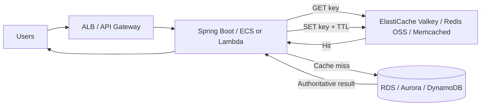

**A cache does not automatically guarantee data correctness.** If a product price changes while the cache still holds the old price, customers may see an incorrect amount; if inventory is kept in the cache without checking the database during order placement, overselling can occur. You must define the **source of truth**, freshness/SLO targets, and invalidation policies before enabling caching.

Within `CLOUD_PROVIDERS_AWS`, this lesson connects to **Regions/AZs, IAM, VPC, ECS/Lambda, RDS/Aurora, DynamoDB, CloudWatch, recovery mechanisms, security, and FinOps**.

**After this lesson, learners can:**

1. Compare **Valkey, Redis OSS, and Memcached** across data structures, scaling, durability, availability, and features.
2. Choose **ElastiCache Serverless or node-based** based on traffic variability, topology, parameter tunability, and cost estimation.
3. Distinguish Redis/Valkey **cluster mode enabled/disabled**, shards/slots, primary/read replicas, and Memcached consistent hashing.
4. Design **cache-aside, read-through, write-through, and write-behind**, along with TTL, eviction, jitter, negative caching, and cache stampede protection.
5. Build a Spring Boot Java service using Lettuce or AWS GLIDE/Redis-compatible clients, protecting key names, serialization, and circuit breakers.
6. Configure VPC security groups, TLS, RBAC/ACL, and **IAM authentication** accounting for version requirements and 15-minute tokens.
7. Understand HA/Multi-AZ, cache backups, cold-start/warm-up, DR, consistency, and handling cache outages.
8. Measure hit rate, latency, memory/ECPU, evictions, hot keys, and cost; and complete the design exercises.

## 2. What ElastiCache Is—and What It Is Not

### 2.1. A Managed Cache Service, Not a Default Database Replacement

For typical applications, ElastiCache holds a **time-bounded copy of data**, while RDS/Aurora/DynamoDB serve as the **source of truth with durability and transaction semantics**. AWS operates the cache infrastructure: provisioning, node replacements, configuration-based patching, monitoring, backups, and scaling options. The application team remains responsible for:

- Choosing **keys, values, data models, and TTLs**.
- Organizing networking and access controls.
- Defining **hit/miss**, consistency, and update policies.
- Ensuring the service degrades gracefully when the cache is unavailable.
- Sizing capacity, hot keys, connection pools, and business SLAs.

A cache miss should be treated as a **normal state**, not a critical error. Cart/session data can be designed for policy-based reconstruction; **payments and authoritative inventory/order states** require a reliable data store and business-level authorization.

**Modern exception:** AWS added **durability** options for supported **node-based Valkey 9.0+ cluster mode enabled** configurations, featuring a Multi-AZ transactional log and configurable synchronous/asynchronous writes. This expands use cases beyond pure caching, but **does not mean every ElastiCache deployment is durable** or suitable as a primary database; evaluate the engine, topology, write mode, eviction policy, transaction/consistency semantics, and backup requirements. See [ElastiCache durability options](https://docs.aws.amazon.com/AmazonElastiCache/latest/dg/Durability.Options.html).

### 2.2. Data Path in AWS

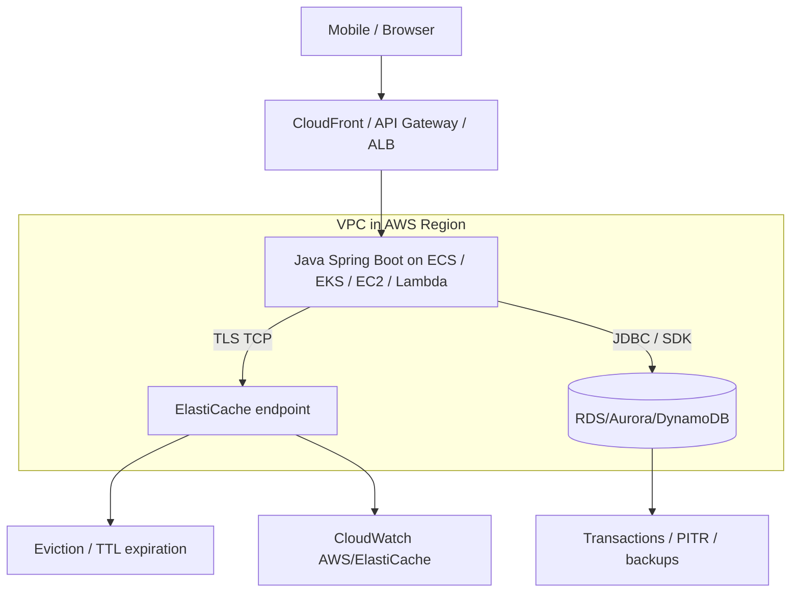

ElastiCache is **not an HTTP CDN cache**. **Amazon CloudFront** caches HTTP responses/objects near the edge; ElastiCache stores key-value data used by the backend. Both layers can work together: CloudFront reduces requests reaching the origin, while ElastiCache reduces requests from the backend to the database. They use **different** TTL/invalidation strategies.

### 2.3. Comparison with Related Options

| Technology | When is it a good fit? | Key constraints |
| --- | --- | --- |
| **Amazon ElastiCache** | Shared cache across multiple instances/services, ultra-fast key-value; Valkey/Redis OSS/Memcached. | Requires TTL/eviction/HA/security; not authoritative storage by default. |
| **In-process Java cache (Caffeine)** | Small, ultra-fast data avoiding any network hop. | Each ECS task/JVM has its own cache; distributed invalidation is hard; lost on restart. |
| **CloudFront** | HTTP/HTTPS edge caching: images, static assets, policy-driven API responses. | Must protect private responses, cache keys, and CDN invalidation. |
| **DynamoDB DAX** | Accelerates DynamoDB reads with write-through/read-through behavior integrated via compatible APIs under supported conditions. | Does not replace ElastiCache for generic keys, Redis commands, or multi-source data. |
| **Amazon MemoryDB** | In-memory database engineered with durability for primary data per supported features. | Different trade-offs in latency, cost, and transactions/DR; not identical by default to Valkey 9 durable mode. |
| **RDS/Aurora read replica** | Scales SQL queries needing joins/constraints and replication-based freshness. | Still a database; lacks automatic cache TTL/eviction. |
| **SQS/Kinesis** | Durable event buffering/streaming and async processing. | Not suited for ultra-fast arbitrary-key cache GETs. |

**Principle:** Choose **the tool based on data semantics**, not latency alone. "Wanting it faster" is not enough reason to replace a database with a cache.

## 3. Three Cache Engines: Valkey, Redis OSS, and Memcached

### 3.1. Valkey — First Option to Evaluate for New Designs

**Valkey** is an open-source engine under the Linux Foundation, maintaining compatibility with common Redis OSS APIs/data structures from the Redis OSS 7.2 fork. ElastiCache supports Valkey via both Serverless and node-based options; newer Valkey releases expand memory efficiency, search, data structures, and version-dependent durability options.

Choose Valkey when the application needs:

- **Strings, hashes, lists, sets, sorted sets, counters**, expiry, and atomic operations.
- Cache-aside or Redis-compatible Java libraries.
- Pub/Sub, leaderboards, ephemeral coordination, or rate-limit structures following security review.
- Replication/Multi-AZ, shard scaling, and backup/restore.
- Cost efficiency, an open-source ecosystem, and a modern engine roadmap.
- Newer version capabilities (such as vector/full-text search or durability in Valkey 9+) **after verifying Region/version/deployment compatibility**.

**Compatibility note:** "Valkey is Redis OSS compatible" **does not mean every Redis module, Lua script, client command, and snapshot is 100% identical**. Test commands, ACLs, cluster behavior, encoding, and version specifics before migrating.

### 3.2. Redis OSS — Practical for Existing Systems

**Redis OSS** is the open-source Redis engine already integrated into many applications. ElastiCache maintains supported Redis OSS versions and upgrade paths to migrate certain clusters to Valkey. Choose Redis OSS when:

- An existing system runs smoothly and has client/feature dependencies not yet validated on Valkey.
- A specific compliance/compatibility policy or roadmap mandates this engine.
- You plan a phased migration rather than upgrading production all at once.

Do not pick Redis OSS just because an older Java tutorial uses the name `RedisTemplate`: Redis-protocol libraries in Spring also work with **Valkey** where compatible. For new projects, compare current Valkey offerings on features, pricing, support, and support lifecycle.

### 3.3. Memcached — Simple, Multi-Threaded, Pure Object Caching

**Memcached** offers a simple key-value model supporting `get/set/add/delete/incr/decr` operations and client-side sharding for node-based clusters. It is often a good fit when:

- The workload only stores and reads **opaque objects** with TTL, without sets/sorted sets/scripts.
- You want a simple **multi-threaded** engine that scales out by adding nodes.
- Losing cache data on node failure is acceptable and data can be rebuilt from the database.
- You use consistent hashing/client discovery and do not need Redis data structures.

**Node-based Memcached** lacks **native replication, Valkey/Redis OSS-style automatic failover, and node-based snapshot backups**. Backups **are available** for **Memcached Serverless** on AWS today; do not claim broadly that "Memcached cannot be backed up" without distinguishing deployment types. See [Snapshot and restore](https://docs.aws.amazon.com/AmazonElastiCache/latest/dg/backups.html).

### 3.4. Engine Decision Table by Feature

| Criterion | Valkey | Redis OSS | Memcached |
| --- | --- | --- | --- |
| In-memory key-value | Yes | Yes | Yes |
| Strings and object caching | Yes | Yes | Yes |
| Hashes, lists, sets, sorted sets | Yes | Yes | **Not the same data structure suite** |
| Atomic increments/TTL | Yes | Yes | Yes, with a different command set |
| Pub/Sub, Lua/functions, advanced commands | Yes, by version | Yes, by version | Not per Redis semantics |
| Multi-threaded engine | Processes commands mostly under the Redis-compatible model; enhanced I/O threading in supported versions | Traditionally single-threaded command execution | **Yes**, multi-threaded command processing |
| Node-based replication & automatic failover | **Yes**, Multi-AZ/replicas configurable | **Yes**, Multi-AZ/replicas configurable | **No**, not in that model |
| Node-based backup/snapshot | **Yes** | **Yes** | **No** |
| Serverless snapshot/backup | **Yes** | **Yes** | **Yes** |
| Cluster-aware sharding | Serverless is always cluster mode; node-based depends on mode | Similar | Client-side sharding in node-based |
| IAM auth/RBAC | Yes by version/config, typically via ACL users | Yes by version/config | Memcached auth model differs; **no default Redis ACLs** |
| Optional node-based durability beyond standard cache | **Valkey 9.0+ cluster mode enabled per deployment/options** | Not uniformly supported by default | No |

This is an **architectural decision matrix**, not an exhaustive list of every feature in every AWS Region. For instance, vector/hybrid search in Valkey 9.x does not imply Memcached or Redis OSS shares those commands; verify [Engine selection](https://docs.aws.amazon.com/AmazonElastiCache/latest/dg/SelectEngine.html) and [Engine versions](https://docs.aws.amazon.com/AmazonElastiCache/latest/dg/engine-versions.html).

### 3.5. Quick Selection Scenarios

| Workload | Candidate choice | Rationale |
| --- | --- | --- |
| Product catalog cache for Spring Boot across many ECS tasks | **Valkey** Serverless/node-based | Shared cache, TTL, rich data types, HA. |
| Caching serialized JSON responses only, rebuildable, many CPU cores | **Memcached** | Simple model, multi-threaded, scale-out. |
| Leaderboard using `ZADD/ZRANGE` and sorted sets | **Valkey/Redis OSS** | Memcached has no Redis sorted sets. |
| Existing Redis-compatible app needing to avoid migration downtime | **Redis OSS temporarily or tested Valkey migration** | Preserves compatibility with a controlled change path. |
| Session store needing protection against node failure | **Valkey/Redis OSS HA with TTL and session strategy** | Replication/backups help, though zero loss is not guaranteed in all modes. |
| Wallet balance / authoritative payment ledger | **RDS/Aurora/DynamoDB or evaluated durable solution** | Never rely on evictable cache to hold money. |
| AI embeddings/vector search on newer Valkey | **Valkey per supported version** | Evaluate index memory, latency/cost, and compare with OpenSearch/vector DBs. |

## 4. Choosing Deployment Type: Serverless or Node-Based?

### 4.1. Serverless: AWS Automatically Distributes and Scales Cache Resources

**ElastiCache Serverless** manages capacity scaling for you: no need to pick node types, shard/replica counts, or manual AZ placement like node-based clusters. It fits when traffic is **unpredictably spiky**, when prototyping quickly, or when minimizing operational toil. For Valkey/Redis OSS Serverless:

- Clusters run with **cluster mode enabled**; clients must support cluster-aware routing to track hash slots and redirects.
- ElastiCache distributes data/compute across multiple AZs per the service model and scales capacity automatically within limits/quotas.
- **TLS and encryption at rest** are enabled by default per the Serverless model.
- You can set **cache usage limits** on data storage and request processing within service bounds, but you must monitor throttling.
- Metrics like `BytesUsedForCache`, `CacheHitRate`, and `ElastiCacheProcessingUnits` help estimate costs.
- Valkey/Redis OSS support automatic/manual snapshots; **Memcached Serverless** also supports snapshots per current AWS docs.
- Parameters/features differ from node-based clusters and do not expose every tuning knob.

**New feature to check:** AWS supports a **public endpoint** for **ElastiCache Serverless for Valkey 9.0+** in supported Regions/configurations. Public endpoints require **IAM authentication and TLS 1.3**, and do not use VPC security groups on the public endpoint itself. **Do not infer from this feature that all ElastiCache caches are public** or should be exposed to the Internet. Internal production workloads should still mostly use **VPC-private endpoints** with least-privilege SGs; public endpoints only apply after a specific security/network review. See [Connect to a cache with a public endpoint](https://docs.aws.amazon.com/AmazonElastiCache/latest/dg/connecting-public-endpoint.html).

### 4.2. Node-Based: Direct Control Over Topology and Capacity

**Node-based** lets you explicitly manage:

- Engine/version, node type (memory/CPU/network), and node count.
- For Valkey/Redis OSS: cluster mode, **number of shards**, replicas per shard, Multi-AZ, and automatic failover.
- Memcached: node count, node discovery/client-side consistent hashing, and cache subnet group.
- Engine **parameter groups**, backup windows, maintenance windows, encryption/authentication, and reserved memory per cache type.
- Certain cluster types and engine versions support **data tiering** (RAM + local SSD) or **Valkey 9.0+ cluster mode enabled durability** where supported.

Node-based fits when **traffic is relatively steady**, capacity forecasts exist, and you want control over CPU/memory, network placement, tuning/maintenance, or node-hour pricing and Savings Plans/Reserved Nodes (where eligible).

### 4.3. Operational Comparison

| Criterion | Serverless | Node-based |
| --- | --- | --- |
| Provisioning | Specify cache, engine, usage limits, VPC/subnets/user group. | Specify node type, topology, shards/replicas, AZ placement. |
| Capacity scaling | AWS scales automatically within service limits. | Team actively resizes, reshards, or configures supported autoscaling. |
| Valkey/Redis OSS cluster mode | **Enabled**; requires cluster-aware client. | Enabled or disabled by design. |
| Multi-AZ | Service-managed under the serverless model. | Must configure replicas/Multi-AZ for equivalent HA. |
| Fine-tuning parameters | Limited set; many settings AWS-managed. | Broad customizable settings via engine parameter groups. |
| Metrics | Cache-level and ECPU; `clusterId` dimension for serverless. | Per-node/per-shard, host metrics, and engine metrics. |
| Cost | Based on data storage and **ECPUs**/consumption per pricing table. | Based on node-hours, node types, data transfer/backups/tiering. |
| Best-fit workloads | Highly variable, lacking baselines, fast deployment. | Steady, predictable, optimizing specific latency/capacity. |
| Backups | Valkey/Redis OSS; **Memcached Serverless** supports backups. | Valkey/Redis OSS; **node-based Memcached has no snapshots**. |
| Internet connectivity | Public endpoint available **in supported Valkey Serverless 9+ types**; default VPC use cases require configuration. | Typically VPC-private. |

**Do not assume Serverless is always cheaper.** Serverless can be cost-effective for spiky traffic, whereas large stored datasets and high steady request volumes should be compared against node-based pricing. Calculate using **actual command patterns and ECPUs**, not just GET/s.

### 4.4. Decision Checklist

Answer before provisioning:

1. Does the workload need Redis data structures/atomic commands? If yes, favor **Valkey/Redis OSS** over Memcached.
2. Can the entire cache be lost and rebuilt? If not, evaluate **durability mode** or a primary data store—do not assume a plain cache suffices.
3. How much does peak traffic differ from average? Is auto scaling required?
4. Does the client support cluster mode, `MOVED`/`ASK` redirects, and resharding?
5. Do you need customer-managed parameter groups, Lua/modules, data tiering, search, snapshots, or Multi-AZ control?
6. What are the private network, IAM authentication, RBAC/ACL, and KMS requirements?
7. What are the estimated total bytes, object cardinality, command rates, hot keys, and ECPUs?
8. Are there strict RTO/RPO targets and AZ-failure protection requirements?

## 5. Redis/Valkey Architecture: Cluster Mode, Shards, and Replicas

### 5.1. Cluster Mode Disabled

In **node-based Valkey/Redis OSS cluster mode disabled**, the classic topology has **one primary** and optionally **read replicas**:

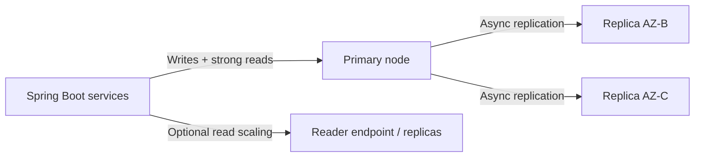

Key points:

- One primary manages the entire keyspace; write scale-out via shards is unavailable in disabled mode.
- Read replicas offload reads, but **replication is asynchronous** in standard caching mode, so replicas can return stale data.
- When the primary fails and **Multi-AZ automatic failover** is enabled, ElastiCache can promote a replica to primary. Apps must reconnect/refresh DNS and retry appropriately.
- A truly single-node cluster with no replicas has **no replica failover**.

**Do not equate "having 2 nodes" with Multi-AZ enabled.** Verify that a replica resides in a different AZ and that `AutomaticFailover`/`MultiAZ` are properly configured.

### 5.2. Cluster Mode Enabled: Sharding Across 16,384 Hash Slots

In Redis/Valkey Cluster, the keyspace is divided into **16,384 hash slots**. Shards own slot ranges, with each shard having a primary and optional replicas. Keys typically map via CRC16 modulo 16,384, and **hash tags** inside `{...}` co-locate keys into the same slot when multi-key atomic operations are needed.

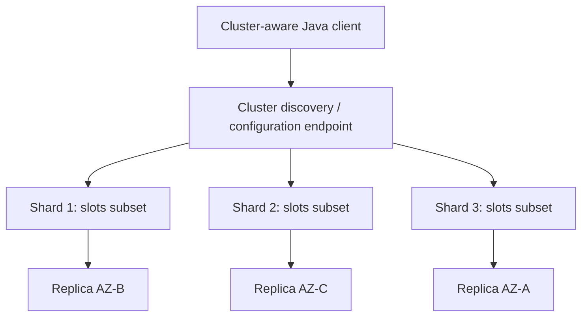

Implications for Java:

- Use a **cluster-aware Redis client** (Lettuce cluster/GLIDE/JedisCluster), not a single-node connection to one shard.
- The client must understand cluster topology and handle **MOVED/ASK redirects**, resharding, and node replacements.
- Many **multi-key** commands or Lua operations are allowed only when keys share the **same hash slot**; otherwise they fail with `CROSSSLOT`.
- Do not put all keys under one hash tag `{all}`, as that creates a **hot shard** and defeats sharding.
- Serverless Valkey/Redis OSS runs in cluster mode enabled with AWS-managed topology and endpoints; applications must still support cluster semantics.

Example keys per order:

```text
order:{ord-123}:summary
order:{ord-123}:status
order:{ord-123}:items
```

All three keys share `{ord-123}` and therefore land in the same hash slot for co-located operations. Do not apply a single hash tag across all customers as a "universal fix"; base it on actual access patterns.

### 5.3. Node-Based Memcached: Client-Side Sharding

Node-based Memcached lacks Redis Cluster keyslot/replication semantics. Clients choose a node using **consistent hashing** over the key and the endpoint list. When adding/removing nodes:

- A subset of keys remaps → **cache misses increase**/cold cache.
- A failed node loses its keys; **there is no native replica holding a copy**.
- Clients need **node discovery** or config refresh; consistent hashing reduces remapped keys compared to simple modulo hashing.
- Apps must tolerate **partial misses** and rebuild from the source of truth.

Memcached Serverless abstracts topology/scaling, but that does not imply node-based Memcached gains replication simply by changing endpoints.

### 5.4. Read/Write Consistency in Cache

| Architecture | Typical consistency level | Risks |
| --- | --- | --- |
| Primary read/write | Reads reflect prior writes on the primary per command ordering and connection semantics. | Certain workflows can still race with the DB/source of truth. |
| Replica read | **Eventual consistency** due to async replication in caching mode. | Read-after-write may observe an older version. |
| Serverless read-optimized endpoint/port `6380` | **Eventually consistent reads** if the client uses `READONLY`/replica reads. | Do not use for balances/stock requiring immediate fresh reads. |
| Application local near-cache | Each instance maintains its own TTL/updates. | Cross-instance stale data without distributed invalidation. |
| Data-store query | SQL/DynamoDB per consistency and transaction options. | Higher latency/cost, but stronger semantics. |

**End-to-end consistency depends on both cache and database logic.** A Redis primary returning the latest value in cache **does not mean that value matches the latest authoritative data** if invalidation failed.

### 5.5. HA and Limits Not to Forget

For node-based Valkey/Redis OSS, AWS recommends **Multi-AZ with at least one replica in another AZ** for automatic failover. This improves availability, **not default exactly-once durability**: async replication can lose the most recent writes during failover. If zero data loss is mandatory, evaluate Valkey 9+ durability mode, an authoritative durable store, or another pattern.

Applications still require **retries with jitter, short timeouts, connection pool limits, circuit breakers**, and controlled DB load shedding during cache failures. Multi-AZ will not save an app if the client pins stale IPs, fails to refresh DNS, or connects only to a single node.

## 6. Cache Patterns: Choosing Reads/Writes Matching Business Data

### 6.1. Cache-Aside (Lazy Loading) — Easiest Default to Implement

With **cache-aside**, the application checks the cache first, reads from the DB on a miss, and populates the cache:

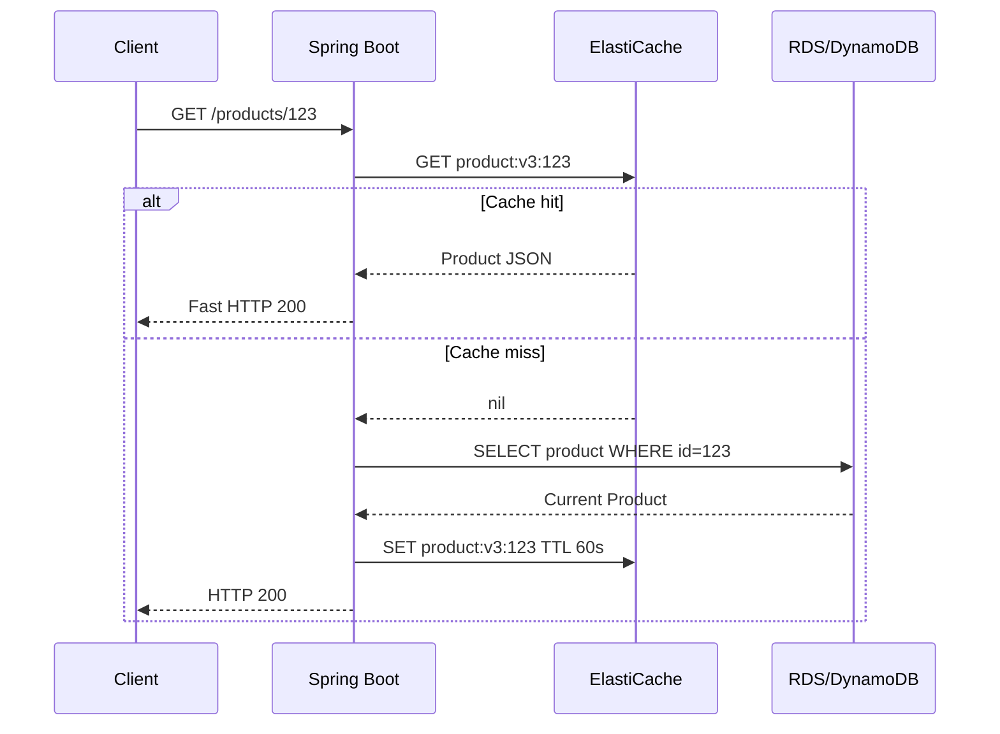

Pros:

- Only caches keys actually requested; avoids filling memory with unused data.
- Cache outages can **fall back to the DB** if logic and capacity allow.
- Fits product catalogs, rarely changing configs, and properly authorized public profiles.

Cons:

- First-time cache misses incur DB latency; deployments/failovers cause a **cold cache**.
- **Cache stampede** when many requests miss a hot key simultaneously.
- If DB prices change without invalidating the key, users read stale values until TTL expires.

**Java pseudo-code sample:**

```java
public Product getProduct(String id) {
    Product cached = cache.get("product:v3:" + id);
    if (cached != null) {
        return cached;
    }
    Product fromDb = repository.findById(id).orElseThrow();
    cache.put("product:v3:" + id, fromDb, Duration.ofSeconds(60));
    return fromDb;
}
```

`cache`/`repository` are hypothetical interfaces; production code must handle timeouts, negative caching for not-found, and concurrent writers rather than copying this snippet verbatim.

### 6.2. Read-Through

**Read-through** delegates miss loading to a cache/provider abstraction so application calls look like automatic cache reads. With ElastiCache Valkey/Redis, **AWS does not automatically connect to RDS/DynamoDB to load a record** on a `GET` miss: you must implement a loader/application middleware or use a library with read-through support.

| Cache-aside | Read-through |
| --- | --- |
| Application checks for misses and queries the DB. | Loader/cache abstraction handles fallback and population. |
| Easy to control inside a Spring service. | Reusable, though requires understanding loader exceptions and concurrency. |
| Easy to log user/business context explicitly. | Must ensure it does not bypass authorization or tenant isolation. |

Do not confuse read-through in a Java library with **ElastiCache natively connecting to a database**—there is no mechanism where "creating a cache causes AWS to auto-load rows from RDS."

### 6.3. Write-Through

**Write-through** synchronously updates the cache when the application writes to the source:

```text
PUT /products/123
    ├─ Commit DB update
    └─ Update/delete cache entry immediately after commit
```

One catch: **DB transactions and cache writes do not share an ACID transaction**. If the DB update succeeds and the cache update fails, stale data remains. For many systems, **invalidating the key** after DB commit is safer than writing a new cache value that could race.

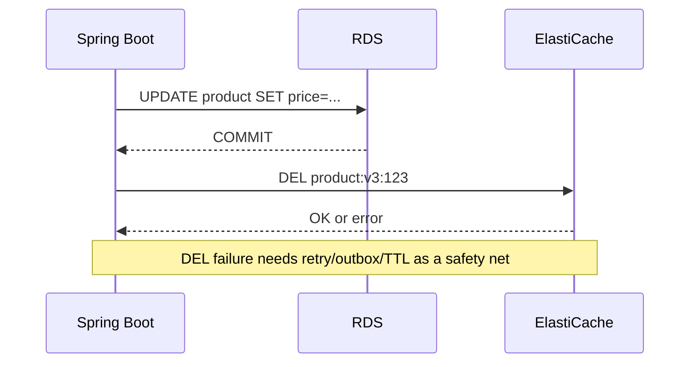

**Do not invalidate before DB COMMIT** assuming it is safe: between key deletion and transaction commit, another request can read the **old price** from the DB and repopulate the cache, leaving it stale post-commit. Invalidate after commit, consider versioning/CAS or event-driven invalidation for racy paths, and use TTL as a bounded upper limit on staleness (not a guarantee if loaders misbehave).

### 6.4. Write-Behind / Write-Back

**Write-behind** updates the cache first and writes asynchronously to the database later:

```text
Client -> Cache accepts new value -> Queue/worker -> Database eventually updates
```

While this reduces synchronous latency in some cases, risks increase:

- Cache crashes/restarts can drop unflushed writes without sufficient durability.
- Direct DB readers can observe stale values.
- Requires retries/DLQs/idempotency, ordering, backpressure, RPO tracking, and auditing.
- Can cause **lost orders or lost payments** if used as an authoritative write path without a reviewed durability design.

**Recommendation:** For orders, money, and inventory, write to the authoritative database first and use caching for read optimization; if async processing is required, use **SQS/Kinesis/EventBridge + durable DB outbox** rather than a pure write-behind cache.

### 6.5. Write-Around

**Write-around** writes directly to the DB without populating the cache; subsequent reads miss and load on demand. This works well when newly written data **may never be read**, avoiding cache pollution. Trade-offs include cold reads after writes and stale cached values if existing keys are not invalidated.

### 6.6. What Should You Cache?

| Data | Reference strategy | Caveats |
| --- | --- | --- |
| Catalog, infrequently changing products | Cache-aside, ~30–300s TTL, event invalidation on updates. | Prices/promotions can change quickly; never trust cache for final checkout price. |
| Low-sensitivity user profiles | Cache-aside, short TTL, tenant-aware keys. | Protect PII/authorization; invalidate on profile changes. |
| API reference metadata / feature flags | Cache-aside with versioned keys or push invalidation. | Rollouts require tenant/config consistency. |
| Session data | Valkey/Redis-compatible TTL, HA/backups per RTO. | Cookie/token/session security, logout invalidation, failover. |
| Rate limiting | Atomic counters/sorted sets with TTL and Lua/commands per engine. | Distributed behavior, clocks, hot keys, bypass on cache failure; security-sensitive policy. |
| Top-K leaderboards | Valkey/Redis sorted sets. | Snapshot/rebuild, ranking updates, memory cardinality. |
| Inventory/payment ledgers | **Database as source of truth**; cache for read assistance only. | Transactions/conditional updates, replay safety; never decrement stock only in cache. |
| Public CDN images | **CloudFront/S3**; do not stuff large binaries into Valkey as a CDN. | Object size, transfer costs, and edge caching. |

**Decision exercise:** If a key could be deleted and the application cannot rebuild it—and there is no evaluated durability layer—it is **no longer just a cache**; design business-level recovery.

## 7. TTL, Eviction, Invalidation, and Cache Stampede

### 7.1. TTL Is a Time Limit, Not Synchronization with Truth

**TTL (Time To Live)** defines how long a key exists before expiry, e.g.:

```text
SET product:v3:123 {"name":"Coffee","price":59000} EX 60
TTL product:v3:123
GET product:v3:123
```

A cache key with a 60s TTL can be removed **earlier** due to eviction, memory pressure, or explicit invalidation; TTL does not guarantee survival for 60s. If the DB changes at second 1, the cached value stays stale for nearly 59s. TTL also **does not synchronize clocks or state across local caches and async loaders**.

Choose TTL based on the data's **staleness budget**, rather than setting every key to 24 hours solely to inflate hit rates.

### 7.2. Common Valkey/Redis OSS Eviction Policies

| Policy | Which keys can be evicted under memory pressure? | Best-fit scenario |
| --- | --- | --- |
| `allkeys-lru` | Keys across the entire keyspace, approximated LRU. | General-purpose cache, especially when some keys lack TTL. |
| `allkeys-lfu` | Least frequently accessed keys via LFU approximation. | Stable hot set with repetitive workloads. |
| `volatile-lru` | **Only keys with a TTL set**, approximated LRU. | All cacheable keys have TTLs; non-TTL keys are preserved. |
| `volatile-ttl` | Among keys with TTLs, prefers shorter remaining lifetimes. | Workloads wanting expiring keys dropped first. |
| `noeviction` | **No eviction**; writes can return OOM when limits are hit. | Workloads with state that must not be silently evicted, after reviewing durability/capacity. |
| `allkeys-random` | Randomly selected keys. | Specialized cases; not superior to LRU/LFU by default. |

**The default may be `volatile-lru`**, meaning **keys without a TTL are never evicted**; if too many non-TTL keys accumulate, writes fail with OOM. For general caching, AWS recommends considering `allkeys-lru` in a custom parameter group depending on workload. However, do not apply node-based parameter groups to Serverless where the service manages those parameters. Reference [Engine specific parameters](https://docs.aws.amazon.com/AmazonElastiCache/latest/dg/ParameterGroups.Engine.html).

### 7.3. TTL Jitter to Prevent Simultaneous Stampedes

If 10,000 keys are written at 09:00 with an exact 3600s TTL, they expire **together at 10:00**, causing a burst of DB load. **Jitter** randomizes TTLs:

```java
import java.time.Duration;
import java.util.concurrent.ThreadLocalRandom;

Duration ttlWithJitter(Duration base) {
    long seconds = base.getSeconds();
    long jitter = ThreadLocalRandom.current().nextLong(0, Math.max(1, seconds / 10));
    return Duration.ofSeconds(seconds + jitter);
}
```

This adds **0–10%** random jitter per key; pick a range matching stale tolerance. Never exceed your staleness SLO with jitter. For security-sensitive expirations (OTPs/sessions), TTL policies must follow strict security requirements rather than arbitrary extensions.

### 7.4. Cache Stampede / Thundering Herd

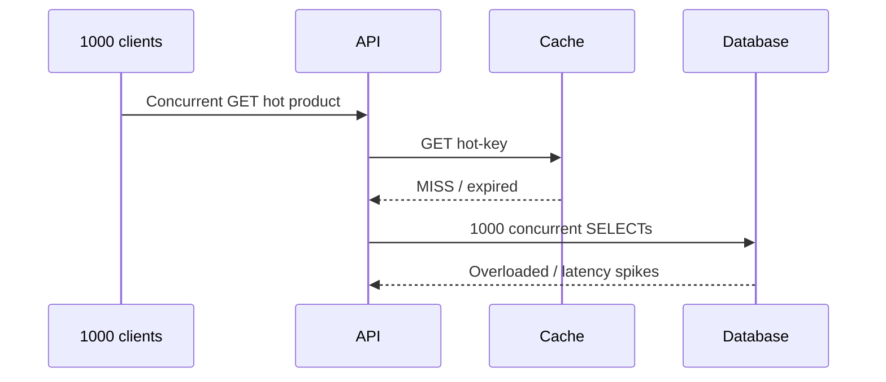

Mitigations:

1. **In-process single-flight**: concurrent requests for the same key share a single inflight future/load.
2. **Distributed lock/`SET NX EX`** or lease so only one worker refreshes the key, using a lock TTL and owner token.
3. **Stale-while-revalidate**: serve slightly stale data per contract while refreshing asynchronously in the background.
4. **Proactive refresh** for hot keys prior to expiry.
5. **TTL jitter**, rate limiting, and **bulkhead/concurrency caps** on database calls.
6. **Negative caching** for frequent not-found lookups, with short TTLs to avoid masking newly created records.

**A Redis distributed lock is not an unconditionally safe transaction lock**: leases can expire while a worker pauses, and clock/network partitions cause races. For side-effecting actions like deducting funds or stock, rely on database conditional updates/fencing tokens and proper transaction design rather than a cache lock alone.

### 7.5. Negative Caching: Remembering Missing Results

An endpoint querying nonexistent product IDs can be scanned tens of thousands of times, costing DB lookups each time. You can cache a **NOT_FOUND sentinel** for 5–15s:

```text
GET product:v3:999999 -> cache miss
DB SELECT -> no rows
SET product:v3:999999 {"_state":"NOT_FOUND"} EX 10
```

However:

- Distinguish **not found** from DB timeouts or permission denied; **never cache technical errors as not-found**.
- Keep TTL short so users creating a record do not see 404 for too long.
- Guard against enumeration: never leak another tenant's existence through cache timing.
- Version the sentinel format so it cannot be confused with real product JSON.

### 7.6. Key Naming, Namespaces, and Schema Versioning

Example key format:

```text
shop:prod:product:v3:123
shop:prod:category:v2:8
shop:prod:session:v1:<opaque-session-id>
shop:prod:tenant:<tenant-id>:settings:v4
```

**Never embed passwords, bearer tokens, or plaintext emails/phone numbers in key names**, as logs/metrics can expose key names. Use opaque IDs or hashes when needed, avoiding easily guessable hashes of emails for sensitive data. Putting a version in the key enables gradual **schema/key migrations**; old keys age out naturally via TTL instead of running `KEYS *` to delete millions of keys.

### 7.7. Avoid Dangerous Commands in Production

Valkey/Redis commands like `KEYS *`, `FLUSHALL`, `FLUSHDB`, or `MONITOR` can block the CPU, wipe all data, or leak sensitive payloads. Node-based/Serverless may restrict some commands, but **do not rely on service restrictions as your sole defense**. For key inspection, use bounded/throttled `SCAN` as needed, restrict admin commands via ACLs, and limit to maintenance windows; **`SCAN` still consumes resources** on large keyspaces.

## 8. Capacity Planning: Memory, Network, CPU, Hot Keys, and Cost per Request

### 8.1. Do Not Size Based on Raw JSON Size Alone

A key-value cache consumes more memory than raw payload sizes due to **key metadata, expiration dictionaries, allocator fragmentation, replication buffers, output buffers, and internal data structures**. Hypothetical example:

```text
Hot products to cache                        5,000,000 keys
Average JSON payload                         600 bytes/key
Assumed key + metadata/allocator overhead    250 bytes/key
Average total                                850 bytes/key
Raw data                                     ~4.25 GB (decimal)
Example 40% headroom                         ~5.95 GB (before buffers/replicas)
```

These numbers are **illustrative**, not a universal sizing formula across versions/node types. Hashes, sorted sets, large JSON strings, and search indexes carry different overheads. Node-based setups must also account for:

- Headroom for write bursts, rehashing, failover, and buffer memory.
- HA replicas (each replica holds the shard's dataset).
- Shard distribution/hot-key skew and memory fragmentation.
- Reserved memory for snapshots/forks/backups per engine.
- If using data tiering, RAM vs. local SSD hit ratios and I/O penalties.

**Load test** with representative data and commands, tracking `BytesUsedForCache`, `DatabaseMemoryUsagePercentage`/fragmentation, evictions, and throughput. Never deploy a single node and "hope it auto-scales" if it is a node-based cluster without scaling configured.

### 8.2. Why a High Cache Hit Rate Is Not Enough

A **95% hit rate** sounds great, yet if the 5% misses are the heaviest queries or hit a peak of 1,000 req/s, the DB can still collapse. Over an hour with 100 million requests:

```text
Requests:               100,000,000
Cache hit rate:           95%
Database miss requests:   5,000,000
```

Actual DB queries also depend on batching, deduplication, single-flight, and negative caching. Measure:

- **Application-level p50/p95/p99 latency** for both cache hits and misses.
- Cache miss rate per **endpoint/business key**, not just overall averages.
- DB QPS/CPU/IOPS/active connections before and after caching.
- Cache CPU/engine CPU, network bytes, command latency, and shard distribution.
- Cost per successful business request, not merely the cache cluster bill.

### 8.3. Hot Keys and Hot Shards

A viral product receiving 50% of requests creates a hot key, overloading a single shard even when overall cluster memory has plenty of room. **Adding shards does not automatically help** if all requests target the same hash slot:

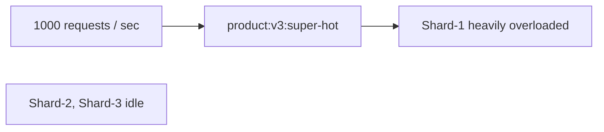

Mitigations:

1. Cache results locally in the JVM with a very short TTL (**near-cache**) if brief staleness is acceptable.
2. Spread reads across read replicas/read-optimized endpoints if consistency permits.
3. Intentionally replicate hot immutable values across multiple keys, carefully designing invalidation and consistency.
4. Use CloudFront for **public HTTP responses** when applicable instead of hitting the backend for every request.
5. Batch/pipeline commands (where supported by client/mode), minimizing expensive commands and oversized payloads.
6. Monitor per-shard CPU and hot-key metrics/sampling where supported by the engine.

Never replicate session/PII keys across tenants or generate unbounded per-request keys to hide hotspots—that breaks memory budgets and security boundaries.

### 8.4. Connection Management

Opening too many TCP/TLS connections per ECS task/Lambda instance can cause:

- Rising `CurrConnections`, memory overhead, and CPU/TLS handshake load.
- Connection timeouts near security group, conntrack, or node limits.
- Latency spikes or exhaustion when deployments cause all instances to reconnect at once.
- Stale DNS/IP usage after failover if clients cache IPs forever.

Java recommendations:

- Reuse **one client bean per application instance** (appropriate Lettuce/GLIDE/Jedis pool).
- Configure connect/read timeouts, max connections, and command queue bounds.
- Verify SSL/TLS certificates; never use `insecureTrustManager` in production.
- Enable cluster topology refresh, redirect retries, and sensible DNS TTLs.
- In AWS Lambda, initialize clients outside the handler when safe to reuse across warm invocations, while handling stale sockets/reconnects and capping concurrency.

### 8.5. Serverless Sizing by ECPU

ElastiCache Serverless bills processing in **ElastiCache Processing Units (ECPUs)**, based on data read/written and command CPU cost. Two workloads at 100,000 requests/s consume very different ECPUs if:

- Workload A mostly runs `GET` on 100-byte keys.
- Workload B runs `ZRANGE` returning large sets, multi-key `MGET`, or complex search queries.
- Workload C writes 50 KiB values with heavy index updates.

Therefore, **do not multiply QPS by a fixed ECPU constant across all commands**; measure `ElastiCacheProcessingUnits`, `BytesUsedForCache`, latency, and throttling on a prototype. AWS enforces per-cache/per-slot limits and adjustable quotas; never assume "serverless is infinite" or that one hot hash slot can consume the entire cache's capacity.

## 9. Security: VPC, TLS, RBAC/ACL, AUTH, and IAM

### 9.1. Access Control Is More Than a Security Group

There are **four layers** of control:

1. **Network:** VPC subnets, SG/NACL, routing, and private/public endpoint types.
2. **Encryption:** TLS in transit, encryption at rest/KMS per deployment.
3. **Authentication:** Valkey/Redis OSS ACL users/passwords or **IAM authentication** (if supported), Memcached auth per deployment.
4. **Authorization:** Restrict users to allowed commands and key patterns; restrict IAM roles to needed management actions.

**IAM permission to manage a cache ≠ IAM permission to log into the data plane.** A role with `elasticache:DescribeServerlessCaches` cannot automatically send `GET/SET` to Valkey. With IAM authentication, you need an IAM-enabled ElastiCache user plus `elasticache:Connect` permission on **both the cache ARN and user ARN**.

### 9.2. Private VPC Networking and Ports

| Cache type | Typical ports | Access path |
| --- | --- | --- |
| Valkey/Redis OSS **node-based** | `6379` default (configurable by engine). | VPC network/private routes, security groups. |
| Valkey/Redis OSS **Serverless VPC** | `6379` primary/read-write and `6380` read-optimized/replica reads. | VPC endpoints/service-managed network, SGs. |
| Memcached **node-based** | `11211`. | VPC, client-side node mapping. |
| Memcached **Serverless VPC** | `11211` and `11212` per service endpoint behavior. | VPC network per configuration. |
| Supported Valkey **Serverless public** | `6379` via **TLS 1.3 + IAM auth**. | Internet endpoint; no VPC SG on the public endpoint itself. |

**Sample network rule:** Cache SG inbound **6379/6380** (for serverless Valkey/Redis) allows only the **ECS task/EC2/Lambda ENI SG**, never `0.0.0.0/0`. Ensure the workload SG allows outbound traffic to the cache port with proper DNS resolution and VPC routing. Never open public access to troubleshoot `ETIMEDOUT` without verifying account/VPC/subnets/ports.

**AWS Lambda in VPC caveat:** Lambda functions must attach to VPC subnets/security groups with routing to the private cache endpoint; non-VPC Lambdas cannot reach private caches. Inside a VPC, reaching AWS APIs (Secrets Manager/KMS) may require VPC endpoints or NAT depending on the setup. Security groups and routes do not replace IAM/data-plane auth.

### 9.3. TLS and Encryption at Rest

- **Serverless** enables TLS and encryption at rest per service defaults; for public Valkey caches, AWS requires **TLS 1.3**.
- Node-based Valkey/Redis OSS supports **in-transit encryption (TLS)** and encryption at rest; verify engine/version/node type settings during cluster creation/updates.
- With customer-managed AWS KMS keys, maintain IAM/key policies protecting snapshots/recovery; disabling a key can break restores/data access.
- Java clients **must validate certificate hostnames/CAs**; never set `trustAll=true`/`sslVerify=false` in production.
- TLS encrypts traffic in transit, but **does not fix** overly permissive ACLs allowing `FLUSHALL` or unauthorized key access.

### 9.4. Role-Based Access Control (RBAC/ACL)

For Valkey/Redis OSS supporting ACLs, define **ElastiCache users** and **user groups** instead of letting every service share an unrestricted `default` user. Conceptual example:

```text
Service orders-read:
  Allowed commands: GET, MGET, PING
  Allowed key prefix: shop:prod:catalog:*

Service orders-write:
  Allowed commands: GET, SET, DEL, EXPIRE, PING
  Allowed key prefix: shop:prod:catalog:*
```

This is a **conceptual policy description**, not literal AWS CLI syntax. Actual Valkey ACL access strings look like `on ~shop:prod:catalog:* +get +mget +ping` or appropriate commands; **do not grant `+@all` to every application user**. Verify the keys/commands required by Spring Cache abstractions, serializers, pub/sub invalidation, and cluster topology discovery.

**Legacy AUTH tokens** work for some **node-based Valkey/Redis OSS** setups, though AWS recommends RBAC; Serverless uses user groups/RBAC rather than the legacy single AUTH token model. For password-based users, store credentials in **AWS Secrets Manager** and rotate via supported workflows—never hard-code them in source, Docker images, or Git.

### 9.5. IAM Authentication: 15-Minute Tokens, 12-Hour Connections

AWS ElastiCache supports IAM auth on **Valkey 7.2+ or Redis OSS 7.0+**, with **TLS required**. Flow:

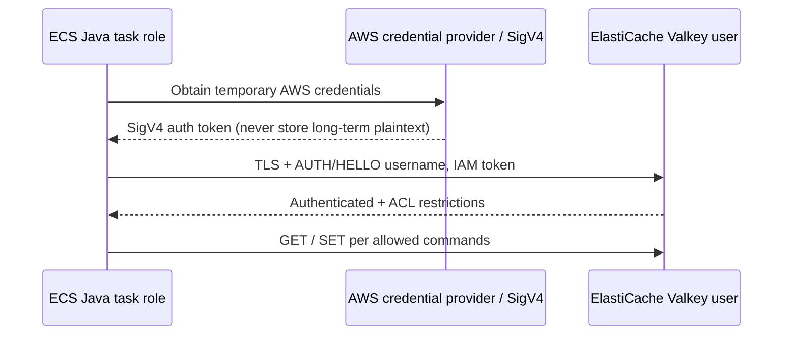

Key rules:

- An IAM-enabled ElastiCache user requires **`user-id == user-name`**.
- The IAM policy must grant `elasticache:Connect` on both the cache ARN and user ARN.
- **IAM tokens are valid for 15 minutes** for authentication; clients must generate a fresh token for **each new connection/re-auth**, never caching one token for the entire session lifetime.
- An IAM-authenticated connection **disconnects after 12 hours** without re-auth; to keep it alive, send `AUTH`/`HELLO` with a fresh token per rules.
- Never run re-authentication inside `MULTI/EXEC` or a Lua script.
- Use a client with an auto-refreshing **credentials provider** (AWS GLIDE 2.2+ has built-in IAM support) or implement [IAM authentication](https://docs.aws.amazon.com/AmazonElastiCache/latest/dg/auth-iam.html) correctly.

**Do not misunderstand:** The 15-minute token limit **does not mean GET commands fail after minute 15 on an already authenticated TCP connection**. It is the validity window for presenting the token during `AUTH`/re-auth, whereas the connection itself has a separate 12-hour limit.

### 9.6. Illustrative IAM Policy

Assuming a cache in account `111122223333`/Region `ap-southeast-1` and ElastiCache IAM user `orders-reader`:

```json
{
  "Version": "2012-10-17",
  "Statement": [
    {
      "Sid": "ConnectToOnlyOrdersCacheAsReader",
      "Effect": "Allow",
      "Action": "elasticache:Connect",
      "Resource": [
        "arn:aws:elasticache:ap-southeast-1:111122223333:serverlesscache:orders-cache",
        "arn:aws:elasticache:ap-southeast-1:111122223333:user:orders-reader"
      ]
    }
  ]
}
```

This is an **identity policy** for an ECS task role or workload IAM role; it does not create the `orders-reader` user itself—you still must create the **ElastiCache IAM user**, attach it to a user group and cache, and define ACL key patterns/commands. For a **node-based replication group**, replace `serverlesscache` with `replicationgroup` in the resource ARN.

Never grant `elasticache:*` on `*` just to let an app connect. Separate management permissions like `CreateServerlessCache`, `DeleteReplicationGroup`, `ModifyUserGroup`/`ModifyUser`, and `Describe*`. Enable CloudTrail auditing and alerts on cache modifications/deletions/ACL changes.

### 9.7. Multi-Tenancy and Secrets

If multiple tenants share a cache, key naming alone does not enforce security isolation. A bug could fetch `tenant:B:settings` while acting for tenant A. Enforce:

- Server-side authorization before constructing any cache key from user input.
- Prefix keys with a tenant ID **derived from a validated identity**, never trusting a raw `tenantId` from the request body.
- For higher-risk workloads, isolate user groups or cache resources per tenant/domain instead of sharing one keyspace.
- Never cache authorization decisions long after permissions change unless revocation/versioning is implemented.
- Apply TLS/KMS encryption, log redaction, PII checks, and compliance retention.
- Restrict admin commands on service accounts and audit `ModifyUser`/`DeleteServerlessCache`.

## 10. AWS CLI: Inventory, Lab Cache Creation, and Endpoint Verification

Commands here use **AWS CLI v2 in Bash/CloudShell**. Account `111122223333` and the IDs/subnets/SGs are **illustrative placeholders**, not to be run verbatim. **Only provision resources in authorized AWS lab accounts**, as ElastiCache can incur hourly/data/ECPU charges even with zero traffic. Never create caches in a default VPC with wide security groups or outside IaC in production.

### 10.1. Read Existing Cache Configuration (Read-Only)

```bash
aws sts get-caller-identity

aws elasticache describe-serverless-caches \
  --region ap-southeast-1 \
  --query 'ServerlessCaches[].{Name:ServerlessCacheName,Engine:Engine,Version:MajorEngineVersion,Status:Status,Endpoint:Endpoint.Address,Port:Endpoint.Port,UserGroup:UserGroupId}' \
  --output table

aws elasticache describe-replication-groups \
  --region ap-southeast-1 \
  --query 'ReplicationGroups[].{ID:ReplicationGroupId,Engine:Engine,Status:Status,ClusterMode:ClusterMode,MultiAZ:MultiAZ,AutomaticFailover:AutomaticFailover,Durability:EffectiveDurability}' \
  --output table

aws elasticache describe-cache-clusters \
  --region ap-southeast-1 \
  --show-cache-node-info \
  --query 'CacheClusters[].{ID:CacheClusterId,Engine:Engine,Status:CacheClusterStatus,NodeType:CacheNodeType,NumNodes:NumCacheNodes}' \
  --output table
```

**Meaning:**

- `describe-serverless-caches` lists serverless caches, endpoints/engines, and policies.
- `describe-replication-groups` lists node-based Valkey/Redis OSS replication groups, Multi-AZ/failover, and durability flags.
- `describe-cache-clusters` lists node-based cache clusters, including Memcached node info; do not rely on a single command to infer every topology.
- To inspect actual security groups, subnet endpoints, TLS, user groups, snapshot retention, or read/primary endpoints, read the full JSON objects rather than only projected fields.

These are **control-plane AWS CLI** calls requiring `elasticache:Describe*` IAM permissions and AWS API reachability; **they do not prove** the Java app has data-plane `GET/SET` access or VPC connectivity.

### 10.2. Create a Serverless Valkey Cache in a Private VPC (Lab)

Assuming two private subnet IDs in the same VPC, a cache SG allowing only the ECS task SG on required ports, and a security-reviewed user group `lab-catalog-readwrite`:

```bash
aws elasticache create-serverless-cache \
  --region ap-southeast-1 \
  --serverless-cache-name lab-catalog-cache \
  --description "Lab shared product catalog cache" \
  --engine valkey \
  --subnet-ids subnet-0123456789abcdef0 subnet-0fedcba9876543210 \
  --security-group-ids sg-0123456789abcdef0 \
  --user-group-id lab-catalog-readwrite \
  --snapshot-retention-limit 1
```

This command creates a **real, billable cache**; the IDs are placeholders. `--snapshot-retention-limit 1` only illustrates a lab snapshot policy and does not replace source DB backups. The user group must already exist with appropriate users/ACLs and credentials or IAM auth.

Afterward, verify status:

```bash
aws elasticache describe-serverless-caches \
  --region ap-southeast-1 \
  --serverless-cache-name lab-catalog-cache \
  --query 'ServerlessCaches[0].{Status:Status,Engine:Engine,Endpoint:Endpoint,ReaderEndpoint:ReaderEndpoint,Subnets:SubnetIds,SG:SecurityGroupIds,UserGroup:UserGroupId}' \
  --output json
```

Wait for `Status=available` before connecting. The endpoint is an AWS-assigned DNS name, not derived from the cache name; serverless clients must handle **cluster mode**. To test `GET/SET` commands, run from an **authorized EC2/ECS/Lambda inside the VPC**, never by opening the cache to the public Internet.

### 10.3. Create a Node-Based Valkey Replication Group (Lab)

Example node-based **cluster mode disabled** with one primary and one replica in a different AZ to test HA; verify instance class availability for the engine/Region:

```bash
aws elasticache create-replication-group \
  --region ap-southeast-1 \
  --replication-group-id lab-catalog-rg \
  --replication-group-description "Lab product catalog cache" \
  --engine valkey \
  --cache-node-type cache.m7g.large \
  --num-cache-clusters 2 \
  --automatic-failover-enabled \
  --multi-az-enabled \
  --cache-subnet-group-name lab-cache-private-subnets \
  --security-group-ids sg-0123456789abcdef0 \
  --transit-encryption-enabled \
  --at-rest-encryption-enabled \
  --user-group-ids lab-catalog-readwrite \
  --snapshot-retention-limit 1
```

**Prerequisites:** The cache subnet group exists with valid AZs/subnets; the user group is valid; the Region supports `cache.m7g.large`; VPC SGs and quotas suffice; IAM roles hold create permissions. This is a **lab template**, not sized for production SLOs.

Once ready:

```bash
aws elasticache describe-replication-groups \
  --region ap-southeast-1 \
  --replication-group-id lab-catalog-rg \
  --query 'ReplicationGroups[0].{Status:Status,MultiAZ:MultiAZ,AutomaticFailover:AutomaticFailover,Primary:NodeGroups[0].PrimaryEndpoint,Reader:NodeGroups[0].ReaderEndpoint,SnapshotRetention:SnapshotRetentionLimit}' \
  --output json
```

**Topology note:** Node-based cluster mode enabled exposes a **configuration endpoint** across multiple shards—do not treat `NodeGroups[0].PrimaryEndpoint` as the sole entry point to the entire keyspace. Match client and queries to the topology. A replication group in `creating` or `modifying` state may not accept traffic yet.

### 10.4. Read-Only Engine Versions and Parameter Groups

```bash
aws elasticache describe-cache-engine-versions \
  --region ap-southeast-1 \
  --engine valkey \
  --query 'CacheEngineVersions[].{Version:EngineVersion,ParameterFamily:CacheParameterGroupFamily}' \
  --output table

aws elasticache describe-cache-parameter-groups \
  --region ap-southeast-1 \
  --query 'CacheParameterGroups[].{Name:CacheParameterGroupName,Family:CacheParameterGroupFamily}' \
  --output table
```

Do not hard-code Valkey/Redis OSS versions in IaC from old tutorials if your current Region has different patches/lifecycles. **Never casually edit a parameter group shared across multiple clusters**, as changes can trigger reboots or alter memory/command behavior.

### 10.5. Test Connection over TLS (Only with Authorized Data-Plane Credentials)

For a **password-based Valkey/Redis OSS ACL user**, `valkey-cli` or `redis-cli` can connect to the private endpoint:

```bash
# Run from a lab host inside the VPC; avoid leaking passwords in shell history.
export VALKEYCLI_AUTH='<password-from-allowed-secret-store>'
valkey-cli -c \
  -h lab-catalog-cache.example.serverless.apse1.cache.amazonaws.com \
  -p 6379 --tls --user lab-app-user PING
unset VALKEYCLI_AUTH
```

Host and user above are placeholders; the command fails unless the cache and user exist. In production, **never pass raw passwords as command literals**; use secure credential retrieval and guard against shell history/process exposure. For IAM auth, **do not** use a static string as a long-lived IAM token: generate a fresh SigV4 token or use an auto-refreshing credentials provider.

For serverless Memcached, use a Memcached client supporting AWS encryption/topology per documentation; **do not point `valkey-cli`/`redis-cli` at Memcached**. For node-based Memcached, verify `configuration endpoint`/node discovery and version compatibility.

### 10.6. Lab Cleanup and Preventing Data Loss

When authorized:

1. Confirm no ECS/Lambda app traffic still hits the lab cache.
2. If data cannot be rebuilt, create a snapshot first per retention/approval rules and wait until `available`.
3. Delete **only the exact lab** serverless cache/replication group, never production identifiers.
4. Do not delete shared user groups, subnets, SGs, or KMS keys.
5. Check remaining automatic/manual snapshots consuming storage/costs and clean up per policy.

**Never run delete commands blindly from this guide.** Any cache eviction/flush/delete can disrupt sessions, logins, and traffic even if every database record remains intact.

## 11. Java Spring Boot: Cache-Aside with Lettuce and Valkey/Redis OSS

### 11.1. Libraries and Configuration

Spring Data Redis (commonly paired with **Lettuce**) provides Redis-compatible commands and abstractions. Valkey is generally compatible with the Redis protocol for common operations; verify exact library, engine, and cluster-mode compatibility. In Spring Boot:

```xml
<!-- Add to pom.xml in a Spring Boot app with appropriate dependency management -->
<dependency>
    <groupId>org.springframework.boot</groupId>
    <artifactId>spring-boot-starter-data-redis</artifactId>
</dependency>
```

Configuration for **Serverless Valkey using cluster mode** with an ACL password-based user:

```yaml
spring:
  data:
    redis:
      client-type: lettuce
      cluster:
        nodes:
          - "${CACHE_HOST}:6379"
      username: "${CACHE_USER}"
      password: "${CACHE_PASSWORD}"
      ssl:
        enabled: true
      connect-timeout: 2s
      timeout: 1500ms
```

`CACHE_HOST`, `CACHE_USER`, and `CACHE_PASSWORD` are **runtime placeholders**, injected via ECS task definitions/Secrets Manager/Parameter Store or equivalent config. Never commit credentials to Git or Docker images. For **IAM auth**, a static password setting will not rotate tokens: use **AWS GLIDE built-in IAM** or a custom Lettuce credentials provider with SigV4 refresh; never just paste a one-time token into `CACHE_PASSWORD`.

**Cluster vs. standalone:** For **node-based cluster mode disabled**, configure `spring.data.redis.host`/`port` instead of `cluster.nodes`. Serverless Valkey/Redis OSS requires a cluster-aware client; if the app reports `MOVED`/`ASK` errors or reaches only a subset of keys, inspect client topology configuration first.

### 11.2. Safe `StringRedisTemplate` Cache-Aside Code

Product catalog example storing JSON via Jackson `ObjectMapper` and TTL with jitter. This is a **complete service-level skeleton**, assuming `ProductRepository` and `Product` are application domain types:

```java
import com.fasterxml.jackson.core.JsonProcessingException;
import com.fasterxml.jackson.databind.ObjectMapper;
import java.time.Duration;
import java.util.Optional;
import java.util.concurrent.ThreadLocalRandom;
import org.springframework.dao.DataAccessException;
import org.springframework.data.redis.core.StringRedisTemplate;
import org.springframework.stereotype.Service;

@Service
public class ProductCatalogService {
    private final StringRedisTemplate redis;
    private final ProductRepository db;
    private final ObjectMapper mapper;

    public ProductCatalogService(StringRedisTemplate redis,
                                 ProductRepository db,
                                 ObjectMapper mapper) {
        this.redis = redis;
        this.db = db;
        this.mapper = mapper;
    }

    public Optional<Product> getProduct(String id) {
        // id has already been validated and authorized at the boundary.
        String key = "shop:prod:product:v3:" + id;
        try {
            String json = redis.opsForValue().get(key);
            if (json != null) {
                return Optional.of(mapper.readValue(json, Product.class));
            }
        } catch (DataAccessException | JsonProcessingException cacheError) {
            // Cache failure: do not break the request. Log redacted metadata,
            // increment cache_error metric; never log tokens/PII/values.
        }

        Optional<Product> product = db.findById(id);
        if (product.isPresent()) {
            try {
                String json = mapper.writeValueAsString(product.get());
                long jitterSeconds = ThreadLocalRandom.current().nextLong(0, 11);
                redis.opsForValue().set(key, json,
                        Duration.ofSeconds(60 + jitterSeconds));
            } catch (DataAccessException | JsonProcessingException cacheError) {
                // Best-effort cache write; the successful DB read still returns.
            }
        }
        return product;
    }
}
```

**Security note:** `Product` must be an authorization-filtered DTO; never cache full Java entities containing emails or internal costs and return them to arbitrary users. For tenant-scoped endpoints, include tenant namespaces in keys and enforce authorization from trusted tokens. **Cache fallback** is safe for a catalog, whereas rate-limit/security-session controls require explicit **fail-open vs. fail-closed** decisions per threat model.

**Consistency note:** If `db.findById` executes inside an uncommitted transaction, never write uncommitted values into the cache. Product creates/updates must **invalidate after commit** and defend against race conditions rather than relying solely on the read path.

### 11.3. Invalidation After DB Commit in Spring

Application event example after updating a product price:

```java
import org.springframework.context.ApplicationEventPublisher;
import org.springframework.dao.DataAccessException;
import org.springframework.data.redis.core.StringRedisTemplate;
import org.springframework.stereotype.Service;
import org.springframework.transaction.annotation.Transactional;
import org.springframework.transaction.event.TransactionPhase;
import org.springframework.transaction.event.TransactionalEventListener;

record ProductChanged(String productId) {}

@Service
public class ProductWriter {
    private final ProductRepository db;
    private final ApplicationEventPublisher events;

    public ProductWriter(ProductRepository db, ApplicationEventPublisher events) {
        this.db = db;
        this.events = events;
    }

    @Transactional
    public void changePrice(String id, long newPrice) {
        Product product = db.findById(id).orElseThrow();
        product.setPrice(newPrice);
        db.save(product);
        events.publishEvent(new ProductChanged(id));
    }
}

@org.springframework.stereotype.Component
class ProductCacheInvalidator {
    private final StringRedisTemplate redis;

    ProductCacheInvalidator(StringRedisTemplate redis) {
        this.redis = redis;
    }

    @TransactionalEventListener(phase = TransactionPhase.AFTER_COMMIT)
    public void onChanged(ProductChanged event) {
        try {
            redis.delete("shop:prod:product:v3:" + event.productId());
        } catch (DataAccessException e) {
            // DB already COMMITTED: emit metric/alert and retry via outbox;
            // do not pretend to roll back a completed transaction.
        }
    }
}
```

**Limitation:** `AFTER_COMMIT` prevents invalidating **before** DB commit, yet the listener still runs in-process. If the ECS task crashes after commit before deleting the key, invalidation **can be lost**. For strict freshness, use a **transactional outbox + EventBridge/SQS consumer invalidating idempotently**, versioned keys, or DB-derived version checks. TTL bounds staleness relatively rather than making DB + cache writes atomic.

### 11.4. When Using Spring `@Cacheable`

`@Cacheable`, `@CacheEvict`, and `RedisCacheManager` cut boilerplate, but note:

- Default JDK serialization carries compatibility and security risks when deserializing untrusted data; use a **JSON serializer with an allowlist of DTO types** and schema versioning.
- `@Cacheable` via AOP proxies **is bypassed on self-invocation within the same bean** under standard proxy behavior.
- `@CacheEvict` does not provide cross-store transactions automatically; consider after-commit hooks or an outbox.
- TTLs can be configured per cache; verify cache manager settings across multiple tenants/regions.
- Never cache exceptions, HTTP unauthorized/forbidden responses, or sensitive data prone to key collisions.

### 11.5. AWS GLIDE Over Lettuce When AWS/IAM Features Are Needed

**AWS GLIDE** is a multi-language Valkey/Redis-compatible client with Java support and **built-in IAM authentication in GLIDE 2.2+** for ElastiCache. Evaluate GLIDE when the application needs:

- Automatic IAM SigV4 token rotation.
- Cluster topology handling and newer Valkey capabilities.
- Observability and performance tailored to GLIDE's API.

Do not copy Lettuce (`StringRedisTemplate`) syntax directly into GLIDE: they are **different client libraries**. Select one based on compatibility matrices and benchmarks, testing reconnects, TLS, auth, and transactions. AWS docs: [IAM authentication and GLIDE](https://docs.aws.amazon.com/AmazonElastiCache/latest/dg/auth-iam.html).

### 11.6. Memcached in Java

For Memcached, use a dedicated Memcached-protocol client such as **spymemcached/XMemcached** or a library compatible with serverless requirements; never use `StringRedisTemplate` or Redis commands. For node-based Memcached, configure node discovery/consistent hashing and timeouts. For Serverless, check TLS/endpoint/port and client version requirements in [Memcached Serverless](https://docs.aws.amazon.com/AmazonElastiCache/latest/dg/WhatIs.deployment.html).

**Adapter abstraction:** If the app only needs `get/put/delete/ttl`, a `CacheStore` interface can wrap Valkey or Memcached implementations; however, **never assume** Memcached supports Redis sorted-set or rate-limit Lua semantics. Those features are engine constraints, not connection details.

## 12. High Availability, Backups, and Cache Recovery

### 12.1. A Cache Outage Must Not Become a Full System Outage

Your caching layer needs a plan for when:

- A node/AZ fails and a replica must be promoted.
- DNS endpoints change and existing client sockets drop.
- The cache is flushed, restarted, resharded, scaled out, or cold after a deploy.
- KMS/IAM/Secrets Manager misconfigurations break authentication.
- Redis/Valkey returns `OOM`/throttling, or a Memcached node dies.
- A traffic spike overloads **both cache and database**.

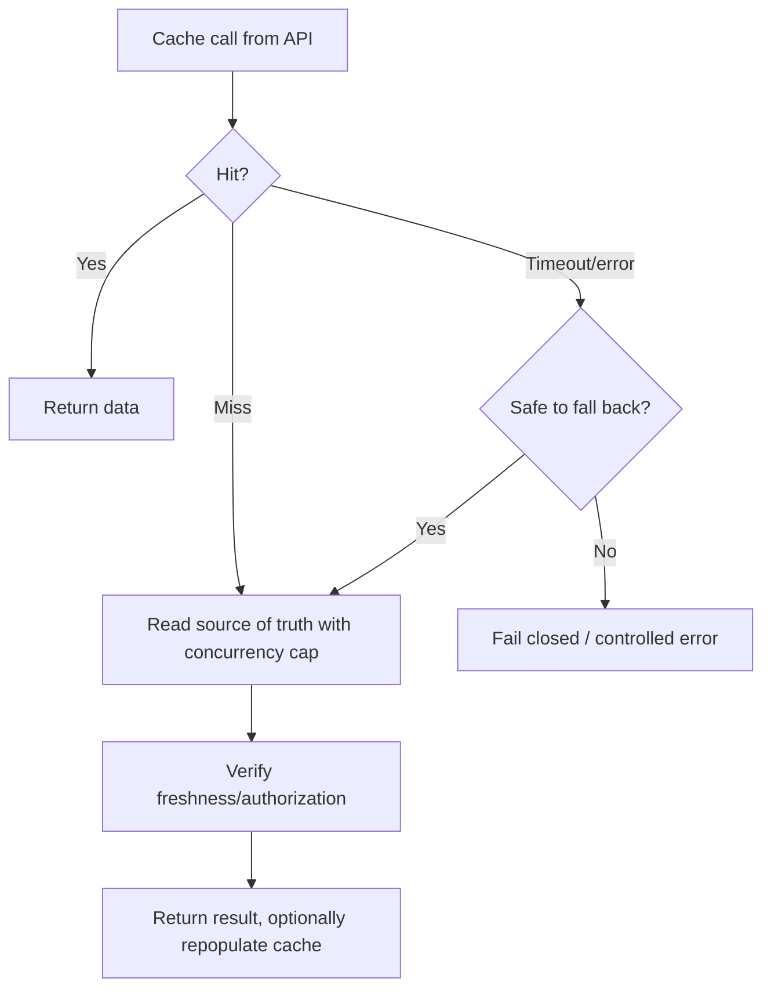

For a **product catalog**, fallback is usually fine; for **login rate limits, authorization revocation, or critical locks**, failing open removes security controls. Choosing fail-open vs. fail-closed is a **business/security policy**, not merely a `try-catch` block.

### 12.2. Multi-AZ and Automatic Failover

**Node-based Valkey/Redis OSS:** Configure a replication group with primary + replicas placed across at least two AZs, enabling `AutomaticFailover` and `MultiAZ` where supported. If the primary fails, ElastiCache promotes a replica and provisions a replacement replica. During failover:

- Reads/writes can encounter transient timeouts or errors.
- Clients must perform **bounded** retries with backoff and refresh DNS/topology.
- Async replica lag may cause very recent writes before the failure to be absent on the new primary.
- Monitor replication lag, failover events, and business side effects.

**Node-based Memcached:** No native replication/automatic failover; when a node is lost, clients remap keys and rehydrate from the DB. Serverless Memcached manages availability differently from node-based, though applications must still tolerate **cache misses** and test outages.

**Serverless:** AWS distributes cache capacity for HA automatically; you do not manually place shard replicas across AZs like node-based. Still, serverless availability **does not** mean keys live forever: eviction, TTL, and failure behaviors still apply. Snapshots can be taken per engine and restored into a new cache.

### 12.3. Backups: Distinguish Deployment Types

| Configuration | Automatic/manual snapshots | Can restore cache from snapshot? | Notes |
| --- | --- | --- | --- |
| **Valkey Serverless** | **Yes** | **Yes** | Snapshots do not impact workload performance per service description. |
| **Redis OSS Serverless** | **Yes** | **Yes** | Cross-compatible per version conditions. |
| **Memcached Serverless** | **Yes** | **Yes** | Newer AWS capability, unlike node-based Memcached. |
| **Valkey node-based** | **Yes** | **Yes** | Backups can consume node resources (memory/fork); consider taking from a replica. |
| **Redis OSS node-based** | **Yes** | **Yes** | Similar to Valkey node-based. |
| **Memcached node-based** | **No** ElastiCache node-based snapshot feature. | Not via this mechanism. | Rebuild from DB/application or follow a migration strategy. |

ElastiCache snapshots reside in service-managed S3 infrastructure, not as arbitrary JSON files in your own bucket. Restoring typically creates a **new cache**, requiring checks on engine/version, endpoint, SG, users/TLS, and application cutover. **A cache snapshot backup is not RDS PITR**; changes between snapshots can be lost, and rebuilds may be needed depending on the use case.

Sources: [Snapshot and restore](https://docs.aws.amazon.com/AmazonElastiCache/latest/dg/backups.html) and [Scheduling automatic backups](https://docs.aws.amazon.com/AmazonElastiCache/latest/dg/backups-automatic.html).

### 12.4. Pre-Maintenance Snapshots and DR Runbook

1. Determine **whether the cache holds data worth preserving** or can be warmed from the source.
2. Check backup retention, manual snapshot status, KMS keys, and access permissions.
3. For node-based Valkey/Redis OSS, consider snapshotting from a **replica** to minimize primary impact per AWS guidance.
4. Restore into a **new cache inside a private VPC** with matching user groups, SGs, and endpoints.
5. Run a test client to verify known keys and controlled sample `GET/SET` operations.
6. If restored data could be stale, invalidate/flush **only on the new cache** or rebuild from source; never serve stale errors in production.
7. Cut over client endpoint configs and watch miss rates, DB QPS, and p95 latency.
8. Preserve rollback capability and clean up restored labs with approval; never delete the original snapshot before testing.

**Do not treat cache restoration as equivalent to recovering a strongly consistent database.** If sessions or state cannot tolerate loss, redesign **source of truth, transactional durability, writes, backups, and replay**; do not put critical state into volatile keys under `allkeys-lru` expecting nightly snapshots to suffice.

### 12.5. Global Datastore and Cross-Region

Certain **node-based Valkey/Redis OSS** configurations support **Global Datastore** for cross-Region replication, lowering read latency and aiding DR per supported features/versions. However:

- Replication is typically **asynchronous**, so measure lag/RPO and handle conflicts/failover.
- Do not assume Global Datastore applies to **Memcached** or all **Serverless** caches.
- Global replication **does not replace backups**: accidental deletes or bad writes replicate across Regions.
- When using Global Datastore, review failover/failback plans, writer endpoints, and data reconciliation.

For multi-Region apps, caches often require **regionalization**: each Region keeps a local cache near its services reading from a replicated authoritative DB with local invalidation. Cross-Region cache replication latency can be harder to manage than warming each Region from the DB.

### 12.6. Valkey Durable Mode Does Not Make Every Cache Durable

On supported **node-based Valkey 9.0+ cluster mode enabled** configurations with durability enabled per engine/version/instance support, you can choose **synchronous** or **asynchronous** transactional log durability:

- **Sync mode** targets zero data loss on failure under documented conditions, trading off latency/throughput.
- **Async mode** prioritizes write performance and can leave a brief window of recent writes undurable upon failure.
- Policies like **`noeviction`** must be used if data cannot vanish under memory pressure; default `volatile-lru` can evict TTL keys.
- Design separate snapshot/restore policies, access controls, app transactions/idempotency, and backup retention.

Select durability mode only when the business genuinely needs **the cache as a reliable data store** and after comparing against MemoryDB/RDS/DynamoDB. For standard caches, adding durability raises cost/latency without solving **cache invalidation**.

## 13. CloudWatch Monitoring: Metrics by Engine and Deployment

### 13.1. Node-Based Valkey/Redis OSS

In the `AWS/ElastiCache` namespace, monitor by **CacheClusterId, CacheNodeId**, or AWS-supported shard/node dimensions:

| Metric | What it reflects | Action |
| --- | --- | --- |
| `CacheHits` / `CacheMisses` | Engine-level hits/misses. | Analyze ratios and app latency, not just raw counts. |
| `EngineCPUUtilization` | CPU consumed by the engine processing path. | Hot shards, expensive commands, pipelining, scaling. |
| `CPUUtilization` | Total node CPU across threads/OS. | Host/OS overhead; combine with `EngineCPUUtilization` and node size. |
| `DatabaseMemoryUsagePercentage` | Percentage of memory used by the dataset per engine semantics. | Add nodes/shards, tune TTL/eviction, shrink payloads. |
| `BytesUsedForCache` | Memory used by the engine to store data per metric definition. | Capacity planning and memory growth tracking. |
| `FreeableMemory` / `SwapUsage` | OS memory and swap activity. | Memory pressure/buffers, sizing. |
| `Evictions` | Keys evicted due to memory pressure. | Review eviction policy, hit-rate, and latency impact. |
| `CurrConnections` / `NewConnections` | Current/new connections. | Reconnect storms, oversized pools, leaks. |
| `ReplicationLag` | Replica delay behind primary where applicable. | Stale reads / HA RPO. |
| `NetworkBytesIn` / `NetworkBytesOut` | Network throughput. | Oversized payloads, saturation, large `GET/MGET`. |
| `SuccessfulReadRequestLatency` / `SuccessfulWriteRequestLatency` | Server-side cache processing latency for successful ops. | Track trends and compare with app end-to-end latency. |

**CPU note:** On newer node types with enhanced I/O, OS `CPUUtilization` can diverge from `EngineCPUUtilization`; AWS recommends tracking **EngineCPUUtilization** to gauge engine thread load. Do not hard-code one CPU threshold across all engines/nodes; check [Which metrics should I monitor?](https://docs.aws.amazon.com/AmazonElastiCache/latest/dg/CacheMetrics.WhichShouldIMonitor.html).

### 13.2. ElastiCache Serverless

Serverless uses the `AWS/ElastiCache` namespace, but with the **`clusterId` dimension** matching the serverless cache name, distinct from node-based `CacheClusterId`. Key metrics:

| Metric | Purpose |
| --- | --- |
| `CacheHitRate` | Hit ratio from 0..1 calculated as hits/(hits+misses) over the interval per service definition. |
| `BytesUsedForCache` | Data storage consumed, including engine indexes. |
| `ElastiCacheProcessingUnits` | ECPUs consumed by requests; critical for billing and capacity. |
| `SuccessfulReadRequestLatency` / `SuccessfulWriteRequestLatency` | Server-side operation latency. |
| `TotalCmdsCount` | Total commands executed. |
| `ThrottledRequests` or throttling-related metrics per engine/version | Risk of hitting throughput/usage limits. |

Verify exact metric names/statistics against docs and cache type: Serverless Valkey/Redis OSS vs. Serverless Memcached differ on some metrics. **Do not apply a node-based per-node dashboard to Serverless** and mistakenly conclude there is no data. Source: [Serverless Valkey/Redis metrics](https://docs.aws.amazon.com/AmazonElastiCache/latest/dg/serverless-metrics-events-redis.html).

### 13.3. Node-Based Memcached

Memcached uses `AWS/ElastiCache` node metrics plus Memcached-specific counters:

- `GetHits` / `GetMisses`, `CmdGet`, `CmdSet`.
- `Evictions` and `Reclaimed` (depending on engine/metrics).
- `BytesUsedForCacheItems`, `CurrItems`, `CurrConnections`.
- `CPUUtilization`, `NetworkBytesIn/Out`, and per-node traffic.

Memcached uses a **slab allocator** partitioning memory by item size; evictions can occur in specific slab classes even while the node still has free memory elsewhere. Tuning requires measuring **item size distribution** and client consistent hashing rather than simply adding total node RAM.

### 13.4. Application-Side Monitoring in Java

Server metrics show only server-side execution. In Spring Boot/Micrometer, add:

| App metric | Why it matters |
| --- | --- |
| `cache_hit_count` / `cache_miss_count` per cache namespace. | Captures real per-endpoint/business-key hit rates. |
| `cache_request_duration_seconds` p95/p99. | Includes network, TLS/cluster redirects, serialization, and client queueing. |
| `cache_errors_total` by timeout/ACL/OOM/CONNECT. | Alerts on outages before the database absorbs full load. |
| `cache_fallback_db_queries_total`. | Quantifies source DB overload. |
| `cache_refresh_duration_seconds` and stampede suppressed count. | Measures preloading/proactive refresh efficiency. |
| `keyspace_bytes_estimate` / average payload bytes (without logging key values). | Prevents storing oversized serialized blobs. |
| `cache_invalidation_failures_total`. | Detects stale data risks from delayed invalidation. |

**Never use raw key values, `userId`, or `tenantId` as high-cardinality metric labels**, as that leaks PII and inflates CloudWatch/Prometheus costs. Use bounded labels like **`cache_name`** and **`operation`**.

### 13.5. Alerting on Business Impact

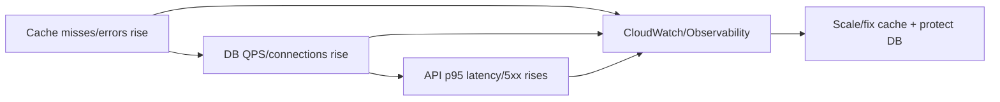

Recommended alerts:

1. Sudden drop in cache hit rate **during meaningful traffic**.
2. Engine CPU, memory pressure, evictions, or hot shards nearing saturation.
3. Spikes in throttles, errors, OOMs, or reconnect storms.
4. Database fallback load exceeding budget during cache errors.
5. Degradation in API p95/p99 latency or transaction success rate.
6. Unexpected HA/failover/restart/auth/KMS events.
7. Serverless ECPU/storage or node-hours deviating from baseline.

Every alert needs an **owner, SLO, evaluation window, threshold, runbook, and maintenance suppression**. Never declare a cache healthy simply because `CacheHitRate=99%` if the remaining 1% are critical requests or cached values are stale.

## 14. FinOps: Choosing a Cache by Total Application Cost

### 14.1. Cost Components to Estimate

| Line item | When incurred | Levers |
| --- | --- | --- |
| **Node-based node-hours** | Each running primary/replica node by type/time. | Right-sizing, autoscaling options, reserved-node pricing when eligible. |
| **Serverless data storage** | Volume of cached data retained per billing unit. | TTLs, key cardinality, schema/payload compression when needed. |
| **Serverless ECPUs** | Reads/writes/commands consuming compute/network. | Optimize commands, batching, trim payloads, near-caching. |
| **Backups/manual snapshots** | Stored snapshot data per retention and deployment type. | Appropriate retention; clean up test snapshots with approval. |
| **Cross-AZ/Region transfer** | Traffic across services/replicas or cross-Region replication per pricing. | Check network placement/transfer policy; never drop HA solely to dodge transfer fees. |
| **CloudWatch logs/metrics** | Log ingestion/storage, custom metric labels, alarms. | Redaction, retention, low-cardinality labels. |
| **KMS/Secrets Manager** | Customer-managed encryption/auth credentials and API calls per pricing. | Sensible key rotation and secret caching intervals. |
| **Source DB** | Misses and fallbacks driving DB queries/IOPS/RCUs. | Analyze total system cost, not just the cache bill. |
| **Engineering/operations** | Client topology, migrations, on-call, patching/DR. | Serverless cuts manual capacity work but does not remove app responsibilities. |

**Never assume one engine is always cheaper in every Region or timeframe.** AWS publishes lower pricing for Valkey compared to Redis OSS in certain configurations, yet you must use the **AWS Pricing Calculator**, current rate tables, estimated ECPU/GB-hours/node-hours, and Cost Explorer. Do not carry budget figures across Regions without verifying.

### 14.2. Serverless vs. Node-Based Comparison Scenario

Suppose a system has:

```text
Normal day:        5,000 GET/s and ~40 GiB hot dataset
Promotion hour:    120,000 GET/s for 30 minutes
P95 target:        under 20 ms end-to-end cache retrieval
Cache-failure RTO: within 15 minutes, DB must remain protected
```

Do not compare based solely on "5,000 QPS." A sound approach:

1. Prototype using 100% real commands (`GET`/`MGET`/`HGET`/`ZRANGE`), payload sizes, and burst shapes.
2. Measure Serverless ECPUs, bytes stored, throttling, and latency.
3. Benchmark node-based setups with 1–N shards and Multi-AZ primary/replicas, measuring CPU/memory/network.
4. Calculate costs across **both peak and off-peak**, adding backups, transfer, logs, and DB miss costs.
5. Validate RTO/RPO/failover and on-call operational overhead.
6. Pick the option meeting SLOs at acceptable total cost and risk—not merely the lowest cache node-hour price.

### 14.3. Cache Stampedes Can Turn "Cache Savings" into DB Overload

Slashing cache size or TTLs too aggressively to save money drives up misses and forces RDS to run expensive queries. Conceptually:

\[
\text{Total cost} =
\text{Cache cost}
+ \text{DB cost}
+ \text{Network/Monitoring cost}
+ \text{Incident cost}
\]

**Optimize cost per successful transaction**, not cache cost in isolation. Scaling the DB 10x to absorb cache misses can cost far more than properly sized cache nodes or tuned TTLs. Conversely, caching hundreds of GiB of rarely read data also wastes money.

### 14.4. Tags, Budgets, and Cleanup

Practices:

- Tag `Environment`, `Application`, `Owner`, `CostCenter`, and `ExpiresAt` on **lab/test resources**.
- Set AWS Budgets alerts when Serverless ECPU/storage or node-hours exceed baseline.
- Audit snapshot retention and idle running caches with zero traffic.
- Investigate `Evictions` and miss ratios before downsizing.
- Clean up labs via IaC/approval; never delete a production cache just because traffic dipped for one day.
- Include durability/long-term snapshot storage and restore-test jobs in cost decisions.

## 15. Engine Upgrades, Redis OSS-to-Valkey Migration, and Rollback

### 15.1. When Should You Migrate?

Drivers include newer supported Valkey releases, performance/cost optimization, Redis OSS lifecycle, new features, or open-source alignment. **Migration is not forced merely because a Spring library has "Redis" in its name.** Applications can keep a Redis-compatible client while running Valkey on the backend if commands and protocols align.

### 15.2. Pre-Migration Compatibility Matrix

| Check area | Why does it matter? |
| --- | --- |
| Engine versions and parameter group family | Custom Redis OSS parameter groups do not always map directly to new Valkey major versions. |
| Client driver/protocol | Spring Data Redis/Lettuce/GLIDE/Jedis versions must support engine commands and cluster topology. |
| Lua/functions/ACL | Unsupported commands or behavioral differences can trigger runtime errors. |
| Serialization | Snapshots/cached entries may encode legacy schemas/codecs. |
| Cluster mode | Single-node clients do not become cluster-aware automatically when moving to Serverless. |
| TLS/IAM credentials | IAM token refresh and RBAC users/groups must stay compatible post-upgrade. |
| Shards/replication/HA | Upgrades/failovers can drop connections briefly and change DNS/IPs. |
| Backup/restore | Take snapshots, test restores, and confirm exact engine/version rollback paths. |
| Feature tier/version | Vector/search/durability/advanced commands are not supported on all versions. |

### 15.3. Redis OSS → Valkey: AWS-Supported Path

AWS supports **cross-engine upgrades** from Redis OSS to Valkey across eligible versions/configurations, preserving endpoint DNS in many scenarios while underlying IPs change on node-based upgrades. For Redis OSS 5.0.6+, AWS notes **minimal interruption** during failover; older versions can incur longer propagation delays. Test in staging—never promise "zero downtime" for arbitrary traffic.

Illustrative AWS CLI (**modifies production if run directly**, concept only):

```bash
# Run only in authorized/lab accounts; verify engine version availability first.
aws elasticache modify-replication-group \
  --region ap-southeast-1 \
  --replication-group-id lab-redis-to-valkey \
  --engine valkey \
  --engine-version 9.0
```

With a **custom parameter group**, supply a Valkey-compatible parameter group via `--cache-parameter-group-name`. Serverless migrations use a different CLI: `modify-serverless-cache --engine valkey --major-engine-version ...` per API and support scope. Ensure snapshots/backups, staged rollouts, feature checks, and alerting. Source: [Upgrading engine versions including cross-engine upgrades](https://docs.aws.amazon.com/AmazonElastiCache/latest/dg/VersionManagement.HowTo.html).

### 15.4. Rollback Is Not Always "Pick the Old Version"

AWS generally **does not allow downgrading** a node-based cluster to an older engine version via a simple version change. Specific cross-engine rollback exceptions exist, such as Valkey 7.2 back to Redis OSS 7.1 per AWS documentation. **Do not rely on that exception** to write a rollback runbook from Valkey 9.0 back to Redis OSS or arbitrary older majors.

Safer rollback strategies in most cases:

1. Take a pre-migration backup/snapshot and verify restore in a lab.
2. Canary a subset of services, or stand up a **new** cluster if topology/versions differ.
3. Prepare DNS/app config rollback and know how cache data is warmed/rebuilt.
4. If the cache holds critical state, design explicit data migration/dual-writes/ordering and keep the old cluster until sign-off.
5. Watch `CacheHitRate`, `Errors`, p95 latency, DB fallbacks, session loss, and traffic.

### 15.5. Node-Based → Serverless or Vice Versa

ElastiCache supports **restoring Valkey/Redis OSS backups** across deployment types under certain conditions, plus online migration options for some self-managed sources. However:

- Serverless Valkey/Redis OSS enforces **cluster mode enabled** → test clients thoroughly.
- Restoring a snapshot creates a new cache/endpoint; it does not cut over application DNS automatically.
- Snapshot-based migration is a **checkpoint** that can miss subsequent writes without streaming, dual-writes, or online migration.
- Parameter groups, user groups/ACLs, IAM auth, and backup policies must be reconfigured for the target type.
- Measure real-traffic RTO/RPO rather than assuming "restore available" completes the move.

If an app currently uses single-node Redis OSS without cluster mode, moving to Serverless **is not just changing a hostname**; you first need a cluster-aware client library handling redirects and slot keys.

### 15.6. Do Not Use Cache Migration to Alter the Source of Truth

If in-memory data is currently authoritative, you need a **real data-migration plan** rather than flushing and warming a cache:

- Review durability features, backups, transactional semantics, and idempotency.
- Guarantee at least one consistent snapshot or recoverable event-log/DB backup.
- Coordinate or freeze writes at cutover to prevent split-brain between clusters.
- Test cache unreachability fallbacks, Redis cluster resharding, and IAM token expiry.
- Define zero-data-loss, latency/throughput, rollback, and post-cutover monitoring criteria.

Caching is an optimization layer, but **once treated as a primary data store, operational rigor must match database standards**.

## 16. Troubleshooting: Slow Cache, Dropped Connections, or Wrong Data

### 16.1. Symptom-Based Diagnostic Table

| Symptom | Causes to check | Evidence and resolution |
| --- | --- | --- |
| `Connection timeout` to private cache. | Wrong VPC/subnet/SG/route/DNS, closed port, cache not yet available. | `describe-serverless-caches`/`describe-replication-groups`, VPC Flow Logs/SGs, test port from workload SG. |
| Serverless connects on `6379` but `6380` times out. | SG only opens 6379; client attempts read-optimized port/topology. | SG inbound 6379/6380 from app SG, client settings, AWS docs. |
| `NOAUTH Authentication required`. | Client omits user/token or default user policy changed. | User group/ACL, credentials provider, matching secrets per deployment. |
| `WRONGPASS invalid username-password pair`. | Wrong username/password/ACL, unsynced password rotation. | Check user status, secret version, and client credentials. |
| IAM auth reconnect fails after 15 minutes. | Reusing expired SigV4 token instead of generating a fresh one. | Credentials provider, token lifetime, GLIDE IAM support, IAM policy. |
| IAM auth socket drops after 12 hours. | Connection lifetime cap under IAM auth. | Client logs/re-auth/refresh/reconnect, backoff. |
| `NOPERM` on `GET/SET`. | User ACL missing command or key pattern. | `UserGroupId`/ElastiCache access string, key names, least privilege. |
| `MOVED` / `ASK` or `CROSSSLOT`. | Non-cluster-aware client, keys in different slots, resharding. | Cluster topology refresh, hash tags, proper client selection. |
| `OOM command not allowed`. | Memory full, `noeviction`, or `volatile-*` with no evictable keys. | `DatabaseMemoryUsagePercentage`, `Evictions`, TTL coverage, memory policy. |
| `Evictions` rise despite freeable memory remaining. | Engine maxmemory/reserved memory, per-shard pressure, slab allocation. | Per-node/slot metrics, key sizes, parameter group, TTL policy. |
| Hit rate drops after deploy. | Changed key prefix/schema version, synchronized TTL expiry, resharding, flush. | Redacted key samples, client version/config, cache warm-up, DB fallback. |
| One shard at 95% CPU while cluster CPU is 30%. | **Hot key/hash slot**, skewed distribution, expensive commands. | Per-shard `EngineCPUUtilization`, key distribution, hot keys, pipelining. |
| Redis primary writes succeed but replicas return old values. | **Asynchronous replication** combined with replica reads. | Replica lag, route read-after-write to primary, review consistency requirements. |
| API 500s during cache outage. | Code treats cache as a hard dependency without fallback/circuit breaker. | Spring logs, DB traffic, bounded fallback, security fail policy. |
| API 500s while cache looks green. | RDS overloaded by misses, serialization errors, or stale data bugs. | API p95, DB QPS/connection count, application cache counters. |
| Sessions lost after node failover. | Cache used as source of truth, async replication loss, session TTL/eviction. | Replication lag, backups, session store/design, versioned session policy. |
| Node-based Memcached lacks snapshots. | Engine/deployment **does not support** native snapshots. | Switch to Memcached Serverless/Valkey or rebuild from DB per design. |
| Serverless cost rises with flat hit count. | Larger payloads/expensive commands, higher ECPUs, long-lived keys. | ECPU, `BytesUsedForCache`, cost dashboard, and command mix. |
| App cannot connect after snapshot restore. | New cache endpoint, differing SG/user group/KMS/engine/SSL config. | Describe restored cache, TLS test, IAM/ACLs, and credentials. |
| Cluster-mode-disabled client hitting Serverless. | Serverless Valkey/Redis OSS requires a cluster-aware client. | Spring/Lettuce cluster config or GLIDE cluster client. |
| Stale cross-Region data despite "replication enabled." | Replica lag or Global Datastore async replication. | Region metrics, read routing, RPO requirements. |

### 16.2. 10-Step Investigation Runbook

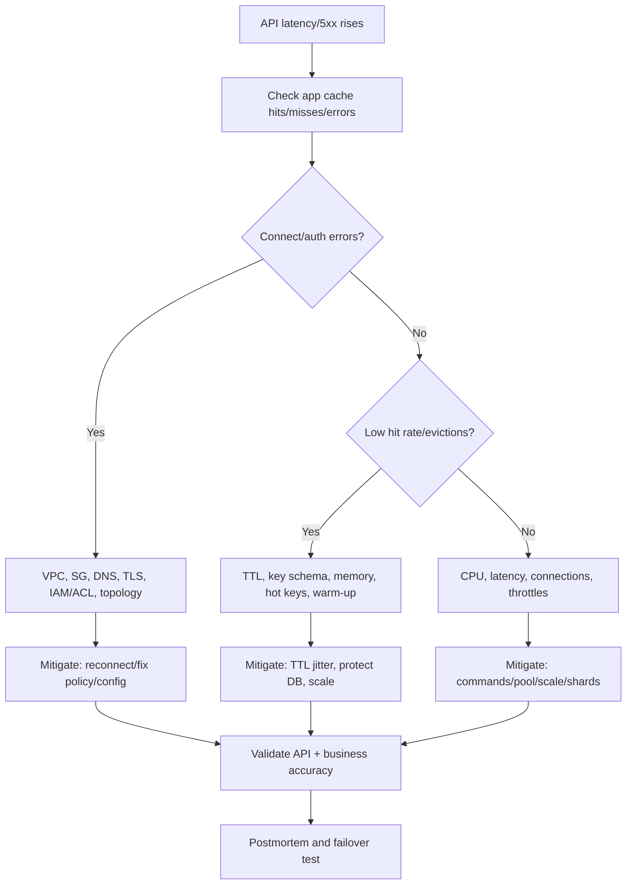

1. **Identify scope:** App/service, Region, VPC, cache name, engine/type, and incident start time.
2. **Assess impact:** API latency/5xx, rate-limit failures, login/session impact, DB pressure.
3. **Inspect cache config:** `Status`, engine/version, endpoints, Multi-AZ, SGs, user groups, TLS/KMS.
4. **Check metrics:** app hits/misses/timeouts, CloudWatch per-node/per-shard or Serverless ECPU/memory.
5. **Check networking:** right port from source SG, private routes/DNS, VPC Flow Logs; never open public inbound.
6. **Check auth:** ACL user/password/Secrets Manager rotation, IAM `elasticache:Connect`, SigV4 tokens.
7. **Check memory/commands:** missing TTLs, evictions, key sizes, hot spots, `noeviction` OOMs.
8. **Contain blast radius:** bounded cache bypass, per-key single-flight, DB rate limit/circuit breaker, scale if needed.
9. **Validate recovery:** cache reconnects, p95 latency, hit rate, DB QPS, business correctness, session risk.
10. **Root cause analysis:** deployment diffs, engine upgrades, parameter/ACL edits, CloudTrail, backup/DR tests.

**Never resolve every error with `FLUSHALL` or a full cluster restart.** That can turn a localized hot-key issue into a full-cache miss storm and take down the DB. Prefer targeted key invalidation/version bumps, client rollbacks, or planned shard scaling.

### 16.3. Case Study: High Cache Hit Rate Yet Wrong Product Prices

**Incident:** A product drops from 100,000 to 80,000 VND at 09:00. The cache key has a 6-hour TTL and the app skips invalidation after DB commit. At 09:30 users still see 100,000 VND while `CacheHitRate=99%`.

Explanation:

- Redis/Valkey behaved according to its cache contract; **business data was wrong because the invalidation strategy was missing**.
- Adding nodes/replicas or switching from Redis OSS to Valkey **will not fix stale prices**.
- You must **invalidate keys post-commit** or use event-driven outbox invalidation, with TTLs aligned to freshness SLOs.
- At checkout, compute prices against the **authoritative DB** inside the transaction rather than trusting cached display prices.
- Business monitoring must include **catalog price mismatch** or synthetic checks, not just hit rates.

### 16.4. Case Study: Cache Stampede Crashes RDS

A marketing campaign drives 2 million users to the same product. Key `product:v3:hot` expires at 10:00:00. 20,000 concurrent requests miss `GET` and hit RDS. RDS max connections saturate, returning API 503s.

**Controlled remediation:**

1. Suppress DB spikes using **single-flight/distributed refresh leases** and concurrency limits.
2. Use stale-while-revalidate where brief staleness is allowed; **never** serve stale checkout prices.
3. Enable TTL jitter/proactive refresh on hot keys, and consider near-caching.
4. Verify RDS capacity and implement graceful degradation fallbacks.
5. Post-incident, load test cold-cache bursts realistically instead of benchmarking only cache hits.

### 16.5. Case Study: Static IAM Token Fails After 15 Minutes

An ECS task fetches an IAM auth token once at startup and stores it like a password in Lettuce config. Initial `GET`/`SET` calls work; minutes later when TCP reconnects, `AUTH` replays the expired token and fails.

**Fix:** Use a credentials provider that generates a **fresh SigV4 token on every connect/re-auth**; use GLIDE IAM support or a tested custom provider. Ensure `elasticache:Connect` covers both cache and user ARNs, verify TLS, and never hard-code static tokens into task definitions. For long-lived connections, handle AWS's 12-hour disconnect/re-auth rule.

### 16.6. Case Study: Choosing Memcached Assuming Redis-Like HA

An app stores sessions exclusively in **node-based Memcached** with three nodes, lacking a source of truth or session regeneration policy. When one node fails, roughly one-third of sessions vanish, forcing users to log in again.

**Root cause:** Node-based Memcached sharding **has no replicas** like Valkey. Adding nodes does not preserve sessions if a node dies. Options:

- Accept session loss within SLOs and improve UX recovery.
- Move the session store to Multi-AZ Valkey/Redis OSS with proper TTL/ACL/backups.
- Use signed/short-lived tokens and a redesigned server-side revocation store.
- Never store unrecoverable transactional state inside sessions.

### 16.7. Case Study: Hot Slot from Misused Hash Tags

A developer puts every key inside `{global}` to run multi-key Lua operations:

```text
shop:{global}:product:1
shop:{global}:product:2
shop:{global}:product:300000
```

Every key hashes to **a single Redis Cluster hash slot**, so even scaling to 8 shards leaves that one shard overloaded. Fix by **hash-tagging per entity/aggregate** (`{order-123}`, `{user-456}`) and scoping transactions/multi-key commands properly; if workflows span multiple entities, use the database.

## 17. Hands-On Exercises and Decision-Making Scenarios

> **Lab rule:** Only provision ElastiCache resources in authorized, budgeted AWS accounts. Serverless and node-based caches incur charges even under low traffic. Without a lab account, produce **decision tables, planned scripts, and expected outputs** on paper; never run test commands against production.

### Exercise 1 — Choosing Valkey, Redis OSS, or Memcached

Three teams have these needs:

1. **Catalog service:** Spring Boot, 2 million products, Redis-compatible key-value cache, 60–300s TTL, spiky traffic.
2. **Gaming leaderboard:** real-time score rankings needing sorted sets and atomic increments.
3. **Image metadata cache:** stores opaque JSON values only, no lists/sets/scripts, rebuildable data.

For each team:

- Choose **Valkey/Redis OSS/Memcached** and explain the engine features.
- If choosing Valkey, state pros/cons of newer engine versions vs. older Java clients.
- Decide Serverless vs. node-based, Multi-AZ/replication, and expected cache-miss handling.
- Pick TTL/invalidation strategies and DB protection during cache failures.
- Design a dashboard for hit rate, p95 latency, memory/ECPU/evictions, and cost.
- If a team runs a single JVM server, when might a Caffeine local cache suffice?

**Passing criteria:** Do not pick Memcached for sorted sets, and never use a plain cache as an authoritative payment ledger.

### Exercise 2 — Serverless vs. Node-Based Under Peak Traffic

Workload:

```text
Normal traffic:       2,000 GET/s
Promotion traffic:    100,000 GET/s
Hot dataset:          20 GiB
Max acceptable stale: 60 seconds
p95 SLO:              under 20 ms for cache retrieval
```

Tasks:

1. Explain why Serverless fits and why node-based might still win.
2. Design a benchmark measuring **ECPU/bytes, EngineCPUUtilization/memory, p95, and hot shards**.
3. Propose a 2-AZ/replica topology for node-based Valkey.
4. If using Serverless Valkey, what cluster-mode behavior must the client support?
5. Estimate total system cost including DB miss impact, not just the cache bill.
6. Identify when Memcached would make sense if Redis data structures are unneeded.

### Exercise 3 — Writing Cache-Aside and TTL Jitter

A Spring Boot service reads `Product` from RDS:

1. Write `getProduct(id)` performing `GET → DB fallback → SETEX`.
2. Add a 60s base TTL with 0–10s random jitter.
3. Define a negative-cache sentinel for nonexistent product IDs with a 10s TTL.
4. Distinguish DB `not-found` from DB timeout so timeouts are never cached as 404.
5. Emit hit/miss/`cache_error` and latency metrics while redacting PII.
6. Define post-commit DB invalidation when prices change.
7. If 2,000 requests miss the same key simultaneously, how would you apply single-flight/refresh locks?

**Passing criteria:** A cache outage must not break product reads if the DB has capacity, and authorization errors must never fail open.

### Exercise 4 — Cluster Mode, Hash Slots, and Multi-Key Operations

Given keys:

```text
order:{123}:status
order:{123}:items
order:{124}:status
user:{123}:profile
```

Answer:

- Which two order keys share a hash slot because of `{123}`?
- Why do `order:{123}:status` and `user:{123}:profile` **also land in the same slot** despite different business domains?
- What happens if you run a multi-key Lua command across `order:{123}:status` and `order:{124}:status`?
- Why shouldn't you place all keys under `{global}`?
- How does node-based cluster mode disabled differ from enabled?
- What kind of client does Serverless Valkey/Redis OSS require?
- During resharding, how must the client handle `MOVED/ASK` and refresh topology?

**Passing criteria:** Recognize that hash tags only solve technical co-location and do not replace business transaction boundaries.

### Exercise 5 — IAM/TLS/RBAC Security

An ECS service `catalog-reader` only needs to `GET` keys prefixed with `shop:prod:catalog:*` on Valkey cache `orders-cache`.

1. Write an IAM identity policy granting `elasticache:Connect` on the cache ARN and user ARN without granting `elasticache:*`.
2. Draft a Valkey ACL permitting only `GET`/`MGET`/`PING` on the target key prefix.
3. Design a user group attached to the cache with IAM auth and mandatory TLS.
4. Explain the **15-minute** IAM token lifetime vs. **12-hour** connection re-auth/lifetime.
5. If a Java process captures a static token in an env var at startup, what happens on reconnect after 30 minutes?
6. Which SGs/ports are needed for private VPC Serverless Valkey?
7. For a **Valkey 9+ public endpoint**, why are IAM and TLS 1.3 required and when should public endpoints be avoided?

**Passing criteria:** No hard-coded secrets, and no `0.0.0.0/0` inbound rules on cache SGs.

### Exercise 6 — Cache Loss on Failover

A node-based Redis OSS deployment runs a **single primary** with no replicas. When its AZ fails:

1. Is there automatic failover?
2. How does enabling Multi-AZ with a primary + cross-AZ replica improve behavior?
3. Why can asynchronous replication still lose the latest writes?
4. What retry/DNS/topology handling is needed in the Java client?
5. If the entire cache goes cold, what load hits RDS?
6. Propose single-flight/concurrency caps to protect RDS.
7. If sessions require zero data loss, how must they be architected beyond a volatile key with TTL?

### Exercise 7 — Backup Differences Across Engines

Fill in `Yes/No` for these rows:

| Engine | Node-based snapshot | Serverless snapshot |
| --- | --- | --- |
| Valkey | ? | ? |
| Redis OSS | ? | ? |
| Memcached | ? | ? |

Follow-ups:

1. Why shouldn't you state broadly that "Memcached has no snapshots"?
2. When restoring a Valkey backup into a new cache, how do endpoints/configs/SGs/user groups change?
3. Can snapshots restore to any exact second like RDS PITR?
4. Does a cache-aside workload strictly need snapshot restores if the DB is the source of truth?
5. If a cache uses durability mode, how must eviction policies and backup strategies change?
6. Plan a restore drill and cutover.

### Exercise 8 — Sizing Memory and Preventing Evictions

A node-based Valkey cluster:

```text
5,000,000 keys
Average JSON value size 600 bytes
Assumed average key + metadata overhead 250 bytes
Reserve 40% headroom in calculation
```

1. Estimate raw dataset bytes and GB before headroom.
2. Calculate capacity with headroom and explain why replicas/buffers/fragmentation are **still excluded**.
3. If using 3 replicas for HA, how does total memory footprint across copies scale?
4. Under `volatile-lru` when 80% of keys have no TTL, what happens when memory fills?
5. Recommend `allkeys-lru`/`allkeys-lfu`, TTL, and eviction policies by use case.
6. If 1% of hot keys receive 90% of traffic, does adding shards help or do you need near-caching/read replicas?

### Exercise 9 — Redis OSS → Valkey Migration

A Spring Boot app uses Lettuce and node-based Redis OSS 7.1 with Lua scripts and a custom parameter group.

Design:

1. Client/command/serialization/ACL compatibility tests.
2. Target engine version and new parameter group family.
3. Pre-upgrade snapshot/backup and restore drill.
4. Staging load test covering hot keys, memory, latency, and reconnect/failover.
5. `modify-replication-group --engine valkey` procedure targeting a **Region-supported** version.
6. When do IP endpoints change and require DNS refresh in the app?
7. Why can't you assume rolling back Valkey 9 to Redis OSS via simple downgrade if something breaks?
8. Rollback strategy using old/new caches along with data cutover and safety plans.

### Exercise 10 — Incident Tabletop: Fast Cache, Wrong Prices

An online store has:

- ElastiCache Valkey Serverless, 98% cache hit rate.
- Catalog API p95 at 5 ms, yet discounted products display old prices for 2 hours.
- Billing must manually adjust 500 transactions.
- A recent deployment also spiked connection counts and DB fallback load.

Take the roles of **Application owner, SRE, DBA, Security, and FinOps** to:

1. Separate **cache performance success** from **business correctness failure**.
2. Trace the price write/update path and post-commit DB invalidation.
3. Decide whether to use key version bumps/targeted invalidation, and explain why not to run `FLUSHALL`.
4. Protect checkout using authoritative DB prices.
5. Mitigate reconnect storms/connection pools and measure ECPU/DB QPS.
6. Set up stale-price alerts and synthetic business checks.
7. Document the incident timeline, evidence, data reconciliation, and prevention plan.

### Self-Check Questions

1. Which three engines does Amazon ElastiCache support?
2. How does Valkey differ from Redis OSS in direction and versioning?
3. Why does Memcached fit simple object caching yet lack Redis sorted sets?
4. Does **node-based** Memcached provide native replication/backups?
5. Does **Serverless** Memcached support snapshots under current AWS features?
6. How do ElastiCache Serverless and node-based differ in capacity management and cost?
7. Does Serverless Valkey/Redis OSS run in cluster mode enabled or disabled?
8. How many hash slots does Redis Cluster use?
9. Why do two keys with the same hash tag land in the same slot?
10. When does `CROSSSLOT` occur?
11. How must a cluster-aware client handle `MOVED` and `ASK`?
12. Does an asynchronous read replica guarantee the same read-after-write consistency as the primary?
13. What topology does Valkey Multi-AZ automatic failover require?
14. How does cache-aside differ from write-through and write-behind?
15. Why is write-behind dangerous for authoritative payments/inventory?
16. Does TTL guarantee a key stays in cache for the exact configured duration?
17. How does `allkeys-lru` differ from `volatile-lru`?
18. When `noeviction` is active and memory fills, what does the client experience?
19. What is a cache stampede and how do you prevent it?
20. How does negative caching differ from caching database timeout errors?
21. What does Serverless ECPU measure and why do 100 `GET`s differ from 100 `ZRANGE`s?
22. Why doesn't adding shards automatically fix a hot key pinned to one slot?
23. Which two security layers do VPC SGs and ElastiCache RBAC enforce?
24. What minimum Valkey/Redis OSS versions does IAM auth require?
25. How do the 15-minute IAM auth token and 12-hour connection lifetime differ?
26. Why does an app with `DescribeServerlessCaches` permission not automatically have `GET` permission?
27. Why is restoring a cache snapshot different from RDS PITR?
28. Does Valkey durable node-based mode automatically disable eviction?
29. How does CloudWatch `clusterId` for serverless differ from node-based `CacheClusterId`?
30. Why is optimizing **combined API + DB + cache cost** better than optimizing cache price alone?
31. Why is in-process Spring `@CacheEvict` insufficient to guarantee invalidation on DB commit?
32. Why is API-level access control still mandatory even when cache keys have tenant prefixes?

## 18. Official AWS Documentation and Operational Checklist

ElastiCache evolves rapidly across **engine versions, deployment types, Regions, security features, and pricing**, notably around **Valkey 9.x**, **Serverless public endpoints**, Memcached Serverless snapshots, and Valkey durability. Before production rollout, verify official documentation and run a proof of concept in your target Region.

### 18.1. Overview and Engine Selection

- [Amazon ElastiCache — User Guide](https://docs.aws.amazon.com/AmazonElastiCache/latest/dg/WhatIs.html)
- [Comparing node-based Valkey, Redis OSS, and Memcached engines](https://docs.aws.amazon.com/AmazonElastiCache/latest/dg/SelectEngine.html)
- [Choosing between Serverless caching and node-based clusters](https://docs.aws.amazon.com/AmazonElastiCache/latest/dg/WhatIs.deployment.html)
- [Supported engine versions and upgrades](https://docs.aws.amazon.com/AmazonElastiCache/latest/dg/engine-versions.html)
- [Upgrade and cross-engine upgrade from Redis OSS to Valkey](https://docs.aws.amazon.com/AmazonElastiCache/latest/dg/VersionManagement.HowTo.html)
- [Upgrade considerations and application connection behavior](https://docs.aws.amazon.com/AmazonElastiCache/latest/dg/VersionManagement-upgrade-considerations.html)
- [Online migration to node-based ElastiCache](https://docs.aws.amazon.com/AmazonElastiCache/latest/dg/OnlineMigration.html)
- [Migrating to ElastiCache Serverless](https://docs.aws.amazon.com/AmazonElastiCache/latest/dg/migration-to-serverless-procedure.html)

### 18.2. Memory, Replication, Availability, and Backups

- [Valkey and Redis OSS configuration and limits](https://docs.aws.amazon.com/AmazonElastiCache/latest/dg/RedisConfiguration.html)
- [Cache parameter groups and eviction policies](https://docs.aws.amazon.com/AmazonElastiCache/latest/dg/ParameterGroups.Engine.html)
- [Multi-AZ with automatic failover for Valkey/Redis OSS](https://docs.aws.amazon.com/AmazonElastiCache/latest/dg/AutoFailover.html)
- [ElastiCache resilience and availability](https://docs.aws.amazon.com/AmazonElastiCache/latest/dg/disaster-recovery-resiliency.html)
- [Snapshot and restore, including Serverless Memcached](https://docs.aws.amazon.com/AmazonElastiCache/latest/dg/backups.html)
- [Automatic backups for node-based/Serverless caches](https://docs.aws.amazon.com/AmazonElastiCache/latest/dg/backups-automatic.html)
- [ElastiCache durability modes in supported Valkey configurations](https://docs.aws.amazon.com/AmazonElastiCache/latest/dg/Durability.Options.html)
- [Distributed KV caching and memory/eviction](https://docs.aws.amazon.com/AmazonElastiCache/latest/dg/distributed-kv-caching-configuration.html)

### 18.3. IAM, TLS, Networking, and Clients

- [Authentication and authorization in ElastiCache](https://docs.aws.amazon.com/AmazonElastiCache/latest/dg/auth-redis.html)
- [Role-Based Access Control (RBAC) and user groups](https://docs.aws.amazon.com/AmazonElastiCache/latest/dg/Clusters.RBAC.html)
- [ElastiCache IAM authentication](https://docs.aws.amazon.com/AmazonElastiCache/latest/dg/auth-iam.html)
- [Migrating password-based authentication to IAM](https://docs.aws.amazon.com/AmazonElastiCache/latest/dg/auth-to-iam-migration.html)
- [Legacy AUTH command authentication](https://docs.aws.amazon.com/AmazonElastiCache/latest/dg/auth.html)
- [Accessing ElastiCache clusters and replication groups](https://docs.aws.amazon.com/AmazonElastiCache/latest/dg/accessing-elasticache.html)
- [Setting up VPC/security groups and ports](https://docs.aws.amazon.com/AmazonElastiCache/latest/dg/set-up.html)
- [Connecting to Serverless Valkey public endpoint](https://docs.aws.amazon.com/AmazonElastiCache/latest/dg/connecting-public-endpoint.html)
- [Creating a Valkey Serverless public endpoint](https://docs.aws.amazon.com/AmazonElastiCache/latest/dg/serverless-public-endpoints-chapter.html)
- [Troubleshooting cache connections](https://docs.aws.amazon.com/AmazonElastiCache/latest/dg/TroubleshootingConnections.html)

### 18.4. Monitoring, CLI, and Pricing

- [CloudWatch metrics to monitor for ElastiCache](https://docs.aws.amazon.com/AmazonElastiCache/latest/dg/CacheMetrics.WhichShouldIMonitor.html)
- [ElastiCache CloudWatch node/cluster metrics](https://docs.aws.amazon.com/AmazonElastiCache/latest/dg/CloudWatchMetrics.html)
- [Serverless Valkey/Redis OSS metrics and events](https://docs.aws.amazon.com/AmazonElastiCache/latest/dg/serverless-metrics-events-redis.html)
- [Serverless Memcached metrics and events](https://docs.aws.amazon.com/AmazonElastiCache/latest/dg/serverless-metrics-events.memcached.html)
- [Memcached node metrics](https://docs.aws.amazon.com/AmazonElastiCache/latest/dg/CacheMetrics.Memcached.html)
- [ElastiCache troubleshooting best practices](https://docs.aws.amazon.com/AmazonElastiCache/latest/dg/wwe-troubleshooting.html)
- [AWS CLI — create-serverless-cache](https://docs.aws.amazon.com/cli/latest/reference/elasticache/create-serverless-cache.html)
- [AWS CLI — create-replication-group](https://docs.aws.amazon.com/cli/latest/reference/elasticache/create-replication-group.html)
- [AWS CLI — describe-serverless-caches](https://docs.aws.amazon.com/cli/latest/reference/elasticache/describe-serverless-caches.html)
- [AWS CLI — describe-replication-groups](https://docs.aws.amazon.com/cli/latest/reference/elasticache/describe-replication-groups.html)
- [Amazon ElastiCache pricing](https://aws.amazon.com/elasticache/pricing/)
- [Amazon ElastiCache FAQs](https://aws.amazon.com/elasticache/faqs/)

### 18.5. Pre-Production Checklist

| Question | Required evidence |
| --- | --- |
| **Is the engine right?** | Valkey/Redis OSS/Memcached matching required data structures, client compatibility, HA, and features. |
| **Is the deployment type right?** | Serverless/node-based benchmarked with traffic, dataset, node/ECPU cost, and SLOs. |
| **Is cache data rebuildable?** | Clear source of truth, TTL/invalidation, backup/durability when required. |
| **Is consistency defined?** | Staleness budget, read-after-write rules, cache-aside/invalidation contract. |
| **Are hot keys/stampedes handled?** | Burst load test, TTL jitter, single-flight, DB backpressure, multi-key hash slot tests. |
| **Are VPC and TLS secure?** | Least-privilege private SGs, correct ports, TLS hostname verification, KMS/ACL/IAM. |
| **Does IAM auth refresh?** | 15-minute IAM token, 12-hour connection limit, workload credentials provider, required ACL scopes. |
| **Is HA/DR verified?** | Multi-AZ/replicas or Serverless behavior, failover drills, snapshot restore, and warm-up. |
| **Can the Java client survive failover?** | Cluster-aware, DNS refresh, `MOVED`/`ASK`, connect timeouts, circuit breakers, bounded retries. |
| **Is business impact observable?** | Hits/misses, errors, cache latency, DB fallbacks, API p95, stale-data detection. |
| **Are costs balanced?** | Node/ECPU/GB-hours, DB savings, transfer/logging/backups, budget alerts. |
| **Is there a runbook?** | Owners, engine/config rollbacks, cache outage mitigation, recovery and cleanup approvals. |

**Key Takeaway:** **Valkey** is the top candidate to evaluate first for many new apps using Redis-compatible APIs; **Redis OSS** fits when maintaining compatibility with legacy systems; **Memcached** excels for simple object caching, though you must distinguish **node-based (no native snapshots/replication)** from **Serverless (backups supported per AWS features)**. **Serverless** prioritizes auto-scaling and low ops toil, while **node-based** gives granular control over topology and cost. Whichever engine you pick, correctness relies on **source of truth, TTL/invalidation, security, failover, stampede protection, and observability**—no high cache hit rate alone proves business data is accurate.
