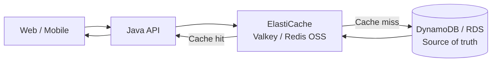
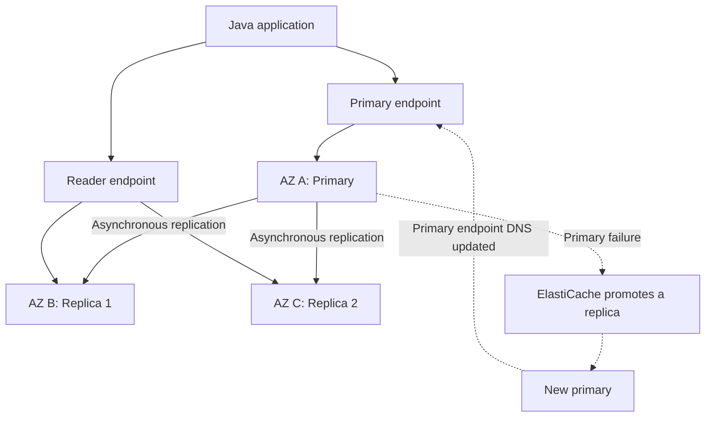
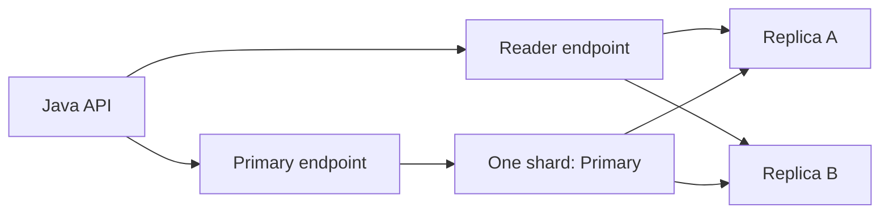
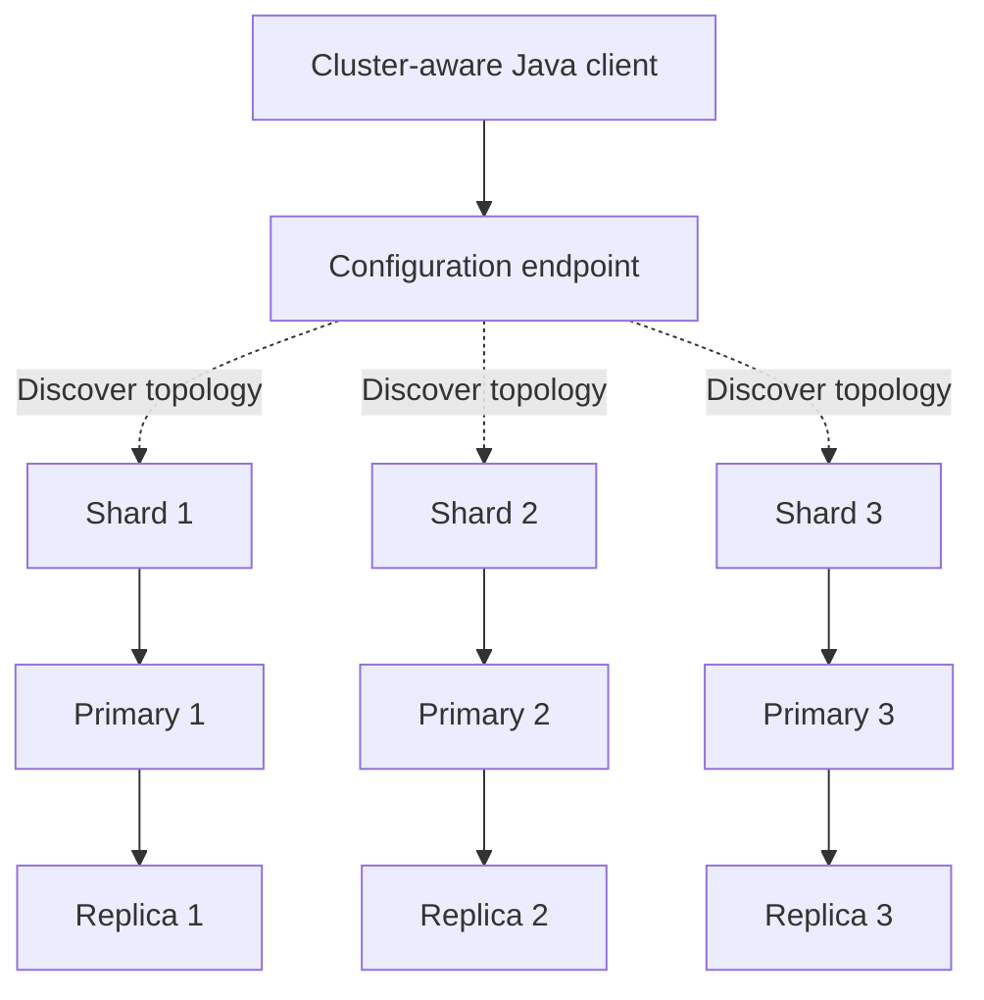
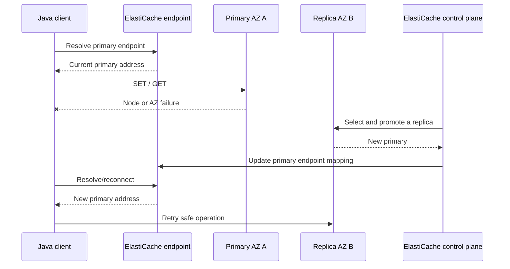

# Cache Replication, Failover, and Sharding

A Java Spring Boot system stores product data in Amazon DynamoDB, while **Amazon ElastiCache for Valkey/Redis OSS** holds frequently read data such as product details, sessions, rate-limit counters, and query results. As traffic grows, a single cache node can become a bottleneck. When the primary fails, the application must continue reading/writing without subjecting users to prolonged errors. When the dataset outgrows one node's capacity, the engineering team needs to partition data across multiple shards.

Three techniques are often mentioned together yet solve distinct problems:

- **Replication:** copying data from a primary to replicas for redundancy and to optionally offload certain reads.
- **Failover:** promoting a replica to primary when the current primary becomes unavailable.
- **Sharding:** splitting the keyspace/dataset across multiple partitions, each owned by a shard, to scale capacity and throughput.

Replication improves fault tolerance and can increase read capacity; failover shortens disruption during node failures; sharding distributes writes and data volume. None of these techniques automatically creates **backups**, **strong consistency**, or a guarantee that every in-flight request succeeds during a node transition.

This lesson belongs to the **Caching and Specialized Databases** chapter of the **CLOUD_PROVIDERS_AWS** module. It focuses on ElastiCache for Valkey/Redis OSS, replication groups, Multi-AZ automatic failover, cluster mode, hash slots, endpoints, Java clients, and coordinating the cache with backing databases so applications stay observable, resilient, and cost-controlled.

## 1. Learning Objectives

After this lesson, you can:

1. Distinguish cache replication, read scaling, automatic failover, sharding, and backups.
2. Describe a replication group consisting of a primary and replicas in ElastiCache for Valkey/Redis OSS.
3. Distinguish **cluster mode disabled** from **cluster mode enabled**, as well as primary, reader, configuration, and node endpoints.
4. Explain Multi-AZ and the prerequisites for ElastiCache automatic failover.
5. Understand replication lag, stale reads, and the risk of losing un-replicated writes prior to failover.
6. Explain Redis Cluster hash slots, `MOVED`, `ASK`, resharding, and hash tags.
7. Design cache keys, sharding strategies, and access patterns to avoid hot keys.
8. Configure cluster-aware Java/Spring Boot clients with TLS, reconnects, and topology refresh.
9. Implement cache-aside/invalidation, TTLs, idempotency, and graceful cache degradation.
10. Monitor failover, replication lag, CPU, memory, evictions, connections, and costs.
11. Distinguish ElastiCache Redis/Valkey from Memcached and ElastiCache Serverless.
12. Build a runbook to test failover, resharding, node replacement, and recovery.

## 2. Cache Is an Acceleration Layer, Not the Default Source of Truth

A cache keeps a copy of frequently accessed data to reduce latency and database load. In a typical architecture:



Caches can lose data via deletion, eviction, flushing, or node replacement/failover. Therefore, unless your application has explicit requirements and a dedicated durability design, **the database remains the source of truth**.

| Component | Role |
|---|---|
| Source database | Durable business data with model-specific transactions/constraints |
| Cache primary | Accepts cache writes and serves reads |
| Cache replica | Receives replicated data, can serve reads, and acts as failover promotion candidate |
| Cache client | Manages endpoints, connections, retries, and cluster topology |
| Invalidation/event path | Updates or deletes cache entries when the database changes |
| Monitoring | Detects node failures, lag, evictions, hot keys, and stale data |

**Never store unrecoverable, non-reconstructible data solely in a cache** assuming Multi-AZ replication equals a database backup. Replication serves HA; it can replicate accidental deletes and provides no point-in-time recovery history like a backup system.

## 3. Replication, Failover, and Sharding Solve Three Different Problems

| Technique | What it improves | What it does not solve automatically |
|---|---|---|
| **Replication** | Data redundancy, serving reads from replicas | Single-primary write throughput, backups, strong consistency |
| **Failover** | Shifting primary role to a replica on failure | In-flight requests, unknown write outcomes, logical corruption |
| **Sharding** | Distributing keyspace, memory, and writes across multiple primary nodes | Single hot keys, cross-shard transactions, global ordering |
| **Multi-AZ** | Separating nodes across Availability Zones to reduce AZ failure risk | Regional DR, backups, application-side reconnect logic |
| **Snapshots/backups** | Point-in-time snapshot recovery | Instant traffic takeover within seconds |
| **Client retries/idempotency** | Helps apps survive connection errors and handle duplicates safely | Recovering cache data if no authoritative source exists |

A replication group can have replicas yet **lack automatic failover** if required settings/conditions are not enabled. A multi-shard cluster can still have single points of failure if any shard lacks a replica. Evaluate every shard and every failure domain.

## 4. ElastiCache for Valkey/Redis OSS Replication Groups

Amazon ElastiCache provides managed caching. For **Valkey** or **Redis OSS**, a replication group typically includes:

- **Primary node:** accepts writes and can also serve reads.
- **Replica nodes:** receive data from the primary via replication and can serve read traffic.
- **Replication group:** a group of cache nodes with service-managed primary/replica relationships, failover, and endpoints.
- **Node group/shard:** the unit partitioning the keyspace when cluster mode is enabled.
- **Multi-AZ:** places nodes across multiple AZs and supports automatic failover when configured properly.



**Redis/Valkey replication is asynchronous.** Replicas can lag behind the primary; never assume every write is applied simultaneously across all replicas. When a primary fails abruptly, un-replicated writes may be missing on the new primary. AWS manages promotion and endpoint updates, while the application must still handle reconnects and business correctness.

Sources: [ElastiCache replication](https://docs.aws.amazon.com/AmazonElastiCache/latest/dg/Replication.html), [Valkey/Redis OSS Multi-AZ](https://docs.aws.amazon.com/AmazonElastiCache/latest/dg/AutoFailover.html).

## 5. Cluster Mode Disabled: One Shard, Optional Replicas

In **cluster mode disabled**, a replication group has **one shard/node group**:

- One primary node receives all writes.
- One or more replicas may exist per supported quota/engine/node configuration.
- Replicas can serve read queries if the app uses the reader endpoint or appropriate node endpoints.
- There is no horizontal keyspace sharding across multiple primaries; write capacity depends on that single primary.



### 5.1. When Is It a Good Fit?

- The dataset fits comfortably in a single node's memory.
- Write workloads can be handled by one primary.
- You want replicas for HA and/or read scaling.
- You prefer simpler application behavior over multi-shard Redis Cluster.
- The keyspace does not yet require distribution across multiple primaries.

### 5.2. Limitations

- **A single primary bounds write throughput.**
- Scaling up to a larger node class increases capacity, up to hardware limits.
- Replicas increase read capacity but do not add write capacity.
- During primary failover, active connections reset and clients must reconnect.
- The reader endpoint typically distributes **connections** across replicas; a long-lived pooled connection may stay pinned to one replica rather than load-balancing per command.

### 5.3. Endpoints

| Endpoint | Purpose |
|---|---|
| **Primary endpoint** | DNS name always resolving to the current primary; use for writes and critical read-after-write |
| **Reader endpoint** | Distributes read connections across replicas; use for stale-tolerant reads |
| **Node endpoint** | Points to a specific node; mainly for diagnostics/testing—avoid hardcoding as an HA endpoint |

**Never use a replica node endpoint as a write endpoint.** Replicas are read-only by role, and roles shift after promotion. Applications should use the role-based endpoints provided by ElastiCache.

## 6. Cluster Mode Enabled: Multiple Shards for Horizontal Scaling

**Cluster mode enabled** splits the keyspace across multiple **shards/node groups**. Each shard has one primary and optional replicas. Each primary owns a subset of hash slots, distributing writes by key.



### 6.1. Benefits

- Datasets exceeding one primary's memory or throughput can be distributed.
- Writes scale across multiple primary nodes.
- Each shard can have replicas for read scaling and promotion if its primary fails.
- You can reshard to add/remove node groups per service and engine version capabilities.

### 6.2. Trade-Offs

- Clients must be **cluster-aware** and understand topology and redirects.
- A request can span shards; multi-key operations are constrained by slot rules.
- Resharding, scaling, and failovers are more complex.
- Hot keys are not solved merely by adding shards: a single key still maps to one slot.
- Not every command, transaction, or Lua script can operate across multiple slots.

### 6.3. Do Not Confuse Shards with Replicas

- A **shard** is a distinct partition of the keyspace with its own primary.
- A **replica** is a copy of a shard's primary.
- Adding replicas improves a shard's HA and read capacity without splitting the keyspace further.
- Adding shards distributes the keyspace and write load, but does not automatically create replicas unless configured.

## 7. Redis Cluster Hash Slots: How Data Is Distributed

Redis Cluster partitions the keyspace into **16,384 hash slots**. Each key maps to a slot based on its hash (Redis Cluster uses `CRC16(key) mod 16384`). Different shards own different slot ranges.

```text
hashSlot(key) = CRC16(key) mod 16384

Illustrative example:
  slot 0..5000       → shard A
  slot 5001..11000   → shard B
  slot 11001..16383  → shard C
```

Actual slot ranges are assigned dynamically by the current topology; never hardcode the illustrative ranges above.

### 7.1. Client Routing

A cluster-aware client computes the key's slot and sends commands to the node owning that slot. If topology changes:

- **`MOVED`**: server indicates the slot is now permanently owned by another node; the client updates its topology/routing table.
- **`ASK`**: while a slot is migrating, the client is told to send the next command to the target node preceded by `ASKING`.
- Clients that do not understand redirects fail even when the cluster is healthy.

### 7.2. Multi-Key Commands and `CROSSSLOT`

Multi-key commands such as `MGET`, `MSET`, transactions, or Lua scripts require all involved keys to reside in the same hash slot (depending on command/engine support). If keys belong to different slots, Redis Cluster returns a `CROSSSLOT` error.

Example:

```text
MGET customer:1:profile customer:2:profile
→ may fail with CROSSSLOT if the 2 keys map to different slots

MGET customer:{42}:profile customer:{42}:cart
→ share hash tag {42}, mapped to the same slot
```

### 7.3. Hash Tags

The substring inside the first valid `{...}` braces determines the hash slot. Hash tags co-locate keys that must be operated on together:

```text
order:{ORD-123}:status
order:{ORD-123}:items
order:{ORD-123}:lock
```

All three keys share one slot, enabling multi-key operations for a single order.

**Never use one global hash tag like `GLOBAL` across the entire system** just to make all multi-key commands share a slot. That forces every key into a single slot, creating a hot shard and defeating distributed scaling. Choose hash tags aligned with **aggregate/business consistency boundaries**.

Sources: [Redis Cluster specification](https://redis.io/docs/latest/operate/oss_and_stack/reference/cluster-spec/), [ElastiCache cluster mode](https://docs.aws.amazon.com/AmazonElastiCache/latest/dg/Replication.Redis-RedisCluster.html).

## 8. Replication and Sharding: Throughput Impact

| Change | Write throughput | Read throughput | Memory capacity | HA |
|---|---|---|---|---|
| Add a replica to a shard | Does not meaningfully raise primary writes | Can increase read capacity | Consumes extra node memory/replication | Adds failover candidate |
| Upgrade primary node class | Can raise primary write capacity | Can raise read capacity | Increases per-node memory | Does not change replica topology |
| Add a shard | Distributes writes across more primaries | Adds nodes serving reads | Increases total cluster memory | Each shard still needs replicas |
| Enable Multi-AZ automatic failover | Not a throughput feature | Not a read-scaling feature | Uses compute in another AZ | Improves resilience to node/AZ failures |

**Replication is not sharding.** One primary with three replicas is still a single shard in cluster mode disabled. All three replicas hold the same dataset, so usable memory capacity does not quadruple.

**Sharding is not HA by itself.** A six-shard cluster where each shard has only a primary will lose that shard's data/availability if its node fails. Every shard needs replicas and automatic failover configured.

## 9. Multi-AZ and Automatic Failover

In a replication group with replicas, **Multi-AZ automatic failover** lets ElastiCache detect an unavailable primary, select an eligible replica, and promote it to primary. Exact configuration prerequisites depend on engine, version, cluster mode, and Region; typically Multi-AZ/automatic failover must be enabled with replicas in other AZs.



### 9.1. What the Application Must Expect

- ElastiCache failure detection and replica promotion.
- Endpoint/DNS updates and client DNS refresh.
- TCP reconnects and TLS handshakes.
- Redis client topology refresh when cluster mode is enabled.
- Application retries with backoff.
- Cache warm-up/repopulation if entries are missing or evicted.

Never quote a single universal RTO number for every cluster. Failover duration varies by topology, engine, node type, replication state, and network/client behavior. Measure in staging and establish end-to-end SLOs.

### 9.2. Critical Topology Conditions

- Primary and replicas should span **different AZs**.
- Placing all replicas in the same AZ as the primary means an AZ outage takes down the entire node group.
- With cluster mode enabled, verify **every shard** has replicas and cross-AZ placement.
- Never configure a subnet group with only one AZ when Multi-AZ is required.
- Confirm security groups, routes, NACLs, and DNS allow applications to reach the promoted node.

### 9.3. Automatic Failover Does Not Mean Zero Errors

During role transitions, applications can encounter `READONLY`, `MASTERDOWN`, connection resets, timeouts, cluster redirects, or transient errors. Clients must handle these cleanly and avoid endlessly retrying non-idempotent commands.

Source: [ElastiCache Multi-AZ automatic failover](https://docs.aws.amazon.com/AmazonElastiCache/latest/dg/AutoFailover.html).

## 10. Replication Lag and Stale Reads

Valkey/Redis OSS replication in ElastiCache is **asynchronous**. A primary can acknowledge a write before a replica applies it.

Example:

```text
T0: SET order:123:status "PAID" on primary → OK
T1: API reads via reader endpoint
T2: Replica has not yet received/applied update
T3: GET order:123:status → "PENDING" (stale)
T4: Replica catches up → "PAID"
```

### 10.1. Choosing Read Endpoints by Consistency

| Requirement | Endpoint/read path |
|---|---|
| Critical read-after-write | Primary endpoint / writer node |
| Session state needing immediate updates | Primary or dedicated consistency design |
| Dashboards tolerating brief staleness | Reader endpoint |
| Best-effort product cache | Reader endpoint may fit |
| Counters/rate limits that must not drift | Design atomic operations on primary and assess failover loss |
| Critical business truth | Query the source database, not a cache replica |

### 10.2. Replicas Have No Strong-Read Switch

Redis/Valkey replicas have no flag equivalent to DynamoDB `ConsistentRead=true` to force a replica to wait for full catch-up. To enforce read-after-write at the app layer, route critical reads to the primary or query the backing database with appropriate consistency.

### 10.3. Failover and Un-Replicated Writes

If a primary crashes before replicating a write, the promoted primary will lack that write. For reconstructible cache data, the app refills from the source DB. For unique business state held solely in cache, this is a design flaw: **never treat cache replication as a durable transaction log**.

## 11. How Failover Affects Clients and Connections

When a primary promotes or shard topology shifts:

- TCP connections to the old node close.
- DNS endpoints can change IP addresses; clients must re-resolve.
- Connection pools holding dead sockets continue failing until evicted.
- Cluster mode enabled requires refreshing topology and handling `MOVED`/`ASK`.
- In-flight commands can have indeterminate outcomes: the command may have executed while the response was lost.
- Pipelined/batched commands may have partially executed before the connection reset.

**Do not blindly retry every command.** `GET` is generally safe to retry; `SET key value` with the same value is usually idempotent in final state, whereas `INCR`, `LPUSH`, `XADD`, or side-effecting Lua scripts can execute twice.

### 11.1. Retry Policy

- Retry only explicitly identified transient/connection errors.
- Apply exponential backoff + jitter with capped attempts and total timeout.
- Prevent all application pods from reconnecting simultaneously right after failover.
- Evict stale sockets rather than keeping dead connections in the pool.
- For non-idempotent operations, use operation IDs/deduplication records or re-read state to reconcile.
- When the cache is unavailable, gate DB fallbacks with concurrency/rate limits to avoid **cache failure → DB overload**.

### 11.2. DNS and the JVM

Always use ElastiCache DNS hostnames rather than hardcoding private IPs. Java/JVM and OS DNS resolvers may cache addresses; configure sensible DNS TTLs matching your runtime, driver, and service guidance, and test reconnects. DNS refresh alone **does not fix cluster topology** if a cluster-mode client lacks cluster discovery.

## 12. Cluster-Aware Java Clients: Lettuce and Spring Data Redis

With **cluster mode enabled**, applications require a Redis Cluster-aware client that:

1. Connects to the seed/configuration endpoint.
2. Discovers nodes and hash-slot topology.
3. Routes key commands to the slot-owning node.
4. Handles `MOVED`/`ASK` redirects.
5. Refreshes topology after resharding/failover.
6. Manages connection pools, TLS, timeouts, and reconnects.

Common Java libraries:

- **Lettuce:** supports Redis Cluster, reactive/non-blocking APIs, and adaptive/periodic topology refresh.
- **Jedis:** offers cluster-aware client APIs; verify behavior for your version.
- **Spring Data Redis:** provides `RedisTemplate`/`StringRedisTemplate` abstractions, typically backed by Lettuce or Jedis.

### 12.1. Spring Boot: Cluster Mode Disabled

Example `application.yml` targeting the primary endpoint:

```yaml
spring:
  data:
    redis:
      host: my-cache-primary.xxxxxx.use1.cache.amazonaws.com
      port: 6379
      ssl:
        enabled: true
      timeout: 2s
      connect-timeout: 2s
      # Pull password/ACL credentials from a runtime secret store;
      # never store plaintext secrets in the repository.
```

To use the reader endpoint for stale-tolerant reads, configure a dedicated Redis connection factory/routing rule or client-supported read-from strategy. Never switch the sole `RedisTemplate` to the reader endpoint if writes also go through it.

### 12.2. Spring Boot: Cluster Mode Enabled

Seed node example:

```yaml
spring:
  data:
    redis:
      cluster:
        nodes:
          - my-cache-configuration.xxxxxx.clustercfg.use1.cache.amazonaws.com:6379
      ssl:
        enabled: true
      timeout: 2s
      connect-timeout: 2s
```

**The configuration endpoint is for bootstrap/discovery**, not a proxy routing every command through one node. The driver must parse cluster topology and route directly to primary/replica node endpoints per cluster protocol.

Property prefixes vary across Spring Boot generations (e.g., `spring.redis` in older releases vs. `spring.data.redis` in newer ones). Verify against your actual dependency version.

### 12.3. Topology Refresh in Lettuce

In cluster mode enabled, configure periodic and adaptive topology refresh per your Lettuce version:

```java
import java.time.Duration;
import io.lettuce.core.cluster.ClusterClientOptions;
import io.lettuce.core.cluster.ClusterTopologyRefreshOptions;

ClusterTopologyRefreshOptions topologyOptions =
    ClusterTopologyRefreshOptions.builder()
        .enablePeriodicRefresh(Duration.ofSeconds(30))
        .enableAllAdaptiveRefreshTriggers()
        .build();

ClusterClientOptions clientOptions =
    ClusterClientOptions.builder()
        .topologyRefreshOptions(topologyOptions)
        .build();
```

This is a **configuration fragment** that must be wired into `LettuceClientConfiguration`/the connection factory for your Spring Data Redis and Lettuce versions. Do not paste it standalone expecting Spring Boot to pick it up automatically. Refreshing too often adds extra connections/traffic; refreshing too rarely slows detection of topology changes.

Sources: [Spring Data Redis](https://docs.spring.io/spring-data/redis/reference/), [Lettuce Redis Cluster](https://redis.github.io/lettuce/).

## 13. Java Cache-Aside and Invalidation

Example product read service:

```java
@Service
public class ProductService {
    private final ProductRepository repository;

    public ProductService(ProductRepository repository) {
        this.repository = repository;
    }

    @Cacheable(cacheNames = "product", key = "#productId",
               unless = "#result == null")
    public Product getProduct(String productId) {
        return repository.findById(productId)
            .orElseThrow(() -> new NotFoundException(productId));
    }

    @CacheEvict(cacheNames = "product", key = "#product.id")
    public Product updateProduct(Product product) {
        return repository.save(product);
    }
}
```

This demonstrates the caching abstraction, with key caveats:

- `@Cacheable` works only when Spring Caching is enabled and the cache manager/serializer are configured.
- `@CacheEvict` must execute **after the database transaction commits**; evicting before commit or on rolled-back transactions leaves the cache inconsistent.
- Across multiple app instances, evictions must propagate via shared/distributed cache rather than local in-memory caches alone.
- If the DB updates but the cache invalidation fails, stale entries persist until TTL. Use outbox/CDC or reliable invalidation where strict freshness is required.
- Namespace keys by tenant/locale/version if values differ across users.

### 13.1. TTL and Cache Stampede

If a hot key expires while thousands of requests arrive simultaneously, all of them hit the DB. Mitigate stampedes using:

- TTL jitter (randomized expiration).
- In-app single-flight/request coalescing or bounded distributed locks.
- Stale-while-revalidate when business rules allow brief staleness.
- Pre-warming critical keys.
- Rate limits and concurrency caps on cache-miss fallbacks.
- Short-TTL negative caching if needed to block repeated lookups of nonexistent IDs.

### 13.2. Invalidation Is a Consistency Problem

Strategies:

| Strategy | How it works | Trade-off |
|---|---|---|
| TTL only | Stale data expires after a fixed window | Simple, explicit stale window |
| Cache-aside + delete on write | Delete cache key after DB commit | Must ensure invalidation reliably executes |
| Write-through | Write DB then synchronously update cache | Slower writes; must handle partial failures |
| Outbox/CDC invalidation | Publish event after transaction commit | Eventual invalidation; needs retries/idempotency |
| Versioned cache key | Embed version in key | Prevents stale overwrites; increases key count/cleanup |

**Never update the cache before DB commit** and return success if the DB transaction might still roll back. On write failure, the cache would hold phantom data that never committed.

## 14. Cache Keys and Sharding Strategy

Sharding works effectively when keys distribute evenly and queries route cleanly to target shards.

### 14.1. Choose Keys with Suitable Cardinality

Examples:

```text
product:{productId}:details
session:{sessionId}
cart:{customerId}
rate:{tenantId}:{apiKey}:{minute}
leaderboard:{gameId}:{season}
```

In cluster mode enabled, Redis Cluster hashes the key to assign slots. Key prefixes provide logical namespacing, while `{...}` hash tags override which substring determines slot placement.

### 14.2. Avoiding Hot Keys

A single key like `global:homepage:counter` receiving hundreds of thousands of increments/second still hits **one shard**, even in a 50-shard cluster. You can stripe hot counters across buckets and aggregate on read:

```text
counter:homepage:0
counter:homepage:1
...
counter:homepage:15

Write: pick bucket via hash(requestId)
Read: sum all 16 buckets
```

In exchange, reads must aggregate, counts may reflect slight point-in-time skew, and bucket lifecycles must be managed.

### 14.3. Hot Shards from Skewed Key Distribution

If 80% of traffic belongs to a single tenant/key, hashing still concentrates load onto a few keys/slots. Analyze access frequencies, key cardinality, payload sizes, and command costs—not merely key counts per shard.

### 14.4. Multi-Key Consistency Boundaries

When keys require atomic multi-key operations, apply hash tags deliberately:

```text
account:{A-100}:balance
account:{A-100}:ledger:last
account:{A-100}:lock
```

Never group all accounts under one tag. The goal is **co-locating within one aggregate**, not collapsing the entire cluster onto one shard.

## 15. Resharding and Topology Changes

In cluster mode enabled, shard counts can scale via ElastiCache-supported scaling/resharding operations, during which hash slots migrate between shards.

### 15.1. What Happens?

- Specific slots migrate from source shards to destination shards.
- Clients receive `MOVED`/`ASK` redirects during topology transitions.
- Some operations retry and commands may experience elevated latency.
- Node CPU/network and replication traffic increase.
- Hot keys remain on a single slot; adding shards never splits an individual key automatically.

### 15.2. Resharding Procedure

1. Measure memory/CPU/network, per-shard load, and slot distribution.
2. Verify whether adding/removing shards actually resolves the bottleneck.
3. Verify cluster-aware clients, redirect handling, and topology refresh.
4. Confirm replicas/Multi-AZ coverage for the target topology.
5. Schedule a change window and watch latency/error rates.
6. Reshard via ElastiCache workflows rather than manually altering slot maps.
7. Re-measure key distribution and hot shards afterward.
8. Verify app behavior, especially multi-key operations and hash tags.
9. Prepare a rollback/scale adjustment plan within service capabilities.

**Never treat resharding as invisible**: older non-cluster-aware clients or clients caching topology too long fail when slots move.

## 16. Which Writes Can Failover Lose?

Because replication is asynchronous, a vulnerability window exists:

```text
Primary:
  SET payment:123:status "CAPTURED" → returns OK
Replica:
  Has not yet received/applied command

Primary crashes:
  Replica is promoted
  Key payment:123:status still has old value or does not exist
```

This becomes critical if a cache is misused as the sole store for business state.

### 16.1. Classifying Cached Data

| Data type | Impact of losing recent writes on failover | Design |
|---|---|---|
| Product details cache | Refillable from DB | Cache-aside + TTL |
| Session cache | Users may have to re-authenticate | Accept loss per policy or use a more durable session store |
| Rate-limit counters | Some requests may briefly exceed quota | Pick datastore/algorithm matching security requirements |
| Shopping cart cache | Latest cart edits may vanish | Durable cart in DB or event log; cache as projection only |
| Payment status | Zero loss acceptable | Database/payment provider as source of truth; cache read-only |
| Distributed locks | Bad locking can cause races | Fencing tokens/leases and an appropriate lock system |

### 16.2. Cache Replication Is Not Durable Consensus

Do not mistake async replication for quorum consensus transactions like distributed databases with stronger guarantees. If business workflows require zero lost writes, pick an appropriate database and transaction model while keeping the cache as an acceleration layer.

## 17. Distinguishing Valkey/Redis OSS from Memcached

| Feature | **ElastiCache for Valkey / Redis OSS** | **ElastiCache for Memcached** |
|---|---|---|
| Data structures | Strings, hashes, lists, sets, sorted sets, streams (by engine/version) | Primarily simple key/value caching |
| Replication | Primary/replica | No Redis-style replication groups |
| Multi-AZ automatic failover | Supported per configuration | No primary/replica automatic failover model |
| Sharding | Redis Cluster / cluster mode enabled | Usually client-side key distribution across nodes |
| Persistence/snapshots | Snapshot/backup capabilities per engine/config | Not a durable store; node failures drop local cache data |
| HA | Replicas + Multi-AZ | Client handles node loss and repopulation |
| Transactions/scripts | Richer support within engine/cluster constraints | Not comparable to Redis |
| Use cases | Caching, sessions, counters, queues/data structures, leaderboards | Simple, high-throughput multi-threaded key/value caching |

If you only need basic key/value caching and can repopulate on node loss, Memcached can suffice. If you need replication, failover, Redis data structures, atomic commands, or cluster-aware sharding, Valkey/Redis OSS is usually the better fit.

## 18. ElastiCache Serverless: Who Manages Sharding and Failover?

**ElastiCache Serverless** is a distinct model from provisioned replication groups. AWS manages data distribution, capacity scaling, and HA infrastructure; you interact through serverless endpoints and usage-based capacity models.

- You do not manually size shard/replica counts as in provisioned replication groups.
- Provisioned primary/reader/configuration endpoint patterns do not carry over identically.
- Check client compatibility, supported engines/versions, TLS/auth, networking, and scaling behavior against serverless cache documentation.
- Pricing follows serverless capacity/storage/usage units rather than simple node-hours.

Choose Serverless to reduce node/topology management for variable workloads; choose provisioned replication groups when you want explicit node classes, shards, and replicas and understand their operation.

Source: [ElastiCache Serverless](https://docs.aws.amazon.com/AmazonElastiCache/latest/dg/WhatIs.serverless.html).

## 19. Security: TLS, AUTH, IAM, and VPC

Caches routinely hold sessions, tokens, or user data; "it's just a cache" is never an excuse to skip security.

### 19.1. Network Isolation

- Place caches inside **private subnets** of your VPC.
- Restrict security groups to the required TCP port from application SGs only.
- Disable public access for production caches.
- For Multi-AZ, ensure subnet groups span the necessary AZs.
- Verify routes, NACLs, SGs, and DNS behavior after node promotions.
- Never hardcode IPs; always use endpoint hostnames.

### 19.2. Encryption

- Enable **in-transit encryption (TLS)** where supported by engine/node configuration and required by policy.
- Enable **at-rest encryption** for disk/snapshots per engine/Region capabilities.
- With customer-managed KMS keys, apply least-privilege key policies and IAM grants.
- Never log passwords, AUTH tokens, session tokens, or raw sensitive cache values.

### 19.3. Authentication and IAM

ElastiCache offers auth mechanisms by engine/mode, such as Redis AUTH tokens/ACL users and IAM authentication where supported. Do not assume IAM auth exists across every engine, version, and cache type; verify compatibility.

- Separate users per app/service.
- Scope ACL commands and key patterns to least privilege.
- Plan connection refreshes around Secrets Manager secret rotation.
- Never share one default user/password across environments.
- Test Redis ACL key patterns and command permissions against application scripts.

### 19.4. VPC Networking

Apps in ECS/EKS/EC2/Lambda inside a VPC must have routing to cache subnets and matching security groups. A cache is not a public API endpoint; never open `0.0.0.0/0` inbound "just for quick testing."

## 20. Operational Monitoring and Alerting

### 20.1. Metrics to Watch

| Metric/signal | Meaning | Question to ask |
|---|---|---|
| `CPUUtilization` | Node CPU | Is the primary/shard saturated? |
| `FreeableMemory` | Available memory | Is memory pressure building? |
| `DatabaseMemoryUsagePercentage` (where supported) | Percentage of memory used by cache data | Do we need to scale nodes/shards? |
| `Evictions` | Evicted keys | Are memory policies or TTLs misaligned? |
| `CurrConnections` / `NewConnections` | Current/new connections | Is there a post-failover connection storm? |
| `ReplicationLag` | Replica delay behind primary | Risk of stale reads or data loss on failover? |
| `NetworkBytesIn/Out` | Network traffic | Is a shard/node seeing hot traffic? |
| `CacheHits` / `CacheMisses` | Hit ratio | Is the cache effective? |
| `SwapUsage` | Swap activity | Is memory sizing inadequate? |
| `EngineCPUUtilization` (where available) | Engine process CPU | Is the bottleneck in the engine thread or host? |
| Events/failover notifications | Node/replication group state transitions | When did a primary promote? |

Exact metric names, dimensions, and availability vary by engine, node type, deployment mode, and CloudWatch integration. Check actual metrics on your replication group rather than assuming every metric exists for every cache type.

### 20.2. Useful Alerts

- Unhealthy primary node or failover event triggered.
- Replica lag exceeding SLO thresholds.
- Sustained high CPU, memory, or network utilization.
- Surging evictions or falling hit ratio.
- Abnormal connection spikes after deployments or failovers.
- Rising cache misses driving DynamoDB/RDS read spikes.
- One shard running significantly hotter than peers.
- Resharding/maintenance running longer than planned.
- Unexpected spikes in node costs, cross-AZ transfer, or serverless usage.

### 20.3. Never Monitor Hit Ratio Alone

A high hit ratio can mask stale data or a hot key. A low hit ratio may simply reflect cold-start warming after failover or resharding. Pair cache metrics with DB latency, business request latency, error rates, and business-level correctness checks.

Source: [Monitoring ElastiCache](https://docs.aws.amazon.com/AmazonElastiCache/latest/dg/CacheMetrics.html).

## 21. Cost and Capacity Planning

### 21.1. Cost Components

- Node-hours for primaries and replicas.
- Shards × replicas/shard × node class.
- Memory capacity and data overhead.
- Cross-AZ data transfer/replication traffic depending on deployment.
- Backups/snapshots and storage.
- ElastiCache Serverless usage/storage if using Serverless.
- CloudWatch metrics/logging, alarms, and observability.
- Network routing/NAT/VPC endpoints depending on architecture.
- Database refill costs during misses, evictions, and failovers.
- Engineering/operational effort for resharding, testing, and triage.

### 21.2. Sizing Example

Suppose a provisioned cluster-mode-enabled deployment has **3 shards**, each with **1 primary + 1 replica**:

```text
3 shards × (1 primary + 1 replica)
= 6 cache nodes total

If increasing to 2 replicas/shard:
3 × (1 + 2) = 9 cache nodes

If scaling from 3 to 6 shards keeping 1 replica each:
6 × (1 + 1) = 12 cache nodes
```

This counts nodes, **not cost**. Actual spend depends on node class, Region, reserved vs. on-demand pricing, storage/backups, cross-AZ transfer, and traffic.

### 21.3. Never Scale on Memory Alone

A node may have plenty of free memory while CPU saturates on Lua scripts or large sorted sets; adding RAM won't help. Conversely, low CPU with high evictions points to insufficient RAM or poorly tuned TTLs/cardinality. Measure CPU, memory, network, ops/sec, command latency, and hot keys before scaling.

## 22. AWS CLI: Inspecting Topology and Status (Read-Only)

The commands below only read configuration metadata; substitute identifiers for your authorized replication groups.

```bash
# Verify active account
aws sts get-caller-identity

# Inspect replication group, endpoints, and cluster mode
aws elasticache describe-replication-groups \
  --replication-group-id orders-cache \
  --region ap-southeast-1 \
  --query 'ReplicationGroups[0].{Status:Status,ClusterEnabled:ClusterEnabled,MultiAZ:MultiAZ,AutomaticFailover:AutomaticFailover,Members:MemberClusters,ConfigurationEndpoint:ConfigurationEndpoint,NodeGroups:NodeGroups}' \
  --output json

# Inspect cache clusters/nodes
aws elasticache describe-cache-clusters \
  --show-cache-node-info \
  --region ap-southeast-1

# Inspect cache subnet groups
aws elasticache describe-cache-subnet-groups \
  --region ap-southeast-1

# Inspect recent events
aws elasticache describe-events \
  --source-type replication-group \
  --source-identifier orders-cache \
  --duration 120 \
  --region ap-southeast-1
```

**Do not call `describe-cache-clusters` without `--show-cache-node-info` and assume all node endpoints were listed.** Check `NodeGroups`, member nodes, and endpoint fields per resource type.

### 22.1. Checking Endpoint DNS

From an authorized app/VPC environment:

```bash
nslookup orders-cache.xxxxxx.use1.cache.amazonaws.com
```

Returned IPs can change on failover. Never copy these IPs into production configs; always configure the ElastiCache DNS endpoint.

## 23. Safe Failover and Resharding Drills

A failover test is a **real mutating operation** on a cache replication group. Run it only in staging—or production after formal approval—with a named owner, schedule, monitoring, and rollback/mitigation plan.

### 23.1. Pre-Drill Checklist

1. Verify replication group, cluster mode, engine/version, and node groups.
2. Confirm healthy replicas and Multi-AZ/automatic failover enabled for the topology.
3. Capture baseline latency, error rates, `ReplicationLag`, connections, and cache hit ratio.
4. Run a synthetic workload using operation IDs to detect duplicate or lost writes.
5. Confirm Java clients target the proper primary/reader/configuration endpoints.
6. Ensure cache-miss fallbacks will not overload the database.
7. Prepare dashboards, alarms, and on-call staff.

### 23.2. During the Drill

- Record the exact failover start time.
- Watch ElastiCache events and node role transitions.
- Monitor DNS resolution, TCP reconnects, and cluster topology refreshes.
- Log any `READONLY`, timeout, `MOVED`/`ASK`, or `CLUSTERDOWN` errors.
- Measure elapsed time until cache requests stabilize cleanly.
- Check whether writes right before/during failover went missing.
- Never issue unbounded retries or flush the cache to "clean up" issues.

### 23.3. Post-Drill

- Verify primary/replica roles and AZ placement.
- Confirm replica lag returned to normal bounds.
- Measure cache warm-up, hit ratio, and DB load.
- Reconcile business data against the source database.
- Record actual application RTO, not merely the AWS event timestamp.
- Tune retries, connection pools, DNS/topology refresh intervals, and alarms.

### 23.4. `TestFailover` API

AWS provides the `TestFailover` API/CLI for supported replication groups/node groups. This is a **potentially disruptive write operation**; check engine, cluster mode, state, and limits before invoking. Never run failover tests in production casually for training or just to verify IAM permissions.

Source: [ElastiCache test failover](https://docs.aws.amazon.com/AmazonElastiCache/latest/APIReference/API_TestFailover.html).

## 24. CloudFormation: Multi-AZ Cluster-Mode-Disabled Replication Group

Illustrative template creating a **Redis OSS replication group** with one primary and one replica, Multi-AZ/automatic failover, and TLS/at-rest encryption. Deploying creates billable resources.

```yaml
AWSTemplateFormatVersion: '2010-09-09'
Description: ElastiCache Redis OSS replication group with Multi-AZ failover

Parameters:
  CacheSubnetGroupName:
    Type: String
  CacheSecurityGroupId:
    Type: AWS::EC2::SecurityGroup::Id

Resources:
  OrdersCache:
    Type: AWS::ElastiCache::ReplicationGroup
    Properties:
      ReplicationGroupDescription: Orders cache HA example
      Engine: redis
      CacheNodeType: cache.t4g.small
      NumCacheClusters: 2
      AutomaticFailoverEnabled: true
      MultiAZEnabled: true
      CacheSubnetGroupName: !Ref CacheSubnetGroupName
      SecurityGroupIds:
        - !Ref CacheSecurityGroupId
      TransitEncryptionEnabled: true
      AtRestEncryptionEnabled: true
      AutoMinorVersionUpgrade: true
      SnapshotRetentionLimit: 1

Outputs:
  PrimaryEndpoint:
    Value: !GetAtt OrdersCache.PrimaryEndPoint.Address
  ReaderEndpoint:
    Value: !GetAtt OrdersCache.ReaderEndPoint.Address
```

### 24.1. Conditions to Verify

- The cache subnet group spans subnets across appropriate AZs.
- The security group allows access strictly from the application on the required cache port.
- The node class and engine version are supported in your Region.
- Multi-AZ automatic failover satisfies node/replica count and engine rules.
- `NumCacheClusters: 2` in this example sets total nodes in **cluster mode disabled** (one primary + one replica); it does **not** create two shards.
- Snapshot retention does not replace long-term backup policies or authoritative database backups.
- TLS/at-rest encryption settings must align with engine, client, and parameter group support.
- Output endpoints are DNS addresses; apps must still refresh connections on failover.
- Manage deletion protection, tags, maintenance windows, log delivery, auth tokens/ACLs, and secrets per production standards.

### 24.2. Cluster Mode Enabled Requires Different Properties

Cluster mode enabled uses `NumNodeGroups` and `ReplicasPerNodeGroup` alongside a cluster-mode-compatible parameter group; do not use `NumCacheClusters` to specify shard counts. Configure engine/parameter groups, node classes, subnet groups, encryption, auth, and quotas per your AWS/Valkey/Redis OSS release. This example intentionally uses cluster mode disabled to avoid mixing up semantics.

## 25. Common Troubleshooting Scenarios

| Symptom | Likely cause | What to inspect |
|---|---|---|
| Primary endpoint times out after failover | DNS caching / stale TCP connections | JVM DNS settings, pools, reconnect logic, ElastiCache events |
| `READONLY` error on write | Client still connected to replica or wrong endpoint | Primary endpoint, node roles, stale topology |
| Repeated `MOVED` errors | Client not refreshing cluster topology | Cluster-aware client, slot map, driver version |
| `ASK`/`MOVED` during resharding | Slot migrating or faulty client redirect handling | Client support, topology refresh |
| `CROSSSLOT` | Multi-key command touches multiple hash slots | Hash tags / aggregate key design |
| Replica returns stale data | Replication lag / eventual replication | Route critical reads to primary, measure lag |
| One shard high CPU while others stay low | Hot keys / skewed key distribution | Key cardinality, per-shard metrics, sharding |
| Rising evictions | Memory pressure, TTL/eviction policy | Memory usage, key sizes, node class |
| DB overloaded during cache failover | Cache-miss stampede / unbounded fallbacks | Rate limits, request coalescing, warm-up |
| Cache misses jump after reshard | Cold keys, topology shifts, key migration | Warm-up, hit ratio, application errors |
| Java fails TLS handshake | Client truststore / TLS config / wrong port | Certificates, SSL config, security groups |
| Automatic failover does not trigger | Multi-AZ/automatic failover disabled or invalid topology | Replication group config, replicas, engine support |
| Writes missing after promotion | Replica lacked write before primary failure | Replication semantics, source database |
| Reader endpoint hits only one replica | Long-lived connection pool, DNS/connection pinning | Reader endpoint semantics, pool/connection counts |
| High latency despite free memory | CPU/network limits, large commands, slow scripts | Engine CPU, command latency, payload sizes |

### 25.1. Investigation Order

1. Identify cache type: Valkey/Redis OSS provisioned replication group or Serverless, cluster mode enabled/disabled.
2. Check replication group status, Multi-AZ/automatic failover, and shard/member health.
3. Review ElastiCache events, CloudWatch metrics, and timestamps.
4. Verify the right endpoint role: primary, reader, configuration, or node.
5. Verify DNS resolution, TLS, security groups, and subnets/AZs.
6. Inspect client topology, `MOVED`/`ASK` handling, reconnects, and connection pools.
7. Measure replica lag, CPU, memory, evictions, network, and hot shards.
8. Determine if cache misses are overloading the database.
9. Reconcile critical records against the source of truth; never treat cache as final evidence.
10. Fix root cause, canary deploy, and re-test failover/resharding.

## 26. Practice Scenarios

### Scenario A — Replication or Sharding?

A cache has one primary and two replicas. Write throughput stays flat despite adding replicas.

**Answer:** replicas mainly scale HA and read capacity. To scale writes horizontally, use sharding/cluster mode enabled or scale up the primary appropriately.

### Scenario B — Multi-AZ Failover

A replication group has primary and replica in the same AZ, with automatic failover disabled. That AZ goes down.

**Answer:** the topology does not provide cross-AZ HA as expected. Place replicas across different AZs and enable Multi-AZ/automatic failover properly.

### Scenario C — Stale Read

Java runs `SET order:123:status PAID` on the primary, immediately reads via the reader endpoint, and receives `PENDING`.

**Answer:** replica replication is asynchronous, so replica reads can lag. Route critical read-after-write queries to the primary or source database.

### Scenario D — Cluster Mode Enabled

A client connects `RedisTemplate` to the configuration endpoint without cluster-awareness; after resharding, commands fail with `MOVED`.

**Answer:** you need a Redis Cluster-aware driver with topology discovery and redirect handling. The configuration endpoint is a bootstrap endpoint, not a single-node proxy for all commands.

### Scenario E — `CROSSSLOT`

A Lua script updates `cart:1` and `inventory:sku-1` in a cluster, where the two keys map to different slots.

**Answer:** Redis Cluster forbids arbitrary multi-key scripts across different slots. If atomicity within one cluster operation is truly required, design hash tags around aggregate/consistency boundaries or split into a compensating workflow.

### Scenario F — Hot Key

A cluster has 12 shards, yet `global:counter` absorbs 90% of writes.

**Answer:** one key maps to one slot, overloading a single shard. Split the counter into buckets and aggregate on read, or choose a service better suited for high-write global counters.

### Scenario G — Lost Write After Failover

`INCR payment:count` returns `OK`, then the primary crashes before the replica applies it. The promoted replica shows a lower count.

**Answer:** async replication can lose un-replicated writes. Never use a cache as the source of truth for payment counts; persist to a durable ledger/database and use the cache only as a projection.

### Scenario H — Cache Stampede

Failover causes many keys to miss at once; thousands of requests flood DynamoDB.

**Answer:** apply request coalescing, TTL jitter, stale-while-revalidate, controlled warm-up, and concurrency/rate limits. Fallbacks must shield the backing DB.

### Scenario I — Reader Endpoint

Operations uses the reader endpoint, yet only one replica receives traffic.

**Answer:** the reader endpoint distributes connections, not individual commands; a long-lived connection pool can stay bound to one replica. Inspect pools/connections and per-node metrics.

### Scenario J — Memcached or Valkey

An app only needs simple JSON caching without replication or rich data structures; or it needs Redis Cluster, atomic counters, and Multi-AZ failover.

**Answer:** Memcached suffices for best-effort key/value object caching; Valkey/Redis OSS fits when replication, failover, and Redis data structures are needed.

### Scenario K — Is Failover a Backup?

Someone accidentally deletes all session keys on the primary. Operations asks for a failover to restore the keys.

**Answer:** deletions replicate to replicas too. Failover is not a point-in-time restore. You need a reconstructible source or proper snapshots/backups.

### Scenario L — Counting Nodes

Cluster mode enabled has 4 shards, each with 1 primary and 2 replicas.

**Answer:** total cache nodes = 4 × (1 + 2) = 12. There are 4 primary shards, not 12 shards.

### Scenario M — Resharding

After increasing shard count, older clients continuously receive `MOVED`.

**Answer:** clients failed to refresh topology or lack proper cluster redirect support. Upgrade/configure cluster-aware drivers and topology refresh.

### Scenario N — Cache Invalidation

The DB commits a new product price, but the invalidation event fails; the cache keeps the old price.

**Answer:** use outbox/CDC or reliable invalidation retries, TTL as a safety net, and versioned keys where suitable. Never update the cache before the DB commits.

### Review Questions

1. How do replication and sharding differ?
2. Does adding a replica increase a single primary's write throughput?
3. What does failover do to a replica?
4. Is Redis/Valkey replication strictly synchronous?
5. What is the primary endpoint used for?
6. Does the reader endpoint load-balance connections or individual commands?
7. How many shards exist in cluster mode disabled?
8. What concept partitions the keyspace in cluster mode enabled?
9. How many hash slots does Redis Cluster have?
10. What do `MOVED` and `ASK` mean?
11. Why can multi-key commands return `CROSSSLOT`?
12. What does hash tag `{order-1}` achieve?
13. Does a hot key automatically split across multiple shards?
14. Does Multi-AZ replace backups?
15. Which writes can failover lose?
16. When should you read from the primary instead of the reader endpoint?
17. Why must clients be cluster-aware in cluster mode enabled?
18. Is the configuration endpoint a single node endpoint?
19. Does DNS refresh replace topology refresh?
20. Can `INCR` be blindly retried after a timeout?
21. How does a cache stampede impact the database?
22. Does Memcached offer Redis-style replication-group failover?
23. Does cluster mode enabled require replicas per shard for HA?
24. Why does `NumCacheClusters` not equal shard count?
25. Which metrics help detect hot shards and memory pressure?

**Quick answers:** (1) copies vs. partitioning keyspace; (2) no; (3) promotes it to primary; (4) no, asynchronous; (5) writes/current primary; (6) connections; (7) one; (8) 16,384 hash slots; (9) 16,384; (10) permanent slot redirect / temporary migration redirect; (11) keys in different slots; (12) co-locates keys in the same slot; (13) no; (14) no; (15) un-replicated writes; (16) read-after-write/critical consistency; (17) discovery/routing/redirects; (18) no; (19) no; (20) no, could increment twice; (21) causes DB overload; (22) no; (23) yes, if per-shard failover is required; (24) in cluster mode disabled it counts nodes in one shard; (25) per-shard CPU/network, replication lag, memory, evictions, and hot-key insights.

## 27. Production Checklist

- [ ] Clarified whether the cache is a source of truth or strictly a derived/cache layer.
- [ ] Selected Valkey/Redis OSS, Memcached, or Serverless matching data structures, HA, and scale.
- [ ] Selected cluster mode disabled/enabled based on write throughput, dataset size, and complexity.
- [ ] Every shard needing HA has replicas and proper cross-AZ placement.
- [ ] Multi-AZ/automatic failover enabled and verified per engine, version, and Region.
- [ ] Application targets the right primary/reader/configuration/node endpoints.
- [ ] No hardcoded node IPs or fixed node endpoints used as HA endpoints.
- [ ] Java client is cluster-aware for cluster mode enabled and handles `MOVED`/`ASK`.
- [ ] Tested DNS caching, topology refresh, connection pools, TLS, and reconnects.
- [ ] Read-after-write and critical reads do not rely on eventually consistent replicas.
- [ ] Business data is not held solely in cache unless loss is acceptable.
- [ ] Retries use bounded attempts/backoff/jitter; non-idempotent commands have reconciliation.
- [ ] Cache-aside invalidation runs post-DB commit, backed by outbox/CDC where needed.
- [ ] Configured TTL jitter, stampede protection, warm-up, and DB fallback limits.
- [ ] Keys distribute evenly; avoided hot keys or cluster-wide hash tags.
- [ ] Multi-key operations and Lua scripts respect hash-slot boundaries.
- [ ] Resharding/scaling has runbooks, topology-aware clients, and monitoring.
- [ ] Monitoring covers replication lag, CPU, memory, evictions, connections, network, and hit/miss rates.
- [ ] CloudWatch alerts have owners/on-call rotation and SLO-aligned thresholds.
- [ ] Cache subnet groups, private subnets, SGs, TLS, KMS, ACLs, and IAM follow least privilege.
- [ ] Failover drills measure end-to-end recovery and missing/duplicate data.
- [ ] Backup/snapshots and source-database recovery are designed independently.
- [ ] Costed nodes, replicas, shards, network, backups, and observability.
- [ ] Tested cold cache, node loss, AZ failure, hot shards, replica lag, and DB overload.

## 28. Summary

**Replication, failover, and sharding** are three complementary building blocks for HA and scalable caching on AWS:

- **Replication** copies data from primary to replicas for read offloading and failover candidacy; asynchronous replication introduces lag.
- **Failover** promotes a replica when the primary fails; endpoints/DNS are service-managed, but clients must reconnect, refresh topology, and retry safely.
- **Sharding** splits the keyspace across primaries to scale memory and writes; Redis Cluster uses **16,384 hash slots**, `MOVED`/`ASK` redirects, and hash tags for multi-key operations.
- **Cluster mode disabled** runs one shard; **cluster mode enabled** runs multiple shards and requires cluster-aware clients.
- **Multi-AZ automatic failover** improves node/AZ resilience, yet does not replace backups/PITR/DR or guarantee zero errors for in-flight requests.
- **Cache consistency** must be co-designed with the source database: primary for critical read-after-write, reader replicas for stale-tolerant reads, post-commit invalidation, and idempotency for retries.
- **Monitoring and cost control** must track per-shard load, replication lag, evictions, connection churn, cache miss/DB fallbacks, and real node/replica counts.

A production-grade cache is not just about adding nodes. It requires **well-distributed keys, cross-AZ replicas, topology-aware clients, clean invalidation, bounded fallbacks, durable backing data, and rehearsed failover runbooks**.

### Official AWS and Vendor Documentation

1. [Amazon ElastiCache User Guide](https://docs.aws.amazon.com/AmazonElastiCache/latest/dg/WhatIs.html)
2. [ElastiCache replication](https://docs.aws.amazon.com/AmazonElastiCache/latest/dg/Replication.html)
3. [Multi-AZ and automatic failover](https://docs.aws.amazon.com/AmazonElastiCache/latest/dg/AutoFailover.html)
4. [ElastiCache for Redis OSS cluster mode](https://docs.aws.amazon.com/AmazonElastiCache/latest/dg/Replication.Redis-RedisCluster.html)
5. [ElastiCache endpoints](https://docs.aws.amazon.com/AmazonElastiCache/latest/dg/Endpoints.html)
6. [ElastiCache resharding](https://docs.aws.amazon.com/AmazonElastiCache/latest/dg/Scaling.RedisCluster.html)
7. [Testing automatic failover](https://docs.aws.amazon.com/AmazonElastiCache/latest/APIReference/API_TestFailover.html)
8. [Monitoring ElastiCache](https://docs.aws.amazon.com/AmazonElastiCache/latest/dg/CacheMetrics.html)
9. [ElastiCache Serverless](https://docs.aws.amazon.com/AmazonElastiCache/latest/dg/WhatIs.serverless.html)
10. [ElastiCache security](https://docs.aws.amazon.com/AmazonElastiCache/latest/dg/WhatIs.Security.html)
11. [ElastiCache pricing](https://aws.amazon.com/elasticache/pricing/)
12. [Redis Cluster specification](https://redis.io/docs/latest/operate/oss_and_stack/reference/cluster-spec/)
13. [Redis Cluster tutorial](https://redis.io/docs/latest/operate/oss_and_stack/management/scaling/)
14. [Spring Data Redis reference](https://docs.spring.io/spring-data/redis/reference/)
15. [Lettuce documentation](https://redis.github.io/lettuce/)
16. [AWS Well-Architected Reliability Pillar](https://docs.aws.amazon.com/wellarchitected/latest/reliability-pillar/welcome.html)
