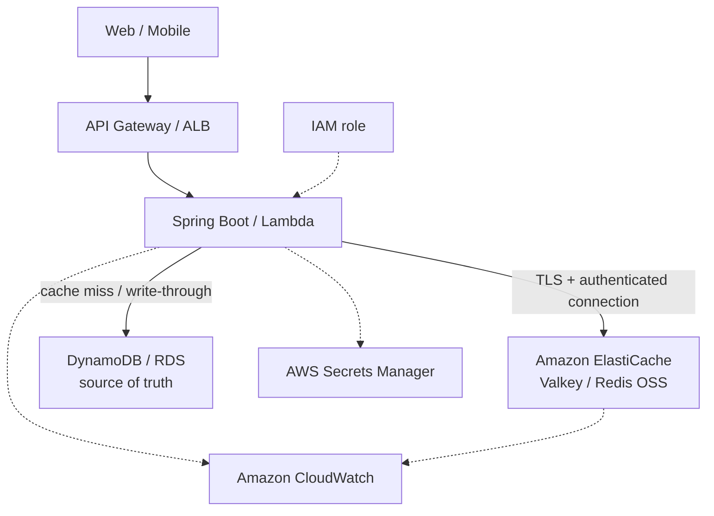
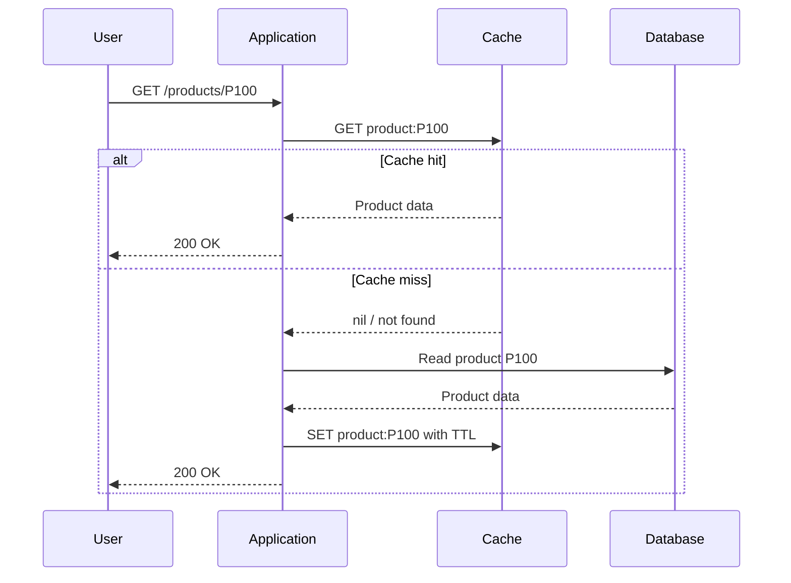
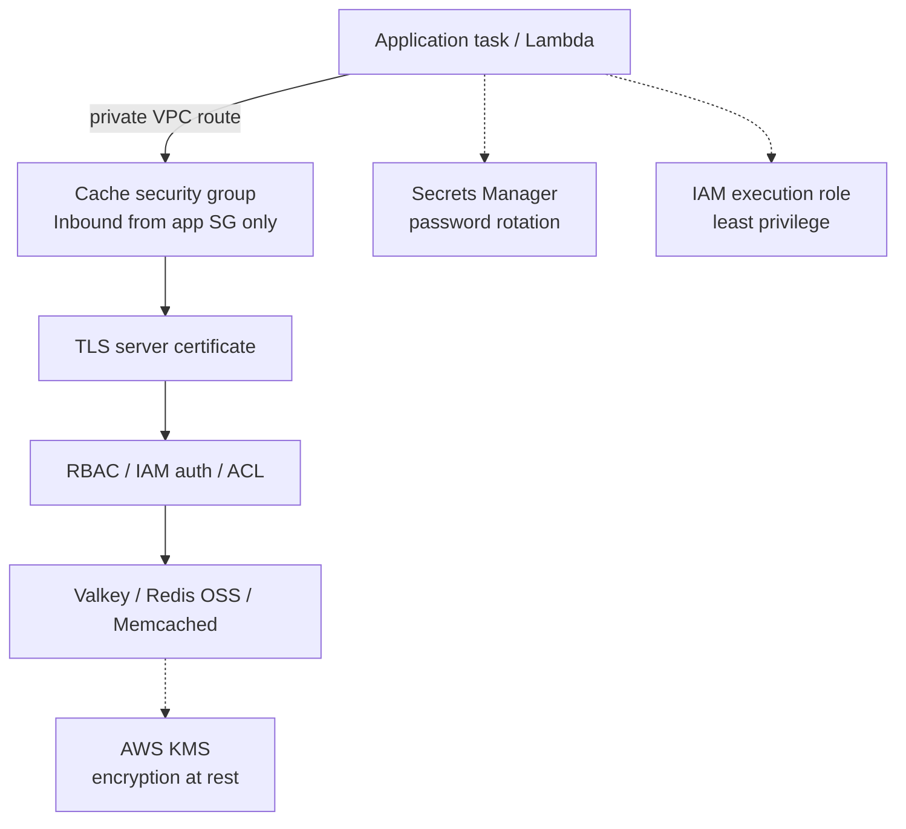
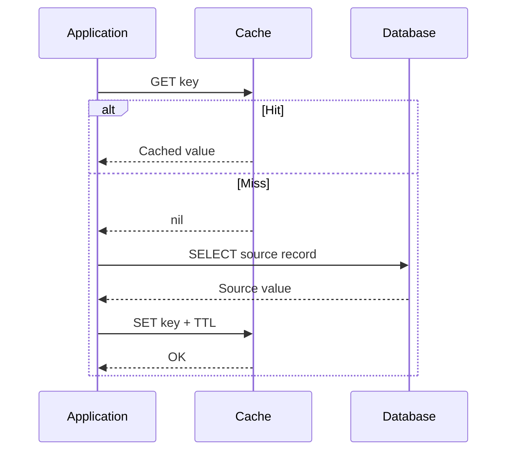
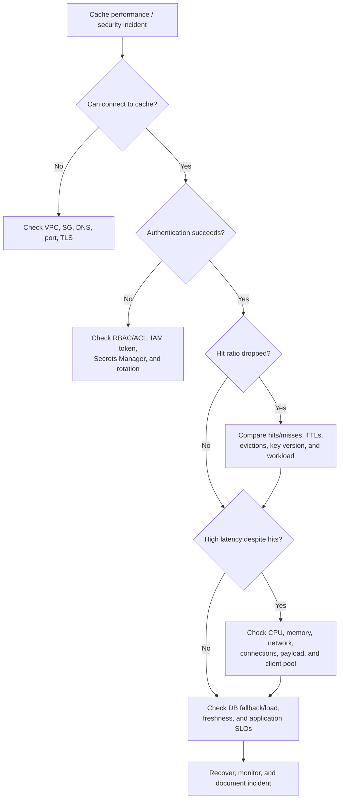

# Securing Connections and Observing Cache Hit Ratio on AWS

> **Chapter:** Caching and Specialized Databases  
> **Module:** CLOUD_PROVIDERS_AWS  
> **Objective:** secure the connection path between applications and caches, choose appropriate TLS/authentication/authorization mechanisms for each AWS service, manage credentials safely, measure cache hit ratio accurately, and combine operational metrics to improve latency, reliability, and cost.
>
> **Scope:** Amazon ElastiCache for Valkey/Redis OSS/Memcached, Amazon MemoryDB, and DynamoDB Accelerator (DAX). Metric names, engine versions, TLS limits, auth mechanisms, and features vary by cache type/Region; verify against official AWS documentation for your specific resources.

## 1. The Problem: Fast Caching Without Creating a Data Backdoor

An e-commerce application running on ECS and Lambda uses caching for:

- Frequently read product information.
- Login sessions and shopping cart state.
- Dashboard query results.
- Rate limits and idempotency keys.
- Shared reference data across multiple services.

The architecture might use Amazon ElastiCache for Valkey/Redis OSS as a distributed cache:



If a cache is unprotected, any workload with network reachability can read sessions or sensitive data, delete keys, run admin commands, or exhaust resources. If TLS is enabled while everyone shares one unrestricted account, connected clients can still perform actions beyond their needs. If cache hit ratio is measured incorrectly, operations teams may resize nodes or tweak TTLs without fixing the root cause.

A sound deployment answers four questions:

1. **Who can reach the endpoint?** VPC, subnets, security groups, routing.
2. **Who is authenticated and what can they do?** TLS, users/ACLs, IAM, least privilege.
3. **How are data and credentials protected?** Encryption at rest, Secrets Manager, rotation, logging.
4. **Is the cache actually reducing load and latency?** Hit/miss ratio, latency, evictions, memory, connections, and backend load.

**A cache is an acceleration layer, not the authoritative source of truth.** Cache misses, restarts, and evictions must be handled as normal events; the application must still protect the database and authoritative data.

## 2. Distinguishing Caches, In-Memory Databases, and Specialized Caches

Not every service labeled "in-memory" shares the same purpose or metrics.

| Service | Role | Connection/security mechanisms | Observed hit ratio |
|---|---|---|---|
| **ElastiCache for Valkey / Redis OSS** | Distributed cache, data structures, sessions, counters, pub/sub | VPC, TLS, AUTH/RBAC, or IAM auth depending on engine/version | **CacheHitRate**, **CacheHits**, **CacheMisses** |
| **ElastiCache for Memcached** | Simple, multi-threaded key-value cache | VPC, security groups, TLS by version; lacks Valkey/Redis RBAC/IAM auth | **GetHits**, **GetMisses**, calculate ratio manually |
| **Amazon MemoryDB** | Redis/Valkey-compatible in-memory database with durability | VPC, TLS, ACLs, IAM auth by version | Does not share ElastiCache's `CacheHitRate` concept |
| **DynamoDB Accelerator (DAX)** | Specialized cache in front of DynamoDB, API-compatible | VPC, separate IAM for DAX and service role to DynamoDB, TLS/KMS | **ItemCacheHits/Misses**, **QueryCacheHits/Misses**, **ScanCacheHits/Misses** |

### 2.1. Choosing the Right Service

- Choose **ElastiCache** when you need to cache application data with TTLs, key/values, or data structures to offload the database, where data can be rebuilt if lost.
- Choose **Memcached** when the workload needs simple, multi-threaded caching without Redis/Valkey features or user-level ACLs.
- Choose **MemoryDB** when you need a Redis/Valkey-compatible database with durable data and recovery, not merely a disposable cache.
- Choose **DAX** when your app uses the DynamoDB SDK and needs caching for compatible DynamoDB reads; DAX is not a general-purpose Redis cache.

**Do not apply the exact same formula or metric names across every service.** ElastiCache Valkey/Redis OSS exposes **CacheHitRate**; Memcached provides **GetHits/GetMisses**; DAX reports separate metric groups for Item, Query, and Scan.

## 3. What Are Cache Hits and Cache Misses?

Suppose an application needs to read product **PRODUCT#P100**.

1. The application checks the cache.
2. If the key exists with remaining TTL, the cache returns the value: **cache hit**.
3. If the key is missing, expired, or evicted, the cache returns a miss: **cache miss**.
4. The application reads the database, returns the response, and usually writes the value to the cache.



### 3.1. Basic Formula

\[
\text{Cache Hit Ratio} =
\frac{\text{Cache Hits}}
{\text{Cache Hits}+\text{Cache Misses}}
\times 100\%
\]

Example over a measurement interval:

- 8,500 lookups find the key.
- 1,500 lookups do not find the key.

\[
\frac{8,500}{8,500+1,500}\times100=85\%
\]

Hit ratio is the **proportion of key lookups satisfied by the cache** per the engine's metric definition. It does not automatically equal the HTTP success rate, avoided database queries, or bytes saved.

### 3.2. Is a High Hit Ratio Always Good?

Not necessarily. For example:

- 99% cache hit, yet each hit takes 100 ms due to networking, client connections, or oversized payloads.
- 95% cache hit, yet data is stale due to broken invalidation.
- 50% cache hit, because only a small fraction of requests target cacheable data while the rest are unique queries.
- 40% cache hit right after a deploy while the cache warms up—which may be strictly temporary.

Evaluate **hit ratio alongside latency, evictions, memory, CPU, connections, network, and database load**.

### 3.3. Distinguishing Misses, Expirations, and Evictions

A lookup missing a key can happen because:

- The key was never written.
- Its TTL expired.
- The cache was flushed/cleared.
- A cache node restarted or failed over and is cold.
- The key was evicted under memory policy or capacity limits.
- The app generates inconsistent keys (differing casing, serialization, or tenant prefixes).
- Cache invalidation or versioning explicitly removed the key.

**`CacheMisses` alone does not tell you why.** Correlate it with **Evictions**, **Reclaimed**, **CurrItems**, memory usage, TTLs, deployment events, and application logs.

## 4. Defense in Depth for Cache Security

### 4.1. Authentication Differs from Authorization

| Layer | Question | Tools/Mechanisms |
|---|---|---|
| Network access | Which clients can open a TCP connection? | VPC, subnet groups, security groups, NACLs, routing |
| Encryption | Is data protected in transit? | TLS |
| Authentication | Who is the client? | RBAC/ACL, AUTH token, IAM auth, client identity |
| Authorization | Which commands/keys can the client use? | Valkey/Redis ACL access strings, IAM policies, DAX access control |
| Encryption at rest | Is data on disk/backups encrypted? | AWS KMS, service-managed or customer-managed keys |
| Secret management | How are passwords/tokens stored, issued, and rotated? | AWS Secrets Manager, IAM roles |
| Audit/monitoring | Who changed configs or triggered suspicious access? | CloudTrail, CloudWatch, application audits |

**TLS does not replace authentication.** TLS encrypts traffic and verifies server identity, but if the server allows unauthenticated connections, any client with network reachability can invoke enabled commands.

**Authentication also does not replace authorization.** A successfully authenticated user granted **+@all ~*** still holds far broader access than a service needing only `GET` on **catalog::***.

### 4.2. Trust Boundaries Diagram



Never expose cache endpoints to the public Internet for developer convenience. In production, place caches in private VPC subnets and allow only required application security groups on the exact port.

## 5. Network Security: VPCs, Subnets, and Security Groups

### 5.1. Private Cache Subnets

Standard pattern:

- Cache subnet group spans private subnets across appropriate Availability Zones.
- Cache nodes are not publicly accessible.
- Application tasks/instances reside in the VPC or connect over approved private networking.
- The cache security group allows inbound **only from the application security group** on the required port.
- Never open cache ports to **0.0.0.0/0**, the full VPC CIDR, or office networks without explicit justification and controls.
- NACLs and route tables permit request and return traffic.
- Use VPC Flow Logs when investigating network connectivity.

Example rule logic:

| Resource | Direction | Protocol/port | Source |
|---|---|---|---|
| Cache security group | Inbound | TCP 6379 (Valkey/Redis OSS) | **sg-app-prod** |
| Cache security group | Inbound | TCP 11211 (Memcached) | **sg-app-prod** |
| DAX security group | Inbound | TCP 9111 (TLS) | **sg-app-prod** |
| App security group | Outbound | TCP cache port | Cache security group |

Ports vary by service, TLS mode, and configuration. Inspect the resource's actual endpoint/port rather than guessing from the engine name.

### 5.2. Security Group Referencing Security Group

For example, **sg-cache-prod** permits inbound TCP 6379 from **sg-app-prod**. When an ECS task carries **sg-app-prod**, it can connect; another EC2 instance in the same VPC without that SG is not automatically allowed.

This manages access by workload identity/network boundary cleanly rather than broad IP ranges. As ECS/Lambda scales, SG rules track the workload automatically without updating per-instance IPs.

### 5.3. TLS Does Not Mean You Should Use a Public Endpoint

- ElastiCache/MemoryDB/DAX are designed for VPC-based access.
- TLS protects payloads and verifies server identity in transit.
- Private routing and security groups restrict which sources can connect.
- If developers need access from laptops, use VPN, Client VPN, a bastion, or a VPC dev environment per policy—never open production cache endpoints directly to the Internet.

**Never embed usernames/passwords in public URLs or frontend config files.** Browsers and mobile apps must never connect directly to internal caches; the backend authenticates end users and enforces business permissions.

## 6. TLS on ElastiCache: Protecting Data in Transit

### 6.1. What Does TLS Do?

ElastiCache in-transit encryption protects:

- Client ↔ cache node connections.
- Inter-node traffic inside a cluster/replication group.
- Server authentication so clients verify they are talking to the legitimate cache endpoint.
- Client authentication for Valkey/Redis OSS via AUTH/RBAC/IAM when configured.

**ElastiCache does not support mutual TLS (mTLS)** per service documentation. Do not design workflows expecting clients to present client certificates to the cache for verification; combine supported auth mechanisms with VPC security groups.

### 6.2. Version Requirements to Remember

| Cache type | Notable TLS requirements |
|---|---|
| Valkey/Redis OSS serverless | TLS is always enabled |
| Valkey/Redis OSS node-based | Enabled via **TransitEncryptionEnabled**; modifying on existing replication groups is supported for Valkey 7.2+ and Redis OSS 7+ |
| Memcached node-based | Supported from Memcached 1.6.12; can only be enabled at cluster creation |
| Memcached serverless | Check TLS status/config for the specific serverless cache |

Per published AWS schedules, starting **2026-04-28**, the minimum supported TLS version is **TLS 1.2** for ElastiCache Valkey 7.2+ and Redis OSS 6+. Public endpoints require **TLS 1.3**. Verify endpoint types and client TLS support before migrating.

### 6.3. Transit Encryption Mode: Preferred and Required

On supported configurations, modes assist client cutovers:

- **Preferred:** permits a transition period while some clients do not yet use TLS.
- **Required:** mandates TLS; unencrypted connections are rejected.

Safe rollout workflow:

1. Inventory all clients, SDKs, connection pools, jobs, and scripts.
2. Verify clients support TLS and CA/server hostname validation.
3. Enable TLS as supported by your service/version in staging.
4. Deploy clients using **`rediss://`** or equivalent SSL configuration.
5. Watch authentication failures, connection errors, and latency.
6. Switch to **Required** once all clients use TLS.
7. Remove plaintext fallbacks after cutover.

### 6.4. TLS Has a Performance Cost

TLS consumes CPU and handshake time. To reduce overhead:

- Use connection pooling/persistent connections rather than opening a TLS session per request.
- Avoid opening/closing cache connections inside individual HTTP handlers.
- Use client libraries supporting keep-alive, reconnects, and TLS.
- Benchmark p95/p99 latency and CPU with realistic payloads and traffic.
- Never disable TLS in production simply because a micro-benchmark showed plaintext was faster.

AWS recommends keeping TLS connections open to minimize handshake overhead. Cluster names should also avoid sensitive information because cluster names can appear in TLS certificates and public Certificate Transparency logs.

### 6.5. Configuring TLS in a Java Client

Example using Lettuce with a TLS Redis URI and an RBAC user. The password is fetched from a secret provider at runtime, never hardcoded in source:

```java
import io.lettuce.core.RedisClient;
import io.lettuce.core.RedisURI;
import io.lettuce.core.api.StatefulRedisConnection;
import io.lettuce.core.api.sync.RedisCommands;

import java.time.Duration;

public class SecureCacheClient {
    public static void main(String[] args) {
        String host = System.getenv("CACHE_HOST");
        String username = System.getenv("CACHE_USERNAME");

        // Illustrative: the app reads the secret from Secrets Manager
        // via an IAM-configured secret provider.
        String password = loadPasswordFromSecretProvider();

        RedisURI redisUri = RedisURI.builder()
                .withHost(host)
                .withPort(6379)
                .withSsl(true)
                .withVerifyPeer(true)
                .withAuthentication(username, password)
                .withTimeout(Duration.ofMillis(500))
                .build();

        RedisClient client = RedisClient.create(redisUri);
        try (StatefulRedisConnection<String, String> connection =
                     client.connect()) {
            RedisCommands<String, String> commands = connection.sync();
            System.out.println(commands.ping());
        } finally {
            client.shutdown();
        }
    }

    private static String loadPasswordFromSecretProvider() {
        // Replace with controlled AWS Secrets Manager integration.
        throw new UnsupportedOperationException("Configure secret provider");
    }
}
```

This illustrates a TLS/RBAC-password connection. Production apps should manage clients and connection pools at the service lifecycle level rather than creating a new client per request. With IAM authentication, use a compatible credentials provider to generate and refresh tokens before expiry; never substitute a static password for an IAM token.

## 7. Encryption at Rest: Protecting Data Stored in Cache

### 7.1. ElastiCache Valkey/Redis OSS

Encryption at rest protects data on disk during sync, backup, and swap operations, as well as backups stored in Amazon S3. Key conditions:

- Node-based replication groups: supported on Valkey 7.2+ and Redis OSS 4.0.10+ on supported node types.
- Serverless caches: at-rest encryption is always enabled.
- Node-based: enabled at replication group creation; cannot be toggled in-place via modify.
- To enable it on an existing cluster, you typically back up, restore to a new encrypted replication group, switch endpoints, and decommission the old cluster.
- Supports service-managed keys or symmetric customer-managed KMS keys where available.

If a cache uses a customer-managed KMS key, **never carelessly disable/delete the key or revoke grants**; the cache and backups can become unrecoverable.

### 7.2. Memcached

- Node-based Memcached supports TLS starting in version 1.6.12 per service terms.
- **At-rest encryption for Memcached is supported only on serverless caches** per current ElastiCache docs.
- Do not infer from "Memcached has encryption features" that every node-based Memcached cluster has at-rest encryption.

### 7.3. MemoryDB

MemoryDB always enables at-rest encryption for transaction logs, disk/sync/snapshot operations, and S3 snapshots; you can choose service-managed or customer-managed KMS keys where supported. In-transit TLS protects client connections and replication.

### 7.4. DAX

DAX allows enabling at-rest and in-transit encryption at cluster creation. For in-transit encryption, DAX uses TLS and the cluster's X.509 certificate for client-side server verification. You cannot enable in-transit encryption on an existing DAX cluster; create a new encrypted cluster, shift traffic, and delete the old cluster once complete.

DAX at-rest encryption uses AWS-managed KMS keys; customer-managed KMS keys are not supported per current DAX documentation. Verify supported node types and settings at creation time.

## 8. Authentication and Authorization on Valkey/Redis OSS

### 8.1. RBAC/ACL: Prefer Per-User Authorization

On Valkey/Redis OSS supporting RBAC:

- Create dedicated users per workload, service, or functional role.
- Group users into user groups and associate groups with the cache.
- Use access strings to restrict commands and key patterns.
- Never let every application share an unrestricted **`default`** user.
- Separate read-only workers, write workers, and admin/operators.

Per ElastiCache feature support, RBAC applies to Valkey **7.2 and later** and Redis OSS **6.0 through 7.2**. The user group engine type must match the cache engine; verify exact version/engine support in your Region before creating or migrating user groups. For serverless caches, RBAC is mandatory.

Example access string allowing reads only on keys under **`catalog::*`**:

```text
on ~catalog::* -@all +@read
```

Explanation:

- **`on`**: user is active.
- **`~catalog::*`**: restricts allowed key patterns.
- **`-@all`**: strips all command categories.
- **`+@read`**: grants read command category.

This is an example permission set; test the exact commands your client library requires. Clients often need additional commands for health checks, connection setup, or cluster discovery. Grant only required commands—never open **`+@all`** just to silence an initialization error.

### 8.2. RBAC vs. AUTH Token

| Mechanism | Scope | Characteristics |
|---|---|---|
| **RBAC/ACL** | Per user | Password or IAM authentication; restricts commands and key patterns |
| **AUTH token** | Cluster/node-based level | Simpler, but lacks per-user/per-command granularity of RBAC |
| **IAM authentication** | Per IAM identity + ElastiCache user | Short-lived SigV4 token; requires TLS and compatible engine version |

AUTH tokens/passwords still exist for certain node-based clusters, though AWS directs users toward RBAC for user management. **All serverless caches must use RBAC.** Avoid sharing a single token across all microservices when per-service auditing and least privilege are needed.

### 8.3. IAM Authentication for ElastiCache

IAM authentication for Valkey/Redis OSS requires:

- Valkey **7.2+** or Redis OSS **7.0+**.
- Cache must have **TLS** enabled.
- Create an ElastiCache user with authentication mode set to IAM.
- IAM identity/role needs a policy allowing **`elasticache:Connect`** on **both the cache ARN and user ARN**.
- The IAM authentication token is signed via AWS Signature Version 4 and passed as the password in **`AUTH`/`HELLO`**.
- Tokens remain valid for **15 minutes**.
- IAM-authenticated connections disconnect automatically after **12 hours**; clients can extend them by re-authenticating with a fresh token.
- An IAM-enabled user must have identical **`username`** and **`user id`**.
- Clients should use a credentials provider that mints fresh tokens upon connection/re-auth.

**Never save a 15-minute IAM token into a config file like a permanent password.** Never reuse an expired token for a new connection or re-auth.

### 8.4. IAM Auth Does Not Replace Access Strings

IAM answers whether a principal may connect to the cache/user; the RBAC access string determines which commands and keys that user may access. Both must be configured.

### 8.5. AUTH Token Rotation

On supported node-based Valkey/Redis OSS versions, AUTH tokens can be rotated safely via:

1. **`ROTATE`**: adds a new token while keeping the old token active during transition.
2. Update clients to use the new token.
3. Confirm no clients remain on the old token.
4. **`SET`**: retains only the new token and removes the old one.

This migration pattern requires testing and change approval. **`--apply-immediately`** can modify production right away; never run rotation during peak hours without a reconnect plan.

## 9. Secrets Manager, IAM Roles, and Credential Management

### 9.1. Never Keep Secrets in Source Code

Never store:

- Redis AUTH tokens/passwords.
- RBAC user passwords.
- MemoryDB ACL passwords.
- Sensitive DAX endpoint/role credentials (if any).
- Long-lived AWS access keys/secret keys.
- Pre-signed IAM authentication tokens.

Use IAM task/execution roles and AWS Secrets Manager for password-based auth, restricting secret reads solely to authorized service roles.

### 9.2. Automatic Password Rotation

ElastiCache RBAC users can integrate with AWS Secrets Manager to rotate passwords automatically via a Lambda rotation function. Rotation requires:

- Secret linked to the exact ElastiCache user ARN.
- Lambda granted scoped **`elasticache:DescribeUsers`**, **`elasticache:ModifyUser`**, and necessary Secrets Manager actions.
- Clients reading the secret by version/rotation stage and reconnecting after password changes.
- An overlap period or rollout strategy to avoid all clients hitting **`WRONGPASS`** simultaneously.
- Testing rotation in staging and monitoring connection errors before production.

**Rotation does not notify applications automatically.** Connection pools must fetch the updated secret, establish new connections, and retire old ones per policy.

### 9.3. IAM Least Privilege

Separate permissions:

| Principal | Permissions |
|---|---|
| Application runtime role | **`elasticache:Connect`** on specific cache/user or **`secretsmanager:GetSecretValue`** on required secret |
| Cache operator | Manage caches/users/user groups within operational scope |
| Rotation Lambda role | Read/write target secret and modify target user |
| Monitoring role | Read CloudWatch metrics/logs and describe resources |
| Security auditor | Read CloudTrail, config, and audit evidence |

Never grant **`elasticache:*`**, **`secretsmanager:*`**, or full admin rights to every runtime task. Separate **control-plane IAM** (creating/modifying resources) from **data-plane permissions** (connecting and manipulating keys).

## 10. Memcached: Security Limitations to Account For

Memcached fits simple caching, yet lacks the user-group model, Redis ACLs, and IAM authentication found in ElastiCache Valkey/Redis OSS.

- Enforce private subnets and tight security groups.
- Enable TLS where supported by version/cache mode; node-based Memcached 1.6.12+ supports enabling TLS only at creation.
- Do not mistake TLS for per-application authentication; it protects transit and server identity.
- Permit only required application workloads to reach the cache port.
- Never use Memcached for data requiring granular per-key/per-command permissions.
- Never expose the cache port to the public Internet.
- For serverless Memcached, inspect actual encryption capabilities and resource configuration.

If a workload demands user-level permissions, token rotation, ACL command restrictions, or IAM auth, evaluate Valkey/Redis OSS rather than trying to emulate them with security groups.

## 11. Cache Hit Ratio on ElastiCache Valkey and Redis OSS

### 11.1. Core Metrics

In the **`AWS/ElastiCache`** CloudWatch namespace, Valkey/Redis OSS exposes:

| Metric | Meaning | Unit |
|---|---|---|
| **CacheHits** | Read-only key lookups finding the key in the main dictionary | Count |
| **CacheMisses** | Read-only key lookups not finding the key | Count |
| **CacheHitRate** | Hit ratio computed by engine/service from hits and misses | Percent or ratio depending on cache mode |
| **Evictions** | Keys removed due to hitting `maxmemory` | Count |
| **Reclaimed** | Expired keys reclaimed | Count |
| **CurrItems** | Current items stored in cache | Count |
| **BytesUsedForCache** | Memory consumed by engine for dataset, buffers, and overhead | Bytes |
| **DatabaseMemoryUsagePercentage** | Memory used as a percentage of `maxmemory` | Percent |
| **EngineCPUUtilization** | Engine thread CPU usage | Percent |
| **CurrConnections** | Active client connections | Count |
| **NewConnections** | New connections accepted during the period | Count |
| **ReplicationLag** | Replica lag behind primary | Seconds |
| **SuccessfulReadRequestLatency** | Latency of successful read requests | Microseconds |

**`CacheHits`/`CacheMisses`** derive from Valkey/Redis OSS keyspace hits/misses. They count successful/failed read key lookups per engine rules—not every command type or every application HTTP request.

### 11.2. AWS Formula for `CacheHitRate`

For node-based Valkey/Redis OSS, AWS defines:

\[
\text{CacheHitRate} =
100 \times
\frac{\text{CacheHits}}
{\text{CacheHits}+\text{CacheMisses}}
\]

Node-based **`CacheHitRate`** is expressed from **0 to 100** (percentage).

AWS notes that a hit rate below roughly **80%** can indicate significant key evictions, expirations, or nonexistent lookups. Treat this as an investigation signal, **not a universal SLO threshold for all workloads**. A cache holding short-lived data or mostly unique queries may legitimately run at a lower hit ratio.

### 11.3. Node-Based and Serverless Use Different Scales

| ElastiCache type | `CacheHitRate` metric |
|---|---|
| Node-based Valkey/Redis OSS | Percentage from **0 to 100** |
| Serverless Valkey/Redis OSS | Ratio from **0 to 1** |

Example:

- Node-based reports **85** meaning 85%.
- Serverless reports **0.85** also meaning 85%.

Never copy alarm thresholds from node-based to serverless without adjusting units. When reusing dashboards/alerts, divide percentage thresholds by 100 for serverless ratios.

### 11.4. Per-Node Metrics, Not Just Cluster Name

ElastiCache publishes engine metrics per cache node at **60-second** intervals. In replication groups or cluster mode enabled:

- Primaries and replicas can receive different traffic mixes.
- Each shard has its own key distribution.
- One node can have a much lower hit ratio than peers.
- A cluster-wide average can hide a hot node or a node that lost its cache.
- If the app reads only from the primary, replica metrics won't reflect workload; conversely, if reading from the reader endpoint, inspect the reader nodes.

Inspect both **replication group/cluster and individual nodes/shards**. In the Console, the Metrics tab may display at most 16 nodes at once; filter by Node ID/Shard ID to inspect the rest.

### 11.5. Example Calculating Ratio from Counters

Over 5 minutes, one node reports:

- `Sum(CacheHits)` = 45,000.
- `Sum(CacheMisses)` = 5,000.

\[
\frac{45,000}{45,000+5,000}\times100=90\%
\]

Another node reports:

- `Sum(CacheHits)` = 900.
- `Sum(CacheMisses)` = 100.

Also 90%. Yet if a third node sees 100 hits and 900 misses, the cluster has skewed workload partitioning; checking per-node metrics uncovers it.

**Do not simply average node percentages** when you need a properly weighted aggregate ratio. Sum the raw counters first, then compute the ratio:

\[
\text{Cluster Hit Ratio} =
\frac{\sum_i H_i}{\sum_i H_i+\sum_i M_i}\times100
\]

Where `H` is hits and `M` is misses across nodes belonging to the target workload. Avoid double-counting nodes or mixing metrics from separate caches.

## 12. CloudWatch Metric Math: Computing Accurate Ratios Over a Time Window

### 12.1. Why Averaging Ratios Can Mislead

Suppose two minutes have vastly different traffic volumes:

| Minute | Hits | Misses | Hit ratio |
|---|---:|---:|---:|
| 1 | 900 | 100 | 90% |
| 2 | 10 | 90 | 10% |

Simple average of the two per-minute ratios:

\[
(90\%+10\%)/2=50\%
\]

Weighted ratio across total requests:

\[
\frac{900+10}{900+100+10+90}
=\frac{910}{1,100}
\approx82.73\%
\]

In Serverless ElastiCache, **`CacheHitRate`** is emitted as a per-minute ratio. Taking `Average` over periods longer than one minute returns the unweighted average of per-minute ratios. To get an exact ratio across the entire window, apply metric math on **`Sum(CacheHits)`** and **`Sum(CacheMisses)`**.

### 12.2. Metric Math in CloudWatch

Define two metrics with matching namespace and dimensions:

- **`m1`** = `Sum` of **`CacheHits`**.
- **`m2`** = `Sum` of **`CacheMisses`**.

Expression:

```text
100 * m1 / (m1 + m2)
```

This yields a percentage. Drop `100 *` for a 0–1 ratio.

**Use the same period, node/cluster dimensions, and time range** for both counters. Never divide node A's hits by cluster-wide misses.

### 12.3. Which Statistic Fits Each Metric?

| Metric type | Typical useful statistic | Why |
|---|---|---|
| `CacheHits` / `CacheMisses` | **Sum** | Total hits/misses in the period |
| `GetHits` / `GetMisses` (Memcached) | **Sum** | Compute ratio from successful/failed gets |
| `CacheHitRate` (node-based) | `Average`/`Minimum`/`Maximum` per dashboard | Already a percentage per node/period |
| `CacheHitRate` (serverless) | `Average` for trend; metric math counters for exact window | Multi-minute `Average` averages per-minute ratios |
| `CPUUtilization` / `EngineCPUUtilization` | `Average`, `Maximum` | Track typical CPU and peaks |
| Latency | `Average`, `p90`/`p95`/`p99` where supported | Averages hide tail latency |
| `CurrConnections` | `Average`/`Maximum` | Connection counts at sample points |
| `Evictions` / `Reclaimed` | `Sum` | Total evictions/reclaims in period |

### 12.4. AWS CLI Command to Fetch Metrics

Example fetching counters for a Valkey/Redis OSS node:

```bash
aws cloudwatch get-metric-statistics \
  --region ap-southeast-1 \
  --namespace AWS/ElastiCache \
  --metric-name CacheHits \
  --dimensions Name=CacheClusterId,Value=shop-cache-001 Name=CacheNodeId,Value=0001 \
  --statistics Sum \
  --start-time 2026-11-20T02:00:00Z \
  --end-time 2026-11-20T03:00:00Z \
  --period 60 \
  --output json
```

Fetch misses similarly with **`CacheMisses`**. This is **read-only**, requiring CloudWatch read IAM permissions. Substitute your real cache/node IDs and timestamps.

For replication groups or cluster mode enabled, verify exact dimension sets in CloudWatch Metrics/Console. Do not assume every metric uses identical dimensions; some publish at node level, cluster level, or shard level depending on engine and mode.

### 12.5. Building a CloudWatch Dashboard

An operational dashboard should include:

1. Hit ratio over time (both per-node and aggregate).
2. Absolute hits/misses to show request volume.
3. Evictions/Reclaimed.
4. Memory usage percentage and bytes used.
5. `EngineCPUUtilization`/`CPUUtilization`.
6. `SuccessfulReadRequestLatency`/`SuccessfulWriteRequestLatency`.
7. `CurrConnections`/`NewConnections`/`RejectedConnections`.
8. `ReplicationLag`.
9. `AuthenticationFailures`/authorization failures.
10. Database request rate and latency to verify actual DB offloading.

Base alarms on baselines and SLOs. For example, a sharp hit-ratio drop over 10 minutes **paired with** rising backend DB read load is far more actionable than a standalone hit-ratio threshold.

## 13. Cache Hit Ratio on Memcached

Memcached exposes different metrics than Valkey/Redis OSS. ElastiCache provides:

| Metric | Meaning |
|---|---|
| **GetHits** | `get` requests finding the key |
| **GetMisses** | `get` requests missing the key |
| **CmdGet** | Total `get` commands received |
| **GetHits + GetMisses** | Total `get` lookups classified as hit/miss |
| **Evictions** | Unexpired items evicted to make room for writes |
| **Reclaimed** | Expired items reclaimed for space |
| **CurrConnections** | Active connections, including some internal/monitoring connections |
| **CurrItems** | Items currently stored |
| **BytesUsedForCacheItems** | Memory occupied by cache items |
| **UnusedMemory** | Unallocated slab memory per Memcached accounting; not all of it is guaranteed usable for new item sizes |

Memcached does not report the same **`CacheHitRate`** metric as node-based Valkey/Redis OSS. Compute get hit ratio manually:

\[
\text{Memcached Get Hit Ratio} =
\frac{\text{GetHits}}
{\text{GetHits}+\text{GetMisses}}\times100\%
\]

Example:

- `GetHits` = 72,000.
- `GetMisses` = 8,000.

Get hit ratio = 90%.

### 13.1. Do Not Mix Get Hit Ratio with CAS Hit Ratio

Memcached exposes separate counters such as **CasHits**, **CasMisses**, **IncrHits**, **IncrMisses**, **DeleteHits**, and **DeleteMisses**, measuring different operations.

If your app relies heavily on CAS, track CAS hits/misses separately. Do not fold `CasHits` into `GetHits` to quote one blended "cache hit ratio" without defining the denominator and goal.

### 13.2. Multi-Threaded Memcached

Memcached runs multi-threaded; CPU utilization is interpreted differently from Valkey/Redis OSS single-threaded command execution. A CPU-bound node may need scaling up or adding nodes, evaluated alongside:

- `CPUUtilization`.
- `GetHits`/`GetMisses` and `CmdGet`.
- `Evictions`/`Reclaimed`.
- `CurrConnections`/`NewConnections`.
- Network bytes in/out.
- Application latency and request rate.

Never apply Redis `EngineCPUUtilization` thresholds to Memcached, as engines and metrics differ.

## 14. Cache Hit Ratio on DynamoDB Accelerator (DAX)

DAX is purpose-built for DynamoDB operations and maintains separate cache paths:

- **Item cache:** `GetItem`/`BatchGetItem` results.
- **Query cache:** `Query` results.
- **Scan cache:** `Scan` results.

Core metrics:

| Cache path | Hit metric | Miss metric |
|---|---|---|
| Item | **ItemCacheHits** | **ItemCacheMisses** |
| Query | **QueryCacheHits** | **QueryCacheMisses** |
| Scan | **ScanCacheHits** | **ScanCacheMisses** |

Formula per path:

\[
\text{Item Hit Ratio} =
\frac{\text{ItemCacheHits}}
{\text{ItemCacheHits}+\text{ItemCacheMisses}}
\]

Same pattern for Query and Scan.

**Do not blindly combine counters across different operation types.** One `Query` can return many items while `ItemCacheHits` counts individual items; the denominators mean different things. Report per operation class or define an explicit application-level metric.

### 14.1. DAX Is Not a Free Bypass Around Authorization

DAX and DynamoDB enforce **separate access control mechanisms**:

- IAM policies authorize applications to call DAX API actions.
- The DAX cluster uses its own service role to access DynamoDB tables.
- Data read via DAX is governed by the DAX cluster service role under DAX's access model; never assume caller-specific IAM restrictions on DynamoDB are re-enforced identically through DAX.
- DAX does not provide per-application-user isolation inside one shared cluster like a user-ACL database.

If tenant or table isolation is required, separate clusters and design appropriate IAM policies/service roles. Never share one DAX cluster across workloads with differing data permissions merely because both need caching.

### 14.2. Which Workloads Fit DAX?

DAX is typically beneficial when:

- The app repeatedly reads the same items or queries.
- Traffic is read-heavy and tolerates eventual consistency per the DAX model.
- Cached reads require microsecond-level latency.
- Access patterns show strong key popularity skew toward hot items.

DAX may be a poor fit when:

- Most reads request unique keys with little repetition.
- Workloads are write-intensive and demand complex cache invalidation.
- Apps depend heavily on strongly consistent reads or operations DAX does not cache effectively.
- Low hit rates fail to justify cluster costs.

AWS guidance notes well-suited DAX workloads often achieve high hit rates (e.g., 85–95% reference), yet you must load-test using **realistic key distributions and operation mixes**.

## 15. MemoryDB: Durable In-Memory Database

MemoryDB is Valkey/Redis OSS-compatible and provides an in-memory data model backed by a durable transaction log. Therefore:

- Never treat MemoryDB like an expendable ElastiCache cache you can wipe anytime.
- Secure connections with TLS and VPC security groups.
- Use ACLs/user groups to restrict commands and keys.
- IAM auth on supported Valkey/Redis OSS 7+ uses short-lived tokens: 15-minute token validity, with IAM-authenticated connections disconnecting after 12 hours unless re-authenticated.
- At-rest encryption is always enabled, protecting transaction logs, disk data, and snapshots.
- Monitor replication, latency, memory, connections, and errors via MemoryDB's own metrics.

**Do not apply ElastiCache's `CacheHitRate` to MemoryDB if the service does not publish that metric.** For MemoryDB, evaluate performance and access patterns using MemoryDB's native metrics and application telemetry.

## 16. Interpreting Hit Ratio by Workload, Not One Universal Threshold

### 16.1. Low Ratios Can Indicate a Cold Cache

After deploying a new cluster, failing over, or flushing/restarting, the cache holds few keys. Early traffic produces high misses until hot keys repopulate and hit ratio climbs.

To separate cold start from an ongoing issue:

- Compare `CacheHits` and `CacheMisses` over time.
- Watch whether `CurrItems`/`BytesUsedForCache` climb steadily or stay flat.
- Check whether `Reclaimed`/`Evictions` are abnormally high.
- Correlate against deployment, failover, flush, or traffic-shift timestamps.
- Check application logs for key serialization errors or failed cache writes.

### 16.2. Low Ratios from an Uncacheable Workload

Some workloads inherently resist caching:

- Every request targets a unique key.
- Data mutates constantly with tiny TTLs.
- Queries use non-repeating parameter combinations.
- The keyspace vastly exceeds cache memory.
- Traffic shifts rapidly across campaigns or user cohorts.

Here, adding RAM will not raise hit ratio. Identify which subset of data actually repeats, how long it can stay cached, and whether miss costs justify caching.

### 16.3. High Hit Ratio Yet Heavy Database Load

Possible reasons:

- Certain request paths bypass the cache.
- Cache covers product reads while reporting/analytics hit the DB directly.
- Many small cache hits mask misses that trigger very expensive DB queries.
- TTLs or invalidation cause specific entity types to miss repeatedly.
- The app caches reads yet remains write-heavy against the DB.
- Cache metrics count key lookups rather than total API requests.

Add **application-level cache instrumentation**: endpoint, cache key family, hit/miss, fallback source, latency, payload size, and tenant/workload class—without putting raw secrets or PII in metric dimensions.

### 16.4. High Hit Ratio Yet Slow Responses

Hit ratio does not measure latency. Check:

- Is the cache client connection pool creating excessive connections?
- Are TLS handshakes firing continuously due to connection churn?
- Is cache engine CPU saturated or traffic management active?
- Are payloads oversized, slowing serialization/deserialization?
- Does the network path cross AZs or Regions unnecessarily?
- Are hot keys, huge values, or CPU-heavy commands slowing processing?
- Are application thread pools blocking while waiting on cache calls?

Measure **end-to-end p50/p95/p99** alongside cache command latency. Only scale up node sizes after locating the true bottleneck.

## 17. TTL, Invalidation, and Common Hit-Ratio Killers

### 17.1. Match TTL to Data Freshness

Too short a TTL:

- Keys expire before repeat requests arrive.
- Cache misses climb and DB reads increase.
- Synchronized expirations can trigger traffic bursts.

Too long a TTL:

- Stale data gets served after DB updates.
- Invalidation becomes harder to rely on.
- Rarely used keys linger in RAM, raising memory pressure and evictions.

Base TTL on **staleness tolerance**, update frequency, and access patterns. A product catalog tolerates longer TTLs than payment statuses; authorization and entitlements demand tighter freshness.

### 17.2. TTL Jitter Prevents Synchronized Expirations

If 100,000 keys load simultaneously with an exact 300-second TTL, they expire together, causing a sudden wave of misses and DB spikes.

Add jitter:

```java
import java.time.Duration;
import java.util.concurrent.ThreadLocalRandom;

public class CacheTtl {
    public static Duration ttlWithJitter(Duration base, int jitterSeconds) {
        int extra = ThreadLocalRandom.current()
                .nextInt(0, jitterSeconds + 1);
        return base.plusSeconds(extra);
    }
}
```

For example, a 300-second base TTL with 0–60s jitter. Tune the jitter range to freshness requirements; never let randomness push TTL past business limits.

### 17.3. Cache Stampede

A cache stampede hits when a popular key expires and many concurrent requests query the DB and rewrite the cache simultaneously.

Mitigations:

- Single-flight / request coalescing: one request reloads while others wait for its result.
- Soft TTL: background refresh prior to hard expiry.
- TTL jitter.
- Bounded distributed locks with safe leases/timeouts when needed—never permanent locks.
- Stale-while-revalidate if business rules allow brief staleness.
- Concurrency caps on cache-miss DB fallbacks.

**Never assume every cache miss should trigger an independent DB query.**

### 17.4. Cache Penetration

Cache penetration occurs when clients repeatedly request nonexistent keys, causing continuous misses and DB hits.

Mitigations:

- Validate requests/keys before querying.
- Short-TTL negative caching for "not found" outcomes, when safe.
- Rate limit by principal, tenant, or IP.
- Bloom filters or membership checks when workloads and false-positive trade-offs fit.
- Track miss rates by key family and caller source.

Do not cache "not found" too long if the record might be created shortly thereafter.

### 17.5. Cache Poisoning and Key Collisions

- Normalize key formats; never let user-supplied strings inject namespaces.
- Embed tenant/authorization context in keys for tenant-scoped data.
- Never share one key across distinct responses differing by locale, role, feature flag, or version.
- Validate payloads before caching.
- Never let end clients issue raw cache commands.
- When serialization changes, bump version prefixes such as **`v2:catalog:...`** to avoid reading incompatible formats.

**A cache hit returning wrong data is worse than a cache miss.** A high hit ratio means nothing if the cache key omits dimensions determining the response.

## 18. Caching Patterns and Freshness

| Pattern | Flow | Pros | Risks/Trade-offs |
|---|---|---|---|
| **Cache-aside** | App reads cache; on miss, reads DB and sets cache | Simple, widely used | Stampedes, stale windows, app owns logic |
| **Read-through** | Cache layer handles loading from source | Cleaner app code | Tight cache/client integration |
| **Write-through** | Writes update DB and cache in one flow | Cache stays close to source | Must design around partial failures/consistency |
| **Write-behind** | Cache accepts writes first; syncs source asynchronously | Can lower write latency | Durability/data-loss risk, complex ordering |
| **Refresh-ahead** | Reloads hot keys before TTL expires | Cuts misses on hot keys | Wastes refresh work on keys no longer needed |

Typical cache-aside sequence:



### 18.1. Invalidation After Updates

When the DB changes:

- **Delete the key** so the next read reloads fresh state.
- **Update the cache value** if the exact payload is safely known.
- Use events/outbox/streams to emit invalidation after DB commit.
- Version keys or namespaces to avoid old/new write races.

If the DB commit succeeds and the cache update fails, the app must recover or tolerate a bounded stale window. Never treat a DB write and cache write as a single atomic distributed transaction.

### 18.2. Business-Driven Cache Consistency

| Data | Suggested freshness | Considerations |
|---|---|---|
| Product descriptions | Tolerates brief staleness | TTL + event invalidation |
| Prices/discounts | More sensitive | Short TTL, invalidation, and DB verification at checkout |
| Payment status | Never rely on cache as final authority | Query source of truth for financial decisions |
| User sessions | Per session policy | TTL, revocation/rotation, tenant/user isolation |
| Feature flags | Per rollout requirements | Short TTL or push invalidation |
| Rate-limit counters | Needs explicit semantics | Atomic ops, key isolation, expiry |
| Reference data | Infrequently modified | Longer TTL and versioned invalidation |

## 19. Observing the Cache: Metrics to Read Together

### 19.1. ElastiCache Valkey/Redis OSS

| Group | Metrics | Questions |
|---|---|---|
| Cache efficiency | `CacheHitRate`, `CacheHits`, `CacheMisses` | Are key lookups repeating? |
| Memory | `BytesUsedForCache`, `DatabaseMemoryUsagePercentage`, `CurrItems` | Is the dataset nearing memory limits? |
| Eviction/expiry | `Evictions`, `Reclaimed`, `DB0AverageTTL` | Are misses caused by eviction or TTL? |
| CPU | `EngineCPUUtilization`, `CPUUtilization` | Is the engine thread or host saturated? |
| Connections | `CurrConnections`, `NewConnections`, `RejectedConnections` | Connection churn or `maxclients` limits? |
| Latency | `SuccessfulReadRequestLatency`, `SuccessfulWriteRequestLatency` | How is command latency trending? |
| Replication | `ReplicationLag`, `ReplicationBytes` | Are replicas keeping up with primary? |
| Security | `AuthenticationFailures`, `CommandAuthorizationFailures`, `KeyAuthorizationFailures` | Any abnormal auth/ACL failures? |
| Traffic management | `TrafficManagementActive`, network allowance metrics | Is the node being throttled under load? |

On nodes with **2 vCPUs or fewer**, AWS recommends watching `CPUUtilization` because background tasks can consume substantial host CPU. On larger nodes, `EngineCPUUtilization` highlights engine-thread load more clearly—though still inspect `CPUUtilization` when diagnosing host overload.

### 19.2. Memcached

Track:

- `GetHits`/`GetMisses`/`CmdGet`.
- `Evictions`/`Reclaimed`.
- `BytesUsedForCacheItems`/`UnusedMemory`.
- `CurrConnections`/`NewConnections`.
- `CPUUtilization`, network bytes, and application latency.

Because Memcached is multi-threaded, CPU interpretation differs from single-threaded Redis/Valkey command execution. When CPU climbs, scale up the node class or scale out with more nodes per topology.

### 19.3. DAX

Track separately:

- `ItemCacheHits`/`ItemCacheMisses`.
- `QueryCacheHits`/`QueryCacheMisses`.
- `ScanCacheHits`/`ScanCacheMisses`.
- `CPUUtilization`.
- `CacheMemoryUtilization`.
- `EvictedSize`.
- `ErrorRequestCount`, `FaultRequestCount`, `ThrottledRequestCount`.
- Latency and `NetworkBytesIn`/`Out`.

If DAX hit ratios are low, review TTLs, key popularity, operation mix, and read/write ratios before adding nodes.

### 19.4. Application-Level Metrics

CloudWatch engine metrics cannot tell which business endpoint is slow. Emit bounded-cardinality application metrics:

- Cache operation type: `get`/`set`/`mget`/`query`.
- Cache key family: `product`/`session`/`configuration`.
- Outcome: `hit`/`miss`/`error`/`timeout`.
- Cache client latency p50/p95/p99.
- Fallback database latency and request count.
- Normalized tenant/workload class dimension—never raw emails or user IDs as metric dimensions.

Never log passwords, IAM auth tokens, session tokens, sensitive raw payloads, or full cached values.

## 20. Suggested Dashboards and Alarms

### 20.1. Dashboard Ordered by Triage Flow

A production cache dashboard should organize four rows:

1. **Business impact:** API p95/p99, DB read rate/latency, error rate.
2. **Cache effectiveness:** hit ratio, hits/misses, miss rate by key family.
3. **Cache health:** CPU, memory, evictions, connections, latency, replication lag.
4. **Security/operations:** auth failures, ACL denials, failovers/restarts, config changes.

### 20.2. Example Alarms

| Alarm | Example condition | Action |
|---|---|---|
| Hit ratio drop | Sharp drop below baseline over 5–10 minutes | Inspect recent deploys, TTLs, invalidation, key versions |
| Sustained evictions | Continuous evictions alongside memory pressure | Check working set, TTLs, node size/policy |
| High Engine CPU | `EngineCPUUtilization` nearing node-class threshold | Identify hot commands, large payloads, scale |
| Connection spike | Abnormal jump in `CurrConnections`/`NewConnections` | Inspect pool lifecycle / reconnect storms |
| Rejected connections | Sustained `RejectedConnections > 0` | Inspect `maxclients`, pool sizing, node capacity |
| Read/write latency | p95/p99 exceeds SLO | Check network, engine CPU, slow commands |
| Replication lag | Exceeds freshness target | Investigate write load and replica health |
| Auth failures | Sudden spike in `AuthenticationFailures` | Check credential rollout or unauthorized access attempts |
| DAX throttling | Rising `ThrottledRequestCount` | Check CPU, node capacity, request bursts |

Thresholds above are illustrative starting points, not universal defaults. Set thresholds from baselines, SLOs, and load testing.

### 20.3. Avoiding False-Positive Alarms

- Low hit ratio during cold start can be completely normal.
- Zero `Evictions` does not prove ample RAM; short TTLs may expire keys before eviction ever triggers.
- High `CacheHitRate` on tiny request volume does not prove economic value.
- `CurrConnections` includes internal service connections; do not equate it 1:1 with request count.
- Average latency can look healthy while p99 degrades; track percentiles where supported.

## 21. AWS CLI: Inspecting Security Settings and Cache State

> The commands below are **read-only**. They require AWS CLI v2, the right Region, and matching IAM permissions. Replace IDs with authorized lab/production resources. Some outputs contain internal endpoints/tags; never paste raw output into public logs.

### 21.1. Inspect an ElastiCache Replication Group

```bash
aws elasticache describe-replication-groups \
  --region ap-southeast-1 \
  --replication-group-id shop-cache-prod \
  --query 'ReplicationGroups[0].{Id:ReplicationGroupId,Status:Status,Engine:Engine,EngineVersion:EngineVersion,TransitEncryption:TransitEncryptionEnabled,TransitMode:TransitEncryptionMode,AtRestEncryption:AtRestEncryptionEnabled,AuthTokenEnabled:AuthTokenEnabled,MultiAZ:MultiAZ,AutomaticFailover:AutomaticFailover,NodeGroups:NodeGroups[*].{Id:NodeGroupId,Status:Status,Primary:PrimaryEndpoint.Address,Reader:ReaderEndpoint.Address}}' \
  --output json
```

Never query or print full secrets or tokens. Verify encryption/auth state directly on the replication group rather than guessing from cache names or security groups.

### 21.2. Inspect RBAC Users and User Groups

```bash
aws elasticache describe-users \
  --region ap-southeast-1 \
  --user-id app-catalog-read \
  --query 'Users[0].{UserId:UserId,UserName:UserName,Status:Status,Engine:Engine,AccessString:AccessString,AuthenticationType:Authentication.Type}' \
  --output json

aws elasticache describe-user-groups \
  --region ap-southeast-1 \
  --user-group-id app-cache-users \
  --query 'UserGroups[0].{Id:UserGroupId,Status:Status,Engine:Engine,Users:UserIds}' \
  --output json
```

`DescribeUsers` returns metadata and access strings without printing passwords. Verify the user is active, matches the engine, and the group is attached to the cache.

### 21.3. Inspect a Serverless Cache

```bash
aws elasticache describe-serverless-caches \
  --region ap-southeast-1 \
  --serverless-cache-name shop-cache-serverless \
  --query 'ServerlessCaches[0].{Name:ServerlessCacheName,Status:Status,Engine:Engine,Endpoint:Endpoint,ReaderEndpoint:ReaderEndpoint,FullEngineVersion:FullEngineVersion,StorageEncryptionType:StorageEncryptionType,ConnectionType:ConnectionType,UserGroupId:UserGroupId,SecurityGroupIds:SecurityGroupIds,SubnetIds:SubnetIds}' \
  --output json
```

Check your current CLI/API output schema before automating against `--query`. Do not infer TLS/auth solely from `UserGroupId`; verify resource settings and client connection behavior.

### 21.4. Inspect a Memcached Cluster

```bash
aws elasticache describe-cache-clusters \
  --region ap-southeast-1 \
  --cache-cluster-id shop-memcached-001 \
  --show-cache-node-info \
  --query 'CacheClusters[0].{Status:CacheClusterStatus,Engine:Engine,EngineVersion:EngineVersion,TransitEncryption:TransitEncryptionEnabled,Nodes:CacheNodes[*].{Id:CacheNodeId,Address:Endpoint.Address,Port:Endpoint.Port}}' \
  --output json
```

Memcached at-rest encryption has strict scope limits: node-based and serverless do not share identical features. Match your cache type against AWS docs before drawing conclusions.

### 21.5. Inspect MemoryDB Users and ACLs

```bash
aws memorydb describe-users \
  --region ap-southeast-1 \
  --user-name app-session-user \
  --query 'Users[0].{Name:Name,Status:Status,ACL:AccessString,Authentication:Authentication.Type}' \
  --output json

aws memorydb describe-acls \
  --region ap-southeast-1 \
  --acl-name app-session-acl \
  --query 'ACLs[0].{Name:Name,Status:Status,UserNames:UserNames}' \
  --output json
```

MemoryDB ACL/user APIs differ from ElastiCache user-group APIs. Never copy ElastiCache IAM policies/ARNs verbatim to MemoryDB; MemoryDB's connect IAM action is **`memorydb:Connect`**.

### 21.6. Inspect a DAX Cluster

```bash
aws dax describe-clusters \
  --region ap-southeast-1 \
  --cluster-name-contains shop-dax \
  --query 'Clusters[*].{Name:ClusterName,Status:Status,Endpoint:ClusterDiscoveryEndpoint,Nodes:Nodes[*].{Id:NodeId,Status:NodeStatus,Address:Endpoint.Address,Port:Endpoint.Port}}' \
  --output json
```

Verify DAX cluster endpoints and encryption modes before connecting clients. DAX uses separate IAM policies for DAX API actions and a separate service role to read/write DynamoDB.

### 21.7. List CloudWatch Metrics

```bash
aws cloudwatch list-metrics \
  --region ap-southeast-1 \
  --namespace AWS/ElastiCache \
  --metric-name CacheHits \
  --output json

aws cloudwatch list-metrics \
  --region ap-southeast-1 \
  --namespace AWS/ElastiCache \
  --metric-name CacheHitRate \
  --output json

aws cloudwatch list-metrics \
  --region ap-southeast-1 \
  --namespace AWS/DAX \
  --metric-name ItemCacheHits \
  --output json
```

`list-metrics` returns metric/dimension combinations with recent data per CloudWatch rules; it may not list unemitted metrics or expired historical dimensions.

### 21.8. Fetch `CacheHits` for a Single Node

```bash
aws cloudwatch get-metric-statistics \
  --region ap-southeast-1 \
  --namespace AWS/ElastiCache \
  --metric-name CacheHits \
  --dimensions Name=CacheClusterId,Value=shop-cache-prod Name=CacheNodeId,Value=0001 \
  --statistics Sum \
  --start-time 2026-11-20T02:00:00Z \
  --end-time 2026-11-20T03:00:00Z \
  --period 60 \
  --output json
```

Repeat with **`CacheMisses`**, ensuring identical dimensions, period, and time range before computing the ratio.

### 21.9. Fetch Memcached Metrics

```bash
aws cloudwatch get-metric-statistics \
  --region ap-southeast-1 \
  --namespace AWS/ElastiCache \
  --metric-name GetHits \
  --dimensions Name=CacheClusterId,Value=shop-memcached-001 Name=CacheNodeId,Value=0001 \
  --statistics Sum \
  --start-time 2026-11-20T02:00:00Z \
  --end-time 2026-11-20T03:00:00Z \
  --period 60 \
  --output json
```

Repeat with **`GetMisses`**. Compute Get hit ratio as total hits divided by total hits + misses.

### 21.10. Fetch DAX Hit Metrics

```bash
aws cloudwatch get-metric-statistics \
  --region ap-southeast-1 \
  --namespace AWS/DAX \
  --metric-name ItemCacheHits \
  --dimensions Name=ClusterId,Value=shop-dax \
  --statistics Sum \
  --start-time 2026-11-20T02:00:00Z \
  --end-time 2026-11-20T03:00:00Z \
  --period 60 \
  --output json
```

DAX metrics use specific dimension sets such as `ClusterId` or `NodeId` depending on the metric. Use the CloudWatch Console or `list-metrics` to confirm exact dimensions for your cluster.

## 22. Infrastructure as Code: Enabling TLS, At-Rest Encryption, and RBAC

The CloudFormation snippet below illustrates a node-based ElastiCache Valkey replication group with required TLS, encryption at rest, and RBAC user groups.

```yaml
Resources:
  CacheSecurityGroup:
    Type: AWS::EC2::SecurityGroup
    Properties:
      GroupDescription: Allow cache access from application tasks only
      VpcId: !Ref VpcId
      SecurityGroupIngress:
        - IpProtocol: tcp
          FromPort: 6379
          ToPort: 6379
          SourceSecurityGroupId: !Ref ApplicationSecurityGroup

  CacheSubnetGroup:
    Type: AWS::ElastiCache::SubnetGroup
    Properties:
      Description: Private subnets for application cache
      SubnetIds:
        - !Ref PrivateSubnetA
        - !Ref PrivateSubnetB

  CacheReplicationGroup:
    Type: AWS::ElastiCache::ReplicationGroup
    Properties:
      ReplicationGroupDescription: Application cache with TLS and RBAC
      Engine: valkey
      CacheNodeType: cache.r7g.large
      NumCacheClusters: 2
      AutomaticFailoverEnabled: true
      MultiAZEnabled: true
      TransitEncryptionEnabled: true
      TransitEncryptionMode: required
      AtRestEncryptionEnabled: true
      CacheSubnetGroupName: !Ref CacheSubnetGroup
      SecurityGroupIds:
        - !GetAtt CacheSecurityGroup.GroupId
      UserGroupIds:
        - !Ref CacheUserGroupId
```

This is a **condensed snippet**; parameters/resources like `VpcId`, `PrivateSubnetA/B`, `ApplicationSecurityGroup`, and `CacheUserGroupId` must be properly defined in a real template. Verify engine version, node type, RBAC user group compatibility, KMS settings, and Region support before deploying.

**Never place plaintext passwords or AUTH tokens in templates/Git.** For password-based RBAC users, use Secrets Manager with rotation, or use IAM authentication where appropriate. With IAM auth, create IAM-mode users/groups and attach an **`elasticache:Connect`** policy targeting the exact cache and user ARNs.

### 22.1. Why Enabling Encryption Often Requires Creating a New Resource

Certain encryption settings cannot be turned on in place for running node-based clusters. The standard migration plan is:

1. Take a snapshot/backup as supported by the service.
2. Create a new cache/replication group with the desired encryption and auth settings.
3. Configure security groups, users/user groups, and TLS clients.
4. Warm the cache or shift traffic in a controlled manner.
5. Compare latency, hit ratio, auth failures, and backend load.
6. Cut over endpoints/configurations.
7. Retain the old resource through the rollback window before deleting.

Even rebuildable caches may hold short-lived sessions or counters; classify data and assess impact before flushing or migrating.

## 23. DAX Security: A Different Trust Model from ElastiCache

DAX has two IAM relationships to understand:

1. **Application → DAX:** the application principal requires DAX actions such as `GetItem`/`Query`/`PutItem` on the cluster.
2. **DAX cluster service role → DynamoDB:** the cluster role requires DynamoDB permissions for the tables DAX accesses.

DAX does not enforce per-application-user data isolation within a shared cluster. When an app reads DynamoDB through DAX, effective data-path permissions come from the DAX cluster role; do not assume caller-level DynamoDB IAM restrictions are re-applied identically via DAX.

If two workloads require different permissions:

- Isolate DAX clusters and service roles along trust boundaries.
- Grant each cluster role only the DynamoDB table ARNs it needs.
- Restrict client connections via security groups.
- Enable TLS and at-rest encryption at cluster creation.
- Enforce key/tenant authorization at the application layer.

**Never share one DAX cluster across workloads with differing data access privileges** if the cluster role can read tables a workload shouldn't see.

## 24. Troubleshooting: Cache Connectivity and Authentication

| Symptom | Causes to inspect | Remediation |
|---|---|---|
| TCP timeout | Security group, subnet, route, NACL, wrong port | Check app SG → cache SG, endpoint, and DNS |
| TLS handshake failure | Client lacks TLS version/cipher, wrong CA trust | Update runtime/client, verify CA and hostname |
| Certificate hostname mismatch | Connecting by IP or hostname not matching endpoint | Use AWS DNS endpoint and keep peer verification enabled |
| `NOAUTH` / authentication required | Client sends command before `AUTH`/`HELLO` | Supply credentials on connection creation |
| `WRONGPASS` | Wrong user/password, recently rotated secret, expired IAM token | Fetch latest secret version, refresh token, check username |
| IAM auth `AccessDenied` | Missing `elasticache:Connect` or wrong cache/user ARN | Verify IAM policy and resource ARNs |
| IAM token rejected | Token older than 15 min, wrong cache-name casing, expired credentials | Mint fresh token with valid role credentials |
| Connection drops after hours | IAM connection hit 12-hour limit | Client credentials provider must re-auth with a fresh token |
| Command permission denied | RBAC access string missing command category | Grant specific needed commands, not blanket permissions |
| Key access denied | ACL key pattern mismatches namespace | Verify key prefix and access string |
| Rising `AuthenticationFailures` | Broken credential rollout or unauthorized probes | Inspect ACL LOG, CloudWatch, and client deployments |
| At-rest encryption missing | Node-based resource created earlier without encryption | Back up/restore to a newly created encrypted resource |
| DAX cannot access table | Cluster service role lacks DynamoDB permissions | Inspect service role, table ARN, and DAX cluster policy |

## 25. Troubleshooting: Hit Ratio and Performance

| Symptom | Possible causes | Investigation steps |
|---|---|---|
| Low hit ratio post-deploy | Cold cache or bumped key version | Compare deploy time, `CurrItems`, hits/misses |
| Steadily falling hit ratio | TTL too short, growing working set, evictions | Inspect TTLs, `Evictions`, memory usage, key distribution |
| Low hit ratio with `Evictions = 0` | Keys not yet populated, non-repeating workload, TTL expiry | Check `Reclaimed`, `GetMisses`, app key patterns |
| High hit ratio yet slow API | Network/serialization/CPU/connection pool | Measure client and engine p95/p99 latency |
| DB load climbs despite high hit ratio | Endpoints bypassing cache or rising writes | Instrument cache coverage per API/key family |
| Rising `Evictions` | Insufficient memory or `maxmemory` policy | Check `BytesUsedForCache`, `DatabaseMemoryUsagePercentage` |
| `CurrConnections` jumping fast | Connection leaks/churn/reconnect storms | Use pools; inspect `NewConnections` and app lifecycle |
| Rising `RejectedConnections` | `maxclients` or node limits | Inspect pool sizes, connection counts, node class |
| High `EngineCPUUtilization` | Hot commands, huge keys, Lua scripts, traffic surge | Inspect command latency, top workloads, scale appropriately |
| Rising `ReplicationLag` | Write throughput/replication pressure | Check primary load, replication bytes, failover events |
| High DAX Item hits, low Query hits | Repeated `GetItem`s alongside varied `Query` patterns | Track ratios per operation; review Query params/TTLs |
| Rising DAX `ErrorRequestCount` | Throttling, bad requests, capacity limits | Check `ThrottledRequestCount`, CPU, client errors |
| Post-TTL miss spike | Synchronized key expirations | Add TTL jitter, refresh-ahead, request coalescing |
| DB overload on cache misses | Cache stampede or miss burst | Single-flight, bounded concurrency, stale-while-revalidate |
| Stale data despite high hit ratio | Broken invalidation, excessive TTL, or key collision | Versioned keys, event invalidation, freshness tests |

### 25.1. Ordered Troubleshooting Runbook



**Never scale up node sizes before identifying the root cause.** If the failure stems from TLS trust, secret rotation, or key design, scaling the cache fixes nothing.

## 26. Practice Scenarios and Answers

### Exercise 1 — Computing Hit Ratio

Over 10 minutes, a cache logs 9,000 hits and 1,000 misses. What is the hit ratio?

**Answer:** \(9,000/(9,000+1,000)=90\%\).

### Exercise 2 — Node-Based vs. Serverless

Node-based CloudWatch ElastiCache reports `CacheHitRate = 82`; serverless reports `0.82`. Is serverless 100× lower?

**Answer:** No. Node-based uses 0–100, while serverless uses 0–1. Both represent 82%.

### Exercise 3 — Weighted Ratio

Minute A has 900 hits/100 misses; minute B has 10 hits/90 misses. The average of the two minute ratios is 50%, but what is the ratio across total counters?

**Answer:** \((900+10)/(900+100+10+90)=82.73\%\). Over longer windows, sum hits and sum misses to compute the weighted ratio.

### Exercise 4 — Memcached Metrics

Memcached lacks a `CacheHitRate` metric like Valkey/Redis OSS. Which metrics do you use instead?

**Answer:** **`GetHits/(GetHits+GetMisses)`**. If using CAS/incr/decr, track separate hit/miss counters for those operations.

### Exercise 5 — DAX Metrics

An app runs both `GetItem` and `Query`. Which metrics should you monitor?

**Answer:** `ItemCacheHits`/`Misses` for `GetItem`/`BatchGetItem`; `QueryCacheHits`/`Misses` for `Query`. If `Scan` is used, add `ScanCacheHits`/`Misses`. Do not merge all operations into one ratio without clear definitions.

### Exercise 6 — TLS Does Not Equal Authentication

A cache enables TLS without requiring users, passwords, or ACLs. Can a client with network access run commands?

**Answer:** Yes, depending on access-control configuration. TLS secures transport and server identity; authentication and authorization are still required.

### Exercise 7 — ElastiCache IAM Auth

A client runs Valkey 7.2 with TLS enabled, yet IAM auth is rejected. What must you check?

**Answer:** An IAM-enabled ElastiCache user, `username == user ID`, an **`elasticache:Connect`** policy on both cache ARN and user ARN, a SigV4 token under 15 minutes old, lowercase cache-name matching, and valid role credentials.

### Exercise 8 — Expired IAM Connections

An app keeps an IAM-authenticated connection open for 13 hours without re-authenticating. What happens?

**Answer:** ElastiCache disconnects IAM-authenticated connections after 12 hours. Clients need a credentials provider that re-authenticates with a fresh token on or before the cycle limit.

### Exercise 9 — RBAC

A reporting worker only needs to read keys starting with **`report::`**. Should you grant **`+@all ~*`**?

**Answer:** No. Use an access string scoping both key patterns and read commands, e.g., **`on ~report::* -@all +@read`**, then test required commands.

### Exercise 10 — Memcached Encryption at Rest

A node-based Memcached 1.6.12 cluster enables TLS. Can you conclude at-rest encryption is enabled?

**Answer:** No. ElastiCache at-rest encryption for Memcached is supported only on serverless caches per current docs. TLS only provides in-transit encryption.

### Exercise 11 — DAX IAM

A user has DynamoDB permissions restricted to one table, yet queries a DAX cluster whose service role reads multiple tables. Is sharing this DAX cluster safe?

**Answer:** Never assume caller restrictions are re-enforced via DAX. DAX uses its own access model and the cluster service role to call DynamoDB; separate clusters and roles by trust boundary.

### Exercise 12 — Cache Stampede

A popular key expires and 5,000 requests hit the DB at once. Which solutions fit?

**Answer:** Request coalescing/single-flight, TTL jitter, refresh-ahead, stale-while-revalidate, or bounded concurrency. Adding cache memory alone will not stop simultaneous misses.

### Exercise 13 — Cache Penetration

Clients send millions of nonexistent IDs causing constant misses. What can you do?

**Answer:** Input validation, rate limiting, short-TTL negative caching, Bloom filters where suitable, and monitoring miss rates by key family.

### Exercise 14 — High Hit Ratio Yet High Latency

Cache hits are 98%, yet API p99 jumps from 20 ms to 250 ms. Where do you look?

**Answer:** Client/network latency, TLS handshakes/connection churn, engine CPU, hot commands, payload sizes, serialization, pool saturation, and p99 cache command latency.

### Exercise 15 — Rising Evictions

`CacheHitRate` drops while `Evictions` and `DatabaseMemoryUsagePercentage` climb. What are the likely causes?

**Answer:** Working set exceeding memory capacity or cache policy evicting keys. Inspect key sizes, TTLs, memory overhead, node sizes, and access distributions before scaling.

### Exercise 16 — Serverless `CacheHitRate`

A dashboard takes `Average(CacheHitRate)` over 60 minutes and calls it the exact weighted ratio. Is that accurate?

**Answer:** Not necessarily. Multi-minute `Average` averages per-minute ratios. An exact weighted ratio requires metric math on `Sum(CacheHits)` and `Sum(CacheMisses)`.

### Exercise 17 — Secrets Manager Rotation

The password rotated, yet the app keeps hitting `WRONGPASS`. What should you check?

**Answer:** Secret version/stage, client secret cache TTL, whether the connection pool opens new connections with the new secret, rotation Lambda status, and user/group associations.

### Exercise 18 — TLS Migration

After switching `TransitEncryptionMode` to `Required`, a legacy worker fails to connect. Why?

**Answer:** The worker lacks TLS enabled or runs a client/runtime unsupported by the required TLS version/ciphers. Inventory all clients and roll out TLS before enforcing `Required`.

### Exercise 19 — CloudWatch Dimensions

A cache cluster has 12 nodes, yet the dashboard plots only one `CacheHitRate` line. What might be missing?

**Answer:** Node dimensions or proper aggregation. View metrics by `CacheClusterId`/`CacheNodeId` or shard, then compute a weighted aggregate from raw counters.

### Exercise 20 — Is DAX a Good Fit?

A DynamoDB app reads mostly unique, non-repeating keys with a 15% hit ratio. Should you keep adding DAX nodes?

**Answer:** Not automatically. Re-evaluate TTLs, key distribution, and workload fit; DAX shines on repeated reads with high hit rates. For non-repeating workloads, cluster costs rarely pay off.

### Exercise 21 — MemoryDB and `CacheHitRate`

A team builds a MemoryDB dashboard using ElastiCache's `CacheHitRate` metric. Should that be used as MemoryDB's primary indicator?

**Answer:** No. MemoryDB is a durable in-memory database; monitor the native metrics and telemetry MemoryDB provides rather than importing ElastiCache cache-only metrics.

### Exercise 22 — Key Isolation

Two tenants share the cache key **`profile:123`**. What can go wrong?

**Answer:** Cache collision and cross-tenant data exposure. Add a tenant namespace, such as **`tenant:T001:profile:123`**, and verify the tenant from a trusted backend identity.

### Exercise 23 — At-Rest Encryption Migration

A node-based replication group was created without at-rest encryption. Can you enable it directly with modify?

**Answer:** No. Back up and restore into a newly created encrypted replication group, update endpoints, and perform a planned cutover.

### Exercise 24 — Never Log Credentials

App logs print full Redis URIs containing usernames and passwords for debugging. What is the risk?

**Answer:** Credential exposure across logs, dashboards, traces, and incident exports. Log only host/port, connection outcome, and request IDs; redact passwords, IAM tokens, and secrets.

### Exercise 25 — Hit-Ratio Alarms

Hit ratio drops from 90% to 75% for 2 minutes after a deploy, while DB load and API latency remain normal. Must you roll back immediately?

**Answer:** Not automatically. Check traffic mix, cache warm-up, key versions, the deployment, and SLOs; decide based on baselines and real impact.

## 27. Pre-Production Checklist for Caching

1. **Service fit:** Does ElastiCache, Memcached, MemoryDB, or DAX match workload and consistency requirements?
2. **Network:** Cache resides in private VPC/subnets; SG allows only app SGs on required ports.
3. **TLS:** In-transit encryption enabled; clients verify server certificates/hostnames; TLS versions compliant.
4. **Authentication:** RBAC/ACLs, IAM auth, or appropriate auth enabled; no unauthenticated access.
5. **Authorization:** Access strings scope commands/key patterns strictly; DAX service roles touch only required tables.
6. **At rest:** Encryption enabled at creation per feature support; KMS key lifecycle verified.
7. **Secrets:** No hard-coded credentials; Secrets Manager/IAM roles used; rotation rehearsed.
8. **Connection lifecycle:** Pooling, keep-alive, timeouts, reconnects, TLS reuse, and IAM token refresh.
9. **Cache key design:** Tenant namespace, key version, serialization, and authorization context included.
10. **TTL:** Aligned to freshness; jitter added where expiration bursts could occur.
11. **Invalidation:** Update/delete propagation and stale windows explicitly defined.
12. **Stampede/penetration:** Request coalescing, negative caching, rate limiting, and bounded fallbacks.
13. **Hit ratio:** Formulas and metrics match each engine and operation class.
14. **Aggregation:** `Sum` hits/misses used for weighted ratios over long windows instead of average-of-ratios.
15. **Per-node view:** Track individual nodes/shards and workload distribution.
16. **Latency:** p95/p99 for both cache client calls and end-to-end APIs.
17. **Capacity:** CPU, memory, evictions, connections, network, and replication lag.
18. **Security metrics:** Auth/authorization failures, CloudTrail config changes, and ACL logs.
19. **Alarms:** Baseline/SLO-driven thresholds distinguishing cold caches from outages.
20. **Cost:** Node/serverless usage, data transfer, Secrets Manager, CloudWatch logs/metrics, and DAX/MemoryDB spend.
21. **Incident runbooks:** Cover secret rotation, TLS migrations, cache flushes, failovers, stampedes, and backend overload.
22. **Load testing:** Production-like traffic mix, key skew, TTLs, hit ratios, and peak concurrency.
23. **Data classification:** Avoid caching unnecessary PII/secrets; bound log/metric dimensions.
24. **Recovery:** Know which data is rebuildable vs. requiring durability/backups.
25. **Periodic review:** Revisit hit ratio, freshness, workload mix, and permissions as systems evolve.

**Closing takeaway:** Securing a cache requires **private networking, TLS, authentication, authorization, encryption at rest, and secrets management**. Cache hit ratios must match each service's semantics: ElastiCache Valkey/Redis OSS, Memcached, and DAX use different metrics, and MemoryDB is a durable in-memory database rather than an equivalent cache metric. Hit ratios are meaningful only alongside **latency, evictions, memory, CPU, connections, database load, and freshness**. A sound cache must be fast, accurate, least-privilege, and resilient across misses, expirations, failovers, and credential rotations.

## Official AWS Documentation

- [Data security in Amazon ElastiCache](https://docs.aws.amazon.com/AmazonElastiCache/latest/dg/encryption.html)
- [ElastiCache in-transit encryption (TLS)](https://docs.aws.amazon.com/AmazonElastiCache/latest/dg/in-transit-encryption.html)
- [At-rest encryption in ElastiCache](https://docs.aws.amazon.com/AmazonElastiCache/latest/dg/at-rest-encryption.html)
- [Authenticating with IAM in ElastiCache](https://docs.aws.amazon.com/AmazonElastiCache/latest/dg/auth-iam.html)
- [Role-Based Access Control (RBAC) in ElastiCache](https://docs.aws.amazon.com/AmazonElastiCache/latest/dg/Clusters.RBAC.html)
- [Valkey and Redis OSS AUTH](https://docs.aws.amazon.com/AmazonElastiCache/latest/dg/auth.html)
- [Automatically rotating ElastiCache passwords with Secrets Manager](https://docs.aws.amazon.com/AmazonElastiCache/latest/dg/User-Secrets-Manager.html)
- [Metrics for Valkey and Redis OSS](https://docs.aws.amazon.com/AmazonElastiCache/latest/dg/CacheMetrics.Redis.html)
- [Metrics for Memcached](https://docs.aws.amazon.com/AmazonElastiCache/latest/dg/CacheMetrics.Memcached.html)
- [Which ElastiCache metrics should I monitor?](https://docs.aws.amazon.com/AmazonElastiCache/latest/dg/CacheMetrics.WhichShouldIMonitor.html)
- [Monitoring CloudWatch cluster and node metrics](https://docs.aws.amazon.com/AmazonElastiCache/latest/dg/CloudWatchMetrics.html)
- [Metrics and events for Memcached serverless caches](https://docs.aws.amazon.com/AmazonElastiCache/latest/dg/serverless-metrics-events.memcached.html)
- [Data security in MemoryDB](https://docs.aws.amazon.com/memorydb/latest/devguide/encryption.html)
- [In-transit encryption in MemoryDB](https://docs.aws.amazon.com/memorydb/latest/devguide/in-transit-encryption.html)
- [MemoryDB IAM authentication](https://docs.aws.amazon.com/memorydb/latest/devguide/auth-iam.html)
- [MemoryDB security](https://docs.aws.amazon.com/memorydb/latest/devguide/memorydb-security.html)
- [Monitoring DAX](https://docs.aws.amazon.com/amazondynamodb/latest/developerguide/pres-guide-monitor-dax.html)
- [DAX cluster sizing and hit-rate guidance](https://docs.aws.amazon.com/amazondynamodb/latest/developerguide/DAX.sizing-guide.html)
- [DAX encryption in transit](https://docs.aws.amazon.com/amazondynamodb/latest/developerguide/DAXEncryptionInTransit.html)
- [DAX encryption at rest](https://docs.aws.amazon.com/amazondynamodb/latest/developerguide/DAXEncryptionAtRest.html)
- [DAX access control](https://docs.aws.amazon.com/amazondynamodb/latest/developerguide/DAX.access-control.html)
- [Amazon ElastiCache pricing](https://aws.amazon.com/elasticache/pricing/)
- [Amazon MemoryDB pricing](https://aws.amazon.com/memorydb/pricing/)
- [Amazon DynamoDB pricing](https://aws.amazon.com/dynamodb/pricing/)
