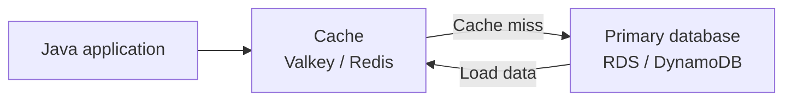
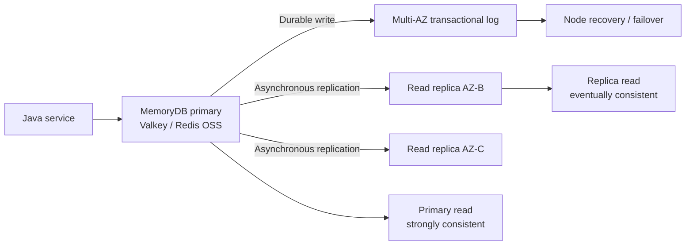
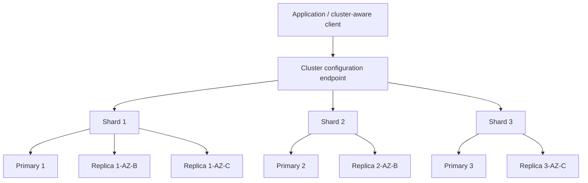
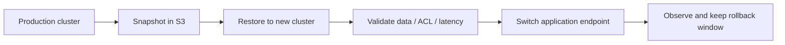
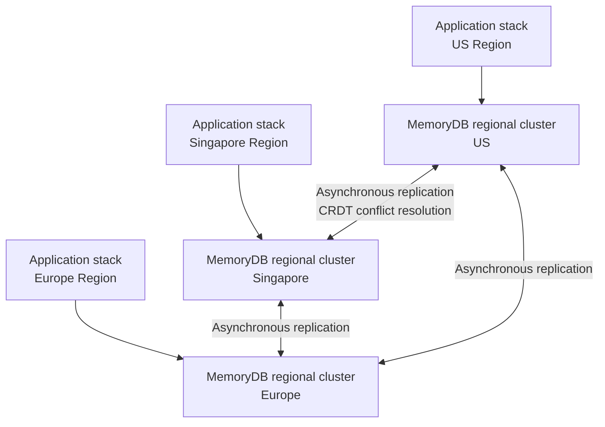
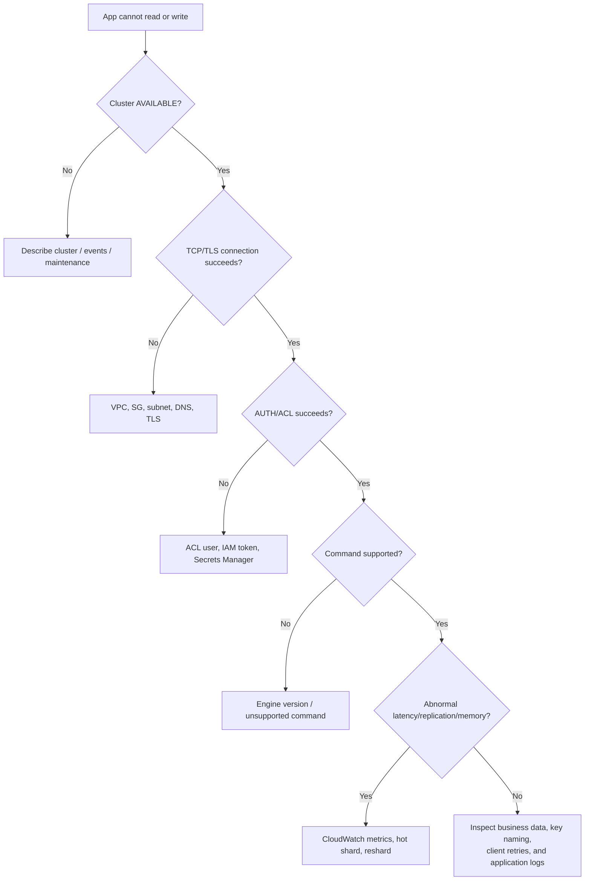
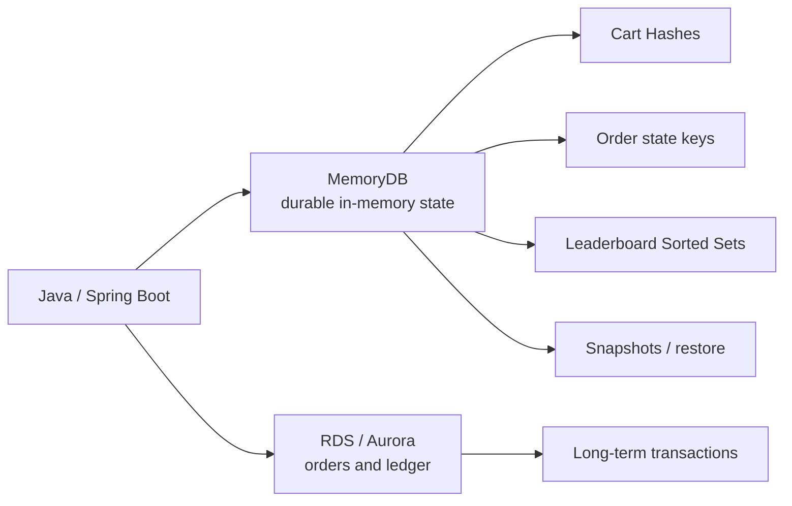

# Amazon MemoryDB and Durable In-Memory Data Storage

## Learning Objectives

After this lesson, you can:

1. Explain why **Amazon MemoryDB** is a durable in-memory database, unlike a cache that is rebuildable from a backing database.
2. Describe the **primary, read replicas, shards, and Multi-AZ transactional log** architecture, understanding how MemoryDB acknowledges writes, recovers nodes, and fails over.
3. Distinguish **strong consistency on the primary** from **eventual consistency on replicas**, choosing the right endpoint for critical reads.
4. Choose **Valkey or Redis OSS engine compatibility**, verifying command compatibility, data structures, and client libraries prior to migration.
5. Decide when to use **MemoryDB, ElastiCache, DynamoDB, or RDS/Aurora**, recognizing that a durable in-memory database does not replace every data model.
6. Design **shards, replicas, key distribution, hash slots, TTLs, snapshots, and restores** around workload, RPO/RTO, and budget.
7. Analyze **MemoryDB Multi-Region active-active**, CRDT/LWW, eventual consistency, and constraints on TTL, failover, transactions, vector search, and data tiering.
8. Secure clusters with **VPC/subnet groups, security groups, TLS, encryption at rest, ACLs, IAM authentication, and least privilege**.
9. Connect Java applications using **Lettuce/Redis-compatible clients**, managing connection pools, cluster discovery, retries, idempotency, and credential rotation.
10. Provision a lab cluster via AWS CLI, test reads/writes, take snapshots, monitor CloudWatch metrics, evaluate costs, and clean up resources safely.

## 1. The Problem: Fast Caching When Critical Data Must Survive Failures

An e-commerce application built in Java/Spring Boot needs near-instant reads for order status, shopping carts, login sessions, and leaderboards. A common approach places a Redis-compatible cache in front of a database:



This caching pattern cuts latency and database read load, yet caches are normally treated as **rebuildable data**. When a cache node loses data, the app reloads from the source database. If the cache holds unique business state—such as a shopping cart never persisted to a database—losing the cache causes business errors.

Certain workloads require all of:

- **Ultra-fast reads** over in-memory data structures like Strings, Hashes, Sets, and Sorted Sets.
- **Durable writes** with recovery across node or Availability Zone failures.
- **Clear consistency** when reading immediately after a write.
- **Automatic failover** and cluster management instead of self-managing Redis servers.

This is the problem **Amazon MemoryDB** solves: a durable in-memory database compatible with Valkey and Redis OSS, engineered to serve as a **high-performance primary database** for suitable microservices.

### 1.1. What Is MemoryDB?

Amazon MemoryDB stores the dataset in memory for microsecond read latency and single-digit millisecond write latency on suitable workloads. At the same time, it persists acknowledged writes to a **distributed Multi-AZ transactional log** before returning success to the client.



The core distinction: **replicas are not the sole copy of committed data**. The Multi-AZ transaction log provides the durable recovery path; replicas scale reads and support failover.

### 1.2. Durable In-Memory Does Not Mean Everything Lives Only in RAM

MemoryDB uses the Valkey/Redis OSS engine to serve data from memory while recording write history in a transactional log distributed across multiple AZs. If a primary fails, the service recovers the node or promotes an eligible replica using the log.

- **In-memory** describes how data is served and engine performance.
- **Durable** describes how acknowledged writes are protected and recovered.
- **Snapshots** are point-in-time backups for restoring/creating new clusters, not the sole durability mechanism.
- **Replicas** are read-scaling and failover copies; replica replication is asynchronous.

Never interpret "data lives in RAM" as "losing RAM loses all data," nor "durable" as "no need for backups, snapshots, or restore drills."

## 2. When Does MemoryDB Fit?

### 2.1. Workloads That Benefit

| Workload | Why MemoryDB can fit | Design considerations |
| --- | --- | --- |
| **Session store** | Low-latency key access by user/session with durable state preservation. | TTLs, key namespaces, session rotation, sensitive data. |
| **Shopping cart** | Fast cart updates via Hashes/Sets, retaining contents across node failures. | Idempotent updates, cart versioning, expiry policies. |
| **Order state / microservice state** | High-throughput known-key state reads/writes. | Business invariants, transactions, idempotency, reconciliation. |
| **Leaderboard / ranking** | Sorted Sets support rank and score queries. | Hot keys, cardinality, write distribution. |
| **Counters / rate limiting** | Atomic commands and Lua scripts enable fast updates. | Per-shard atomicity, key design, time windows. |
| **Real-time application state** | Hash/Set/List/Sorted Set and Pub/Sub per supported engine/version. | Command compatibility, fan-out, reconnects, persistence semantics. |
| **Vector search** | Supported engine/versions allow vector indexing over Hash/JSON data. | Vector capacity, index backfill, scaling limits, feature compatibility. |

### 2.2. When Should You Choose Another Service?

| Need | Often better-fitting service | Rationale |
| --- | --- | --- |
| Complex relationships, JOINs, SQL transactions, ad hoc queries | **Amazon RDS / Aurora** | Relational model and SQL. |
| Serverless key-value/document, massive scale, single-digit ms | **Amazon DynamoDB** | Distributed durable storage, capacity modes, and key/index access. |
| Cache accelerating an existing DB with rebuildable data | **Amazon ElastiCache** | Cache-oriented workloads; Valkey/Redis OSS/Memcached options. |
| Full-text search, multi-attribute filters, relevance scoring | **Amazon OpenSearch Service** | Search indexing and retrieval queries. |
| Large-scale analytics, long-term history | **Amazon S3 + Athena/Glue** | Object storage and analytics. |
| Many-to-many relationships, graph traversals | **Amazon Neptune** | Graph data model. |

MemoryDB does not replace a relational database for JOINs or arbitrary reporting queries. A system can pair **MemoryDB for high-speed state** with **RDS/DynamoDB for transactional or other backing data**, depending on ownership and consistency boundaries.

### 2.3. MemoryDB vs. ElastiCache: Distinguishing by Durability Requirements

| Criterion | Amazon MemoryDB | Amazon ElastiCache |
| --- | --- | --- |
| Typical positioning | **Durable in-memory primary database**. | Typically used as an **acceleration cache/data store** in front of another system. |
| Engines | Valkey and Redis OSS per supported versions. | Valkey, Redis OSS, and Memcached across deployment options. |
| Durable writes | Multi-AZ transactional log is MemoryDB's core durability foundation. | **Node-based ElastiCache for Valkey** now offers durability options with synchronous/asynchronous writes; verify engine version/Region availability and settings. |
| Multi-Region active-active | MemoryDB Multi-Region with CRDTs in supported Regions/engines. | Different ElastiCache capabilities; not identical by default to MemoryDB Multi-Region. |
| When to pick | Primary data needing durability, ultra-low read latency, and Valkey/Redis APIs. | Caching in front of a DB, or ElastiCache durability if version/features satisfy requirements. |

**Do not memorize that "ElastiCache is always ephemeral."** AWS now provides durability for **node-based ElastiCache for Valkey**; synchronous writes persist to a Multi-AZ log before acknowledging, while asynchronous writes log post-response with a window of uncommitted data at risk on failure. Current AWS FAQs recommend evaluating **ElastiCache for new workloads** since durability lets it act as both a cache and a persistent data store; MemoryDB remains a fit when its specific architecture or features better satisfy requirements. Compare exact engine/versions, synchronous vs. asynchronous writes, Multi-Region, command compatibility, migration, and operational needs at design time.

## 3. Cluster Architecture: Primaries, Replicas, Shards, and Endpoints

### 3.1. Clusters and Shards

A **MemoryDB cluster** consists of one or more **shards** (also called node groups). Each shard contains:

- **One primary node**: handles writes and can serve reads.
- **Read replicas**: read-only copies of the primary that can serve reads when clients target replica endpoints/`READONLY`.
- **Transaction log**: durably stores acknowledged writes across multiple AZs.

A cluster partitions data across shards. Under current service limits, MemoryDB supports up to **500 shards and 500 nodes per cluster**; each shard has one primary and up to 5 replicas, bounded by the total node cap. For example, 500 shards with 0 replicas or 100 shards with 4 replicas/shard both hit the 500-node limit. Verify Service Quotas and Regional/engine limits before designing.



### 3.2. Scaling Writes and Reads Differently

| Change | Primary effect |
| --- | --- |
| Add **shards** | Increases data partitioning and aggregate write throughput when key distribution is balanced. |
| Add **replicas/shard** | Increases read capacity and availability across node/AZ failures. |
| Upgrade **node type** | Increases CPU, memory, and network capacity per node. |
| Reduce shards/replicas/node type | Cuts cost, provided remaining memory, throughput, and resilience still suffice. |

Adding replicas **does not automatically increase a shard's write throughput**, because writes still route to the shard's primary. Adding shards helps only when keys distribute across hash slots; one hot key still heats up a single shard.

### 3.3. Endpoints to Distinguish

| Endpoint | Role | When to use |
| --- | --- | --- |
| **Cluster configuration endpoint** | Entry point for cluster-aware clients to discover topology/shards and the hash-slot map. | Standard cluster-mode-enabled app connections; configure clients with this endpoint. |
| **Primary node endpoint** | Endpoint for the primary of one specific shard. | Only for documented operational/direct-node tasks; never hardcode for cluster-aware apps. |
| **Replica node endpoint** | Endpoint for a read replica of one specific shard. | Direct replica reads/troubleshooting when client and consistency model allow. |

In cluster mode enabled, use the **cluster configuration endpoint** with a Redis/Valkey Cluster-aware client so it tracks the slot map and routes writes to the proper shard primary. There is no single global primary across a multi-shard cluster; never hardcode node IPs/endpoints because nodes change during failovers and maintenance.

### 3.4. Hash Slots and Key Co-Location

Cluster mode divides the keyspace into **16,384 hash slots**. Each key hashes to a slot owned by a shard.

Example:

```text
order:1001:status  -> one hash slot -> shard 1
order:1002:status  -> one hash slot -> shard 2
cart:customer:007  -> one hash slot -> shard 3
```

When multiple keys participate in one multi-key command, transaction, or Lua script, they generally must share the **same hash slot**. Redis/Valkey supports **hash tags**, hashing only the substring inside `{...}` braces:

```text
order:{1001}:status
order:{1001}:items
order:{1001}:payment
```

These keys share `{1001}` and map to the same slot, enabling multi-key operations. However, tagging every order with `{all}` creates a **hot shard**. Scope hash tags to small aggregates with healthy concurrency, never a system-wide constant.

### 3.5. Multi-AZ and Automatic Failover

With Multi-AZ enabled and eligible replicas:

1. MemoryDB detects a primary node or AZ failure.
2. The service selects a consistent replica and initiates failover.
3. The replica promotes to primary to keep accepting writes.
4. A replacement node is provisioned and synced from the transactional log.

**Failovers can still disconnect clients briefly.** Apps must reconnect, refresh topology, retry safely, and never pin static node IPs. Multi-AZ cuts downtime and protects committed writes, but does not eliminate app bugs, network partitions, or client-layer errors.

## 4. Durability and Consistency: The Heart of MemoryDB

### 4.1. Writes Acknowledge Only After Persisting to the Transactional Log

In single-Region MemoryDB:

1. The client sends a write command to a shard's primary.
2. MemoryDB persists the write to the **distributed Multi-AZ transactional log**.
3. Once persisted, the write is acknowledged as durable.
4. The primary updates in-memory state for subsequent commands; replicas receive updates asynchronously.

This produces two distinct properties:

- **Durability:** acknowledged writes are protected in the Multi-AZ log for recovery after node failures.
- **Replica freshness:** read replicas can lag slightly behind due to asynchronous replication.

### 4.2. Strong Primary Reads, Eventually Consistent Replica Reads

| Read target | Consistency | Usage |
| --- | --- | --- |
| **Primary node** | Strongly consistent with prior successful writes. | Reading right after updating payment status, inventory, or transaction state. |
| **Read replica** | Eventually consistent; may lag behind primary. | Dashboards, leaderboards, or lag-tolerant reads. |
| **Single replica** | Sequentially consistent with updates applied on that replica. | Never assume a replica sees the newest write just committed on primary. |

Example:

```text
1. SET order:1001:status "PAID"  -> primary acknowledges
2. GET order:1001:status         -> primary returns "PAID"
3. READONLY + GET ...            -> replica may briefly return "PENDING"
4. After replication             -> replica returns "PAID"
```

If an app writes and immediately reads to drive business logic, read from the **primary**. Route reads to replicas only when eventual consistency is acceptable. Do not mistake replica lag for lost data when the primary already acknowledged the write.

### 4.3. Replica Lag and Failover

Because replica replication is asynchronous, monitor **`ReplicationLag`**. When a primary fails, MemoryDB promotes a consistent replica per failover mechanics while the transactional log preserves acknowledged writes. During failover:

- Existing connections may drop.
- Clients must reconnect and discover the updated topology.
- In-flight requests may return ambiguous outcomes to the client.
- Apps need idempotency keys for side-effecting writes.

Never retry a balance increment, stock decrement, or payment capture with a fresh operation ID just because a socket reset. Re-read state by business key or use idempotent operations.

### 4.4. Durability Does Not Mean RDBMS ACID Transactions

MemoryDB supports Valkey/Redis transaction commands like `MULTI`/`EXEC` and Lua scripting per supported version/commands. That does not make MemoryDB a relational database:

- No SQL JOINs or foreign-key constraints like RDS.
- Multi-key commands/transactions in cluster mode must obey hash-slot constraints.
- Transactions do not span external side effects in payment gateways, RDS, or SNS.
- Engine-level command atomicity differs from distributed multi-service transactions.

Design **business idempotency, conditional logic, and reconciliation** for financial operations or multi-store updates.

## 5. Snapshots, Backups, and Recovery

### 5.1. Transaction Logs and Snapshots Solve Different Problems

| Mechanism | Purpose | Scope |
| --- | --- | --- |
| **Multi-AZ transactional log** | Protects acknowledged writes and enables node recovery/failover. | Continuous architectural layer in MemoryDB. |
| **Automatic snapshot** | Scheduled recovery points retained per configured retention limit. | Full cluster metadata and data at snapshot time. |
| **Manual snapshot** | Operator-triggered copy before migrations, engine changes, or risky ops. | On-demand point-in-time snapshot. |
| **Restore from snapshot** | Provisions a brand-new cluster populated from snapshot data. | Not an in-place rollback of a live cluster. |

MemoryDB stores snapshots in **Amazon S3**. Snapshots hold cluster metadata and data, allowing you to spin up a new cluster from that point in time or seed another cluster under supported conditions.

### 5.2. When Should You Take a Snapshot?

- Before engine version upgrades or migrations.
- Before schema/data-structure changes affecting multiple apps.
- Before major shard-count or operational changes where required by runbooks.
- On a backup schedule to recover from application bugs or accidental deletions.
- Before deleting a cluster if audit/restore retention is needed.

**Snapshots do not replace Multi-AZ failover**, nor does Multi-AZ failover replace backups. If an app writes corrupt but valid values, the transactional log faithfully preserves that bad data; snapshots and logical recovery procedures remain essential.

### 5.3. Restoring Creates a New Cluster

A standard restore flow:

1. Select a snapshot and verify its timestamp.
2. Create a **new cluster** from the snapshot with matching subnet group, security groups, ACLs, node type, shards, and compatible settings.
3. Wait for the new cluster to reach `AVAILABLE`.
4. Point a test client to the new endpoint to verify data, command compatibility, and performance.
5. Shift traffic per cutover plan (DNS/config/secrets/service discovery).
6. Keep the old cluster through the approved rollback window before deleting.



Restoring is not an instant "rewind of the existing cluster" and takes time proportional to dataset size. Measure real RTO via drills rather than assuming snapshot existence guarantees speed.

### 5.4. RPO/RTO and Runbooks

| Concept | Question to answer |
| --- | --- |
| **RPO** (Recovery Point Objective) | What is the maximum tolerable time window of data loss in a specific failure? |
| **RTO** (Recovery Time Objective) | How fast must the service recover? |
| **Backup retention** | How long must snapshots be retained for compliance/policy? |
| **Restore drill** | How often do we restore a real cluster and validate business records? |
| **Failover drill** | Do clients reconnect and handle ambiguous writes properly? |

A production runbook should specify the owner, cluster ARN, snapshot ARN/name, subnets/security groups, ACL/users, KMS key, engine version, endpoint cutover steps, validation queries, rollback, and cleanup approvals.

## 6. Engine Compatibility and Valkey/Redis OSS Data Structures

### 6.1. Protocol Compatibility Does Not Mean Identical Command Support

MemoryDB supports **Valkey and Redis OSS** across AWS-published engine versions. Apps can reuse compatible clients and data structures, provided you verify:

- Active engine and patch versions.
- Exact commands and subcommands supported by MemoryDB.
- Cluster mode, multi-key/transaction constraints, and Pub/Sub behavior.
- ACL rules, TLS, client library versions, and connection pooling.
- Specialized features like vector search, data tiering, or Multi-Region.

Never assume "Redis OSS compatible" includes every third-party module, admin command, or self-managed Redis command. Run compatibility suites against a staging cluster.

### 6.2. Common Data Structures

| Data structure | Example commands | Use cases |
| --- | --- | --- |
| **String** | `SET`, `GET`, `INCR`, `MGET` | Tokens, small state payloads, counters. |
| **Hash** | `HSET`, `HGET`, `HGETALL` | Carts, user/session profiles, order summaries. |
| **List** | `LPUSH`, `RPOP`, `LRANGE` | Lightweight queues within supported commands; consider SQS for durable messaging. |
| **Set** | `SADD`, `SISMEMBER`, `SMEMBERS` | Tags, membership sets, unique elements. |
| **Sorted Set** | `ZADD`, `ZRANGE`, `ZREVRANK` | Leaderboards, rankings, time/score ordering. |
| **Pub/Sub** | `PUBLISH`, `SUBSCRIBE` | Real-time notifications; requires reconnect handling and is not a durable event log. |
| **Streams** | `XADD`, `XREADGROUP` | Event streams per engine/feature support; check version/command availability. |

### 6.3. TTL and Expiration

In single-Region MemoryDB, Valkey/Redis OSS commands like `EXPIRE`/`PEXPIRE` set TTLs on keys per engine/version support. Once expired, keys are no longer returned as valid per engine semantics; actual memory reclamation timing may not match the exact expiry second.

Example:

```text
SET session:user-007 "..."
EXPIRE session:user-007 3600

SET cart:user-007 "..."
EXPIRE cart:user-007 86400
```

Never use TTL as a substitute for time-exact business workflows, such as triggering refunds when an order expires. Use a scheduler or event workflow for business actions, keeping TTL strictly for lifecycle cleanup.

**Special note:** MemoryDB **Multi-Region does not support TTL** per current feature limits. If your Multi-Region app needs expiration, implement application-level expiration logic and handle state reconciliation explicitly.

### 6.4. Vector Search in MemoryDB

MemoryDB offers **vector search** on supported engine/versions to store embeddings and run approximate nearest-neighbor searches alongside app data. Use cases include:

- Low-latency Retrieval-Augmented Generation (RAG).
- Real-time recommendations.
- Anomaly detection and document retrieval.

Vector search is not automatically available on every cluster: it requires **MemoryDB 7.1+**, supported node families (**R6g, R7g, and T4g**), and must be enabled at cluster creation via an appropriate parameter group. **You cannot enable vector search on an existing cluster in place**; create a new search-enabled cluster or restore from a snapshot per AWS rules. Current limits include up to **32,768 dimensions/vector**, **10 indexes**, and **50 fields/index**. Budget RAM for both vector payloads and indexes.

Additional limits to note:

- Vector search is restricted to a **single shard** per current feature docs; do not expect horizontal scaling by adding shards.
- Index backfill may still be running briefly after a node returns to service.
- Snapshot/restore and engine compatibility must follow vector-search rules.
- **MemoryDB Multi-Region does not support vector search** per current limits.

Do not pick MemoryDB vector search merely because your app uses embeddings. Compare vector counts, dimensions, recall/latency, metadata filtering, index scale, and cost against OpenSearch or dedicated vector databases.

## 7. Data Tiering and Cluster Scaling

### 7.1. Data Tiering with the `r6gd` Node Family

MemoryDB supports **data tiering** on **`r6gd`** node types. Keys remain in DRAM while less frequently accessed values tier out from memory to local SSD via LRU. When an app reads a value from SSD, MemoryDB promotes it back into memory before serving the request.

Data tiering fits when a workload actively accesses a small hot slice of a larger dataset (AWS suggests roughly **up to 20%** frequently accessed data) and tolerates slightly higher latency for SSD-resident values. For a 500-byte string value, AWS cites roughly **450 microseconds** of extra read latency from SSD; actual numbers depend on workload, node, and value size.

Avoid data tiering if most data is hot, p99 latency is ultra-sensitive, or you need incompatible features like vector search or Multi-Region. Measure hot/cold ratios and latency before picking `r6gd`.

### 7.2. Horizontal and Vertical Scaling

MemoryDB supports **online resharding** to add or remove shards while the cluster remains online. Resharding still consumes CPU and network bandwidth and can temporarily raise latency.

Before resharding:

1. Check CPU, memory, network throughput, connections, and replication lag.
2. Inspect key distribution and shard skew; adding shards will not fix a hot key.
3. Load-test client behavior during slot migrations.
4. Watch for very large keys/items that may migrate differently or slowly in edge cases.
5. Schedule during low-traffic windows and monitor latency/throttling.

Changing node types is **vertical scaling**. Before scaling down, confirm free memory on the smaller node covers the dataset, engine overhead, replication buffers, and fragmentation—never compare solely against logical payload size.

## 8. MemoryDB Multi-Region: Active-Active and CRDTs

### 8.1. When Do You Need Multi-Region?

Global apps may require local read/write latency across multiple AWS Regions. MemoryDB Multi-Region provides **active-active replication**: each Region hosts a regional cluster serving local reads/writes, replicating asynchronously across Regions. Currently this requires **Valkey 7.3+**, supported node families/sizes (minimum **`db.r7g.xlarge`** per current requirements), and up to **5 Regions** per Multi-Region cluster. Regional clusters must share identical shard counts, node types, Valkey engine versions, TLS, and parameter groups, while replica counts can differ per Region. Verify supported Regions/node types before deploying.



AWS notes cross-Region propagation typically occurs in **sub-second** time, though this is typical behavior rather than an RPO/RTO SLA.

### 8.2. Conflict Resolution with CRDTs and Last Writer Wins

When two Regions update the same key nearly simultaneously, MemoryDB Multi-Region uses **Conflict-free Replicated Data Types (CRDTs)** and **Last Writer Wins (LWW)** to converge state:

- For **Strings**, conflicts resolve at the key level.
- For collections like **Hashes, Sets, and Sorted Sets**, conflicts resolve at the sub-key/element level per supported semantics.
- Concurrent updates to distinct fields/elements merge cleanly.
- Competing writes to the same field converge via LWW.

Hash example:

```text
Region A: HSET cart:007 itemA 2
Region B: HSET cart:007 itemB 1

After replication:
cart:007 = { itemA: 2, itemB: 1 }
```

If both Regions concurrently write different values to the **same `itemA` field**, LWW chooses the final winning value. Therefore, never rely on Multi-Region for global transactions demanding strict locking or serializability.

### 8.3. Multi-Region Is Not a Synchronous Global Database

| Property | MemoryDB Multi-Region |
| --- | --- |
| Local reads/writes | Yes, each Region operates a regional cluster. |
| Replication | Asynchronous. |
| Consistency | Eventual across Regions; conflicts resolved via CRDT/LWW. |
| Write conflicts | Automatically reconciled per engine/data-type rules. |
| Local durability | Writes protected by each Region's Multi-AZ transaction log. |
| Cross-Region transaction atomicity | **Not guaranteed**; transactions are atomic within one Region, not across Regions. |
| Regional failover | Application must detect failures and steer traffic; no automatic global endpoint fails over for you. |
| RPO/RTO SLA | No formal RPO/RTO SLA is published for Multi-Region. |

If a Region is partitioned, it continues accepting local writes while replication lag climbs. Once connectivity returns, pending writes propagate and conflicts reconcile.

### 8.4. Multi-Region Limits to Remember

- **No TTL support**.
- **No data tiering**.
- **No vector search**.
- Certain read-modify-write commands and specific commands/data types are unsupported.
- Transactions are atomic **within a single Region**, not cross-Region.
- **No single global endpoint** or automatic regional failover; apps must steer traffic to another regional stack and cluster.
- Monitor **`MultiRegionClusterReplicationLag`** and plan traffic failover around your system's RPO targets.

Before adopting Multi-Region, verify supported/unsupported command lists and engine versions. Never migrate workloads relying on Redis Streams, TTL, or unsupported read-modify-write commands without testing.

### 8.5. Designing Apps to Avoid Conflicts

- Partition **ownership by Region/tenant/entity** where possible so each key is normally written from one Region.
- Use operation IDs and idempotency keys rather than relying on cross-Region ordering.
- Structure data models so independent updates across sub-keys merge cleanly.
- For global invariants (e.g., debiting account balances), use a transactional ledger with appropriate consistency instead of letting CRDT LWW decide final financial state.
- Build your own traffic steering, health checks, regional routing, and reconciliation runbooks.

## 9. Security: VPC, TLS, ACLs, and IAM

### 9.1. MemoryDB Runs Inside a VPC

MemoryDB clusters deploy inside an **Amazon VPC**, not as public database endpoints. Apps need valid private networking:

1. Place the cluster in a subnet group spanning private subnets across multiple AZs.
2. Attach a dedicated security group to the cluster.
3. Allow inbound TCP strictly from application workload security groups on the cluster port (default **6379**).
4. Verify DNS, route tables, NACLs, and VPC peering/Transit Gateway/VPN if clients live in another VPC or network.

Never open security groups to all sources just to test connectivity. Create a dedicated SG for MemoryDB instead of reusing a broad default SG.

### 9.2. Encryption in Transit and at Rest

- **TLS in transit** protects traffic between apps and nodes as well as inter-node traffic per service configuration.
- **Encryption at rest** protects transactional logs and disk data during snapshot operations.
- Supports AWS-owned keys or customer-managed KMS keys per governance rules.

Enable TLS in production. Clients must verify certificates/hostnames using MemoryDB's DNS endpoint—never disable certificate validation to bypass connection errors.

### 9.3. IAM Control Plane Differs from Redis/Valkey Data Access

Distinguish three layers:

| Layer | Tool | Purpose |
| --- | --- | --- |
| AWS resource administration | **IAM policies** | Who can create, modify, delete, or describe clusters, users, ACLs, and snapshots. |
| Engine command auth/authz | **MemoryDB users + ACLs** | Who can `AUTH` and which commands/key patterns they can execute. |
| Network access | **VPC + security groups + TLS** | Which workloads can open sockets to the endpoint/port. |

An IAM role with `memorydb:DescribeClusters` **does not automatically gain `GET`/`SET` access on the data plane**. Conversely, an ACL user able to run `SET`/`GET` cannot create clusters or delete snapshots.

### 9.4. ACL Users and Access Strings

MemoryDB uses **Access Control Lists (ACLs)** to group users and attach permissions to clusters. Access strings control whether a user is enabled, allowed key patterns, and permitted commands/categories.

Example app user restricted to the `orders` key namespace:

```text
on ~orders:* +@read +@write +ping
```

Treat this as a starting point; audit required commands, scripts, transactions, and key patterns. Avoid granting `+@all`/`~*` to application users unnecessarily. Store passwords in AWS Secrets Manager, rotate them, and keep them out of source control and logs.

### 9.5. IAM Authentication for Valkey/Redis OSS 7+

For Valkey or Redis OSS **version 7.0 and later**, MemoryDB supports **IAM authentication**:

1. Create a MemoryDB user with authentication mode `iam`.
2. Add the user to an ACL and attach the ACL to the cluster.
3. Grant the app's IAM identity/role `memorydb:Connect` on **both the cluster ARN and user ARN**.
4. Have the app sign a SigV4 request with AWS credentials to mint a temporary auth token.
5. Send the token as the password in `AUTH`/`HELLO` on connect or refresh.

IAM tokens last **15 minutes**, and IAM-authenticated connections drop after **12 hours** unless refreshed with a new token. Use a client/credentials provider with automatic refresh for long-lived connections.

Important caveats: IAM authentication does not support `MULTI`/`EXEC` per current docs, and never hardcode a 15-minute token as a static password in a long-lived pool.

### 9.6. Least Privilege

Separate roles:

- **Deployment role**: creates clusters, subnet groups, users, ACLs, snapshots, and configs.
- **Application role**: only `memorydb:Connect` (if using IAM auth) plus needed AWS actions.
- **Operations role**: views metrics/events, takes snapshots, describes/modifies per runbook.

Never grant `memorydb:*` to application runtimes just because they read/write data. Further restrict data-plane commands via ACLs.

## 10. AWS CLI Lab: Creating a Lab MemoryDB Cluster

This lab creates a small Valkey cluster with **two shards, one replica per shard, TLS, and an ACL user**, using existing VPC subnets and security groups in your test account.

> **Cost warning:** MemoryDB bills per node-hour while the cluster runs, even with zero traffic. Run labs only in authorized accounts, verify Region/VPC, and delete lab clusters/snapshots when finished. Never run cleanup commands against shared or production resources.

### 10.1. Prerequisites

Prepare:

- AWS CLI configured with credentials and Region.
- A VPC with **private subnets in at least two AZs**.
- A dedicated security group for MemoryDB.
- Inbound TCP **6379** rule on the MemoryDB SG from the **application security group**.
- An IAM role authorized to create users, ACLs, subnet groups, and clusters, plus `iam:PassRole` if service-linked role creation is needed.

Verify account and Region:

```bash
aws sts get-caller-identity
aws configure get region
```

The examples below use `ap-southeast-1`. Replace subnet and security group IDs with real IDs from the **same VPC**:

```bash
REGION=ap-southeast-1
SUBNET_A=subnet-0123456789abcdef0
SUBNET_B=subnet-0fedcba9876543210
MEMORYDB_SG=sg-0123456789abcdef0
```

Never assume placeholder IDs exist in your account.

### 10.2. Create a Subnet Group

```bash
aws memorydb create-subnet-group \
  --subnet-group-name orders-lab-subnets \
  --description "Private subnets for MemoryDB lesson lab" \
  --subnet-ids "$SUBNET_A" "$SUBNET_B" \
  --region "$REGION"

aws memorydb describe-subnet-groups \
  --subnet-group-name orders-lab-subnets \
  --region "$REGION"
```

The subnet group defines which subnets MemoryDB places nodes into. Pick subnets across multiple AZs for Multi-AZ; do not pick public subnets expecting public IPs.

### 10.3. Create a Password User and Restricted Access String

Create `memorydb-user.json`:

```json
{
  "UserName": "orders-app",
  "AuthenticationMode": {
    "Type": "password",
    "Passwords": [
      "<replace-with-generated-strong-password>"
    ]
  },
  "AccessString": "on ~orders:* +@read +@write +ping"
}
```

Replace the placeholder with a strong random password stored temporarily in a secure place. In production, manage and rotate secrets in **AWS Secrets Manager**, keeping passwords out of shell history, source control, and logs.

```bash
aws memorydb create-user \
  --cli-input-json file://memorydb-user.json \
  --region "$REGION"

aws memorydb create-acl \
  --acl-name orders-lab-acl \
  --user-names orders-app \
  --region "$REGION"
```

The access string enables the user, limits access to `orders:` keys, and allows read/write command categories plus `PING`. Always audit command categories and key patterns in real environments to prevent over-permissioning.

### 10.4. Create the Cluster

```bash
aws memorydb create-cluster \
  --cluster-name orders-memorydb-lab \
  --description "Durable in-memory database lesson lab" \
  --engine valkey \
  --node-type db.r6g.large \
  --num-shards 2 \
  --num-replicas-per-shard 1 \
  --subnet-group-name orders-lab-subnets \
  --security-group-ids "$MEMORYDB_SG" \
  --acl-name orders-lab-acl \
  --tls-enabled \
  --snapshot-retention-limit 3 \
  --region "$REGION"
```

Choose an engine version supported by MemoryDB in your target Region. To pin a version, pass `--engine-version` after verifying client and feature compatibility.

### 10.5. Retrieve the Cluster Endpoint

```bash
aws memorydb describe-clusters \
  --cluster-name orders-memorydb-lab \
  --region "$REGION" \
  --query 'Clusters[0].ClusterEndpoint'
```

In cluster mode enabled, retrieve the **cluster configuration endpoint** for cluster-aware clients. Never hardcode node endpoints or IPs in app configs.

### 10.6. Connect with `redis-cli`

Run from an EC2/compute host with network reachability to the MemoryDB security group:

```bash
redis-cli -c \
  -h "<cluster-configuration-endpoint>" \
  -p 6379 \
  --tls \
  --user orders-app \
  --askpass
```

Enter the securely stored lab password when prompted. `-c` enables cluster mode so `redis-cli` follows shard redirects.

Test writes and reads:

```text
SET orders:1001:status PAID
GET orders:1001:status

HSET orders:1001 customerId c007 currency VND
HGETALL orders:1001
PING
```

All keys start with `orders:`, matching the ACL. Attempting `cart:customer:007` should be denied because the access string excludes that namespace.

### 10.7. Take a Manual Snapshot

```bash
aws memorydb create-snapshot \
  --cluster-name orders-memorydb-lab \
  --snapshot-name orders-memorydb-lab-before-change \
  --region "$REGION"

aws memorydb describe-snapshots \
  --cluster-name orders-memorydb-lab \
  --region "$REGION"
```

Wait until the snapshot completes before restoring. Snapshots are point-in-time backups, not directly queryable endpoints.

### 10.8. Restore to a New Cluster

Restoring requires a **new cluster name** and matching subnet/ACL/node settings. Example:

```bash
aws memorydb create-cluster \
  --cluster-name orders-memorydb-restore-lab \
  --description "Restore test from lesson snapshot" \
  --engine valkey \
  --node-type db.r6g.large \
  --num-shards 2 \
  --num-replicas-per-shard 1 \
  --subnet-group-name orders-lab-subnets \
  --security-group-ids "$MEMORYDB_SG" \
  --acl-name orders-lab-acl \
  --tls-enabled \
  --snapshot-name orders-memorydb-lab-before-change \
  --region "$REGION"
```

Once the new cluster is `AVAILABLE`, fetch its new endpoint and verify `GET orders:1001:status`. Applications do not cut over automatically; switch endpoints via config or service discovery after verification.

### 10.9. Safe Lab Cleanup

Delete only resources **created by this lab**, after confirming no workloads still connect:

```bash
aws memorydb delete-cluster \
  --cluster-name orders-memorydb-restore-lab \
  --region "$REGION"

aws memorydb delete-cluster \
  --cluster-name orders-memorydb-lab \
  --region "$REGION"
```

Once clusters finish deleting, remove the lab snapshot if no longer needed:

```bash
aws memorydb delete-snapshot \
  --snapshot-name orders-memorydb-lab-before-change \
  --region "$REGION"
```

Then delete the ACL, user, and subnet group if unused elsewhere. **Never delete shared VPCs, subnets, or security groups** just because a lab ended. Check billing afterward to verify no stray snapshots or storage remain.

## 11. Connecting from Java with Lettuce

MemoryDB speaks the Valkey/Redis OSS protocol, so Java apps can use compatible clients like **Lettuce**, Jedis, or Valkey GLIDE. Clients must support TLS and cluster discovery when cluster mode is enabled.

### 11.1. Dependencies and Configuration

In Maven, add Lettuce and manage versions via your project's dependency management:

```xml
<dependency>
    <groupId>io.lettuce</groupId>
    <artifactId>lettuce-core</artifactId>
</dependency>
```

Runtime settings should come from environment variables or Secrets Manager:

```text
MEMORYDB_HOST=<cluster-configuration-endpoint>
MEMORYDB_PORT=6379
MEMORYDB_USERNAME=orders-app
MEMORYDB_PASSWORD=<loaded-from-secrets-manager>
```

Never commit passwords into `application.yml` in Git, exception messages, or logs.

### 11.2. Java Cluster Client

Example using Lettuce with ACL username/password and TLS:

```java
import io.lettuce.core.RedisURI;
import io.lettuce.core.cluster.RedisClusterClient;
import io.lettuce.core.cluster.api.StatefulRedisClusterConnection;
import io.lettuce.core.cluster.api.sync.RedisAdvancedClusterCommands;
import java.util.Map;

public final class MemoryDbOrderStore {
    public static void main(String[] args) {
        String host = System.getenv("MEMORYDB_HOST");
        String username = System.getenv("MEMORYDB_USERNAME");
        String password = System.getenv("MEMORYDB_PASSWORD");

        if (host == null || username == null || password == null) {
            throw new IllegalStateException("MemoryDB connection settings are required");
        }

        RedisURI uri = RedisURI.Builder.redis(host, 6379)
                .withSsl(true)
                .withAuthentication(username, password)
                .build();

        RedisClusterClient client = RedisClusterClient.create(uri);
        try (StatefulRedisClusterConnection<String, String> connection =
                     client.connect()) {
            RedisAdvancedClusterCommands<String, String> commands = connection.sync();

            commands.set("orders:1001:status", "PAID");
            String status = commands.get("orders:1001:status");

            commands.hset("orders:1001", Map.of(
                    "customerId", "c007",
                    "currency", "VND",
                    "status", status
            ));

            System.out.println("Order status updated: " + status);
        } finally {
            client.shutdown();
        }
    }
}
```

This illustrates lifecycle management for a standalone sample. In production Spring Boot, share a **singleton `RedisClusterClient`/connection factory**, managing pools, timeouts, and shutdown through the application lifecycle—never instantiate a new client per HTTP request.

### 11.3. IAM Authentication in Java Applications

When using IAM authentication:

- Create a user with auth mode `iam` and attach it to an ACL.
- Grant the application role `memorydb:Connect` on both cluster ARN and user ARN.
- Use the AWS credential provider chain (ECS/EKS/EC2/Lambda IAM role) to sign SigV4 tokens.
- Configure a Lettuce credentials provider to **mint/refresh tokens** rather than storing one 15-minute token statically.

AWS publishes official Java examples using `IAMAuthTokenRequest`, SigV4 presigned requests, and Lettuce's `RedisCredentialsProvider`. Match the sample to your SDK/client versions and never reuse an expired token.

### 11.4. Retries and Connection Management

- Use a cluster-aware client and the cluster configuration endpoint.
- Enable TLS with certificate-chain and hostname verification.
- Tune connect timeouts, command timeouts, reconnect delays, and pool sizes to real load.
- Refresh topology and allow reconnects after failover/resharding.
- Retry only idempotent commands or commands carrying operation IDs; a client timeout does not prove the server never executed the write.
- Never retry endlessly on ACL, authentication, unsupported command, or invalid key errors.

## 12. Monitoring MemoryDB with CloudWatch

The CloudWatch namespace is **`AWS/MemoryDB`**. Metrics emit at the node level; filter by `ClusterName`/`NodeId` and verify against your engine version.

| Metric | Meaning | How to use |
| --- | --- | --- |
| `CPUUtilization` | Host CPU. | Detect overloaded nodes, especially small nodes. |
| `EngineCPUUtilization` | Engine thread CPU. | Track engine workload on multi-vCPU nodes. |
| `BytesUsedForMemoryDB` | Memory used by engine for dataset/buffers. | Forecast memory pressure and scaling. |
| `DatabaseMemoryUsagePercentage` / `DatabaseCapacityUsagePercentage` | Percentage of memory/data capacity used. | Alert on headroom before hitting limits. |
| `FreeableMemory` | Available host memory. | Alert when approaching exhaustion. |
| `SwapUsage` | Swap in use. | Detect memory pressure. |
| `Evictions` | Evicted keys per engine metrics. | Investigate memory pressure or `maxmemory` behavior. |
| `CurrConnections` | Active client connections. | Catch connection leaks or pool spikes. |
| `ReplicationLag` | Replica delay behind primary. | Pick replicas with acceptable lag; alert on replication health. |
| `SuccessfulReadRequestLatency` / `SuccessfulWriteRequestLatency` | Successful command latency on supported engine versions. | Track p95/p99 latency SLOs. |
| `AuthenticationFailures` | Failed `AUTH` attempts. | Detect bad passwords or unauthorized probes. |
| `CommandAuthorizationFailures` / `KeyAuthorizationFailures` | Commands or keys denied by ACLs. | Catch overly tight ACLs or unexpected access attempts. |
| `MaxReplicationThroughput` / `ReplicationDelayedWriteCommands` | Observed replication throughput and write commands delayed by sync replication. | Monitor write bursts and replication pressure. |
| `MultiRegionClusterReplicationLag` | Cross-Region lag in Multi-Region clusters. | Monitor real RPO and drive failover/routing decisions. |

### 12.1. Engine CPU vs. Host CPU

The engine thread may be saturated while host CPU still looks low, or the host may saturate from both engine and management processes. AWS recommends watching:

- Small nodes (2 vCPUs or fewer): watch host-level **`CPUUtilization`**.
- Larger nodes: combine **`EngineCPUUtilization`** with `CPUUtilization` to understand load.

Never scale based on a single metric alone. Inspect memory, swap, network, connections, replication lag, and latency together.

### 12.2. Suggested Alarms and Dashboards

- Alert on sustained high `CPUUtilization`/`EngineCPUUtilization`.
- Alert on low `FreeableMemory` or rising `SwapUsage`.
- Alert if `Evictions > 0` when zero evictions are expected.
- Alert when `ReplicationLag` exceeds business freshness thresholds.
- Alert on spikes in `AuthenticationFailures`.
- Graph successful read/write latencies and connection counts.
- For Multi-Region, alert on `MultiRegionClusterReplicationLag` and regional app health.

Infrastructure metrics are only half the picture; add application metrics like `cart_write_success_total`, `order_state_read_latency`, and `duplicate_operation_total` to track business outcomes. Never put passwords, tokens, or PII in metric dimensions.

## 13. Cost and Limits to Plan Upfront

### 13.1. Cost Components

| Component | Cost impact |
| --- | --- |
| **Node hours** | Node count × runtime hours × node type. Both replicas and shards increase node count. |
| **Data written** | MemoryDB charges by volume of data written (keys, values, commands); reads do not incur data-written charges under current pricing. |
| **Snapshot storage** | Longer snapshot retention can incur additional storage fees. |
| **Cross-Region data transfer** | Multi-Region replication incurs inter-Region transfer fees. |
| **KMS / CloudWatch / networking** | Customer-managed KMS keys, metrics/logs, and VPC/network resources incur separate charges. |

Do not cite fixed USD prices, as rates depend on Region, node type, engine, shard/replica counts, data written, snapshot retention, and time. Use the **AWS Pricing Calculator**, MemoryDB pricing page, Cost Explorer, and AWS Budgets.

### 13.2. Why Replicas and Shards Affect Budgets

Example cluster with 3 shards, each having 1 primary + 2 replicas:

```text
3 shards × 3 nodes/shard = 9 nodes
```

Dropping replicas from 2 to 1 cuts node count, altering read scale and resilience. Adding shards spreads data wider while raising total node costs and operational complexity.

### 13.3. Quotas and Sizing

Before production, verify:

- Supported node types and engine versions in your Region.
- Total shards/nodes and replicas against Service Quotas.
- Dataset size, engine overhead, fragmentation, and headroom.
- Network throughput, max replication throughput, and command latencies.
- Cluster connection limits and client pool sizes.
- Data tiering, vector search, and Multi-Region compatibility.
- Backup retention and restore speed within RTO.

Because MemoryDB is an in-memory database, **memory sizing is critical**. Estimating solely from JSON/business record sizes underestimates engine overhead, key metadata, hash tables, replication buffers, and fragmentation.

### 13.4. Optimizing Cost Without Sacrificing Durability

1. Size node types from measured memory and throughput rather than starting at the tiniest node blindly.
2. Add enough shards to distribute hot keys; never add shards if traffic hammers a single hot key.
3. Size replica counts to actual read throughput and resilience requirements.
4. Use `r6gd` data tiering when hot/cold ratios and latency budgets align.
5. Align snapshot retention to policy and delete obsolete manual snapshots.
6. Monitor data written, cluster node-hours, and cross-Region transfer.
7. Never leave idle production clusters running or forget to tear down finished labs.

## 14. Symptom-Based Troubleshooting

| Symptom | Likely cause | What to check |
| --- | --- | --- |
| Client timeout on connect | Wrong endpoint, SG/NACL/route, DNS, or cluster not yet `AVAILABLE`. | Cluster status, subnet group, SG inbound 6379, DNS resolution. |
| TLS handshake fails | Client lacks TLS enabled, bad trust chain/hostname, or cert config. | Client SSL settings, endpoint hostname, certificate validation. |
| `AUTH`/`NOAUTH`/`WRONGPASS` | Bad username/password, inactive ACL user, or user missing from ACL. | User status, ACL membership, Secrets Manager secret version. |
| IAM auth `AccessDenied` | Missing `memorydb:Connect` on cluster/user ARN, or expired token. | IAM policy, user auth mode, SigV4 Region/cluster name, token freshness. |
| `GET`/`SET` returns `NOPERM` | ACL access string excludes command or key pattern. | User access string, key prefix, command categories. |
| `MOVED`/`ASK` errors | Client not cluster-aware or failing to follow redirects. | Cluster-aware client, endpoint config, topology refresh. |
| Latency rises post-resharding | Slot migration, CPU/network pressure, or hot shard. | Shard-level metrics, client retries, key distribution. |
| Read replica returns stale data | `ReplicationLag` and eventual consistency. | Route read-after-write to primary; monitor replica lag. |
| Memory pressure / evictions | Large dataset, key growth, fragmentation, or undersized nodes. | `BytesUsedForMemoryDB`, `FreeableMemory`, `SwapUsage`, `Evictions`. |
| High host CPU, moderate engine CPU | Background tasks consuming CPU or small node type. | Check both `CPUUtilization` and `EngineCPUUtilization`. |
| Failover breaks requests | Client pinning old connections, non-idempotent retries, or hardcoded IPs. | Reconnects, topology refresh, operation IDs, app logs. |
| Restored snapshot missing newest data | Snapshot predates writes or wrong snapshot chosen. | Snapshot timestamp/status, source cluster, test data. |
| Temporary Multi-Region data divergence | Replication lag or concurrent updates. | `MultiRegionClusterReplicationLag`, CRDT/LWW rules, ownership. |
| Multi-Region command rejected | Command/type unsupported in Multi-Region. | Check unsupported command list for your engine/version. |
| Vector query fails after restart | Index backfill incomplete or insufficient memory. | Vector index status/backfill, memory, logs. |

### Investigation Workflow



Never disable TLS, open SGs to `0.0.0.0/0`, or grant `+@all` ACLs as a "quick fix." Pinpoint the exact failing layer first, then apply the proper targeted change.

## 15. Design Scenario: Shopping Carts and Order State

### Context

An online store runs a Java Order API serving 1 million customers with flash sales:

- Shopping carts must read/write fast and survive node/AZ failures.
- Order state is updated by payment and fulfillment workers.
- Dashboards read leaderboards and near-real-time state.
- Long-term transaction records remain in RDS/Aurora.
- The app runs in a Singapore VPC and may expand to additional Regions later.

### 15.1. Proposed Architecture



### 15.2. Data Ownership Split

| Data | Primary store | Rationale |
| --- | --- | --- |
| Active shopping carts | MemoryDB Hash/Set | Fast reads/writes; durability preserves carts across node/AZ failures. |
| Transient workflow state | MemoryDB key/value or RDS per invariants | Match consistency and transaction guarantees to business rules. |
| Payment ledger / official invoices | RDS/Aurora | Relational transactions and strict financial constraints. |
| Leaderboards | MemoryDB Sorted Set | Natural fit for rank/score access patterns. |
| Long-term reporting | S3/Athena or warehouse | Historical analytics without scanning an in-memory store. |

### 15.3. Decisions to Test

1. Carts use TTL in single-Region; moving to Multi-Region requires custom expiry logic because Multi-Region lacks TTL support.
2. Post-write order-state reads must target the primary whenever strong consistency is required.
3. Payment updates need operation IDs and reconciliation; never treat MemoryDB `MULTI`/`EXEC` as spanning RDS and a payment provider.
4. Leaderboards concentrate writes on hot keys; test shard distribution.
5. Test failovers covering client reconnects, ambiguous writes, and connection pools.
6. Test snapshot restores verifying data, ACLs, TLS, endpoints, and rollback before cutting over traffic.

### 15.4. When to Expand Multi-Region?

Adopt Multi-Region only if local regional read/write latency or multi-Region availability justifies accepting:

- Eventual consistency across Regions.
- CRDT/LWW conflict resolution semantics.
- Application-managed routing and failover.
- Lack of TTL, vector search, and data tiering.
- No atomic cross-Region transactions.

Never use Multi-Region as a global payment ledger or balance authority if business rules require strict global serialization.

## 16. Common Misconceptions

**Misconception 1: "MemoryDB is just a Redis cache with snapshots."**

No. MemoryDB is a durable in-memory database using a Multi-AZ transactional log to protect acknowledged writes.

**Misconception 2: "Having replicas means all reads are strongly consistent."**

No. The primary provides strong consistency; replicas receive updates asynchronously and can lag.

**Misconception 3: "Adding replicas increases write throughput."**

No. Replicas scale read capacity and availability; writes still go through each shard's primary.

**Misconception 4: "Multi-AZ failover never drops client connections."**

No. Clients must reconnect, refresh topology, and handle ambiguous in-flight requests.

**Misconception 5: "Snapshots are the only protection for MemoryDB data."**

No. The Multi-AZ transactional log protects acknowledged writes continuously; snapshots provide point-in-time backups for restores and logical recovery.

**Misconception 6: "Restoring a snapshot overwrites the live cluster."**

No. Restores create a new cluster; applications must test it and cut over endpoints/configs.

**Misconception 7: "Valkey/Redis compatibility means every command and module works."**

No. MemoryDB publishes supported commands/features per engine version; run compatibility tests.

**Misconception 8: "MemoryDB Multi-Region is a synchronous global database."**

No. Replication is asynchronous, consistency is eventual, and conflicts resolve via CRDT/LWW.

**Misconception 9: "Multi-Region automatically routes traffic away from a failed Region."**

No. Applications must build regional health checks, traffic steering, and failover runbooks.

**Misconception 10: "MemoryDB Multi-Region supports every single-Region Redis command."**

No. Certain commands/data types, TTL, data tiering, and vector search are unsupported.

**Misconception 11: "An IAM role allowed to describe clusters can run `GET`/`SET`."**

No. The IAM control plane and data-plane ACL/authentication are separate layers.

**Misconception 12: "Opening port 6379 to `0.0.0.0/0` is the easiest way to connect."**

No. Clusters reside in a VPC and should restrict SG sources strictly to application security groups.

**Misconception 13: "A 15-minute IAM auth token lasts forever in a connection pool."**

No. Clients must refresh tokens; IAM connections also enforce a 12-hour lifetime without re-auth.

**Misconception 14: "MemoryDB replaces RDS for all data."**

No. MemoryDB excels at key/value and in-memory structures; SQL JOINs, relational constraints, and ledgers often belong in RDS/Aurora.

**Misconception 15: "ElastiCache is always non-durable."**

No. Node-based ElastiCache for Valkey 9.0+ offers durability options; compare exact versions and configurations.

## 17. Self-Check Questions

**Question 1.** What makes MemoryDB different from a traditional cache?

**Answer:** Acknowledged writes persist in a **Multi-AZ transactional log** enabling durable recovery, whereas traditional caches are treated as rebuildable data.

**Question 2.** Why might reading from the primary right after a write be necessary?

**Answer:** The primary offers strong consistency, whereas replicas may not yet have applied the write due to asynchronous replication.

**Question 3.** Does adding read replicas raise a shard's write throughput?

**Answer:** No. Replicas scale read capacity and availability; writes still hit the primary.

**Question 4.** Why do cluster-aware clients need the cluster configuration endpoint?

**Answer:** To discover shard topology and hash slots and route commands to the right node, since node IPs can change after failover.

**Question 5.** What are hash tags in key patterns used for?

**Answer:** Grouping multiple keys into the same hash slot to enable multi-key commands, transactions, or Lua scripts within cluster rules.

**Question 6.** Do snapshots replace the transactional log?

**Answer:** No. The transaction log protects acknowledged writes; snapshots provide backups to restore a new cluster.

**Question 7.** Does restoring a snapshot overwrite the running cluster?

**Answer:** No. Restoring creates a new cluster requiring testing and endpoint cutover.

**Question 8.** Which node family supports data tiering?

**Answer:** The **`r6gd`** node family, moving cold values to local SSD while keeping keys in memory.

**Question 9.** How does MemoryDB Multi-Region resolve concurrent updates?

**Answer:** Using CRDTs and Last Writer Wins per supported data type and semantics.

**Question 10.** Does MemoryDB Multi-Region support TTL and vector search?

**Answer:** No under current limits; data tiering is also unsupported.

**Question 11.** Which IAM permission allows an IAM-authenticated app to connect to a cluster/user?

**Answer:** `memorydb:Connect` on both the cluster ARN and user ARN, paired with an IAM-mode user attached to an ACL.

**Question 12.** How long is an IAM authentication token valid?

**Answer:** **15 minutes**; use a credentials provider to refresh tokens, and remember IAM connections terminate after 12 hours unless re-authenticated.

**Question 13.** Why should ACLs restrict key patterns?

**Answer:** So an app user accesses only its required namespace (e.g., `orders:*`), reducing blast radius from bugs or unauthorized access.

**Question 14.** Which metric measures replica lag?

**Answer:** `ReplicationLag`; for Multi-Region clusters, track `MultiRegionClusterReplicationLag`.

**Question 15.** Does a client-side write timeout prove MemoryDB never executed the write?

**Answer:** No. The outcome is ambiguous; use operation IDs/idempotency and re-read state from the primary.

## Official AWS Documentation

- [Amazon MemoryDB — Developer Guide](https://docs.aws.amazon.com/memorydb/latest/devguide/what-is-memorydb.html)
- [How MemoryDB works](https://docs.aws.amazon.com/memorydb/latest/devguide/what-is-memorydb.html)
- [Supported MemoryDB engine versions](https://docs.aws.amazon.com/memorydb/latest/devguide/engine-versions.html)
- [Durability in MemoryDB](https://docs.aws.amazon.com/memorydb/latest/devguide/durability.html)
- [MemoryDB consistency](https://docs.aws.amazon.com/memorydb/latest/devguide/consistency.html)
- [MemoryDB clusters and shards](https://docs.aws.amazon.com/memorydb/latest/devguide/clusters.html)
- [MemoryDB service quotas](https://docs.aws.amazon.com/memorydb/latest/devguide/limits.html)
- [Finding connection endpoints](https://docs.aws.amazon.com/memorydb/latest/devguide/endpoints.html)
- [Authenticating users with ACLs](https://docs.aws.amazon.com/memorydb/latest/devguide/clusters.acls.html)
- [Authenticating with IAM](https://docs.aws.amazon.com/memorydb/latest/devguide/auth-iam.html)
- [MemoryDB Multi-Region](https://docs.aws.amazon.com/memorydb/latest/devguide/multi-Region.html)
- [Supported and unsupported Multi-Region commands](https://docs.aws.amazon.com/memorydb/latest/devguide/multi-Region.SupportedCommands.html)
- [Vector search overview](https://docs.aws.amazon.com/memorydb/latest/devguide/vector-search.html)
- [Creating a vector-search-enabled cluster](https://docs.aws.amazon.com/memorydb/latest/devguide/vector-search-cluster.html)
- [Vector search features and limits](https://docs.aws.amazon.com/memorydb/latest/devguide/vector-search-limits.html)
- [Data tiering](https://docs.aws.amazon.com/memorydb/latest/devguide/data-tiering.html)
- [MemoryDB snapshots](https://docs.aws.amazon.com/memorydb/latest/devguide/snapshots.html)
- [Creating a subnet group](https://docs.aws.amazon.com/memorydb/latest/devguide/subnetgroups.creating.html)
- [MemoryDB metrics](https://docs.aws.amazon.com/memorydb/latest/devguide/metrics.memorydb.html)
- [Which MemoryDB metrics should I monitor?](https://docs.aws.amazon.com/memorydb/latest/devguide/metrics.whichshouldimonitor.html)
- [AWS CLI — create-cluster](https://docs.aws.amazon.com/cli/latest/reference/memorydb/create-cluster.html)
- [AWS CLI — create-user](https://docs.aws.amazon.com/cli/latest/reference/memorydb/create-user.html)
- [AWS CLI — create-acl](https://docs.aws.amazon.com/cli/latest/reference/memorydb/create-acl.html)
- [Choosing an AWS database service](https://docs.aws.amazon.com/decision-guides/latest/decision-guides/databases-on-aws-how-to-choose.html)
- [Amazon MemoryDB pricing](https://aws.amazon.com/memorydb/pricing/)
- [Amazon MemoryDB FAQs — MemoryDB or ElastiCache for new workloads?](https://aws.amazon.com/memorydb/faqs/)
- [Amazon ElastiCache durability for Valkey](https://docs.aws.amazon.com/AmazonElastiCache/latest/dg/durability.html)

**Key Takeaway:** Choose MemoryDB when an app needs **in-memory data structures with durability**, explicit primary/replica consistency, and Multi-AZ recovery. Size shards and keys to load, read from the primary when strong consistency is required, use snapshots for logical recovery, secure with VPC/TLS/ACLs/IAM, and test client reconnects. For Multi-Region, accept eventual consistency/CRDTs, build your own regional routing, and verify command limits. Match the service to the workload: MemoryDB for durable in-memory state, ElastiCache for caching or appropriate durability modes, DynamoDB for serverless key-value, and RDS/Aurora for relational transactions.
