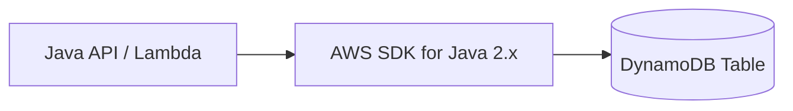
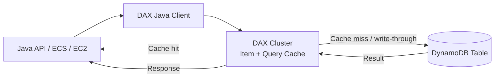
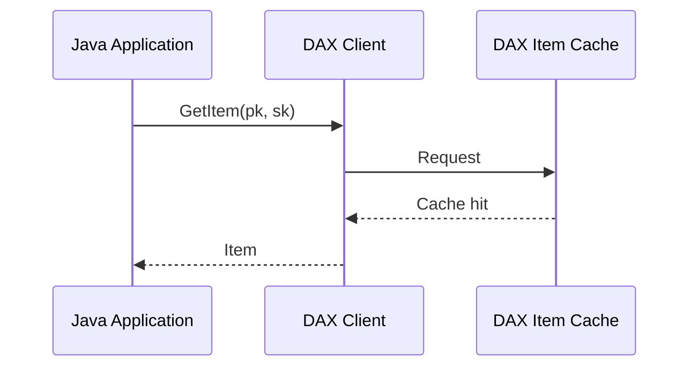
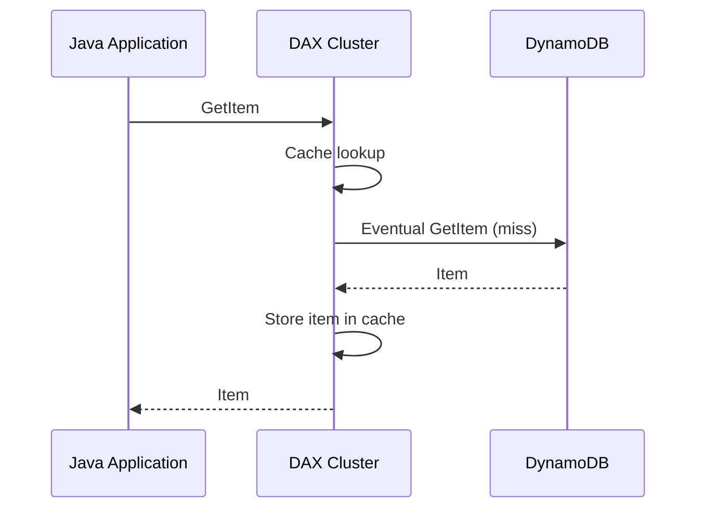
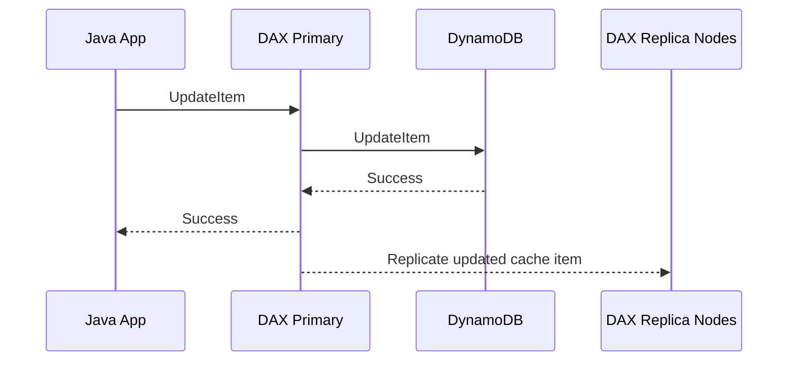
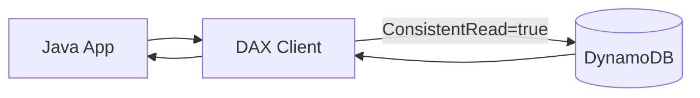
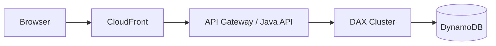
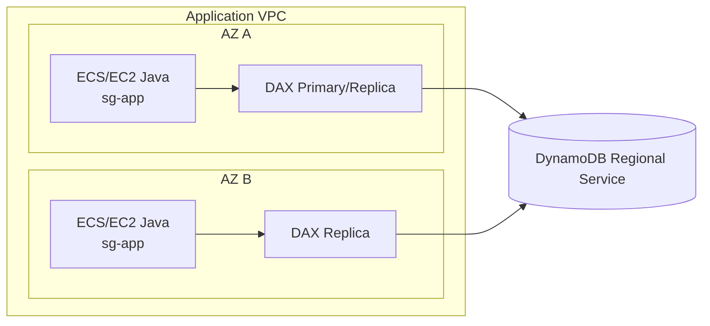
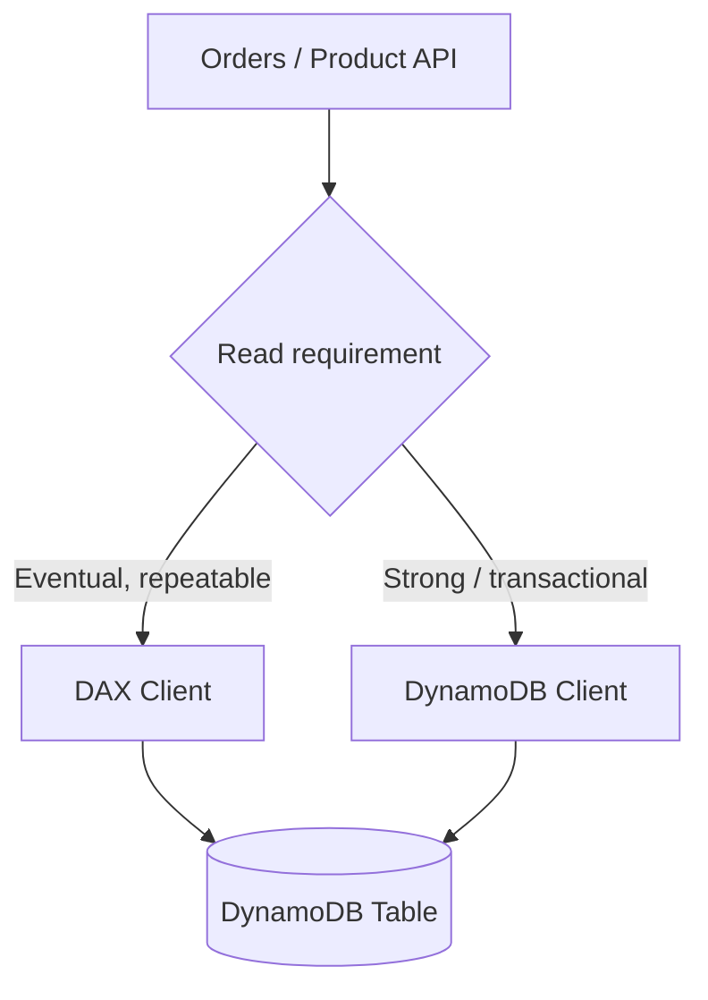

# DynamoDB Accelerator and Accelerating DynamoDB Queries

**Amazon DynamoDB Accelerator (DAX)** is a managed in-memory cache purpose-built for DynamoDB. Java apps use a DAX client to send DynamoDB API requests to the cluster; DAX serves responses from its **item cache** or **query cache**, forwarding requests that need table reads to DynamoDB. For repetitive read workloads, DAX cuts cache-hit read latency down to microseconds and reduces read requests reaching DynamoDB.

DAX is not a new database and does not replace DynamoDB. DynamoDB remains the **system of record**; DAX holds copies of data in memory governed by TTLs and an LRU eviction policy. Applications must account for potentially stale reads, which operations are cached, how DAX updates caches on writes, and which requests bypass cache straight to DynamoDB.

This lesson belongs to the **Caching and Specialized Databases** chapter of the **CLOUD_PROVIDERS_AWS** module. It connects DynamoDB data modeling, IAM, VPC, EC2/ECS/EKS/Lambda, AWS SDK for Java, CloudWatch, performance, resilience, and cost.

> **Principle:** DAX fits **read-heavy workloads with repeated reads that tolerate eventual consistency**. Strongly consistent reads and transactional reads bypass straight to DynamoDB rather than being served from cache. DAX does not speed up every query and cannot fix poorly designed partition keys.

## 1. Learning Objectives

After this lesson, you can:

1. Explain what DAX is, where it sits in a DynamoDB application architecture, and why it never replaces DynamoDB tables.
2. Distinguish the **item cache** from the **query cache**, which APIs are cached, and how hits/misses occur.
3. Describe read-through, write-through, TTL, LRU, negative caching, and consistency limits.
4. Explain why DAX serves only eventually consistent reads from cache while strong reads and `TransactGetItems` go straight to DynamoDB.
5. Contrast item caching with `Query`/`Scan` result-set caching, especially invalidation differences.
6. Identify workloads suited or unsuited for DAX and compare DAX against ElastiCache, CloudFront, and DynamoDB on-demand.
7. Design DAX clusters, node counts, subnet groups, Multi-AZ placement, endpoints, and security groups.
8. Separate the application IAM policy, DAX IAM service role, and direct DynamoDB access permissions.
9. Integrate DAX with **AWS SDK for Java 2.x** using proper endpoints and TLS.
10. Monitor cache hit ratios, CPU, memory, evictions, throttling, connections, and DynamoDB consumed capacity.
11. Benchmark cold vs. warm caches, measure p50/p95/p99, and decide when to scale up vs. scale out.
12. Handle stale caches, negative caches, cold caches after restarts, failovers, and connectivity errors.
13. Estimate cluster node costs against saved DynamoDB read capacity.
14. Plan DAX rollouts, rollbacks, security, and production operations.

## 2. Where Does DAX Sit?

Without DAX, a Java service sends requests directly to DynamoDB:



With DAX, the application switches to a DAX client targeting the cluster:



**DAX is a dedicated caching layer in front of DynamoDB.** A DAX cluster runs nodes inside your VPC; the DAX client handles node discovery and request routing via the cluster endpoint. The app does not have to write manual cache-aside logic for each `GetItem`/`Query` as with a general-purpose cache.

| Component | Role |
| --- | --- |
| **DynamoDB table** | System of record, durable storage |
| **DAX cluster** | In-memory cache serving hits and forwarding required ops to DynamoDB |
| **DAX client** | DynamoDB API-compatible library managing connections and routing |
| **Item cache** | Caches `GetItem`/`BatchGetItem` results by primary key |
| **Query cache** | Caches `Query`/`Scan` result sets by request parameters |
| **DAX service role** | Authorizes DAX to invoke DynamoDB APIs on behalf of apps |
| **Application IAM role** | Authorizes apps to invoke DAX actions on the cluster |
| **CloudWatch** | Monitors cache hits/misses, CPU, memory, throttling, and network |

DAX runs inside an **Amazon VPC** using private network interfaces. It is not a public HTTP endpoint callable from the open Internet.

## 3. How Does DAX Work?

### 3.1. Cache Hit

When a request is served from cache:

1. The Java app sends `GetItem` through the DAX client.
2. DAX looks up the item by table and primary key.
3. If present in cache, DAX returns it immediately.
4. No DynamoDB read occurs for that item.



### 3.2. Cache Miss

If the item is absent, expired, or evicted:

1. DAX receives the request.
2. DAX calls DynamoDB using an eventually consistent read.
3. DynamoDB returns the item.
4. DAX stores the item in the item cache with its TTL.
5. DAX returns the result to the application.



**DAX does not eliminate DynamoDB charges on cache misses.** The initial read still hits DynamoDB; savings materialize when subsequent reads reuse cached data.

### 3.3. Caching `Query` and `Scan`

DAX maintains a separate query cache:

- Caches **`Query`** and **`Scan`** results.
- Stores results keyed by request parameters.
- Subsequent requests must match all relevant parameters to hit.
- If queries/scans return large payloads or vary parameters on every call, hit ratio drops.
- The query cache uses its own TTL and LRU policy.

For example, two `Query` calls with identical table/index, key conditions, filters, projections, limits, and result-affecting parameters can share a cached result set. Changing even one filter or pagination token misses the prior entry.

**Do not treat broad `Scan` operations as a default DAX use case.** Scans read huge amounts of data and produce bulky result sets; if rarely repeated, caching them rarely pays off.

## 4. Item Cache vs. Query Cache

| Criterion | **Item cache** | **Query cache** |
| --- | --- | --- |
| Primary APIs | `GetItem`, `BatchGetItem` | `Query`, `Scan` |
| Cache key | Table + primary key | Table/index + request parameters |
| Contents | Single or multiple items | Entire request result set |
| TTL | Yes | Yes |
| LRU eviction | Yes | Yes |
| Write-through updates | DAX updates item cache on writes routed through DAX | Result sets are not individually invalidated per item write |
| Staleness risk | External direct DynamoDB writes or unexpired TTL | Can serve stale results until query TTL expires |
| GSI | `GetItem` cannot query GSIs; item cache keys by base-table primary key | Query cache can cache `Query` against indexes |

### 4.1. Item Cache Does Not Cache Attributes Independently

The item cache stores whole items by primary key. Repeated `GetItem` calls for the same item return the cached item. DAX does not split individual attributes into separate independently cached keys.

### 4.2. Query Cache Stores Result Sets

The query cache speeds up repeated queries, such as dashboards polling identical datasets. However, it requires **high parameter repeatability**. Queries embedding the current timestamp or constantly shifting filters rarely achieve high hit ratios.

### 4.3. Negative Caching

DAX can cache empty results:

- A `GetItem` finding no item can create a negative cache entry.
- A `Query`/`Scan` returning zero matches can cache an empty result set.
- Repeated requests before TTL expiry continue receiving empty responses.
- A DAX write-through update refreshes the item cache; the query cache still follows query TTL/invalidation behavior.

Example: an app checks `SKU#A100` before it exists, and DAX caches "not found." Another system then writes that SKU directly to DynamoDB; reads via DAX continue returning empty until the negative cache entry expires or updates via an appropriate mechanism.

**If your app frequently reads "not yet created" keys while another writer inserts directly, test negative caching carefully and pick conservative TTLs.**

## 5. Read-Through and Write-Through

### 5.1. Read-Through

The app issues reads via the DAX client. DAX checks its cache first, falls back to DynamoDB on a miss, and populates the cache.

This eliminates manual cache-aside boilerplate in application code:

```text
Application
   |
   | GetItem
   v
DAX item cache
   | hit       -> return cached item
   |
   | miss
   v
DynamoDB
   |
   | item
   v
DAX caches item -> return
```

### 5.2. Write-Through

DAX supports write operations including:

- `PutItem`
- `UpdateItem`
- `DeleteItem`
- `BatchWriteItem`
- `TransactWriteItems`

When writing through DAX, DAX forwards the write to DynamoDB. Once DynamoDB succeeds, DAX updates its item cache and propagates changes across cluster nodes per service mechanics.



**Write-through keeps the item cache aligned with DAX-routed writes**, though writes still traverse DynamoDB and DAX adds cache/replication work.

### 5.3. Direct DynamoDB Writes Bypassing DAX

If another service writes directly via a standard DynamoDB client, DAX does not immediately see those changes. Cached items stay stale until TTL expires or a cache update occurs.

Example:

1. Java Service A reads an item via DAX: `status=NEW`.
2. Java Service B updates DynamoDB directly: `status=PAID`.
3. Service A reads the same item again via DAX.
4. DAX may return `status=NEW` until the entry expires.

Therefore, with multiple writers:

- Standardize writes through DAX where suitable; or
- Tolerate staleness within a designed TTL; or
- Read directly from DynamoDB for paths needing immediate fresh data; and
- Never assume DAX instantly sees writes bypassing the cluster.

### 5.4. Write-Around and Bulk Writes

DAX is not ideal for every write workload:

- Bulk loading items that will rarely be read again pollutes the cache with cold data.
- Write-heavy workloads consume primary node resources and replication bandwidth.
- Writing through DAX adds an extra network hop; direct DynamoDB writes can show lower write latency for some workloads.
- When writing around DAX directly to DynamoDB, apps must accept stale cache reads and never expect immediate read-after-write via DAX.

**DAX is designed primarily to accelerate reads.** Do not route bulk ingestion through DAX if it evicts hot cached data.

## 6. Consistency: Limits to Understand Before Integrating

DAX serves **eventually consistent data** from cache. A read may miss a just-completed write if that write bypassed DAX or if a query cache entry has not yet expired.

### 6.1. Strongly Consistent Reads

If a request sets `ConsistentRead=true` on `GetItem`/`BatchGetItem`/`Query`/`Scan`, DAX forwards the request straight to DynamoDB. DAX returns the response **without caching the strong-read result**.



Flows requiring the latest data can use a direct DynamoDB client instead of DAX, avoiding an extra hop that yields zero cache hits.

### 6.2. Transactional Reads

`TransactGetItems` forwards directly to DynamoDB without caching results, preserving transactional isolation semantics.

`TransactWriteItems` runs write-through. To keep the item cache current post-transaction, DAX may execute background transactional reads for affected items—which can consume extra DynamoDB read capacity.

### 6.3. GSIs and Consistency

DynamoDB does not support strongly consistent reads on Global Secondary Indexes. DAX query caching on GSIs remains subject to TTL/cache semantics. Never expect a GSI `Query` through DAX to provide read-after-write consistency immediately after a write.

### 6.4. Decision Table

| Need | Recommended handling |
| --- | --- |
| Frequently read product catalog tolerating brief lag | DAX item/query cache |
| Dashboard repeating identical `Query` calls | Evaluate DAX query cache |
| Account balance requiring latest state | Direct DynamoDB strongly consistent read, not DAX cache |
| Critical post-write status check | Direct read with appropriate consistency |
| Transactional read | Direct DynamoDB `TransactGetItems` via SDK |
| Bulk data loads rarely re-read | Write directly to DynamoDB to avoid cache pollution |
| Rapidly mutating data with few repeat reads | Likely poor fit for DAX |

## 7. TTL, LRU, and Cache Freshness

### 7.1. Default TTLs

DAX parameter groups define TTLs for item and query caches. The common default is **5 minutes** for each cache, customizable to match freshness and workload needs.

TTL bounds how long an entry can be served before expiring. Once expired, the next request fetches fresh data from DynamoDB and repopulates the cache.

### 7.2. TTL Is Not a Background Refresh Schedule

DAX does not proactively re-read every item on a timer when TTL expires. Entries expire and refresh **lazily on the next request**. If nobody reads an item, DAX has no reason to reload it.

### 7.3. LRU Eviction

Under memory pressure, DAX evicts older/less-used entries via **Least Recently Used (LRU)** even before TTL expires. Consequently:

- Long TTLs do not guarantee items stay cached for the full duration.
- High `CacheMemoryUtilization` drives up evictions.
- A working set larger than node RAM keeps hit ratios low.
- Scale up node types or narrow cached data when evictions climb persistently.

### 7.4. TTL = 0

Per DAX semantics:

- **Query cache TTL = 0**: query responses are not cached.
- **Item cache TTL = 0**: item cache relies on LRU/write-through refresh rather than standard TTL expiration; do not interpret TTL zero as "every read bypasses the item cache."

To bypass DAX caching for a read, route directly to DynamoDB or use strong consistency by design rather than relying on TTL zero.

### 7.5. Choosing TTL by Business Need

| Data | Starting guidance | Questions to answer |
| --- | --- | --- |
| Rarely changing catalog | Longer TTL may fit | How stale can price/stock be at worst? |
| User profiles | Moderate TTL | Must users see updates instantly across devices? |
| Dashboard aggregates | Query TTL aligned with refresh cadence | Is 1–5 minute staleness acceptable? |
| Payment status | Never rely on cache for final decisions | Is a strongly consistent read required? |
| Real-time inventory | Tight freshness | Should the critical path read DynamoDB directly? |
| Negative lookups | Short TTL if records can appear soon | Is caching "not found" too long risky? |

**There is no universal optimal TTL.** Start from business freshness limits, measure hit ratio/evictions, and tune empirically.

## 8. When Is DAX a Good Fit?

DAX fits well when:

- Workloads are **read-heavy** with high read/write ratios.
- Many requests repeat the same items or identical `Query` result sets.
- You need lower read latency and fewer read units hitting DynamoDB.
- Traffic bursts concentrate on popular items.
- The app accepts eventual consistency and TTLs.
- The DynamoDB table already has solid access patterns and key design.

Examples:

| Use case | Why DAX helps |
| --- | --- |
| Product catalog | Many shoppers read the same popular products |
| User profiles | Profiles are fetched repeatedly |
| Game leaderboard snapshots | Repeated identical query results with bounded freshness |
| Metadata/configuration | Rarely changing data with heavy repeat reads |
| Session lookups | When consistency/TTL satisfies security policies |
| Popular content metadata | Hot working set fits easily in cache memory |

AWS recommends evaluating DAX by **measured cache hit ratio**; workloads with high hit ratios—often around 90%+—benefit most. Treat this as a benchmark indicator, not a rigid rule or cost guarantee.

## 9. When Should You Avoid DAX?

| Workload | Reason |
| --- | --- |
| Write-heavy | Writes pass through the primary node and incur cache replication overhead |
| Data rarely re-read | High miss rates fail to offset cluster cost |
| Strongly consistent reads mandatory | Requests bypass to DynamoDB with zero cache benefit |
| `TransactGetItems`-centric | Transactional reads are never cached |
| Bulk `Scan`/bulk writes | Large result sets or cache pollution |
| Constantly mutating data | Stale reads or poor hit ratios |
| Many tables with strict per-user permissions | DAX cluster service role can broaden effective data access across the cluster |
| Simple single-instance local caching needs | DAX cluster adds unnecessary complexity and cost vs. local cache |

**Never add DAX just because you want "faster DynamoDB."** Measure the real bottleneck first: network round trips, key design, hot partitions, payload size, downstream work, or serialization.

## 10. DAX vs. Other Options

| Criterion | **DAX** | **ElastiCache (Redis/Valkey)** | **CloudFront** | **DynamoDB on-demand** |
| --- | --- | --- | --- | --- |
| Category | Dedicated DynamoDB API cache | General-purpose cache/data store | CDN / HTTP edge cache | DynamoDB capacity mode |
| Client | DAX SDK/client | Redis/Valkey client | HTTP client/CDN | DynamoDB SDK |
| Cache key | DynamoDB item/query semantics | Application-designed | HTTP URL/cache key | Not a cache |
| Invalidation | TTL, write-through item cache, query TTL | App-managed or cache/data model | Cache policy/invalidation | None |
| Strong reads | Bypasses cache | App-designed | Not DB consistency | Supports strong reads on tables/LSIs |
| Best fit | Repeated DynamoDB reads | Diverse objects/data structures | Static/API HTTP responses | Unpredictable traffic |
| Operations | Managed DAX cluster | Managed cache cluster/serverless options | AWS-managed CDN | AWS-managed database mode |

**DAX and on-demand can work together.** On-demand governs DynamoDB billing and throughput scaling; DAX cuts reads reaching DynamoDB whenever cache hits occur. DAX does not replace capacity modes or increase write capacity.

### 10.1. DAX or ElastiCache?

Choose DAX when:

- DynamoDB is the primary data source.
- You want a drop-in DynamoDB-compatible API.
- Item/query caching matches DynamoDB semantics.
- The app accepts DAX's consistency model.

Choose ElastiCache when:

- You cache objects or aggregates from multiple data sources.
- You need Redis/Valkey data structures, scripting, rankings, counters, locks, or pub/sub.
- You want full control over key formats, invalidation, and serialization.
- You are prepared to own cache-aside/write-through logic.

Never assume Redis/Valkey and DAX share identical invalidation or transaction semantics.

### 10.2. DAX or CloudFront?

CloudFront caches HTTP content at the edge to cut latency for Internet users. DAX caches DynamoDB API reads inside the VPC. An app can use both:



## 11. DAX Clusters: Nodes and Availability

A DAX cluster contains:

- **Primary node**: processes write-through ops and coordinates replication.
- **Read replica nodes**: serve read traffic and maintain replicated cache state.
- **Cluster endpoint**: application entry point; the DAX client discovers nodes and load-balances across them.
- **Node endpoints**: individual node endpoints, mainly for diagnostics/operations.
- **Subnet group**: defines VPC subnets/AZs and IPs available to DAX nodes.
- **Parameter group**: cluster-wide TTL/cache settings.

A cluster supports **up to 11 nodes**: one primary and up to 10 read replicas. AWS recommends **at least three nodes spread across different AZs for production**, since one- or two-node clusters lack equivalent fault tolerance. A DAX cluster interacts only with DynamoDB tables in the **same Region** and supports up to **500 tables**; multi-Region workloads need separate DAX clusters per Region.

### 11.1. Scale Out and Scale Up

| Action | Effect |
| --- | --- |
| **Scale out** | Add read replicas to distribute read throughput |
| **Scale in** | Remove read replicas during low load |
| **Scale up** | Choose a larger node type to increase per-node resources |

**Adding read replicas does not raise primary-node write throughput.** Node type governs primary write capacity; if write-through bottlenecks, evaluate node type or architecture rather than adding replicas. **You cannot change the node type of a running cluster**: vertical scaling requires creating a new cluster with the larger node type, testing, and migrating traffic to the new endpoint. Choose your node type carefully upfront.

When adding nodes, DAX syncs cache state from peers, which takes time depending on cache size and load. **Pre-scale before peaks** rather than waiting for traffic surges.

### 11.2. Cache Warm-Up After Cluster Changes

New nodes must sync cache contents. Cluster restarts, config changes, or failovers can leave portions of the cache cold, raising misses. Prepare by:

- Monitoring cache hits/misses during warm-up.
- Provisioning sufficient DynamoDB read capacity headroom for elevated misses.
- Avoiding simultaneous rollouts of all app instances.
- Watching DynamoDB latency and throttling during cutover.
- Benchmarking on clusters in realistic warm/cold states.

### 11.3. Node-Type Changes and Maintenance

- Adding/removing read replicas works on live clusters; new nodes sync from peers.
- Changing node types requires **creating a new cluster** and migrating apps; plan warm-up, IAM, SGs, TLS, and endpoint cutover.
- DAX schedules a weekly maintenance window. Nodes update sequentially, though transient errors or throttling can occur during maintenance.
- Pick low-traffic maintenance windows, configure client retries/backoff, and monitor DAX events.

## 12. VPC, Subnet Groups, and Security Groups

DAX runs inside a **VPC**. Applications need private network paths to DAX nodes.



### 12.1. Subnet Group

- Select the VPC hosting your application workloads.
- Create a DAX subnet group spanning subnets across multiple AZs.
- Co-locate apps and nodes in the same AZs where practical to minimize latency.
- Confirm subnets have sufficient free IPs for DAX nodes/ENIs.
- A DAX subnet group is not a DynamoDB table subnet group; **DynamoDB tables do not live inside VPC subnets**.

### 12.2. Security Group

DAX uses TCP port **8111**. Example:

```text
sg-dax:
  INBOUND:
    TCP 8111 FROM sg-orders-app

sg-orders-app:
  OUTBOUND:
    TCP 8111 TO sg-dax
```

- Clients connect to the DAX endpoint on port 8111.
- Allow inbound strictly from authorized application SGs.
- Never open DAX ports to the Internet.
- Do not allow the ALB SG if requests originate from ECS/EC2/Lambda.
- Ensure NACLs and route tables allow bidirectional traffic.
- Use the DAX DNS endpoint; never hardcode node IPs.

### 12.3. Lambda in a VPC

For Lambda inside a VPC, attach the function to private subnets and an SG permitted to reach the DAX SG on port 8111. Lambda also needs DynamoDB connectivity if used directly, while DAX calls DynamoDB via its own service role.

DAX **does not automatically make Lambda a private VPC client**. Verify VPC config, routing, and the function's IAM role.

### 12.4. DAX Is Not a VPC Endpoint for DynamoDB

DAX is a cluster with its own node ENIs and endpoint in the VPC. A **DynamoDB gateway VPC endpoint** is a separate mechanism letting apps reach DynamoDB's regional API privately. Apps using the DAX client connect to the DAX cluster; a DynamoDB gateway endpoint never replaces the DAX cluster endpoint.

## 13. Endpoints and TLS

The cluster endpoint is recommended for applications. Illustrative formats:

```text
Cluster endpoint, encryption in transit disabled:
dax://orders-cache.xxxxxx.dax-clusters.ap-southeast-1.amazonaws.com

Cluster endpoint, encryption in transit enabled:
daxs://orders-cache.xxxxxx.dax-clusters.ap-southeast-1.amazonaws.com

Port:
8111
```

Use the exact URL from the Console or `DescribeClusters`. Never construct hostnames from cluster names or connect directly to node endpoints except for explicit diagnostics.

### 13.1. Encryption in Transit

- DAX supports TLS between clients and the cluster.
- Clients verify the cluster's X.509 certificate per library mechanisms.
- New clusters can enable encryption in transit at creation.
- **You cannot enable encryption in transit on an existing cluster by flipping a flag**; create a new TLS-enabled cluster, shift traffic, and retire the old one.
- Use a client version compatible with TLS-enabled DAX endpoints.
- Never disable certificate verification or use endpoints that mismatch the certificate.

### 13.2. Encryption at Rest

DAX encrypts persisted node disk data with AES-256 integrated with KMS. Encryption at rest must be selected at cluster creation; verify node-family and Region support. Never assume at-rest encryption can be toggled on a live cluster.

## 14. IAM: Two Separate Permission Layers

**DAX and DynamoDB use distinct IAM models.** Understand both before switching an app from the DynamoDB client to the DAX client.

### 14.1. DAX IAM Service Role

The DAX cluster assumes a service role with trust principal:

```json
{
  "Version": "2012-10-17",
  "Statement": [
    {
      "Effect": "Allow",
      "Principal": {
        "Service": "dax.amazonaws.com"
      },
      "Action": "sts:AssumeRole"
    }
  ]
}
```

Its role policy scopes which DynamoDB tables and actions the cluster can call, e.g.:

```json
{
  "Version": "2012-10-17",
  "Statement": [
    {
      "Effect": "Allow",
      "Action": [
        "dynamodb:DescribeTable",
        "dynamodb:GetItem",
        "dynamodb:BatchGetItem",
        "dynamodb:Query",
        "dynamodb:Scan",
        "dynamodb:PutItem",
        "dynamodb:UpdateItem",
        "dynamodb:DeleteItem",
        "dynamodb:BatchWriteItem"
      ],
      "Resource": [
        "arn:aws:dynamodb:ap-southeast-1:123456789012:table/Orders",
        "arn:aws:dynamodb:ap-southeast-1:123456789012:table/Orders/index/*"
      ]
    }
  ]
}
```

DAX needs `dynamodb:DescribeTable` to maintain table metadata. Scope remaining actions to real read/write needs. If using transactions, verify required transaction API permissions per current IAM/DAX documentation.

### 14.2. Application IAM Role

The app requires DAX permissions on the **DAX cluster ARN**, e.g.:

```json
{
  "Version": "2012-10-17",
  "Statement": [
    {
      "Effect": "Allow",
      "Action": [
        "dax:GetItem",
        "dax:BatchGetItem",
        "dax:Query"
      ],
      "Resource": "arn:aws:dax:ap-southeast-1:123456789012:cache/orders-cache"
    }
  ]
}
```

If the app writes through DAX, add only the needed write actions—avoid `dax:*` out of habit.

### 14.3. Warning on User-Level Isolation

DAX **does not enforce per-end-user isolation on DynamoDB data** via individual caller table policies. When users/roles reach tables through DAX, they can effectively inherit the data scope permitted to the **DAX cluster service role** under DAX access control.

This alters application security boundaries:

- If DAX's service role can read both `Orders` and `Payroll`, any principal allowed to query the cluster may gain an indirect path to that scope.
- Never conclude a user cannot read a table via DAX just because they lack direct `dynamodb:GetItem`.
- Separate clusters by trust boundary or table group when isolation is required.
- Restrict which apps can invoke the DAX cluster via `dax:` actions and network SGs.
- Enforce tenant/user authorization at the business layer for shared data.

**This is a mandatory security review item before adopting DAX in apps relying on per-table or per-user IAM policies.**

## 15. Java and DAX: AWS SDK for Java 2.x

DAX provides a dedicated client compatible with AWS SDK for Java 2.x. Use Maven artifact **`software.amazon.dax:amazon-dax-client`** at a team-tested, approved version. SDK for Java 2.x supports Java 8+ and asynchronous I/O.

### 15.1. Maven Dependency

```xml
<dependency>
    <groupId>software.amazon.dax</groupId>
    <artifactId>amazon-dax-client</artifactId>
    <version>REPLACE_WITH_TESTED_VERSION</version>
</dependency>
```

Align dependency management/BOMs with AWS SDK for Java 2.x in your project. Never copy random versions from old blogs; verify DAX client releases and compatibility before upgrading.

### 15.2. Creating a DAX Client

Java 17 example using a TLS-enabled DAX cluster endpoint:

```java
package example.dax;

import software.amazon.awssdk.services.dynamodb.DynamoDbAsyncClient;
import software.amazon.awssdk.services.dynamodb.model.AttributeValue;
import software.amazon.awssdk.services.dynamodb.model.GetItemRequest;
import software.amazon.dax.ClusterDaxAsyncClient;
import software.amazon.dax.Configuration;

import java.util.Map;

public final class DaxReadExample {
    public static void main(String[] args) {
        String endpoint = required("DAX_ENDPOINT");
        String table = System.getenv().getOrDefault("DDB_TABLE", "Products");

        // DAX_ENDPOINT from DescribeClusters/Console, e.g. dax:// or daxs://.
        try (DynamoDbAsyncClient dax = ClusterDaxAsyncClient.builder()
                .overrideConfiguration(Configuration.builder()
                    .url(endpoint)
                    .build())
                .build()) {

            GetItemRequest request = GetItemRequest.builder()
                .tableName(table)
                .key(Map.of(
                    "pk", AttributeValue.builder().s("PRODUCT#1001").build(),
                    "sk", AttributeValue.builder().s("DETAIL").build()))
                .consistentRead(false)
                .build();

            var response = dax.getItem(request).join();

            if (response.hasItem()) {
                System.out.println("Product loaded");
            } else {
                System.out.println("Product not found");
            }
        }
    }

    private static String required(String name) {
        String value = System.getenv(name);
        if (value == null || value.isBlank()) {
            throw new IllegalArgumentException("Missing environment variable " + name);
        }
        return value;
    }
}
```

Notes:

- The DAX client implements `DynamoDbAsyncClient`, letting apps reuse standard SDK request models.
- Set `DAX_ENDPOINT` from the cluster discovery endpoint.
- `daxs://` targets TLS-enabled clusters; `dax://` targets unencrypted clusters.
- Ensure Region and credentials align with the runtime's default provider chain.
- The Java workload needs `dax:GetItem` on the cluster ARN and network access on port 8111.
- This snippet illustrates an eventual read; never use it for decisions requiring strong consistency.

### 15.3. Direct Strongly Consistent Reads Against DynamoDB

When a flow requires the latest committed state, use the DynamoDB client:

```java
package example.dax;

import software.amazon.awssdk.services.dynamodb.DynamoDbAsyncClient;
import software.amazon.awssdk.services.dynamodb.model.AttributeValue;
import software.amazon.awssdk.services.dynamodb.model.GetItemRequest;

import java.util.Map;

public final class StrongReadExample {
    public static void main(String[] args) {
        String table = System.getenv().getOrDefault("DDB_TABLE", "Products");

        try (DynamoDbAsyncClient dynamoDb = DynamoDbAsyncClient.create()) {
            var request = GetItemRequest.builder()
                .tableName(table)
                .key(Map.of(
                    "pk", AttributeValue.builder().s("PRODUCT#1001").build(),
                    "sk", AttributeValue.builder().s("DETAIL").build()))
                .consistentRead(true)
                .build();

            var response = dynamoDb.getItem(request).join();
            System.out.println(response.hasItem()
                ? "Strong read completed"
                : "Item not found");
        }
    }
}
```

The app needs direct DynamoDB IAM permissions for this read path in addition to DAX permissions. If you want to prohibit direct table reads/writes from the app role, omit unnecessary `dynamodb:` actions.

### 15.4. Creating a Client per Request Is an Anti-Pattern

In production:

- Instantiate the client once per application lifecycle and reuse it.
- Never create a new DAX client per HTTP request.
- Close the client cleanly on application shutdown.
- Monitor connection pools, client metrics, and node discovery errors.
- Configure sensible timeouts/retries to avoid retry storms during failovers.
- Plan safe endpoint rollouts when replacing clusters.

## 16. Java Application Design: Choosing the Read Path per Use Case

An application can use both clients side by side:



Examples:

| API | Read path |
| --- | --- |
| `GET` product catalog | DAX if hit ratio is high and TTL is acceptable |
| `GET` popular product details | DAX item cache |
| Repeated dashboard `Query` | DAX query cache if parameters are stable |
| Check payment status post-commit | Direct DynamoDB strong read if required |
| Final inventory decision | Read/transact at required consistency; never trust stale cache |
| Full-table batch export | Evaluate `Scan`/Export instead of DAX cache |
| Transactional read | DynamoDB transaction API per semantics |

**Never route every request through DAX just because it is integrated.** Route according to each endpoint's consistency contract.

## 17. TTL and Parameter Groups

A DAX parameter group defines cluster-wide settings, including:

- `record-ttl-millis`: item cache TTL.
- `query-ttl-millis`: query cache TTL.

Illustrative configuration concept:

```text
Item cache TTL: 120000 ms (2 minutes)
Query cache TTL: 30000 ms (30 seconds)
```

These are sample values, not recommendations for every application.

### 17.1. Choosing Item TTL and Query TTL Independently

A product item may tolerate 2 minutes of staleness while a dashboard query tolerates only 30 seconds. Separate TTLs express distinct freshness requirements.

### 17.2. Modifying Parameter Groups

- Create a custom parameter group when custom TTLs are needed.
- Check service docs for cluster/node impact before editing.
- Changes may require a maintenance window or brief cluster downtime depending on parameter type and state.
- Already-cached entries may retain the TTL active when they were stored.
- Monitor cache hits, evictions, stale results, and latency after changes.

**Never lengthen production TTLs just to make hit ratios look prettier** without verifying business staleness tolerance.

## 18. DAX Monitoring with CloudWatch

DAX emits metrics to the **`AWS/DAX`** namespace. Track per cluster/node using appropriate dimensions and statistics.

| Metric | Meaning | Signal to investigate |
| --- | --- | --- |
| `ItemCacheHits` | `GetItem`/`BatchGetItem` cache hits | Sudden drop |
| `ItemCacheMisses` | Item cache misses | Sudden spike |
| `QueryCacheHits` | Query cache hits | Low relative to repeated queries |
| `QueryCacheMisses` | Query cache misses | Requests failing to reuse results |
| `ScanCacheHits` / `ScanCacheMisses` | Scan cache behavior | Scans not benefiting from cache |
| `CacheMemoryUtilization` | Percentage of cache memory used | Sustained high usage, rising evictions |
| `EvictedSize` | Bytes evicted from cache | Working set exceeds RAM |
| `CPUUtilization` | Node/cluster CPU | Near saturation during peaks |
| `NetworkBytesIn/Out` | Network throughput | Anomalies or approaching network limits |
| `ClientConnections` | Active client connections | Connection leaks or churn |
| `ThrottledRequestCount` | Requests throttled by DAX | Under-provisioned cluster/nodes |
| `ErrorRequestCount` | DAX client/API errors | Check client/API/permission errors |
| `FaultRequestCount` | Server-side DAX faults | Investigate node/service events |

### 18.1. Calculating Cache Hit Ratio

Item cache:

\[
HitRatio_{\mathrm{item}}=
\frac{ItemCacheHits}
{ItemCacheHits+ItemCacheMisses}
\times100\%
\]

Query cache:

\[
HitRatio_{\mathrm{query}}=
\frac{QueryCacheHits}
{QueryCacheHits+QueryCacheMisses}
\times100\%
\]

Example in one monitoring window:

- Item hits = 8,500
- Item misses = 1,500

\[
\frac{8500}{8500+1500}=85\%
\]

That yields an **85%** item cache hit ratio. Separate item, query, and scan ratios because each reflects different workloads and TTLs.

### 18.2. Reading DynamoDB Consumed Capacity Correctly

When reading through DAX, DynamoDB sees only forwarded requests (cache misses and cache-bypassing calls). Hence DynamoDB `ConsumedReadCapacityUnits` **does not equal total read requests sent by the app to DAX**.

To understand total workload, combine:

- DAX cache hits/misses.
- Total DAX request count.
- DynamoDB consumed read capacity.
- App request volume and latency.
- SDK call durations and error counts.

### 18.3. SDK Metrics

AWS SDK for Java 2.x can collect SDK metrics, such as **`ApiCallSuccessful`** and **`ApiCallDuration`** per current docs. Do not assume Java client metrics replace CloudWatch DAX cache metrics.

### 18.4. Suggested Alerts

- Continuously rising `ThrottledRequestCount`.
- Sustained high CPU utilization.
- High `CacheMemoryUtilization` paired with rising `EvictedSize`.
- Item or query hit ratio falling below app thresholds.
- Unusual spikes in `ClientConnections`.
- DAX node events, failovers, or maintenance.
- Rising DynamoDB read throttling despite healthy cache hit ratios.
- Application p95/p99 latency breaching SLOs.

## 19. Sizing a DAX Cluster

### 19.1. Three Core Factors

1. **Cache hit ratio**: share of requests DAX serves from cache.
2. **Read throughput**: item/query reads per second and item sizes.
3. **Write throughput**: write-through ops to the primary node and replication overhead. AWS sizing guidance applies weighting factors because misses consume more cluster resources than hits, and writes through DAX carry significantly higher overhead; treat this as initial sizing and load-test with real item sizes and traffic.

In AWS's **Normalized Requests Per Second** model, approximate weights are **10×** for cache misses and **25×** for write-throughs relative to cache-hit reads, with item size rounded up to KiB:

\[
NormalizedRPS \approx (ReadHitRPS \times SizeKB)
+ (ReadMissRPS \times SizeKB \times 10)
+ (WriteRPS \times SizeKB \times 25 \times NodeCount)
\]

This is a heuristic for selecting initial node types/counts, not guaranteed capacity. Add headroom for target utilization (AWS suggests keeping cluster utilization at roughly 70% or lower) and single-node/AZ loss. Load-test with production data, item sizes, and request mixes before finalizing.

Also factor in:

- Cache working set size.
- TTLs and eviction rates.
- Per-node CPU/memory/network limits.
- Traffic peaks and growth.
- Query result sizes.
- Client connection counts.
- Availability Zones and failover headroom.

### 19.2. Scale Out

Add read replicas when:

- Read traffic increases.
- Node CPU/throughput runs high.
- Hit ratios are high yet latency/throughput still misses targets.
- More nodes are needed to spread traffic and improve HA.

Adding nodes takes time for cache sync; pre-scale ahead of campaigns or launches.

### 19.3. Scale Up

Consider a larger node type when:

- The primary node bottlenecks on writes.
- Cache memory is insufficient and evictions climb.
- Per-node CPU or network limits are reached.
- The cluster handles heavy writes and replication overhead.

**Adding replicas never fixes a primary-node write bottleneck.** Size node type and write rates separately. Since live clusters cannot switch node types in place, vertical scaling requires spinning up a new cluster and migrating traffic.

### 19.4. Production Clusters

AWS recommends at least **three nodes across separate AZs** for production. One- or two-node clusters cannot withstand node/AZ failures to the same degree. Maximum cluster size is 11 nodes (one primary plus up to 10 replicas).

Never pick replication factor from average requests alone. Account for peaks, node replacements, maintenance capacity, and RTO.

## 20. Benchmarking: Proving DAX Actually Helps

Never conclude DAX is faster from a single `GetItem` test. Benchmarks must capture both cold-cache and warm-cache behavior.

### 20.1. Experiment Design

Run identical workloads across two clients:

- Direct DynamoDB client.
- DAX client against the cluster.

Hold variables constant:

- Same Region, VPC, and network source.
- Same table/index, partition key distribution, and item sizes.
- Same request concurrency, retry policies, and payloads.
- Same eventual consistency level.
- Same cache warm-up and TTLs.
- Same test duration and workload mix.

### 20.2. Steps

1. Seed a production-like dataset in a sandbox.
2. Run the direct DynamoDB client; record p50/p95/p99 latency and throughput.
3. Run the DAX client cold; observe cache misses.
4. Repeat key/query traffic to warm the cache.
5. Measure hit ratio, CPU, memory, network, and DynamoDB consumed RCUs.
6. Vary TTLs, query parameters, and workload mixes to test sensitivity.
7. Simulate failover/node maintenance or client reconnects in test.
8. Compare DAX cluster cost against saved DynamoDB read capacity.
9. Document consistency/staleness trade-offs and rollback criteria.

### 20.3. Do Not Measure Average Latency Alone

| Metric | Why it matters |
| --- | --- |
| p50 | Typical user experience |
| p95/p99 | Peak tail latency |
| Cache hit ratio | Is DAX actually reusing data? |
| DynamoDB consumed RCUs | How much read capacity was saved? |
| DAX CPU/memory | Does the cluster retain headroom? |
| `EvictedSize` | Does the working set fit in RAM? |
| `ThrottledRequestCount` | Are DAX nodes overloading? |
| Error rate | Correctness and stability |
| Monthly cost | Do savings/SLO gains outweigh cluster spend? |

**Never compare warm DAX cache-hit latency to cold DynamoDB latency and extrapolate to the whole workload.** Production includes misses, writes, failovers, TLS, network variance, and skewed request distributions.

## 21. AWS CLI: Inspecting Clusters (Read-Only)

Use AWS CLI v2 against the proper account/Region and IAM role. Commands below only read metadata.

### 21.1. Verify Identity and List Clusters

```bash
aws sts get-caller-identity --profile training

aws dax describe-clusters \
  --region ap-southeast-1 \
  --profile training
```

Project specific fields with `--query`:

```bash
aws dax describe-clusters \
  --query "Clusters[].{Name:ClusterName,Status:Status,Nodes:NodeIds,Endpoint:ClusterDiscoveryEndpoint,SubnetGroup:SubnetGroup,SecurityGroups:SecurityGroups}" \
  --region ap-southeast-1 \
  --profile training
```

### 21.2. Read Parameter Groups

```bash
aws dax describe-parameter-groups \
  --region ap-southeast-1 \
  --profile training

aws dax describe-parameters \
  --parameter-group-name default.dax.1.0 \
  --region ap-southeast-1 \
  --profile training
```

Retrieve the real parameter group name from `DescribeClusters`; `default.dax.1.0` is just an example.

### 21.3. Inspect Cluster Events

```bash
aws dax describe-events \
  --source-type cluster \
  --duration 1440 \
  --region ap-southeast-1 \
  --profile training
```

Correlate events with node additions/removals, cluster edits, maintenance, and incidents.

### 21.4. Inspect Metrics

```bash
aws cloudwatch list-metrics \
  --namespace AWS/DAX \
  --region ap-southeast-1 \
  --profile training
```

To read specific datapoints, run `get-metric-statistics` with exact dimensions and an active time window. DAX metrics aggregate at one-minute intervals; verify the statistic (`Sum`, `Average`, or `Maximum`) before interpreting numbers.

## 22. Creating a Cluster in the Console: Key Decisions

> **Cost:** DAX clusters bill by node type and node-hours even when traffic is low or unused. Provision real clusters only in sandboxes with approved budgets/owners.

1. Open the DynamoDB Console and select **DAX → Clusters → Create cluster**.
2. Pick a short cluster name free of PII, account numbers, or sensitive details.
3. Pick a node type sized to read/write throughput and working set.
4. Pick node count; evaluate at least three nodes across multiple AZs for production.
5. Select the DAX subnet group in your app's VPC.
6. Attach an SG allowing inbound TCP 8111 strictly from the app SG.
7. Attach an IAM service role with least-privilege DynamoDB access to target tables/indexes.
8. Enable encryption at rest and encryption in transit per policy.
9. Choose a parameter group/TTL matching freshness targets.
10. Configure maintenance window, SNS event notifications, and tags.
11. Review cost, subnet IP capacity, AZ placement, and client compatibility.
12. Create the cluster, wait for `available`, and copy the cluster discovery endpoint.
13. Deploy the DAX client in the app and test misses, hits, and IAM.
14. Monitor metrics before routing production traffic.

**Never grant a default IAM policy across all tables** when the cluster only accesses specific tables/indexes.

## 23. Troubleshooting

| Symptom | Possible cause | What to check |
| --- | --- | --- |
| DAX client fails to resolve endpoint | Wrong endpoint/Region/DNS | `DescribeClusters`, VPC DNS, cluster endpoint |
| Connection timeout | Bad SG/NACL/route/VPC | TCP 8111 from right app subnet/SG |
| TLS handshake error | Client version/endpoint/certificate | `daxs://`, TLS support, client version |
| `AccessDenied` calling DAX | App IAM missing `dax:` actions | Cluster ARN, role policy |
| DAX gets `AccessDenied` calling DynamoDB | DAX service role lacks table/index actions | Trust policy and service role permissions |
| App reads table via DAX despite lacking direct DynamoDB permission | DAX cluster role authorizes on app's behalf | Review DAX access-control boundaries |
| Low cache hit ratio | Large working set, low TTL, varying params | Item/query hit/miss metrics |
| High DAX latency | CPU/network/memory or miss-heavy traffic | Node metrics, misses, item sizes |
| High cache memory and rising evictions | Insufficient node RAM or overly broad caching | `CacheMemoryUtilization`, `EvictedSize` |
| DAX write throttling | Primary node write/resource saturation | Node type, write rate, `ThrottledRequestCount` |
| DynamoDB read throttling despite DAX | Misses, strong reads, query/tx bypass | DynamoDB throttle metrics, DAX misses |
| Stale items after external writer | Direct DynamoDB writes bypassing DAX | TTL, write paths, freshness targets |
| Query returns stale results after `PutItem` | Query cache TTL not yet expired | Query TTL and cache behavior |
| Newly created item still returns not found | Negative cache entry | Item/query TTL, write-through path |
| High hit ratio yet high p99 | App/serialization/network or huge miss payloads | End-to-end traces, p99 by operation |
| Scale-out fails to raise throughput as expected | Primary write bottleneck or cache warm-up | Node roles, CPU, cache sync |
| Cluster unavailable on node/AZ failure | Too few nodes or poor AZ spread | Replication factor, node events |
| No metrics in CloudWatch | Wrong namespace/dimension/time window | `AWS/DAX`, dimensions, non-zero activity |
| Java SDK metrics lack cache hit ratio | SDK tracks only API success/duration | Use CloudWatch DAX metrics |

### 23.1. Investigation Workflow

1. Confirm account, Region, cluster ARN, and cluster status.
2. Verify DAX endpoint, client version, and TLS scheme.
3. Verify app VPC/subnets/SGs and TCP 8111 reachability.
4. Verify app IAM `dax:` permissions.
5. Verify DAX service role DynamoDB permissions on target tables/indexes.
6. Measure item/query cache hits and misses.
7. Inspect TTLs, LRU evictions, and negative caching.
8. Check whether strong reads or transactional reads bypass the cache.
9. Inspect CPU, memory, network, connections, and throttling.
10. Compare DynamoDB consumed capacity against app latency.
11. Identify staleness from direct writes or query caching.
12. Test one config change at a time in sandbox before rolling out.

**Never disable TLS, open SGs to the whole VPC, or grant `dax:*`/`dynamodb:*` just to make errors vanish.**

## 24. Security and Data Protection

### 24.1. Network Isolation

- Place DAX nodes inside a VPC in proper private subnets.
- Restrict inbound TCP 8111 strictly to the application SG.
- Disable public exposure.
- Restrict cross-account/network access to approved paths.
- Enable VPC Flow Logs when investigating network paths.

### 24.2. IAM Least Privilege

- Application role: exact DAX cluster ARN and required `dax:` actions.
- DAX service role: strictly required DynamoDB tables/indexes and operations.
- DAX administrator: only needed cluster/parameter-group management permissions.
- Never reuse DAX's service role as a general EC2/Lambda execution role.
- Carefully evaluate user-level isolation before migrating apps to DAX.

### 24.3. Encryption

- Enable encryption at rest and in transit at cluster creation.
- Govern KMS key policies if using customer-managed keys.
- Use TLS-compatible DAX client versions.
- Never log item payloads/PII or credentials in application logs.
- DAX caches are data copies; apply data classification and TTLs aligned with retention/compliance.

### 24.4. Cluster Naming and Certificate Transparency

With encryption in transit enabled, cluster endpoint certificates may appear in public Certificate Transparency logs. **Never put customer account numbers, PII, or sensitive data labels in cluster names.** Use short technical names like `orders-cache-prod`.

## 25. Cost and Economic Efficiency

### 25.1. Cost Components

| Component | Impact |
| --- | --- |
| DAX node-hours | Billed by node type and node count |
| DAX cluster size | 3 nodes cost more than 1 node |
| DynamoDB reads | Cache misses and strong reads still hit DynamoDB |
| DynamoDB writes | Write-through still consumes write capacity |
| DynamoDB storage | Continues billing as before |
| Backups/PITR/Streams/Global Tables | Billed per enabled features |
| Data transfer | Depends on Region/AZ/network paths |
| CloudWatch | Metrics, dashboards, alarms, and log integrations |
| KMS | Customer-managed key usage charges |

**DAX is not a free-when-idle serverless cache.** Cluster nodes run and bill continuously over time. You can scale nodes down per service rules, but never treat shrinking a cluster to zero as a pause button.

### 25.2. Comparing Benefits vs. Costs

Estimation model:

\[
C_{\mathrm{net}} =
C_{\mathrm{DAX\ cluster}}
+ C_{\mathrm{DynamoDB\ remaining\ reads}}
+ C_{\mathrm{DynamoDB\ writes}}
+ C_{\mathrm{other}}
\]

Compare against baseline:

\[
C_{\mathrm{baseline}} =
C_{\mathrm{DynamoDB\ reads}}
+ C_{\mathrm{DynamoDB\ writes}}
+ C_{\mathrm{other}}
\]

DAX pays off in total cost if saved read spend and latency/throughput value **exceed added cluster spend**, after accounting for misses and writes.

### 25.3. Hit-Ratio Example

Suppose a workload sends 10 million cacheable read requests/day:

- 90% hits: ~9 million requests served from cache.
- 10% misses: ~1 million requests hit DynamoDB.
- Strongly consistent reads and cache-bypassing calls still hit DynamoDB.

This illustrates **request counts**, not an exact RCU savings formula. Larger items consume more read capacity; measure real `ConsumedReadCapacityUnits` and cache hits/misses.

### 25.4. When Is DAX Not Worth the Spend?

- Low cache hit ratio.
- Small table already meeting latency SLOs.
- Write-dominated traffic.
- Heavy reliance on strong or transactional reads.
- Cluster nodes sitting idle during low-traffic periods.
- Working set far larger than cache RAM.
- App cannot tolerate eventual consistency.
- True bottleneck lies in API Gateway, Lambda, serialization, or data modeling.

Check [DynamoDB pricing](https://aws.amazon.com/dynamodb/pricing/) and the [AWS Pricing Calculator](https://calculator.aws/) for your current Region, node types, and counts.

## 26. DAX Rollout and Rollback

### 26.1. Pre-Rollout

1. Confirm repeated reads and tolerance for eventual consistency.
2. Identify cached APIs vs. APIs needing direct DynamoDB strong reads.
3. Review IAM boundaries and the cluster service role.
4. Provision cluster, subnet group, SGs, and TLS in sandbox.
5. Benchmark direct DynamoDB vs. DAX.
6. Measure hit ratio, p95/p99, CPU, memory, and DynamoDB consumed RCUs.
7. Test stale data, negative caching, and query cache invalidation.
8. Test failover/node replacement and client reconnects.
9. Estimate combined cluster + DynamoDB costs.
10. Build a configuration-driven rollback toggle in the app.

### 26.2. Canary Rollout

- Point a small slice of app instances to the DAX client.
- Compare latency/errors against instances calling DynamoDB directly.
- Watch hits/misses, stale reads, and DynamoDB throughput.
- Ramp traffic incrementally as metrics look healthy.
- Never alter TTLs, node count, and traffic percentage simultaneously.

### 26.3. Rollback

If hit ratios disappoint, staleness hurts, or errors climb:

1. Switch app reads back to the DynamoDB client.
2. Leave the DynamoDB table and data untouched.
3. Investigate DAX client/IAM/networking/TTLs.
4. Keep the cluster until confirming zero apps remain connected.
5. Once retired, delete unneeded clusters and sandbox resources.
6. Check remaining CloudWatch alarms, KMS keys, and billing.

**Because DAX is a cache, rolling back to DynamoDB requires no data restore from DAX.** DynamoDB remains the durable source of truth.

## 27. Hands-On Exercise: Accelerating a Product Catalog

### 27.1. Context

A Java API on ECS Fargate serves a product catalog. Popular products receive thousands of reads per minute. Prices and descriptions change infrequently, while inventory updates more often.

```text
Table: Products
PK: PRODUCT#<productId>
SK: DETAIL

GSI: ByCategory
GSI PK: CATEGORY#<category>
GSI SK: PRODUCT#<productId>

Workload:
  GetItem product detail: 8,000 requests/s
  Query category: 500 requests/s
  Writes product metadata: 20 requests/s
  Inventory updates: 300 requests/s
```

### 27.2. Part A — Choosing Cache Targets

Classify:

- Product detail: item cache candidate when keys repeat.
- Category listing: query cache candidate when `Query` parameters repeat.
- Inventory: verify freshness rules before caching.
- Product price: cacheable with TTL if business allows slight lag.
- Checkout availability: read per consistency contract; never trust stale cache for final decisions.

### 27.3. Part B — Choosing TTLs

Propose separate TTLs:

```text
Item cache:
  Product description: 5 minutes (initial experiment)
  Inventory critical path: bypass DAX or shorter TTL/direct read

Query cache:
  Category listing: 30-60 seconds (initial experiment)
```

Explain why these are only initial experimental values requiring hit-ratio, staleness, LRU eviction, and business-impact measurements.

### 27.4. Part C — Cluster and Network Design

- Place in the ECS tasks' VPC.
- DAX subnet group across at least three AZs for production.
- At least three nodes per recommendation.
- App SG outbound TCP 8111 to DAX SG.
- DAX SG inbound TCP 8111 from app SG.
- Enable TLS and encryption at rest.
- Retrieve the cluster discovery endpoint.
- Use the DAX Java 2.x client.

### 27.5. Part D — IAM

Write two separate policies:

1. **Application role** granting `dax:GetItem`, `dax:Query` on the exact cluster ARN.
2. **DAX service role** granting `dynamodb:DescribeTable`, `GetItem`, `Query` on the exact table/index.

Explain why allowing the DAX service role to read both `Products` and `Payroll` creates unintended indirect access for app users authorized on the cluster.

### 27.6. Part E — Benchmark

Record:

```text
Direct DynamoDB:
  p50 / p95 / p99:
  ConsumedReadCapacityUnits:
  Error / throttle rate:

DAX:
  p50 / p95 / p99:
  ItemCacheHits / ItemCacheMisses:
  QueryCacheHits / QueryCacheMisses:
  CacheMemoryUtilization:
  CPUUtilization:
  EvictedSize:
  ThrottledRequestCount:
  DynamoDB ConsumedReadCapacityUnits:

Cost:
  DAX node-hours:
  DynamoDB reads saved:
  DynamoDB writes:
  Total monthly estimate:
```

### 27.7. Part F — Read-Only Audit

If a sandbox cluster exists, run only the read-only commands in Section 21 and document:

```text
AWS Account / Region: ...
DAX cluster name / ARN (redacted): ...
Cluster status: ...
Node type / node count / primary: ...
Availability Zones: ...
Cluster endpoint: dax:// or daxs:// ...
Subnet group / VPC: ...
Security group / TCP 8111 sources: ...
Encryption at rest / in transit: ...
DAX service role and allowed DynamoDB tables: ...
Application role and dax actions: ...
Item cache TTL / Query cache TTL: ...
Item cache hit ratio: ...
Query cache hit ratio: ...
CPU / memory / network / evictions: ...
DAX throttling / errors: ...
DynamoDB consumed read/write capacity: ...
Application p50/p95/p99 latency: ...
Consistency and stale-data policy: ...
Cost / owner / review date: ...
```

**Completion criteria:** clearly explain DAX item/query caching, consistency, write-through, TTL/LRU, workload fit, VPC/TLS/IAM cluster design, Java client usage, CloudWatch metrics, and benchmark/cost justification. Provisioning a billable cluster is optional.

## 28. Self-Check Questions

1. Is DAX a database or a caching layer in front of DynamoDB?
2. Why does DynamoDB remain the system of record when using DAX?
3. Which primary read APIs does the item cache accelerate?
4. What does the query cache store and what forms its cache key?
5. What steps occur on a cache miss?
6. How does DAX write-through handle `PutItem`/`UpdateItem`?
7. Why can direct DynamoDB writes make the item cache stale?
8. Why can the query cache still return stale results after a write through DAX?
9. What is the typical default TTL for item and query caches?
10. How does LRU eviction differ from TTL expiration?
11. What is negative caching?
12. How does DAX process a strongly consistent `GetItem`?
13. Is `TransactGetItems` cached?
14. How is `TransactWriteItems` supported?
15. Can GSI `Query` calls use the DAX query cache?
16. When does a read-heavy workload fit DAX well?
17. Why are write-heavy/bulk-load workloads often poor fits?
18. At which layer does DAX differ from DynamoDB on-demand?
19. How does DAX differ from ElastiCache in APIs and caching model?
20. What is the maximum number of nodes in a DAX cluster under the current model?
21. Why does AWS recommend at least three nodes across multiple AZs for production?
22. Does adding read replicas increase primary-node write throughput?
23. What TCP port does a DAX cluster use?
24. How does a DAX subnet group differ from DynamoDB table subnets?
25. What IAM responsibilities belong to the application role vs. the DAX service role?
26. Why can DAX alter user-level IAM isolation?
27. What is the Maven artifact for the DAX Java 2.x client?
28. When do you use `dax://` vs. `daxs://`?
29. How is cache hit ratio calculated?
30. Why does DynamoDB consumed RCUs not reflect total app read requests when using DAX?
31. When do you scale out vs. scale up?
32. Why does adding a node require cache synchronization/warm-up?
33. Can DAX encryption in transit be enabled after cluster creation?
34. Does a DAX cluster continue billing during low traffic?
35. Which metrics reveal memory pressure and evictions?
36. How do you roll back from DAX to DynamoDB without restoring data?

## 29. Official AWS Documentation

1. [DynamoDB Accelerator (DAX)](https://docs.aws.amazon.com/amazondynamodb/latest/developerguide/DAX.html).
2. [DAX — How it works](https://docs.aws.amazon.com/amazondynamodb/latest/developerguide/DAX.concepts.html).
3. [DAX consistency models](https://docs.aws.amazon.com/amazondynamodb/latest/developerguide/DAX.consistency.html).
4. [Configuring DAX cluster considerations](https://docs.aws.amazon.com/amazondynamodb/latest/developerguide/dax-config-considerations.html).
5. [DAX cluster sizing](https://docs.aws.amazon.com/amazondynamodb/latest/developerguide/dax-cluster-sizing.html).
6. [DAX cluster components](https://docs.aws.amazon.com/amazondynamodb/latest/developerguide/DAX.concepts.cluster.html).
7. [Deploying a DAX cluster](https://docs.aws.amazon.com/amazondynamodb/latest/developerguide/dax-deploy-cluster.html).
8. [Managing DAX clusters and scaling](https://docs.aws.amazon.com/amazondynamodb/latest/developerguide/DAX.cluster-management.html).
9. [DAX access control](https://docs.aws.amazon.com/amazondynamodb/latest/developerguide/DAX.access-control.html).
10. [DAX encryption at rest](https://docs.aws.amazon.com/amazondynamodb/latest/developerguide/DAXEncryptionAtRest.html).
11. [DAX encryption in transit](https://docs.aws.amazon.com/amazondynamodb/latest/developerguide/DAXEncryptionInTransit.html).
12. [Java and DAX — AWS SDK for Java 2.x](https://docs.aws.amazon.com/amazondynamodb/latest/developerguide/DAX.client.run-application-java.html).
13. [TryDax Java sample](https://docs.aws.amazon.com/amazondynamodb/latest/developerguide/DAX.client.TryDax.java.html).
14. [Monitoring DAX](https://docs.aws.amazon.com/amazondynamodb/latest/developerguide/pres-guide-monitor-dax.html).
15. [DAX CloudWatch metrics and dimensions](https://docs.aws.amazon.com/amazondynamodb/latest/developerguide/dax-metrics-dimensions-dax.html).
16. [Evaluating DAX suitability](https://docs.aws.amazon.com/amazondynamodb/latest/developerguide/evaluate-dax-suitability.html).
17. [DynamoDB pricing](https://aws.amazon.com/dynamodb/pricing/).
18. [AWS Pricing Calculator](https://calculator.aws/).

> **Key Takeaway:** DAX accelerates **reusable reads** through its item cache and query cache. Clearly understand **eventual consistency, TTL/LRU, write-through, and query cache invalidation**, route strong reads directly to DynamoDB when needed, scope the IAM service role tightly, deploy privately with TLS, benchmark hit ratio/latency/cost, and scale for the actual bottleneck.
